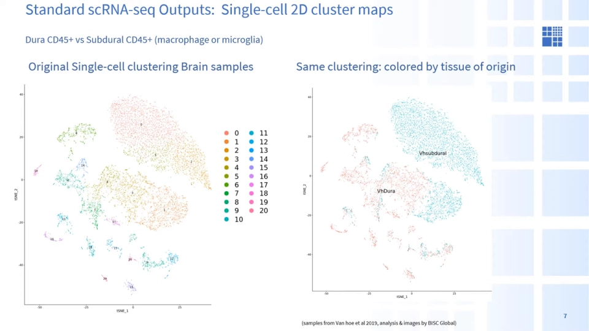
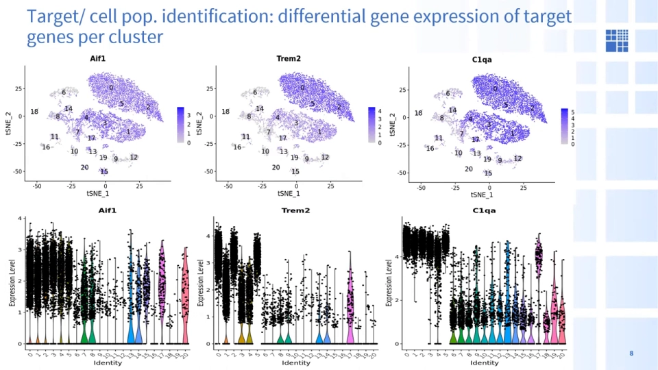
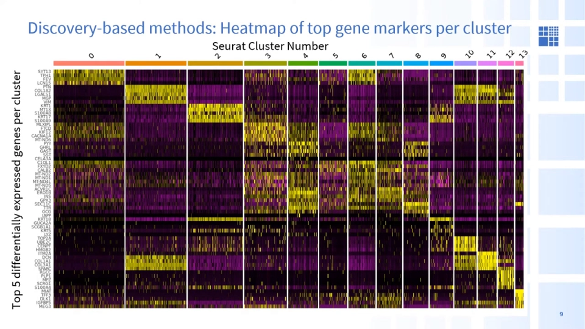
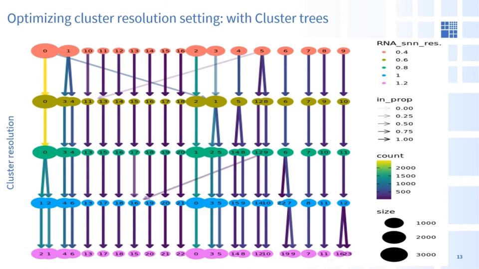
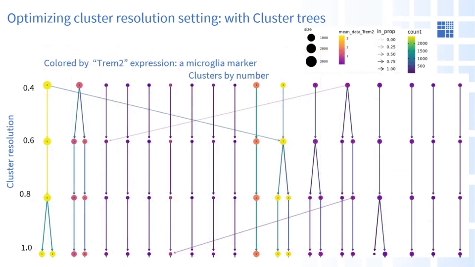
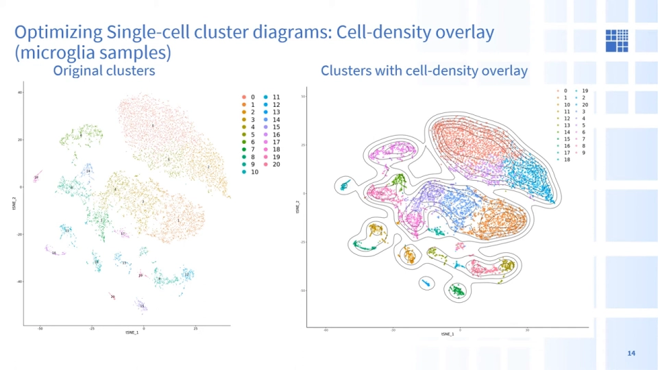
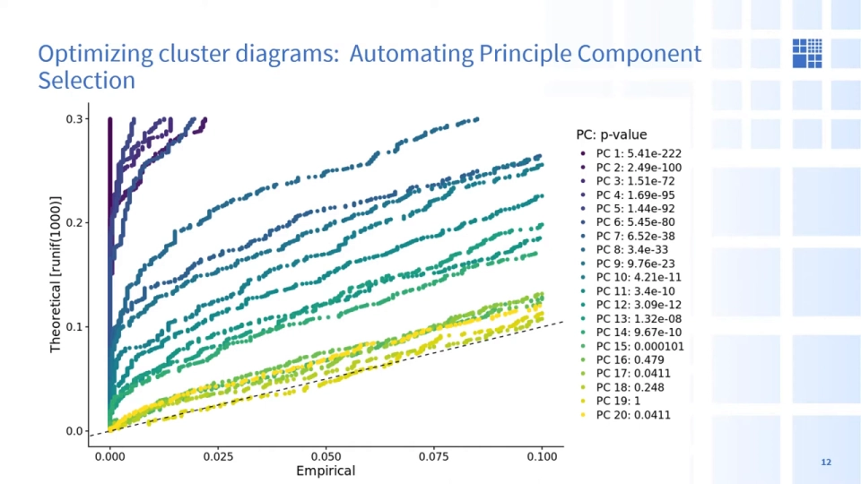

# 聚类分辨率的选定：clustree 谱系、marker 回看与二维图的盲区

> 视频来源：[Single-Cell RNA-seq Analyses: Going beyond the standard workflow](https://www.youtube.com/watch?v=OomEEAU2pFw)（YouTube · Bisque Global，Dr. Dave，约 16 分钟）
> 简要导读：这是一支分析服务团队讲"标准单细胞流程之外还该做什么"的报告。本文只取与聚类判读直接相关的部分——二维聚类图能看什么、同一张图换一种画法为什么会给出不同信息、怎样用 clustree 把分辨率当成一条谱系来看、以及怎样用 marker 的平均表达反过来挑分辨率；QC、标签迁移、拟时序与基因调控网络只作位置说明。原片中的软件截图与示例图来自 Seurat 官方教程与公开数据集。

## 本讲要解决的核心问题（SCQA）

**背景**：单细胞分析走到聚类之后，几乎每篇论文都会放一张二维聚类图：每个点是一个细胞，颜色是 cluster 编号。这张图看起来已经把"分几群、每群在哪"说清楚了。

**冲突**：但同一份数据，分辨率从 0.4 调到 1.2，群数会翻倍；同一张图，按 cluster 上色和按样本上色讲的是两件不同的事；同一个 marker，画成 feature plot 和画成 violin plot，甚至会在"某个群到底表不表达这个基因"上给出相反印象。**图是同一个流程的产物，但它承载的结论取决于你怎么画、按什么参数画。**

**疑问**：二维聚类图到底能回答什么、不能回答什么？分辨率该按什么依据定下来？除了看图，还应该拿什么来核对？

**回答（中心思想）**：分辨率不是一个"调对了就收敛"的参数，而是一个**需要沿着一条谱系去选、并用独立证据回看**的决策。可行的做法是三步：用 clustree 把多个分辨率下的分裂关系一次看全；用目标细胞类型的 marker 平均表达去检查"哪一档分辨率把该在一起的细胞放在一起、把该分开的分开"；最后承认二维图只是三维结构的投影，密度、边界和距离都要用别的图层（等高线、violin、热图、样本上色）交叉验证。

## 一、标准聚类图：它回答"分了几群"，不回答"这些群是什么"

### 1.1 同一张嵌入图，两种上色讲两件事

报告先给出最常见的产出：一张二维聚类图，左边按 cluster 编号上色，右边把**完全相同的坐标**按组织来源重新上色（[【跳转到 05:16】](https://www.youtube.com/watch?v=OomEEAU2pFw&t=316)）。

讲者的读法是：数据**并不是按取材位置聚类，而更像是按细胞功能聚类**。这个判断本身就是一条信息——如果按样本上色后每个群都是单一颜色，就要怀疑批次；如果像这里一样各群都混合了两种来源，说明群反映的更可能是细胞类型/状态而不是取材差异。他补充说，同样的做法可以换成按处理组、按生物学重复编号、按患者年龄上色，"取决于哪个因素对你的问题最重要"（[【跳转到 05:41】](https://www.youtube.com/watch?v=OomEEAU2pFw&t=341)）。

这里要建立的第一个习惯是：**嵌入图的坐标只有一套，上色依据可以有很多套**。cluster 上色告诉你"算法分了几群"，元数据上色告诉你"这些群和实验设计是什么关系"，两者不能互相替代。

### 1.2 群数、群大小也是输出

除了图，报告提醒还有一批标准表格：各群的差异表达倍数变化、以及**每个群的细胞数**（[【跳转到 07:37】](https://www.youtube.com/watch?v=OomEEAU2pFw&t=457)）。群大小要一起看：一个群的细胞数直接决定后续在这个群里做差异表达、算平均表达时有多少样本可用，也决定这个群值不值得单独解释。

## 二、同一个 marker，feature plot 和 violin 会给出不同印象

报告接着演示"在聚类图上叠加目标基因表达"（[【跳转到 06:11】](https://www.youtube.com/watch?v=OomEEAU2pFw&t=371)）。示例用的是小胶质细胞的三个标记 AIF1、TREM2、C1QA：上排是 feature plot（每个细胞按表达量上色），下排是 violin plot（每个群一个分布）。

讲者点出的差异很具体：**AIF1 在 cluster 9 里确实有一小部分细胞表达，但这一点在 feature plot 上看不出来**（[【跳转到 06:36】](https://www.youtube.com/watch?v=OomEEAU2pFw&t=396)）。原因是两种图压缩信息的方式不同：

- **feature plot** 把表达量映射成颜色，落在二维坐标上。高表达细胞少的时候，几个深色点会被周围大量浅色点淹没；而且点的位置本身受嵌入算法影响。
- **violin plot** 把每个群的表达分布摊开，能看出"表达这个基因的细胞占多少、分布是单峰还是双峰、有没有一群完全不表达"。

对判读的启示是：**"这个群表不表达某 marker"是一个分布问题，不是一张散点图能回答的问题**。要判断一个群的身份，至少要看分布形状和表达细胞比例，而不是只看图上有没有深色斑块。

## 三、无偏发现：每群 top 差异基因的热图，以及"marker 会跨群共享"

除了"先选 marker 再看群"（target-driven），报告还演示了反方向的做法：**不看先验，直接对每个群取差异最显著的基因**，画成热图（[【跳转到 06:50】](https://www.youtube.com/watch?v=OomEEAU2pFw&t=410)）。

讲者特别指出一个容易被忽略的现象：**很多"标记基因"其实在多个群里都高表达**——例如 FEV 在 cluster 0 高，在 cluster 6 也很高，因此"单凭这一个基因不足以识别那个群"（[【跳转到 07:15】](https://www.youtube.com/watch?v=OomEEAU2pFw&t=435)）。

这条观察直接支撑了后面注释环节的做法：**判据是"一组基因的组合模式"，不是单个基因的有无**。反过来，它也是检验聚类的一个抓手：如果两个群在 top 差异基因上几乎一样，那它们很可能是被分辨率切开的同一类细胞。

## 四、把分辨率当成一条谱系：clustree

报告进入"标准流程之外"的部分，第一句就是：**做单细胞分析时最值得花时间优化的就是聚类**（[【跳转到 08:02】](https://www.youtube.com/watch?v=OomEEAU2pFw&t=482)）。它把聚类优化拆成两个上游/下游决策：喂给聚类的主成分数，以及聚类本身的分辨率。

### 4.1 分辨率谱系图怎么读

clustree 把多个分辨率下的聚类结果叠在一张图上（[【跳转到 09:35】](https://www.youtube.com/watch?v=OomEEAU2pFw&t=575)）：

- **纵轴是分辨率**，从下往上（或从下到上）逐档变化；
- **每个点是一个 cluster**，点的大小代表该群的细胞数；
- **连线表示继承关系**：低分辨率下的一个群，在高分辨率下分裂成了哪几个群。

讲者的用法是"**追踪这些群分裂的谱系**"——不是问"哪个分辨率是对的"，而是问"从哪一档开始，某个群开始裂开、裂成了什么"。稳定的群在相邻几档之间是一条直上直下的粗线；不稳定的群会在某一档突然分叉。

### 4.2 用 marker 回看：TREM2 的例子

谱系图只说明"群怎么分裂"，不说明"该不该分裂"。报告给出的判据是**用目标细胞类型的 marker 去检查分裂是否对应生物学差异**（[【跳转到 10:00】](https://www.youtube.com/watch?v=OomEEAU2pFw&t=600)）。

具体读法：

1. 在 **0.4** 分辨率下，cluster 0 和 cluster 3 是 TREM2 平均表达最高的两个群——它们对应小胶质细胞/巨噬细胞；
2. 到 **0.8** 分辨率，这两个群**各自又分裂成更多群**；
3. 于是讲者把**最优分辨率定在 0.6**：既让目标细胞类型保持为一个可解释的群，又不至于把它切成一堆小碎片（[【跳转到 10:30】](https://www.youtube.com/watch?v=OomEEAU2pFw&t=630)）。

他还补充，这套做法可以**对多个 marker 各跑一遍**，或者只针对你真正关心的那个目标基因。

这段演示的方法论价值大于具体数值：**分辨率的依据来自"分裂是否对应 marker 层面的差异"，而不是"图上看起来分不分得开"**。如果某个群在高分辨率下裂成两半，而两半的 marker 谱完全一样，那这次分裂就没有生物学支撑，只是把噪声切细了。

## 五、二维图的空间本身不可靠：密度等高线

报告接着讲了一个更根本的限制：**二维聚类图是把三维（甚至更高维）结构压到二维平面上的结果**（[【跳转到 10:30】](https://www.youtube.com/watch?v=OomEEAU2pFw&t=630)）。

改进办法是**在二维图上叠加细胞密度等高线**，从而看出"哪些群是紧密聚在一起的、哪些其实比二维图显示的更分散"（[【跳转到 10:55】](https://www.youtube.com/watch?v=OomEEAU2pFw&t=655)）。

这条限制对判读的意义是：二维图上"两群离得远"或"两群挨得近"都不能直接当作相似度的度量；**同一群内部的疏密、群与群之间的空白宽度，都是嵌入算法的产物**。要比较两个群到底差多少，得回到表达矩阵（差异表达、模块打分），而不是量图上的距离。

## 六、上游参数同样在改变结论：主成分数

报告把聚类优化拆成两步，第一步是**喂给聚类的主成分数**（[【跳转到 08:52】](https://www.youtube.com/watch?v=OomEEAU2pFw&t=532)）。讲者的原话很坦白：这通常是一个"**educated guessing game**"——有人从 10 个 PC 开始，有人从 25 个开始，然后靠试错调整。

他们团队的做法是把这个过程自动化：借用 jackstraw 的思路，给每个主成分算一个显著性，只保留**既显著、又解释了一定方差比例**的成分（[【跳转到 09:17】](https://www.youtube.com/watch?v=OomEEAU2pFw&t=557)）。

这一点对本节的意义在于：**分辨率不是唯一影响分群的参数**。PC 数决定图建在什么空间里，邻居数决定边的密度，分辨率决定切分门槛——三者共同决定最终那份划分。任何"我们的数据分了 N 群"的说法，都隐含着一整组参数选择。

## 七、聚类之后还有什么：标签迁移、拟时序与调控网络

报告后半段快速带过了三类扩展分析，它们的位置值得知道，但细节属于其他小节：

1. **参考标签迁移**：把自有数据和 Allen Brain Institute 的参考数据放在一起时，只有一部分细胞（灰色）能落进参考已定义的群；更实用的做法是**在自有数据的聚类图上按表达模式迁移标签**，于是大部分细胞被标成小胶质/非小胶质（[【跳转到 11:58】](https://www.youtube.com/watch?v=OomEEAU2pFw&t=718)）。这依赖聚类结果本身是否合理。
2. **拟时序分析**：把细胞按分化进程排序，并提取阶段特异的 marker；报告举的是嗅球分化（[【跳转到 12:48】](https://www.youtube.com/watch?v=OomEEAU2pFw&t=768)）。拟时序的起点和轨迹同样建立在群结构上。
3. **基因调控网络**：用 SCENIC 把基因聚成共调控模块，看某个模块在哪种细胞类型/条件下活跃（[【跳转到 13:43】](https://www.youtube.com/watch?v=OomEEAU2pFw&t=823)）。讲者把它定位为"产生假设的工具"。

报告的收尾强调两件事：**优化聚类的参数、优化可视化，并把步骤自动化以便重复**（[【跳转到 15:01】](https://www.youtube.com/watch?v=OomEEAU2pFw&t=901)）。"可重复"在这里不是客套：既然 PC 数、分辨率都是试错选出来的，那么**记录下这一组参数、并能用同一组参数重跑**，是结论可核查的前提。

## 八、这些做法合起来给出的判读顺序

把报告里的操作按判读逻辑重排，可以得到一个可执行的顺序：

1. **先看群数与群大小**：哪些群细胞数很少、哪些群占了大半数据——这决定后续哪些群撑得起统计、哪些群可能只是被切碎的噪声。
2. **再按元数据上色**：群是否被单一供体、样本或批次占满；混合是否充分。
3. **跑一串分辨率，看 clustree 谱系**：哪些群在相邻档位稳定，哪些在某档突然裂开。
4. **用目标 marker 回看分裂**：裂开的两半在 marker 分布上是否有差别；没差别就说明切细了。
5. **换一种画法交叉验证**：feature plot 看不出的小群表达，用 violin 或热图确认；二维图上的疏密用密度等高线补看。
6. **把参数记下来**：PC 数、邻居数、分辨率、随机种子，缺一项就无法复现这份划分。

## 小结

- 二维聚类图回答"分了几群、群在哪"，**不回答"这些群是什么"**；同一套坐标换元数据上色，才能看出群与实验设计的关系。
- **feature plot 与 violin plot 压缩信息的方式不同**：小比例细胞表达某个 marker 时，散点图会把它淹没，violin 才能看出分布与表达比例。
- 无偏的每群 top 差异基因热图显示，**很多 marker 在多个群中共享**，单基因不足以定群，判据应是基因组合。
- **clustree 把多个分辨率叠成一条谱系**，用来看群的分裂关系，而不是寻找"正确分辨率"。
- **用目标 marker 的平均表达回看分裂**：TREM2 的例子中，0.4 分辨率下两个高表达群到 0.8 各自裂开，于是选 0.6 作为兼顾"可解释"与"不过碎"的档位。
- **二维图是投影**：群内疏密与群间距离不能当相似度用，密度等高线能补出图上缺失的紧密度信息。
- **PC 数、邻居数、分辨率共同决定划分**；PC 数常靠试错，可借助显著性检验自动化，但必须记录参数才能复现。

## 关键术语速查

| 术语 | 一句话解释 |
| :--- | :--- |
| 二维聚类图（cluster map） | 把细胞嵌入到二维平面并按 cluster 或元数据上色的图，用于看群数与群间关系 |
| feature plot | 按单个基因表达量给细胞上色的嵌入图，适合看空间分布，不适合看表达比例 |
| violin plot | 每个群一个表达分布，能看出表达细胞比例与分布形状 |
| target-driven / discovery-driven | 先选 marker 再看群 / 先找每群差异基因再看它们是什么，两种互补的证据路线 |
| clustree | 把多个分辨率下的聚类结果画成树状谱系，节点大小=细胞数，连线=分裂关系 |
| 分辨率谱系 | 一串分辨率下的划分序列；稳定群在相邻档位保持不变，不稳定群会突然分叉 |
| 细胞密度等高线 | 叠加在嵌入图上的密度线，用来显示群的紧密/分散程度，弥补二维投影的信息损失 |
| jackstraw | 通过置换检验给每个主成分一个显著性的方法，用于决定保留多少个 PC |
| 可重复性 | 记录 PC 数、邻居数、分辨率与随机种子，使同一份划分能被重跑出来 |