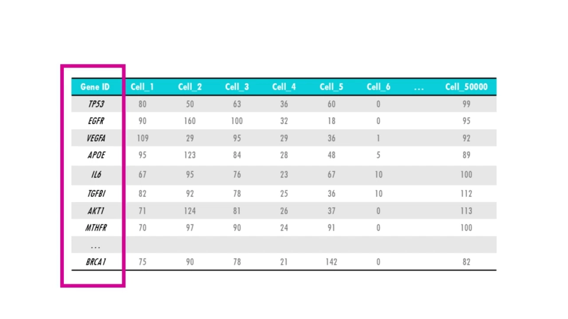
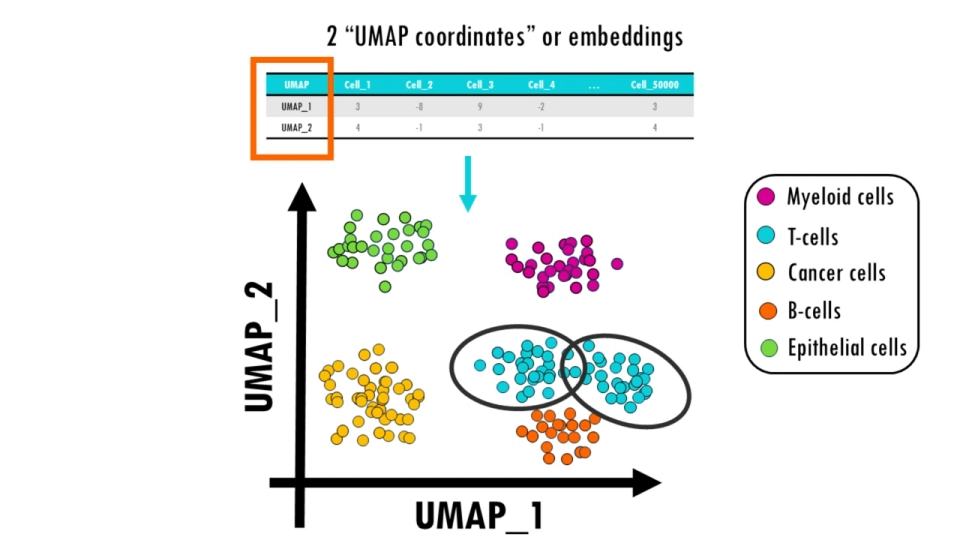
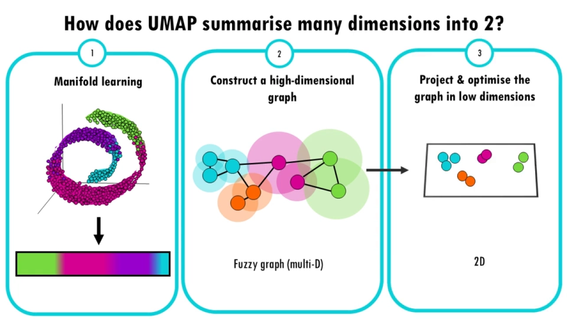
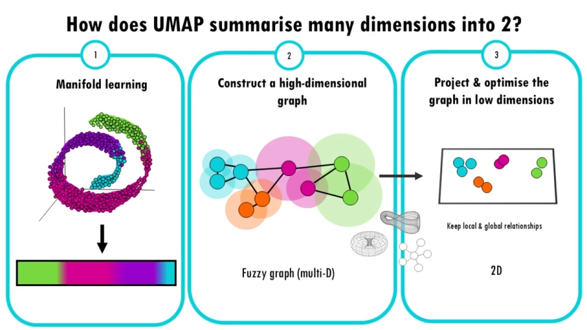
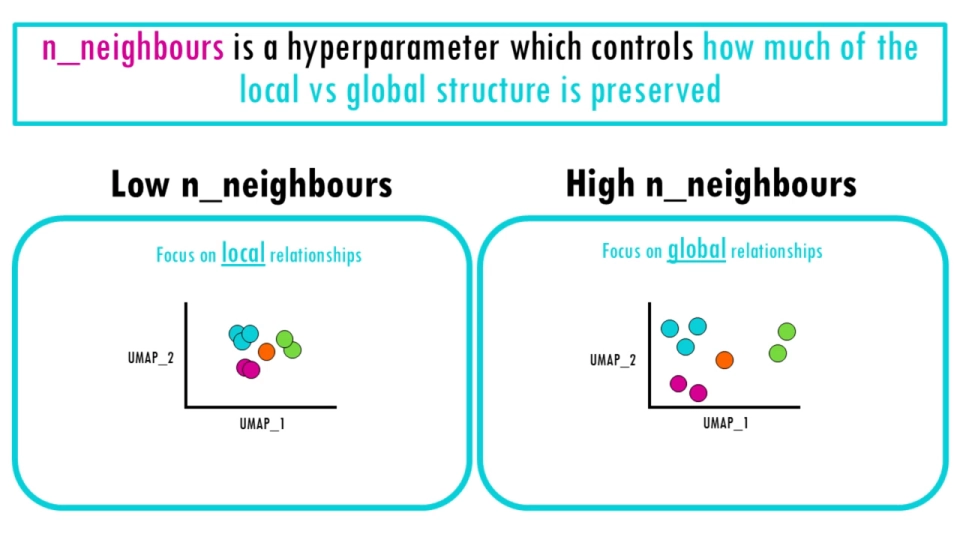
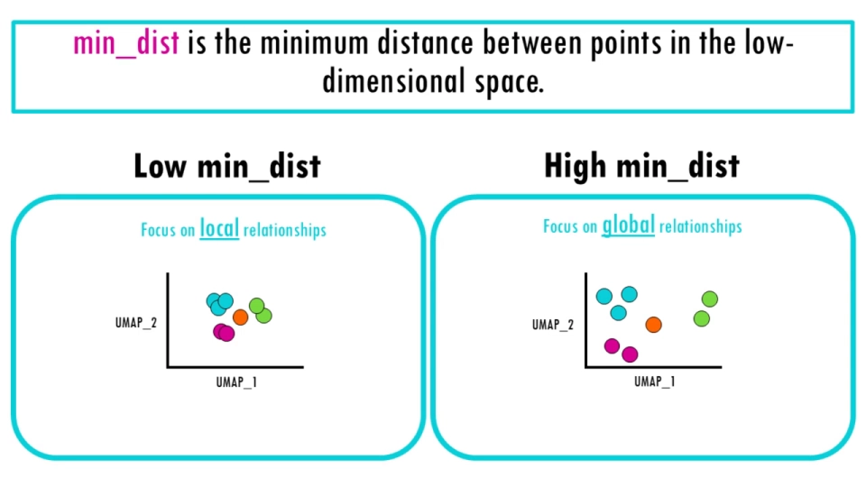
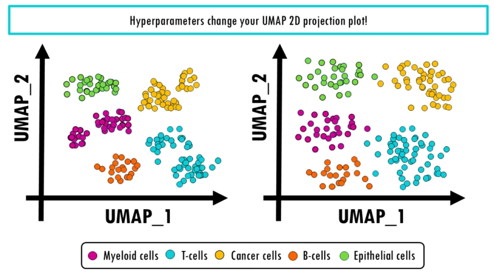

# UMAP 与单细胞可视化：流形、模糊图与两个参数

> 视频来源：[UMAP - simple explanation with an example!](https://www.youtube.com/watch?v=m3s0Tgh8ofg)（YouTube · Biostatsquid）｜时长约 11 分钟
> 简要导读：这是"PCA / t-SNE / UMAP 三兄弟"系列里讲 UMAP 的一集，例子直接是单细胞数据。它把 UMAP 压成三步——学流形、建高维模糊图、把图优化到二维——然后重点讲两个参数：`n_neighbors` 决定局部与全局的取舍，`min_dist` 决定二维里点能挤多紧。最后落到一个很实际的问题：参数不同图就不同，到底哪个"对"？

## 本讲要解决的核心问题（SCQA）

**背景**：一个典型的单细胞数据集是 10,000 个基因 × 50,000 个细胞（[【跳转到 00:15】](https://www.youtube.com/watch?v=m3s0Tgh8ofg&t=15)）。我们想看的是"哪些细胞因为表达谱相似而聚在一起"，而这件事在五万维空间里没法看。

**冲突**：降维必然丢信息，只能尽量保留结构（[【跳转到 01:03】](https://www.youtube.com/watch?v=m3s0Tgh8ofg&t=63)）。UMAP 号称既保留局部关系又兼顾全局结构，但它的参数一改，图就变一个样——那这张图到底在多大程度上是"数据的结构"，多大程度上是"参数的产物"？

**疑问**：UMAP 把几万个基因压成两个坐标，中间到底做了哪几步？`n_neighbors` 和 `min_dist` 各自改的是哪一步？参数不同的两张图，哪一张是对的？

**回答（中心思想）**：UMAP 分三步：先在概念上假设高维数据躺在一个低维弯曲表面上（流形学习），再在这个高维空间里按**每个细胞各自的半径**连出一张模糊图，最后把这张图优化到二维，尽量保住图里的连接。`n_neighbors` 改的是第一步里半径多大、连多少邻居，也就是局部与全局的取舍；`min_dist` 改的是第三步里二维点能挤多紧。两个参数都没有唯一正确值——它们决定的是"你想在这张图上看什么"。

## 一、为什么单细胞必须先降维

讲者先摆出那个矩阵：行是基因，列是细胞，10,000 行 × 50,000 列（[【跳转到 00:15】](https://www.youtube.com/watch?v=m3s0Tgh8ofg&t=15)）。

降维要做的，是把这样一个矩阵换成两个变量，好画成一张散点图（[【跳转到 01:03】](https://www.youtube.com/watch?v=m3s0Tgh8ofg&t=63)）。讲者很坦白地说：**降维一定会丢信息**，目标是尽量保留数据集的结构与特征。

UMAP 的结果就是每个细胞两个坐标，通常记作 `UMAP_1` 与 `UMAP_2`（[【跳转到 02:36】](https://www.youtube.com/watch?v=m3s0Tgh8ofg&t=156)）。她用一个五类细胞的例子展示：髓系、T 细胞、癌细胞、B 细胞、上皮细胞各成一团，而 T 细胞那一团里还能再分出 CD4 与 CD8 两个亚群。

## 二、UMAP 的三步

讲者把整件事拆成三步（[【跳转到 02:53】](https://www.youtube.com/watch?v=m3s0Tgh8ofg&t=173)）：

1. **流形学习（manifold learning）**：假设高维数据其实躺在一个更低维的弯曲表面上。她举的例子是：一个三维物体，凑近看可能像一张二维曲面。UMAP 要做的是从 10,000 个基因学到那个曲面，再把它摊成两个 UMAP 坐标。
2. **构造高维图**：在原始高维空间里，把每个细胞和它的近邻连起来，得到一张"模糊图"（fuzzy graph）。
3. **投影并优化**：把这张图压到二维，调整点的位置，让图里的连接关系尽量保持不变。

第二步和第三步的分工值得强调：**模糊图里已经装下了全部"谁和谁相连"的信息，第三步只是把它画到平面上**。讲者说，正因为先建了这张图，UMAP 才能在保留局部结构的同时兼顾全局——这也是她认为 UMAP 相对 t-SNE 的关键优势（[【跳转到 04:00】](https://www.youtube.com/watch?v=m3s0Tgh8ofg&t=240)）。

她也点了一句方法论上的差别：t-SNE 用概率分布来做优化，UMAP 用的是拓扑学的工具（[【跳转到 04:37】](https://www.youtube.com/watch?v=m3s0Tgh8ofg&t=277)）。

## 三、模糊图是怎么建出来的

回到第二步。把细胞按 10,000 个基因的表达摆在多维空间里（画不出来，只能想象），然后**从每个点画一个半径，半径有重叠就连边**（[【跳转到 05:40】](https://www.youtube.com/watch?v=m3s0Tgh8ofg&t=340)）。

三个细节决定了这张图的性质：

- **半径是局部的**：每个细胞有自己的半径，不是一个全局统一的阈值。
- **半径大小按"到第 n 个邻居的距离"定**：这样每个细胞大约连上同样数量的邻居（[【跳转到 07:18】](https://www.youtube.com/watch?v=m3s0Tgh8ofg&t=438)）。
- **连接是"模糊"的**：半径越大，连接概率越低。中间那个粉色细胞和粉、橙两个细胞半径重叠得小，连接概率高；和蓝、绿两个细胞要靠更大的半径才碰上，概率就低（[【跳转到 06:20】](https://www.youtube.com/watch?v=m3s0Tgh8ofg&t=380)）。

最后还有一条保底规则：**保证每个点至少和它最近的邻居相连**（[【跳转到 06:35】](https://www.youtube.com/watch?v=m3s0Tgh8ofg&t=395)）。

## 四、n_neighbors：局部与全局的取舍

讲者说 UMAP 有两个需要关注的超参数，**最重要的那个是 `n_neighbors`**，它控制"保留多少局部结构、多少全局结构"（[【跳转到 07:03】](https://www.youtube.com/watch?v=m3s0Tgh8ofg&t=423)）。

机制就在上一步：`n_neighbors` 越大，每个细胞的半径越大，连出去的边越多（[【跳转到 07:52】](https://www.youtube.com/watch?v=m3s0Tgh8ofg&t=472)）。她特别声明，示意图只是为了说明方向，半径与连边并不是严格画对的。

效果是：

- **`n_neighbors` 小**：半径小、连接少，**局部关系被保留**——非常相似的细胞会挤在一起（[【跳转到 08:13】](https://www.youtube.com/watch?v=m3s0Tgh8ofg&t=493)）。
- **`n_neighbors` 大**：半径大、连接多，簇可能没那么紧，但**更看重细胞之间的全局关系**。

她还提醒：t-SNE 里对应这个位置的是 **perplexity**（[【跳转到 06:35】](https://www.youtube.com/watch?v=m3s0Tgh8ofg&t=395)）。

## 五、min_dist：二维里点能挤多紧

第二个参数是 `min_dist`，定义是**低维空间里点与点之间的最小距离**（[【跳转到 08:31】](https://www.youtube.com/watch?v=m3s0Tgh8ofg&t=511)）。注意它作用的位置：不是那张高维模糊图，而是我们已经算好的二维投影。

方向很直观（[【跳转到 09:04】](https://www.youtube.com/watch?v=m3s0Tgh8ofg&t=544)）：

- **`min_dist` 小**：UMAP 会把细胞挤得更紧，簇更密。
- **`min_dist` 大**：细胞散开，更侧重全局结构。

讲者在这里给了一个很实用的区分：`n_neighbors` 改的是**关系是怎么算出来的**，`min_dist` 改的是**已经算出来的关系怎么摆出来**。所以调 `min_dist` 不会改变"谁和谁是邻居"，只会改变这张图看起来多拥挤。

## 六、参数不同，图不同：哪一张是对的

讲者把这一条单独拎出来强调（[【跳转到 09:57】](https://www.youtube.com/watch?v=m3s0Tgh8ofg&t=597)）：**用不同参数跑 UMAP，会得到很不一样的图。哪张对、哪张错？**

她的回答是：UMAP 的目的是把数据可视化出来，所以**邻居数让你控制"在这张图里什么对你重要"**（[【跳转到 10:12】](https://www.youtube.com/watch?v=m3s0Tgh8ofg&t=612)）。想看 T 细胞亚型之间的区别，就把 `n_neighbors` 调小；想要所有细胞类型的一个总体概览，就调大。

> **编者注**：视频在开头把"表达谱相似而聚在一起的细胞"直接说成"同一细胞类型或细胞身份"（[【跳转到 00:54】](https://www.youtube.com/watch?v=m3s0Tgh8ofg&t=54)），这是教学上的简化。UMAP 只保证邻接关系，它不知道什么是细胞类型；图上分开的一坨可以是被分辨率切开的同一类细胞，也可以是同一类细胞在不同条件下的两个状态。给簇命名要靠标记基因组合与参考映射，见 [3.2.4](../../../README.md#b04-3-2-4) 与 [3.2.6](../../../README.md#b04-3-2-6)。

## 小结

- **UMAP 三步**：学流形 → 建高维模糊图 → 把图优化到二维。模糊图里已经装下了"谁和谁相连"，第三步只负责摆位置。
- **模糊图的关键是局部半径**：每个细胞按"到第 n 个邻居的距离"定自己的半径，因此每个细胞大约连同样多的邻居；距离越远，连接概率越低。
- **`n_neighbors`** 改半径大小与连边数量，因此决定局部与全局的取舍；对应 t-SNE 的 perplexity。
- **`min_dist`** 改二维里点的最小间距，只影响"关系怎么摆出来"，不影响"关系怎么算出来"。
- **参数没有唯一正确值**：不同参数回答不同的问题，选参数等于选"你想在这张图上看到什么"。
- **图上聚成一团不等于同一细胞类型**：UMAP 只保留邻接关系，标签要靠标记基因与参考。

## 关键术语速查

| 术语 | 一句话解释 |
| :--- | :--- |
| 流形学习（manifold learning） | 假设高维数据躺在一个更低维的弯曲表面上，并把这个表面学出来 |
| 模糊图（fuzzy graph） | 高维空间里按局部半径连边、边权表示连接概率的图，是 UMAP 的中间产物 |
| 局部半径 | 每个细胞各自的连边半径，按其到第 n 个邻居的距离确定 |
| n_neighbors | 控制半径大小与连边数量的超参数，决定局部与全局结构的取舍 |
| min_dist | 低维空间里点与点之间的最小距离，控制二维图上点挤得多紧 |
| perplexity | t-SNE 中与 n_neighbors 作用相近的参数 |
| UMAP_1 / UMAP_2 | 每个细胞最终得到的两个低维坐标 |