# UMAP 的主要思想：相似度分数、低维布局与 n_neighbors

> 视频来源：[UMAP Dimension Reduction, Main Ideas!!!](https://www.youtube.com/watch?v=eN0wFzBA4Sc)（YouTube · StatQuest with Josh Starmer）｜时长约 18 分钟
> 简要导读：这是 StatQuest 讲 UMAP 的上半支，只讲"主要思想"，不推公式。它把 UMAP 拆成两件事：先把高维距离换成一组**相似度分数**，再在低维里一点点搬动点，让"邻居的分数尽量高、非邻居的分数尽量低"。看完能回答：UMAP 到底在优化什么、n_neighbors 改的是哪一步、为什么同一份数据两次跑出来的图会略有不同。公式细节在配套的[《UMAP 的数学细节》](UMAP%20的数学细节：相似度曲线、模糊并集与随机梯度下降.md)里。

## 本讲要解决的核心问题（SCQA）

**背景**：两个特征可以画成一张散点图，三个特征勉强能画成三维图，四个以上就画不出来了。而单细胞数据一个细胞就带几千上万个基因表达值，人眼根本没法直接看。

**冲突**：PCA 是第一个想到的办法，但它有前提——只有当第一、第二主成分解释了数据里的大部分变异时，二维 PCA 图才好看（[【跳转到 02:29】](https://www.youtube.com/watch?v=eN0wFzBA4Sc&t=149)）。数据一复杂，PCA 图就会糊成一团。另一个偷懒办法是直接把数据投影到某一条轴上，讲者明确说那只会得到"一堆混在一起的点"，而不是两个分开的簇（[【跳转到 04:52】](https://www.youtube.com/watch?v=eN0wFzBA4Sc&t=292)）。

**疑问**：UMAP 凭什么能把高维数据摊到二维还看出簇？它到底在优化什么目标？那个最常被调的 `n_neighbors` 改的又是哪一步？

**回答（中心思想）**：UMAP 不试图"保留距离"，它保留的是**邻接关系**。第一步，把每个点和其他点的距离换成一组相似度分数，分数的总量由"这个点想要几个邻居"决定；第二步，在低维里初始化一堆点，然后反复把"应该是邻居"的点拉近、把"不应该是邻居"的点推开，直到低维的邻接关系和高维对得上。所以 UMAP 图回答的是"谁和谁是邻居"，不是"谁离谁多远"。

## 一、为什么还需要 UMAP：PCA 的适用条件

讲者用一个身高体重的例子开场（[【跳转到 01:08】](https://www.youtube.com/watch?v=eN0wFzBA4Sc&t=68)）：体重做横轴、身高做纵轴，二维散点图能看出离群点和相似人群的簇。想再加一个年龄，就得加第三根轴；再加更多特征，就画不出来了。

PCA 是标准答案，但它有前提：**只有当前两个主成分承载了大部分变异时，二维 PCA 图才有信息量**（[【跳转到 02:29】](https://www.youtube.com/watch?v=eN0wFzBA4Sc&t=149)）。数据一复杂，这个前提就不成立。

UMAP（Uniform Manifold Approximation and Projection）的定位是：输入三维以上的高维数据，输出一张能看的低维图；它比较快，即使数据很大也能跑；相似的样本在输出里倾向于聚在一起，因此能用来找相似性和离群点（[【跳转到 02:58】](https://www.youtube.com/watch?v=eN0wFzBA4Sc&t=178)）。

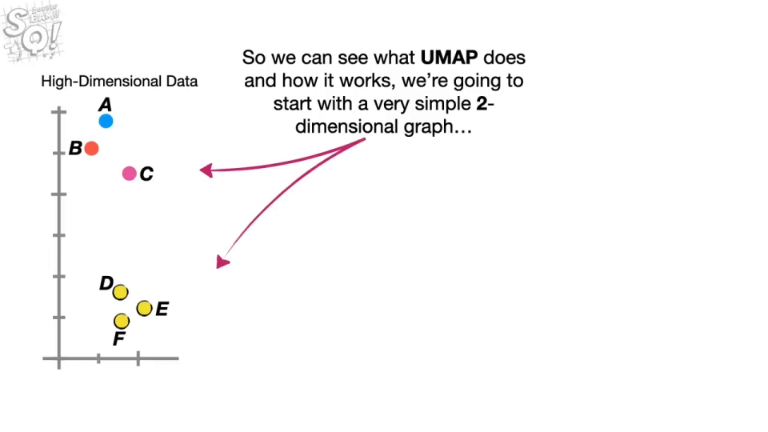

为了讲清机制，讲者把问题缩到最小：高维数据只用二维表示（两簇各三个点），低维目标只有一根数轴（[【跳转到 03:22】](https://www.youtube.com/watch?v=eN0wFzBA4Sc&t=202)）。UMAP 的目标是让低维数轴上的 a、b、c 挨在一起，d、e、f 挨在一起，两堆之间分开——也就是**把高维的簇结构搬到低维**。

## 二、第一步：把距离换成相似度分数

UMAP 做的第一件事是算出所有点对之间的高维距离（[【跳转到 05:02】](https://www.youtube.com/watch?v=eN0wFzBA4Sc&t=302)）。A 到 B 是 0.5，A 到 C 是 2.4，A 到 D、E、F 都很远。

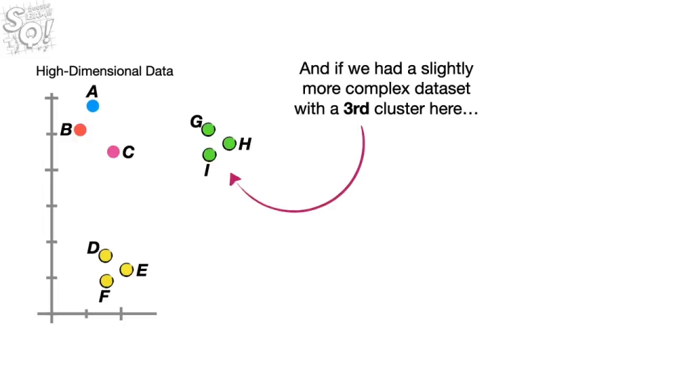

然后以 A 为原点重新摆一遍：B 放在 0.5 处，C 放在 2.4 处，D、E、F 放到很远的地方（[【跳转到 05:27】](https://www.youtube.com/watch?v=eN0wFzBA4Sc&t=327)）。在这条距离轴上画一条下降的曲线，曲线在每一点的高度就是"该点相对 A 的相似度分数"。

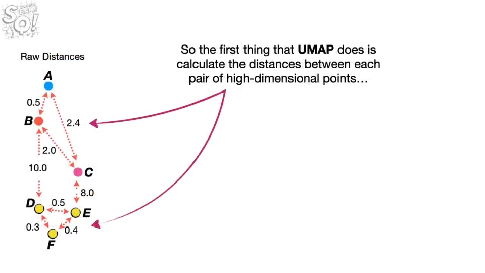

**曲线的形状由"每个点想要几个邻居"决定**（[【跳转到 06:17】](https://www.youtube.com/watch?v=eN0wFzBA4Sc&t=377)）。默认值是 15，但这个只有六个点的例子里设成 3——注意这个数字**包含点自己**，所以实际只要求两个邻居。

接下来是本讲唯一一处数学：UMAP 取邻居数的以 2 为底的对数，作为"相似度分数之和"的目标值（[【跳转到 07:07】](https://www.youtube.com/watch?v=eN0wFzBA4Sc&t=427)）。邻居数为 3 时，目标是 $\log_2 3 \approx 1.6$。曲线被伸缩成这个样子：B 的分数是 1.0，C 的分数是 0.6，加起来正好 1.6；D、E、F 的分数几乎为零，可以直接忽略。

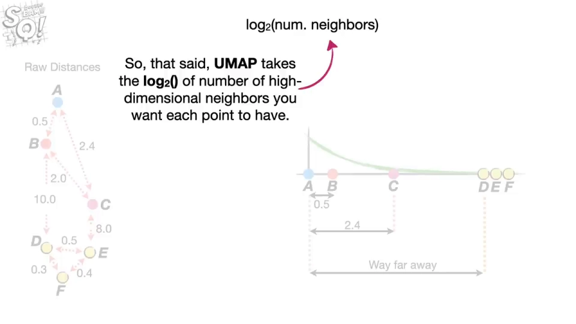

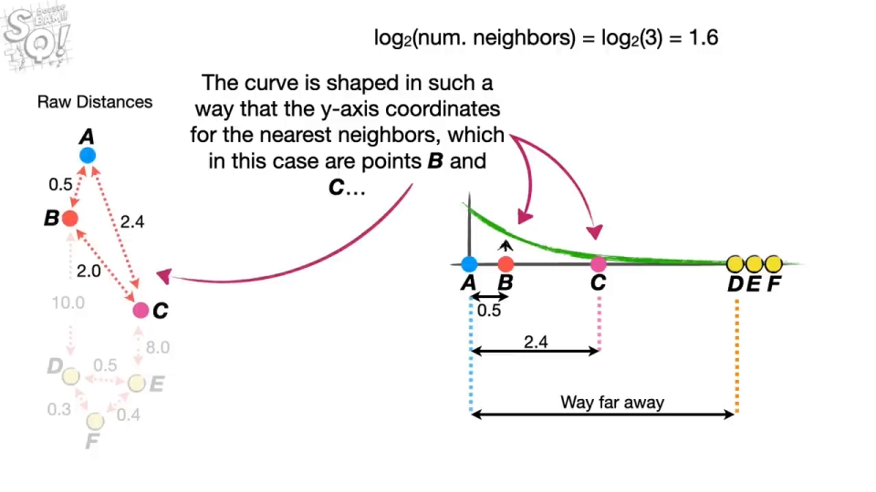

**每个点都有自己的曲线**。算 B 的相似度分数时，把 B 放到原点、其他点按到 B 的距离摆好，再画一条曲线，让除 B 以外的分数之和也等于 1.6（[【跳转到 08:49】](https://www.youtube.com/watch?v=eN0wFzBA4Sc&t=529)）。因为 B 离 C 比 A 离 C 更近，B 的曲线形状和 A 的不一样。

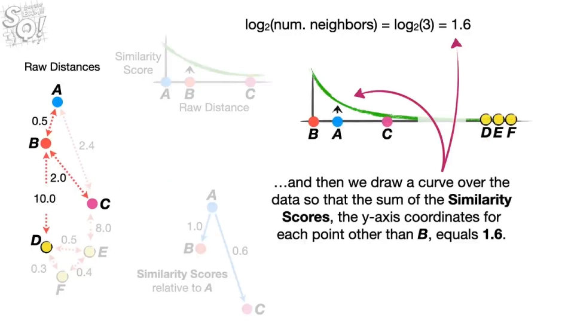

讲者解释了为什么要这样伸缩曲线：**保证每个点至少和另一个点"相似"**。如果曲线固定不动，一个四周都很远的孤立点可能所有分数都接近 0，它在低维里就没有任何约束，会被随便丢在哪儿（[【跳转到 10:07】](https://www.youtube.com/watch?v=eN0wFzBA4Sc&t=607)）。

## 三、不对称的分数怎么变成对称的

用各自的曲线算分，会得到一个尴尬的结果：B 相对 C 的分数是 0.6，C 相对 B 的分数却是 1.0（[【跳转到 10:18】](https://www.youtube.com/watch?v=eN0wFzBA4Sc&t=618)）。同一条边，两个方向的分量不一样。

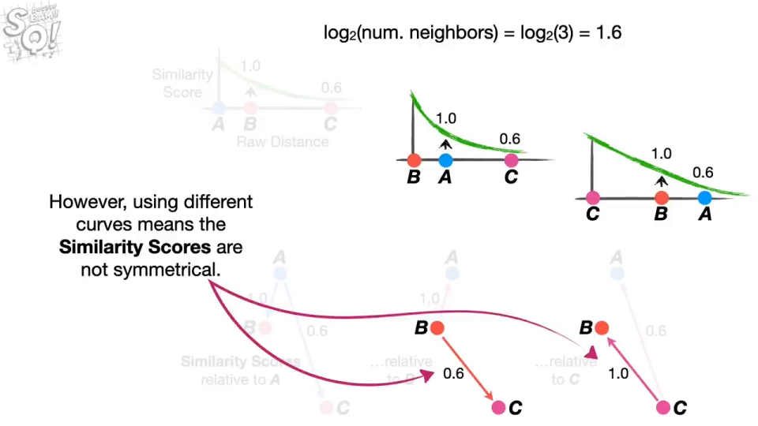

t-SNE 遇到同样问题时取平均。UMAP 不取平均，它用一种"类似取平均"的方法把两个方向的分数合成一个对称分数（[【跳转到 10:21】](https://www.youtube.com/watch?v=eN0wFzBA4Sc&t=621)）。讲者在这一集里没有给公式，只说这是后续数学细节那一集的内容；配套的[《UMAP 的数学细节》](UMAP%20的数学细节：相似度曲线、模糊并集与随机梯度下降.md)第二节给出了完整写法（模糊并集 $s=s_1+s_2-s_1s_2$）。

## 四、第二步：初始化一张低维图

有了对称的相似度分数，UMAP 才开始处理低维。它先初始化一张低维图，然后**反复搬动低维点，直到低维里的簇结构和高维对得上**（[【跳转到 10:42】](https://www.youtube.com/watch?v=eN0wFzBA4Sc&t=642)）。

初始位置是随机的还是固定的？这是 UMAP 和 t-SNE 的第一个大差别：**UMAP 用谱嵌入（spectral embedding）初始化**，因此同一份数据每次的起点完全相同；t-SNE 每次都是随机初始化，同一份数据两次跑出来的起始布局就不一样（[【跳转到 16:45】](https://www.youtube.com/watch?v=eN0wFzBA4Sc&t=1005)）。

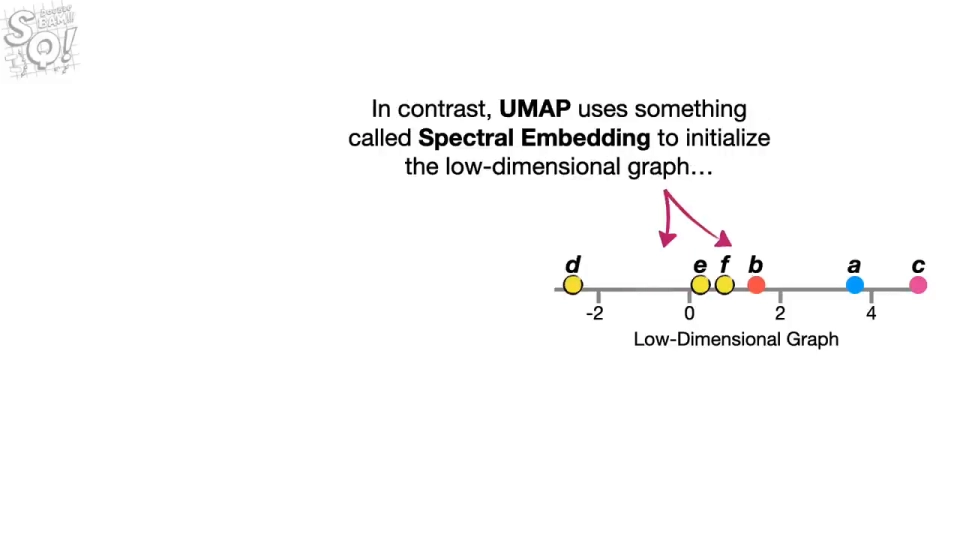

## 五、第三步：一次搬一个点

搬点的规则是本讲的核心，分四小步（[【跳转到 11:04】](https://www.youtube.com/watch?v=eN0wFzBA4Sc&t=664)）：

1. **选一对应该靠近的点**：按高维相似度分数成比例地随机选。A–B 的分数是 1.0，A–C 是 0.8，所以抽到 A–B 的概率更大。
2. **决定动谁**：抛硬币，决定把 B 移向 A，还是把 A 移向 B。
3. **选一个应该远离的点**：从"不在 B 的邻居里"的点中等概率随机选一个。注意这一步**不看高维分数**，不管那个点离得多远，被选中的机会一样。
4. **决定移动多少**：用低维的相似度分数来算——把 B 往 A 挪会让"邻居分数"变大，把 B 往远离 E 的方向挪会让"非邻居分数"变小，两个方向一起决定这一步的位移。

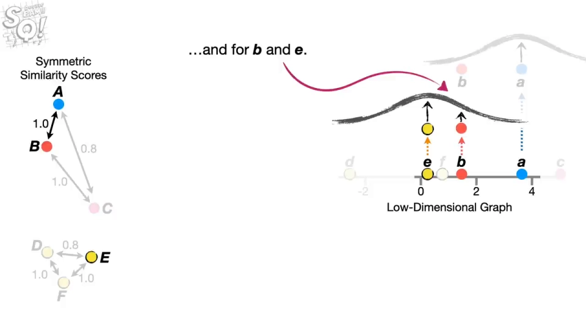

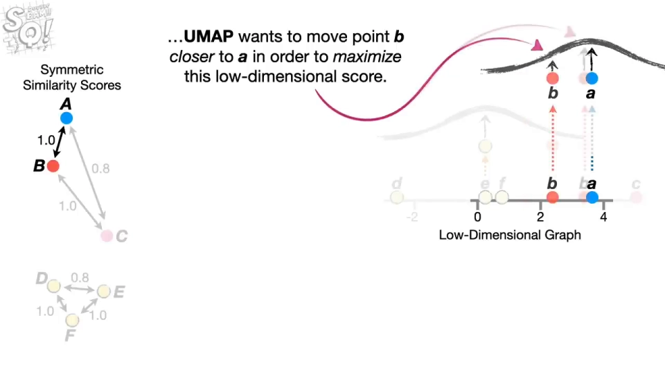

讲者强调每次只挪一小步。原因很实际：数据量一大，小步走更容易把低维布局调到"刚刚好"，而不是一步跨过头（[【跳转到 14:15】](https://www.youtube.com/watch?v=eN0wFzBA4Sc&t=855)）。

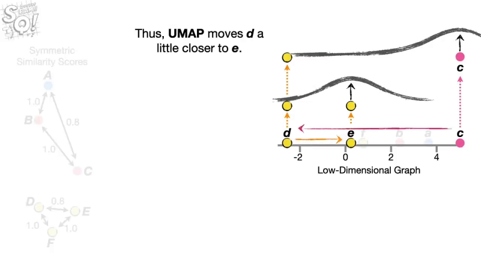

重复这个过程，低维里最终出现两簇，彼此隔开——和高维里看到的结构一致（[【跳转到 15:44】](https://www.youtube.com/watch?v=eN0wFzBA4Sc&t=944)）。

## 六、n_neighbors 改变什么

讲者在最后回到那个"最重要的 UMAP 参数"（[【跳转到 17:19】](https://www.youtube.com/watch?v=eN0wFzBA4Sc&t=1039)）。结论是方向性的：

- **邻居数偏小**：得到的是若干**小而独立的簇**。某种意义上是在看细节，但看不到大局（[【跳转到 17:38】](https://www.youtube.com/watch?v=eN0wFzBA4Sc&t=1058)）。
- **邻居数偏大**：看到更多大局，细节被抹平（[【跳转到 17:54】](https://www.youtube.com/watch?v=eN0wFzBA4Sc&t=1074)）。

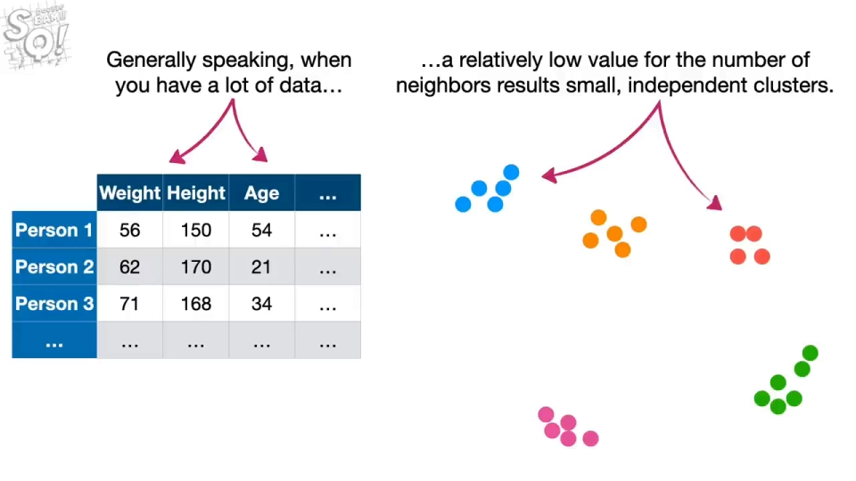

因为方向相反、没有普适最优值，讲者的建议是**在自己的数据上多试几个值**（[【跳转到 18:08】](https://www.youtube.com/watch?v=eN0wFzBA4Sc&t=1088)）。这句话听起来像套话，但它有机制支撑：邻居数直接决定了第二步里每条曲线被伸缩成什么形状，也就决定了哪些点被当成"应该靠近"、哪些被当成"应该远离"。

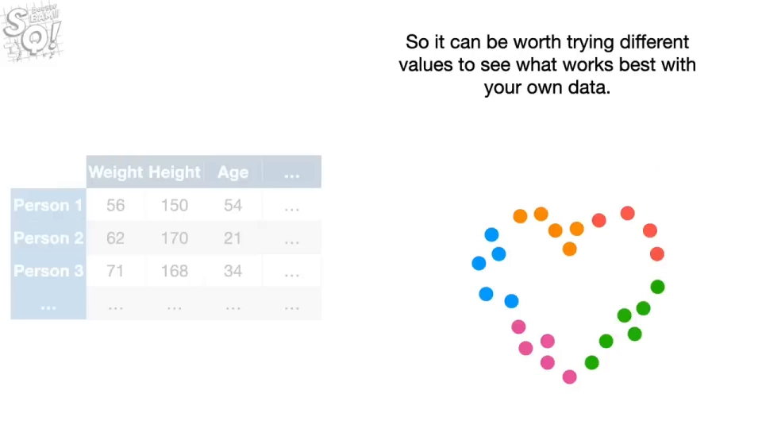

## 七、和 t-SNE 的两个差别

讲者顺带点出 UMAP 与 t-SNE 的两个实质差别（[【跳转到 15:50】](https://www.youtube.com/watch?v=eN0wFzBA4Sc&t=950)）：

| 差别 | t-SNE | UMAP |
| :--- | :--- | :--- |
| 低维初始化 | 随机，每次起点不同 | 谱嵌入，同一数据起点相同 |
| 每轮更新 | 所有点都动一点 | 可以只动一个点或一小撮，因此更容易扩展到大数据 |

至于"主要思想"层面，讲者的原话是：两者**本质相同，大部分差异很细微**（[【跳转到 16:02】](https://www.youtube.com/watch?v=eN0wFzBA4Sc&t=962)）。这一点值得记住——UMAP 不是"另一种原理"，而是同一类邻域保持方法的一个工程上更好用的版本。

## 小结

- **UMAP 保留邻接关系，不保留距离**。它把高维距离换成相似度分数，再在低维里调整点的位置，让邻居的分数高、非邻居的分数低。
- **相似度分数是"每个点一条曲线"**。曲线被伸缩到让最近邻的分数之和等于 $\log_2(\text{邻居数})$；邻居数越多，目标总量越大，曲线越"平"。
- **最近邻的分数恒为 1**，这是曲线定义带来的，与曲线怎么伸缩无关。
- **每点曲线不同 → 分数不对称**，UMAP 用模糊并集而不是平均把它对称化。
- **低维初始化用谱嵌入**，所以同一份数据每次起点相同；但搬点是随机抽样的，最终图仍会略有差异。
- **n_neighbors 偏小看细节（小独立簇），偏大看大局（细节被抹平）**，没有普适最优值。
- **和 t-SNE 的差别主要在初始化与更新方式**，不是原理层面的颠覆。

## 关键术语速查

| 术语 | 一句话解释 |
| :--- | :--- |
| UMAP | Uniform Manifold Approximation and Projection，把高维数据映射到低维、尽量保留邻接关系的非线性降维方法 |
| 相似度分数（similarity score） | 把原始距离经一条指数曲线换算成的 0~1 之间的权重，越近越高 |
| n_neighbors | 每个点在构造相似度时"想要几个邻居"（含自己），决定曲线形状与局部/全局的取舍 |
| 谱嵌入（spectral embedding） | UMAP 用来初始化低维布局的方法，使同一份数据的起点固定 |
| 邻居分数 / 非邻居分数 | 低维里"应该靠近"的一对点与"应该远离"的一对点各自的相似度 |
| 模糊并集（fuzzy union） | UMAP 把两个方向的不对称分数合成对称分数时用的运算，不是简单取平均 |
| t-SNE | 另一类邻域保持降维方法，主要思想与 UMAP 相近，但随机初始化且每轮更新所有点 |