# UMAP 的数学细节：相似度曲线、模糊并集与随机梯度下降

> 视频来源：[UMAP: Mathematical Details (clearly explained!!!)](https://www.youtube.com/watch?v=jth4kEvJ3P8)（YouTube · StatQuest with Josh Starmer）｜时长约 16 分钟
> 简要导读：这是上一支[《UMAP 的主要思想》](UMAP%20的主要思想：相似度分数、低维布局与%20n_neighbors.md)的续集，把"相似度分数怎么算""不对称怎么变对称""点到底被往哪儿推"三件事写成公式。看完能回答：σ 是谁定的、min_dist 藏在哪个符号里、代价函数里到底有几项——以及为什么这几项决定了 UMAP 图上的簇间距离不可解释。

## 本讲要解决的核心问题（SCQA）

**背景**：上一集讲了 UMAP 的主要思想——把高维距离换成相似度分数，再在低维里搬点，让邻居更近、非邻居更远。但"画一条曲线让分数加起来等于 $\log_2 3$"这件事，听起来像是手工调出来的。

**冲突**：如果曲线的形状是随便定的，那这套方法就没有可复现性；如果低维的相似度也是随便定的，那"把点往哪推"就没有依据。更麻烦的是，上一集留下了一个悬案：为什么 UMAP 不用平均、而要用一个"看起来很奇怪"的方式把不对称的分数对称化？

**疑问**：相似度分数的公式是什么？曲线形状由哪个量控制、这个量怎么定？对称化到底怎么算？低维的分数从哪来、`min_dist` 对应哪个符号？代价函数长什么样？

**回答（中心思想）**：高维相似度是一条指数曲线 $e^{-(d-d_{\min})/\sigma}$，其中 $\sigma$ **不是用户设的**，而是被"分数之和等于 $\log_2 k$"这个条件反解出来的，所以每个点一个 $\sigma$；对称化用模糊并集 $s=s_1+s_2-s_1s_2$；低维相似度是一条固定的 t 分布曲线 $1/(1+\alpha d^{2\beta})$，$\alpha$、$\beta$ 由 `min_dist` 与散布决定；代价函数是交叉熵，**只有"邻居"和"非邻居"两项**。最后这一条是读图的关键：没有任何一项在约束"两个簇应该隔多远"。

## 一、高维相似度：一条按 σ 伸缩的指数曲线

公式是（[【跳转到 01:48】](https://www.youtube.com/watch?v=jth4kEvJ3P8&t=108)）：

$$
\text{Similarity Score} = e^{-\left(\text{raw distance} - \text{distance to nearest neighbor}\right)/\sigma}
$$

分子里的"减去到最近邻的距离"是一个平移：让最近邻那一项的指数恰好为 0，于是**最近邻的分数恒等于 1**，与 $\sigma$ 无关（[【跳转到 05:15】](https://www.youtube.com/watch?v=jth4kEvJ3P8&t=315)）。这个设计很实用——不管数据尺度多大，每个点至少有一个确定的锚。

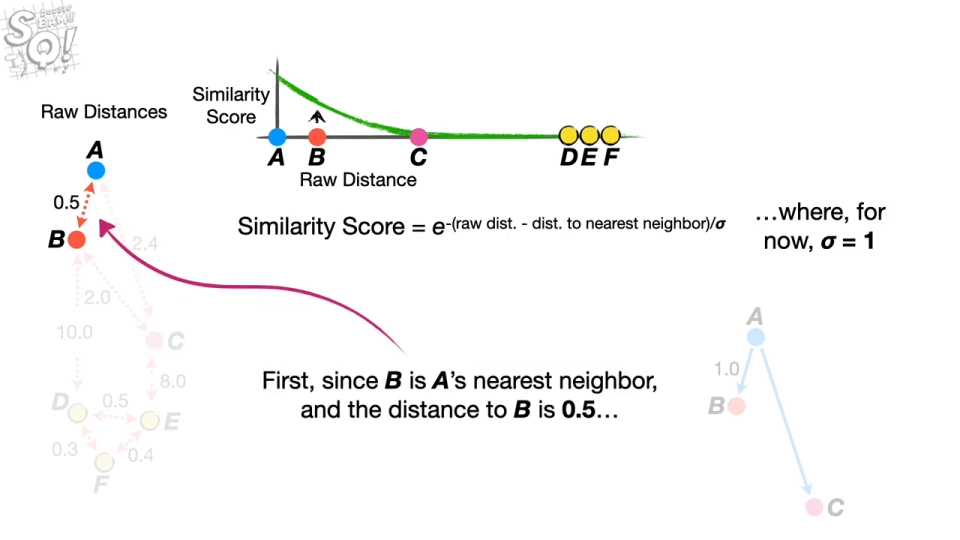

现在只剩 $\sigma$ 一个未知量。讲者先试 $\sigma=1$：A 到 B 是 0.5（最近邻），分数 1.0；A 到 C 是 2.4，算出来 0.15；两者之和 1.15，**比目标 1.6 小**（[【跳转到 03:57】](https://www.youtube.com/watch?v=jth4kEvJ3P8&t=237)）。

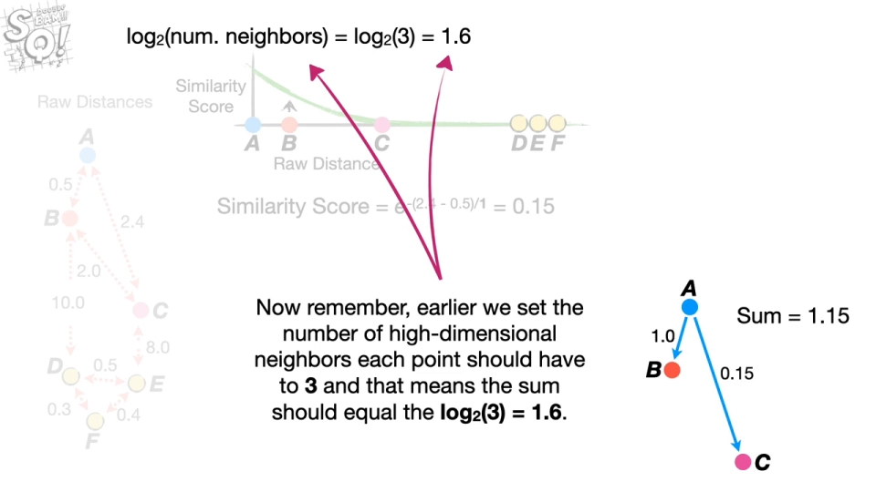

高维距离是固定的，改不了，所以**唯一能改曲线形状的量就是 $\sigma$**。$\sigma$ 调到 2，分数变成 1.0 与 0.39；调到 3.5，分数变成 1.0 与 0.6，和正好 1.6（[【跳转到 04:32】](https://www.youtube.com/watch?v=jth4kEvJ3P8&t=272)）。

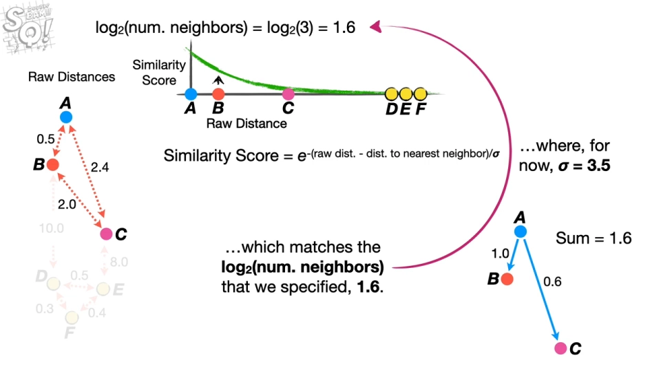

这一步的结论值得单独记：**$\sigma$ 是"解"出来的，不是"调"出来的**。用户设的是邻居数 $k$，$\sigma$ 只是让分数之和满足 $\log_2 k$ 的那个取值。所以 `n_neighbors` 才是真正的旋钮，$\sigma$ 只是它的执行结果。

算 B 的时候要换一条曲线：因为 B 离 C 比 A 离 C 更近，需要的 $\sigma$ 更小（2.8），才能让分数之和也达到 1.6（[【跳转到 05:42】](https://www.youtube.com/watch?v=jth4kEvJ3P8&t=342)）。**每个点一个 $\sigma$**，这就是"每点一条曲线"的数学来源。

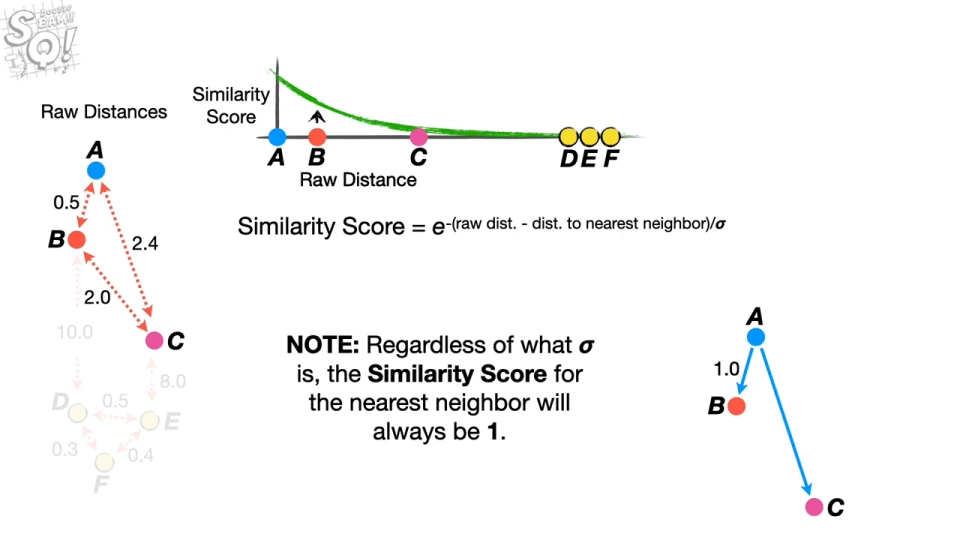

顺带对照 t-SNE：t-SNE 在这一步用的是高斯曲线，曲线的宽高由 **perplexity** 决定；perplexity 与 UMAP 的 `n_neighbors` 作用非常相似，都是在决定"哪些点算邻居"（[【跳转到 06:33】](https://www.youtube.com/watch?v=jth4kEvJ3P8&t=393)）。

## 二、对称化：模糊并集，而不是平均

每点一条曲线，必然导致不对称：B 相对 C 的分数是 0.6，C 相对 B 的分数是 1.0（[【跳转到 06:50】](https://www.youtube.com/watch?v=jth4kEvJ3P8&t=410)）。

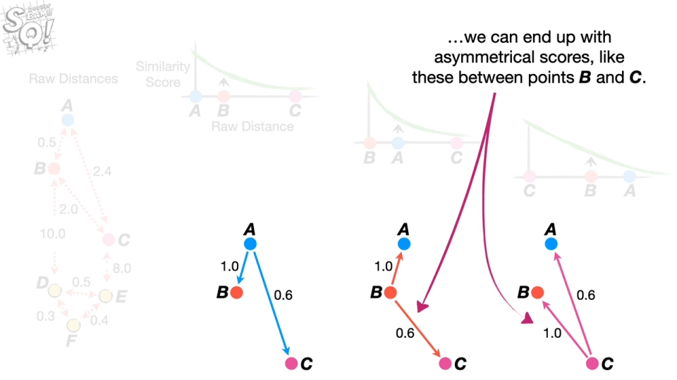

t-SNE 遇到这个问题取平均。UMAP 用另一个式子（[【跳转到 07:13】](https://www.youtube.com/watch?v=jth4kEvJ3P8&t=433)）：

$$
s = s_1 + s_2 - s_1 s_2
$$

代入 $s_1=0.6$、$s_2=1.0$，得到 $0.6+1.0-0.6=1.0$。讲者在这里说了一句很实在的话：**这个结果在他看来是奇怪的**——现在 B 和 C 的相似度跟 B 和 A 一样高，尽管 B 明明离 A 更近（[【跳转到 07:40】](https://www.youtube.com/watch?v=jth4kEvJ3P8&t=460)）。

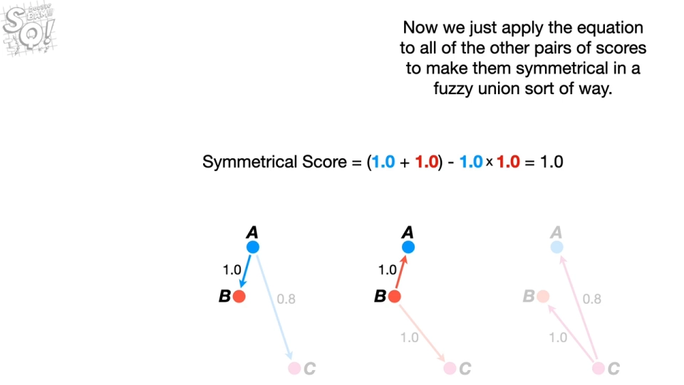

为什么不用平均？讲者的解释是：UMAP 的推导来自拓扑学与模糊集合，这个式子是**模糊并集**运算，不是为了让数值好看（[【跳转到 07:54】](https://www.youtube.com/watch?v=jth4kEvJ3P8&t=474)）。记住这一点就够了：UMAP 的相似度是对称化之后的"边权"，它的语义是"这两点属于同一个邻域的程度"，不是"这两点有多像"。

## 三、低维相似度：一条固定的 t 分布曲线

低维里的相似度用另一条曲线算（[【跳转到 09:04】](https://www.youtube.com/watch?v=jth4kEvJ3P8&t=544)）：

$$
\text{Low-d. Score} = \frac{1}{1 + \alpha d^{2\beta}}
$$

其中 $d$ 是低维距离。$\alpha$ 与 $\beta$ 控制**低维点能被挤得多紧**，讲者明确说它们可以由用户参数调节，对应"低维点之间的最小距离"和"散布"（[【跳转到 09:16】](https://www.youtube.com/watch?v=jth4kEvJ3P8&t=556)）。默认值是 $\alpha=1.577$、$\beta=0.8951$。

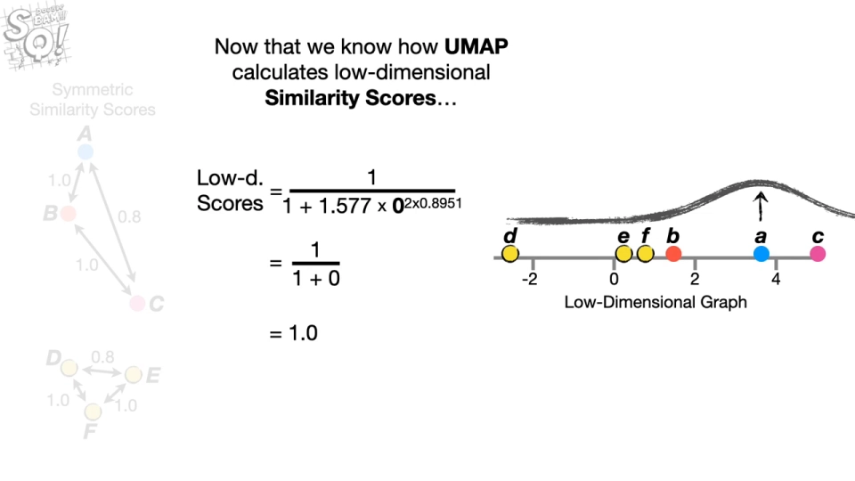

这里有一个很有信息量的对照：**如果把 $\alpha$ 和 $\beta$ 都设成 1，得到的就是 t-SNE 用的低维分数**（[【跳转到 09:36】](https://www.youtube.com/watch?v=jth4kEvJ3P8&t=576)）。

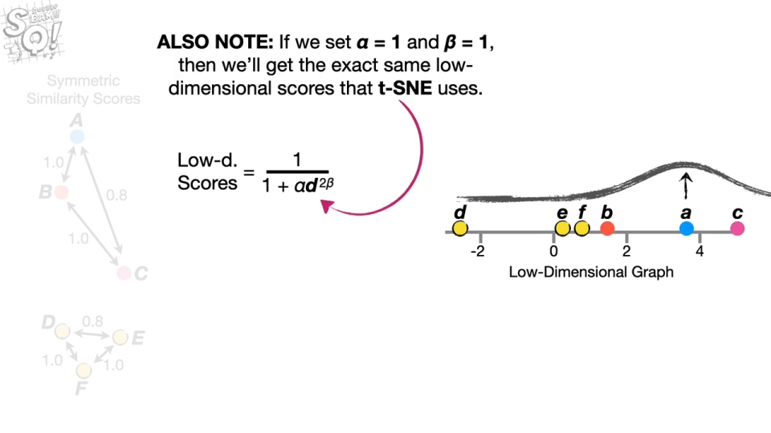

换句话说，UMAP 相对 t-SNE 多出来的那个旋钮，正是这一对参数——也就是我们在软件里看到的 `min_dist`。它作用在**低维**：不改高维模糊图，只改二维里点能挤多紧。

## 四、代价函数：只有两项

有了高维分数和低维分数，就可以定义"当前布局好不好"。做法是这样的（[【跳转到 10:54】](https://www.youtube.com/watch?v=jth4kEvJ3P8&t=654)）：

1. 按高维分数成比例地随机选一对"邻居"，算它们的低维分数，叫**邻居分数**（例子里 0.14）。
2. 从"非邻居"里随机选一个点，算低维分数，叫**非邻居分数**（例子里 0.23）。注意这一步**不看高维分数**，非邻居之间等概率。
3. 把这两个分数代进代价函数。

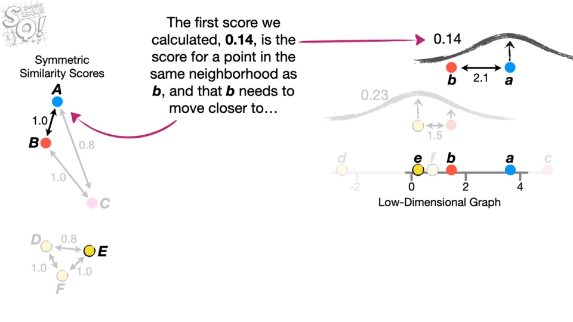

代价函数的形式是交叉熵（[【跳转到 13:16】](https://www.youtube.com/watch?v=jth4kEvJ3P8&t=796)）：

$$
\text{Cost} = \log\frac{1}{\text{neighbor score}} + \log\frac{1}{1-\text{not neighbor score}}
$$

讲者用线性回归做类比：就像用残差算残差平方和来评价拟合好坏，这里用这两个分数评价"点 b 是不是待在正确的位置"（[【跳转到 12:45】](https://www.youtube.com/watch?v=jth4kEvJ3P8&t=765)）。

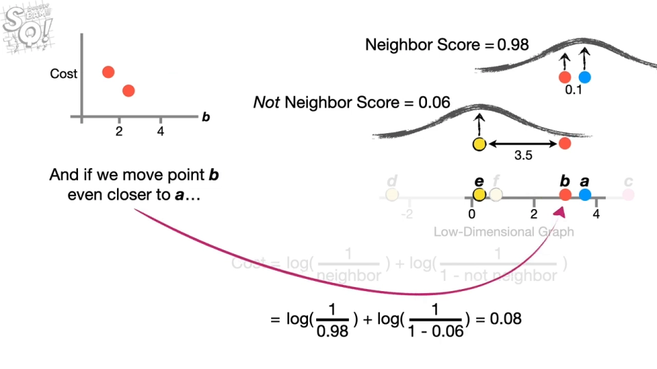

把 b 沿数轴移动，代价先降后升：位置不动时 2.23，靠近 a 一点降到 1.17，再近降到 0.08，越过 a 之后又开始上升（[【跳转到 14:10】](https://www.youtube.com/watch?v=jth4kEvJ3P8&t=850)）。对这条曲线求导得到梯度，就可以用梯度下降一步步把 b 挪到谷底。因为每次只动一个点或一小撮点，实际用的是**随机梯度下降**（[【跳转到 14:43】](https://www.youtube.com/watch?v=jth4kEvJ3P8&t=883)）。

## 五、随机性从哪来

上一集说 UMAP 用谱嵌入初始化，起点固定。那为什么两次跑出来的图还是略有差别？

答案在优化这一步：**随机梯度下降的随机采样**。起点相同，但每一步抽到哪一对点、动谁、往哪个方向，都是随机的，所以最终布局会略有不同（[【跳转到 15:00】](https://www.youtube.com/watch?v=jth4kEvJ3P8&t=900)）。

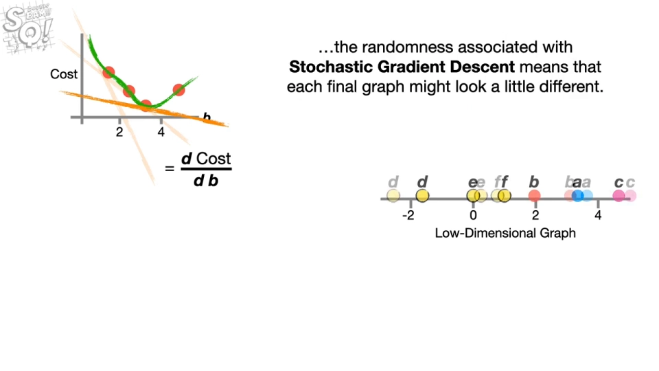

这条结论对复现很实际：**同一份数据、同一组参数，两次 UMAP 不会是像素级相同的图**。如果两次的差异只是整体旋转、平移或轻微形变，那是方法定义的一部分，不是程序出错；但如果某个簇在两次里被拆开或合并，那就要回去查参数与上游表示。

## 六、这套数学对读图意味着什么

把公式摊开之后，有三件事变得很清楚：

- **代价函数里只有两项**：一个"邻居要靠近"，一个"非邻居要远离"。**没有任何一项在约束两个簇之间应该隔多远**。所以 UMAP 图上的簇间空白宽度不是被优化出来的量，它只是"这两个簇没有被拉近"的副产品。
- **非邻居是等概率随机抽的**。抽到近处的非邻居和抽到远处的非邻居机会一样，所以"把 b 推离 e"这一步并不区分 e 有多远。距离信息在这一步被丢掉了。
- **`n_neighbors` 与 `min_dist` 作用在不同层**：前者改高维模糊图的形状（谁算邻居），后者改低维曲线的形状（点能挤多紧）。两者都不改变"UMAP 只优化邻接关系"这个事实。

这也解释了上一集结尾那句"多试几个值"：参数换掉，被优化的邻接关系就换了，图当然会变；而"哪个图对"这个问题，UMAP 本身回答不了。

## 小结

- **高维相似度**：$e^{-(d-d_{\min})/\sigma}$。最近邻分数恒为 1；$\sigma$ 由"分数之和等于 $\log_2 k$"反解，每个点一个 $\sigma$。
- **$\sigma$ 不是用户参数**，`n_neighbors` 才是；$\sigma$ 只是它的执行结果。
- **对称化用模糊并集** $s=s_1+s_2-s_1s_2$，不是平均；结果可能比两个方向都大，讲者自己也说这看起来奇怪，但这是拓扑/模糊集框架带来的。
- **低维相似度**：$1/(1+\alpha d^{2\beta})$，默认 $\alpha=1.577$、$\beta=0.8951$；$\alpha=\beta=1$ 时与 t-SNE 相同。$\alpha$、$\beta$ 对应 `min_dist` 与散布。
- **代价函数是交叉熵**，只有"邻居分数"与"非邻居分数"两项；非邻居等概率抽取，不看距离。
- **随机性来自随机梯度下降**：起点固定，但每次最终图略有不同。
- **读图结论**：簇间距离、簇间空白宽度都不是被优化的量；`n_neighbors` 换掉就换了一套邻接关系。

## 关键术语速查

| 术语 | 一句话解释 |
| :--- | :--- |
| σ（sigma） | 高维相似度曲线的伸缩量，由"分数之和等于 log2(k)"反解，每点一个 |
| 模糊并集（fuzzy union） | $s_1+s_2-s_1s_2$，把两个方向的不对称分数合成对称分数 |
| α、β | 低维 t 分布曲线的两个参数，控制点能挤多紧；对应 `min_dist` 与散布 |
| 邻居分数 / 非邻居分数 | 低维里"应靠近"与"应远离"两对点的相似度，代进代价函数 |
| 交叉熵代价 | $\log\frac{1}{s_{\text{neighbor}}}+\log\frac{1}{1-s_{\text{not neighbor}}}$，UMAP 优化的目标 |
| 随机梯度下降（SGD） | 每次只用一个点或一小撮点算梯度并更新，是 UMAP 随机性与可扩展性的来源 |
| perplexity | t-SNE 里对应 UMAP `n_neighbors` 的参数，决定"哪些点算邻居" |