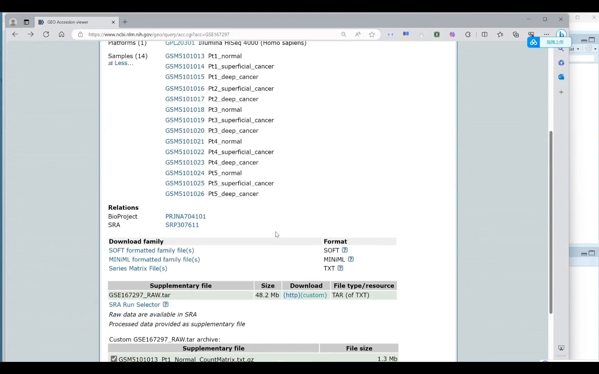
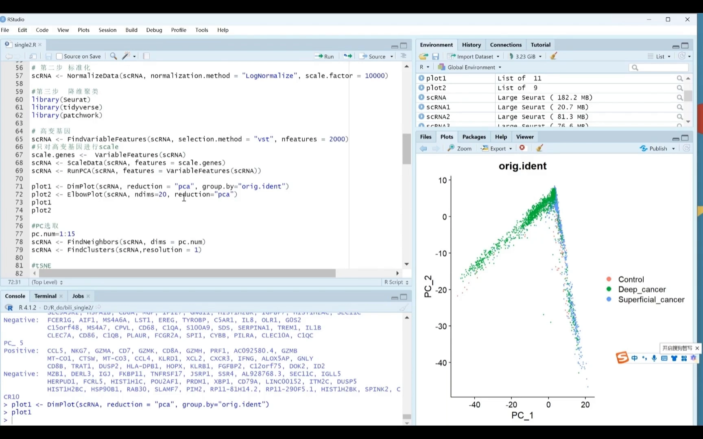
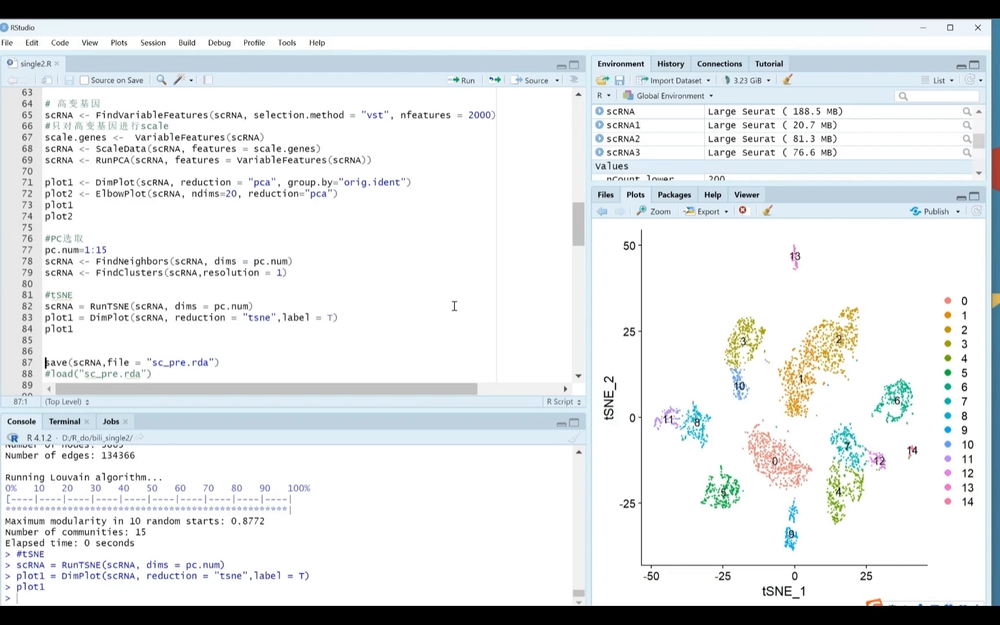
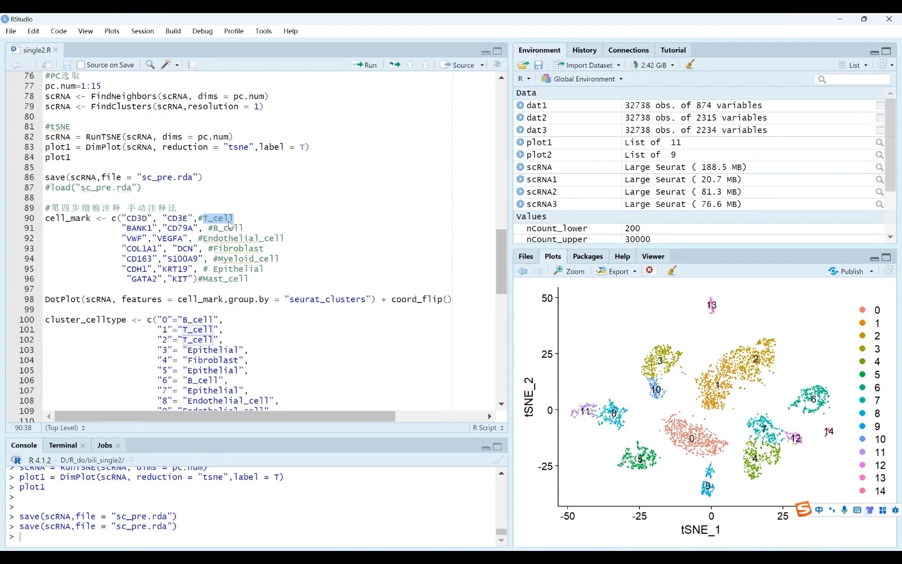
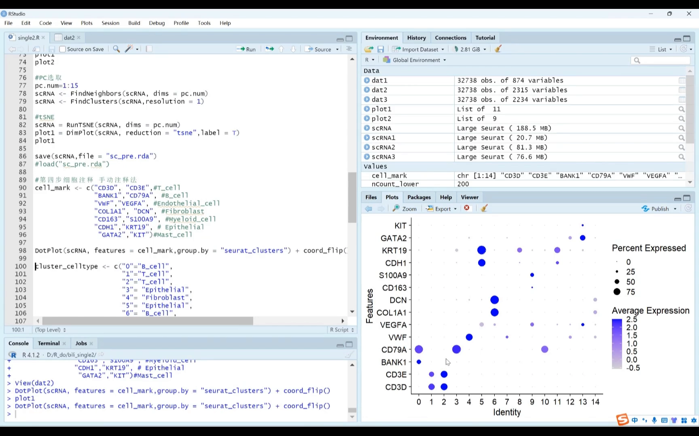
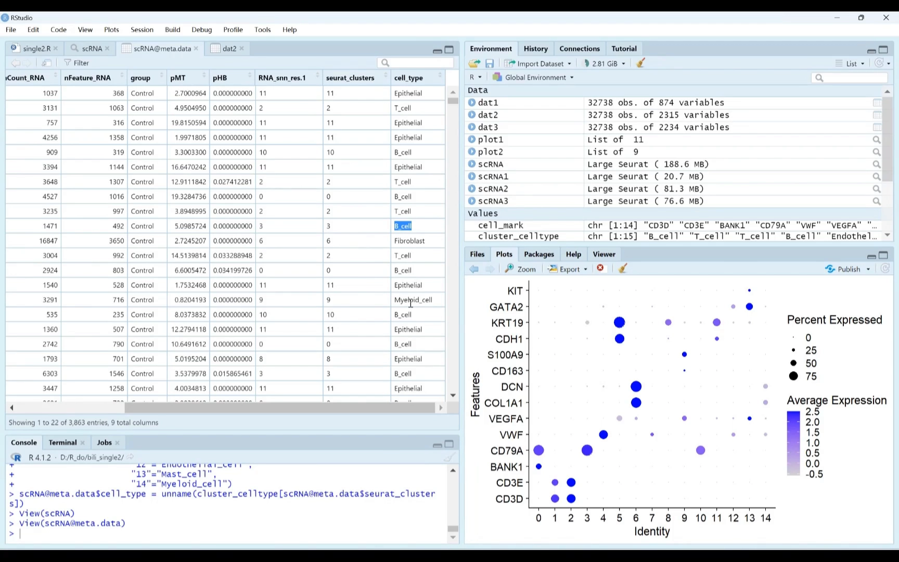
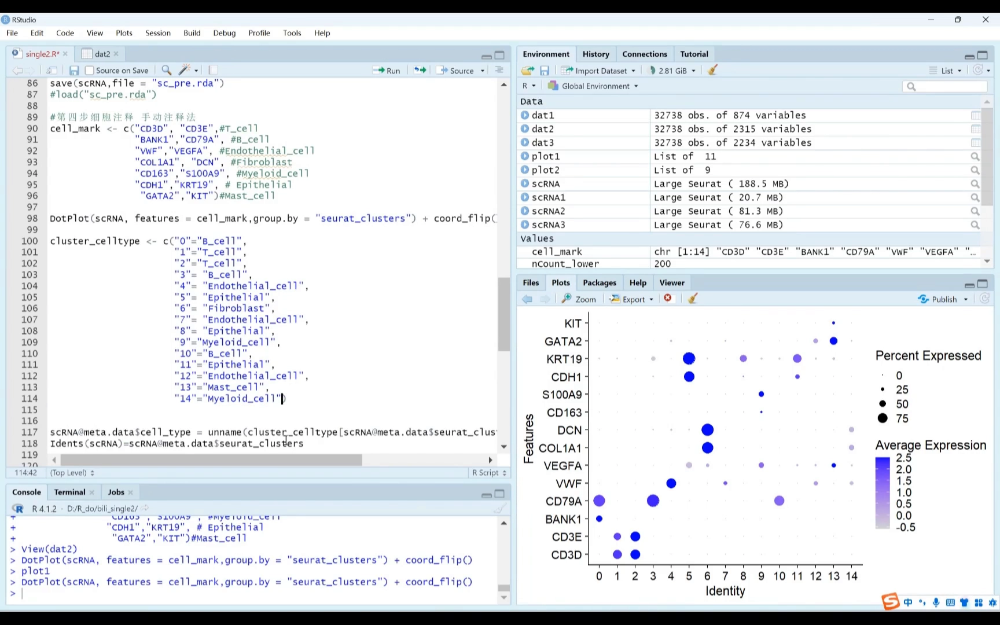
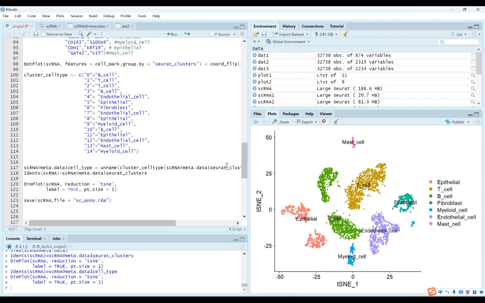
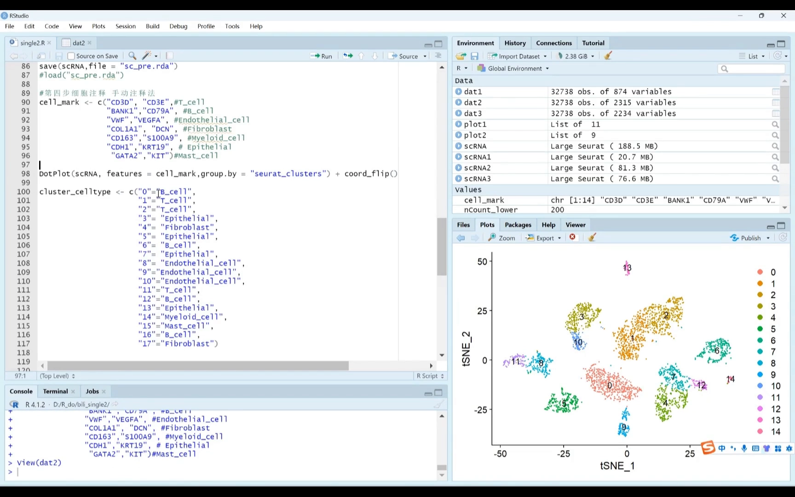

# 单细胞实战：从 PCA 到 15 个亚群，再用 marker 把编号变成细胞名字

> 视频来源：[单细胞专题 3 降维聚类细胞注释](https://www.bilibili.com/video/BV1ew41127x2/)（Bilibili · 吉克学长）｜时长约 17 分钟
> 简要导读：一支"全流程走一遍"的实操视频，用胃癌数据集 GSE167297 的三个样本演示 Seurat 标准流程。前段的质控与标准化只是带过，真正的重头戏是后半段：**15 个 cluster 怎么一个个贴上细胞类型标签**，以及注释完之后**怎么验证注释对不对**。本文把质控部分压缩到最小，重点整理降维聚类参数与手动注释的完整动作。

## 本讲要解决的核心问题（SCQA）

**背景**：单细胞流程走到降维聚类这一步，代码只有几行，图也很快就能出来。真正让人卡住的是下一步——**图上一堆带编号的色块，怎么变成"T 细胞、B 细胞、上皮细胞"这样的名字**。

**冲突**：自动注释工具（比如 SingleR）看起来能一键解决，但 UP 主直接说了它的局限：**"它注释得不是很准确"**，有些情况下甚至用不了。而手动注释又高度依赖"你知不知道该组织里有哪些细胞、它们的 marker 是什么"。

**疑问**：降维聚类的参数该怎么定？手动注释具体怎么做？做完之后怎么知道注释是对的？

**回答（中心思想）**：**降维聚类是常规操作，注释才是真正的难点**。参数上，PC 数看肘部、分辨率取 1 这一档先看群数；注释上，用 **DotPlot 把 marker 基因 × cluster 摆成矩阵**，逐群读出"这个群特异表达什么基因"，再翻译成细胞类型；最后**用"每个细胞类型是否各自聚成一团"来反向验证注释**——如果一团里混着 T 细胞和上皮细胞，那大概率是注释出了问题。

## 一、数据集与前置步骤：先把三个样本合成一个对象

UP 主用的数据集是 **GSE167297**，一个胃癌的单细胞数据集，overall design 是"深层癌 vs 浅层癌 vs 对照"（[【跳转到 00:23】](https://www.bilibili.com/video/BV1ew41127x2/?t=23)）。GEO 页面上列了 14 个样本，命名规则很规整：Pt1_normal、Pt1_superficial_cancer、Pt1_deep_cancer……一直到 Pt5（[【跳转到 00:00】](https://www.bilibili.com/video/BV1ew41127x2/?t=0)）。

他这里只取 **patient one 的三个样本**（对照、浅层肿瘤、深层肿瘤）做演示，读进来的是 count matrix 形式的表达矩阵——行名是基因、列名是细胞（[【跳转到 00:48】](https://www.bilibili.com/video/BV1ew41127x2/?t=48)）。



这里有一个**不能省的动作**：三个样本分别建成 Seurat 对象后，必须 **merge 成一个大的 Seurat 对象**才能往下做（[【跳转到 03:19】](https://www.bilibili.com/video/BV1ew41127x2/?t=199)）。UP 主的说法是"我们必须将它整合才能进行后续的分析"。merge 之后还要给 metadata 加一列 `group`（对照 / 浅层 / 深层），因为后面所有图都要按这个分组上色。

> 关于质控（线粒体与血红蛋白百分比、`subset` 取子集）和标准化（`NormalizeData`），本讲只是照流程走了一遍，属于 [3.1.3 表达预处理](../../3.1_表达预处理/3.1.3_表达预处理：文库大小、归一化与对数变换/RPKM、FPKM%20与%20TPM：测序深度与基因长度怎么校正.md) 的内容，本文不展开。

## 二、降维：先挑 2000 个高变基因，再算 PCA

### 2.1 高变基因是 PCA 的输入

进入降维聚类这一步，UP 主先做的是**搜寻高变基因**：`FindVariableFeatures` 选出每个细胞中变化最大的 **2000 个基因**，然后"围绕着这 2000 个基因"做标准化与 PCA（[【跳转到 08:37】](https://www.bilibili.com/video/BV1ew41127x2/?t=517)）。

为什么要先挑基因？因为 PCA 找的是方差最大的方向，如果直接把上万个基因都塞进去，那些在所有细胞里都差不多（方差接近 0）的基因只会增加计算量、稀释信号。**先保留 2000 个高变基因，等于先把"可能有信息"的部分圈出来**。

### 2.2 第一张 PCA 图：三个分组有没有分开

`RunPCA` 之后画的 `DimPlot(..., group.by = "orig.ident")`，是按样本来源上色的 PCA 散点图。UP 主的判读是：**"这里可以看到他们三个分组是没有批次效应的"**（[【跳转到 09:02】](https://www.bilibili.com/video/BV1ew41127x2/?t=542)）——三个颜色的点沿着同一条弧线分布、彼此交叠，没有各自聚成一坨。



### 2.3 选 PC 数：肘部 + "文章里最多的情况"

第二张图是 `ElbowPlot`。UP 主的读法是：**PC 越来越大，标准差越来越小，最后基本稳定**（[【跳转到 09:27】](https://www.bilibili.com/video/BV1ew41127x2/?t=567)）。

他给的经验值是**通常选 10 个或者 15 个 PC**，并补了一句"这是文章里最多的情况"；这份数据他取 **15**，代码写成 `pc.num = 1:15`。

> 和[另一支流程视频](<../../../../../生物建模/P08_单细胞分析与基础模型/1_细胞测量与表达表示/1.2_质控、差异表达与关系图/1.2.5_SCP 分析输出：邻接图、Louvain 聚类与 UMAP 的流程绑定/单细胞降维与聚类全流程：从PCA到UMAP与分辨率选择.md>)（选 20~40 个 PC）对比着看很有意思：**PC 数没有统一答案**，取决于数据本身的复杂度与细胞数。共同点在于——**都用肘部作为判断依据**，而不是抄一个固定数字。

## 三、聚类与 tSNE：resolution = 1 分出 15 个亚群

选好 15 个 PC 之后，`FindNeighbors` 在 PCA 空间建 KNN 图，`FindClusters` 用 **resolution = 1** 跑图聚类，然后 `RunTSNE` 画二维图（[【跳转到 09:52】](https://www.bilibili.com/video/BV1ew41127x2/?t=592)）。

控制台里能看到聚类算法的输出：`Running Louvain algorithm...`、`Number of communities: 15`——也就是说，**这一步用的是 Louvain 社区发现，最终得到 15 个 cluster，编号 0~14**。UP 主口播时先说"分成了 14 个亚群"，随即改口为"15 个亚群，0~14"，与代码输出一致。





UP 主对这一步的评价是：**"这是一个降维聚类的过程，也是一个比较常规的过程"**，并且明确说"其实前三步它都是比较常规，到了第四步细胞注释才是单细胞真正的难点"（[【跳转到 10:17】](https://www.bilibili.com/video/BV1ew41127x2/?t=617)）。这句话其实点出了本小节的核心：**降维聚类是"算"，注释是"判"**。

顺带一个工程习惯：注释之前先用 save 把对象存成 sc_pre.rd 一份（[【跳转到 10:47】](https://www.bilibili.com/video/BV1ew41127x2/?t=647)）。因为前面这些步骤要跑不少时间，注释阶段反复试错时不该重跑一遍。

## 四、注释的两条路线：手动与自动

### 4.1 为什么优先手动

UP 主把注释分成两类（[【跳转到 10:47】](https://www.bilibili.com/video/BV1ew41127x2/?t=647)）：

- **手动注释**：基于自己搜集到的 marker 基因，逐群判断；
- **自动注释**：例如 **SingleR**，用参考数据集给每个细胞打分、直接给出标签。

他对自动注释的态度是有保留的：**SingleR"在有些情况下用不了，因为它注释得不是很准确"**，所以"还是要结合我们的手动注释法去做"（[【跳转到 11:12】](https://www.bilibili.com/video/BV1ew41127x2/?t=672)）。

这个判断值得展开一句：自动注释的本质是**把查询细胞映射到一个已注释的参考上、继承参考的标签**。它快，但会**同时继承参考的偏差和粒度**——参考里只到"T 细胞"这一层，你就得不到"CD8 效应 T"；参考里没有的细胞类型，你可能一个都标不出来。所以它适合当**第一遍草稿**，不适合当结论。

### 4.2 marker 从哪来：高分文章 + 数据库 + 组织常识

手动注释的前提是"手里有一份 marker 清单"。UP 主给了两个来源（[【跳转到 11:12】](https://www.bilibili.com/video/BV1ew41127x2/?t=672)）：

1. **模仿自己研究疾病领域的高分文章**里用的 marker；
2. **查细胞 marker 数据库**。

还有一条更根本的前提：**先确定样本来源**。UP 主强调"人和鼠源肯定差别很大"，不同组织的细胞组成差别也很大——肾、皮肤、脑各有自己的特化细胞（皮肤有黑色素细胞、脑有胶质细胞）；**但免疫细胞和血管细胞的构成是相对通用的**（[【跳转到 11:37】](https://www.bilibili.com/video/BV1ew41127x2/?t=697)）。

这句话其实是在说：**注释的知识一半来自通用免疫学，一半来自组织特异性**。前者可以照抄，后者必须查文献。

## 五、逐群注释：用 DotPlot 把 marker 摆成矩阵

### 5.1 一个 DotPlot 顶十张 FeaturePlot

UP 主的做法是把 marker 写成一个命名列表，然后用 `DotPlot` 一次画出来：

```r
cell_mark <- c("CD3D", "CD3E",           # T_cell
               "BANK1", "CD79A",         # B_cell
               "VWF", "VEGFA",           # Endothelial_cell
               "COL1A1", "DCN",          # Fibroblast
               "CD163", "S100A9",        # Myeloid_cell
               "CDH1", "KRT19",          # Epithelial
               "GATA2", "KIT")           # Mast_cell
DotPlot(scRNA, features = cell_mark, group.by = "seurat_clusters") + coord_flip()
```

这张图的读法就两件事（[【跳转到 12:27】](https://www.bilibili.com/video/BV1ew41127x2/?t=747)）：

- **点的大小 = 该 cluster 中表达这个基因的细胞比例**（Percent Expressed）；
- **点的颜色深浅 = 平均表达量**（Average Expression）。

于是"哪个群特异表达哪个 marker"一眼可见：CD3D/CD3E 只在 1、2、11 群亮，CD79A/BANK1 只在 0、3、10 群亮，COL1A1/DCN 只在 6 群亮，KRT19/CDH1 在 5、8 群亮，KIT/GATA2 只在 13 群亮。



### 5.2 逐群读出的结果

UP 主对着这张图一群一群念下来（[【跳转到 12:52】](https://www.bilibili.com/video/BV1ew41127x2/?t=772)）：

| cluster | 关键 marker | 判定的细胞类型 |
| :--- | :--- | :--- |
| 0 | CD79A | B 细胞 |
| 1、2 | CD3 | T 细胞 |
| 3 | CD79A | B 细胞 |
| 4 | VWF / VEGFA | 内皮（血管） |
| 5 | KRT19 / CDH1 | 上皮 |
| 6 | COL1A1 / DCN | 成纤维 |
| 7 | 表达较弱，仅见血管 marker | 暂定为内皮 |
| 8 | KRT19 / CDH1 | 上皮 |
| 9 | 两个 marker 同时表达 | 暂定为"水细胞"（待定） |
| 10 | CD79A | B 细胞 |
| 11 | KRT19 / CDH1 | 上皮 |
| 12 | VWF / VEGFA | 内皮 |
| 13 | KIT / GATA2 | 肥大细胞 |
| 14 | CD163 / S100A9 | 髓系 |

注意其中两个"不那么确定"的群：**7 群表达较弱、9 群两个 marker 同时表达**。UP 主的处理方式是先给个暂定名，继续往下走（[【跳转到 13:42】](https://www.bilibili.com/video/BV1ew41127x2/?t=822)）。这其实是很诚实的做法——**注释不是一次到位的判决，而是"当前证据下的最佳猜测"**，不确定的群应该被标记出来，而不是硬套一个名字。

### 5.3 把标签写回 metadata

判定完之后，代码里建立一张"cluster 编号 → 细胞类型"的映射表，再用 `unname()` 把它按 `seurat_clusters` 逐细胞查表，写进 metadata 的 `cell_type` 列（[【跳转到 14:32】](https://www.bilibili.com/video/BV1ew41127x2/?t=872)）：

```r
cluster_celltype <- c("0" = "B_cell", "1" = "T_cell", "2" = "T_cell", ...)
scRNA@meta.data$cell_type <- unname(cluster_celltype[scRNA@meta.data$seurat_clusters])
```

UP 主特意去 metadata 表里核对了"是不是一一对应"——比如第三群确实是 B_cell，没有问题（[【跳转到 15:22】](https://www.bilibili.com/video/BV1ew41127x2/?t=922)）。这一步看着琐碎，但**映射表写错一个数字，整群标签就全错**，值得当场核一遍。





## 六、注释做完还要验：用"聚不聚得成一团"反查

拿到细胞类型之后，UP 主用 `DimPlot` 按 `cell_type` 重新上色（[【跳转到 15:47】](https://www.bilibili.com/video/BV1ew41127x2/?t=947)）。这张图不只是好看，它是**一次独立的验证**：

- 如果注释是对的，**同一个细胞类型应该各自聚成一团**——血管一团、成纤维一团、T 细胞一团、B 细胞一团、上皮一团、肥大一团；
- 如果发现**某个独立的细胞团里既有 T 细胞又有上皮细胞**，那大概率是注释出了问题（[【跳转到 16:12】](https://www.bilibili.com/video/BV1ew41127x2/?t=972)）。

UP 主的原话是"因为不同的细胞它很难聚在一起"——**在表达空间里离得远的细胞，不太可能是同一种细胞**。所以"注释后的类型在 UMAP/tSNE 上是否各自成团"是一个便宜又有效的自检。

要提醒的是这条验证也有边界：**它只能发现"把不同细胞标成同一类"的错误（欠聚类/错标），发现不了"把同一类细胞拆成两群"的错误**（过度聚类）——后者在图上表现为两个分开的团却共享同一个标签，看起来反而"没问题"。所以真正的验证仍然要靠**独立证据**：蛋白层面（流式、CITE-seq）、空间位置、功能实验。





## 七、三个必须记住的陷阱

### 7.1 聚类 ≠ 细胞类型

这一讲里 cluster 编号是 0~14，细胞类型只有 7 种——**15 个群被合并成了 7 个名字**（0、3、10 都是 B 细胞，1、2 都是 T 细胞，5、8、11 都是上皮）。这正好说明：**cluster 是算法给出的划分，细胞类型是人给出的名字，两者不是一一对应**。一个类型可以被拆成多个群（过度聚类），多个群也可以归成同一个类型。

### 7.2 注释的循环论证

如果用"这群的 marker 是 CD3D"来定义它是 T 细胞，再用"它是 T 细胞所以表达 CD3D"来证明注释正确——这就是**循环论证**，什么也没验证。UP 主用的"注释后是否各自成团"比循环论证强一些（它用了聚类结构这个相对独立的信息），但仍然**不是完全独立**：聚类和注释用的是同一份表达矩阵。真正独立的证据只能来自表达矩阵之外。

### 7.3 扰动数据里的额外陷阱：状态 ≠ 类型

如果这份数据来自扰动实验（Perturb-seq、药物处理等），还有一层坑：**扰动可能让同一细胞类型分成“处理组一群、对照组一群”**。这时聚类分出来的是**状态差异**，不是新的细胞类型。看到“某群只来自处理组”时，先别急着给它起个新名字，要回去看它和对照组的对应群在 marker 上是否一致——一致就是同一类型的不同状态。这类分析属于细胞状态与比例变化的内容，见 [1.1.4 细胞类型、细胞状态与细胞周期](../../../1_细胞身份、状态与组学测量/1.1_身份与动态/1.1.4_细胞类型、细胞状态与细胞周期/细胞异质性从哪来：噪音、细胞周期与亚群.md)，这里只点到为止。

## 小结

- **降维聚类是常规操作，注释才是难点**：前三步照流程走，第四步决定结论。
- **高变基因（2000 个）是 PCA 的输入**，先圈出"可能有信息"的基因再降维。
- **PC 数看肘部**，这份数据取 15（"文章里最多的情况"是 10~15），和上一支视频取 20~40 形成对照——**没有统一答案**。
- **resolution = 1 得到 15 个 cluster**（Louvain，编号 0~14）；聚类数是参数产物，不是细胞类型数。
- **自动注释（SingleR）快但不准**，会继承参考的偏差与粒度；适合当草稿，不适合当结论。
- **手动注释靠 DotPlot**：点大小 = 表达比例，颜色 = 平均表达量，逐群读出特异 marker 再翻译成类型。
- **不确定的群先标暂定名**（如 7 群、9 群），别硬套。
- **注释后必须验证**：同类细胞应各自成团，混在一起的团说明注释有问题；但这条验证发现不了过度聚类。
- **15 个 cluster → 7 个细胞类型**，这是"聚类 ≠ 细胞类型"最直接的证据。

## 关键术语速查

| 术语 | 一句话解释 |
| :--- | :--- |
| 高变基因（HVG） | 在细胞间变化最大的基因，通常取 2000 个作为降维输入 |
| PCA | 线性降维，把高变基因压成若干主成分 |
| 肘部（elbow） | ElbowPlot 上标准差曲线由陡变平的位置，用作 PC 数的参考 |
| KNN 图 | 每个细胞与最相似的 $k$ 个细胞连边构成的图，聚类的输入 |
| Louvain | 图上的社区发现算法，把 KNN 图切成若干 cluster |
| resolution | 聚类粒度参数，越大 cluster 越多 |
| marker gene | 某类细胞特异高表达的基因，注释的主要依据 |
| DotPlot | 把 marker 基因与 cluster 摆成矩阵，点大小表示表达比例、颜色表示平均表达量 |
| 手动注释 | 人工读 marker 给每个 cluster 命名，依赖专家知识与文献 |
| SingleR | 自动注释工具，把细胞映射到参考数据集并继承标签 |
| reference mapping | 参考映射，把查询细胞投射到已注释参考上，继承其标签 |
| over-clustering | 分辨率过高导致同一类型被拆成多个群 |
| metadata | Seurat 对象里存放每个细胞元信息的表，注释结果写在这一层 |