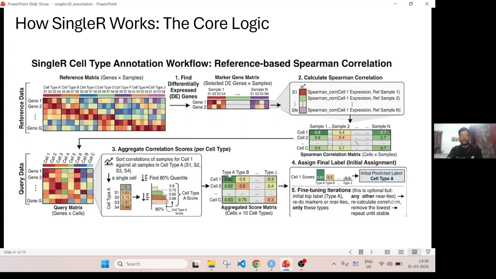
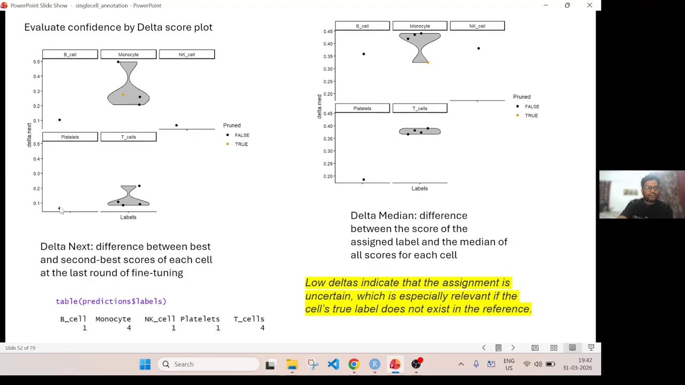
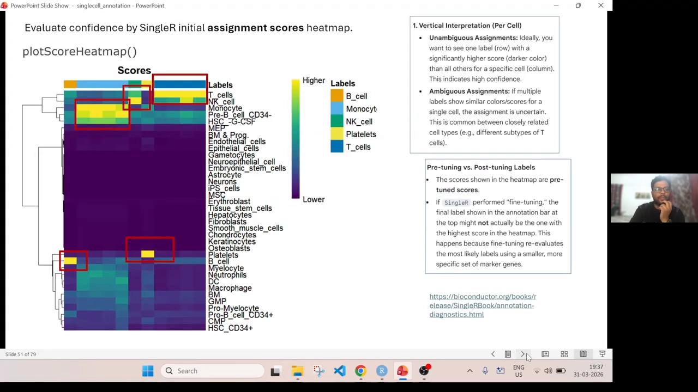
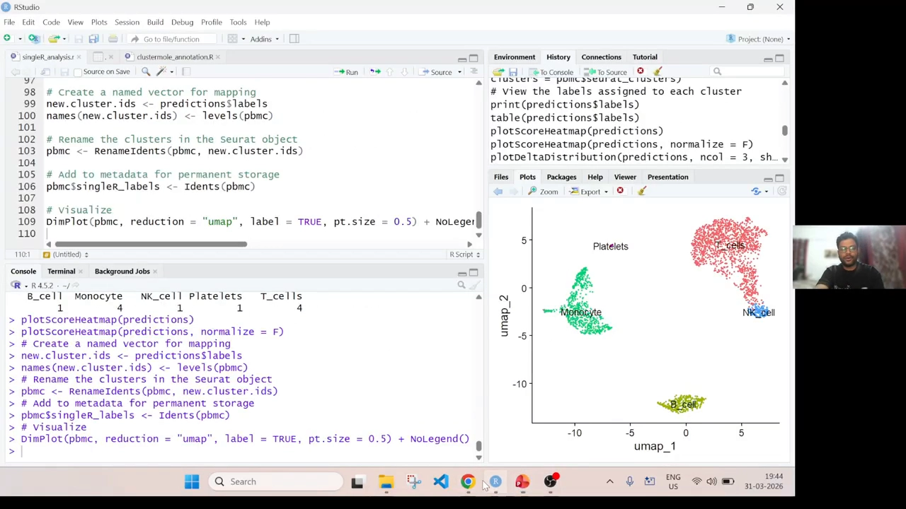
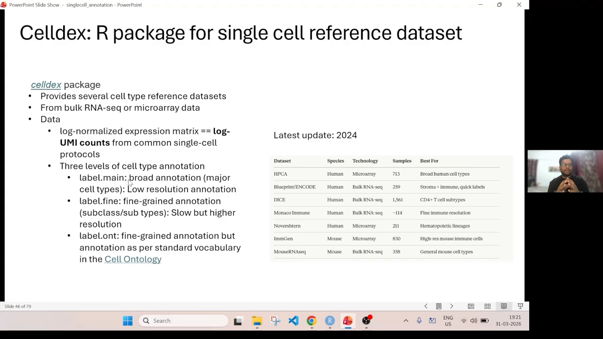
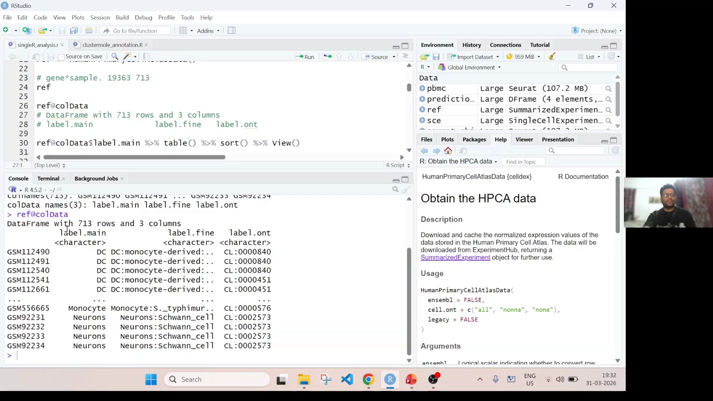
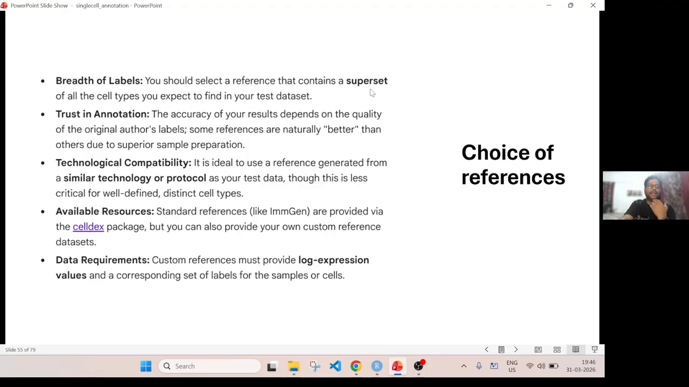
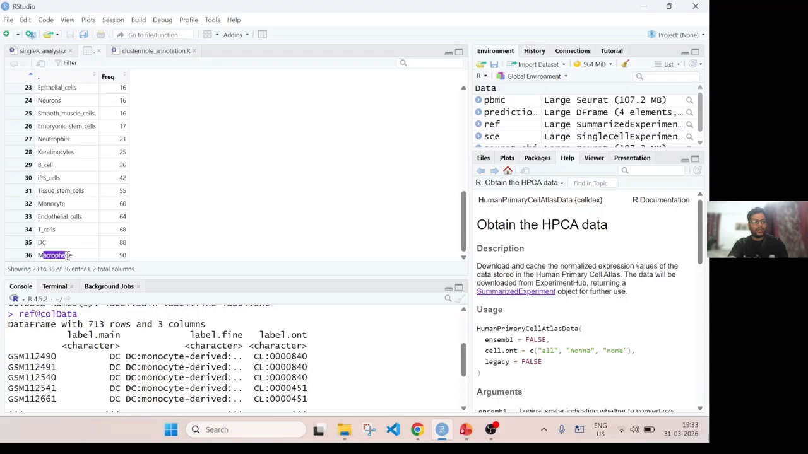

# SingleR 注释可信度：delta 分数、层级标签与参考缺失

> 视频来源：[SingleR | Reference-Based Annotation in scRNA-seq](https://www.youtube.com/watch?v=KDv67W2NZDY)（YouTube · BioinfQuests）｜时长约 34 分钟
> 简要导读：这支教程把 SingleR 从原理讲到实操，最有价值的部分不是"怎么跑一行代码"，而是**跑完之后怎么读分数**：delta 分数是什么、为什么它不等于概率、分数热图和 delta 分布图各自能看出什么、标签层级（main/fine/ontology）怎么选、参考缺了细胞类型时会出现什么现象。讲者本人在视频里把 delta 的方向读反过一次并当场纠正，正好是这一节要防的误读。

## 本讲要解决的核心问题（SCQA）

**背景**：参考映射（reference-based annotation）是单细胞注释的第二条主线。做法很直接：拿一份已经标好类型的参考数据，把查询数据里每个细胞和参考比一比，谁最像就把谁的名字贴上去 [【跳转到 01:40】](https://www.youtube.com/watch?v=KDv67W2NZDY&t=100)。

**冲突**：这类工具**总会给出一个标签**。哪怕这个细胞的真实类型根本不在参考里，哪怕它和第一名、第二名几乎一样像，输出结果里仍然是一个干净的细胞类型名字。标签本身不携带"我有多确定"的信息，而下游所有分析都会把这个名字当成事实继续用。

**疑问**：怎么判断一条参考映射出来的标签可不可信？当证据不足时，能不能不给名字？参考里没有的类型，会以什么形式暴露出来？

**回答（中心思想）**：可信度不是一个数字，而是**三个互相独立的来源**——分数差距（delta）、标签层级（main / fine / ontology）、参考覆盖（参考里有没有、有多少样本支持这个类型）。三者要分开读：delta 低是"待复核"的信号，不等于"标签错"；层级选错会让标签看起来比证据更细；参考缺失则会伪装成"低置信度的正常标签"。**低 delta 的群要先当成候选，而不是直接当噪声删掉**——它可能是真未知、可能是双细胞或中间态，也可能只是参考里这个类型只有一两个样本。

## 一、参考映射只回答"最像谁"，不回答"是不是"

### 1.1 三条技术路线，同一个前提

讲者把参考类方法分成三组 [【跳转到 01:45】](https://www.youtube.com/watch?v=KDv67W2NZDY&t=105)：

1. **相关性路线**：SingleR 用 Spearman 相关系数把查询细胞和参考样本逐一比较；
2. **投影路线**：Azimuth 把查询细胞投影到参考的 PC 空间里，落在谁的地盘就贴谁的标签；
3. **机器学习路线**：CellTypist、scVI 这类已经训练好的分类器直接输出类别。

三条路线的共同前提是**必须有一份参考**。参考可以来自 celldex 这类打包好的资源（HPCA、Blueprint、DICE 等），也可以自己从论文或实验室数据里做一张"基因 × 样本"的矩阵 [【跳转到 03:25】](https://www.youtube.com/watch?v=KDv67W2NZDY&t=205)。这决定了后面所有可信度问题的根源：**标签的上限由参考决定，不由算法决定**。

### 1.2 一个细胞是怎么被打上标签的

SingleR 的流程可以拆成五步 [【跳转到 14:28】](https://www.youtube.com/watch?v=KDv67W2NZDY&t=868)：

1. **挑基因**：参考数据里先做差异表达，只留下能区分各类型的基因（比如两万个基因里留两百个）。这也是参考必须是 log 标准化数据的原因——它要算差异表达；
2. **算相关**：查询细胞对参考里**每一个样本**算 Spearman 相关，得到一串相关系数；
3. **按类型聚合**：把属于同一细胞类型的那些样本的相关系数排序，取 80% 分位数，作为这个细胞对该类型的得分 [【跳转到 09:53】](https://www.youtube.com/watch?v=KDv67W2NZDY&t=593)；
4. **初判 + 微调（fine-tuning）**：先取分数最高的两个类型，只在这两个类型之间重算差异基因、重算相关，如此迭代，直到只剩一个标签；
5. **算 delta**：最后一轮里，第一名和第二名的分数差就是 delta。

注意第 4 步的含义：**微调会让最终标签和"全类型一起比"时的最高分不一定一致**。因为最后一轮只用了区分前两名的那批基因，比较的尺子换了。这一点在后面读分数热图时会直接踩坑。

## 二、delta 分数：它是什么，以及三种典型误读

### 2.1 定义：第一名和第二名的差距

$$
\Delta = \text{Score}_{\text{top}} - \text{Score}_{\text{next}}
$$

讲者的原话是：**delta 越高，说明第一名越明显地甩开了其他候选，你就越有信心**；delta 低则提示这条指派是模糊的 [【跳转到 14:33】](https://www.youtube.com/watch?v=KDv67W2NZDY&t=873)。幻灯片上把低 delta 的三种可能写得很清楚：这个细胞可能是**杂交/过渡态（hybrid）**、可能是**双细胞（doublet）**，也可能**参考里根本没有完全匹配的类型**。

这里有个容易混淆的细节：SingleR 提供两种 delta [【跳转到 23:42】](https://www.youtube.com/watch?v=KDv67W2NZDY&t=1422)：

- **delta.next**：第一名减第二名，衡量"冠亚军差距"；
- **delta.median**：被指派的那个类型的得分，减去该细胞对所有类型得分的**中位数**，衡量"这个类型比一堆无关类型高多少"。

讲者引用 SingleR 文档的解释是：假设参考里大多数类型与某个细胞无关，那么该细胞对所有类型得分的中位数就可以当作**基线相关**；delta.median 衡量的是指派类型比这条基线高多少。所以**换一种 delta，阈值就不能照搬**。

### 2.2 误读一：把 delta 当成概率

delta 是一个**排序差距**，不是经过校准的概率。0.3 不代表"70% 的把握"，也不代表"30% 会错"。它的量纲取决于参考里有多少类型、每个类型有多少样本、以及用的是 next 还是 median。讲者在实操里看到 delta 中位数落在 0.3 附近时，直接说了一句很诚实的话：**"我不知道该选什么尺度，得去看他们推荐的值"** [【跳转到 26:13】](https://www.youtube.com/watch?v=KDv67W2NZDY&t=1573)。这正说明：**不存在跨数据集的通用 delta 阈值**，只有"同一份参考、同一批数据内部的相对高低"。

### 2.3 误读二：把方向读反

视频里有一个很有教学价值的瞬间：讲者先看到 B 细胞群的 delta 只有 0.1，脱口而出"delta 很低说明很自信"，随即自己纠正——**低 delta 意味着第一名和第二名贴得很近，这条指派反而更不可靠** [【跳转到 25:48】](https://www.youtube.com/watch?v=KDv67W2NZDY&t=1548)。方向搞反的代价很直接：最该复核的那群细胞被当成了最可靠的结论。

### 2.4 误读三：只看总体中位数，不看按类型的分布

单个数字（比如全数据集的 delta 中位数）会把问题平均掉。真正有用的是**按标签分组的 delta 分布**：如果某个类型的 delta 中位数明显低于其他类型，说明这一类的所有指派都摇摇欲坠 [【跳转到 27:12】](https://www.youtube.com/watch?v=KDv67W2NZDY&t=1632)。

图里还有一层信息：**pruning（剪枝）**。SingleR 可以把低 delta 的指派标成"不指派"，也就是在结果里留空而不是硬给一个名字。这就是"拒绝注释"在工具层面的落点——不是所有细胞都必须有名字。

## 三、分数热图：一次看完所有候选，而不是只看赢家

只看最终标签，等于只看考试第一名，看不到第二名差多少。`plotScoreHeatmap()` 把"每个细胞 × 每个参考类型"的得分矩阵画成热图 [【跳转到 21:38】](https://www.youtube.com/watch?v=KDv67W2NZDY&t=1298)。

读法只有两条：

- **理想情况**：竖直看一列，只有一行明显更亮（幻灯片上写的是 "one label with a significantly higher score"）。这说明这个细胞的归属清晰；
- **模糊情况**：同一列里多行都亮。这常见于**近缘类型**之间——比如 T 细胞的几个亚型，彼此的差异基因本来就少，微调时容易来回摇摆。

讲者特别提醒了一个坑：**热图画的是微调之前的分数**。因为微调换了一批基因重算，最终标签有可能不是热图里最亮的那一行 [【跳转到 21:38】](https://www.youtube.com/watch?v=KDv67W2NZDY&t=1298)。看到"最终标签和热图最高行不一致"时不要以为出了 bug，但也不能拿热图去反推最终结论——两者是不同轮次的分数。

## 四、标签层级：main / fine / ontology 是三个不同的答案

### 4.1 三级标签各是什么

celldex 的参考为每个样本提供三列标签 [【跳转到 06:03】](https://www.youtube.com/watch?v=KDv67W2NZDY&t=363)：

| 层级 | 含义 | 代价 |
| --- | --- | --- |
| `label.main` | 大类（T cell、B cell、Monocyte），层级少、分辨率低 | 快，但会把几个群压成同一个名字 |
| `label.fine` | 细粒度（subclass、subtype） | 慢一些，分辨率更高 |
| `label.ont` | 与 `label.fine` 同级，但额外给出 Cell Ontology 的标准编号 | 便于跨数据集对齐 |

### 4.2 层级一致性：先粗后细，而不是一步到位

讲者给的操作顺序是：**先用 `label.main` 拿到大类，再对"被合并成一坨"的那些群用 `label.fine` 细分** [【跳转到 06:28】](https://www.youtube.com/watch?v=KDv67W2NZDY&t=388)。这条建议背后是"层级一致性"的要求：一个标签必须和它的上位标签相容——如果大类判成了 T 细胞，细标签却给出一个非淋巴系的亚型，那这两级之间就矛盾了，必须回去查。

实操里更常见的不一致是**粒度错配**：用 `label.main` 时，四个本来分开的群全被叫成 T_cells，看起来"注释得很干净"，其实把异质性藏起来了；反过来，用 `label.fine` 时，参考里没有的亚型也会被硬塞一个最接近的细名字，看起来"很精确"，其实是过度解读。

### 4.3 ontology 编号解决的是"同名不同物"

`label.ont` 给的是 CL 编号（如 `CL:0000840`、`CL:0002573`），而不是字符串名字 [【跳转到 17:06】](https://www.youtube.com/watch?v=KDv67W2NZDY&t=1026)。它的用处是：不同参考、不同论文里同一个类型可能写成 "DC"、"dendritic cell"、"monocyte-derived DC"，只有编号能确认它们是不是同一个概念。跨数据集合并标签时，**先对齐编号，再对齐名字**。

## 五、参考缺失：低 delta 最需要警惕的情形

### 5.1 参考必须是"超集"

讲者对选参考给的第一条要求是：**参考要包含你预期在查询数据里出现的所有细胞类型的超集** [【跳转到 30:33】](https://www.youtube.com/watch?v=KDv67W2NZDY&t=1833)。理由很直接：参考里没有的类型，工具不会说"没有"，只会把它派给最接近的那个类型。

同一张幻灯片还列了另外三条：**原始标注的可信度**（有些参考因为样本制备更好而天然更准）、**技术兼容性**（芯片数据和单细胞数据比，能对上但别指望很准）、**自定义参考的数据要求**（必须是 log 表达值，并且带样本或细胞的标签）。

### 5.2 参考内部的"稀有"：一个类型只有一两个样本

讲者在看参考的元数据时做了一件很值得学的事：**先数每个细胞类型有多少个样本支持** [【跳转到 18:01】](https://www.youtube.com/watch?v=KDv67W2NZDY&t=1081)。

视频里他指出的正是这种极端情形：某个类型在参考里只有两个样本，而巨噬细胞有 90 个。他的判断是：**这类只有一两个样本支撑的类型，即使被预测出来，置信度也会很低**。注意这里"稀有"说的是**参考侧的支持度**，不是查询侧那个群的大小。一个类型在参考里稀有，和它在真实样本里是否稀有，是两件事：前者会直接压低 delta；后者会不会出问题，则取决于参考里有没有这个类型（见下一节）。

### 5.3 参考里没有真实类型时，会发生什么

这是本节最需要记住的一条：**低 delta 尤其重要，当细胞的真实标签根本不在参考里时** [【跳转到 27:48】](https://www.youtube.com/watch?v=KDv67W2NZDY&t=1668)。此时工具仍然会输出一个标签（因为总有一个"最像"的），但这个标签在生物学上是错的。它的唯一痕迹就是**分数差距很小**——第一名和第二名半斤八两，因为真正的答案根本不在候选列表里。

所以"低 delta"不是一种错误，而是一种**信号**：它把"参考覆盖不足"这件事从不可见变成可见。忽略这个信号，就会把"参考里没有的类型"当成"参考里某个类型的低质量样本"处理掉。

## 六、把"未知"当成一个合法输出

### 6.1 工具层面的拒绝：pruning

SingleR 的 `plotDeltaDistribution()` 可以显示剪枝结果：低于阈值的指派被标成 `Pruned = TRUE`，在结果里不再给出类型 [【跳转到 27:12】](https://www.youtube.com/watch?v=KDv67W2NZDY&t=1632)。这是最省事的一种"拒绝注释"——把不确定的细胞留空，而不是硬塞一个名字。

但剪枝只是把问题标出来，它不告诉你那些细胞到底是什么。所以还需要第二步。

### 6.2 人工层面的复核：换方法、回看 marker

讲者在结尾给的结论很朴素：**"你必须用多种方法得出最终答案"**——把参考映射的结果拿去和 marker 基因对照，做一次共识判断 [【跳转到 29:18】](https://www.youtube.com/watch?v=KDv67W2NZDY&t=1758)。他没有展开怎么对 marker，因为那是另一条路线的事（本项目的 marker 注释流程见 [3.2.4](../3.2.4_标记基因组合与细胞类型注释/一次真实的细胞注释：差异基因、SingleR%20与人工%20marker%20三路对照.md)）。

把视频里的做法和 3.2.4 的流程接起来，复核顺序大致是：

1. **先看 delta 分布**，找出 delta 中位数偏低的类型，而不是逐细胞看；
2. **再看分数热图**，确认这些细胞的候选是不是集中在几个近缘类型上（是近缘 → 层级问题；是毫不相干的类型 → 参考覆盖问题）；
3. **回到 marker**：低 delta 的群是否有一组自洽的 marker？如果 marker 支持某个类型而参考没给，问题在参考；如果 marker 也不自洽，问题在细胞本身（双细胞、环境 RNA、低质量）；
4. **决定输出粒度**：证据只够大类就输出大类，不够就留"未知/待定"，不要为了表格好看硬填。

### 6.3 一个反直觉的结论：宽泛层级反而更稳

讲者提到，如果某个类型在宽泛层级（`label.main`）下 delta 很低，换成细粒度（`label.fine`）后置信度**可能反而变高** [【跳转到 27:37】](https://www.youtube.com/watch?v=KDv67W2NZDY&t=1657)。原因是细粒度重算差异基因时，比较的对象更聚焦。这条提醒我们：**delta 低不一定是"这个细胞不像任何类型"，也可能只是"当前层级的候选太挤"**。所以在放弃注释之前，值得换一个层级再试一次。

## 七、稀有类型不是噪声：低 delta 的三种来源要分开

低 delta 的群在实操里最容易被一刀切掉——"分不清就删掉"。但视频给出的证据说明，低 delta 至少有三种完全不同的来源，处理方式也完全不同：

| 来源 | 表现 | 该怎么处理 |
| --- | --- | --- |
| **参考缺失**（真未知类型） | 候选分散在几个不相干的类型上，marker 自成一派 | 补参考或标为未知，不能删 |
| **生物学中间态 / 双细胞** | 候选集中在两个近缘或相邻谱系的类型上，marker 两套都有 | 先排查双细胞与环境 RNA，再谈过渡态 |
| **参考侧稀有**（该类型只有一两个参考样本） | 该类型的 delta 整体偏低，但群内 marker 一致 | 保留标签但降级表述，扩充参考后重跑 |

三条的共同点是：**"分不清"是参考和证据的问题，不是细胞的问题**。把它当成噪声删掉，等于用参考的缺陷去惩罚数据。反过来说，也不能因为"稀有"就默认它是新类型——判据要落在 marker 是否自洽、是否在多个样本/供体里重复出现、以及能否排除双细胞与环境 RNA 上。这几步的机制分别在本项目的 [2.2.4 双细胞污染](../../../2_从样本到表达矩阵/2.2_数据对象与观测偏差/2.2.4_双细胞污染：混合转录组、同型与异型双细胞/DoubletFinder%20剔除双细胞：原理、参数与单样本实操.md) 和 [2.2.5 环境 RNA 污染](../../../2_从样本到表达矩阵/2.2_数据对象与观测偏差/2.2.5_环境%20RNA%20污染：背景转录本、估计与校正/SoupX%20与%20DecontX%20对比：环境%20RNA%20校正的两种背景估计.md)。

## 小结

- **参考映射永远会给出标签**，所以"有标签"不能当成"注释完成"；可信度要另外读。
- **delta 是排序差距，不是概率**：它没有跨数据集的通用阈值，方向不能读反，也不能只看总体中位数。
- **分数热图看的是"赢家赢多少"**：一列里多行同时亮，说明候选太挤（近缘类型）或参考不匹配；注意热图是微调前的分数。
- **标签层级要显式选择**：`label.main` 快但会压平异质性，`label.fine` 细但容易过度解读，`label.ont` 用编号解决同名不同物。
- **参考必须是超集**：参考里没有的类型不会报错，只会被派给最像的那个；支持样本只有一两个的类型，置信度天然低。
- **低 delta 是信号不是错误**：它同时可能是"参考缺失"、"中间态/双细胞"、"参考侧稀有"。先分类，再决定是补参考、留未知，还是保留但降级表述。
- **拒绝注释是合法输出**：剪枝 + 多方法共识 + marker 复核，比给每个细胞硬填一个名字更诚实。

## 关键术语速查

| 术语 | 一句话解释 |
| --- | --- |
| 参考映射（reference-based annotation） | 用已标好类型的参考数据给查询细胞贴标签的方法族 |
| SingleR | 基于 Spearman 相关的参考映射工具，按细胞类型聚合相关系数并微调 |
| delta 分数 | 第一名与第二名得分的差距，用来衡量这条指派有多"独占" |
| delta.next / delta.median | 冠亚军差距 / 指派类型得分与所有类型得分中位数之差 |
| 分数热图（plotScoreHeatmap） | 细胞 × 参考类型的得分矩阵，用来看每个细胞的候选有多集中 |
| pruning（剪枝） | 把低 delta 的指派标为不指派，即工具层面的拒绝注释 |
| label.main / label.fine / label.ont | 参考数据的三级标签：大类 / 亚型 / 带 Cell Ontology 编号的亚型 |
| Cell Ontology（CL） | 给细胞类型分配稳定编号的受控词表，用于跨数据集对齐 |
| 双细胞（doublet） | 两个细胞被当成一个捕获，表达谱是两者的混合，常表现为"两套 marker 都在" |
| 参考超集 | 参考应包含查询数据里所有预期类型，否则缺失类型只能被错配 |