# 从供体到细胞系再到培养孔：细胞系研究里「n」的四个层级

> 视频来源：[Statistics in Studies Using Cancer Cell Lines](https://www.youtube.com/watch?v=NypmmODIeRQ)（YouTube · University of Colorado Anschutz Cancer Center，讲者 Kathleen Torkko, PhD）｜时长约 57 分钟
> 导读：这是一场统计学家给基础科学家讲的「随笔式」报告，主题是细胞系研究里的三个老问题——可推广性、独立性、小样本。它最大的价值是把「n = 3」这句实验室口头禅拆开：三个孔、三周、三个细胞系都可以叫 n = 3，但只有最后一种跨了供体。本文按「参照总体 → 细胞系的取样链 → 独立性 → 培养皿与动物里的 n → 单细胞 → 小样本」重排，保留讲者的例子与数字；字幕为 YouTube 自动字幕，MCF7、HeLa、STR、Ben-David 等术语按画面与上下文订正，听辨不清的人名保持中性表述。伪 bulk 聚合与混合效应模型的实操见 [4.1.5](../4.1.5_生物重复、伪重复与伪%20bulk%20汇总：从细胞到样本的聚合/pseudobulk：把单细胞聚合成样本级表达谱再做差异分析.md)，通用统计推断见 [M01](../../../../../../深度学习/数学与统计基础/M01_统计学习与科学评估基础/README.md)。

## 本讲要解决的核心问题（SCQA）

**背景**：细胞系实验有一套几乎成了行规的做法——每个条件做三个复孔，同一个实验在不同周重复三次，于是 n = 3；如果换三个细胞系，n 也是 3；如果做异种移植，每组五只鼠，n = 5。这些数字写进论文的方法部分，读者也就默认了。

**冲突**：讲者把这几张「n = 3」的图并排放在一起，问了一句：它们真的是一回事吗？三个孔是同一批细胞、同一天、同一批试剂；三周是同一批细胞、同一个操作者、不同的日子；三个细胞系才是来自三位不同患者的肿瘤。前两种的变异来源是操作噪声，第三种才是生物学变异。可它们在论文里都写作 n = 3，都被送进同一个 t 检验。

**疑问**：细胞系研究里，「一个独立重复」到底在哪一层？供体、样本、细胞系、培养孔、单个细胞，这五层里哪一层才是统计单位？

**回答（中心思想）**：**细胞系研究的统计单位是「供体」，而细胞系只是供体的一个代理。** 一个细胞系源自一位患者的一块肿瘤，经过病理取材、永生化、传代，早已不是那位患者的肿瘤；因此「n 个细胞系」最多等于「n 位供体」，而「n 个孔」「n 次实验」「n 个细胞」都只是同一个供体内部的重复。层级搞错的方向是固定的：把下层当上层，n 被虚增、方差被压小、假阳性变多；把上层当下层，n 被压到个位数、效能不足、真效应被漏掉。

## 一、p 值只是工具，它背后站的是「重复」

### 1.1 一张图里的 50% 下降

讲者用一篇乳腺癌论文的图 2 开场：MCF7 细胞先加雌激素，再加抑制雄激素受体的药物，看雌激素受体的基因组结合事件如何变化。看图 D 的直觉是——加了 AR 抑制剂之后，每千个细胞检测到的结合事件下降了约 50%，效应相当大。[【跳转到 02:11】](https://www.youtube.com/watch?v=NypmmODIeRQ&t=131) [【跳转到 02:36】](https://www.youtube.com/watch?v=NypmmODIeRQ&t=156)

她特意把这张图「改」过一次：先去掉统计标记给大家看，再把原始版本（带四个星号、p < 0.0001）放出来。她的观点是：**光看数据你就能看出差异，统计检验未必让它更重要。**[【跳转到 03:01】](https://www.youtube.com/watch?v=NypmmODIeRQ&t=181)

### 1.2 p 值不负责「重要」，只负责「指向」

讲者点名了一种常见误读：说「药 B 比药 A 更重要，因为它的 p 值更小」。她的纠正很干脆——p 值不是用来告诉你「这很重要」的，它只是指向某个可能重要的方向；真正重要的是你在数据里观察到的那个差异。p 值更像孵箱、显微镜这类工具，是你研究生物学时用的东西，而不是结论本身。[【跳转到 03:26】](https://www.youtube.com/watch?v=NypmmODIeRQ&t=206) [【跳转到 03:51】](https://www.youtube.com/watch?v=NypmmODIeRQ&t=231)

她顺手给了一组文献计量：20 年前《Cancer Cell》上只有 70%~80% 的研究论文提到用了 p 值，近年接近 100%；生理学领域也差不多。所以「我的数据本身已经够有说服力」并不能让你免于回答「p 值在哪」。[【跳转到 05:16】](https://www.youtube.com/watch?v=NypmmODIeRQ&t=316)

这一段的作用是铺垫：既然 p 值跑不掉，那它依赖的东西——**重复**——就必须先搞清楚。因为 p 值是从「重复之间的变异」算出来的，重复是什么，p 值就在回答什么问题。

## 二、参照总体：你的样本要代表谁

### 2.1 黄斑癌：从总体到样本

讲者造了一个虚构的罕见病「黄斑癌」（yellow spot cancer）来铺开推断统计的基本框架。假设一位研究者找齐了 2021 年科罗拉多所有被诊断该病的人——那就是**总体**，她本可以直接研究所有人。但现实不允许：受金钱与时间限制，我们只能用手边能拿到的**样本**，比如某家医院的患者。[【跳转到 08:34】](https://www.youtube.com/watch?v=NypmmODIeRQ&t=514) [【跳转到 09:14】](https://www.youtube.com/watch?v=NypmmODIeRQ&t=554)

做样本的核心想法是：**把样本当作总体的替身**，从样本的发现推断回总体。这就是推断统计：样本里算出的是统计量（公式里用罗马字母，如 $\bar{x}$），总体里存在的是真值（用希腊字母，如 $\mu$）；多数时候我们不知道真值，只能用样本估计它。[【跳转到 10:14】](https://www.youtube.com/watch?v=NypmmODIeRQ&t=614) [【跳转到 10:39】](https://www.youtube.com/watch?v=NypmmODIeRQ&t=639)

接着是零假设显著性检验的标准流程：假设「男性被诊断的年龄更小」，在样本里分别算男女均值，代入独立样本 t 检验，得到 t，再得到 p；p < 0.05 就拒绝零假设。讲者在这一页特意加了一句提醒：**公式里的零假设不是由样本决定的**，我们做的是对总体的推断，不是对样本的推断。[【跳转到 11:04】](https://www.youtube.com/watch?v=NypmmODIeRQ&t=664) [【跳转到 13:08】](https://www.youtube.com/watch?v=NypmmODIeRQ&t=788)

### 2.2 便利样本：大学医院的患者代表谁

推断统计有四个常见假设：随机抽样、独立性、正态性、等方差。讲者只展开前两个。

关于随机抽样，她承认真正的随机抽样往往做不到——我们不知道总体是什么。实际做的多是**便利样本**（convenience sample）：手边有什么就用什么。科罗拉多大学医院就在校园边上，走几步就能见到医生护士、能拿到样本和数据，方便极了。[【跳转到 15:54】](https://www.youtube.com/watch?v=NypmmODIeRQ&t=954)

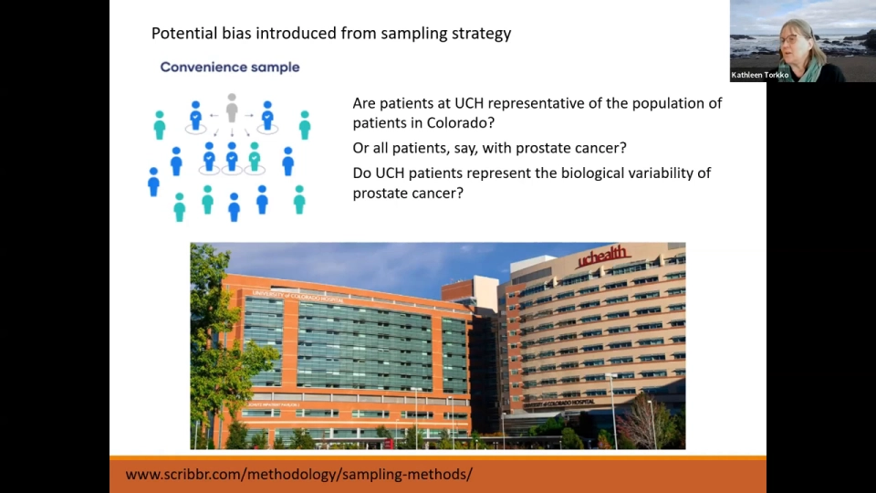

但便利样本有个必须回答的问题：这些患者代表谁？讲者给了一个自己的数据：在她正在建的数据库里，把前列腺切除标本档案与临床参数匹配后发现，在该院做前列腺切除的人里，**只有不到 40% 的活检也是在该院做的**。原因是前列腺癌的诊疗路径是「筛查 → 活检 → 观察等待或放疗/手术」，很多患者的早期诊疗在别处完成；而作为区域转诊医院，这里收的往往是需要特定治疗、病情更重的患者。[【跳转到 16:44】](https://www.youtube.com/watch?v=NypmmODIeRQ&t=1004) [【跳转到 17:54】](https://www.youtube.com/watch?v=NypmmODIeRQ&t=1074)

她的结论很克制：这不说明样本「坏」，只说明在论文里应当承认——它可能不代表前列腺癌的全貌。[【跳转到 18:24】](https://www.youtube.com/watch?v=NypmmODIeRQ&t=1104)

### 2.3 为什么这段要放在细胞系之前

因为细胞系是**同一条抽样链的下游**。如果「一位患者」只是总体的一个 n = 1 样本，那么「一个细胞系」就是「一位患者的一块肿瘤的一个子样本」——抽样偏倚不是从细胞系开始的，而是从选患者那一刻就开始了。这条链下一节展开。

## 三、细胞系的建立是一条逐级取样的链

### 3.1 从乳腺癌人群到 MCF7

讲者把细胞系的诞生画成一条自上而下的链：乳腺癌人群 → 选一位女性患者 → 取肿瘤 → 病理取材 → 原代细胞 → 化学或病毒改造使其永生化 → 细胞系 → 不同传代与培养条件。[【跳转到 18:29】](https://www.youtube.com/watch?v=NypmmODIeRQ&t=1109)

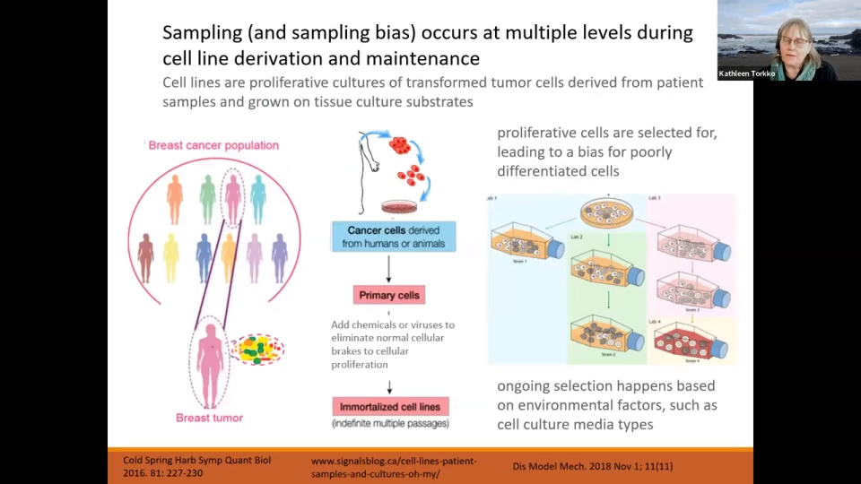

每一级都在丢代表性，讲者逐级点出：

- **选患者**：从所有乳腺癌患者里选一位，这是 n = 1。想要生物学多样性，就得取很多位女性、建很多个细胞系。[【跳转到 19:09】](https://www.youtube.com/watch?v=NypmmODIeRQ&t=1149)
- **取肿瘤**：你拿不到整个肿瘤。必须取一部分去做病理与免疫组化，看组织结构定分级、看受体状态定治疗，所以细胞系来自肿瘤的一个**子样本**。[【跳转到 19:34】](https://www.youtube.com/watch?v=NypmmODIeRQ&t=1174)
- **永生化**：加化学物或病毒解除增殖刹车。这一步很可能在**选择增殖更快的细胞**，因而偏向低分化细胞。[【跳转到 19:59】](https://www.youtube.com/watch?v=NypmmODIeRQ&t=1199)
- **传代与培养**：细胞系建立后还会随传代次数、培养基、培养方式继续发生「株系演化」，细胞一直在变。[【跳转到 20:24】](https://www.youtube.com/watch?v=NypmmODIeRQ&t=1224)

### 3.2 异质性在每一级都存在

讲者用一页「异质性无处不在」把这条链上的漏洞摊开：乳腺癌本身有很多类型，最常见的是浸润性导管癌（IDC，约 54%），还有浸润性小叶癌（约 7%）、小管癌、黏液癌、髓样癌等；肿瘤内部还有**瘤内异质性**，不同细胞群体共存；取材时取到的那一块能否代表整个肿瘤，也是个问题。[【跳转到 20:34】](https://www.youtube.com/watch?v=NypmmODIeRQ&t=1234)

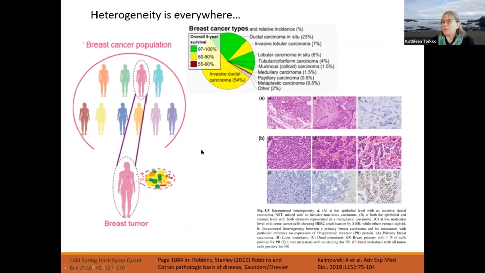

走到 MCF7 这个具体例子，讲者把问题压成三句：MCF7 是 IDC 来源、取自一位 69 岁女性胸腔积液的转移灶。那么——**MCF7 能代表所有乳腺癌患者吗？能代表那位患者原来的肿瘤吗？经过维护、传代与不同培养条件之后，MCF7 还能代表 MCF7 自己吗？**[【跳转到 21:04】](https://www.youtube.com/watch?v=NypmmODIeRQ&t=1264)

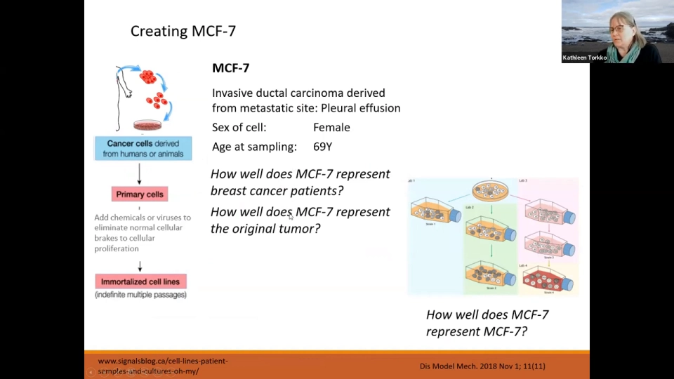

这也解释了她为什么强调细胞系鉴定（authentication）：如果你要研究 ER 阳性细胞系，你必须确认手上这批细胞**现在**仍然是 ER 阳性的。[【跳转到 21:29】](https://www.youtube.com/watch?v=NypmmODIeRQ&t=1289)

### 3.3 HeLa：一个供体，六十多年培养

讲者把这件事拉到更个人的层面：Henrietta Lacks 1951 年去世，她的细胞在培养里已经待了六十多年，被用于癌症研究之外的许多用途（包括疫苗开发）。她的问题很直接：这些细胞能代表她本人吗？能代表所有宫颈癌患者吗？她去世时 31 岁，而幻灯片上写的宫颈癌平均死亡年龄是 59 岁。这些细胞这些年变了多少？我们又怎么从这些细胞里研究到的东西推广回她本人或其他女性？[【跳转到 22:01】](https://www.youtube.com/watch?v=NypmmODIeRQ&t=1321) [【跳转到 22:26】](https://www.youtube.com/watch?v=NypmmODIeRQ&t=1346)

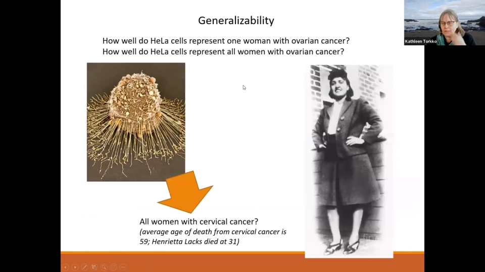

这一页把「细胞系 = 一个供体」讲透了：**HeLa 的 n 是 1**。它在培养里待得再久、被用得再多，也还是一个供体、一个肿瘤、一个时间点。

## 四、细胞系是「一个供体」，不是「一个群体」

### 4.1 参照总体的四选一

讲者把「一个细胞系、三个复孔、三次实验」画在一页上，然后问：这里的**参照总体**（reference population）是什么？[【跳转到 23:35】](https://www.youtube.com/watch?v=NypmmODIeRQ&t=1415)

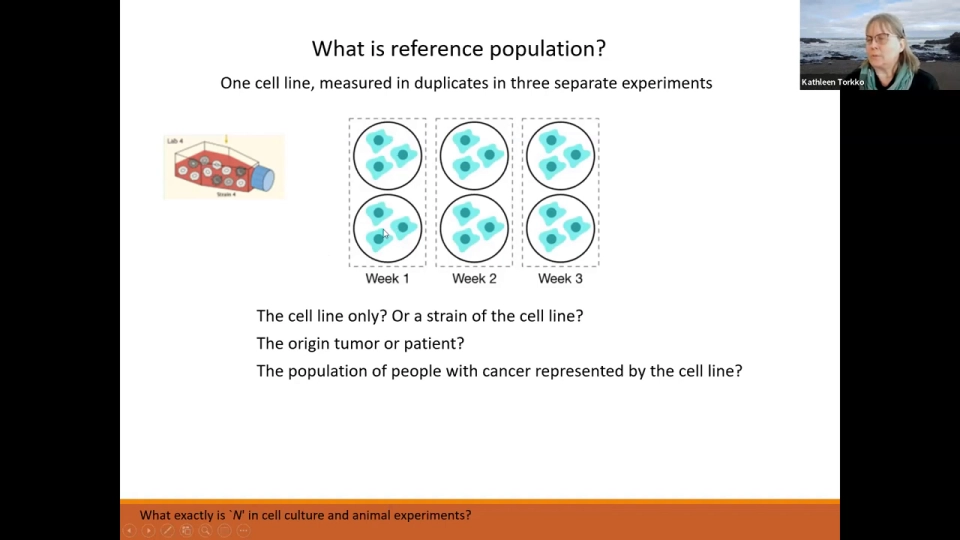

四个候选答案分别是：**只是这个细胞系**、**这个细胞系的某个株系**、**原始肿瘤或患者**、**这个细胞系所代表的癌症人群**。讲者的立场是：我们真正想推断的是最后那个（患该癌症的人群），而不是推断回手上的细胞系；但她也承认，这里存在一个断层——从细胞系到人群之间隔着好几级抽样。[【跳转到 25:15】](https://www.youtube.com/watch?v=NypmmODIeRQ&t=1515) [【跳转到 25:40】](https://www.youtube.com/watch?v=NypmmODIeRQ&t=1540)

同一个问题在异种移植里更尖锐：把细胞系注射到小鼠侧腹，随机分配处理，观察肿瘤生长。被随机分配的是**小鼠**，但你想下结论的总体是小鼠、还是肿瘤、还是细胞系？讲者说这里会「变得有点模糊」——你没法把肿瘤和小鼠背上那个「筛子」分开。[【跳转到 25:15】](https://www.youtube.com/watch?v=NypmmODIeRQ&t=1515) [【跳转到 24:40】](https://www.youtube.com/watch?v=NypmmODIeRQ&t=1480)

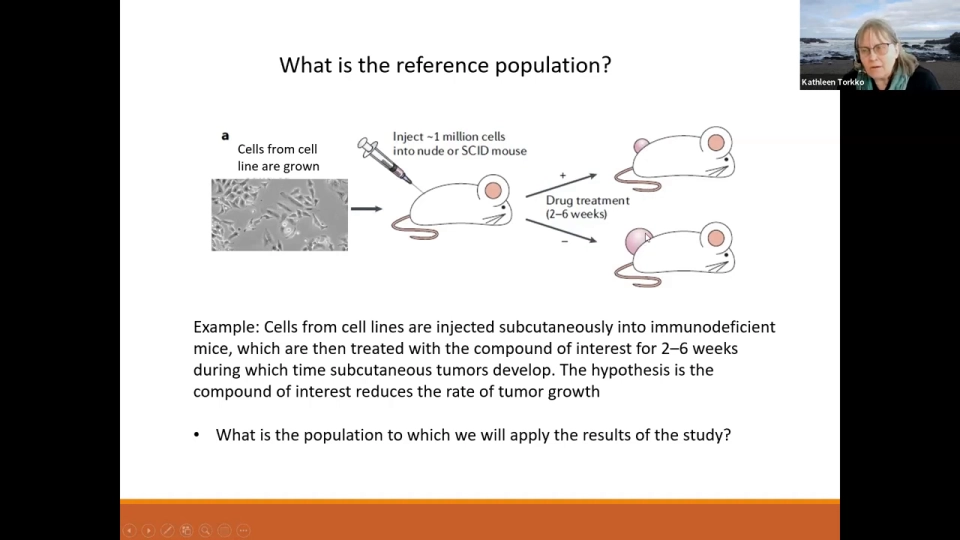

### 4.2 STR 图谱与 MCF7 的演化

Q&A 里，一位听众（Christopher，多年做基于 STR 基因分型的细胞系鉴定）补了两篇论文的结论：两篇都研究 MCF7，发现**同一批 MCF7 中相隔三次传代的两份分装，八个位点的 STR 图谱完全相同，但对药物的反应差异巨大**；其中 Ben-David 等人的工作还做到单细胞层面，发现源自单个细胞的不同分装对药物的反应也不同。[【跳转到 51:44】](https://www.youtube.com/watch?v=NypmmODIeRQ&t=3104) [【跳转到 52:09】](https://www.youtube.com/watch?v=NypmmODIeRQ&t=3129)

他顺带纠正了一个流行误解：**STR 图谱 80% 匹配并不等于「同一个细胞系」**，它的意思是「来自同一位患者」，并不排除这些细胞已经在培养中演化过。他见过二三十份 MCF7 样本，图谱各不相同，但都源自同一个人。[【跳转到 52:34】](https://www.youtube.com/watch?v=NypmmODIeRQ&t=3154) [【跳转到 53:01】](https://www.youtube.com/watch?v=NypmmODIeRQ&t=3181)

讲者的回应补上了统计含义：MCF7 已经算是相对「稳定」的细胞系了，外面仍有致病性更强的变体，而它们全都被当作等同的来用。更麻烦的是，培养中的演化**未必反映人身上肿瘤的演化**，因为环境完全不同——这也是三维培养被当作更好模型的原因。[【跳转到 53:21】](https://www.youtube.com/watch?v=NypmmODIeRQ&t=3201) [【跳转到 54:28】](https://www.youtube.com/watch?v=NypmmODIeRQ&t=3268)

对统计的启示是：**「同一个细胞系」这个前提本身就不稳**。如果连「这批细胞是不是上周那批」都要打问号，那么把它当作一个稳定的、可重复的观测单位就更勉强了。

## 五、独立性：依赖从哪里来

### 5.1 定义与三个例子

讲者把独立性讲成它的反面——依赖性：数据或对象独立，指的是每个对象或标本只做一次测量，且对象之间没有关系、在测量层面上互不影响；当你在同一个人或同一个标本上重复做同样的测量（同一时刻的技术重复，或随时间反复测量），就出现了依赖性。[【跳转到 26:05】](https://www.youtube.com/watch?v=NypmmODIeRQ&t=1565) [【跳转到 26:30】](https://www.youtube.com/watch?v=NypmmODIeRQ&t=1590)

她给了三个递进的例子：研究无关个体时可以大致假定独立；研究兄妹时不行，因为他们共享一部分遗传物质、也共享相似环境；研究同卵双胞胎时更不行，除非研究本身就是关于同卵双胞胎的。[【跳转到 27:16】](https://www.youtube.com/watch?v=NypmmODIeRQ&t=1636)

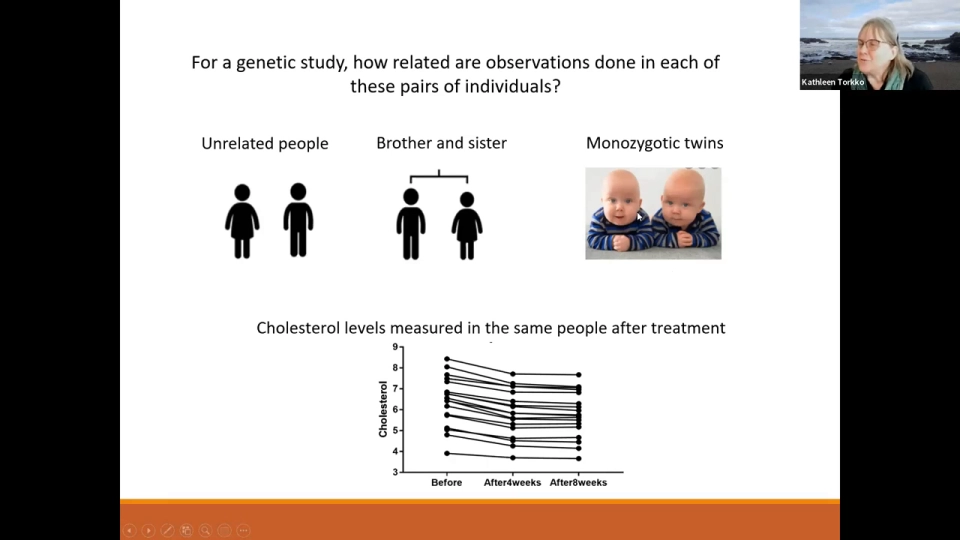

第三档是重复测量：给患者用药，在基线、4 周、8 周各测一次胆固醇。图里每条线是一位患者，看起来药有效、各条线也大致平行；但起点高的人降完仍比起点低的人高——**用重复测量算出来的变异，比把这些观测当作人与人之间相互独立的观测时要小**。[【跳转到 27:41】](https://www.youtube.com/watch?v=NypmmODIeRQ&t=1661) [【跳转到 28:06】](https://www.youtube.com/watch?v=NypmmODIeRQ&t=1686)

### 5.2 t 统计量：依赖为什么总是朝「更显著」偏

讲者回到 t 统计量，逐项说明它怎么变大：

$$
t = \frac{\bar{x}_1 - \bar{x}_2}{\sqrt{\dfrac{s_1^2}{n_1} + \dfrac{s_2^2}{n_2}}}
$$

- **增大样本量**：分母里的 $s^2/n$ 变小，整个分母变小，$t$ 变大；
- **增大效应量**：分子变大，$t$ 变大；
- **减小变异**：$s^2$ 变小，分母变小，$t$ 变大。

[【跳转到 28:31】](https://www.youtube.com/watch?v=NypmmODIeRQ&t=1711) [【跳转到 29:01】](https://www.youtube.com/watch?v=NypmmODIeRQ&t=1741)

依赖性的危险正在第三条：它**在你没意识到的情况下压小了变异**，于是 $t$ 变大、p 变小，你更容易犯第一类错误（假阳性）。所以她强调：知道数据是独立还是依赖，会影响研究设计、样本量，以及该用哪种检验。[【跳转到 29:46】](https://www.youtube.com/watch?v=NypmmODIeRQ&t=1786)

## 六、培养皿里的 n：孔、周、细胞系

### 6.1 一个细胞系、六个浓度、三个复孔

标准的体外实验长这样：把细胞做成悬液，按已知细胞数铺到 96 孔板，加不同浓度的药物测活力或生长。于是你得到「一个细胞系 × 六个药物浓度 × 每个浓度三个复孔」。[【跳转到 30:36】](https://www.youtube.com/watch?v=NypmmODIeRQ&t=1836)

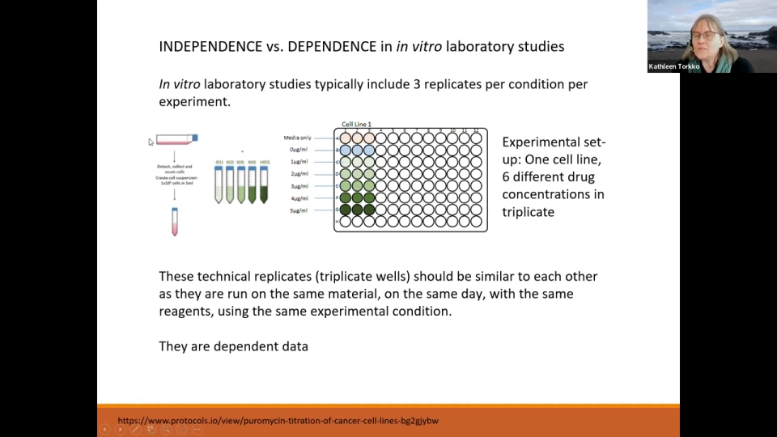

讲者的判断很明确：这三个复孔**本来就不应被当作独立观测**，它们是技术重复——用来检查你有没有吸对细胞数、加对药量，检验的是操作本身；你期望它们一致，然后把它们平均掉。它们是依赖数据，也应按依赖数据处理。[【跳转到 31:01】](https://www.youtube.com/watch?v=NypmmODIeRQ&t=1861)

### 6.2 三周三次「独立实验」

为了增大样本量，常规做法是把同一个实验在**不同的独立实验批次**里重复，比如每周做一次。重复的意义是证明效应足够稳健，能经受多次实验流程（温度、试剂等会有波动）。于是这被写作「三个独立实验，n = 3」，而这几乎成了细胞系实验里定义 n 的最低标准。[【跳转到 31:51】](https://www.youtube.com/watch?v=NypmmODIeRQ&t=1911)

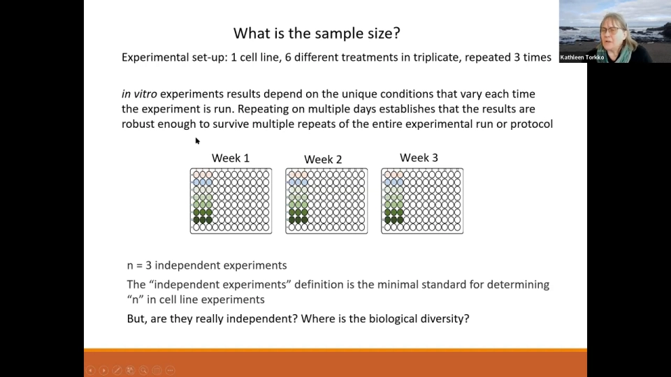

讲者的质疑是：这三周用的是同一批细胞、同一套技术、同一个操作者，测到的是**实验技术的变异**，不是生物学变异。所以在她看来，它们更像技术重复，合起来仍然只是 n = 1——尽管文献里普遍当作 n = 3。[【跳转到 32:46】](https://www.youtube.com/watch?v=NypmmODIeRQ&t=1966) [【跳转到 33:11】](https://www.youtube.com/watch?v=NypmmODIeRQ&t=1991)

### 6.3 一张图看清 n = 3 的四种含义

这一页是全片最值得记住的图。四个「n = 3」并排放在一起，从下层的孔到上层的细胞系：[【跳转到 32:46】](https://www.youtube.com/watch?v=NypmmODIeRQ&t=1966)

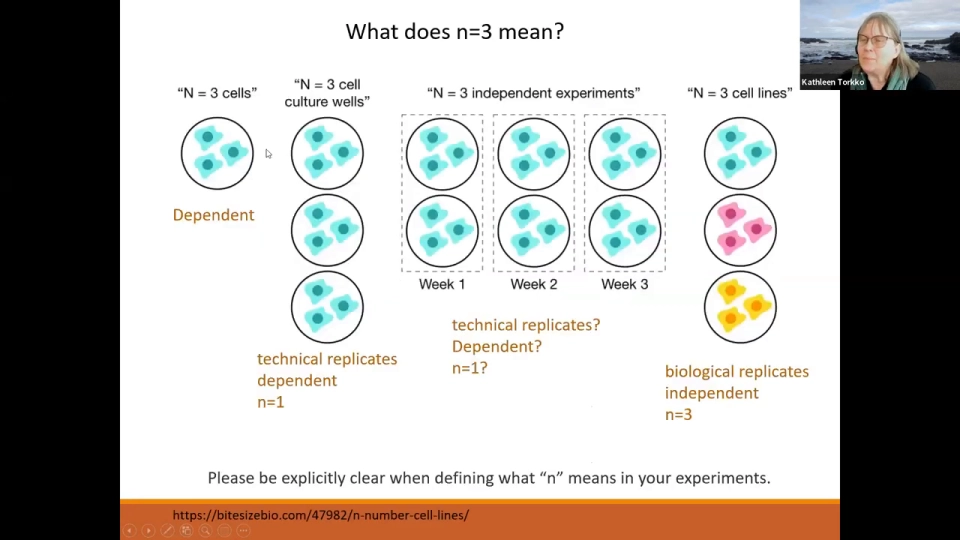

| 写法 | 实际是什么 | 是否独立 | 真实的 n |
| --- | --- | --- | --- |
| 「N = 3 个细胞」 | 同一孔里的三个细胞 | 依赖 | 1 |
| 「N = 3 个培养孔」 | 同一批细胞铺三个孔 | 技术重复，依赖 | 1 |
| 「N = 3 次独立实验」 | 同一批细胞、三周各做一次 | 技术重复，依赖 | 1（讲者观点） |
| 「N = 3 个细胞系」 | 三位不同患者的肿瘤来源 | 生物学重复，独立 | 3 |

幻灯片底部写着一句几乎可以当成本节结论的话：**在定义实验里的「n」时，请明确说清它指的是什么。**[【跳转到 33:11】](https://www.youtube.com/watch?v=NypmmODIeRQ&t=1991)

这张表也解释了为什么「同一批细胞做三周」和「三个细胞系」不能混为一谈：前者在估计技术噪声，后者在估计生物学变异。前者能告诉你「这个效应在我的操作下稳定不稳定」，后者才能告诉你「这个效应在不同的人身上是否成立」。
## 七、动物实验：神经元、窝、以及一只鼠身上的两个肿瘤

### 7.1 30 个神经元与 3 只鼠；25 只仔与 4 窝

动物研究里样本量常常就是「用了多少只动物」，5 是一个常见数字。但依赖性依然存在：可能来自笼子，也可能来自饲养管理里的「栏」「圈」这类单位。[【跳转到 34:51】](https://www.youtube.com/watch?v=NypmmODIeRQ&t=2091)

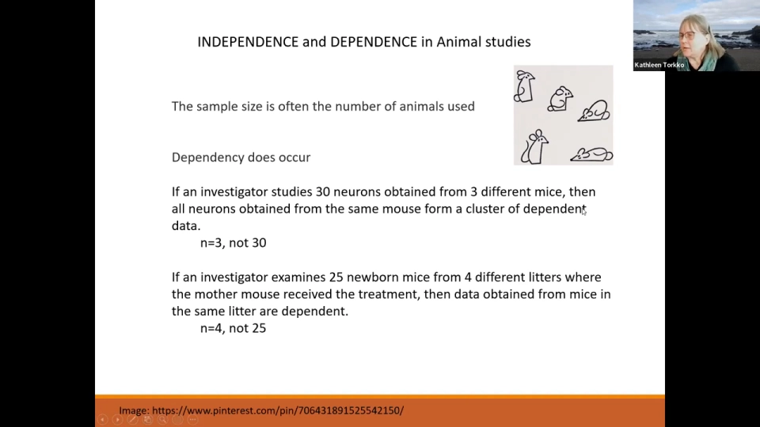

两个例子结构完全一样：

- **神经元**：测了 30 个神经元，但它们来自 3 只小鼠。同一只鼠的神经元会形成一个簇，因为这只鼠的环境、遗传等因素使它们彼此更相似，所以 n = 3 而不是 30。
- **窝**：给母鼠处理，观察对出生体重的影响。被随机分配的是母鼠（实验单位），一共 25 只仔。仔是观测单位，先按窝算均值，于是 n = 4 而不是 25。

讲者提到，做神经科学的人有时会把取自同一个脑的神经元视为独立，并把神经元个数当作样本量，理由是「每只鼠只取一个神经元要用太多动物」。她的回答分两半：要么把「同一个脑内的神经元确实独立」这个理由讲清楚、能辩护；要么改用聚类分析、混合模型这类方法，把簇内变异显式建模。但作为通则——**你手上是一簇相关的数据，决定样本量的不是它，而是那三个独立单位**。[【跳转到 35:16】](https://www.youtube.com/watch?v=NypmmODIeRQ&t=2116) [【跳转到 35:41】](https://www.youtube.com/watch?v=NypmmODIeRQ&t=2141) [【跳转到 36:06】](https://www.youtube.com/watch?v=NypmmODIeRQ&t=2166)

### 7.2 异种移植：5 只鼠、10 个肿瘤

讲者找了一篇卵巢癌的论文当靶子：把表达 Scr 与 KDM3AshRNA2 的细胞分别注射到裸鼠**右侧与左侧腹部**，肿瘤可触及后定期测体积，共用了 5 只小鼠。论文把两侧的肿瘤分开呈现，用独立样本 t 检验分析——也就是把同一只鼠身上的两个肿瘤当作独立观测，样本量是 **10 个肿瘤**而不是 5 只鼠。[【跳转到 37:46】](https://www.youtube.com/watch?v=NypmmODIeRQ&t=2266) [【跳转到 38:11】](https://www.youtube.com/watch?v=NypmmODIeRQ&t=2291)

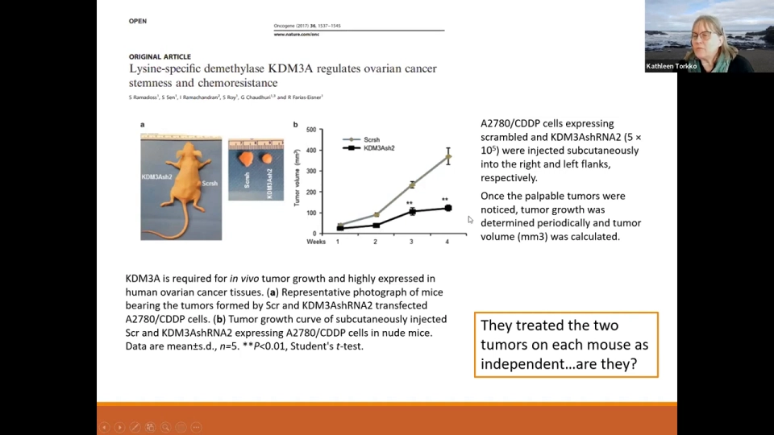

她的反驳很具体：两个肿瘤长在同一只动物身上。如果这只动物在笼中受欺负、吃不到食物、处于应激与营养不良状态，两个肿瘤都会受影响，而且不会只影响其中一个。所以它们依赖，最好的做法是**配对分析**——用同一只鼠身上肿瘤体积的差值作为测量值。[【跳转到 38:36】](https://www.youtube.com/watch?v=NypmmODIeRQ&t=2316) [【跳转到 39:01】](https://www.youtube.com/watch?v=NypmmODIeRQ&t=2341)

Q&A 里另一位听众提出反面：如果研究问题就是比较两个细胞系，把两个肿瘤放在同一只鼠身上反而更好，因为条件更相似。讲者同意——**这正是配对设计的价值：每只鼠成为它自己的对照**。分歧只在最后一步：不要把两个肿瘤当作独立肿瘤。[【跳转到 55:30】](https://www.youtube.com/watch?v=NypmmODIeRQ&t=3330) [【跳转到 55:55】](https://www.youtube.com/watch?v=NypmmODIeRQ&t=3355)

### 7.3 技术重复与伪重复：n = 1 还是 n = 3

讲者用一页把动物实验里的两类重复并排：[【跳转到 39:12】](https://www.youtube.com/watch?v=NypmmODIeRQ&t=2352)

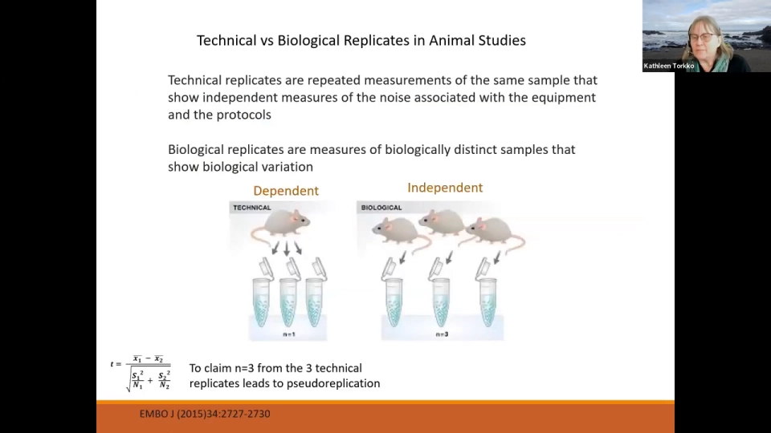

- **技术重复**是对同一个样本的重复测量，反映的是仪器与流程的噪声；它们依赖，合起来是 n = 1。
- **生物学重复**是对生物学上彼此不同的样本的测量，反映的是生物学变异；它们独立，n 等于独立样本数。

把三个技术重复当作 n = 3，就是伪重复。机制和第五节一样：$s$ 被压小、$n$ 被抬高，分母变小，$t$ 变大——**假阳性就是这样产生的**。[【跳转到 39:37】](https://www.youtube.com/watch?v=NypmmODIeRQ&t=2377) [【跳转到 40:02】](https://www.youtube.com/watch?v=NypmmODIeRQ&t=2402)

## 八、单细胞：同一个供体的细胞为什么相关

讲者把同样的逻辑推到单细胞层面，引了一篇论文的观点：人们常把取自同一个体的细胞当作独立，但来自同一个体的细胞共享由环境和遗传影响带来的共同特征，因此同一个样本、同一个供体的细胞之间基因表达更相似。[【跳转到 40:27】](https://www.youtube.com/watch?v=NypmmODIeRQ&t=2427)

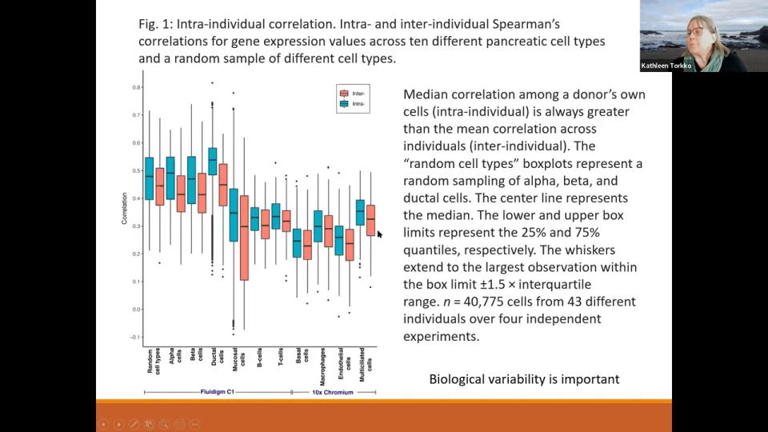

这张图的读法很直接：每一种细胞类型、每一对比较里，代表**个体内**的那个箱体都高于代表**个体间**的箱体——同一个供体的细胞彼此更相关。所以如果你只用一个供体的细胞、把它们当作独立、不承认数据里的依赖，你就带有偏向于「发现阳性结果」的偏倚。讲者也承认有相应的技术手段可以处理（她自己不做单细胞），但前提是先承认这个依赖存在。[【跳转到 40:52】](https://www.youtube.com/watch?v=NypmmODIeRQ&t=2452) [【跳转到 41:17】](https://www.youtube.com/watch?v=NypmmODIeRQ&t=2477)

把这一节与本系列的语境接上：单细胞里「细胞」是观测单位，「供体」才是实验单位。这正是 [4.1.5](../4.1.5_生物重复、伪重复与伪%20bulk%20汇总：从细胞到样本的聚合/pseudobulk：把单细胞聚合成样本级表达谱再做差异分析.md) 里伪 bulk 聚合要解决的问题——把细胞按「样本 × 细胞类型」加总，让 n 回到供体数。

## 九、小样本：效能，以及假设检验在小 n 上的失效

### 9.1 三个「行规」数字

讲者回顾了自己撞上这个问题的经过：体外实验 n = 3，动物实验每组 n = 5 或 6，这几乎就是行规。她给一个研究猪肾病的团队做样本量分析，问对方「想检测多大差异、数据变异多大」，对方回答：我们每组一直用五头猪，只用五头。这就是动物研究里的教条。[【跳转到 42:07】](https://www.youtube.com/watch?v=NypmmODIeRQ&t=2527) [【跳转到 42:32】](https://www.youtube.com/watch?v=NypmmODIeRQ&t=2552) [【跳转到 43:02】](https://www.youtube.com/watch?v=NypmmODIeRQ&t=2582)

她也提醒做「大数据」的人：这里的生物学重复指的是所用的个体，如果只在一个或几个个体上做，同样是小样本。她找到的两篇论文建议至少五个或六个生物学重复，要确证结果还需要更多。[【跳转到 43:27】](https://www.youtube.com/watch?v=NypmmODIeRQ&t=2607)

### 9.2 效能：小样本只能看见大效应

小样本的直接后果是**效能不足**：n 小的时候，只有效应非常大才可能显著，小差异根本检测不到。而差异的大小本应与它在临床上或生物学上是否重要有关，不只是数值大小。[【跳转到 43:52】](https://www.youtube.com/watch?v=NypmmODIeRQ&t=2632)

效能（power）的定义是：如果效应在总体中真实存在，你的研究或统计检验能得出 $p < 0.05$ 的概率。它常用百分比表示（「80% 效能」），是三个因素的函数，其中最容易调整的是样本量。[【跳转到 44:37】](https://www.youtube.com/watch?v=NypmmODIeRQ&t=2677) [【跳转到 45:02】](https://www.youtube.com/watch?v=NypmmODIeRQ&t=2702)

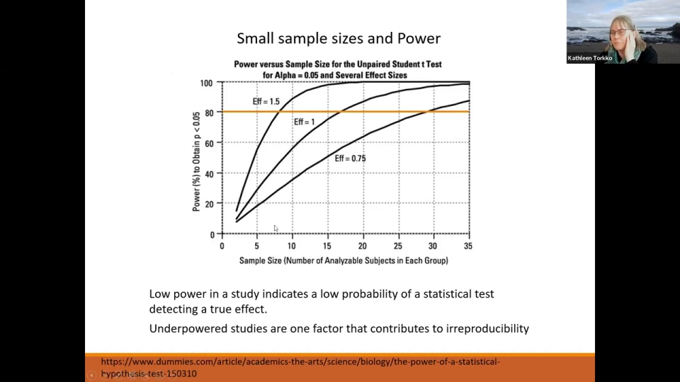

读这张图的几个数字：要达到 80% 效能，效应量 1.5 时每组约需 7~8 只动物；效应量小的时候每组约需 28 只。而如果按行规每组 5 只，最好的情况也只有大约 55% 的效能。[【跳转到 45:27】](https://www.youtube.com/watch?v=NypmmODIeRQ&t=2727) [【跳转到 45:52】](https://www.youtube.com/watch?v=NypmmODIeRQ&t=2752) [【跳转到 46:27】](https://www.youtube.com/watch?v=NypmmODIeRQ&t=2787)

她的结论是：效能不足的研究容易得到**假阴性**，这也是研究不可重复的一个来源。[【跳转到 46:52】](https://www.youtube.com/watch?v=NypmmODIeRQ&t=2812)

### 9.3 小样本连假设都验不了

推断统计的常见假设是：独立、正态、等方差。检验的办法是画图（看分布形状、看方差是否相近），也可以做正式检验，比如用 Shapiro-Wilk 检验正态性。但这些检验在小样本上没有足够效能去检出偏离，在大样本上又过于敏感。[【跳转到 47:07】](https://www.youtube.com/watch?v=NypmmODIeRQ&t=2827) [【跳转到 47:32】](https://www.youtube.com/watch?v=NypmmODIeRQ&t=2852)

于是形成一个闭环困境：小样本（通常指少于 20）不足以检验假设，图也说明不了什么，那么你无法知道自己用的检验是否合适、是否因此引入了偏倚，也无法判断一个阴性结果是「真的没有效应」还是「效能不够」。这正是她作为统计学家最不安的地方。[【跳转到 47:57】](https://www.youtube.com/watch?v=NypmmODIeRQ&t=2877) [【跳转到 48:22】](https://www.youtube.com/watch?v=NypmmODIeRQ&t=2902)

## 十、怎么办：三条建议与一条底线

讲者把全片收成一张总结页：[【跳转到 48:32】](https://www.youtube.com/watch?v=NypmmODIeRQ&t=2912)

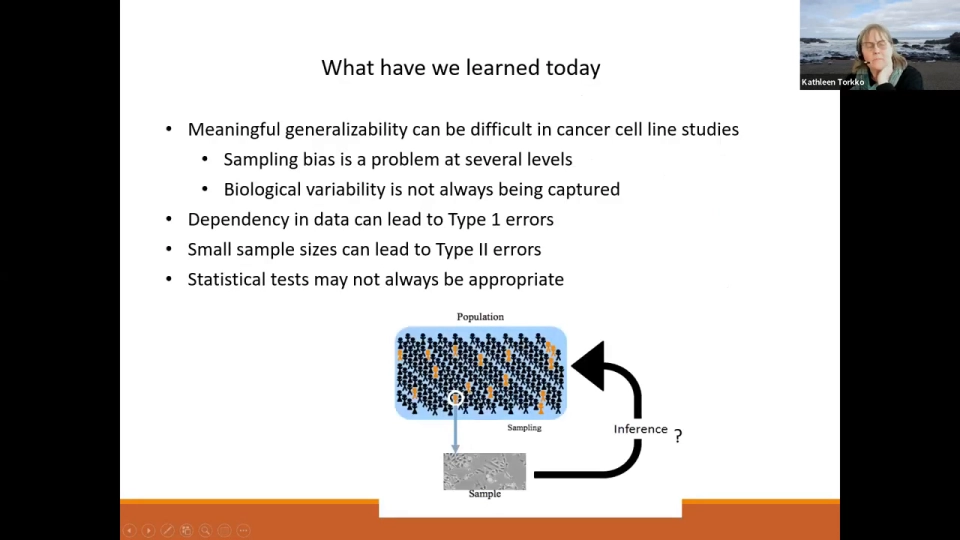

四条问题对应四条解法，其中前三条是「做得更好」，第四条是「说得更清楚」：[【跳转到 49:22】](https://www.youtube.com/watch?v=NypmmODIeRQ&t=2962)

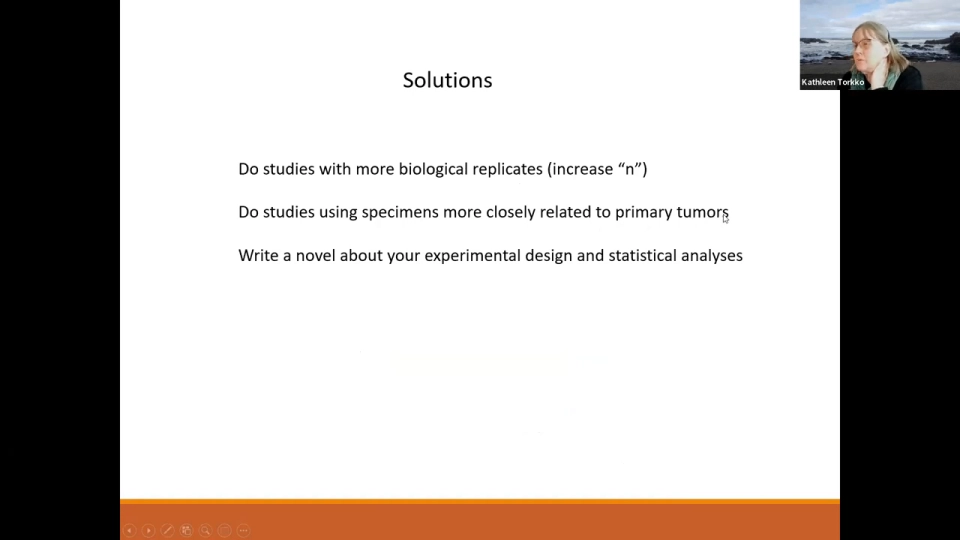

1. **做更多生物学重复**，把 n 提上去——讲者自己加了一句「说得轻巧，对吧」；
2. **用与原始肿瘤更接近的标本**（如患者来源的异种移植），减少取样链上的代表性损失；
3. **把实验设计与统计分析写详细**——她开玩笑说「写一部小说」，Nature 允许把方法学写在正文之外、不计入词数，正好用来说明清楚。

第四条是她真正的最低要求：**解释你做了什么**。如果你要把一只动物身上的两个肿瘤当作独立，就说明理由、写详细；讨论数据的局限（流行病学家通常会写一整段局限性）；并且**对每一个 n 都具体说明它指的是什么**——因为这让读者能判断你的做法是否正确、是否有效。[【跳转到 49:47】](https://www.youtube.com/watch?v=NypmmODIeRQ&t=2987) [【跳转到 50:12】](https://www.youtube.com/watch?v=NypmmODIeRQ&t=3012)

## 小结

- **细胞系研究的统计单位是供体，细胞系只是供体的代理。** 一个细胞系 = 一位患者的一块肿瘤的一个子样本；HeLa 的 n 永远是 1。
- 细胞系的建立是一条逐级取样的链：人群 → 患者 → 肿瘤 → 病理取材 → 原代细胞 → 永生化 → 传代。每一级都在丢代表性，抽样偏倚不是从细胞系才开始的。
- 参照总体要事先想清楚：你要推断的是这个细胞系、这个株系、原始肿瘤/患者，还是这个细胞系所代表的癌症人群？四者的答案不同，n 的含义也不同。
- 依赖性来自「同一个上级单位下的多次测量」：同一批细胞的三周、同一只鼠的两个肿瘤、同一个供体的多个细胞。它压小方差、放大 $t$、制造假阳性。
- 「n = 3」有四种含义：3 个细胞、3 个孔、3 次独立实验、3 个细胞系。只有最后一种跨了供体，是真正的生物学重复；前三种合起来都是 n = 1。
- 动物实验里 n 数的是动物或窝，不是神经元数、不是仔数、不是肿瘤数；同一只鼠身上的两个肿瘤应当做配对分析，而不是当作独立肿瘤。
- 单细胞里同一个供体的细胞彼此更相关（个体内相关高于个体间），把细胞当独立会偏向阳性结果；这正是伪 bulk 聚合要解决的统计单位问题（见 [4.1.5](../4.1.5_生物重复、伪重复与伪%20bulk%20汇总：从细胞到样本的聚合/pseudobulk：把单细胞聚合成样本级表达谱再做差异分析.md)）。
- 小样本的代价是双重的：效能不足导致假阴性，且连正态性、等方差这些假设都无法检验，于是你既不能相信阴性结果，也无法确认检验是否合适。
- 三条解法（更多生物学重复、更接近原发肿瘤的标本、写清设计与分析）之外，还有一条底线：**明确说明每个 n 指的是哪一层**。

## 关键术语速查

| 术语 | 一句话解释 |
| --- | --- |
| 参照总体（reference population） | 你想把结论推断回去的那个总体；细胞系研究里常常没被想清楚 |
| 便利样本（convenience sample） | 手边容易拿到的样本（如本院患者），通常无法代表目标总体 |
| 细胞系（cell line） | 源自某一位供体的一块肿瘤、经永生化后可长期传代的细胞群体 |
| 细胞系鉴定（authentication） | 用 STR 图谱等手段确认手上的细胞是不是它声称的那个细胞系 |
| STR 图谱 | 用若干短串联重复位点做细胞系身份指纹；80% 匹配只说明同一患者，不排除已演化 |
| 技术重复（technical replicate） | 对同一样本/同一批材料的重复测量，反映仪器与流程噪声，依赖，n = 1 |
| 生物学重复（biological replicate） | 对生物学上彼此不同的样本（不同供体、不同细胞系）的测量，独立，n 即样本数 |
| 伪重复（pseudoreplication） | 把技术重复或同一上级单位下的观测当作独立重复，虚增 n、压低方差 |
| 独立性（independence） | 每个对象只测一次、对象之间互不影响；重复测量、同窝、同一供体都会破坏它 |
| 第一类错误 / 第二类错误 | 假阳性（无效应却判显著）/ 假阴性（有效应却没检出）；前者多来自依赖，后者多来自小样本 |
| 效能（power） | 效应真实存在时能得出 $p < 0.05$ 的概率；常规目标 80% |
| 配对分析（paired analysis） | 把同一上级单位内的多次测量按差值处理，从而承认它们的依赖 |
| 异种移植（xenograft） | 把细胞系注射到免疫缺陷小鼠体内成瘤，用于体内药效评价 |
