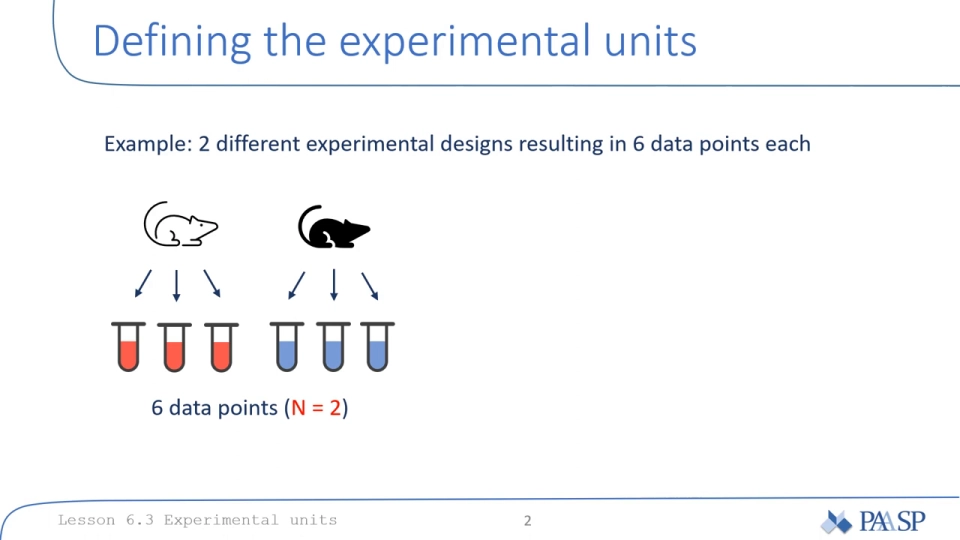
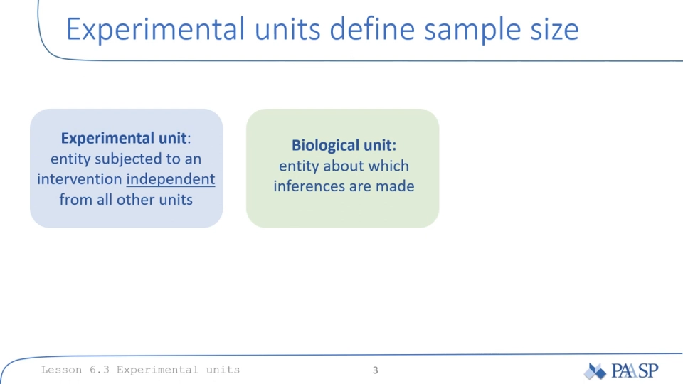
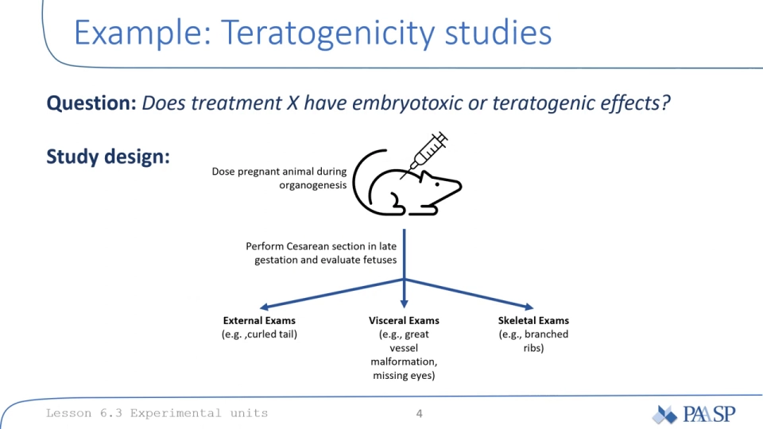
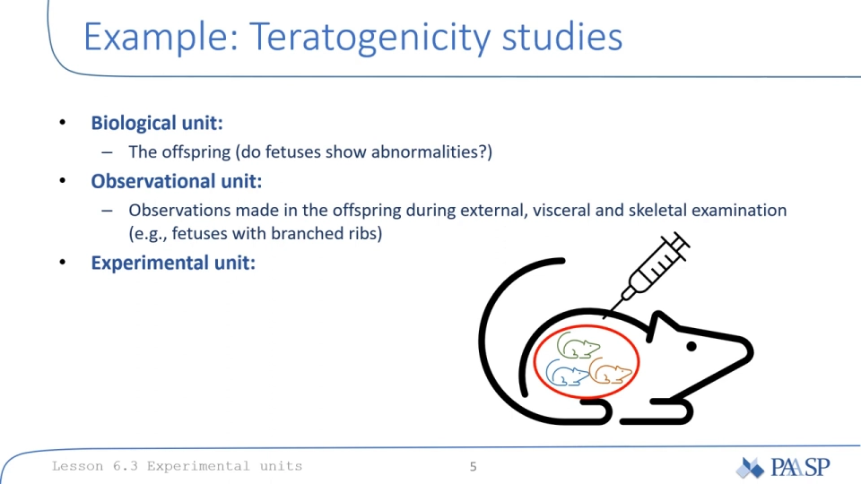
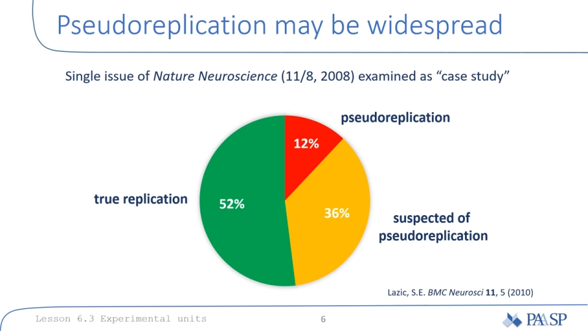
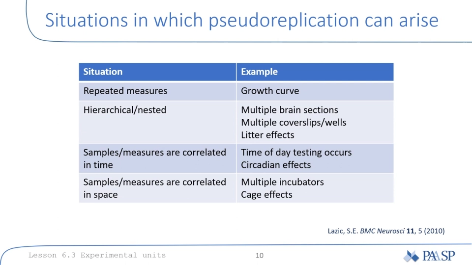
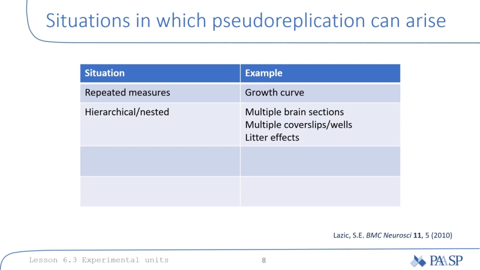
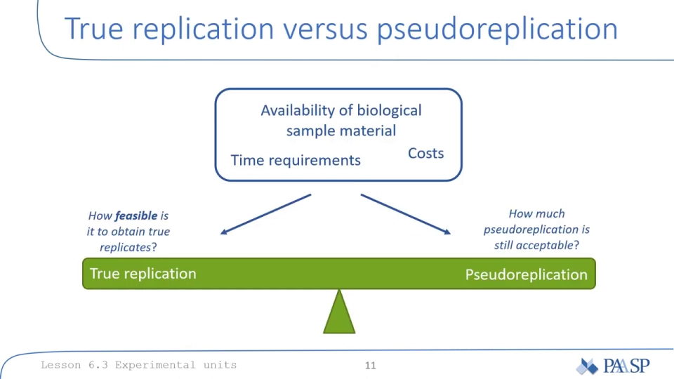

# 实验单位、生物学单位与观测单位：六个数据点为什么可能只是 n = 2

> 视频来源：[6 3 Experimental units](https://www.youtube.com/watch?v=4u6uBbojluw)（YouTube · PAASP network，Lesson 6.3）｜时长约 11 分钟
> 导读：这是一节讲「实验设计里的单位」的短课，全程用幻灯片推演，几乎每个概念都配一个具体例子：两只鼠各测三次、致畸实验里的窝、脑—切片—脑区—细胞、昼夜节律下的采血顺序、96 孔板的边缘孔。它回答的不是「怎么算 p 值」，而是**在算 p 值之前，你的 n 到底该数在哪一层**。字幕为 YouTube 英文自动字幕，本文按画面订正术语后重述；公式与统计推断的细节见 [M01](../../../../../../深度学习/数学与统计基础/M01_统计学习与科学评估基础/README.md)，从细胞到样本的聚合策略见 [4.1.5](../4.1.5_生物重复、伪重复与伪%20bulk%20汇总：从细胞到样本的聚合/pseudobulk：把单细胞聚合成样本级表达谱再做差异分析.md)。

## 本讲要解决的核心问题（SCQA）

**背景**：做两组比较时，我们习惯用「每组有几个数据点」来当样本量。实验记录本上写着每组三个孔、每只动物三个时间点、每张切片五个视野，于是 n 看起来很清楚——数一数就有了。

**冲突**：讲者一开场就摆出两个设计，各自都产生**六个数据点**：第一个设计是两只鼠（一雌一雄），每只测三次；第二个设计是六只鼠，每组三只，每只测一次。六个点一模一样多，但第一个设计的 n 是 **2**，第二个是 **6**。同一份「看起来有六个重复」的数据，统计效力差了三倍。

**疑问**：既然数据点个数不等于样本量，那 n 到底由什么决定？在细胞、样本、动物、供体这些层里，哪一层才是「一个重复」？

**回答（中心思想）**：**n 由「实验单位」决定，而不是由数据点决定。** 实验单位是「接受干预、且与其他所有单位相互独立的实体」；在它之下还有生物学单位（我们据以下结论的实体）和观测单位（实际做测量的实体）。三者可以是同一个东西，也可以不是——致畸实验里实验单位是窝、生物学单位是胎儿、观测单位是胎儿的组织。一旦把观测单位当成实验单位来数 n，就得到伪重复：n 被虚增、方差被压小、p 值被系统性放大，而读者会以为证据比实际更强。

## 一、同样六个数据点，n 可以是 2 也可以是 6

### 1.1 两个设计，六个数

讲者用同一张幻灯片对比两个实验设计，标题是「定义实验单位」，副标题写着「两个不同的设计，各产生 6 个数据点」。[【跳转到 00:00】](https://www.youtube.com/watch?v=4u6uBbojluw&t=0)

- **第一个设计**：只选了一只雌鼠和一只雄鼠，在每只鼠身上做三次测量。三个数据点来自同一只鼠，彼此不独立，所以 **n = 2**，多出来的四次测量属于伪重复。
- **第二个设计**：六只不同的鼠，每组三只，每只测一次。六次测量在生物学上彼此独立，所以 **n = 6**，每一次都是真重复。

[【跳转到 00:25】](https://www.youtube.com/watch?v=4u6uBbojluw&t=25) [【跳转到 00:50】](https://www.youtube.com/watch?v=4u6uBbojluw&t=50)

### 1.2 多测几次换来的不是「对总体的精度」

这一步最容易被误解。对同一只鼠测三次，确实让**这只鼠**的真实均值估得更准了；但它没有让「鼠这个群体」的均值估得更准。讲者的原话是：多次观测提高的是「估计这只鼠真实均值」的精度，而不是「估计总体均值」的精度——后者只有靠增加鼠的数量才能提高。[【跳转到 01:15】](https://www.youtube.com/watch?v=4u6uBbojluw&t=75)

用公式说清这件事：设第 $i$ 只鼠有 $m$ 次观测，组内均值 $\bar{x}_i$ 的方差是 $\sigma^2_{\text{within}}/m$，而组均值 $\bar{x}$ 的方差是

$$
\operatorname{Var}(\bar{x}) = \frac{\sigma^2_{\text{between}}}{n} + \frac{\sigma^2_{\text{within}}}{n\,m}
$$

其中 $n$ 是鼠的只数、$m$ 是每只鼠的观测次数。$m$ 变大只能压掉第二项（技术噪声那一份），压不掉第一项（个体间差异）。当个体间差异远大于技术噪声时，$m$ 再大也没用——这正是「伪重复不增加样本量」的数学含义。

## 二、三个单位：实验单位、生物学单位、观测单位

### 2.1 定义

讲者把三个词并列放在一页上，标题就是「实验单位决定样本量」：[【跳转到 01:40】](https://www.youtube.com/watch?v=4u6uBbojluw&t=100)

| 术语 | 定义 | 在「两只鼠各测三次」例子里 |
| --- | --- | --- |
| 实验单位（experimental unit） | 接受干预、且与其他所有单位相互独立的实体 | 每只鼠 |
| 生物学单位（biological unit） | 我们据以做出推断的实体 | 每只鼠（本例与实验单位相同） |
| 观测单位（observational unit） | 实际进行结果测量的实体 | 从每只鼠身上取的各个样本 |
| 样本量（sample size） | 每组的实验单位个数 | 每组 1（共 2） |

[【跳转到 02:05】](https://www.youtube.com/watch?v=4u6uBbojluw&t=125) [【跳转到 02:30】](https://www.youtube.com/watch?v=4u6uBbojluw&t=150)

真重复建立在独立样本上，所以它增加 n；伪重复不增加 n，它做的事情是把「数据点的个数」当成「独立样本的个数」。讲者补了一句后果：如果没被识别出来，伪重复会让读者以为我们对某个结论的证据强度比实际更高。[【跳转到 02:55】](https://www.youtube.com/watch?v=4u6uBbojluw&t=175) [【跳转到 03:20】](https://www.youtube.com/watch?v=4u6uBbojluw&t=200)

### 2.2 致畸实验：三个单位第一次分开

第二个例子来自药物开发中监管强制要求的致畸实验（teratogenicity study）：给妊娠期雌性动物给药，然后对胎儿做外观、内脏、骨骼三类检查，看有没有畸形。[【跳转到 03:34】](https://www.youtube.com/watch?v=4u6uBbojluw&t=214)

三个单位在这个例子里终于分家了：[【跳转到 03:59】](https://www.youtube.com/watch?v=4u6uBbojluw&t=239) [【跳转到 04:24】](https://www.youtube.com/watch?v=4u6uBbojluw&t=264)

- **生物学单位**是子代——我们推断的是「这个胎儿有没有畸形」；
- **观测单位**是从每个胎儿身上取的组织与检查结果；
- **实验单位**是**窝（litter）**，因为接受干预（给药）的是母鼠，同一窝胎儿共享同一个子宫环境，彼此不独立。

所以 n 数的是窝数，不是胎儿数、更不是检查项数。讲者特意补了一句：因为致畸实验按监管指南执行，监管机构**不允许**把同一窝的子代当作独立样本使用。[【跳转到 05:14】](https://www.youtube.com/watch?v=4u6uBbojluw&t=314)

### 2.3 一句话记住

三个单位的区别可以压成一句：**实验单位决定 n，生物学单位决定你能对谁下结论，观测单位决定你测了几次。** 三者重合时最省事（两只鼠的例子），分开时最容易出错（致畸实验、脑切片、细胞培养孔）。

## 三、伪重复：把数据点当成独立样本

### 3.1 有多普遍

讲者引了两个数字。Hurlbert 1984 年提出「伪重复」这个词，并统计出当时生态学文献里**将近 50%** 使用推断统计的研究存在某种形式的伪重复。更近的一次是 Lazic 把 2008 年 8 月的一期 *Nature Neuroscience* 当案例：19 篇论文里 17 篇（89%）用了推断统计，其中只有 3 篇（18%）提供了足够信息来判断是否伪重复；这 3 篇里有 2 篇看起来存在伪重复，另外 14 篇信息不足的里有 5 篇（36%）被怀疑存在伪重复。[【跳转到 05:24】](https://www.youtube.com/watch?v=4u6uBbojluw&t=324) [【跳转到 05:49】](https://www.youtube.com/watch?v=4u6uBbojluw&t=349) [【跳转到 06:14】](https://www.youtube.com/watch?v=4u6uBbojluw&t=374)

这张饼图比「50%」更有信息量：**真正的问题不是「有多少研究错了」，而是「有多少研究根本没有把单位写清楚」**——36% 那一块之所以只能叫「疑似」，是因为论文没交代 n 是怎么数的。

### 3.2 四种典型情形

Lazic 归纳的四类情形，讲者逐条举例：[【跳转到 06:49】](https://www.youtube.com/watch?v=4u6uBbojluw&t=409) [【跳转到 07:14】](https://www.youtube.com/watch?v=4u6uBbojluw&t=434) [【跳转到 09:19】](https://www.youtube.com/watch?v=4u6uBbojluw&t=559)

| 情形 | 例子 | 为什么 n 被虚增 |
| --- | --- | --- |
| 对同一单位的重复测量 | 生长曲线 | 同一对象在不同时间点被数了多次 |
| 数据具有层级/嵌套结构 | 多个脑切片、多个盖玻片或孔、窝效应 | 同一上级单位下的样本彼此相关 |
| 样本或测量在时间上相关 | 测试时间、昼夜效应 | 时间本身成了一个未记录的变量 |
| 测量在空间上相关 | 96 孔板的边缘孔 | 位置本身成了一个未记录的变量 |

## 四、层级结构：本节真正关心的那一层

### 4.1 脑 → 切片 → 脑区 → 细胞

讲者用神经生物学里最常见的采样流程说明「层级」是怎么长出来的：把若干个脑切成切片，在切片上检查若干脑区，再对每个脑区里的一部分细胞做进一步分析。于是形成一条链：**整个脑 → 脑内的切片 → 切片内的脑区 → 脑区内的细胞**。[【跳转到 07:14】](https://www.youtube.com/watch?v=4u6uBbojluw&t=434) [【跳转到 07:39】](https://www.youtube.com/watch?v=4u6uBbojluw&t=459)

关键的一句是：**沿这条链产生的所有样本彼此都不独立，因为它们源自同一个脑。** 而且讲者提醒，这种相关性往往不是设计里有意安排的，而是来自采样流程、所研究的现象本身，或者实验的执行方式。

### 4.2 换成单细胞与细胞系的语境

把这条链换到本系列关心的语境里，就是同一件事换了名词。下表是**编者的对照**（不是讲者的原话），用来把视频的抽象层级落到具体对象上：

| 视频里的层级 | 单细胞 / 细胞系语境 | 这一层的「一个独立重复」是什么 |
| --- | --- | --- |
| 整个脑 | 供体（donor / 个体） | 一位供体 |
| 脑内的切片 | 样本（一次活检、一个时间点、一个处理条件） | 一位供体下的一次取样 |
| 切片内的脑区 | 细胞系（cell line，源自某一位供体的一个克隆化培养物） | 一个细胞系（= 一位供体） |
| 脑区内的细胞 | 单个细胞（一个液滴、一个孔里的一个细胞） | 严格说不是重复，是观测 |

这张表最重要的读法是**从下往上数**：细胞是观测单位，细胞系/样本/供体才是候选的实验单位；哪一层算 n，取决于干预施加在哪一层。如果处理是加在培养孔里的，孔是观测单位；如果处理是加在不同供体来源的细胞系上的，细胞系才是实验单位。这条判据的完整展开见 [4.1.5](../4.1.5_生物重复、伪重复与伪%20bulk%20汇总：从细胞到样本的聚合/pseudobulk：把单细胞聚合成样本级表达谱再做差异分析.md) 与 [M01 的重复测量与分层结构](../../../../../../深度学习/数学与统计基础/M01_统计学习与科学评估基础/3_统计推断与实验设计/3.2_合理的实验单位/3.2.1_重复测量、分层结构与伪重复/细胞是观测供体才是重复：Donor-level差异分析的五个步骤.md)。

### 4.3 为什么层级链上的样本都不独立

因为同一上级单位下的样本共享了上级单位的一切：同一套基因组、同一个培养箱、同一批试剂、同一天的操作、同一位操作者。这些共享因素使它们**比来自不同上级单位的样本更相似**。相似意味着组内方差被低估，而组内方差正是 t 检验分母的来源——分母变小，$t$ 变大，p 值变小。

$$
t = \frac{\bar{x}_1 - \bar{x}_2}{\sqrt{\dfrac{s_1^2}{n_1} + \dfrac{s_2^2}{n_2}}}
$$

这个式子里，$n_1, n_2$ 必须是**实验单位**的个数，$s_1^2, s_2^2$ 必须反映**实验单位之间**的变异。把观测单位填进 $n$、把观测单位之间的离散度填进 $s^2$，分子分母同时被做假，$t$ 被系统性放大——这就是伪重复为什么总是朝「更显著」的方向偏。

## 五、相关不只来自层级：时间与空间

讲者特意强调：相关的观测**不必来自同一个个体**。有两种更容易被忽略的来源。

### 5.1 时间：昼夜节律与采样顺序

大鼠的应激激素皮质酮有昼夜节律：黑暗活动期开始时达到峰值，然后整夜逐渐下降。假设血浆皮质酮是主要结局变量，要从 20 只大鼠取血；如果从黑暗期开始（浓度峰值处）采样、持续两小时，那么后采的大鼠浓度会整体低于先采的。此时若前 10 只是对照组、后 10 只是处理组，结果就被**混淆**了：分不清差异来自处理还是来自昼夜节律。[【跳转到 08:29】](https://www.youtube.com/watch?v=4u6uBbojluw&t=509) [【跳转到 08:54】](https://www.youtube.com/watch?v=4u6uBbojluw&t=534)

解决办法很朴素：采样时把两组的鼠**交替**进行。注意这不是统计校正能补救的问题——一旦组别与采样时间完全重合，处理效应和时间效应在数据里就是同一列，任何模型都无法把它们分开。混淆与随机化的通用讨论见 [M01 随机化实验与因果效应](../../../../../../深度学习/数学与统计基础/M01_统计学习与科学评估基础/3_统计推断与实验设计/3.2_合理的实验单位/3.2.4_随机化实验与因果效应：干预、对照与识别假设/随机对照实验：随机分配、合理对照与内部外部真实性.md)。

### 5.2 空间：96 孔板的边缘孔

同一位置上的多次测量会共同受该位置条件的影响。以 96 孔板为例，靠边缘的孔比中心的孔蒸发更快，从而改变代谢物、激素等物质的浓度。于是把对照放第一列、处理放第二列就不是好主意——组别与板位置重合，孔板伪影会被读成处理效应。[【跳转到 09:19】](https://www.youtube.com/watch?v=4u6uBbojluw&t=559) [【跳转到 09:44】](https://www.youtube.com/watch?v=4u6uBbojluw&t=584)

这条对单细胞与细胞系实验特别实用：铺板时的**随机化布孔**（而不是按组别排成整齐的行列）就是为此存在的。它不增加 n，但能防止位置变成一个与组别共线的隐藏变量。

## 六、折中与透明

### 6.1 真重复与伪重复是一条滑尺

讲者没有把伪重复说成「绝对禁止」。他承认：由于成本、时间以及生物样本材料的可获得性，科学家有时不得不在最优设计上妥协，未必总能拿到足够数量的真重复。于是真正要回答的是两个问题：**获得真重复有多可行？多大程度的伪重复仍然可以接受？**[【跳转到 10:05】](https://www.youtube.com/watch?v=4u6uBbojluw&t=605)

把这条滑尺用起来，需要两步：先判断「能不能拿到更多独立单位」，再判断「拿不到时，我最多能接受多少伪重复」。这两步都是判断，没有统一阈值——但无论落在滑尺哪一点，下一步都是同一个要求。

### 6.2 最低要求：把实验单位写清楚

讲者的收尾是一句几乎无法反驳的话：**最低要求是明确说明我们把什么定义为实验单位，因为这决定了实验的样本量；在展示或发表结果时，必须提供足够的细节。**[【跳转到 10:30】](https://www.youtube.com/watch?v=4u6uBbojluw&t=630)

这条要求之所以是「最低」，是因为它成本几乎为零，收益却很大：读者能否判断一篇细胞系研究「有几个独立重复」，完全取决于作者有没有写清 n 数在哪一层。而前面 Lazic 那 36% 的「疑似」正说明，很多论文连这一点都没做到。

## 小结

- **n 由实验单位决定，不由数据点决定。** 两只鼠各测三次是 n = 2；六只鼠各测一次是 n = 6。
- 三个单位要分清：**实验单位**（接受干预、相互独立的实体）决定 n，**生物学单位**（据以下结论的实体）决定结论指向谁，**观测单位**（实际测量的实体）只是数据点。
- 三者可以重合，也可以分开：致畸实验里实验单位是窝、生物学单位是胎儿、观测单位是胎儿的组织；监管机构不允许把同窝子代当独立样本。
- 伪重复就是把观测单位当成实验单位来数 n：n 被虚增、方差被压小、$t$ 被放大、p 值被系统性压低，读者会以为证据比实际更强。
- 层级/嵌套是伪重复最常见的来源之一：脑 → 切片 → 脑区 → 细胞这条链上的样本都源自同一个脑，因此互不独立。换成单细胞语境就是供体 → 样本 → 细胞系 → 细胞。
- 相关不只来自层级，也来自时间（昼夜节律与采样顺序）与空间（96 孔板边缘孔）；后两者一旦与组别重合就变成混淆，统计校正救不回来，只能靠随机化与交替采样预防。
- 真重复与伪重复是一条滑尺，受样本可获得性、时间与成本约束；但无论落在哪里，**说明实验单位是什么**都是不可省的最低要求。
- 统计方法层面的处理（伪 bulk 聚合、混合效应模型）见 [4.1.5](../4.1.5_生物重复、伪重复与伪%20bulk%20汇总：从细胞到样本的聚合/pseudobulk：把单细胞聚合成样本级表达谱再做差异分析.md) 与 [M01](../../../../../../深度学习/数学与统计基础/M01_统计学习与科学评估基础/README.md)，本文只讲「n 该数在哪一层」。

## 关键术语速查

| 术语 | 一句话解释 |
| --- | --- |
| 实验单位（experimental unit） | 接受干预、且与其他所有单位相互独立的实体；它决定样本量 n |
| 生物学单位（biological unit） | 我们据以做出推断的实体；可以与实验单位相同，也可以不同（如窝 vs 胎儿） |
| 观测单位（observational unit） | 实际进行结果测量的实体，如一份组织、一个孔、一个视野 |
| 样本量（sample size） | 每组的实验单位个数，不是数据点个数 |
| 真重复（true replication） | 建立在独立样本上的重复，会增加 n |
| 伪重复（pseudoreplication） | 把数据点个数当成独立样本个数，n 不增加却被当成增加了 |
| 层级/嵌套结构（hierarchical / nested） | 样本按上级单位分组的结构，如同一脑的多个切片、同一窝的多只仔 |
| 窝效应（litter effect） | 同一窝个体共享母体环境而彼此相似，使窝成为实验单位 |
| 混淆（confounding） | 组别与另一个变量（采样时间、板位置）完全重合，效应无法归因 |
| 孔板伪影（plate artifact） | 96 孔板边缘蒸发更快等位置效应造成的系统偏差 |