# bulk 给一个平均值，单细胞给一堆分布：为什么差异分析要先把细胞聚合成 pseudobulk

> 视频来源：[Single-Cell RNA-seq Differential Expression Analysis | Muscat Workshop](https://www.youtube.com/watch?v=W9NsB1ROQtY)（YouTube · UBC Bioinformatics Workshops）｜时长约 44 分钟
> 导读：这是一场以实操为主的 workshop，前半段用幻灯片讲清「bulk 是平均值、单细胞是分布」，以及为什么把每个细胞当成独立样本做检验会系统性出错；后半段在 R Markdown 里用 muscat 走完 pseudobulk 差异分析的完整流程（准备 → 聚合 → 检验 → 出图）。字幕为 YouTube 自动字幕，术语（pseudobulk、muscat、edgeR、limma-voom、FDR 等）已按上下文订正；讲者口误的包名与函数名以幻灯片和代码为准。

## 本讲要解决的核心问题（SCQA）

**背景**：你已经知道 bulk RNA-seq 测的是一块组织里所有细胞的平均表达，而单细胞 RNA-seq 测的是每一个细胞各自的表达。做差异表达分析时，我们习惯的思路是「两组之间比较某个基因的表达高低，看差异是否显著」。

**冲突**：单细胞数据里细胞动辄上万个，看起来样本量非常充足。但如果真把每个细胞当成一个独立样本去做检验，几乎每个基因都会「显著」——同一份数据、同一批供体，换个统计单位，结论就从「几百个差异基因」变成「几千个差异基因」。这不是生物学变了，而是统计单位错了。

**疑问**：单细胞数据里，一个「观测」到底是什么？为什么细胞不能当重复？如果细胞不能当重复，那单细胞的差异分析该怎么做？

**回答（中心思想）**：单细胞的统计单位是**样本（供体）**，不是细胞。做法是把同一细胞类型、同一供体的所有细胞的原始计数**相加**，得到一份「每个样本、每个细胞类型一个表达谱」的 pseudobulk 矩阵，再交给成熟的 bulk 差异分析框架（edgeR / DESeq2 / limma-voom）去检验。这一步同时解决三个问题：把稀疏的零值压下去、把统计单位还原成样本、让结果可以按「群体水平」而不是「单个细胞水平」来解释。

## 一、先把两种测量的差别摆清楚：平均发生在哪一步

### 1.1 RNA-seq 能回答什么

讲者用一页回顾幻灯片开场：RNA-seq 让你在某个时间点、某个条件下去看一个细胞或一块组织里所有基因的活性。区别只在于测量对象——bulk RNA-seq 测的是**跨所有细胞的平均表达**，单细胞 RNA-seq 测的是**单个细胞内部的表达**。[【跳转到 01:17】](https://www.youtube.com/watch?v=W9NsB1ROQtY&t=77)

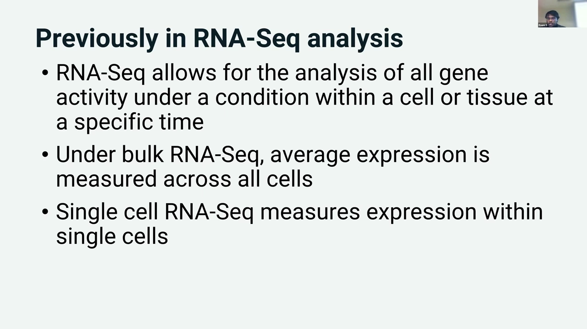

### 1.2 果昔与水果：平均到底发生在哪一步

讲者给了一个贯穿全场的类比。做 bulk 测序，就像把一堆混合浆果全部倒进搅拌机打成一杯果昔：你能尝出这是一杯果昔，但尝不出哪一口味道来自哪一颗果子。单细胞测序则相反，它不搅拌，而是把每种果子单独摆开，每一颗都清清楚楚。[【跳转到 01:56】](https://www.youtube.com/watch?v=W9NsB1ROQtY&t=116)

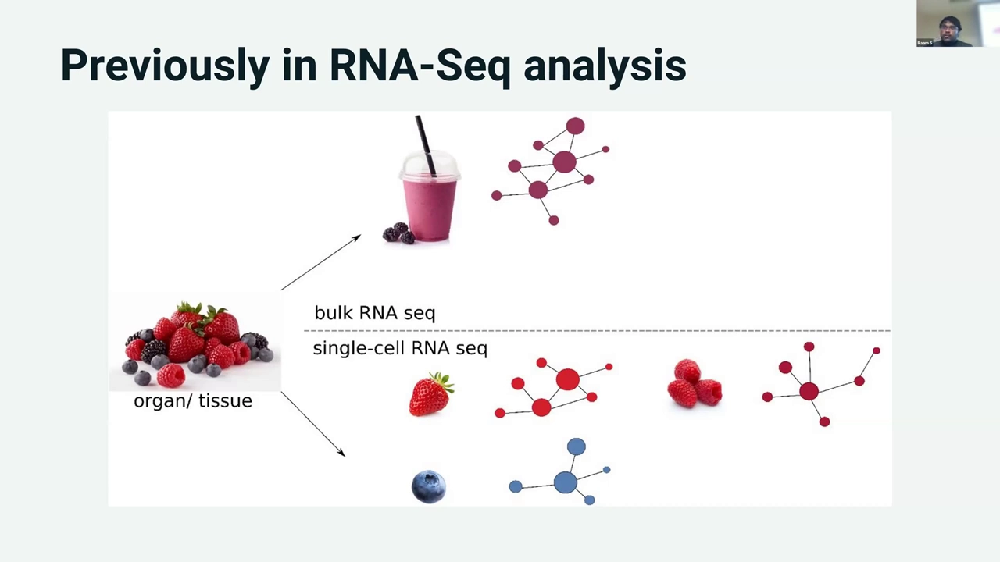

这个类比后面还会被反过来用一次：pseudobulk 不是「把果子重新打成一杯」，而是「按果子种类分别打小杯」——草莓打成草莓昔、蓝莓打成蓝莓昔，然后再比较不同条件下的草莓昔。这个区别是本讲的关键，第五节会展开。

### 1.3 平均这一步丢掉的到底是什么

把上面两句话翻译成统计语言：bulk 的测量值是

$$
y_{g,s} = \sum_{c} p_{c,s} \cdot \mu_{g,c,s}
$$

其中 $g$ 是基因、$s$ 是样本、$c$ 是细胞类型，$p_{c,s}$ 是这类细胞在该样本中的比例，$\mu_{g,c,s}$ 是这类细胞里该基因的平均表达。也就是说，bulk 的读数是一个**以细胞比例为权重的加权平均**。

这个式子里藏着两件容易被忽略的事：

- **权重是会变的**。如果两组样本之间某类细胞的比例变了（比如免疫细胞浸润变多），即使每个细胞里的表达一点没变，$y_{g,s}$ 也会变，看起来就像「这个基因上调了」。
- **分布被压成了一个数**。$\mu_{g,c,s}$ 本身只是均值，细胞之间的差异（谁高谁低、是不是双峰）在求和那一步就消失了。

把 $p_{c,s}$ 从 $y_{g,s}$ 里反解出来，是反卷积要解决的问题；这一篇讲的是相反方向的问题：**手里已经有一堆单细胞了，怎么把它们变回可以比较的表达谱**。

## 二、差异表达分析要什么，单细胞又给了什么

### 2.1 差异表达分析的产出

讲者先花几分钟把 DE 的定义铺平：差异表达分析就是找出在不同实验条件下表达发生显著变化的基因，判断它是上调还是下调。典型场景是疾病 vs 健康、刺激 vs 对照。做法是逐个基因比较两组条件下的表达水平，检验差异是否统计显著，然后用火山图、热图可视化。[【跳转到 03:41】](https://www.youtube.com/watch?v=W9NsB1ROQtY&t=221)

最终产出是一张表，每个基因两列关键数字：**fold change**（变化了多少倍）和 **p 值**（这个变化有多可信）。[【跳转到 04:31】](https://www.youtube.com/watch?v=W9NsB1ROQtY&t=271)

这里要注意一个隐含前提：p 值是从「重复之间的变异」算出来的。你手上必须真的有几个**互相独立**的重复，才能估计组内方差。

### 2.2 单细胞把「重复」这件事搞乱了

这就是问题的起点。单细胞数据里，每个细胞确实是一个独立的测量值，但细胞之间并不独立：

- 同一个供体的细胞共享同一套基因组、同一个培养/处理环境、同一批建库试剂；
- 因此同一供体的细胞之间是**相关的**，把它们当独立观测会严重低估方差；
- 结果是**有效样本量**不是细胞数，而是供体数。

讲者用一页左右对照的幻灯片把这件事讲得很直白：左边是「细胞级 DE」的四条罪状——把每个细胞当独立观测从而虚增样本量、同一供体的细胞相关因而违反独立性假设、第一类错误率可以超过 50%（也就是所谓「显著」的基因大部分是假阳性）、在单个细胞上用 Wilcoxon 或 t 检验得到的 p 值不可靠；右边是 pseudobulk 的四条对应解法——按样本 × 细胞类型聚合、统计单位还原成供体、复用成熟的 bulk 框架、把错误发现率控制在名义水平。[【跳转到 06:35】](https://www.youtube.com/watch?v=W9NsB1ROQtY&t=395)

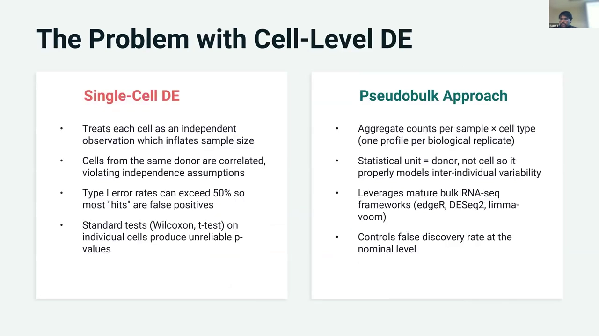

用公式说，细胞级检验算的是

$$
t = \frac{\bar{x}_{A} - \bar{x}_{B}}{\sqrt{s_A^2/n_A + s_B^2/n_B}}, \qquad n_A = \#\{\text{cells in A}\}
$$

分母里的 $n_A$ 被细胞数撑得很大，而 $s_A^2$ 只反映细胞间离散度、不包含供体间差异，于是 $t$ 被系统性放大。正确的写法应该让 $n_A$ 等于该组的**供体数**，$s_A^2$ 反映**供体之间**的差异。pseudobulk 做的就是这件事：先把细胞加总成一个样本级的数，让 $n$ 自动回到供体数。

### 2.3 为什么不能「把细胞数除以某个系数」凑合

讲者没有讨论这种折中方案，而是直接给出结论：pseudobulk 通过把细胞折叠回供体水平来解决这个问题，而供体在多数情况下才是我们真正想看的重复单位。[【跳转到 07:00】](https://www.youtube.com/watch?v=W9NsB1ROQtY&t=420)

## 三、pseudobulk 是什么：按「样本 × 细胞类型」加总

### 3.1 定义

pseudobulk 是一种在执行差异分析之前整理数据的聚合方法：把**同一份样本里、同一类型的全部细胞**合并成一份表达谱。你几乎是在为每个细胞类型、每个供体重建一个小号的 bulk 样本。[【跳转到 05:01】](https://www.youtube.com/watch?v=W9NsB1ROQtY&t=301)

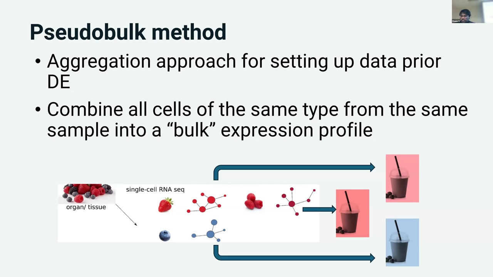

它和真 bulk 的差别只有一句：bulk 给你**整块组织一份**表达谱，pseudobulk 给你**每个细胞类型各一份**表达谱。[【跳转到 05:26】](https://www.youtube.com/watch?v=W9NsB1ROQtY&t=326)

### 3.2 具体怎么算

操作上分三步，幻灯片画成了一条四段的流水线：[【跳转到 07:30】](https://www.youtube.com/watch?v=W9NsB1ROQtY&t=450)

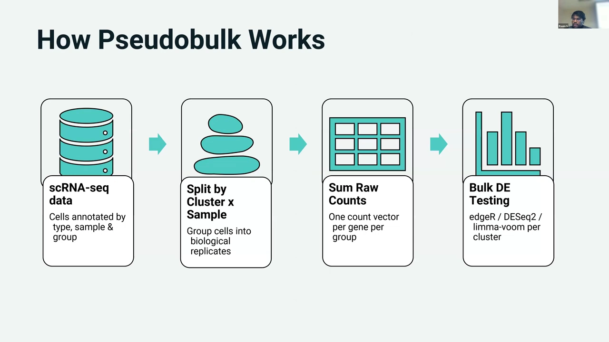

1. **准备**：单细胞对象里每个细胞都已经有细胞类型标签、样本 ID、分组信息；
2. **拆分**：按「细胞类型 × 样本」两个维度把细胞分组；
3. **求和**：组内把每个基因的原始计数加起来，得到一个计数向量；
4. **检验**：把每个细胞类型的那份「基因 × 样本」矩阵，交给 edgeR / DESeq2 / limma-voom。

写成公式就是

$$
y^{\text{pb}}_{g,\,c,\,s} = \sum_{i \in (c,\,s)} x_{g,i}
$$

其中 $x_{g,i}$ 是细胞 $i$ 里基因 $g$ 的 UMI 计数，$(c,s)$ 表示「属于细胞类型 $c$、样本 $s$」的那批细胞。

讲者给了一个具体数字：如果你有 8 个细胞类型、16 个样本，聚合之后就是 $8 \times 16 = 128$ 个 pseudobulk 组，每组一份表达谱。[【跳转到 07:30】](https://www.youtube.com/watch?v=W9NsB1ROQtY&t=450)

### 3.3 为什么是求和，不是求平均

这一点很容易做错。求平均看起来更「公平」（不同组的细胞数不一样，平均一下似乎可比），但下游的 edgeR / DESeq2 用的是**负二项模型**，模型里的均值参数对应的是「计数的期望」，输入必须是原始计数；取平均会破坏计数性质，也会把文库大小信息丢掉。所以规范做法是**组内求和**，把「细胞数不同」这件事交给下游的文库大小归一化去处理。

## 四、这一步换来了什么

把细胞加回去，收益有三条，讲者在概念部分和实操部分各讲了一遍：

1. **零值大幅减少**。单细胞里大量基因在单个细胞上是 0（技术性 dropout 与真实低表达混在一起），聚合到样本级之后，一个基因只要在该样本的这类细胞里有若干条读数就会被保留下来，低表达基因的灵敏度明显改善。实操中控制台会直接打印「Removing 16745 rows with all zero counts」这样的信息——聚合后仍然全零的基因才被丢掉。
2. **统计单位回到样本**。每个样本在每个条件下只出现一次，天然避免了「同一供体的细胞被当成多个重复」的伪重复问题，也让组内方差反映的是供体间差异。
3. **可以直接复用成熟工具**。差异表达这件事，bulk 领域已经打磨了十几年（负二项 GLM、经验贝叶斯离散度估计、拟似然 F 检验、独立过滤……），pseudobulk 把单细胞问题**转化**成一个已经被充分理解的 bulk 问题，而不是重新发明一套检验。[【跳转到 07:55】](https://www.youtube.com/watch?v=W9NsB1ROQtY&t=475)

代价也要说清楚：pseudobulk 把细胞层面的异质性抹平了。它回答的是「这个细胞类型作为一个群体，在两种条件下有没有变化」，而不是「这个细胞类型内部哪个亚群在响应」。后者需要回到单细胞层面去做亚群分析，两者是互补而非替代关系。

## 五、前提：不是每个数据集都够格

### 5.1 四条硬要求

pseudobulk 差异分析对实验设计有明确要求，讲者用一张表列了出来：[【跳转到 10:31】](https://www.youtube.com/watch?v=W9NsB1ROQtY&t=631)

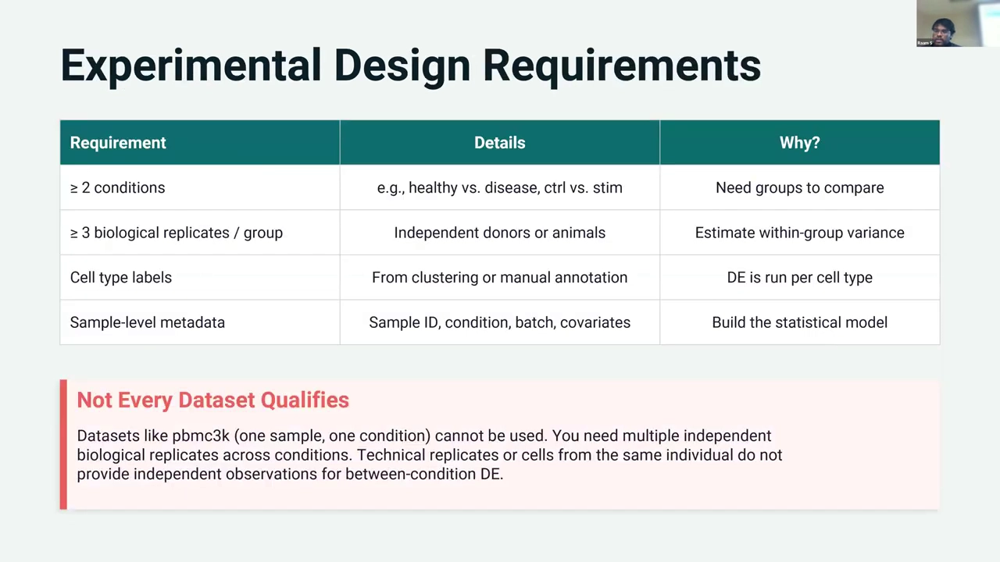

| 要求 | 具体含义 | 为什么需要 |
| --- | --- | --- |
| 至少 2 个条件 | 如健康 vs 疾病、对照 vs 刺激 | 有组才能比 |
| 每组至少 3 个生物学重复 | 独立的供体或动物，不是同一病人的不同孔 | 估计组内方差 |
| 细胞类型标签 | 来自聚类或人工注释 | DE 是按细胞类型分别跑的 |
| 样本级元数据 | 样本 ID、条件、批次、协变量 | 构建统计模型 |

### 5.2 反例：pbmc3k 为什么不行

讲者特意点了名：前几次 workshop 用的 PBMC 3K 数据**不能**做这类分析，因为它只有一个样本、一个条件。技术重复、或者同一个体的多个细胞，都不能提供条件间比较所需的独立观测。[【跳转到 10:56】](https://www.youtube.com/watch?v=W9NsB1ROQtY&t=656)

这条限制值得记住：pseudobulk 不是「任何单细胞数据都能做」的万能开关，它把「有没有真正的生物学重复」这个老问题重新摆到了台面上。

### 5.3 本次用的数据集

演示数据是 Kang et al. (2018)：8 个供体的 PBMC，每个供体分别在对照和干扰素 β（IFN-β）刺激两种条件下测过，共 8 个细胞类型、16 个样本。[【跳转到 11:26】](https://www.youtube.com/watch?v=W9NsB1ROQtY&t=686)

讲者选它的理由很实在：供体多、条件清晰、细胞类型多、生物学背景清楚——正好满足上面四条要求，而且干扰素刺激是一个有明确预期答案的经典体系。如果这份数据是 Seurat 对象，也有转换到 muscat 可用格式的路径，只是本讲没有展开。[【跳转到 12:16】](https://www.youtube.com/watch?v=W9NsB1ROQtY&t=736)
## 六、muscat：把上面这套流程打包成四个函数

### 6.1 工具定位

muscat 是 Bioconductor 上的 R 包，为「多样本、多条件」的单细胞数据提供端到端的 pseudobulk 差异分析流水线：准备、聚合、检验、可视化都只要几次函数调用。它内部封装了 edgeR、DESeq2、limma-voom 三套成熟框架，还自带 QC 图、跨 cluster 的多重检验校正和可视化函数。[【跳转到 08:20】](https://www.youtube.com/watch?v=W9NsB1ROQtY&t=500)

输入是一个 `SingleCellExperiment` 对象——Bioconductor 体系里存单细胞数据的标准容器，可以把原始计数、元数据、降维结果放在同一个对象里，相当于 Seurat 对象在 Bioconductor 世界的对应物。[【跳转到 09:10】](https://www.youtube.com/watch?v=W9NsB1ROQtY&t=550)

### 6.2 四个函数对应四个步骤

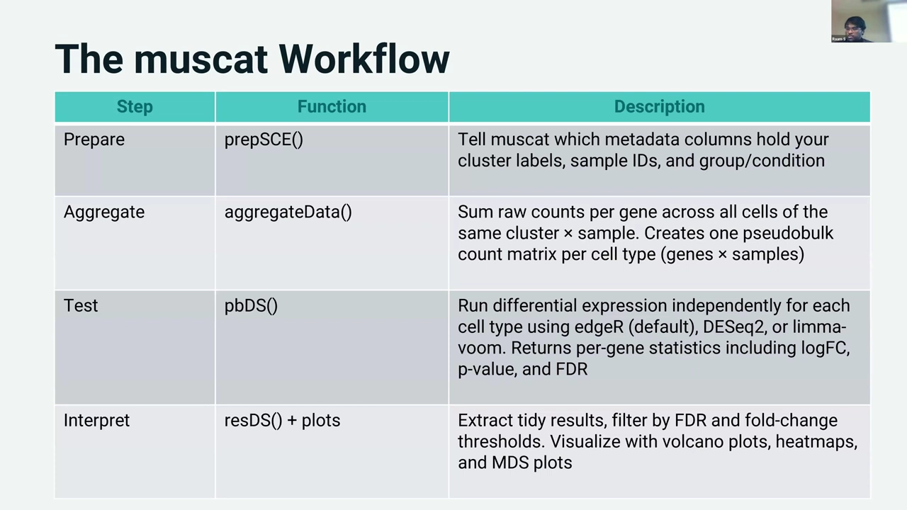

| 步骤 | 函数 | 做什么 |
| --- | --- | --- |
| 准备 | `prepSCE()` | 告诉 muscat 哪几列是 cluster 标签、样本 ID、分组/条件 |
| 聚合 | `aggregateData()` | 把同一 cluster × sample 的原始计数求和，得到每个细胞类型一份「基因 × 样本」矩阵 |
| 检验 | `pbDS()` | 对每个细胞类型独立跑 DE（默认 edgeR，可换 DESeq2 / limma-voom），返回 logFC、p 值、FDR |
| 解释 | `resDS()` + 绘图 | 抽出整洁结果表，按 FDR 与 fold change 阈值过滤，再画火山图、热图、MDS |

### 6.3 准备：把元数据对齐

`prepSCE()` 做的事很朴素但很关键：把元数据列名统一成 muscat 认识的 `cluster_id`、`sample_id`、`group_id`，并为「供体 × 条件」生成唯一的样本 ID。这一步还会顺手加上对数归一化的 `logcounts`——但注意，聚合时用的不是它。[【跳转到 25:20】](https://www.youtube.com/watch?v=W9NsB1ROQtY&t=1520)

准备完之后先做一次体检：`head(colData())` 看前几行，`table()` 分别数细胞类型、样本、条件，再拼成一张「每个样本 × 每个细胞类型有多少细胞」的大表。本例得到 8 个细胞类型、16 个样本、2 个条件。[【跳转到 28:11】](https://www.youtube.com/watch?v=W9NsB1ROQtY&t=1691)

### 6.4 聚合：只认原始计数

`aggregateData()` 是整条流水线的核心动作。讲者强调了两遍：必须聚合**原始计数**，不能用对数归一化后的值，因为 edgeR 和 DESeq2 要的是计数。[【跳转到 28:36】](https://www.youtube.com/watch?v=W9NsB1ROQtY&t=1716)

聚合完成后得到一个 `pb` 对象，维度大幅下降：每个细胞类型是一份「35,000 个基因 × 16 个样本」的矩阵。可以理解为——原来的 29,000 个细胞被折叠成了 128 列（8 个细胞类型 × 16 个样本）。[【跳转到 29:01】](https://www.youtube.com/watch?v=W9NsB1ROQtY&t=1741)

### 6.5 先做质控，再做检验

这一步的顺序不能颠倒。讲者先画 MDS 图（`pbMDS`），检查这些 pseudobulk 样本是不是按**条件**分开，而不是按**批次**分开。[【跳转到 30:16】](https://www.youtube.com/watch?v=W9NsB1ROQtY&t=1816)

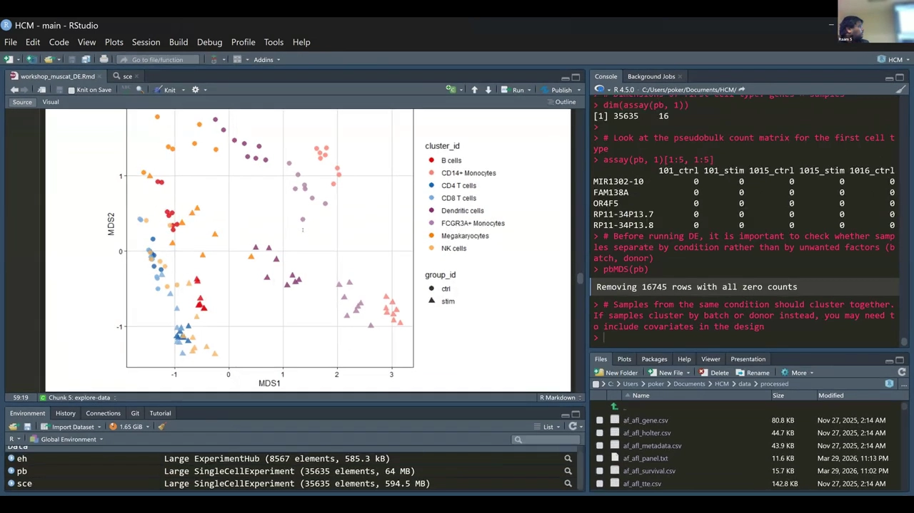

这张图信息量很大：每个点是一个 pseudobulk 样本（不是一个细胞），颜色是细胞类型，形状是对照（圆）与刺激（三角）。可以看到同类细胞聚在一起，而同一细胞类型的两种条件沿某个方向分开——说明数据是干净的，不需要做批次校正。[【跳转到 30:42】](https://www.youtube.com/watch?v=W9NsB1ROQtY&t=1842)

第二项检查是「每个 pseudobulk 组有多少细胞」：既看绝对细胞数，也看各组的相对比例，按 cluster、sample、group 三个维度分组画图。细胞数太少的组，聚合出来的表达谱噪音很大，这类组在 `pbDS()` 里会被默认过滤掉（阈值是 10 个细胞）。[【跳转到 31:21】](https://www.youtube.com/watch?v=W9NsB1ROQtY&t=1881)

讲者把伪 bulk 阶段的质控总结成四条，正好可以当成一份检查清单：[【跳转到 15:21】](https://www.youtube.com/watch?v=W9NsB1ROQtY&t=921)

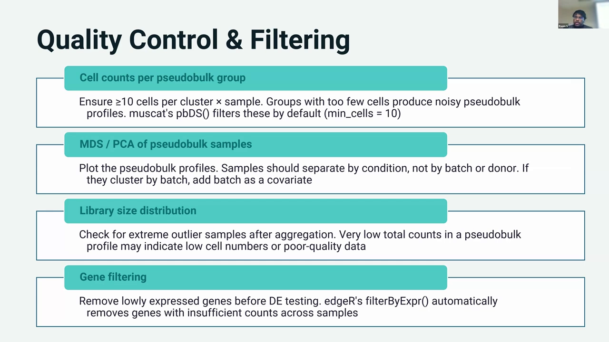

1. **每组细胞数**：cluster × sample 至少 10 个细胞，`pbDS()` 默认把细胞数不足 10 的组过滤掉；
2. **MDS / PCA**：pseudobulk 样本应当按条件分开，若按批次或按供体聚在一起，就要把批次加进模型；
3. **文库大小分布**：聚合后总计数极低的样本，往往意味着细胞数太少或数据质量差；
4. **基因过滤**：检验前先去掉低表达基因，edgeR 的 `filterByExpr()` 会按各样本的计数自动筛。

### 6.6 检验：一行 `pbDS()`，一张整洁结果表

`pbDS()` 默认用 edgeR，本例样本不多，跑得很快。结果用 `resDS()` 抽成整洁表格，每行是「一个基因 × 一个细胞类型」，列包括：[【跳转到 33:03】](https://www.youtube.com/watch?v=W9NsB1ROQtY&t=1983)

- `log2FC`：log2 倍数变化；
- `avg_logCPM`：平均 log2 CPM，反映表达丰度；
- `F`：edgeR 拟似然检验的 F 统计量；
- `p_val`：原始 p 值；
- `p_adj.loc`：在单个 cluster 内校正的 FDR；
- `p_adj.glb`：跨所有 cluster 一起校正的 FDR。

后两列的区别下一节专门讲。另外还可以查「每个细胞类型实际检验了多少个基因」。

### 6.7 三种后端方法怎么选

muscat 把三套 bulk 框架都内置了，`pbDS()` 里换个 `method` 参数即可：[【跳转到 09:47】](https://www.youtube.com/watch?v=W9NsB1ROQtY&t=587)

| 方法 | 特点 | 何时用 |
| --- | --- | --- |
| edgeR（QLF，默认） | 拟似然 F 检验 + 经验贝叶斯离散度收缩，小计数、少重复时表现稳 | 单细胞里最常见的场景：样本数不多 |
| DESeq2 | Wald 检验 + 独立过滤，提供收缩后的 log fold change | 想让基因排序更稳时 |
| limma-voom | voom 变换后的精度加权线性模型，速度最快 | 样本量很大、想跑得快 |

讲者的经验是：三种方法的结果往往很接近，选择很少改变 top hits 的名单。真正决定结论的是实验设计和统计单位，而不是这三者之间选哪个。[【跳转到 10:12】](https://www.youtube.com/watch?v=W9NsB1ROQtY&t=612)

## 七、多重检验：local FDR 还是 global FDR

### 7.1 FDR 是什么

一次检验几千个基因，总有一些会因为偶然看起来显著。FDR（false discovery rate，错误发现率）控制的是「所有被判为显著的基因里，假阳性所占的期望比例」。设 FDR = 0.05，意味着你接受「报告出来的基因里最多 5% 是假的」。[【跳转到 13:15】](https://www.youtube.com/watch?v=W9NsB1ROQtY&t=795)

### 7.2 两种校正范围

因为 pseudobulk 是**按细胞类型分别**做检验的，多重检验校正就有了两种口径：[【跳转到 14:51】](https://www.youtube.com/watch?v=W9NsB1ROQtY&t=891)

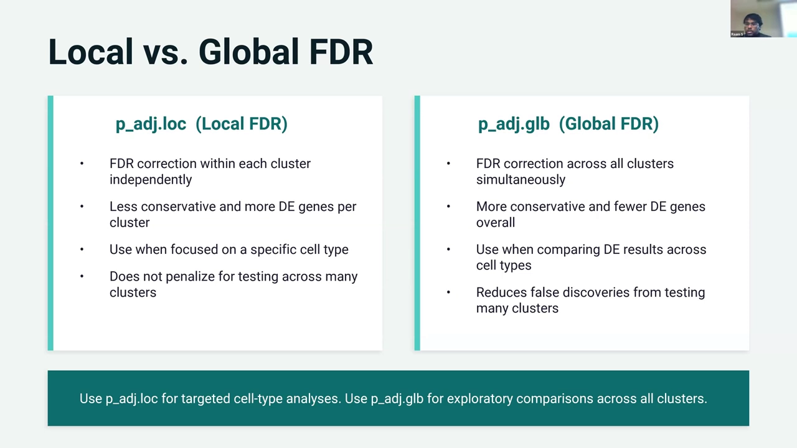

- **local（`p_adj.loc`）**：只在当前细胞类型内部校正。更宽松，每个 cluster 能留下更多差异基因；代价是「我在 8 个细胞类型里各挑一个最显著的」这种跨类型比较不再受控。
- **global（`p_adj.glb`）**：把所有细胞类型的检验放在一起校正。更保守，总体假阳性更少，适合「扫一遍所有细胞类型找线索」的探索性分析。

讲者给的判断规则很好用：**有明确的细胞类型假设时用 local，跨细胞类型做探索时用 global**。[【跳转到 14:56】](https://www.youtube.com/watch?v=W9NsB1ROQtY&t=896)

本例因为聚焦 B 细胞，用的是 local FDR。

## 八、结果长什么样：从火山图到条形图

### 8.1 过滤与火山图

筛选标准是 FDR < 0.05 且 $|\log_2 \text{FC}| > 1$。按 `p_adj.loc` 过滤后，先按细胞类型汇总上调、下调、总数，再对 B 细胞画火山图：红色是显著基因，top hits 加了标签，横轴是 log2 fold change，纵轴是 $-\log_{10}(p)$。[【跳转到 35:13】](https://www.youtube.com/watch?v=W9NsB1ROQtY&t=2113)

### 8.2 热图：每个细胞类型各取 top 20

`pbHeatmap()` 是 muscat 自带的热图函数，默认给每个 cluster 画 top 20 差异基因。行是基因、列是样本，列按细胞类型和条件分组，颜色是归一化后的平均 log 表达。[【跳转到 37:13】](https://www.youtube.com/watch?v=W9NsB1ROQtY&t=2233)

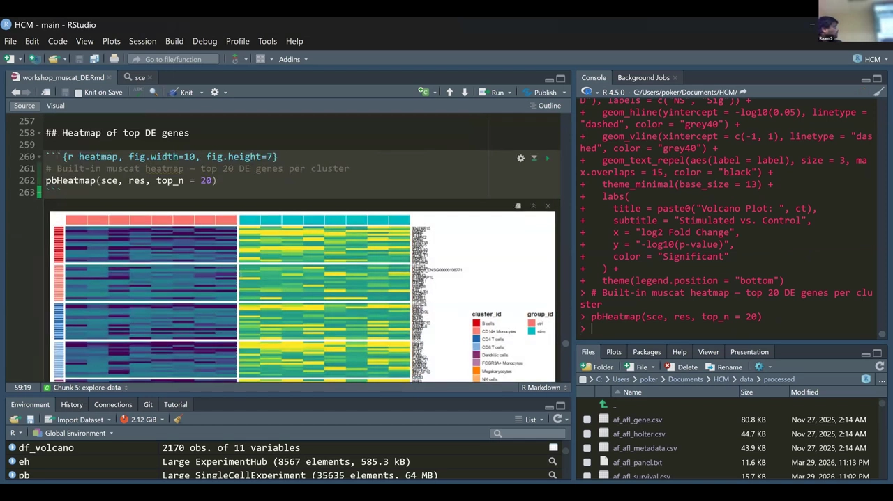

这张图能直接看出「哪些细胞类型在刺激后整体翻转了表达」——同一个基因在某个细胞类型里刺激组高、对照组低，在另一个细胞类型里可能完全没变化。这正是 pseudobulk 相比整体 bulk 的价值：**平均没有跨细胞类型混在一起**。

### 8.3 表达频率图与小提琴图

`plotExpression()` 可以画某个 cluster 里 top 基因的表达频率（有多少比例的细胞表达该基因）和小提琴图，用来看「显著」背后到底是「表达量升高」还是「表达该基因的细胞变多」。[【跳转到 38:27】](https://www.youtube.com/watch?v=W9NsB1ROQtY&t=2307)

这两件事在 bulk 数据里是分不开的——bulk 只有一个总数，无法区分「每个细胞表达得更多」与「表达它的细胞更多」。在 pseudobulk 分析里，回到单细胞层面看表达频率就能把两者拆开。

### 8.4 每个细胞类型的差异基因数

最后用一张条形图汇总各细胞类型的差异基因数（区分上调和下调）。本例里 CD14+ 单核细胞的差异基因最多，其他细胞类型也各有响应。[【跳转到 39:55】](https://www.youtube.com/watch?v=W9NsB1ROQtY&t=2395)

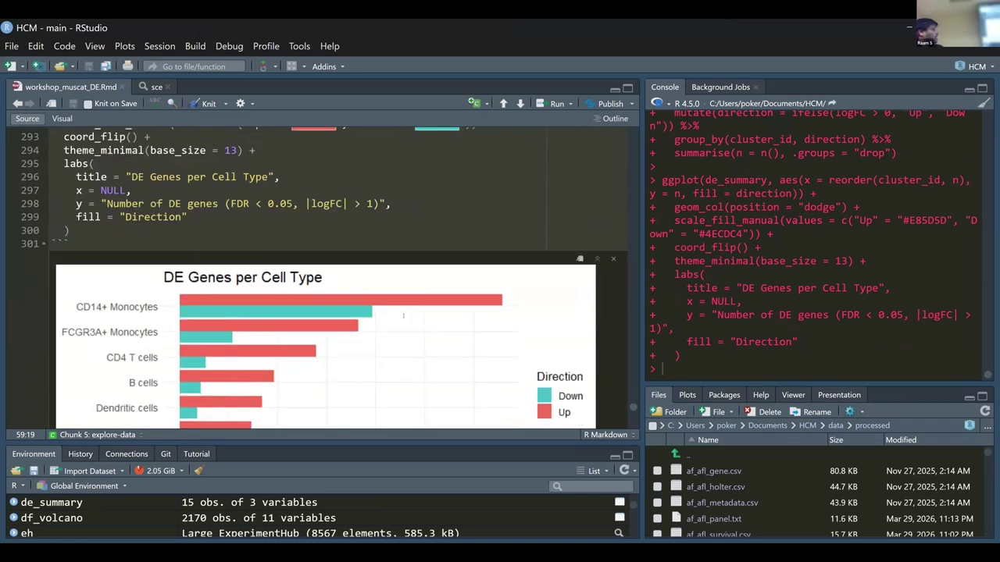

这类图回答的是「哪种细胞对刺激最敏感」，是 pseudobulk 分析最常用的落脚点之一。

## 九、批次与协变量：MDS 不听话的时候

如果 MDS 图显示样本按**批次**而不是按**条件**分开，说明批次效应盖过了生物学信号，必须把批次放进模型。muscat 的做法是：[【跳转到 41:28】](https://www.youtube.com/watch?v=W9NsB1ROQtY&t=2488)

1. 在对象的 `colData` 里加一列批次信息（muscat 约定的 `pb` 批次列）；
2. 用 `model.matrix()` 基于该列构造自定义设计矩阵；
3. 基于设计矩阵设置对比（contrasts）；
4. 用同一个 `pbDS()` 重跑，得到批次校正后的差异基因列表。

本例数据很干净，所以讲者没有实际跑这一步。但他提醒：自己手上的真实数据，多数情况下是需要加协变量的。

## 十、把这一讲压缩成一张决策链

回到本小节的核心命题——bulk 测平均、单细胞测分布。这一讲给出的操作结论是一条清晰的决策链：

1. **先问有没有真正的生物学重复**。没有（如 pbmc3k 这类单样本数据），pseudobulk 差异分析无从谈起；
2. **有重复，就把细胞按「样本 × 细胞类型」聚合成 pseudobulk**，用原始计数求和，不用对数归一化值；
3. **聚合完先做质控**：每组细胞数够不够（≥10）、MDS 是否按条件分开、文库大小有没有离群；
4. **再跑 DE**，按「有没有明确的细胞类型假设」选 local 或 global FDR；
5. **最后回到单细胞层面看细节**：表达频率、亚群构成，把 pseudobulk 抹平的那部分异质性补回来。

## 小结

- bulk RNA-seq 测的是**跨所有细胞的加权平均**，权重是细胞比例；单细胞测的是每个细胞各自的表达，两者不是「精度不同」，而是**表示不同**。
- 单细胞做差异分析时，把细胞当独立重复会虚增样本量、低估方差，第一类错误率可以超过 50%，「显著基因」大多是假阳性。
- pseudobulk 的做法是：按「样本 × 细胞类型」把原始计数**求和**，得到每个样本、每个细胞类型一份表达谱，统计单位回到供体。
- 这一步同时解决三件事：压掉稀疏零值、恢复正确的统计单位、复用成熟的 bulk 负二项框架。
- 代价是抹平细胞层面的异质性——它回答「这个细胞类型整体有没有变」，不回答「哪个亚群在变」。
- pseudobulk 有硬性前提：至少 2 个条件、每组至少 3 个独立供体、有细胞类型标签和样本级元数据；pbmc3k 这类单样本数据不能用。
- muscat 把流程打包成 `prepSCE()` → `aggregateData()` → `pbDS()` → `resDS()` 四步，聚合必须用原始计数，默认后端是 edgeR，可换 DESeq2 或 limma-voom。
- 多重检验有两种口径：local FDR（cluster 内校正，宽松，适合有明确细胞类型假设）与 global FDR（跨 cluster 校正，保守，适合探索）。
- MDS 若按批次分开，就要把批次作为协变量放进设计矩阵，再重跑 `pbDS()`。

## 关键术语速查

| 术语 | 一句话解释 |
| --- | --- |
| bulk RNA-seq | 把一块组织里所有细胞的 RNA 混在一起测序，得到的是以细胞比例为权重的平均表达 |
| scRNA-seq | 对每个细胞单独建库测序，得到「基因 × 细胞」的计数矩阵 |
| pseudobulk | 把同一细胞类型、同一样本的细胞计数相加，得到样本级的「伪 bulk」表达谱 |
| 伪重复（pseudo-replication） | 把同一供体的多个细胞当成多个独立重复，导致 p 值被系统性高估显著 |
| 有效样本量 | 真正独立的观测数；单细胞里等于供体数，而不是细胞数 |
| 第一类错误 | 原假设为真却被判为显著的概率；细胞级检验会把它推到 50% 以上 |
| 负二项模型 | bulk 差异分析的标准模型，用均值与离散度描述计数数据，输入必须是原始计数 |
| edgeR / DESeq2 / limma-voom | 三套成熟的 bulk 差异分析框架，pseudobulk 之后可以直接复用 |
| FDR（错误发现率） | 被判为显著的结果中假阳性所占的期望比例；常用阈值 0.05 |
| local / global FDR | 前者在每个细胞类型内单独校正，后者跨所有细胞类型一起校正 |
| MDS 图 | 多维标度图，把样本间距离压到二维；用来检查样本是按条件还是按批次分开 |
| SingleCellExperiment | Bioconductor 里存单细胞数据的标准容器，相当于 Seurat 对象的 Bioconductor 对应物 |
