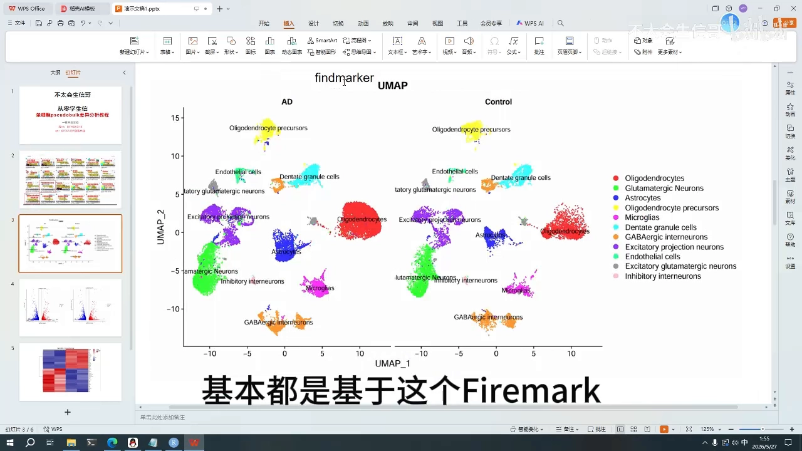
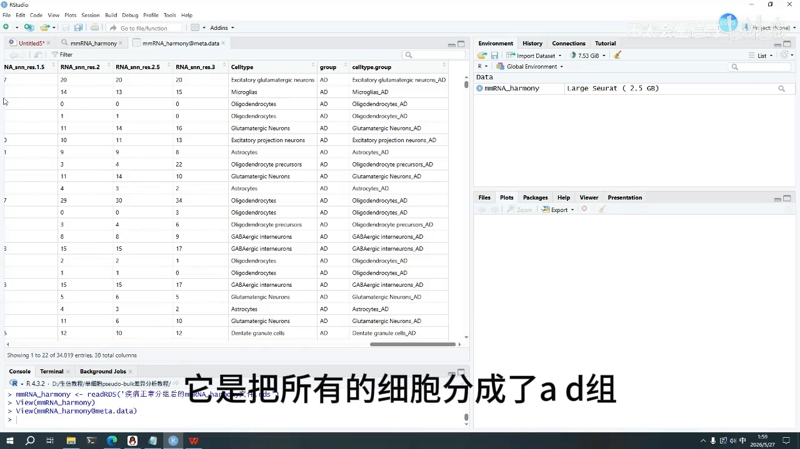
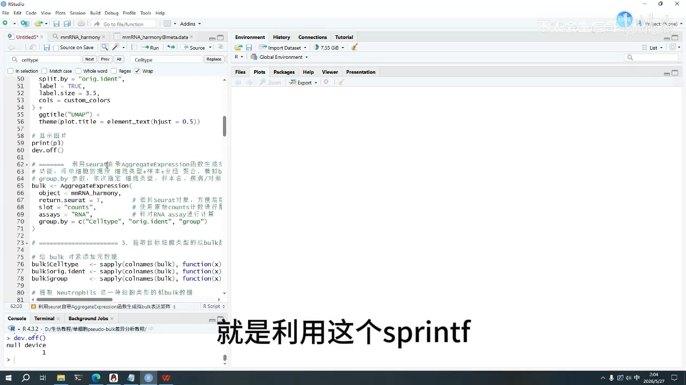
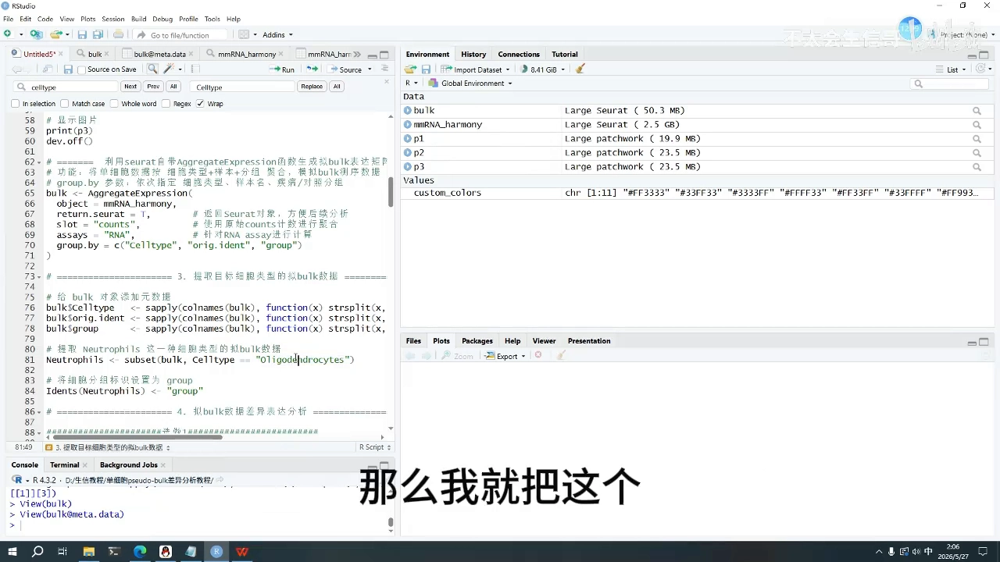
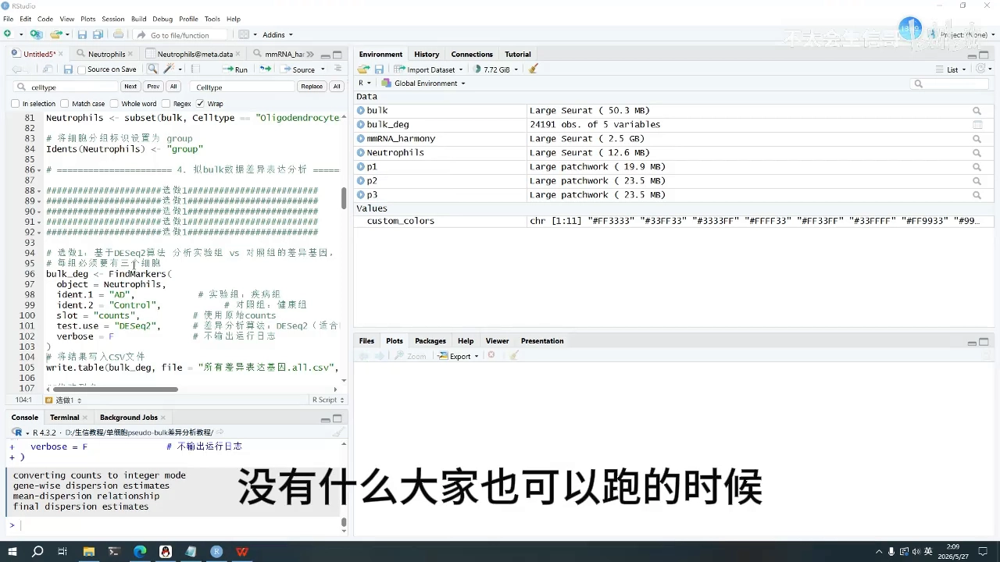
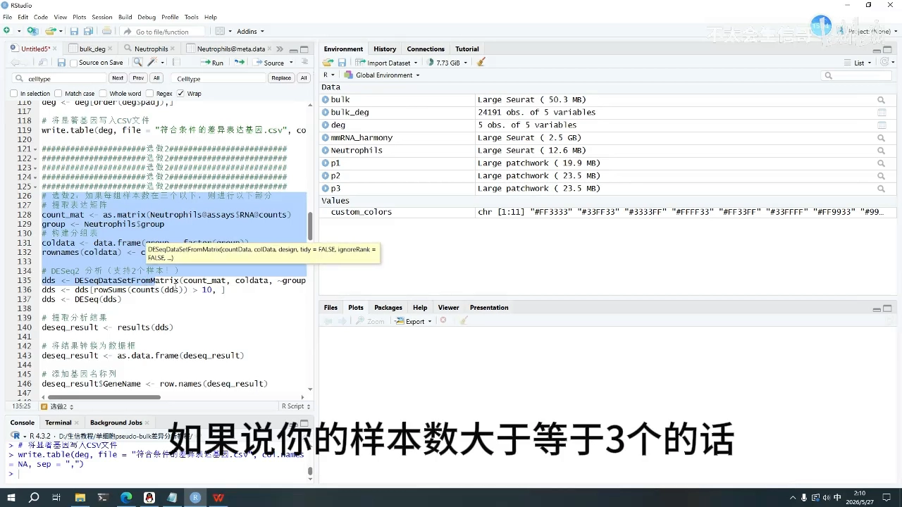
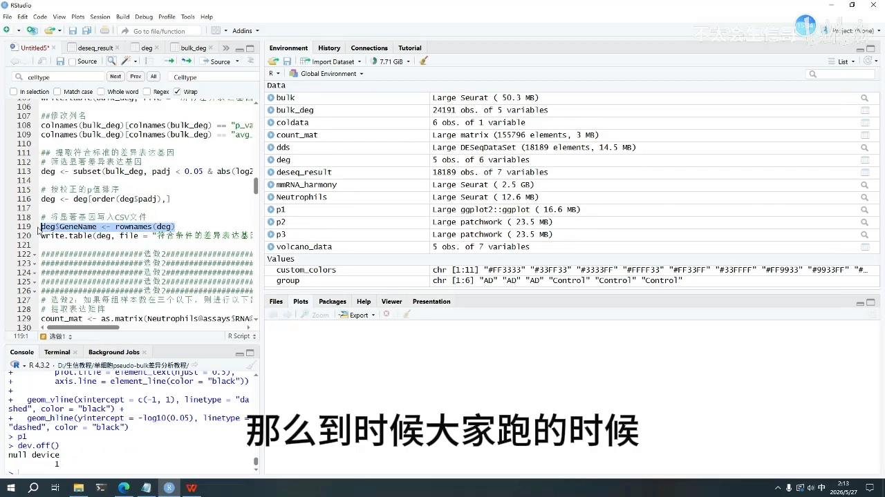
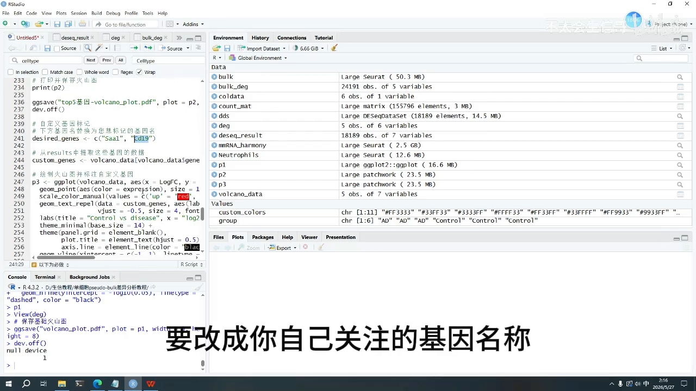
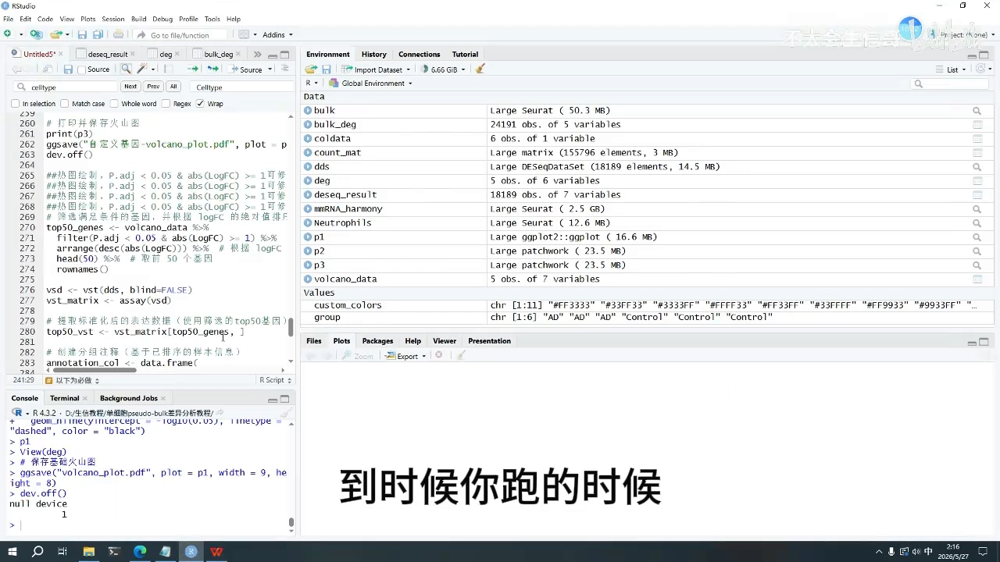

# 在 Seurat 里按「样本 × 细胞类型」聚合，把 pseudobulk 差异分析跑通

> 视频来源：[24（附代码）单细胞分组pseudobulk差异分析教程，伪bulk差异分析精讲！](https://www.bilibili.com/video/BV189VK6qEyz)（Bilibili · 不太会生信哥）｜时长约 19 分钟
> 导读：一支纯实操视频——从一份已注释的单细胞对象出发，用 Seurat 自带的 `AggregateExpression()` 把细胞按「细胞类型 + 样本 + 分组」聚合成伪 bulk 矩阵，再用 DESeq2 检验、筛选、出火山图和热图。本文保留全部代码层面的取舍（三列 metadata、`slot = "counts"`、两组分支、阈值），并把视频没展开的统计背景补在标注处。字幕为 B 站 AI 字幕，pseudobulk / AggregateExpression / FindMarkers 等术语已按上下文与画面代码订正。

## 本讲要解决的核心问题（SCQA）

**背景**：你已经会用 Seurat 的 `FindMarkers()` 做组间差异分析：把细胞按分组切开，逐个基因检验两组细胞的表达差异，输出一张带 `avg_log2FC` 和 `p_val_adj` 的表。这是绝大多数单细胞教程的标准动作。

**冲突**：这套做法把每个细胞当成一个独立观测。可一个样本里的几千个细胞共享同一个供体、同一个文库、同一批试剂——它们不是几千个独立重复。于是 p 值被系统性高估，假阳性爆炸；同时单细胞数据本身是稀疏矩阵，零值多，又容易在另一个方向产生假阴性。审稿人一句「细胞被当成独立重复了吗」，就足以让这张表失去说服力。

**疑问**：既然单细胞层面的检验不可靠，那在 Seurat 的工作流里，怎么把细胞还原成「样本级」的表达谱，再交给成熟的 bulk 差异分析工具？聚合要按什么分组、用哪个 slot、检验用哪个函数、样本数不够时又怎么办？

**回答（中心思想）**：把细胞按「细胞类型 × 样本」把原始 counts **加总**成伪 bulk 矩阵，然后**一次只对一个细胞类型**做样本级的差异分析（DESeq2）。这条路线和原来的 `FindMarkers()` 路线**都跑一遍、取交集**，交集里的基因才拿来写结论——单细胞层面负责灵敏地找候选，pseudobulk 负责把候选钉在统计上站得住的那一批。

## 一、问题不在方法不够多，而在统计单位选错了

讲者开场先回顾了这个系列里已有的两节课：第 14 号视频按样本的组织来源（疾病组 vs 正常组）分组做差异分析，第 19 号视频按某个基因的表达高低把细胞分成两组再做差异分析。[【跳转到 00:12】](https://www.bilibili.com/video/BV189VK6qEyz/?t=12)

这两节课用的函数，内在逻辑都是同一个：`FindMarkers()`。[【跳转到 00:37】](https://www.bilibili.com/video/BV189VK6qEyz/?t=37) 你在 B 站上能刷到的单细胞差异分析教程，绝大多数也是基于它。



问题出在投稿之后。讲者提到，经常有伙伴被审稿人问：你只用这一个方法做差异分析，会不会有假阳性或假阴性？[【跳转到 01:23】](https://www.bilibili.com/video/BV189VK6qEyz/?t=83)

这个质疑有两个来源，讲者点出了其中一个：单细胞数据是**稀疏矩阵**，表达值本身稀疏，差异分析过程中就容易出现假阳性和假阴性。[【跳转到 01:48】](https://www.bilibili.com/video/BV189VK6qEyz/?t=108)

另一个来源（视频里没展开，但正是 pseudobulk 存在的理由）是**伪重复**：`FindMarkers()` 的 p 值是在「细胞数」这个自由度上算出来的。假如两组各 3 个样本、每组几千个细胞，那么 p 值背后其实只有 3 个独立观测，却用了上万自由度——细胞越多，p 值越小，而这个「更显著」跟生物学效应大小无关。这部分推导见 [M01 细胞是观测，供体才是重复：Donor-level 差异分析的五个步骤](../../../../../../深度学习/数学与统计基础/M01_统计学习与科学评估基础/3_统计推断与实验设计/3.2_合理的实验单位/3.2.1_重复测量、分层结构与伪重复/细胞是观测供体才是重复：Donor-level差异分析的五个步骤.md)。

### 1.1 讲者给出的解法：两条路线，取交集

讲者的建议很直接：用多种差异分析方法同时跑，最后把两种结果**取交集**，交集基因作为最终的差异表达基因，这样分析和描述都更有说服力。[【跳转到 02:10】](https://www.bilibili.com/video/BV189VK6qEyz/?t=130)

具体到这套流程：

- 一条路线是 `FindMarkers()`（第 14、19 号视频的方法）；
- 另一条路线就是本节课的 pseudobulk 差异分析；
- 两条都跑，取交集，交集基因才纳入最终结果。[【跳转到 03:03】](https://www.bilibili.com/video/BV189VK6qEyz/?t=183)

这个「双路线」策略值得单独强调，因为它同时解决了两个不同的问题：

| 路线 | 统计单位 | 强项 | 弱项 |
| --- | --- | --- | --- |
| `FindMarkers()`（细胞级） | 细胞 | 灵敏，细胞多就能捞到弱效应 | p 值被高估，假阳性多 |
| pseudobulk（样本级） | 样本 / 供体 | 方差估计正确，结论站得住 | 受样本数限制，灵敏度低 |
| 两者交集 | — | 既灵敏又可靠 | 会漏掉只在一条路线显著的基因 |

换句话说，交集不是「更保守一点」，而是**用两种互补的错误方向互相抵消**：细胞级容易多报，样本级容易漏报，交集落在两者都认的那一小块。

### 1.2 这套流程产出什么

讲者说得很实在：这节课得到的图比较常规——UMAP 图、火山图、热图，没有什么花里胡哨的东西，只是给大家增加一个新的知识和新的选择。[【跳转到 03:26】](https://www.bilibili.com/video/BV189VK6qEyz/?t=206)

这句话其实点明了本节的定位：pseudobulk 不是「更高级的可视化」，而是**换一个统计单位重做同一件事**。图还是那些图，但图背后的 p 值含义变了。

## 二、开工前的硬前提：metadata 里必须有三列

代码的第一步是常规动作：设工作目录、加载 R 包、读入单细胞文件。这个文件是**已经分好组、并且已经注释过**的单细胞对象。[【跳转到 04:03】](https://www.bilibili.com/video/BV189VK6qEyz/?t=243)

读进来之后，讲者做了一件很值得学的事：先打开 metadata 检查列名。



要做 pseudobulk，metadata 里**必须有三列**，缺一不可：

1. **样本列**（Seurat 默认叫 `orig.ident`）：记录每个细胞来自哪个样本。这一列大家一般都有。[【跳转到 05:40】](https://www.bilibili.com/video/BV189VK6qEyz/?t=340)
2. **分组列**（例子里叫 `group`）：把每个细胞定义好它属于哪个组，比如 AD 组和 CTRL 组。[【跳转到 06:05】](https://www.bilibili.com/video/BV189VK6qEyz/?t=365)
3. **细胞类型列**（例子里叫 `Celltype`）：记录每个细胞的注释结果。

这三列正好对应聚合时的三个维度——**谁（样本）× 什么细胞（类型）× 哪一组（条件）**。缺样本列就没法聚合，缺分组列就没法比较，缺细胞类型列就会把不同细胞混成一锅（不同细胞类型的表达差异远大于扰动效应，混着聚合等于把信号淹掉）。

讲者反复提醒的一点是**列名大小写要对齐**：他的数据里是 `Celltype`、`group`，你的数据里如果叫 `celltype`，代码里每一处都要跟着改，从头到尾都要改，后面就不再重复强调了。[【跳转到 06:46】](https://www.bilibili.com/video/BV189VK6qEyz/?t=406)

> 工程建议：与其在几十行代码里逐处替换列名，不如在脚本开头把列名赋给一个变量，后面统一引用。视频里是逐处手改，容易漏。

## 三、聚合：`AggregateExpression()` 的四个参数决定成败

正式分析前，视频先跑了几张常规 UMAP：整体一张、按 `group` 分屏一张、按样本分屏一张（例子里共 6 个样本：AD1、AD2、AD3、NC1、NC2、NC3）。[【跳转到 07:58】](https://www.bilibili.com/video/BV189VK6qEyz/?t=478) 这些图本身不产生新信息，但按样本分屏那张能让你先看出「哪些细胞类型在某些样本里几乎没有细胞」——这正是后面能不能检验的前提。

真正的核心只有一行代码：

```r
bulk <- AggregateExpression(
  object       = mmRNA_harmony,
  return.seurat = TRUE,          # 返回 Seurat 对象，方便后续分析
  slot         = "counts",       # 使用原始 counts 计数进行聚合
  assays       = "RNA",          # 针对 RNA assay 进行计算
  group.by     = c("Celltype", "orig.ident", "group")
)
```



四个参数，每一个都在决定结果对不对：

- **`slot = "counts"`**：必须用**原始计数**，不能用归一化后的 data。理由在下一节。
- **`group.by = c("Celltype", "orig.ident", "group")`**：三个维度一起给，聚合结果的每一列就是「某个细胞类型 + 某个样本 + 某个分组」的组合。
- **`assays = "RNA"`**：指定对 RNA assay 操作。
- **`return.seurat = TRUE`**：返回一个 Seurat 对象而不是裸矩阵，这样后面可以继续用 `FindMarkers()`、`Idents()` 这些熟悉的接口。

聚合完的结构，讲者用一句话讲清了：你有多少种细胞类型、多少个样本，就会形成多少个「样本 × 细胞类型」的列。疾病组样本一有一个这样的结果，样本二、样本三各有一个；对照组样本一、样本二也各有一个。[【跳转到 10:30】](https://www.bilibili.com/video/BV189VK6qEyz/?t=630)

### 3.1 为什么必须是求和，而不是求平均

视频里只说了「用原始 counts 聚合」，没解释原因。这里补一句：`AggregateExpression()` 对 counts 做的是**按基因求和**。求和保留了「这个样本里这类细胞总共测到多少 reads」这一信息，负二项模型正是靠这个总量去估测序深度因子、进而建模均值–方差关系的。如果先算平均，深度信息就被抹平，下游的 DESeq2 / edgeR 会失去它赖以工作的计数语义。

### 3.2 聚合完，先拆细胞类型再检验

聚合得到的是一个「所有细胞类型混在一起」的对象。下一步是把它拆开，一次只研究一个细胞类型：

```r
# 提取某一个细胞类型的伪 bulk 数据
Neutrophils <- subset(bulk, Celltype == "Oligodendrocytes")
# 将该细胞类型的分组标识设置为 group
Idents(Neutrophils) <- "group"
```



这两行是整条流程的枢纽：`subset()` 把「样本 × 细胞类型」矩阵切成「一个细胞类型的样本 × 基因」矩阵，`Idents()` 把比较对象从细胞类型换成**分组**。做完这两步，你手上的对象每一列是一个样本，`FindMarkers()` 比较的就是样本而不是细胞了。

> 注意：为什么必须按细胞类型分开？因为不同细胞类型的表达谱差异远大于扰动效应。如果把所有细胞一起聚合，某类细胞比例的变化会被误读成「基因表达变了」——这是典型的 Simpson 悖论陷阱。
## 四、检验：按「每组样本数」分成两条分支

到了检验这一步，视频里出现了两个「选做」分支，判断标准只有一条：**你每个组有几个样本**。

- 如果每组的样本数 **≥ 3**，选做一、选做二都可以，任选其一；[【跳转到 12:10】](https://www.bilibili.com/video/BV189VK6qEyz/?t=730)
- 如果每组的样本数 **< 3**，就必须走选做二。[【跳转到 12:35】](https://www.bilibili.com/video/BV189VK6qEyz/?t=755)

例子里每组 3 个样本（AD1–3、NC1–3），所以两条都能走。讲者演示的是选做一。

### 4.1 选做一：让 `FindMarkers()` 调 DESeq2

```r
# 选做1：基于 DESeq2 算法，分析实验组 vs 对照组
bulk_deg <- FindMarkers(
  object    = Neutrophils,     # 已按细胞类型拆好的伪 bulk 对象
  ident.1   = "AD",            # 实验组：疾病组
  ident.2   = "Control",       # 对照组：健康组
  slot      = "counts",        # 使用原始 counts
  test.use  = "DESeq2",        # 差异分析算法选 DESeq2
  verbose   = F
)
```



三个细节值得注意：

1. **`test.use = "DESeq2"`** 是关键。默认的 Wilcoxon 检验会退回「把每一列当独立观测」的秩和检验；只有显式换成 DESeq2，才是在用负二项模型处理计数。
2. **`slot = "counts"`** 必须和聚合时保持一致。
3. **`ident.1` / `ident.2` 填的是分组名**（AD / CTRL），不是样本名。讲者特别提醒这两个要改成你自己的实验组、对照组名称。[【跳转到 13:00】](https://www.bilibili.com/video/BV189VK6qEyz/?t=780)

跑完得到的是一张常规差异分析结果表：有 logFC 值、有校正后的 P 值，就是大家熟悉的数据框。[【跳转到 13:50】](https://www.bilibili.com/video/BV189VK6qEyz/?t=830)

### 4.2 选做二：绕开 `FindMarkers()`，直接喂给 DESeq2

选做二走的是另一条路——把伪 bulk 对象里的 counts 抠成普通矩阵，自己拼 `colData`，直接调 DESeq2：

```r
# 选做2：如果每组样本数在三个以下，则走这里
count_mat <- as.matrix(Neutrophils@assays[["RNA"]]@counts)
group     <- Neutrophils$group
coldata   <- data.frame(row.names = colnames(count_mat), group = group)

dds <- DESeqDataSetFromMatrix(countData = count_mat, colData = coldata,
                              design = ~ group)
dds <- dds[rowSums(counts(dds)) > 10, ]   # 去掉低表达基因
dds <- DESeq(dds)
deseg_result <- results(dds)
```



两条分支在统计上做的是同一件事（都是 DESeq2 的负二项 GLM），差别在**入口**：选做一把对象和分组名交给 `FindMarkers()` 包装，选做二自己控制 `design` 公式和基因过滤（`rowSums(counts(dds)) > 10`）。

为什么样本少就必须走选做二？因为 `FindMarkers()` 的封装假设了「有足够多的列可以估离散度」，样本数不足时它的内部检查会挡下来。选做二让你显式写出 `design = ~ group`，也方便你后面加协变量（见第六节）。

> 讲者在录制时这里报过一次错，处理完继续跑，并说明大家照常运行即可。[【跳转到 13:25】](https://www.bilibili.com/video/BV189VK6qEyz/?t=805) 这类报错多半出在列名或分组因子水平上，不必紧张。

## 五、筛选与出图：阈值怎么定、图注怎么标

### 5.1 筛选阈值

结果表拿到后先改列名（`p_val_adj`、`avg_log2FC` 之类），再按两个条件筛差异基因：**校正后 P 值 < 0.05，且 |log2FC| ≥ 1**。[【跳转到 14:15】](https://www.bilibili.com/video/BV189VK6qEyz/?t=855)

讲者的经验之谈：这两个数都可以改，但**一般只改 logFC 那个 1**，0.05 基本不动。

```r
deg <- subset(bulk_deg, p_val_adj < 0.05 & abs(avg_log2FC) >= 1)
deg <- deg[order(deg$p_val_adj), ]
```

这里有一个容易被忽略的含义差别：pseudobulk 的 log2FC 是在**样本级表达谱**上算的，天然比细胞级平滑——细胞级里某些细胞的极端值会被平均掉，所以 pseudobulk 的效应量通常更小、更稳。因此同一个「|log2FC| ≥ 1」的阈值，在两条路线上的宽松程度并不相同。

### 5.2 火山图

```r
p1 <- ggplot(volcano_data, aes(x = logFC, y = -log10(p_val_adj))) + ...
  geom_vline(xintercept = c(-1, 1), linetype = "dashed", color = "black") +
  geom_hline(yintercept = -log10(0.05), linetype = "dashed", color = "black")
```



讲者对这张图很坦率：图很丑，因为符合筛选标准的基因只有几个——他用的是随便挑的一份数据，结果不好是数据的问题，不是流程的问题。[【跳转到 15:55】](https://www.bilibili.com/video/BV189VK6qEyz/?t=955)

这其实是个有用的提醒：**pseudobulk 的显著基因数天然比细胞级少一个量级**。如果你习惯了细胞级动辄上千个差异基因，第一次跑 pseudobulk 看到几十个甚至几个，不要以为代码写错了。

### 5.3 标记 top 基因与自定义基因

后面两段代码是火山图的升级版：

- 一段自动挑出 **logFC 最大和最小的各 5 个基因**标在图上；[【跳转到 16:20】](https://www.bilibili.com/video/BV189VK6qEyz/?t=980)
- 一段让你**手动指定**要标记的基因——把想强调的基因名放进一个字符向量（例子里是 Saa1 与 Cd19），改成你自己关注的基因即可。[【跳转到 17:12】](https://www.bilibili.com/video/BV189VK6qEyz/?t=1032)



绘图时还要改两处：图例里的 `CTRL` 和 `LPS` 要换成你自己的对照组、实验组名称。[【跳转到 17:17】](https://www.bilibili.com/video/BV189VK6qEyz/?t=1037)

### 5.4 热图

热图部分用 `vst()` 做方差稳定化变换（`blind = FALSE`），取筛选后按 logFC 排序的**前 50 个基因**画 `pheatmap`：

```r
vsd <- vst(dds, blind = FALSE)
top50_genes <- top_genes[1:50]
top50_vst <- vsd[top50_genes, ]
pheatmap(top50_vst, ...)
```



前 50 个可以改成前 10、20、30、40、100，都行。[【跳转到 18:07】](https://www.bilibili.com/video/BV189VK6qEyz/?t=1087)

注意这张热图的列是**样本**（6 个），不是细胞。这正是 pseudobulk 的价值所在：你能一眼看出「同一组的三个样本是不是真的像」，如果同组样本在热图上都聚不到一起，那说明组内变异大于组间差异，任何差异基因都不可信。

## 六、视频没讲、但你必须补的三件事

这一节是我按本小节主题补的实践要点，不对应视频画面，请与前面区分开。

### 6.1 最小细胞数阈值：聚合前先过滤

视频直接对全部细胞做了聚合。实际数据里，某些「样本 × 细胞类型」组合可能只有 3、5 个细胞——这样加总出来的「表达谱」噪声极大，方差估计会被它带偏。

通行做法是在聚合前设一个最小细胞数阈值（常见 10~20，例如「每个样本、每个细胞类型至少 20 个细胞」），不足的组合**丢弃**，并在方法里写明丢弃了哪些。丢弃会让某些细胞类型的样本数变少，进而影响它能不能进入模型——这个连锁反应必须提前想清楚。

### 6.2 设计矩阵里放什么协变量

`design = ~ group` 是最简形式。扰动实验里至少要问三个问题：

- **有没有配对？** 如果同一个供体同时提供了对照和处理样本，设计应写成 `~ donor + group`，先扣掉供体间个体差异，再估条件效应，功效远高于不配对。
- **有没有批次？** 不同 10x 通道、不同测序 lane、不同处理日期都是批次，应作为协变量写进 `design`。
- **协变量必须是样本级的**：性别、年龄、批次这些是「每个样本一个值」，不是「每个细胞一个值」。把细胞级变量塞进样本级模型会直接报错或产生无意义结果。

### 6.3 三个工具怎么选

视频用的是 DESeq2。同样的 pseudobulk 矩阵也可以交给 edgeR 或 limma-voom：

| 工具 | 模型 | 适合什么情况 |
| --- | --- | --- |
| DESeq2 | 负二项 GLM + 收缩估计 | 样本数少（每组 3~5）、需要稳定 logFC 估计 |
| edgeR（QL F 检验） | 负二项 + 拟似然 | 有离群样本、想用更稳健的离散度估计 |
| limma-voom | logCPM + 精度权重 + 线性模型 | 设计矩阵复杂、样本数较多、想用随机效应 |

三者的共同硬门槛是一样的：**至少 2~3 个生物学重复**。没有重复就没有 pseudobulk——这条限制的展开见同目录的 [《pseudobulk：把单细胞聚合成样本级表达谱再做差异分析》](pseudobulk：把单细胞聚合成样本级表达谱再做差异分析.md) 第五节。

## 小结

- **问题**：`FindMarkers()` 把细胞当独立重复，p 值被高估；单细胞数据又稀疏，两个方向都可能出错，所以审稿人会追问。
- **解法**：两条路线都跑、取交集。细胞级负责灵敏地找候选，pseudobulk 负责给出站得住的统计结论。
- **前提**：metadata 必须有样本列、分组列、细胞类型列，缺一不可，列名大小写要与代码一致。
- **聚合**：`AggregateExpression(slot = "counts", group.by = c("Celltype", "orig.ident", "group"), return.seurat = TRUE)`，对 counts **求和**，不要求平均。
- **拆类型**：`subset()` 出目标细胞类型，`Idents()` 设为分组列——之后比较的单位才是样本。
- **检验**：每组样本 ≥ 3 可用 `FindMarkers(test.use = "DESeq2")`；< 3 走直接调 DESeq2 的分支。
- **筛选出图**：校正 P < 0.05 且 |log2FC| ≥ 1，火山图标 top5 或指定基因，热图用 vst + 前 50 个基因，列是样本。
- **别忘的补丁**：最小细胞数阈值、配对与批次协变量、DESeq2/edgeR/limma-voom 的取舍。

## 关键术语速查

| 术语 | 一句话解释 |
| --- | --- |
| pseudobulk | 把同一「样本 × 细胞类型」的细胞原始 counts 按基因加总，得到样本级表达谱 |
| 伪重复（pseudoreplication） | 把同一供体内的多个细胞当成独立重复，导致 p 值被高估 |
| `AggregateExpression()` | Seurat 提供的聚合函数，可按多个 metadata 列分组求和 |
| `slot = "counts"` | 指定使用原始计数而非归一化数据，是 pseudobulk 的唯一正确输入 |
| `FindMarkers(test.use = "DESeq2")` | 让 Seurat 在给定对象上调用 DESeq2 做检验，对象是样本级时即为 pseudobulk DE |
| `DESeqDataSetFromMatrix()` | 从普通 counts 矩阵 + colData 构造 DESeq2 对象，可自定义 design 公式 |
| `vst()` | DESeq2 的方差稳定化变换，让热图上的方差不受表达量高低影响 |
| 最小细胞数阈值 | 聚合前要求每个「样本 × 细胞类型」至少有一定细胞数，否则该组合不可靠 |
| 设计矩阵（design） | 用公式声明哪些变量解释表达量，如 `~ group`、`~ donor + group` |
