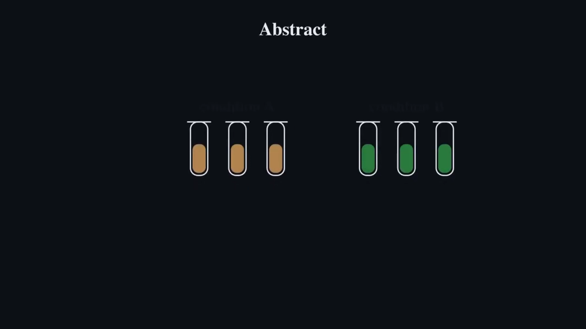
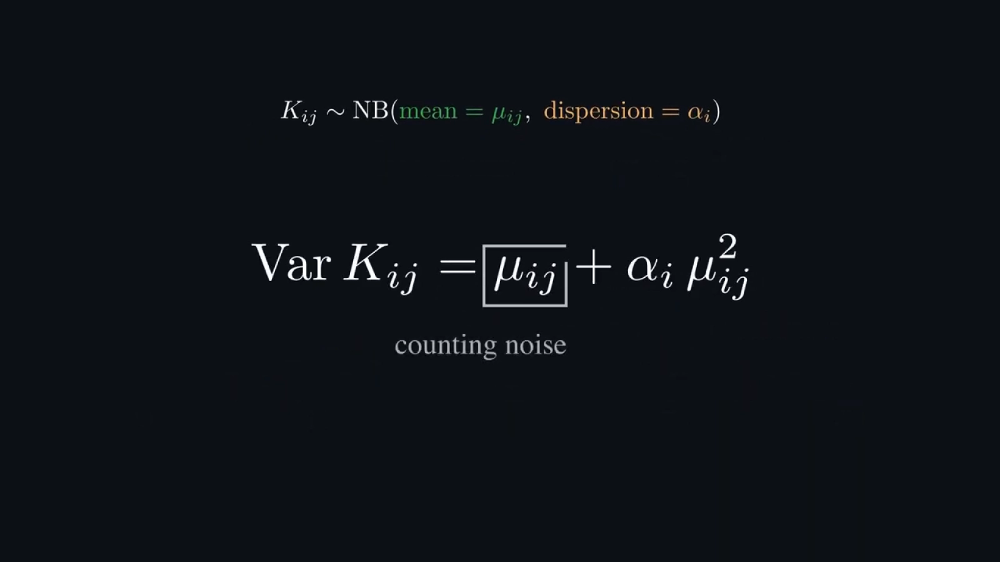
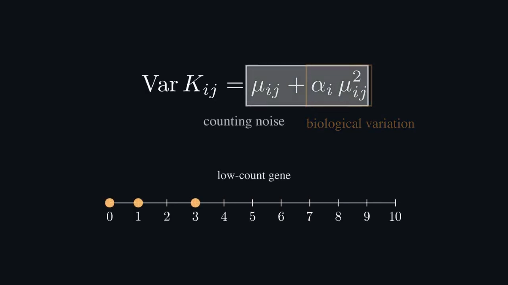
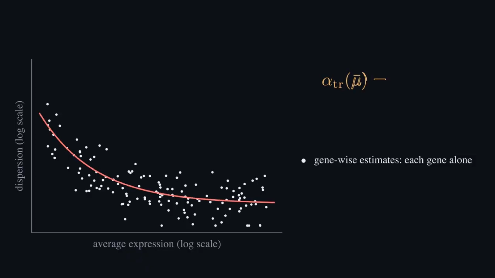
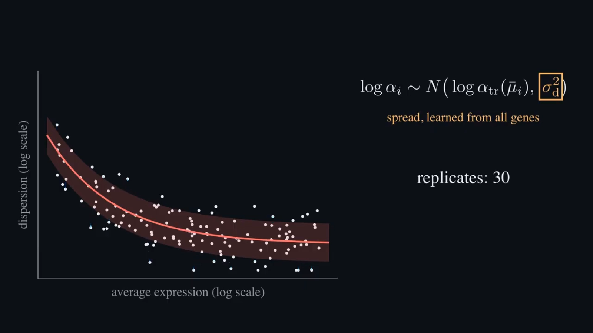
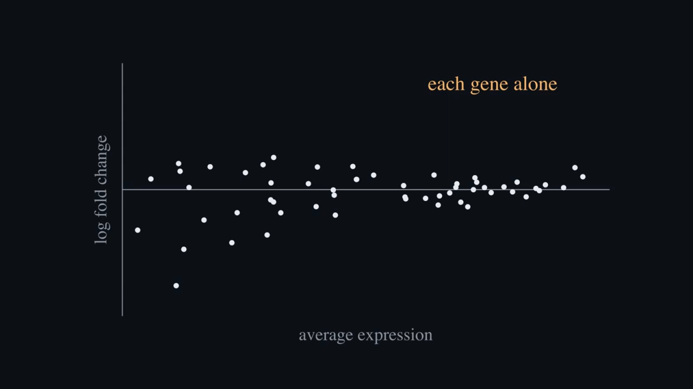
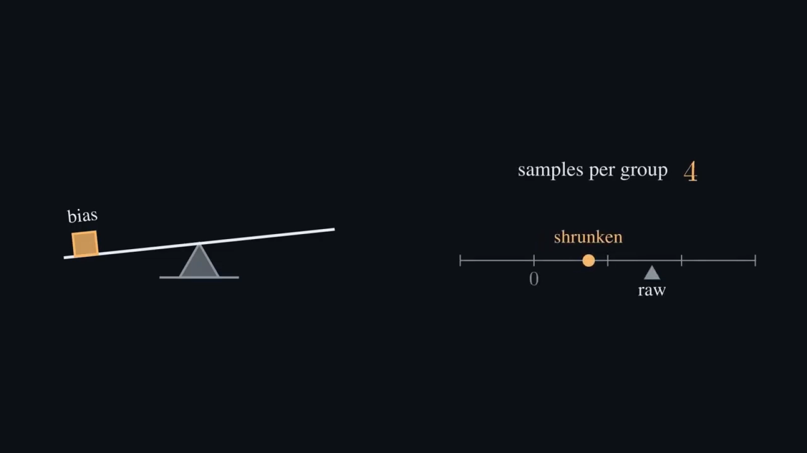
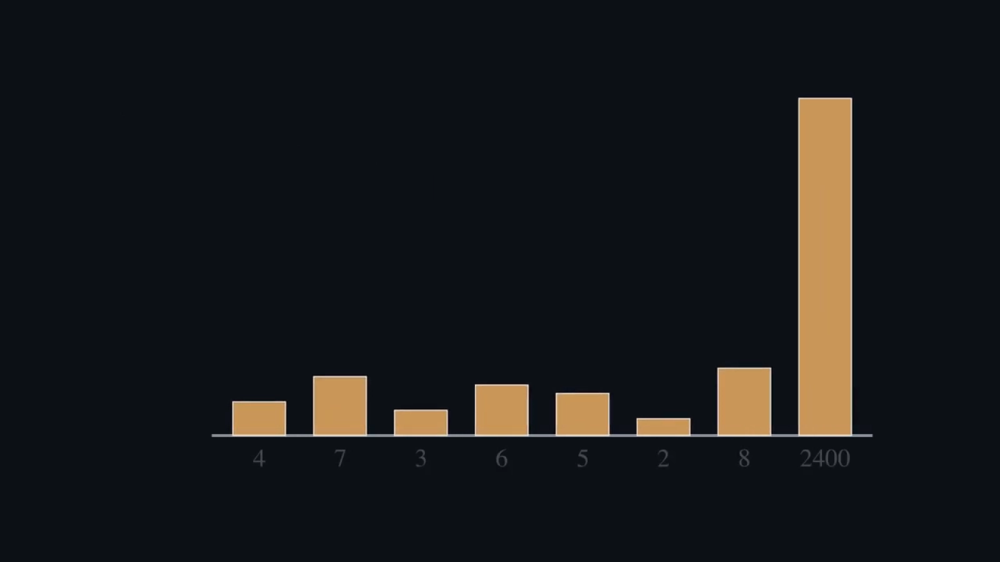

# DESeq2 的收缩估计：离散度趋势线、经验贝叶斯与倍数变化

> 视频来源：[Moderated estimation of fold change and dispersion for RNA-seq data with DESeq2 in 11 minutes](https://www.youtube.com/watch?v=yEcWiMVJssk)（YouTube · Neural Casts，对 Love、Huber、Anders 2014 年 DESeq2 论文的讲解）｜时长约 11 分钟
> 导读：这是一支按论文结构逐段讲解的短视频。它先说明"每组只有三个样本"为什么让逐基因的方差估计不可用，再讲 DESeq2 的两处收缩——离散度向趋势线收缩、倍数变化向零收缩——以及收缩之后检验怎么做。本文按原片顺序整理，末尾一节说明它没有覆盖什么。

## 本讲要解决的核心问题

**背景**：比较两种条件（例如健康组织与病变组织）时，测序仪数出每个基因发出多少条"信息"，得到一张行是基因、列是样本的计数表。问题是要找出哪些基因在两组之间发生了变化。[【跳转到 00:45】](https://www.youtube.com/watch?v=yEcWiMVJssk&t=45)

**冲突**：这个问题很难回答，因为实验室通常每组只有三个或四个样本。计数是从零到几百万的整数，一个异常样本就能让一个本来不存在的变化看起来很大；数据这么少，一个只被数到几次的基因也可能纯属偶然地"跳了十倍"。[【跳转到 00:45】](https://www.youtube.com/watch?v=yEcWiMVJssk&t=45)

**回答（中心思想）**：DESeq2 的办法是把几千个基因放在一起看——先学习"基因通常有多吵""变化通常有多大"，再把每个基因摇晃的估计拉向这个典型模式，而且基因自己的证据越弱，拉得越用力。输出不只是一张"变/没变"的名单，还包括每个基因到底变了多少的可信估计。[【跳转到 01:10】](https://www.youtube.com/watch?v=yEcWiMVJssk&t=70)

## 一、计数表、测序深度与 size factor

一次 RNA 测序实验通过计数来测量基因活性：每个样本产生数百万条短片段（reads），每条 read 被指派给它的来源基因，结果就是一张每个基因一行、每个样本一列的计数表。[【跳转到 01:25】](https://www.youtube.com/watch?v=yEcWiMVJssk&t=85)

有些样本测得比其他样本更深，于是它们的所有计数都偏高。DESeq2 用一个 **size factor** 来校正：每个样本一个缩放数，取该样本与"由所有样本构造的参考"的比值的中位数。一个基因的期望计数，就是它自身的水平乘以这个 size factor。[【跳转到 02:00】](https://www.youtube.com/watch?v=yEcWiMVJssk&t=120)

校正深度之后，同一组的重复样本之间计数仍然不同，而且差异比"单纯计数随机性"能产生的更大。这句话是后面所有建模的出发点。[【跳转到 02:25】](https://www.youtube.com/watch?v=yEcWiMVJssk&t=145)

## 二、负二项：把方差拆成"计数噪声 + 生物变异"

DESeq2 用负二项分布描述每个基因的计数——计数散布很宽时的标准模型。它的方差有两项：

$$
\operatorname{Var} K_{ij} = \mu_{ij} + \alpha_i\,\mu_{ij}^2
$$

第一项 $\mu_{ij}$ 是均值本身，代表计数噪声（泊松那一层）；第二项是"基因专属的一个数"——离散度 $\alpha_i$——乘以均值的平方，代表生物变异。[【跳转到 02:50】](https://www.youtube.com/watch?v=yEcWiMVJssk&t=170)

这个拆法立刻带来一个后果：**低计数基因的计数噪声会淹没生物信号**。一个基因从 2 条读数变成 6 条读数，看起来是三倍，而几条零星的读数就能造成这种差别。[【跳转到 03:15】](https://www.youtube.com/watch?v=yEcWiMVJssk&t=195)

## 三、离散度为什么不能一个基因一个基因地估

估计离散度需要重复。但很多实验每组只有两个或三个样本——**从三个数估一个散布，估计值可能高得离谱，也可能低得离谱**。低计数基因更糟，因为计数噪声盖过了生物信号；它们的倍数变化（两组水平之比）同样不可靠。逐基因测量时，答案是摇晃的。[【跳转到 03:15】](https://www.youtube.com/watch?v=yEcWiMVJssk&t=195)

这里就是"离散度收缩"要解决的问题：不是模型不对，而是**每个基因自己携带的信息太少，估不出一个稳定的方差参数**。

## 四、趋势线加经验贝叶斯：把估计拉向典型值

### 4.1 一条"离散度—平均表达"的曲线

DESeq2 假设平均表达相近的基因，离散度也相近。它先只用每个基因自己的计数估一个离散度，再把这些估计对平均表达拟合一条平滑曲线，表示每个表达水平上"典型"的离散度是多少。[【跳转到 03:40】](https://www.youtube.com/watch?v=yEcWiMVJssk&t=220)

然后每个基因的估计被拉向这条曲线。

### 4.2 收缩强度的形式化：先验的散布 $\sigma_d$

形式上，每个基因真实离散度的对数围绕曲线散布，散布幅度 $\sigma_d$ 由所有基因一起学出来：

$$
\log \alpha_i \sim N\!\left(\log \alpha_{\mathrm{tr}}(\bar\mu_i),\ \sigma_d^2\right)
$$

$\sigma_d$ 窄，意味着拉得强；重复数越多，拉力越弱，直到每个基因自己的估计几乎不动。[【跳转到 04:30】](https://www.youtube.com/watch?v=yEcWiMVJssk&t=270)

### 4.3 两个例外：低于曲线的被抬高，远高于曲线的保留

- 估计落在曲线**下方**的基因会被抬高——这有助于避免报告并不真实的变化。
- 如果某个基因自己的估计落在曲线**上方很远**（超过基因围绕曲线典型散布的两倍），DESeq2 把它当作离群值：这个基因可能不服从共同模式，于是保留它自己更高的值。

一句话概括这套规则：**共享信息支持数据薄的基因，在数据丰富的地方让位**。[【跳转到 04:55】](https://www.youtube.com/watch?v=yEcWiMVJssk&t=295)

## 五、倍数变化也收缩

### 5.1 原始倍数变化最大的，往往是最弱的基因

逐基因测量时，最大的倍数变化属于表达最弱的基因：几条零星读数就能让一个罕见基因看起来翻倍或减半。[【跳转到 05:20】](https://www.youtube.com/watch?v=yEcWiMVJssk&t=320)

### 5.2 向零收缩

DESeq2 先逐基因估出每个基因的倍数变化，再对所有估计拟合一条以零为中心、宽度由数据学到的钟形曲线。每个基因最终的倍数变化，在"自己的数据"和"这条曲线"之间取得平衡——最终估计是同时最好地拟合该基因计数与这条曲线的那个值。[【跳转到 05:20】](https://www.youtube.com/watch?v=yEcWiMVJssk&t=320)

拉力的强弱取决于**这个基因的数据携带多少信息**，而不只是平均计数：低计数、重复之间变异大、样本少，都会削弱信息。平均计数相近、原始倍数变化也相近的两个基因，变异更大的那个会被拉得更靠近零。[【跳转到 05:45】](https://www.youtube.com/watch?v=yEcWiMVJssk&t=345)

对证据弱的基因来说这是一笔交易：**用一点刻意的、朝向零的偏差，换取小得多的噪声**。证据强的基因几乎不动；样本越多，收缩越弱。[【跳转到 06:10】](https://www.youtube.com/watch?v=yEcWiMVJssk&t=370)

### 5.3 一个可重复性实验：21 与 81

作者把一份小鼠数据分成两半，当作实验做了两次。前半部分变化最大的 100 个基因里，用**原始**倍数变化排序，只有 21 个落在后半部分的 top 100；用**收缩后**的倍数变化，这个数字是 81。[【跳转到 06:10】](https://www.youtube.com/watch?v=yEcWiMVJssk&t=370)

这个数字是本节最直接的证据：收缩改变的不只是数值大小，而是**排序的可重复性**。

## 六、离散度估计如何进入检验

### 6.1 Wald 检验：收缩后的倍数变化除以它的不确定性

要判断一个基因是否变化，DESeq2 用收缩后的倍数变化除以这个估计的不确定性。比值远离零，就是变化为真的强证据。[【跳转到 06:35】](https://www.youtube.com/watch?v=yEcWiMVJssk&t=395)

这一步把前面的两处收缩与 p 值连了起来：**离散度估计决定标准误，标准误决定检验统计量**。离散度被高估，标准误偏大，检验变保守；被低估，标准误偏小，p 值偏小。逐基因估计在三个重复下恰好会两头都发生，所以收缩同时修正了两个方向的错误。

### 6.2 FDR 与独立过滤

几千个基因同时检验时，结果要校正以控制假发现率（FDR）——被报告的基因里假阳性的期望比例。[【跳转到 06:35】](https://www.youtube.com/watch?v=yEcWiMVJssk&t=395)

平均计数很低的基因几乎没有被检出的机会，所以 DESeq2 把它们排除在校正之外，让更多真实变化存活下来。[【跳转到 06:40】](https://www.youtube.com/watch?v=yEcWiMVJssk&t=400)

### 6.3 检验"变化是否够大"

在大型实验里几乎每个基因都会显示一点微小变化，对零做检验会报出小到没有意义的效应。DESeq2 可以改为检验变化是否超过一个选定阈值（例如任一方向的翻倍）；关掉收缩时，也可以反向检验"变化是否低于某个阈值"。[【跳转到 07:12】](https://www.youtube.com/watch?v=yEcWiMVJssk&t=432)

### 6.4 单个极端样本：Cook's distance

一个极端样本同样会误导：例如个位数计数里出现一个 2400。DESeq2 计算"如果去掉这个样本，这个基因的估计会移动多远"，移动太大就标记该样本。当一个条件只有六个或更少的重复时，带标记样本的基因被搁置；七个或更多重复时，极端计数被替换为所有样本的典型值，再重新拟合该基因。[【跳转到 07:37】](https://www.youtube.com/watch?v=yEcWiMVJssk&t=457)

## 七、rlog：同一套收缩思路用在可视化上

聚类、热图这类"按相似性给样本分组"的任务，要求每个基因在样本间的变化尺度大致相同。原始计数被少数高表达、高变异基因主导，而普通对数又让罕见基因剧烈摆动。DESeq2 的 regularized logarithm（rlog）在**每个基因内部**做收缩，把每个样本的值拉向该基因的平均：高计数时它接近归一化计数的普通对数，低计数时它把样本的值拉到一起，噪声不再把它们撑开。[【跳转到 08:02】](https://www.youtube.com/watch?v=yEcWiMVJssk&t=482)

模拟中，等测序深度时 rlog 是表现最好的方法之一；深度不均时普遍优于其他方法。但 rlog 只用于探索与可视化，**统计检验本身仍然使用原始计数**。[【跳转到 09:14】](https://www.youtube.com/watch?v=yEcWiMVJssk&t=554)

## 八、评测结果与它的两条限制

作者把 DESeq2 与 edgeR、voom、旧版 DESeq 比较。在模拟数据里每个基因的真值已知，在把假阳性控制在所有被标记基因 10% 以内的工具中，DESeq2 常常找到最大比例的真实变化。但模拟只是在检验一个方法是否符合它自己的假设。[【跳转到 09:39】](https://www.youtube.com/watch?v=yEcWiMVJssk&t=579)

在真实数据上，作者比较了两组之间**本来没有差异**的样本，于是每个被标记的基因都是假阳性：DESeq2 的假阳性率保持在设定的 1% 阈值之下。为了看检出能力，作者把一份小鼠数据分成"三对三"的小数据集和一份更大的、当作近似真值的数据集：DESeq2 找到的真实变化与 edgeR、voom 大致相当，但少于 DSS；在被它标记的基因中，被大数据集确认的比例常常排第二，仅次于旧版 DESeq。[【跳转到 10:04】](https://www.youtube.com/watch?v=yEcWiMVJssk&t=604)

讲者自己给出两条限制：近似真值本身有误差（假定对各工具影响大致相同）；把各工具校正到相同错误率之后，它们的表现更接近，DESeq2 常常靠近前列——而不同划分之间的随机波动，比工具之间的差距还大。[【跳转到 10:29】](https://www.youtube.com/watch?v=yEcWiMVJssk&t=629)

## 九、这一讲没有回答什么

- **它只讲 DESeq2 这一条实现。** edgeR 的共同离散度与 tag-wise 离散度、limma-voom 的经验贝叶斯权重，以及各自用哪种检验统计量，属于 [4.2.3 差异表达建模](../../../README.md#b04-4-2-3) 讨论的软件实现与设计矩阵层面；本节只把"离散度估计 → 标准误 → 检验"这条链讲清楚。
- **泊松、负二项与对数连接的通用似然**（为什么计数要用对数连接、过度离散如何定义）是 [4.2.2 计数似然与过度离散](../../../README.md#b04-4-2-2) 的复用内容，本节不重复推导。
- **零值与零膨胀**：本片只提到"低计数基因几乎没有被检出的机会"，没有讨论单细胞矩阵里成片的零该由负二项还是零膨胀模型解释。这部分见本节导读 [单细胞矩阵里的零从哪里来](../../../2_从样本到表达矩阵/2.1_RNA%20测序的观测过程/2.1.7_测序深度与捕获效率：文库复杂度、饱和度与检测概率/单细胞矩阵里的零从哪里来：Dropout、零膨胀与过度校正.md)。
- **收缩后的倍数变化怎么用于下游排序**（GSEA、标记基因选择）不在本片范围；"收缩改变的是排序可重复性"这一点只在 21 与 81 的实验里给出。
- 片中的具体数字（100 个基因里的 21 与 81、10% 与 1% 的阈值、三对三的划分）都是该论文的设置，不是通用合格线。