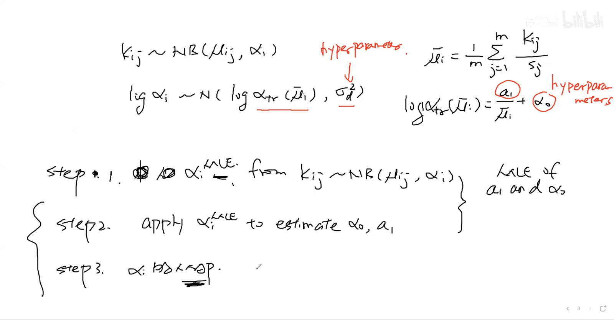
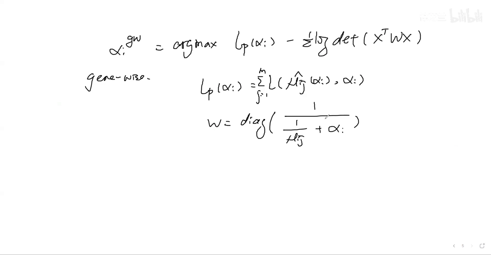
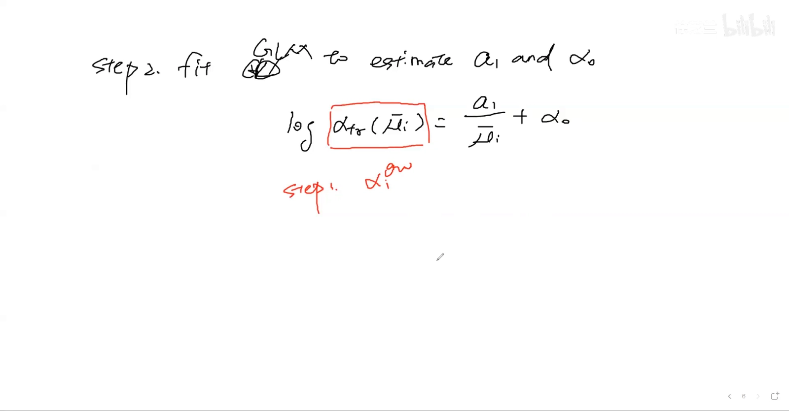
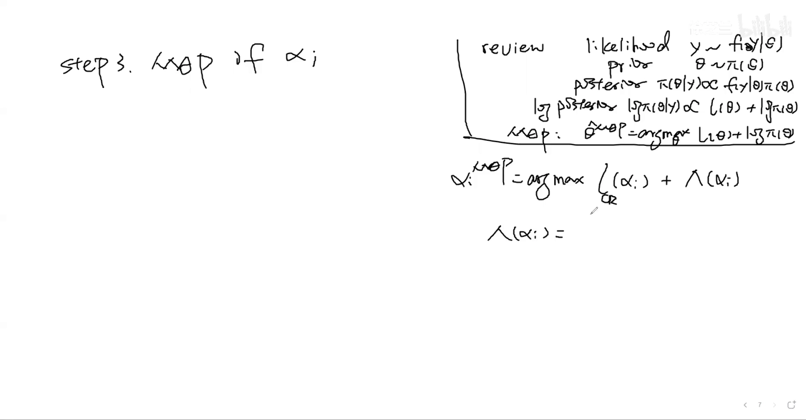
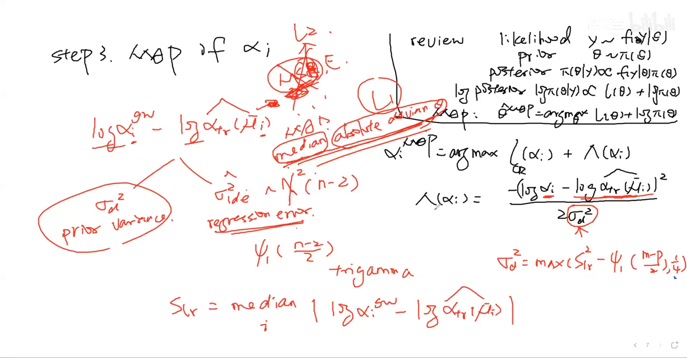

# 离散度的三步估计：基因级 MLE、Cox-Reid 校正与经验贝叶斯 MAP

> 视频来源：[【贝叶斯统计】DESeq2 p03 Dispersion Parameter的估计](https://www.bilibili.com/video/BV1uW4y1X73L?p=3)（B 站 · 徐芝兰，DESeq2 系列第 3 讲）｜时长约 38 分钟
> 导读：这是一支按论文记号逐行推演的板书讲解。它回答的是"DESeq2 里那个离散度到底怎么算出来的"：为什么不能直接用似然最大化，为什么要在似然上扣掉一项，趋势线的两个系数怎么回归出来，先验方差为什么要有下界。全片只讲 α 的估计，最后一句才转到 β。本文按原片顺序整理，公式按板书复述，不补片中没有的推导。

## 一、模型与要估计的对象

### 1.1 负二项 + 对数正态先验

板书先写下模型：基因 $i$ 在样本 $j$ 上的计数服从负二项分布，均值为 $\mu_{ij}$，离散度（dispersion）为 $\alpha_i$；要估的就是这个 $\alpha_i$。它的先验写成

$$
K_{ij} \sim \mathrm{NB}(\mu_{ij}, \alpha_i), \qquad
\log \alpha_i \sim N\!\left(\log \alpha_{\mathrm{tr}}(\bar\mu_i),\ \sigma_d^2\right)
$$

先验的均值是 $\log \alpha_{\mathrm{tr}}(\bar\mu_i)$，其中 $\mathrm{tr}$ 表示趋势项，这个趋势是关于 $\bar\mu_i$ 的函数；先验的方差是 $\sigma_d^2$。[【跳转到 00:00】](https://www.bilibili.com/video/BV1uW4y1X73L?p=3&t=0)

括号里的 $\bar\mu_i$ 是一个 normalized mean：考虑到每个样本的权重（size factor $s_j$）之后再计算基因 $i$ 的平均值，相当于用每个样本的 coverage 调整之后的平均读数。[【跳转到 01:05】](https://www.bilibili.com/video/BV1uW4y1X73L?p=3&t=65)



### 1.2 趋势项是一个 Gamma GLM

趋势项被写成

$$
\log \alpha_{\mathrm{tr}}(\bar\mu_i) = \frac{a_1}{\bar\mu_i} + a_0
$$

讲者提示：熟悉 GLM 的人会认出，这是一个 Gamma family、link function 为 log 的广义线性模型。认出这一点，对后面"怎么估 $a_1$ 和 $a_0$"是有好处的。[【跳转到 01:30】](https://www.bilibili.com/video/BV1uW4y1X73L?p=3&t=90)

### 1.3 三个超参数，以及为什么用经验贝叶斯

$a_1$、$a_0$ 是贝叶斯统计里的两个**超参数**——先验里面的未知参数；$\sigma_d^2$ 也是超参数。确定超参数有三种做法：当成机器学习的 tuning parameter、用经验贝叶斯（用 MLE 估）、或者给超参数再加一层先验（纯贝叶斯）。[【跳转到 01:55】](https://www.bilibili.com/video/BV1uW4y1X73L?p=3&t=115)

讲者排除第一种（这不是机器学习问题），也排除第三种，理由是要降低模型复杂度：如果给 $a_1$、$a_0$ 再加先验，模型的层数就太深了；"适于应用的模型，分布的层数控制在两三层就够了"，再往下加不方便别人拿去用。而且再加先验又该选什么分布、这个分布是否还有未知参数，都是新问题，不利于推广。所以选择**用 MLE 估 $a_1$、$a_0$ 的经验贝叶斯**。[【跳转到 02:30】](https://www.bilibili.com/video/BV1uW4y1X73L?p=3&t=150)

### 1.4 三步框架

整个流程分三步：[【跳转到 03:30】](https://www.bilibili.com/video/BV1uW4y1X73L?p=3&t=210)

1. 用第一层模型（负二项似然）得到每个基因的 $\alpha_i^{\mathrm{MLE}}$；
2. 把 $\alpha_i^{\mathrm{MLE}}$ 当作观测，回归出 $a_1$、$a_0$；
3. 用 MAP 得到 $\alpha_i^{\mathrm{MAP}}$。

前两步合起来，相当于得到 $a_1$、$a_0$ 的 MLE；第三步才是在超参数已知的前提下最大化后验。讲者强调：**只有把超参数确定下来，先验和似然对我们才算已知信息**，才能去做后验最大化。所以整个框架就是一个经验贝叶斯框架，最终要交付的是 MAP 估计。[【跳转到 04:30】](https://www.bilibili.com/video/BV1uW4y1X73L?p=3&t=270)

## 二、第一步：基因级 MLE 与 Cox-Reid 校正

### 2.1 $\mu_{ij}$ 是冗余参数，用 profile likelihood 消掉

负二项分布有两个参数：$\mu_{ij}$ 和 $\alpha_i$。真正感兴趣的是 $\alpha_i$（parameter of interest）；$\mu_{ij}$ 不需要估计，甚至最好当它不存在——它是一个 nuisance parameter，一个冗余变量。它当然会影响 $K_{ij}$，只是现在不关心它。[【跳转到 05:05】](https://www.bilibili.com/video/BV1uW4y1X73L?p=3&t=305)

对含有冗余参数、又想要另一个参数的 MLE 的情形，需要 **profile likelihood**：先写出对数似然关于 $\mu_{ij}$ 和 $\alpha_i$ 的两个方程，解出 $\mu_{ij}$ 的 MLE——它是 $\alpha_i$ 的函数——再代回似然函数。这样得到的 $l_p(\alpha_i)$ 只和 $\alpha_i$ 有关，冗余参数被消掉了。[【跳转到 06:30】](https://www.bilibili.com/video/BV1uW4y1X73L?p=3&t=390)

### 2.2 缺陷：似然里还混着用来估 $\mu$ 的信息

但这样消掉之后仍有缺陷：不管怎么消，计算似然时用的还是**所有** $K_{ij}$ 的数据，其中既包含能分配给 $\mu_{ij}$ 的信息，也包含能分配给 $\alpha_i$ 的信息。[【跳转到 07:05】](https://www.bilibili.com/video/BV1uW4y1X73L?p=3&t=425)

### 2.3 Cox-Reid 校正：扣掉分配给 $\mu$ 的那部分 Fisher 信息

调整的办法是借助统计推断里的 Fisher information 概念：把能分配到 $\mu_{ij}$ 的那部分信息扣掉。因为对数似然已经取过一次对数，似然与信息量的 scale 相同，所以对信息量也取一次 log：

$$
l_p^{\mathrm{CR}}(\alpha_i) = l_p(\alpha_i) - \tfrac{1}{2}\log \det\!\left(X^{\mathsf T} W X\right)
$$

这种调整叫 **Cox-Reid adjusted likelihood**。它本质上是一种 profile likelihood，用来处理 nuisance parameter；核心思想是把似然里可以分配到冗余参数的那部分信息扣除，剩下的信息全部分配给 $\alpha_i$，从而得到更靠谱的估计。[【跳转到 07:30】](https://www.bilibili.com/video/BV1uW4y1X73L?p=3&t=450)

### 2.4 得到的基因级估计

论文直接给出了信息量的结果：$\log\det(X^{\mathsf T} W X)$，其中 $W$ 是对角阵，对角元为

$$
W = \operatorname{diag}\!\left(\frac{1}{1/\mu_{ij} + \alpha_i}\right)
$$

这里 $X$ 虽然写成矩阵，但只包含第 $i$ 个基因的数据（由 $x_{rj}$ 构成）；它的下标只和特征、样本有关，和基因无关，所以对基因 $i$ 来说 $X$ 算常数，真正和 $i$ 有关的是 $W$。[【跳转到 09:05】](https://www.bilibili.com/video/BV1uW4y1X73L?p=3&t=545)

于是基因级估计为

$$
\alpha_i^{\mathrm{GW}} = \arg\max_{\alpha_i}\ \left[l_p^{\mathrm{CR}}(\alpha_i)\right],
\qquad
l_p^{\mathrm{CR}}(\alpha_i) = \sum_{j=1}^{m} l\!\left(\hat\mu_{ij}(\alpha_i), \alpha_i\right) - \tfrac{1}{2}\log\det\!\left(X^{\mathsf T} W X\right)
$$

记号 GW 代表 gene-wise：针对每一个基因单独做一次 MLE。[【跳转到 10:30】](https://www.bilibili.com/video/BV1uW4y1X73L?p=3&t=630)



## 三、第二步：用 Gamma GLM 回归出趋势线的两个系数

第二步要估超参数 $a_1$ 和 $a_0$。它们对所有的 $i$、$j$ 都一样，是一个 scale。既然趋势项是 Gamma family、log link 的 GLM，就可以直接做一个回归：把趋势项换成第一步得到的 $\alpha_i^{\mathrm{GW}}$ 作为被解释变量，解释变量用 $1/\bar\mu_i$：[【跳转到 11:00】](https://www.bilibili.com/video/BV1uW4y1X73L?p=3&t=660)

```r
glm(alpha_gw ~ I(1 / mu_bar), family = Gamma(link = "log"))
```

为什么可以这样替换？因为这样估出来的 $\alpha_i$ 相当于一个均值或中心值的含义，所以可以直接替换趋势项。[【跳转到 12:05】](https://www.bilibili.com/video/BV1uW4y1X73L?p=3&t=725)

这种估计在 R 里用 IRLS（iteratively reweighted least squares）完成，所以得到的 $a_1$、$a_0$ 一定是它们的 MLE。[【跳转到 12:55】](https://www.bilibili.com/video/BV1uW4y1X73L?p=3&t=775)



为什么选 Gamma、选 log link？讲者给了两条理由：Gamma GLM 的 link function 有两种（取对数或取倒数），这里取对数，因为分布本身是对数正态；而选 Gamma 是因为离散度加的先验是 log-normal——一个右偏分布，所以尽量用一个右偏的 family 去估 $\alpha$ 与 $\mu$ 之间的关系。[【跳转到 12:45】](https://www.bilibili.com/video/BV1uW4y1X73L?p=3&t=765)

## 四、第三步：MAP

### 4.1 MAP 的定义

给定数据 $y$ 服从 $y\mid\theta$ 的分布、并给 $\theta$ 一个先验，后验 $\pi(\theta\mid y) \propto f(y\mid\theta)\pi(\theta)$；取对数后，$\log\pi(\theta\mid y) \propto l(\theta) + \log\pi(\theta)$。MAP 就是最大化这个量：[【跳转到 13:55】](https://www.bilibili.com/video/BV1uW4y1X73L?p=3&t=835)

$$
\hat\theta^{\mathrm{MAP}} = \arg\max_{\theta}\ \left[l(\theta) + \log \pi(\theta)\right]
$$

讲者强调：**只有清楚似然和先验的具体表达式，才能把优化写出来**，才能选择对应的方法去解。[【跳转到 14:30】](https://www.bilibili.com/video/BV1uW4y1X73L?p=3&t=870)



### 4.2 目标函数

似然那一项用 Cox-Reid 校正后的 $l^{\mathrm{CR}}(\alpha_i)$；先验那一项是对数正态密度的对数，即

$$
\Lambda(\alpha_i) = -\frac{\left(\log \alpha_i - \log \alpha_{\mathrm{tr}}(\hat{\bar\mu}_i)\right)^2}{2\sigma_d^2}
$$

于是

$$
\alpha_i^{\mathrm{MAP}} = \arg\max_{\alpha_i}\ \left[l^{\mathrm{CR}}(\alpha_i) + \Lambda(\alpha_i)\right]
$$

其中 $\log \alpha_{\mathrm{tr}}(\hat{\bar\mu}_i)$ 就是第二步那个 GLM 的 fitted value：做完回归后直接 predict，把预测值放回先验的均值里。[【跳转到 15:05】](https://www.bilibili.com/video/BV1uW4y1X73L?p=3&t=905)

到这一步，三个超参数里只剩下 $\sigma_d^2$ 还没确定。

## 五、先验方差 $\sigma_d^2$：残差分解、稳健中心与下界

### 5.1 残差由两部分构成

回到第二步的 GLM：除了 fitted value，还能得到 residual。考虑 $\log\alpha_i^{\mathrm{GW}} - \log\alpha_{\mathrm{tr}}(\hat{\bar\mu}_i)$ 这个残差，它由两部分构成：一部分是回归误差，另一部分来自先验——也就是 $\sigma_d$。[【跳转到 16:55】](https://www.bilibili.com/video/BV1uW4y1X73L?p=3&t=1015)

### 5.2 回归误差服从卡方，取对数后是 trigamma

对 Gamma 回归来说，回归误差的估计量服从某种卡方分布（熟悉线性模型的人也知道它就是一个卡方分布）。它的自由度是样本量减去系数占掉的自由度：样本是逐个基因的，样本量为 $n$，系数是 $a_1$ 和 $a_0$ 两个，所以自由度是 $n-2$。[【跳转到 18:05】](https://www.bilibili.com/video/BV1uW4y1X73L?p=3&t=1085)

我们关心的是它的**对数**的方差——因为所有 scale 都是基于 log 做的。卡方分布取对数之后的方差由一个叫 **trigamma** 的函数表示，记作 $\psi_1$。[【跳转到 18:30】](https://www.bilibili.com/video/BV1uW4y1X73L?p=3&t=1110)

讲者在这里专门澄清了一处记号混用：论文写的是 $m-p$，但论文里那个 $m$ 指的是"这次回归所用的样本量"，而实际回归用的样本是所有的基因，所以样本量是 $n$；论文里的 $p$ 说的是系数个数，但 $p$ 本来应该指一开始 $\beta$ 的个数，而不是这个 Gamma GLM 里的系数个数（这里是 2）。所以正确写法是 $n-2$，不是 $m-p$。[【跳转到 19:05】](https://www.bilibili.com/video/BV1uW4y1X73L?p=3&t=1145)

### 5.3 用 MAD 而不是均方误差

残差平方和通常用 mean square error 表示，但讲者提醒：这一整套建模一直在讨论稳健性。mean square error 是平方再求均值，也就是算术均值，而算术均值不是稳健的中心表示。所以这里改用 MAD（median absolute deviation）：

$$
S_{ir} = \operatorname{median}_i\left|\log \alpha_i^{\mathrm{GW}} - \log \alpha_{\mathrm{tr}}(\hat{\bar\mu}_i)\right|
$$

理由有两条：中位数比平均数稳健；absolute deviation 是 $L_1$ 范数，而 mean square error 是 $L_2$ 范数——就像 Lasso 相对 ridge regression 更稳健一样。双重考虑都是为了让结果更稳健，而更稳健的好处是模型能适用于更多数据集、更广的应用场景。[【跳转到 19:55】](https://www.bilibili.com/video/BV1uW4y1X73L?p=3&t=1195)

### 5.4 先验方差的估计与 1/4 下界

先验方差的估计写成

$$
\sigma_d^2 = \max\left(S_{ir}^2 - \psi_1\!\left(\tfrac{n-2}{2}\right),\ \tfrac{1}{4}\right)
$$

也就是从观测到的散布里扣掉回归误差贡献的那部分（trigamma 项），再和 $1/4$ 取最大值。[【跳转到 21:05】](https://www.bilibili.com/video/BV1uW4y1X73L?p=3&t=1265)



为什么要有 $1/4$ 这个下界？讲者回到模型：如果 $\sigma_d$ 趋近于零，$\alpha_i$ 最终会收敛到趋势线，先验相当于一点都没用上。而趋势线本身是用频率派方法、基于似然估出来的，所以那样做等于没用任何先验信息，还额外强加了一个假设——$\alpha_i$ 的对数等于 $a_1/\bar\mu + a_0$。因此不希望 $\sigma_d$ 趋近于零，只能给它设一个下界，这就是 `max` 存在的意义。讲者补充：$1/4$ 是可以改的，觉得不够保险可以调到 $1/2$。[【跳转到 22:30】](https://www.bilibili.com/video/BV1uW4y1X73L?p=3&t=1350)

## 六、这一讲对"似然"与"实现"的区分

把三步连起来看，能清楚地区分两层东西：

- **模型层**：负二项似然、对数正态先验、趋势项的函数形式。这些是统计假设，换成别的先验或别的趋势形式，就是另一个模型。
- **实现层**：用 Cox-Reid 校正而不是朴素 profile likelihood；用 Gamma GLM 回归趋势系数；用 MAD 而不是均方误差估散布；给 $\sigma_d^2$ 设 $1/4$ 下界；论文里 $m-p$ 与实际实现里 $n-2$ 的记号差异。这些是 DESeq2 为了让估计在"每组三个重复"这种数据上还能用而做的工程选择，不是似然的必然结果。

这也解释了为什么不同软件在同一份数据上给出的离散度不会完全相同：它们共享"负二项 + 收缩"的骨架，但收缩的对象（基因级离散度还是共同离散度）、趋势的拟合方式、稳健化手段各不相同。软件实现与设计矩阵层面的比较见 [4.2.3 差异表达建模](../../../README.md#b04-4-2-3)；泊松、负二项与对数连接的通用似然见 [4.2.2 计数似然与过度离散](../../../README.md#b04-4-2-2)。

## 七、这一讲没有回答什么

- **它不讨论零值。** 全片从负二项似然出发，没有涉及零膨胀模型，也没有讨论单细胞矩阵里成片的零该由负二项还是零膨胀解释。这部分见本节导读 [单细胞矩阵里的零从哪里来](../../../2_从样本到表达矩阵/2.1_RNA%20测序的观测过程/2.1.7_测序深度与捕获效率：文库复杂度、饱和度与检测概率/单细胞矩阵里的零从哪里来：Dropout、零膨胀与过度校正.md)。
- **它不讲 β 的估计**，只在结尾一句转到下一讲；组间比较、设计矩阵与效应量见 [4.2.3](../../../README.md#b04-4-2-3)。
- **它不评估收缩的好坏**：没有给出"收缩前后 p 值分布如何变化""不同 $\sigma_d$ 下 FDR 如何变化"的对照实验。收缩对检验结果的影响，本节导读中的另一篇正文用 DESeq2 论文里的可重复性实验与假阳性率实验给出证据。
- 板书里的 $1/4$、两三层分布等说法是讲者对"为什么这样选"的解释，不是论文给出的唯一正确取值；讲者本人也说这些参数可以调整。