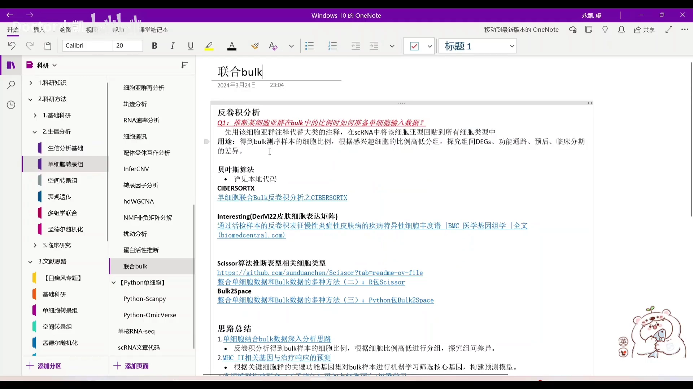
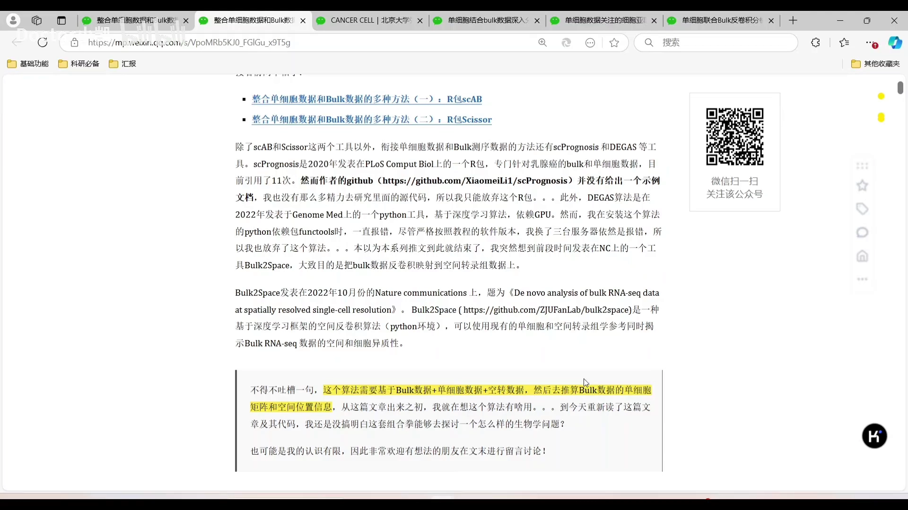
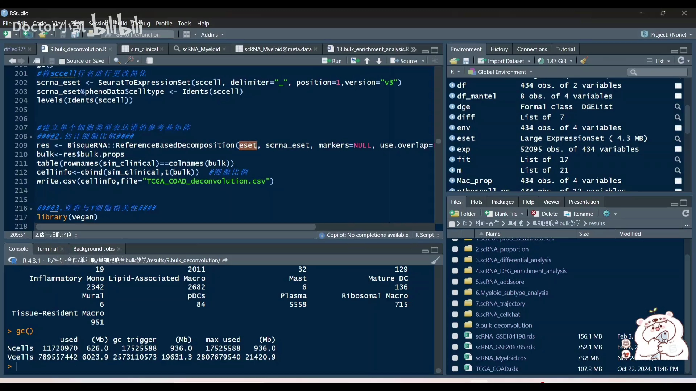
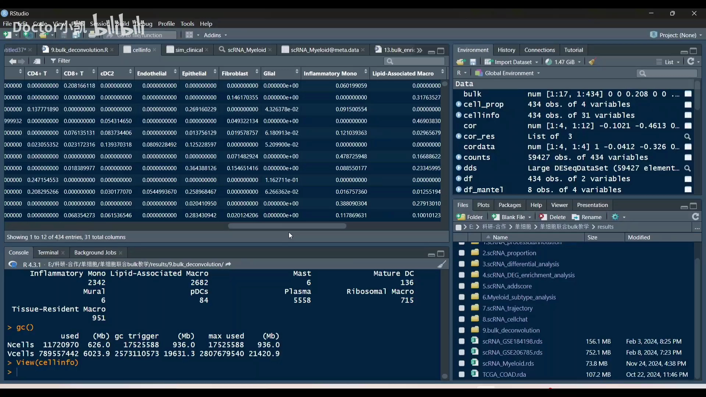
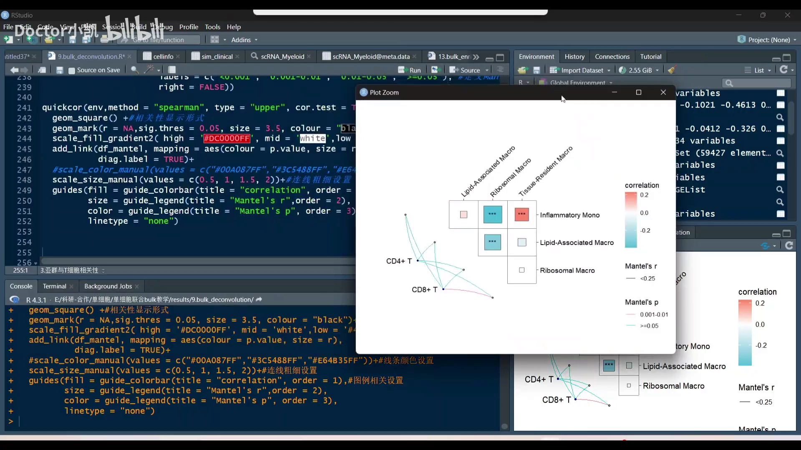
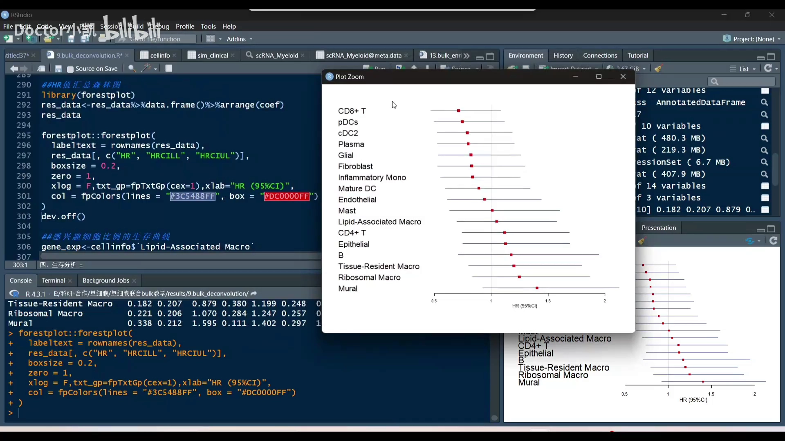
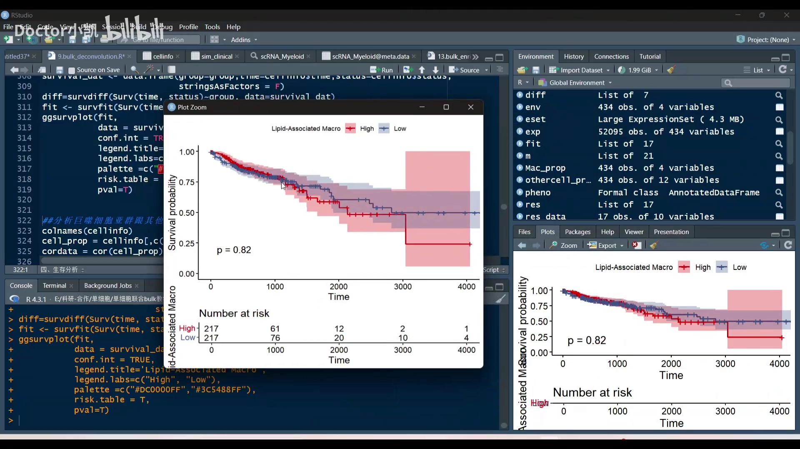
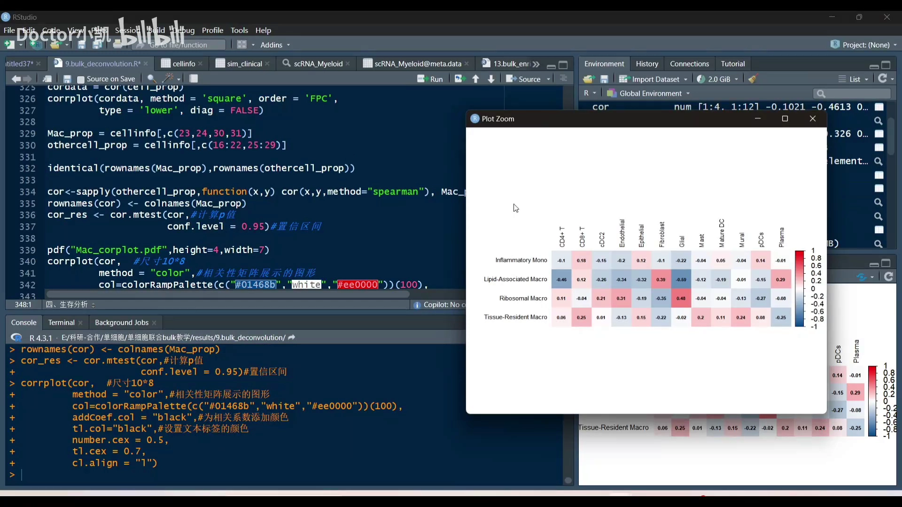

# 反卷积：从 bulk 的群体平均表达里，反推每种细胞占多少

> 视频来源：[【单细胞联合bulk转录组实战】13.去卷积分析](https://www.bilibili.com/video/BV1WjiBYVECS/)（Bilibili · Doctor小凯）｜时长约 20 分钟
> 导读：这一节是「单细胞 + bulk 联合分析」实战的第 13 讲，前半段用十分钟讲清反卷积到底在解什么问题——bulk 的一个数字是「细胞类型表达 × 细胞比例」的加权和，反卷积就是把这两样拆开；后半段用 TCGA 结直肠癌数据（402 例肿瘤 + 32 例对照）配合 BisqueRNA 跑完整流程，再把得到的细胞比例拿去做 Mantel 检验、Cox 回归、生存曲线、Spearman 相关和药敏分析。字幕为 B 站 AI 字幕，术语（反卷积、CIBERSORTx、Scissor、Bulk2Space、BisqueRNA、TPM 等）已按上下文与代码订正。

## 本讲要解决的核心问题（SCQA）

**背景**：bulk RNA-seq 便宜、样本量大、临床随访信息齐全，但每个样本只给你一个「整块组织的平均表达」。单细胞 RNA-seq 能给出每种细胞类型各自的表达特征，可样本数往往只有几个、十几个，很难直接跟临床结局挂钩。

**冲突**：真正想回答的临床问题——「这类细胞多的病人是不是预后更差」——需要几百个带随访的样本；而这几百个样本只有 bulk 数据。单细胞能提供「细胞类型的表达特征」，却提供不了「大样本的细胞比例」。

**疑问**：能不能用少量单细胞数据当「参考配方」，把大量 bulk 样本的平均值反解成「每种细胞各占多少」？

**回答（中心思想）**：可以，这就是**反卷积（deconvolution）**。它把 bulk 的表达矩阵看成两个矩阵的乘积——「每种细胞类型的特征表达」乘以「每种细胞在每个样本中的比例」，然后反解出比例矩阵。拿到比例之后，bulk 队列里原本只有一个数的样本，就多出了一组「细胞组成」变量，可以像基因表达量一样去做分组、差异分析、预后分析和相关性分析。

## 一、两种数据的分工：一个给总量，一个给配方

### 1.1 bulk 只告诉你总量

讲者开场把两种数据摆在一起：单细胞数据能帮我们获得**每个细胞类型的基因表达特征**，而 bulk RNA-seq 只能帮我们获得**这一块组织总体的基因表达**。[【跳转到 00:00】](https://www.bilibili.com/video/BV1WjiBYVECS/?t=0)

这个「总体」二字的含义，[1.2.2 RNA 测序对象：bulk、单细胞与单核](../../../README.md#b04-1-2-2) 已经拆过：bulk 的读数是一个以细胞比例为权重的加权平均。问题在于，一旦组织是混杂的（肿瘤里有恶性细胞、T 细胞、巨噬细胞、成纤维细胞……），这个加权平均就把「谁表达了多少」和「谁占多少」两件事搅在了一起。

### 1.2 想拆开的两样东西

于是问题变成：如何从这样一个混沌的混杂组织里，分离出**每一种细胞类型的表达基因**，以及**它们各自的比例构成**？[【跳转到 00:25】](https://www.bilibili.com/video/BV1WjiBYVECS/?t=25)

讲者的答案是：把单细胞数据和 bulk 数据做联合分析，用的方法就是反卷积。

## 二、反卷积的数学形式：一次有约束的矩阵分解

### 2.1 三个矩阵

讲者用「因式分解」来类比：把 bulk 那个「基因为行、样本为列」的表达矩阵，拆分成两个矩阵的乘积——一边是**每种细胞类型的基因表达特征**，另一边是「细胞比例为行、样本为列」的矩阵。[【跳转到 00:50】](https://www.bilibili.com/video/BV1WjiBYVECS/?t=50)

写成公式：

$$
\mathbf{Y}_{G \times S} \approx \mathbf{M}_{G \times K} \cdot \mathbf{P}_{K \times S}
$$

- $\mathbf{Y}$：观测到的 bulk 表达矩阵，$G$ 个基因、$S$ 个样本，每个元素是某个基因在某个样本里的表达量；
- $\mathbf{M}$：**特征矩阵（signature matrix）**，$K$ 种细胞类型各自的表达谱，通常由单细胞数据按细胞类型求平均得到——这就是单细胞数据在整件事里扮演的角色：提供「配方卡」；
- $\mathbf{P}$：**比例矩阵**，每个样本里每种细胞占多少，正是我们要求解的未知量。

对单个基因、单个样本展开，就是上一节那个加权平均式：

$$
y_{g,s} = \sum_{k=1}^{K} m_{g,k} \cdot p_{k,s}
$$

### 2.2 为什么是「反」卷积

如果把「把细胞混成一份 bulk」看作一次卷积（每种细胞按比例叠加），那么反卷积就是它的逆运算：已知混合后的结果和每种成分的纯谱，反推混合比例。类比一下：你知道草莓昔、蓝莓昔各自的味道（$\mathbf{M}$），也尝到了一杯混合果昔的味道（$\mathbf{Y}$），要反推这杯里草莓和蓝莓各占多少（$\mathbf{P}$）。

### 2.3 两个隐含约束

反卷积不是随便做一次最小二乘就有意义的，通常要加两条约束：

$$
p_{k,s} \ge 0, \qquad \sum_{k=1}^{K} p_{k,s} = 1
$$

第一条是「比例不能为负」，第二条是「一个样本里所有细胞类型的比例加起来是 1」。不同算法（贝叶斯、支持向量回归、非负最小二乘……）的差别，很大程度上就在于怎么处理噪声与这两条约束。

### 2.4 得到的是什么

反卷积的输出就是 bulk RNA 测序样本的细胞比例。这个比例与单细胞数据中的细胞类型一一对应，既可以是大类注释的分群，也可以是把每个大类细化为亚群之后的分类。[【跳转到 01:15】](https://www.bilibili.com/video/BV1WjiBYVECS/?t=75)

这一点很关键：**分辨率的粒度由你的单细胞参考决定**。如果参考里只有「髓细胞」一类，反卷积就只能给出「髓细胞占比」；如果参考里把髓细胞细分成炎症型单核、脂代谢相关巨噬、组织驻留巨噬等亚群，反卷积就能给出这些亚群各自的比例。本讲的实战演示走的正是后一条路。

## 三、拿到细胞比例之后能做什么

讲者花了整整两分钟讲「用途」，因为这才是反卷积真正的价值所在。他先把自己整理的一页笔记投出来，上面写着反卷积的三件事：怎么准备单细胞输入、拿到比例能干什么、以及后面要讲的几条思路。[【跳转到 04:04】](https://www.bilibili.com/video/BV1WjiBYVECS/?t=244)

### 3.1 最直接的一类：按比例高低分组

得到 bulk 样本的细胞比例之后，可以根据感兴趣的细胞比例做高低分组，然后探究组间的差异基因、功能通路、预后以及临床分期的差异。[【跳转到 01:40】](https://www.bilibili.com/video/BV1WjiBYVECS/?t=100)

换句话说，细胞比例被当成一个「新的表型变量」，后面所有 bulk 分析套路都可以照搬：高比例组 vs 低比例组做差异表达、做富集、做生存分析。

### 3.2 为什么这一步特别重要

讲者给的理由很实在：单细胞测的样本数量比较少，很难直接跟临床表现关联起来；而反卷积可以把 bulk 原本的基因表达矩阵重新解构为一个细胞比例矩阵。[【跳转到 02:05】](https://www.bilibili.com/video/BV1WjiBYVECS/?t=125)

这就是两种表示之间的换算价值：单细胞提供精度，bulk 提供样本量，反卷积是连接两者的桥。

### 3.3 另外两类思路

讲者还总结了另外两条常见路线。

**路线二：关键细胞群 → 关键功能基因集 → 机器学习 → 预测模型。** 先确定一个感兴趣的细胞群（可以是单细胞分析里自己找出来的，也可以是后续验证中发现组间差异明显的），对这个细胞群做功能富集，找到它的关键功能基因集；然后用这个基因集在 bulk 样本上做机器学习，筛选核心基因，构建预测模型。[【跳转到 04:29】](https://www.bilibili.com/video/BV1WjiBYVECS/?t=269)

**路线三：比例或基因集 → NMF / 一致性聚类 → 疾病亚型。** 用反卷积得到的细胞比例，或者上面那组关键功能基因集，对 bulk 样本做 NMF 或一致性聚类，把样本重新分成若干亚型。讲者特别提醒：这类分析一般只用**疾病样本**，把疾病分成若干亚型，再比较亚型之间的差异——这样可以鉴定出一种新亚型，并说明它与疾病恶性程度的关系。[【跳转到 05:19】](https://www.bilibili.com/video/BV1WjiBYVECS/?t=319)

## 四、算法版图：贝叶斯、CIBERSORTx、Scissor、Bulk2Space

反卷积的具体算法非常多。讲者列了几类，并说明本讲演示的是哪一种。[【跳转到 02:30】](https://www.bilibili.com/video/BV1WjiBYVECS/?t=150)

| 方法 | 输入 | 输出 / 用途 |
| --- | --- | --- |
| 贝叶斯类（如 BisqueRNA） | bulk 表达矩阵 + 单细胞参考 | 细胞类型比例，可在本地 R 里跑 |
| CIBERSORTx | bulk 表达矩阵 + 单细胞特征基因表达 | 细胞类型比例，在网页上运算 |
| Scissor（剪刀算法） | bulk + 单细胞 | 识别与疾病高度相关的细胞亚群 |
| Bulk2Space | bulk + 单细胞 + 空间转录组 | 先推算 bulk 对应的单细胞表达矩阵，再把细胞类型回贴到空间切片 |

其中 CIBERSORTx 需要在一个网站上运算，要提供 bulk 的表达矩阵和单细胞的细胞特征基因表达。[【跳转到 02:30】](https://www.bilibili.com/video/BV1WjiBYVECS/?t=150)

Scissor 又叫「剪刀」算法，作用是识别与疾病高度相关的细胞亚群；Bulk2Space 更高级一些，需要 bulk、单细胞和空间转录组三种数据，先推算 bulk 数据对应的单细胞表达矩阵，再进一步推算这些细胞类型在空间中的表达，也就是重新对空间转录组数据做细胞注释、把细胞类型回贴到切片上。[【跳转到 03:20】](https://www.bilibili.com/video/BV1WjiBYVECS/?t=200)

讲者放这页时顺手点评了几句：有的包（如 scPrognosis）只针对特定癌种、文档不足；有的（如 DEGAS）依赖 GPU、安装环境容易出错；Bulk2Space 虽然思路漂亮，但需要三种数据同时具备，实际能回答什么生物学问题还需要想清楚。这段话的实用价值在于提醒：**方法的选择首先取决于你手上有什么数据**。

## 五、实战：TCGA 结直肠癌的反卷积流程

### 5.1 为什么用 TCGA

演示数据选的是 TCGA 的 bulk 数据，因为它包含比较丰富的临床预后信息。[【跳转到 05:55】](https://www.bilibili.com/video/BV1WjiBYVECS/?t=355)

具体癌种选的是 COAD（结肠腺癌）：通过 `projectid` 指定癌种，下载后得到 32 个对照样本和 402 个肿瘤样本。[【跳转到 06:45】](https://www.bilibili.com/video/BV1WjiBYVECS/?t=405)

这 434 个样本，正是「单细胞给不了、bulk 才给得了」的那部分数据规模。

### 5.2 从 counts 到 TPM 到 log2

拿到 counts 矩阵后，第一步是转成 TPM。讲者的解释是：count 是单纯的计数，TPM 是经过标准化的数据，只有转成 TPM 才方便后续做更深入的分析。转换需要一个「基因名 + 基因长度」的注释文件。[【跳转到 07:35】](https://www.bilibili.com/video/BV1WjiBYVECS/?t=455)

转完 TPM 之后再做一次 log2 变换，把数值范围压到 0~20 左右。[【跳转到 08:25】](https://www.bilibili.com/video/BV1WjiBYVECS/?t=505)

这一步的选择值得说明：反卷积算法对输入的尺度敏感，比例是「相对量」，如果不同样本之间的总量差异巨大而没有归一化，比例估计会被文库大小带偏。TPM 的「每百万 + 转录本长度归一化」正好把这类技术差异压下去。

### 5.3 转成反卷积需要的容器

数据准备阶段的最后一步，是把表达矩阵转成反卷积函数认识的格式：先用 DESeq2 做一次标准化，再用 DEFormats 把结果包装成 `ExpressionSet`（代码里的 `eset`）。[【跳转到 09:15】](https://www.bilibili.com/video/BV1WjiBYVECS/?t=555)

### 5.4 单细胞参考：把髓细胞亚群回贴进去

反卷积的另一半输入是单细胞参考。讲者读入了两个 Seurat 对象：一个是总的单细胞数据，一个是单独的髓细胞数据。[【跳转到 10:30】](https://www.bilibili.com/video/BV1WjiBYVECS/?t=630)

为什么要多读一个髓细胞数据？为了注释粒度。他希望把髓细胞的亚群也体现出来，于是给两个对象都加一列 `subsettype`，再 merge 起来——这样参考矩阵里就有「炎症型单核」「脂代谢相关巨噬」「组织驻留巨噬」「核糖体高表达巨噬」这样的细分标签，而不是笼统的一个「髓细胞」。

### 5.5 一个必须避开的坑：随机抽样会让比例失真

演示里有一处「反例」，讲者特意停下来强调。为了加快运算，他随机从总单细胞数据里抽了 1 万个细胞再合并——但他马上说明：**这个方法其实已经导致细胞比例失真了**，大家自己运行的时候这两行不要运行。[【跳转到 11:20】](https://www.bilibili.com/video/BV1WjiBYVECS/?t=680)

这个提醒很重要，因为它触及反卷积的一个隐含假设：参考矩阵 $\mathbf{M}$ 里的每一列，应当是该细胞类型的「纯」表达谱；而抽样、或者参考数据本身的细胞组成偏差，会通过 $\mathbf{M}$ 传导到最终的比例估计里。

### 5.6 运行与输出

准备好之后，建立「单个细胞类型表达谱的参考基矩阵」，直接调用贝叶斯反卷积函数，把 bulk 数据（`eset`）和单细胞参考（`scRNA_eset`）一起传进去。[【跳转到 12:10】](https://www.bilibili.com/video/BV1WjiBYVECS/?t=730)

跑完之后得到一个 `cellinfo`，就是反卷积得到的矩阵：前面若干列是样本的临床信息，后面是每一种细胞亚群的比例，例如 0.03、0.11、0.09……[【跳转到 12:35】](https://www.bilibili.com/video/BV1WjiBYVECS/?t=755)

到这一步，每个 bulk 样本的细胞比例就都拿到了，接下来可以做非常多的深入分析。[【跳转到 13:00】](https://www.bilibili.com/video/BV1WjiBYVECS/?t=780)

## 六、比例矩阵怎么用：五个具体分析

讲者用后半段演示了五类下游分析。它们本身都是常规套路，但换成「细胞比例」这个变量之后，含义就变了。

### 6.1 Mantel 检验：髓细胞亚群与 T 细胞的相关性

第一个例子是看髓细胞亚群与 T 细胞的相关性。做法是提取 CD4+ T 与 CD8+ T 两列比例作为一组变量，提取四个髓细胞亚群的比例作为另一组变量，用 `vegan` 包的 Mantel 检验看两组距离矩阵是否相关。[【跳转到 13:25】](https://www.bilibili.com/video/BV1WjiBYVECS/?t=805)

怎么读这张图，讲者解释得很清楚：右边代表髓细胞亚群内部之间的相关性，左边是我们挑选的两种 T 细胞亚群与每一个髓细胞亚群之间的相关性，用连线表示；连线红色代表显著相关，每个点代表这一行所对应的髓细胞亚群的相关性。[【跳转到 14:55】](https://www.bilibili.com/video/BV1WjiBYVECS/?t=895)

### 6.2 批量单因素 Cox 回归与森林图

第二个例子是生存分析：看感兴趣的细胞类型的比例与预后是否相关。思路跟以前做「基因表达量 vs 预后」完全一样，只是把基因表达换成了细胞比例——对每个细胞类型做一次单因素 Cox 回归，再把结果汇总成森林图。[【跳转到 15:20】](https://www.bilibili.com/video/BV1WjiBYVECS/?t=920)

讲者坦言，这份数据里没有找到 Cox 回归显著的细胞亚群，并把原因归为「数据本身不尽如人意」。这个诚实的处理值得记一笔：**反卷积给出比例，不等于比例一定与预后相关**；阴性结果同样是结果。

### 6.3 生存曲线

第三个例子是挑一个具体细胞类型画 Kaplan-Meier 曲线。这里选的是脂代谢相关巨噬细胞，按比例中位数分成高、低两组，画生存曲线。[【跳转到 16:26】](https://www.bilibili.com/video/BV1WjiBYVECS/?t=986)

结果同样不显著（p = 0.82）。讲者的处理方式是照实说明，不做过度解读。[【跳转到 16:44】](https://www.bilibili.com/video/BV1WjiBYVECS/?t=1004)

### 6.4 Spearman 相关：巨噬细胞亚群与其他细胞类型

第四个例子换了一种相关分析：这次不是 Mantel 检验，而是直接用 Spearman 相关，因为这里比较的是两个连续变量（两种细胞类型的比例）。[【跳转到 16:52】](https://www.bilibili.com/video/BV1WjiBYVECS/?t=1012)

从图上可以看到，脂代谢相关巨噬细胞与成纤维细胞之间有相对明显的正相关。[【跳转到 17:17】](https://www.bilibili.com/video/BV1WjiBYVECS/?t=1037)

讲者在这里加了一句必要的提醒：一定要结合 `cor.mtest` 的结果看 P 值，只有 P 值显著的相关系数才值得解读。[【跳转到 17:33】](https://www.bilibili.com/video/BV1WjiBYVECS/?t=1053)

### 6.5 药敏分析

最后一个例子是细胞亚群的药物敏感性：用 `pRRophetic` 做组间药敏比较，分组依据同样是细胞比例的高低。[【跳转到 18:05】](https://www.bilibili.com/video/BV1WjiBYVECS/?t=1085)

讲者没有展开这一步的细节，只说明代码是标准的药敏流程，其余交给观众自行探索。

## 七、回到本小节的主题：反卷积补的是「组成」，不是「分布」

把这一讲放回「群体平均表达 vs 单细胞表达」这条主线，可以看清反卷积的定位：

- bulk 的一个数字 = 加权平均，权重是细胞比例。反卷积做的事情，就是**把这个加权平均里的权重反解出来**；
- 它补回的是**组成信息**（每个样本里各类细胞各占多少），而不是**分布信息**（同一类细胞内部谁高谁低）。后者即使反卷积也无能为力——一旦取过平均，细胞间的分布就不可逆地丢了；
- 因此反卷积与 pseudobulk 恰好是一对反向操作：pseudobulk 是「已知每个细胞，聚合成样本级表达谱」，反卷积是「已知样本级表达谱，反解出细胞组成」。两者都在两种表示之间来回换算，各自解决「平均丢信息」与「单细胞太稀疏」这两个相反的问题。pseudobulk 那条路线的完整实操见 [4.1.5 的《pseudobulk：把单细胞聚合成样本级表达谱再做差异分析》](../../4.1_实验单位与统计对象/4.1.5_生物重复、伪重复与伪%20bulk%20汇总：从细胞到样本的聚合/pseudobulk：把单细胞聚合成样本级表达谱再做差异分析.md)。

讲者在结尾还提了一个替代方案：除了反卷积拿到细胞类型信息，也可以用 GSVA 之类的基因集功能评分——拿髓细胞亚群 top100 或 top50 的 markers 去给 bulk 样本打分，按评分高低分组，也能间接反映该细胞亚群的特征。[【跳转到 18:55】](https://www.bilibili.com/video/BV1WjiBYVECS/?t=1135)

这个替代方案的价值在于：当你没有合适的单细胞参考数据时，marker 基因集评分是一个更粗糙但更省事的近似。

## 八、这一讲的局限与注意事项

把讲者散落在各处的提醒集中起来，用反卷积时有几件事必须留意：

1. **参考数据要与 bulk 同源**。单细胞参考的细胞类型、平台、组织来源，最好与 bulk 队列匹配；跨组织、跨平台的参考会引入系统性偏差。
2. **参考的注释粒度决定输出的粒度**。想要亚群比例，就必须在单细胞参考里把亚群注释好、回贴好。
3. **不要为了跑得快而随机抽样**。演示中为了提速抽了 1 万个细胞，讲者明确说这会让细胞比例失真。
4. **比例是估计值，不是测量值**。所有下游的 p 值都建立在估计出来的比例上，解读时要保守。
5. **阴性结果要如实报告**。本例的 Cox 回归与生存曲线都不显著，讲者照实说了，没有硬凑结论。

## 小结

- bulk 的读数是「细胞类型特征表达 × 细胞比例」的加权和；反卷积就是把这两个因子拆开，反解出比例矩阵。
- 数学形式是一次有约束的矩阵分解：$\mathbf{Y} \approx \mathbf{M}\mathbf{P}$，$\mathbf{P}$ 非负且每列和为 1。
- 单细胞数据在其中的角色是提供特征矩阵 $\mathbf{M}$（每种细胞类型的表达谱），bulk 数据提供观测矩阵 $\mathbf{Y}$。
- 拿到比例之后，细胞比例就成了一个可以分组、可以做差异分析、可以做预后分析的新变量——这正是把单细胞精度接到 bulk 样本量上的关键一步。
- 算法选择很多：贝叶斯类（BisqueRNA）、CIBERSORTx（网页）、Scissor（找疾病相关亚群）、Bulk2Space（联合空间转录组）。
- 实战流程：TCGA bulk → counts 转 TPM → log2 → ExpressionSet → 单细胞参考（含亚群回贴）→ 反卷积 → 比例矩阵。
- 下游五类分析：Mantel 检验、批量 Cox + 森林图、KM 曲线、Spearman 相关、药敏分析；都要看 P 值，阴性结果如实报告。
- 反卷积补回的是**组成**，补不回**分布**；它与 pseudobulk 是两种表示之间的两个相反方向的换算。

## 关键术语速查

| 术语 | 一句话解释 |
| --- | --- |
| 反卷积（deconvolution） | 从混合信号里反推各成分比例的方法；这里指从 bulk 表达反推细胞类型比例 |
| 特征矩阵（signature matrix） | 每种细胞类型的纯表达谱，通常由单细胞数据按类型求平均得到 |
| 比例矩阵 | 每个样本里每种细胞所占的比例，反卷积要求解的未知量 |
| 加权平均 | bulk 的读数等于各细胞类型表达按细胞比例加权求和 |
| CIBERSORTx | 常用的网页版反卷积工具，需要 bulk 矩阵与单细胞特征基因表达 |
| BisqueRNA | R 包，提供基于参考的单细胞比例反卷积函数 |
| Scissor | 「剪刀」算法，用 bulk 表型信息去识别单细胞中与疾病相关的亚群 |
| Bulk2Space | 联合 bulk、单细胞与空间转录组的反卷积工具，可把细胞类型回贴到空间切片 |
| TPM | 每百万转录本归一化后再按基因长度校正的表达量，消除文库大小与基因长度差异 |
| Mantel 检验 | 比较两组距离矩阵相关性的检验，用于两组多变量（如两种细胞群的比例构成）之间的关联 |
| 一致性聚类 | 通过多次重采样评估聚类稳定性，常用于给 bulk 样本划分亚型 |
| GSVA | 基因集变异分析，用一组 marker 基因的整体表达给样本打分，可作为反卷积的粗略替代 |