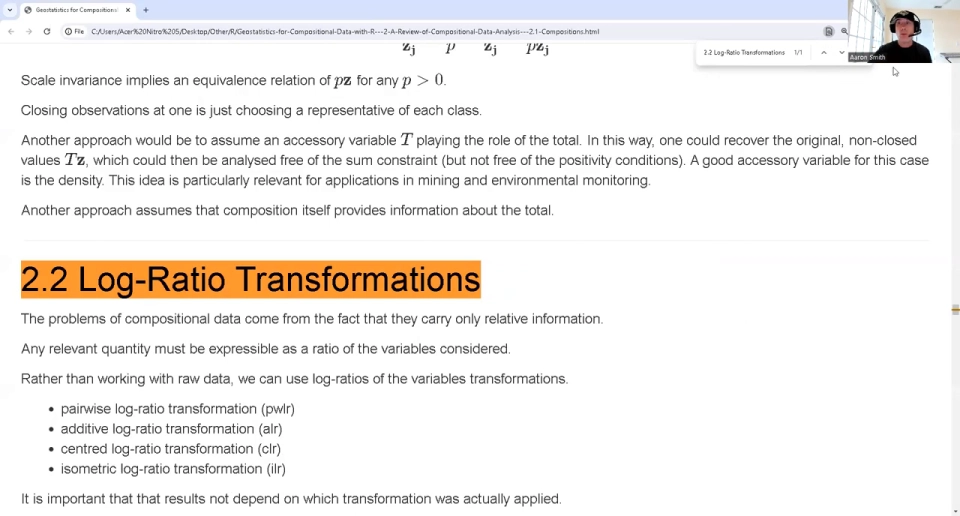
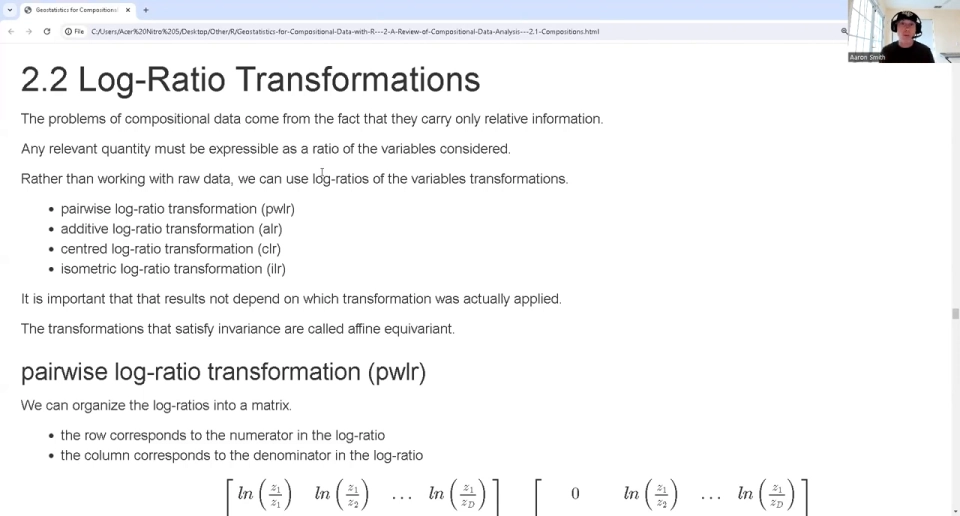
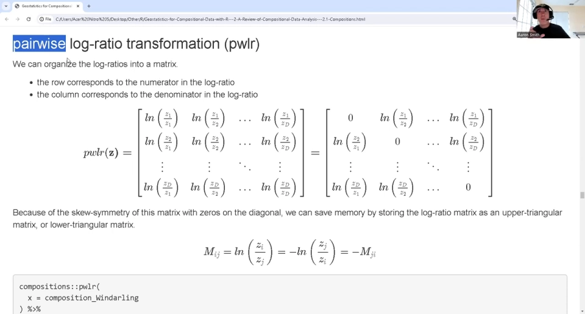
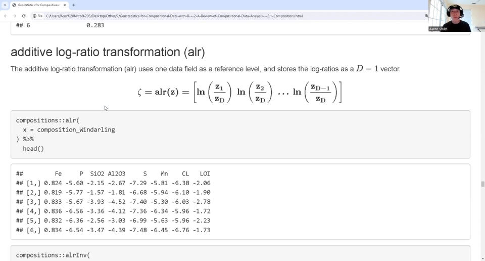
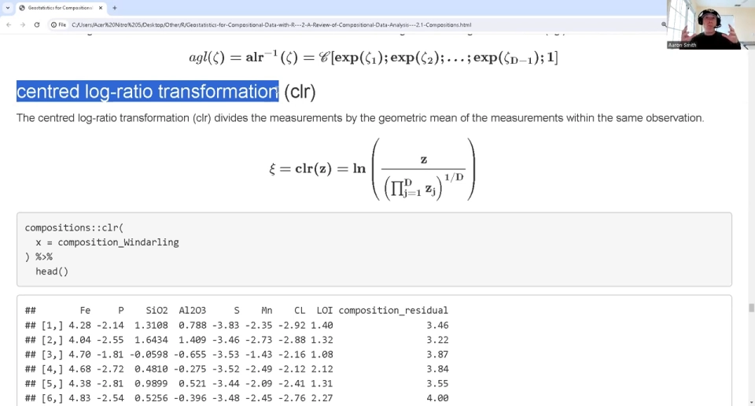
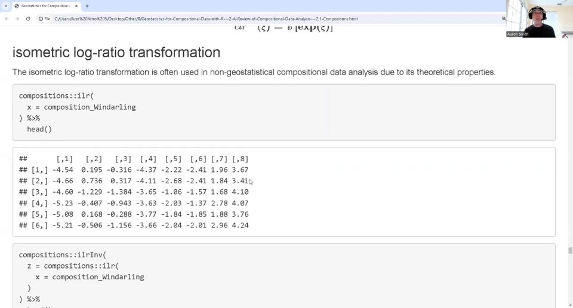
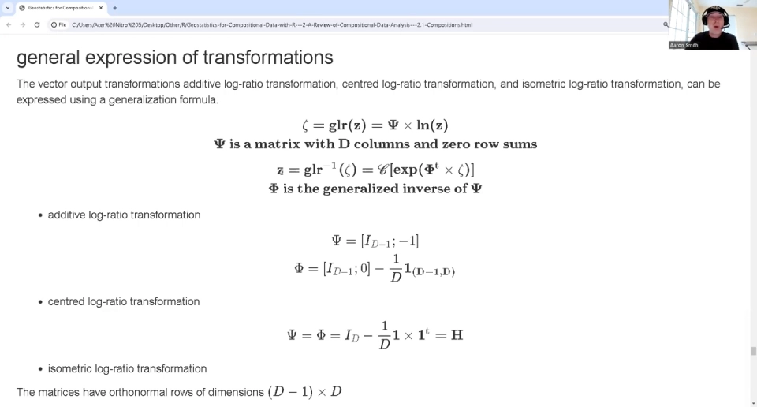
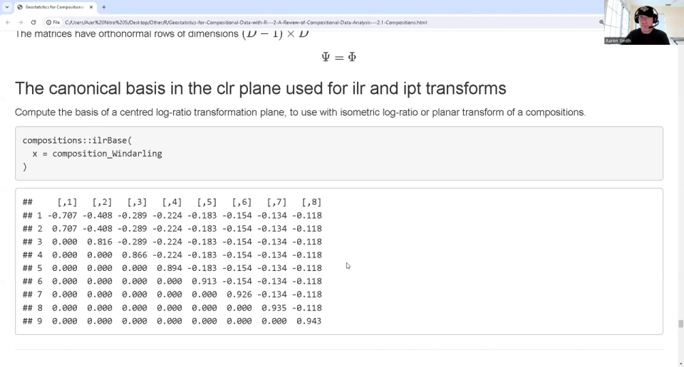

# 对数比变换：把组成数据从单纯形搬到欧氏空间

> 视频来源：[Geostatistics for Compositional Data with R — 2.2 Log-Ratio Transformations](https://www.youtube.com/watch?v=KTC8BPPKKq4)（YouTube · Statistics Ninja，讲者 Aaron Davis）｜时长约 18 分钟
> 导读：这支视频是「地质统计学中的组成数据」课程的一节，但讲的内容与地质无关：**为什么和为常数的数据不能直接套用普通统计方法，以及 pairwise / ALR / CLR / ILR 四种对数比变换各自拿什么当分母**。本文按「问题 → 四种变换 → 怎么判断用得对不对」重排，把其中的化学组分例子换成细胞类型比例来讲；视频里后半段的 R 代码只保留结论，不逐步复述。

## 本讲要解决的核心问题（SCQA）

**背景**：单细胞实验里，我们经常把每个样本的细胞按注释分成若干类，再算每类占多少。得到的是每个样本一组比例，比如 T 细胞 45%、B 细胞 20%、髓系 30%、其他 5%。这类数据在 bulk 转录组、微生物组、代谢组里同样常见——它们都是「把一个整体切成若干份，只记录每份占多大」。

**冲突**：这种数据有一个普通数值没有的性质：**所有分量加起来恒等于一个常数**（比例是 1，百分比是 100，ppm 是一百万）。视频一开头就把后果说清楚了：组成数据的全部信息都是相对的，任何一个分量的数值，本身只是「相对于同一观测里其他分量」的大小 [【跳转到 00:24】](https://www.youtube.com/watch?v=KTC8BPPKKq4&t=24)。这意味着：一个分量变大，其余分量必然被挤压变小——即使它们背后的绝对数量一个都没变。于是「A 类细胞比例上升」这句话，可能只是「B 类细胞比例下降」的另一种写法。

**疑问**：既然单个分量没有独立含义，那什么量才有？怎样把它变成可以用普通线性模型、相关分析、降维去处理的形式？

**回答（中心思想）**：**先把分量写成比值，再取对数**。比值消掉了「和为常数」这个约束带来的耦合，对数把「倍数关系」变成「加减关系」。围绕「拿谁当分母」，一共有四种做法——pairwise、ALR、CLR、ILR；它们的区别不在于数学上谁更正确（合格的变换必须给出等价的结果），而在于**分母的选择决定了结果怎么解释**。

## 一、组成数据的问题：只有相对信息

### 1.1 和为常数，单个分量没有独立含义

视频给的定义很朴素：组成数据的每个值非负，并且加起来等于一个常数 [【跳转到 00:24】](https://www.youtube.com/watch?v=KTC8BPPKKq4&t=24)。

$$
z_1 + z_2 + \cdots + z_D = \kappa,\qquad z_i \ge 0
$$

其中 $\kappa$ 是那个常数（比例数据里 $\kappa = 1$）。这条约束不是数据质量要求，而是**定义的一部分**：它把可能的取值锁在一个 $D-1$ 维的单纯形里，而不是 $D$ 维空间。视频在下一节才正式讲单纯形的几何，但这里已经能看出后果——**你不可能只动其中一个分量**。

对细胞比例来说，这条约束还有一个更麻烦的版本：分母是「这个样本里捕获到的细胞总数」。所以「某类细胞占比升高」既可能是这类细胞变多，也可能是别的类变少，还可能是捕获到的总细胞数变了。分母本身是观测的一部分，不是固定的物理量。

### 1.2 任何有意义的量都是比值

既然单个分量只是「相对其他分量的大小」，那么**任何有意义的量都必须写成所考虑变量之间的比值** [【跳转到 00:49】](https://www.youtube.com/watch?v=KTC8BPPKKq4&t=49)。

这句话是整支视频的枢纽。它把「组成数据分析」翻译成一个很具体的操作要求：

- 想问「A 类是不是变多了」，必须写成 $z_A / z_{\text{参考}}$，而不是 $z_A$；
- 想问「A 类相对于 B、C 两类整体是不是变多了」，必须写成 $z_A / (z_B z_C)^{1/2}$ 这类**组与组之间**的比值；
- 想比较两个样本，只能比较这些比值，不能比较单个分量。

比值天然消掉了 $\kappa$：分子分母同乘一个常数，比值不变。这就是为什么组成数据「只携带相对信息」——**乘性缩放不改变数据**，能被观测到的只有比值。

### 1.3 为什么再取对数

比值解决了约束，但留下一个新问题：比值是乘性的。A/B 从 1 变到 2，和从 2 变到 4，是同样大小的变化，但在原始尺度上是 1 和 2 的差别。视频的说法是：处理数字时我们常常更关心量级而不是精确值，而**对数正是把数字转换成量级的工具** [【跳转到 01:14】](https://www.youtube.com/watch?v=KTC8BPPKKq4&t=74)。

具体到公式上，对数把「比」变成「差」：

$$
\ln\frac{z_i}{z_j} = \ln z_i - \ln z_j
$$

视频提醒的另一层好处是：取对数之后，$z_i$ 和 $z_j$ 同时乘上任意常数，$\ln z_i - \ln z_j$ 完全不变——**约束被彻底消掉了，而且是以一种对线性模型友好的方式消掉的** [【跳转到 02:04】](https://www.youtube.com/watch?v=KTC8BPPKKq4&t=124)。代价是解释变难：原始比例的数值直接就是「占多少」，对数比的数值没有这种直觉含义，需要换算回倍数来读。

## 二、四种对数比变换：区别只在「拿谁当分母」

视频明确列出要讲的四种变换，并说明它们在 R 的 `compositions` 包里分别对应 `pwlr`、`alr`、`clr`、`ilr` 四个函数 [【跳转到 02:54】](https://www.youtube.com/watch?v=KTC8BPPKKq4&t=174)。

### 2.1 pairwise：所有两两比值，排成一个矩阵

最直接的做法是把一个组成里所有两两组合的比值都算出来，一共 $D \times D$ 个，自然排成一个矩阵：**行对应分子，列对应分母** [【跳转到 04:34】](https://www.youtube.com/watch?v=KTC8BPPKKq4&t=274)。

这个矩阵有两个结构性质，视频逐一指出：

- **对角线全是 0**：因为 $z_i/z_i = 1$，而 $\ln 1 = 0$ [【跳转到 05:49】](https://www.youtube.com/watch?v=KTC8BPPKKq4&t=349)；
- **反对称**：$\ln(z_i/z_j) = -\ln(z_j/z_i)$，所以上三角和下三角互为相反数，实际只需要存一半 [【跳转到 06:14】](https://www.youtube.com/watch?v=KTC8BPPKKq4&t=374)。

$$
M_{ij} = \ln\frac{z_i}{z_j} = -\ln\frac{z_j}{z_i} = -M_{ji}
$$

视频演示时特别指出一个细节：输出的列名里只有 `P/F` 没有 `Fe/P`，因为后者就是前者的相反数，存一次就够了 [【跳转到 07:54】](https://www.youtube.com/watch?v=KTC8BPPKKq4&t=474)。

pairwise 的信息最全（所有比值都在里面），但维度是 $D^2$ 量级，而且分量之间高度冗余——它更像是「原料」，实际建模时通常要再压缩。

### 2.2 ALR：选一个分量当参考

additive log-ratio 变换的做法是：**在组成里挑一个分量作为基线参考，其余每个分量都对它取对数比**，得到一个 $D-1$ 维的向量 [【跳转到 09:59】](https://www.youtube.com/watch?v=KTC8BPPKKq4&t=599)。

$$
\zeta = \mathrm{alr}(\mathbf{z}) = \left[\ln\frac{z_1}{z_D},\ \ln\frac{z_2}{z_D},\ \dots,\ \ln\frac{z_{D-1}}{z_D}\right]
$$

视频的描述是：这相当于在 pairwise 矩阵里只取「参考分量所在的那一列」的非零部分 [【跳转到 10:24】](https://www.youtube.com/watch?v=KTC8BPPKKq4&t=624)。维度从 $D$ 降到 $D-1$，正好等于单纯形的自由度。

**这个选择的代价是解释被绑在参考分量上**：$\zeta_1$ 读作「$z_1$ 相对 $z_D$ 的对数倍数」。换一个参考分量，向量里每个数都会变，但彼此之间的差不变。所以 ALR 适合「有一个天然的对照分量」的场合；如果没有，参考分量的选择本身就成了一个需要交代的决定——这一点在下一节的组成检验里会变成零假设的一部分。

### 2.3 CLR：拿整个组成的几何均值当分母

centred log-ratio 变换换了个思路：不选某一个分量当参考，而是**把整个组成都拉进来**——用所有分量的几何均值作分母 [【跳转到 12:04】](https://www.youtube.com/watch?v=KTC8BPPKKq4&t=724)。

$$
\xi = \mathrm{clr}(\mathbf{z}) = \ln\left(\frac{\mathbf{z}}{\left(\prod_{j=1}^{D} z_j\right)^{1/D}}\right)
$$

几何均值就是「乘积开 $D$ 次方」。视频强调，这样做的效果是**每一个分量都被拿来和「这个样本的整体水平」比较**，而不是和某一个特定的分量比较 [【跳转到 12:29】](https://www.youtube.com/watch?v=KTC8BPPKKq4&t=749)。

CLR 输出仍然是 $D$ 维，比自由度多一维，因此有一个必须知道的性质：**各分量之和恒为 0**。原因很直接——把每个 $\ln z_i$ 减去同一个 $\frac{1}{D}\sum_j \ln z_j$，加起来自然是 0。视频在讲基向量时用「每列加起来等于零」把这个性质又演示了一遍 [【跳转到 17:04】](https://www.youtube.com/watch?v=KTC8BPPKKq4&t=1024)。多出来的那一维是冗余的，这也意味着 CLR 后的数据不能直接丢进要求满秩的方法里。

### 2.4 ILR：$D-1$ 维的正交坐标

isometric log-ratio 变换是视频里最后讲、也是讲得最简略的一个。它给出的信息有三条 [【跳转到 13:44】](https://www.youtube.com/watch?v=KTC8BPPKKq4&t=824)：

- 输出维度是 $D-1$，和单纯形的自由度一致，没有 CLR 那种冗余；
- 它的坐标建立在一组**正交基**上（视频在矩阵形式里写作「行正交，维度 $(D-1)\times D$」）；
- 因为这套理论性质，**它在非地质领域的组成数据分析里用得很多**——视频的原话是「often used in non-geostatistical compositional data analysis due to its theoretical properties」，并说明这些性质留到后续视频再展开。

对学习者来说，这里要建立的判断是：**ILR 不是「更高级的 CLR」，而是「换了一组坐标」**。CLR 的每一维是「某分量 vs 全体几何均值」，直观但冗余；ILR 的每一维是「一组分量 vs 另一组分量」的对比，正交、无冗余，但**每一维的含义取决于你选的那组基**——基怎么选，是使用者要自己交代的事情。视频没有展开这一点，只留下了「理论性质好」这一句，这是本文的一处已知缺口（见文末）。

## 三、怎么判断变换用得对不对

### 3.1 仿射等价：结果不应该依赖用了哪种变换

视频在介绍四种变换之前先立了一条规矩，这条规矩比任何单个公式都重要：

> 在组成数据上做分析，**结果不应该依赖实际用了哪一种变换**。如果不同变换给出不同结果，那说明信息是矛盾的，结果本身就不该被信任 [【跳转到 03:19】](https://www.youtube.com/watch?v=KTC8BPPKKq4&t=199)。

满足这条要求的变换被称为**仿射等价（affine equivalent）**变换 [【跳转到 03:44】](https://www.youtube.com/watch?v=KTC8BPPKKq4&t=224)。四种变换都在这个家族里：它们对同一个组成给出的坐标不同，但坐标之间的差异只是一个线性变换，因此任何**仿射不变**的结论（比如两组样本能不能分开、某两个分量的比值有没有差异）在四种变换下应当一致。

视频还给了这条规矩的实用读法：如果换了变换结论就变了，最可能的情况是**样本量太小**或者**信号太弱**，这时候应该退回去重新评估，而不是挑一个「显著」的变换来报告 [【跳转到 03:44】](https://www.youtube.com/watch?v=KTC8BPPKKq4&t=224)。这是一条很硬的判读规则：**变换是可选项，结论不是**。

### 3.2 一个矩阵统一四种变换

四种变换看起来各说各话，视频用一个统一写法把它们收在一起：先取逐分量的对数向量 $\ln \mathbf{z}$，再左乘一个 $D$ 列、**行和为 0** 的矩阵 $\Psi$ [【跳转到 14:34】](https://www.youtube.com/watch?v=KTC8BPPKKq4&t=874)。

$$
\zeta = \mathrm{glr}(\mathbf{z}) = \Psi \times \ln(\mathbf{z})
$$

「行和为 0」正是「比值」这件事在矩阵上的体现：每一行都是若干个 $\ln z_i$ 的加权和，权重加起来为零，于是整体乘一个常数不会改变结果。逆变换则用 $\Psi$ 的广义逆 $\Phi$ 写回去：

$$
\mathbf{z} = \mathrm{glr}^{-1}(\zeta) = \mathcal{C}\left[\exp(\Phi^{\mathsf{T}} \times \zeta)\right]
$$

其中 $\mathcal{C}[\cdot]$ 表示把向量归一化回和为常数的组成。视频给出的三种矩阵分别是 [【跳转到 14:59】](https://www.youtube.com/watch?v=KTC8BPPKKq4&t=899)：

| 变换 | 变换矩阵 $\Psi$ | 维度 |
| --- | --- | --- |
| ALR | $[I_{D-1};\, -1]$（单位阵右侧接一列 $-1$） | $(D-1)\times D$ |
| CLR | $I_D - \frac{1}{D}\mathbf{1}\mathbf{1}^{\mathsf{T}}$（矩阵与逆相同） | $D\times D$ |
| ILR | 行正交的 $(D-1)\times D$ 矩阵，$\Psi = \Phi$ | $(D-1)\times D$ |

从这张表能直接读出三件事：

1. **ALR 的矩阵里有一列是 $-1$**，对应的就是那个被选作参考的分量——参考分量的选择被写死在矩阵里；
2. **CLR 的矩阵是对称的**（$\Psi = \Phi$），这解释了为什么 CLR 的逆变换形式上最干净，也解释了它为什么多一维：$\Psi$ 是 $D\times D$ 但秩只有 $D-1$；
3. **ILR 的矩阵满足 $\Psi = \Phi$ 且行正交**，所以它是「等距」的——变换前后距离不变。这是「isometric」这个词的来源，也是它理论性质好的原因。

### 3.3 CLR 平面上的基

视频最后算了一件在实现上有用的事：**CLR 变换所在平面的规范基**，这个基后面会用于 ILR 和另一种平面变换 [【跳转到 16:39】](https://www.youtube.com/watch?v=KTC8BPPKKq4&t=999)。

输出矩阵的每一列加起来都是 0，正值只出现在次对角线（对角线往下一格），其余位置是等量的负值 [【跳转到 17:29】](https://www.youtube.com/watch?v=KTC8BPPKKq4&t=1049)。这正好是 2.3 节那个「CLR 各分量之和为 0」的性质在基上的体现：**基向量本身必须住在那个和为零的超平面里**，否则它无法表示任何合法的 CLR 坐标。

这一段是整支视频里最「实现向」的部分。对使用者来说，只需要记住结论：**CLR 的输出不是 $D$ 维自由数据，它被限制在一个 $D-1$ 维的超平面上**；任何在 CLR 空间里做的分析，都要对这个约束保持自觉。

## 四、放回细胞比例上：这套变换给了什么、没给什么

把视频的框架套回细胞类型比例，能得到的是一张很清楚的分工表：

- **pairwise** 回答「A 类相对 B 类的比例有没有变」，信息最全但冗余最大；
- **ALR** 回答「各类相对某个参考类有没有变」，参考类必须是你在设计上敢固定的那一类；
- **CLR** 回答「各类相对这个样本的整体水平有没有变」，不需要指定参考，但输出多一维且和为 0；
- **ILR** 给出 $D-1$ 维正交坐标，适合直接接线性模型或降维，代价是每一维的含义依赖所选基。

而视频**没有**回答的问题，恰好是组成检验最关键的那一层：

- 变换之后用什么模型、检验什么零假设——这是 [组成检验：细胞比例的零假设与过度离散计数模型](组成检验：细胞比例的零假设与过度离散计数模型.md) 的内容；
- 比例变化与「同一类细胞内部表达变化」怎么区分——这是 [4.2.5](../4.2.5_细胞组成变化与细胞内表达变化/反卷积：从bulk的群体平均表达反推细胞类型比例.md) 已经建立的判读层，本节不重复；
- 零值怎么处理：公式里每个 $z_i$ 都要取对数，**分量等于 0 时对数无定义**，这是所有对数比方法的共同前提，也是单细胞数据里真实存在的麻烦（某一类细胞在某个样本里一个都没捕获到时，比例就是 0）。

还有一处需要说明的边界：视频里的例子是地质样品的化学组分（Fe、P、SiO₂、Al₂O₃ 等），它默认「组成是精确观测到的」。细胞比例不是——它是从捕获到的细胞里数出来的估计值，分母本身带抽样误差。这个差别不影响变换的数学，但会影响后面检验的方差结构，那是下一篇要处理的事。

## 小结

- 组成数据的每个分量非负、和为常数，因此**只携带相对信息**；单个分量的升降必然牵动其余分量。
- 任何有意义的量都必须写成**比值**；再取对数，把乘性的比值关系变成加性的差值关系，同时消掉「乘一个常数不改变数据」这个不确定性。
- 四种对数比变换的区别只在**分母是谁**：pairwise 用所有两两组合，ALR 用选定的参考分量，CLR 用整个组成的几何均值，ILR 用一组正交基。
- **合格的变换必须仿射等价**：结论不应依赖用了哪种变换；换了变换结论就变，说明样本量太小或信号太弱，应当退回而不是挑结果。
- 四种变换都能写成「行和为 0 的矩阵左乘对数向量」；ALR 的参考分量被写死在矩阵里，CLR 的矩阵对称但秩亏一维，ILR 的矩阵行正交因此等距。
- CLR 的输出各分量之和恒为 0，它住在一个 $D-1$ 维超平面上；这个约束在基向量上表现为「每列之和为 0」。
- 变换只负责把数据搬到合适的空间，**不负责定义零假设**；「比例不变」到底检验什么，要由模型和参考量共同决定。

## 关键术语速查

| 术语 | 一句话解释 |
| --- | --- |
| 组成数据（compositional data） | 各分量非负、和恒等于一个常数的数据；比例、百分比、ppm 都是 |
| 单纯形（simplex） | 组成数据被锁定的取值空间，维度比分量数少一 |
| 相对信息 | 组成数据只反映分量之间的比值，乘性缩放不改变任何可观测的量 |
| pairwise log-ratio | 把组成里所有两两比值取对数，排成 $D\times D$ 反对称矩阵 |
| ALR（additive log-ratio） | 选一个参考分量放分母，其余分量各自对它取对数比，得 $D-1$ 维向量 |
| CLR（centred log-ratio） | 每个分量除以全体分量的几何均值再取对数，得 $D$ 维、各分量之和为 0 |
| ILR（isometric log-ratio） | 建立在正交基上的 $D-1$ 维对数比坐标，变换前后距离不变 |
| 仿射等价（affine equivalent） | 不同变换之间只差一个线性变换，因此仿射不变的结论应当一致 |
| 几何均值 | $D$ 个分量乘积的 $D$ 次方根，CLR 的分母 |
| 广义逆 | 矩阵不满秩时用来求逆的工具，四种变换的逆变换都靠它写出来 |