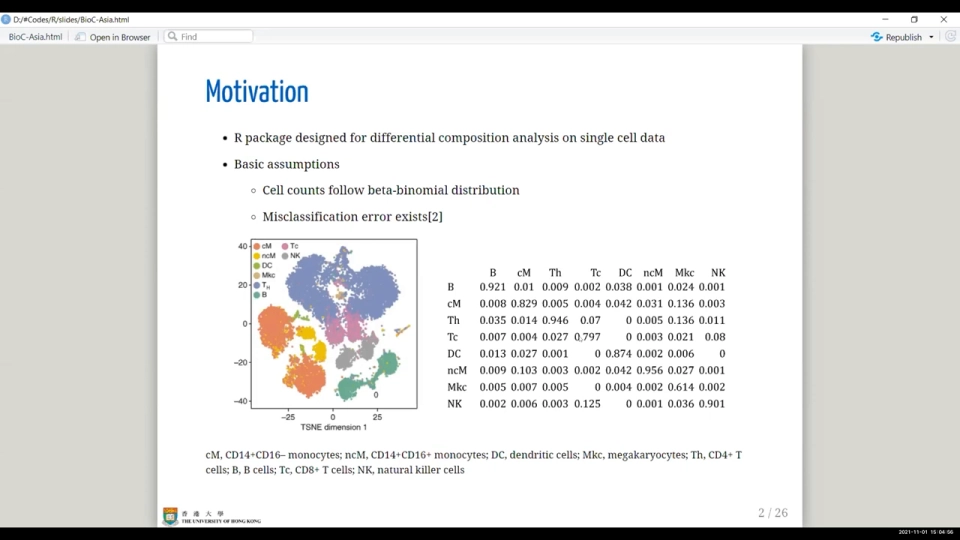
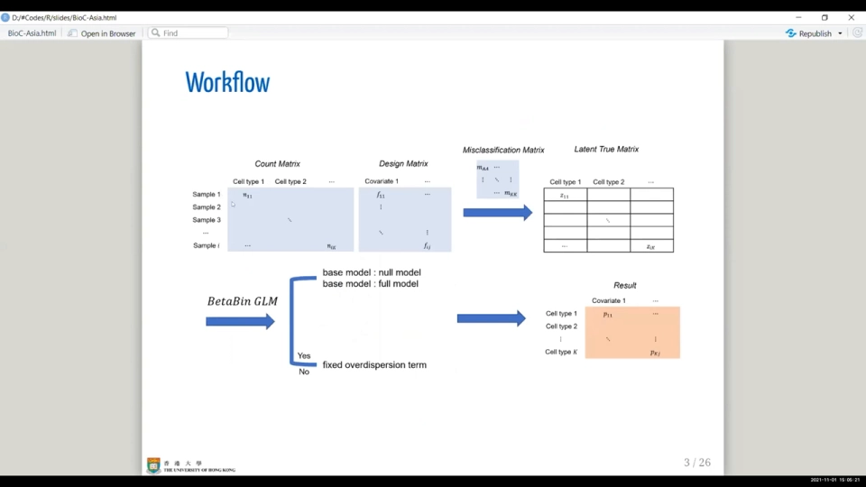
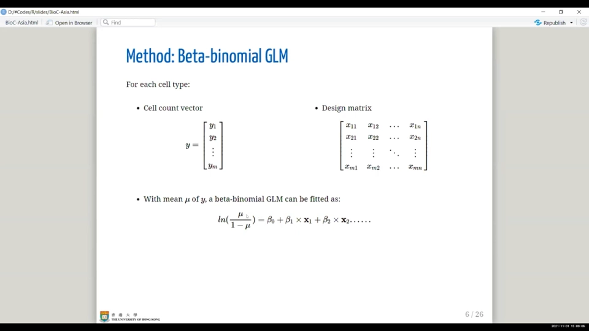
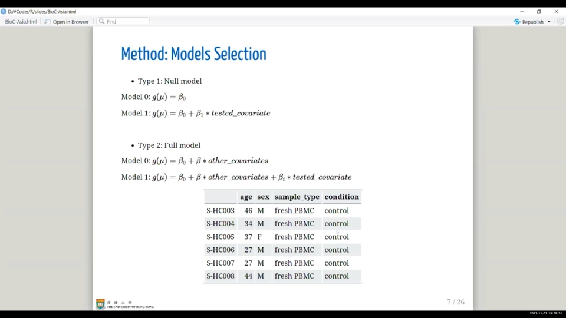
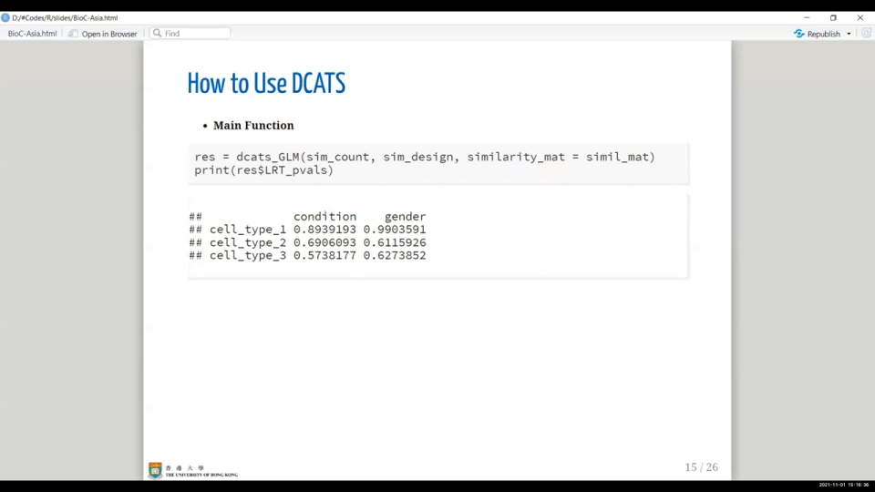
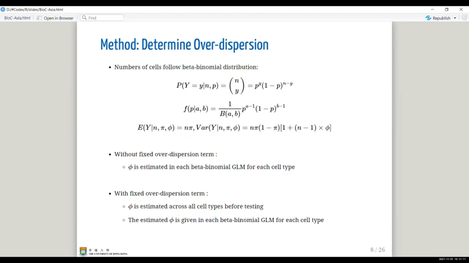
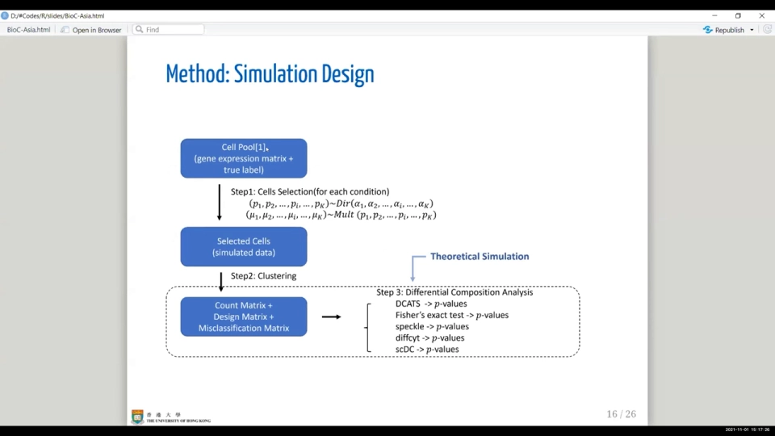
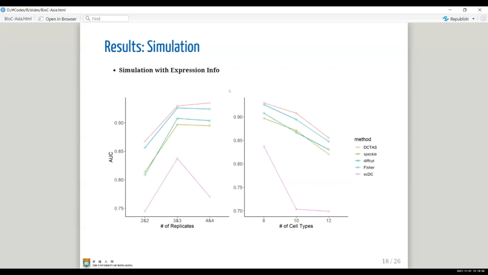

# 组成检验：细胞比例的零假设与过度离散计数模型

> 视频来源：[DCATS: Differential composition analysis of single-cell data](https://www.youtube.com/watch?v=_Fh3sp59ui0)（YouTube · Bioconductor webinar，讲者 Xin Ling，香港大学 Joshua Ho 实验室）｜时长约 25 分钟
> 导读：这是一场 R 包发布会，但它把「细胞比例差异检验」的三个要害讲得比多数教程清楚：**输入是一张「样本 × 细胞类型」的计数表**、**零假设是「这个协变量不影响这个细胞类型的比例」**、**计数要用带过度离散的模型而不是简单比例检验**。本文按「输入 → 零假设 → 计数模型 → 适用条件」重排，R 代码只保留结论；文末把「组成变化 vs 细胞内表达变化」的分界交回 [4.2.5](../4.2.5_细胞组成变化与细胞内表达变化/反卷积：从bulk的群体平均表达反推细胞类型比例.md)。

## 本讲要解决的核心问题（SCQA）

**背景**：单细胞实验最常见的设计是「两组样本，比较细胞类型组成」。手上有每个样本的细胞类型注释，于是可以数出每个样本里每类细胞有多少个，再算成比例。看上去只要比较两组比例就行。

**冲突**：视频一开场就点出两个麻烦 [【跳转到 00:41】](https://www.youtube.com/watch?v=_Fh3sp59ui0&t=41)。第一，**比例是从聚类和注释来的，不是测出来的**：UMAP 上 CD8 T 细胞有一部分和其他类型重叠，一个细胞被分到哪一类带有误差；视频给出的误分类矩阵里，某一类只有 0.8 的概率被正确分给自己 [【跳转到 01:31】](https://www.youtube.com/watch?v=_Fh3sp59ui0&t=91)。第二，**同一类细胞在不同样本里的计数波动远大于二项抽样应有的波动**——因为样本之间除了处理条件，还有供体、批次、捕获效率的差异。把比例直接丢进普通的两组比较，等于同时忽略了这两件事。

**疑问**：那么「处理改变了细胞组成」这句话，应该用什么样的模型、检验什么样的零假设？哪些条件下这个检验才成立？

**回答（中心思想）**：把每个细胞类型的计数当成**带过度离散的计数**来建模（视频用的是 beta-binomial，它的多类别推广就是 Dirichlet-multinomial），用**设计矩阵**同时容纳条件和协变量，再用**零模型与全模型的似然比检验**回答「加入这个协变量是否改善了拟合」。零假设因此不是「比例相等」这么笼统，而是**「在控制其他协变量的前提下，这个协变量不影响这个细胞类型的比例」**——**逐类型、有条件、有前提**。

## 一、输入不是表达矩阵，是一张计数表

### 1.1 三个矩阵：计数、设计、误分类

视频把整个流程的输入固定为三个矩阵 [【跳转到 01:56】](https://www.youtube.com/watch?v=_Fh3sp59ui0&t=116)：

| 输入 | 形状 | 每个元素是什么 |
| --- | --- | --- |
| 计数矩阵（count matrix） | 样本 × 细胞类型 | 该样本里被判为该类型的细胞个数 |
| 设计矩阵（design matrix） | 样本 × 协变量 | 条件、年龄、性别、样本类型等实验设计信息 |
| 误分类矩阵（misclassification matrix） | 细胞类型 × 细胞类型 | 类型 $i$ 的细胞被判成类型 $j$ 的概率，每行和为 1 |

视频演示的计数矩阵里，行是样本名（`B1` 到 `B6`），列是细胞类型（Endocrine、Enterocyte、Goblet、Stem 等），某个格子里的 36 表示「在样本 B1 的 Endocrine 类里观察到 36 个细胞」 [【跳转到 05:41】](https://www.youtube.com/watch?v=_Fh3sp59ui0&t=341)。设计矩阵在这个例子里只有一列条件：四个样本来自对照组，两个来自 H poly 3 处理组 [【跳转到 09:26】](https://www.youtube.com/watch?v=_Fh3sp59ui0&t=566)。误分类矩阵的对角线是「被正确分给自己」的概率（例子里 0.979），每行加起来是 1 [【跳转到 10:16】](https://www.youtube.com/watch?v=_Fh3sp59ui0&t=616)。

**这里有一条很容易被忽略的分界**：整场报告里没有出现「细胞 × 基因」的表达矩阵。问答环节有人问「你们用的是反正弦平方根变换还是对数变换」，讲者的回答是：**不需要表达矩阵，只需要每个样本的细胞数、实验设计信息和误分类矩阵** [【跳转到 23:47】](https://www.youtube.com/watch?v=_Fh3sp59ui0&t=1427)。这句话把组成检验和差异表达彻底分开了：组成检验的观测单位是「一个样本里某类细胞有几个」，表达分析的观测单位是「一个细胞里某个基因有多少条 read」。

### 1.2 为什么不能把比例直接拿去做普通检验

比例之和恒为 1，所以**各类型的比例不是独立的分量**：一类变多，其余必然被挤压。这在检验上有两个直接后果：

1. **不能对每个类型分别做一次独立的两组比较，然后把结果当成互不相干的结论**。某一个类型「显著上升」可能只是别的类型下降的镜像；
2. **分母本身是观测的一部分**。分母是「这个样本捕获到的细胞总数」，它受解离、上样、测序深度影响，不是固定的物理量。所以「比例」的抽样误差同时来自分子和分母。

视频的处理方式是：**不直接对比例建模，而对计数建模**，把「总共有多少细胞」作为模型的一部分（beta-binomial 里的 $n$），再用设计矩阵解释「比例为什么在不同样本间不同」。这样至少把分母的抽样波动放进了似然里，而不是假装比例是精确观测值。

至于「一类上升必然挤压其他类」这条约束本身，视频的模型**没有把它显式写进去**——它是逐类型拟合的。这一点在第四节会作为适用条件讨论。

## 二、零假设：逐类型、有条件、有前提

### 2.1 模型：logit 链接 + 设计矩阵

对每个细胞类型单独拟合一个 beta-binomial GLM [【跳转到 06:06】](https://www.youtube.com/watch?v=_Fh3sp59ui0&t=366)。观测是该类型在各样本里的细胞数向量 $\mathbf{y} = (y_1, \dots, y_m)$，设计矩阵 $X$ 的每一行是一个样本的协变量取值：

$$
X = \begin{bmatrix} x_{11} & x_{12} & \cdots & x_{1n} \\ x_{21} & x_{22} & \cdots & x_{2n} \\ \vdots & & & \vdots \\ x_{m1} & x_{m2} & \cdots & x_{mn} \end{bmatrix}
$$

用 $\mu$ 表示 $y$ 的期望，通过 logit 链接把它和协变量的线性组合连起来：

$$
\ln\left(\frac{\mu}{1-\mu}\right) = \beta_0 + \beta_1 \mathbf{x}_1 + \beta_2 \mathbf{x}_2 + \cdots
$$

用 logit 链接的原因是 $\mu$ 是一个比例，必须落在 0 到 1 之间；logit 把 $(0,1)$ 映到整条实轴，于是「比例的差异」变成「对数几率的差异」，可以放心用线性结构。

### 2.2 零模型与全模型：用似然比检验问「这个协变量有用吗」

视频把检验写成两个模型的比较，并区分两种用法 [【跳转到 06:31】](https://www.youtube.com/watch?v=_Fh3sp59ui0&t=391)：

**第一种：零模型（null model）**，只放要检验的那个协变量：

$$
\text{Model 0}: g(\mu) = \beta_0 \qquad \text{Model 1}: g(\mu) = \beta_0 + \beta_1 \cdot \text{tested\_covariate}
$$

**第二种：全模型（full model）**，把其他协变量都放进去，只留下要检验的那一个做增减：

$$
\begin{aligned}
\text{Model 0}:&\ g(\mu) = \beta_0 + \boldsymbol{\beta}\cdot\text{other\_covariates}\\
\text{Model 1}:&\ g(\mu) = \beta_0 + \boldsymbol{\beta}\cdot\text{other\_covariates} + \beta_1 \cdot \text{tested\_covariate}
\end{aligned}
$$

两者的差别就是「控制」二字。零模型问的是「这个协变量单独看有没有关联」；全模型问的是「**在已经考虑了年龄、性别、样本类型之后**，这个协变量还有没有额外解释力」。视频的例子里设计矩阵包含 age、sex、sample_type、condition 四列，检验 condition 时其余三列就是「其他协变量」 [【跳转到 06:31】](https://www.youtube.com/watch?v=_Fh3sp59ui0&t=391)。

比较两个模型用**似然比检验**：如果加入待检验协变量让拟合显著变好，就认为它影响了这个细胞类型的比例 [【跳转到 06:56】](https://www.youtube.com/watch?v=_Fh3sp59ui0&t=416)。

### 2.3 零假设的准确表述

视频把零假设说得很直白：

> 对每个细胞类型，**来自不同协变量取值的样本，其比例不受影响** [【跳转到 13:36】](https://www.youtube.com/watch?v=_Fh3sp59ui0&t=816)。

这句话里有三个限定词，每一个都决定结论能走多远：

- **「每个细胞类型」**：检验是逐类型做的，一个类型一个 p 值。不存在一个「整体组成变了」的单一 p 值；要谈整体，得把多个类型的结果一起读。
- **「比例」**：检验的对象是「该类型占这个样本总细胞数的比例」，不是绝对数量。比例不变不等于组织里的绝对数量不变——后者要靠流式加计数微球这类独立定量。
- **「不受影响」**：零假设是「没有关联」，不是「两组相等」。在全模型里，它更精确地是「**在控制其他协变量后**没有额外关联」。

视频给的结果示例很能说明这个结构：某细胞类型在 condition 上的 p 值是 0.8939，大于 0.05，于是结论是「该类型在不同条件组的样本里比例相同」 [【跳转到 13:36】](https://www.youtube.com/watch?v=_Fh3sp59ui0&t=816)。同一个结果表里还有 gender 一列，同一个细胞类型在 gender 上的 p 值也要单独读——**每个「类型 × 协变量」的组合都是一个独立的检验**。

### 2.4 「参考」在哪里：零假设里藏着一个选择

上一句「比例不受影响」听起来是无条件的，但在组成数据上它必然依赖一个隐含的参考。原因还是那条约束：比例和为 1，所以「某类的比例变了」和「其他类的比例变了」在算术上是同一件事。**任何组成检验都只能回答「相对于什么」，不能回答「绝对地变了没有」。**

这一点在两种做法里表现不同：

- 逐类型检验（视频的做法）：每个类型各自一个零假设，不指定参考类型，代价是**多个类型的结论彼此耦合**——若某类真的上升，其他类的比例在总体上必然下降，逐类型的 p 值不能当成互相独立的证据；
- 参考分量做法：把某一类固定为参考，只检验其余类相对它的对数比。这正是 [对数比变换：把组成数据从单纯形搬到欧氏空间](对数比变换：把组成数据从单纯形搬到欧氏空间.md) 里 ALR 的结构——参考分量被写进变换矩阵，零假设也随之变成「相对参考类的对数比不变」。4.2.5 提到的「参考群体」在数学上就对应这个选择，代价也一样：参考类必须真的在两组间稳定，否则整组结论都会被它带偏。

视频没有讨论这条约束在多重检验上的后果（跨类型校正、参考类选择），这是使用时需要自己补上的一层。

## 三、计数模型：为什么要多一个「过度离散」参数

### 3.1 beta-binomial：比例 + 过度离散

如果每个样本只是从同一个真实比例 $p$ 里独立抽 $n$ 个细胞，计数服从二项分布。但真实数据里，样本之间 $p$ 本身就在变（供体差异、批次、捕获效率），于是计数的方差比二项分布大。视频的模型把这两层写在一起 [【跳转到 08:11】](https://www.youtube.com/watch?v=_Fh3sp59ui0&t=491)：

$$
P(Y = y \mid n, p) = \binom{n}{y} p^{y}(1-p)^{n-y}, \qquad f(p \mid a, b) = \frac{1}{B(a,b)} p^{a-1}(1-p)^{b-1}
$$

$$
\mathbb{E}[Y \mid n, \pi, \phi] = n\pi, \qquad \operatorname{Var}(Y \mid n, \pi, \phi) = n\pi(1-\pi)\left[1 + (n-1)\times\phi\right]
$$

读这个方差式子：$n\pi(1-\pi)$ 是二项分布的方差，后面方括号里的 $1 + (n-1)\phi$ 是**膨胀因子**。$\phi = 0$ 时退化成普通二项分布；$\phi > 0$ 时方差变大，$\phi$ 越大越离散。这就是「过度离散」在计数模型里的具体位置——**它不是数据缺陷，而是一个要估的参数**。

### 3.2 过度离散怎么估：逐类型估，还是全局借

视频给了两种估计方式 [【跳转到 08:11】](https://www.youtube.com/watch?v=_Fh3sp59ui0&t=491)：

- **不固定**：每个细胞类型的 GLM 各自估一个 $\phi$，最灵活；
- **固定**：先在所有细胞类型上估一个全局 $\phi$，再把它当作已知常数放进每个类型的 GLM。

为什么要全局借？视频的理由很实在：**有些实验每组只有两三个生物学重复，逐类型估 $\phi$ 估不准，会高估** [【跳转到 08:36】](https://www.youtube.com/watch?v=_Fh3sp59ui0&t=516)。重复数少的时候，借用其他类型的信息来稳定方差估计，比硬估一个不可靠的 $\phi$ 更安全。

这个思路与差异表达里的离散度收缩是同一件事的两个版本：**当每个单元的重复太少、方差估不稳时，从其他单元借信息**。区别只在于这里的单元是「细胞类型」，那里的单元是「基因」。差异表达侧的机制见 [4.2.1](../4.2.1_差异表达中的离散度收缩与零膨胀假设/DESeq2%20的收缩估计：离散度趋势线、经验贝叶斯与倍数变化.md)。

### 3.3 Dirichlet-multinomial：把两类推广到多类

beta-binomial 处理的是「一个类型 vs 其余」的两类情形。把「其余」拆成多个类型，对应的模型就是 **Dirichlet-multinomial**：先从 Dirichlet 分布抽一组比例 $(p_1, \dots, p_K)$，再从多项分布按这组比例抽计数。视频在模拟环节用的正是这个生成过程 [【跳转到 14:26】](https://www.youtube.com/watch?v=_Fh3sp59ui0&t=866)：

$$
(p_1, p_2, \dots, p_K) \sim \mathrm{Dir}(\alpha_1, \alpha_2, \dots, \alpha_K), \qquad (\mu_1, \mu_2, \dots, \mu_K) \sim \mathrm{Mult}(p_1, p_2, \dots, p_K)
$$

这两步就是 Dirichlet-multinomial 的全部内容，也是它和「对数比变换」路线的根本分歧所在：

| 维度 | 对数比变换路线 | Dirichlet-multinomial 路线 |
| --- | --- | --- |
| 处理对象 | 比例向量（先把计数换成比例，再取对数比） | 原始计数（比例是模型里的隐变量） |
| 约束怎么处理 | 用比值消掉「和为常数」 | 用多项分布 + Dirichlet 直接建在单纯形上 |
| 过度离散 | 不显式建模，靠变换后的残差结构 | 显式参数（$\phi$ 或 Dirichlet 的集中度） |
| 零值 | 对数无定义，必须先处理 | 计数为 0 是合法的观测 |
| 代价 | 变换后每一维的含义依赖分母选择 | 需要重复样本来估离散度，模型更重 |

视频的模拟还说明了一件事：**这套生成过程可以用来造「已知答案」的基准数据**。它先用 Splatter 造一个大细胞池（带真实标签），按条件定义比例向量、用 Dirichlet + 多项抽出每个样本的细胞数，再按数目从池里挑细胞、用 Seurat 重新聚类注释——于是「真实比例」和「分析拿到的计数矩阵」之间的差距（也就是误分类）被显式造了出来 [【跳转到 14:26】](https://www.youtube.com/watch?v=_Fh3sp59ui0&t=866)。

## 四、适用条件与失效方式

### 4.1 误分类：群边界不是真值

视频最强调的一条适用条件是：**比例是从聚类注释来的，注释有误差，必须建模** [【跳转到 01:31】](https://www.youtube.com/watch?v=_Fh3sp59ui0&t=91)。它的做法是先估一个误分类矩阵，再用 EM 反推一个「潜在的真实计数矩阵」，然后才在真实矩阵上做检验 [【跳转到 02:46】](https://www.youtube.com/watch?v=_Fh3sp59ui0&t=166)。

误分类矩阵有三种估法 [【跳转到 03:36】](https://www.youtube.com/watch?v=_Fh3sp59ui0&t=216)：

- **均匀型**：假设每类被正确分给自己的概率是 $a$，被分到其余每一类的概率都是 $(1-a)/(k-1)$；
- **kNN 型**：从 kNN 图算——类型 $i$ 的邻域里有多大比例属于类型 $j$；
- **SVM 型**：用细胞标签加其他可能影响聚类的信息训练分类器，五折交叉预测，比较预测标签与原标签得到混淆矩阵。

模拟结果显示，**用真实误分类矩阵做校正后 AUC 显著上升**；不校正时准确率明显更低 [【跳转到 16:31】](https://www.youtube.com/watch?v=_Fh3sp59ui0&t=991)。这条结论的适用范围要说清楚：它证明的是「误分类会伤害组成检验」，而不是「某一种估法一定准」。均匀型是一个强假设，kNN 型依赖图的构造，SVM 型依赖标签质量——**三种估法给出的结论是否一致，是使用者要自己检查的稳健性**。

### 4.2 重复数少、细胞类型多

视频系统地扫了两个维度：每组生物学重复从 2 到 4，细胞类型从 8 到 12 [【跳转到 16:56】](https://www.youtube.com/watch?v=_Fh3sp59ui0&t=1016)。

结果里最值得记住的不是「哪个方法赢了」，而是**其他方法的失效方式**：它们的敏感度更高，但**特异度很低**，在真实场景里会给出大量假阳性 [【跳转到 17:27】](https://www.youtube.com/watch?v=_Fh3sp59ui0&t=1047)。这提示了一条判读规则：**在组成检验里，「发现了更多显著类型」往往不是好事**——组成数据的分量彼此耦合、分母又带抽样误差，宽松的检验很容易把噪声读成差异。

### 4.3 阴性对照：一个「本来不该有差异」的数据集

视频用了三个真实数据集，其中第一个是天然的阴性对照：PBMC 的刺激 vs 未刺激，**原文认为刺激本身不会改变细胞类型比例** [【跳转到 18:27】](https://www.youtube.com/watch?v=_Fh3sp59ui0&t=1107)。在这个数据上，DCATS 给出不显著的结果，符合预期；另外两个方法给出了假阳性 [【跳转到 18:52】](https://www.youtube.com/watch?v=_Fh3sp59ui0&t=1132)。

这个设计的价值在于它示范了**怎么验证一个组成检验**：找一个生物学上「应该没有组成差异」的数据集，看方法会不会报出差异。第二个数据集（四种感染条件）里，speckle 走向另一个极端——几乎全报不显著，连真正有差异的类型也漏掉 [【跳转到 19:42】](https://www.youtube.com/watch?v=_Fh3sp59ui0&t=1182)。**过松和过紧都是失效**，只是方向不同。

第三个数据集（COVID 与对照）演示了协变量的作用：原文只用了分组信息，加上年龄和性别后，DCATS 多找到一对差异的细胞类型，来自「对照 vs 轻症」和「对照 vs 重症」的比较；讲者认为这个发现可能被原文里年龄和性别的噪声掩盖了 [【跳转到 20:57】](https://www.youtube.com/watch?v=_Fh3sp59ui0&t=1257)。这是「全模型」的实际意义：**同一个协变量，控制与不控制可以给出不同结论**，而哪个更可信取决于协变量是否真的与分组混杂。

### 4.4 与细胞内表达变化的分界

把这一篇和 [4.2.5](../4.2.5_细胞组成变化与细胞内表达变化/反卷积：从bulk的群体平均表达反推细胞类型比例.md) 并排看，分界很清楚：

- **输入不同**：组成检验要的是「样本 × 细胞类型」的计数表；表达分析要的是「细胞 × 基因」的计数矩阵。问答里讲者明确说不需要表达矩阵 [【跳转到 23:47】](https://www.youtube.com/watch?v=_Fh3sp59ui0&t=1427)。
- **零假设不同**：这里问「这个协变量是否影响这个类型的比例」；表达分析问「在同一类细胞内部，这个基因的表达量是否不同」。
- **结论不能互换**：某个类型比例显著变化，不说明这一类细胞内部的基因表达变了；反过来，某基因在类内上调，也不说明这一类细胞变多了。两种变化如何在同一份数据上互相伪装、如何用「丰度路线 + 共同状态内的 pseudobulk 表达路线」一起读，是 4.2.5 的内容，本节不重复。

还有一条边界值得单列：**比例变化不等于绝对数量变化**。所有组成检验的观测都是「捕获到的细胞里占多少」，分母受解离、上样、测序影响；要谈组织里绝对多了还是少了，需要流式细胞术加计数微球这类独立定量。

## 小结

- 组成检验的输入是**「样本 × 细胞类型」的计数表**加设计矩阵，不是表达矩阵；比例之和为 1，各类型不是独立分量。
- 模型把计数当成**带过度离散的计数**（beta-binomial；多类别推广是 Dirichlet-multinomial），用 logit 链接把期望比例写成协变量的线性组合。
- 零假设是**逐细胞类型**的：「在控制其他协变量的前提下，这个协变量不影响这个类型的比例」；用零模型与全模型的似然比检验来回答。
- 组成数据上任何检验都只能回答「**相对于什么**」；逐类型检验不指定参考，代价是各类型的结论彼此耦合，参考分量做法（ALR 式）则把参考写进零假设。
- 过度离散 $\phi$ 是要估的参数；重复数少时借用其他细胞类型的信息估一个全局 $\phi$，与差异表达里的离散度收缩同理。
- 适用条件：注释误分类要建模、重复数要够、要有阴性对照验证；「显著类型更多」在组成检验里往往意味着特异度低，而不是发现更多。
- 比例变化与细胞内表达变化是两个问题，输入、零假设、结论都不能互换（判读层见 4.2.5）。

## 关键术语速查

| 术语 | 一句话解释 |
| --- | --- |
| 差异组成分析（differential composition analysis） | 比较不同条件下各细胞类型占比是否不同，观测单位是样本 |
| 计数矩阵 | 样本 × 细胞类型，每个格子是该样本里被判为该类型的细胞数 |
| 设计矩阵 | 样本 × 协变量，把条件、年龄、性别、批次等写成模型输入 |
| 误分类矩阵 | 类型 $i$ 的细胞被判成类型 $j$ 的概率，每行和为 1，用来校正注释误差 |
| beta-binomial | 二项似然配 Beta 先验，方差比二项分布多一个 $(n-1)\phi$ 的膨胀项 |
| 过度离散（overdispersion） | 实际方差大于名义分布方差；此处由样本间真实比例波动造成，用 $\phi$ 度量 |
| Dirichlet-multinomial | 先抽 Dirichlet 比例、再抽多项计数的两层生成模型，beta-binomial 的多类别推广 |
| 零模型 / 全模型 | 不含 / 含其他协变量的两个模型，用似然比检验比较加入待检验协变量是否改善拟合 |
| 似然比检验（LRT） | 比较两个嵌套模型的拟合改善是否显著，组成检验的 p 值由此得到 |
| 阴性对照数据集 | 生物学上本不应有组成差异的数据，用来检查方法会不会报假阳性 |