# 单细胞差异表达的三条路线：细胞级检验、伪 bulk 与模型化方法的基准比较

> 视频来源：[\[2025-06-11\] Pseudobulk DGE statistical methods journal club](https://www.youtube.com/watch?v=TB9dfKPfns8)（YouTube · Leonardo Collado Torres）｜时长约 43 分钟
> 导读：一场逐篇评述方法学论文的 journal club，把单细胞差异表达的几条路线放在同一把尺子上量：muscat 的模拟基准（细胞级 MAST、伪 bulk 的 edgeR／limma-voom、混合模型 MM 与分布检验 AD 同台）、dreamlet 的随机截距混合模型、Gillis 等人的「检出率」模型，以及 distinct 的分布检验。本文只保留「每种方法假设了什么、基准里输在哪」这两类信息，不复述软件操作。字幕为 YouTube 自动字幕，muscat／edgeR／limma-voom／dreamlet／variancePartition／MAST／stageR 等术语已按画面与幻灯片订正。

## 本讲要解决的核心问题（SCQA）

**背景**：单细胞差异表达（differential expression，DE）的常规做法，是把某个细胞类型里的细胞按两组分开，逐个基因比较平均表达。软件里能选的检验很多：Wilcoxon 秩和、MAST、似然比检验，或者先把细胞按样本加总成伪 bulk 再交给 edgeR／DESeq2／limma-voom。

**冲突**：这些方法给出的显著基因清单差别很大，而且差别不是「谁的算法更先进」。它们对「什么算一个独立观测」和「零值算什么」的假设根本不同：细胞级检验把每个细胞当独立个体，伪 bulk 把每个样本当独立个体，混合模型则想在细胞层面分析、同时承认「同一供体的细胞不独立」。同一份数据换一条路线，差异基因数量能差一个量级，假阳性率也能差一个方向。

**疑问**：这三条路线各自假设了什么？在模拟基准里它们分别在哪里出错？手上这份数据该走哪一条？

**回答（中心思想）**：**方法的选择不是选软件，而是选「谁是独立观测」和「零值代表什么」。** 细胞级检验（MAST 一类）在细胞层面做检验，代价是假阳性；伪 bulk 把统计单位换回样本，误差控制最好，但功效受样本数、每个亚群每个样本的细胞数限制；模型化路线（混合模型、检出率模型、分布检验）把「供体／批次」或「检出／未检出」显式写进模型，能在细胞层面保留分辨率，但要求模型设定与数据规模匹配。

## 一、先看清基准的设计：同一套模拟，十七种场景，十六种方法

这场 journal club 按时间顺序评述四篇工作，第一篇是 muscat 包背后的论文（Crowell 等，*Nature Communications* 2020）。它做的事不是提出一个新检验，而是**建一套模拟框架，把当时能用的方法放在一起比**。

### 1.1 模拟的不是「一个基因变没变」，而是表达分布怎么变

讲者先解释模拟里的场景命名 [【跳转到 01:25】](https://www.youtube.com/watch?v=TB9dfKPfns8&t=85)。两组细胞的表达分布可以以多种方式不同：

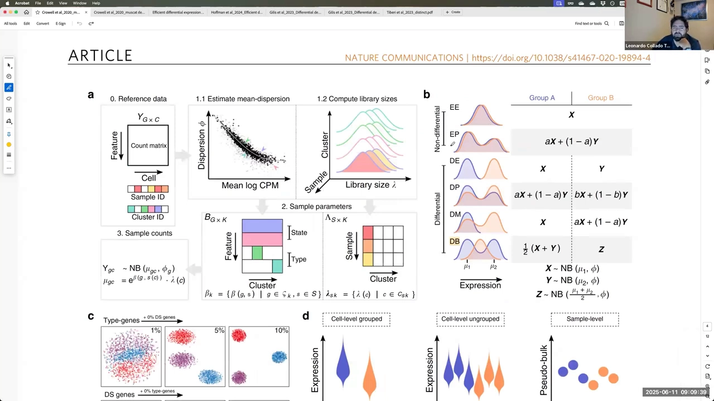

| 缩写 | 含义 | 两组分布的关系 |
| --- | --- | --- |
| EE | 等价表达 | 曲线完全重合 |
| EP | 等价但多峰 | 均值形状相同，但都是双峰 |
| DE | 差异表达 | 单峰、形状相同，**均值不同** |
| DP | 差异比例 | **均值相同**，但落在两个峰上的比例不同 |
| DM | 差异峰数 | 峰的数量不同 |
| DB | 双峰差异 | 一组单峰居中，另一组两个峰且与前者不重叠 |

传统 DE 只测第一种（DE），其余五种在均值检验里要么看不见、要么被当成噪声 [【跳转到 03:05】](https://www.youtube.com/watch?v=TB9dfKPfns8&t=185)。这就是「差异表达」与「差异分布」的分界：**DE 只问均值，DP/DM/DB 问的是分布形状**。

### 1.2 十六种方法分属五类，这是本节要对照的谱系

muscat 论文的补充表一列出了一批待比较的方法 [【跳转到 03:30】](https://www.youtube.com/watch?v=TB9dfKPfns8&t=210)。讲者点明了其中的关键分野：有些方法**先把数据聚合成伪 bulk**，有些方法**直接在细胞层面做检验**（MAST 就是后者），还有的连「用什么数据做伪 bulk」都有多个版本——原始计数、每百万缩放计数、voom 变换值、vst 残差 [【跳转到 04:20】](https://www.youtube.com/watch?v=TB9dfKPfns8&t=260)。

从结果图的图例可以直接读出这十六种方法及其类别：

| 类别 | 代表方法 | 统计单位 |
| --- | --- | --- |
| PB（伪 bulk） | `edgeR.sum.counts`、`edgeR.sum.scalecpm`、`limma-voom.sum.counts`、`limma-trend.mean.*` | 样本 × 亚群 |
| MM（混合模型） | `MM-dream`、`MM-dream2`、`MM-nbinom`、`MM-vst` | 细胞（供体为随机效应） |
| AD（Anderson–Darling 检验） | `AD-gid.*`、`AD-sid.*` | 细胞（比较分布） |
| MAST | `MAST.logcounts` | 细胞（两部分模型） |
| scDD | `scDD.logcounts`、`scDD.vstresiduals` | 细胞（比较分布） |

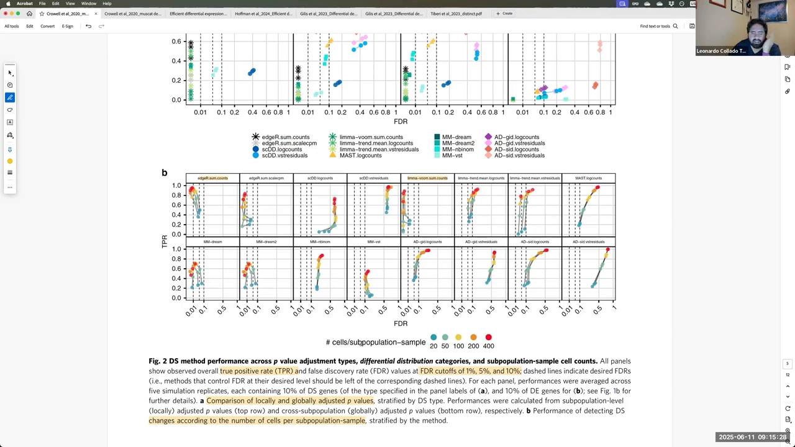

这张图就是全片的骨架：**横轴是实际的 FDR，纵轴是 TPR**。理想的方法应该让点落在虚线标出的目标 FDR 上（不超发），同时纵轴尽量高（不漏检）。同一张图上，不同颜色的点只改变了一件事——每个亚群每个样本里有多少细胞。

## 二、伪 bulk 与细胞级检验：差别不在算法，在「谁是独立观测」

### 2.1 伪 bulk 的误差控制最好，但功效被细胞数和重复数卡住

讲者指出，全场最关心的两条曲线是 `edgeR.sum.counts`（黑色星号）与 `limma-voom.sum.counts`（深绿星号），它们「总体上误差控制良好」 [【跳转到 04:56】](https://www.youtube.com/watch?v=TB9dfKPfns8&t=296)。

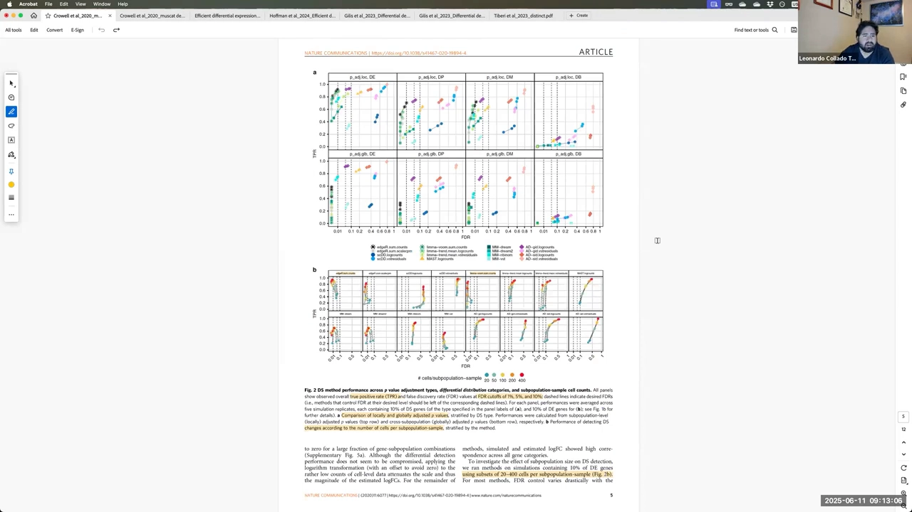

读这张图要先分清两件事：

1. **局部校正 vs 全局校正**：局部是把每个细胞类型的 p 值各自做多重检验校正，全局是把所有细胞类型合在一起校正。讲者说局部校正「在这里更说得通」 [【跳转到 06:36】](https://www.youtube.com/watch?v=TB9dfKPfns8&t=396)。这一点直接决定你报出的 FDR 是「类型内」还是「研究内」的口径。
2. **每个亚群每个样本的细胞数**：图 2b 里，蓝色点代表只有 20 个细胞，绿色 50 个，黄色 100 个。**从 20 到 100 是大幅提升，100 之后几乎不再提升** [【跳转到 07:31】](https://www.youtube.com/watch?v=TB9dfKPfns8&t=451)。讲者的说法是「到 100 就基本安全了」。

这条结论后来被写进了 OSCA（*Orchestrating Single-Cell Analysis with Bioconductor*）与 scran 的 `findMarkers` 文档：细胞数少的时候，edgeR 比 limma-voom 更稳 [【跳转到 08:15】](https://www.youtube.com/watch?v=TB9dfKPfns8&t=495)。图 2b 里 limma-voom 的蓝色点（20 个细胞）明显低于 edgeR 的对应点，就是这个说法的出处。

### 2.2 重复数比细胞数更致命

同一篇论文的补充图 8 把「每个组的重复数」单独拎出来 [【跳转到 13:37】](https://www.youtube.com/watch?v=TB9dfKPfns8&t=817)：

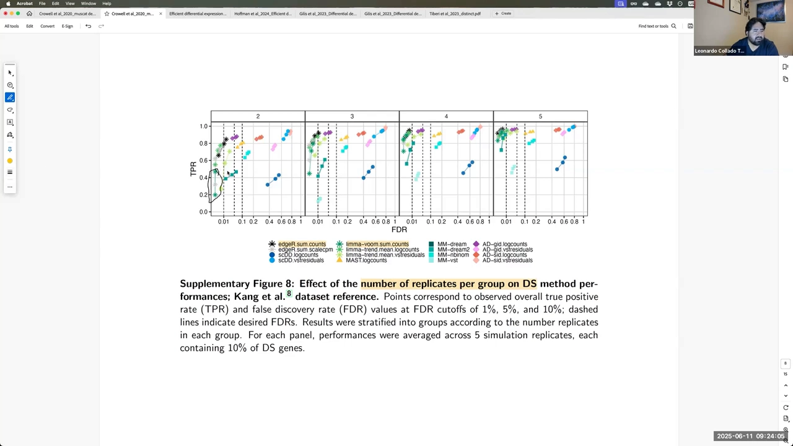

- 4 个、5 个重复时，edgeR 与 limma-voom 几乎重合；
- **只有 2 个重复时，limma-voom 的真阳性率明显掉下来** [【跳转到 14:27】](https://www.youtube.com/watch?v=TB9dfKPfns8&t=867)。

讲者的总结是：检出差异所需的细胞数取决于很多因素——**效应强度、重复数、每个亚群每个样本的细胞数，以及单细胞测定本身的性质** [【跳转到 14:57】](https://www.youtube.com/watch?v=TB9dfKPfns8&t=897)。换句话说，「每簇至少 20 个细胞」这类阈值不是万能钥匙，重复数不够时，加细胞救不回来。

### 2.3 细胞级检验的问题：假阳性不是零星几个，而是成百上千

讲者用一张 UpSet 图展示方法之间的一致性 [【跳转到 10:19】](https://www.youtube.com/watch?v=TB9dfKPfns8&t=619)。图里蓝色柱代表「实际上两组等价表达、却被判成显著」的基因，也就是**假阳性**；柱越矮越好。

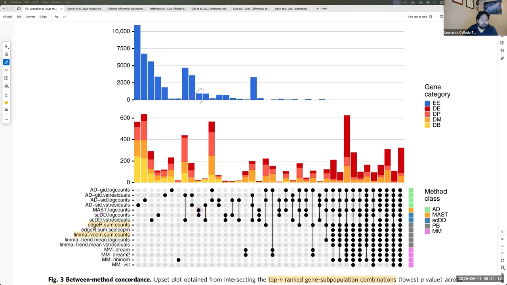

结果很直白：`edgeR.sum.counts`、`limma-voom.sum.counts` 等伪 bulk 方法所在的三列**几乎没有蓝色柱**；而 **MAST 这一列（在细胞层面运行）有一根蓝色柱，高度约一千个基因** [【跳转到 11:59】](https://www.youtube.com/watch?v=TB9dfKPfns8&t=719)。讲者的评价是：在细胞层面做检验的方法「可以有很多假阳性」。

为什么？因为细胞级检验把每个细胞当成一个独立观测，而同一供体的细胞共享基因组、建库批次与处理条件。**样本量被细胞数撑大，标准误被压小，p 值随之系统性偏小。** 这条机制本身在 [4.1.5 伪 bulk 正文](../../4.1_实验单位与统计对象/4.1.5_生物重复、伪重复与伪%20bulk%20汇总：从细胞到样本的聚合/pseudobulk：把单细胞聚合成样本级表达谱再做差异分析.md) 与 [M01 伪重复与聚合伪批量](../../../../../../深度学习/数学与统计基础/M01_统计学习与科学评估基础/3_统计推断与实验设计/3.2_合理的实验单位/3.2.1_重复测量、分层结构与伪重复/伪重复与聚合伪批量：单细胞差异基因到底该按细胞还是按样本检验.md) 里已经展开，本节只取它在基准里的表现：**假阳性是成百上千个基因的量级，不是几个离群点。**

### 2.4 一张总表：十六种方法在七项标准上的排名

论文最后用一张热图总结 [【跳转到 12:28】](https://www.youtube.com/watch?v=TB9dfKPfns8&t=748)：

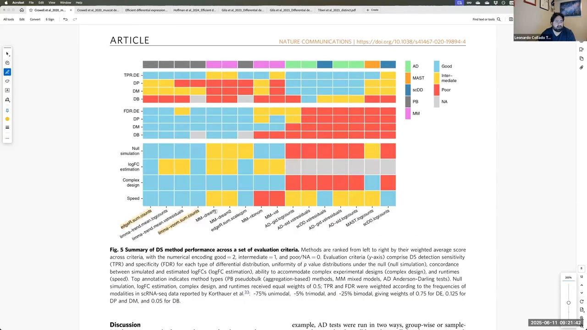

七项标准分别是：DE/DP/DM/DB 各自的 TPR 与 FDR、零模拟（null simulation）、logFC 估计、复杂设计、运行速度。讲者指出两点：

- **edgeR 与 limma-voom 表现相当，且明显优于右侧那一批方法**（右侧红色更多）[【跳转到 13:18】](https://www.youtube.com/watch?v=TB9dfKPfns8&t=798)；
- 但也要公平：这些方法「本来就不是为了检测 DP 或 DB 基因开发的」，它们在 DP/DM/DB 上表现差，不代表在生物学上没有价值 [【跳转到 13:18】](https://www.youtube.com/watch?v=TB9dfKPfns8&t=798)。

### 2.5 muscat 把两族方法装进同一个接口

讲者顺带说明了实现层的关系：muscat 的主函数是 `aggregateData()`（造伪 bulk）与 `pbDS()`（pseudobulk differential state，做差异状态分析），后者默认 edgeR，也可以换成 limma-voom [【跳转到 15:31】](https://www.youtube.com/watch?v=TB9dfKPfns8&t=931)。2019 年 Aaron Lun 与 muscat 作者之间有一个 GitHub issue，讨论 scran 的 `findMarkers` 与 muscat 的关系——两者「非常相似」 [【跳转到 16:21】](https://www.youtube.com/watch?v=TB9dfKPfns8&t=981)。

注意 README 最后一行：**混合模型可以直接在细胞层面运行**。这正是下一节的主题——也是为什么「细胞级 vs 伪 bulk」这个二分法并不完整。

## 三、模型化路线之一：混合模型把「供体／批次」写进模型

### 3.1 dreamlet 要解决的问题：批次多、样本大，固定效应吃不消

第二篇是 2023 年 3 月的预印本，第一作者 Gabriel Hoffman（`variancePartition` 的作者），工作名为 dreamlet [【跳转到 16:41】](https://www.youtube.com/watch?v=TB9dfKPfns8&t=1001)。背景是 CommonMind Consortium 这类数据：样本来自多个脑库，**批次效应很大**，而供体数以千计 [【跳转到 17:56】](https://www.youtube.com/watch?v=TB9dfKPfns8&t=1076)。

dreamlet 建在 `variancePartition` 之上，用的是与 muscat 同一套模拟框架。它的核心主张是：**把批次（或供体）建模成随机效应，而不是固定效应** [【跳转到 18:26】](https://www.youtube.com/watch?v=TB9dfKPfns8&t=1106)。

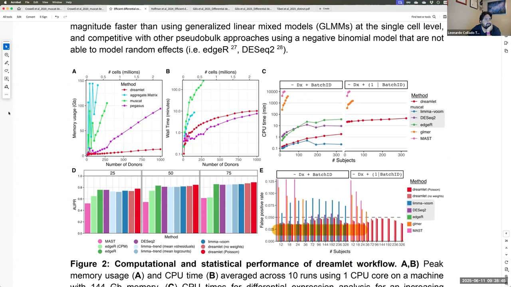

### 3.2 固定效应 vs 随机截距：差别落在自由度和假阳性率上

讲者对着图 2 的 C、E 两个面板解释 [【跳转到 18:51】](https://www.youtube.com/watch?v=TB9dfKPfns8&t=1131)：

- **C 面板**：诊断（感兴趣的变量）始终是固定效应，区别只在批次 ID 是固定效应还是随机截距；
- **E 面板**：纵轴是假阳性率，越低越好。dreamlet（红色）是最低的一档；而 **limma-voom（蓝色）在「批次当固定效应」的设定下，假阳性率明显高出 5% 那条线** [【跳转到 19:16】](https://www.youtube.com/watch?v=TB9dfKPfns8&t=1156)。

原因讲者说得很具体：**把批次当固定效应，八个批次就要占掉七个自由度**，而 limma-voom 的表现在残差自由度低时本来就会变差 [【跳转到 20:06】](https://www.youtube.com/watch?v=TB9dfKPfns8&t=1206)。limma-voom 不支持混合模型，所以图里右侧没有它的蓝线。

这条正好接上 [M01 分组嵌套与随机截距](../../../../../../深度学习/数学与统计基础/M01_统计学习与科学评估基础/3_统计推断与实验设计/3.2_合理的实验单位/3.2.2_分层与混合效应模型：随机截距、组内相关与不确定性修正/分组嵌套与随机截距：把组间差异交给随机效应，把总体趋势留给固定效应.md)：随机截距的作用不是「更高级」，而是**用更少的参数吸收组间差异**，把自由度留给真正关心的效应。

### 3.3 什么时候值得上混合模型：每批样本数落在 3–10 时

讲者翻到 dreamlet 的补充图 3 [【跳转到 25:50】](https://www.youtube.com/watch?v=TB9dfKPfns8&t=1550)：

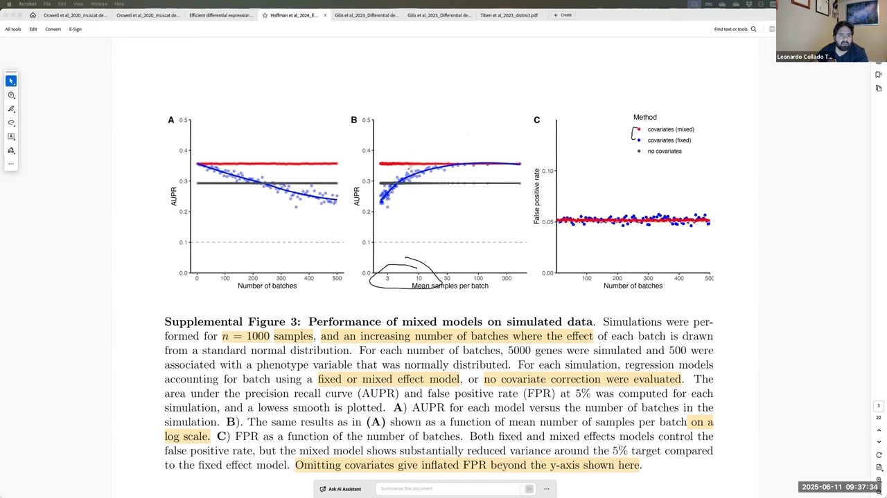

- 横轴是**每批的样本数**，纵轴是 AUPR（精度—召回曲线下面积，越高越好）；
- 红色（混合模型）与蓝色（固定效应）的差距，在每批样本数少时最大 [【跳转到 26:15】](https://www.youtube.com/watch?v=TB9dfKPfns8&t=1575)；
- 讲者的判断是：论文本身讨论的是超大数据集，但**我们自己的数据大概落在每批 3 到 10 个样本这个区间**，这里用混合模型可能有相当大的提升 [【跳转到 26:40】](https://www.youtube.com/watch?v=TB9dfKPfns8&t=1600)。

他同时给了一个实践提醒：dreamlet 用的是 voom 框架，而 muscat 的结论是「样本量小的时候用 edgeR 而不是 limma-voom」——**这两条建议会打架**。如果你的数据既有批次、样本量又小，就得自己权衡：是优先校正批次，还是优先享受 edgeR 在小样本下的优势 [【跳转到 28:20】](https://www.youtube.com/watch?v=TB9dfKPfns8&t=1700)。

### 3.4 模型化路线的两个使用细节

- **校正后的 p 值口径不同**：dreamlet 结果表里的 `adjusted p` 是**全局**的（所有细胞类型合在一起校正），不是按细胞类型分别校正。要按类型报结论，得自己拆开重算 [【跳转到 22:25】](https://www.youtube.com/watch?v=TB9dfKPfns8&t=1345)。
- **方差分解可以当预筛**：`variancePartition` 的图能看出每个基因的方差有多少由感兴趣的协变量解释。讲者的经验是：**方差解释比例高的基因，通常也是差异表达的基因**——除非测量本身的方差太大 [【跳转到 23:58】](https://www.youtube.com/watch?v=TB9dfKPfns8&t=1438)。他举了 CLU、NFKBIA 与 PTPRG 三个基因作对照 [【跳转到 24:08】](https://www.youtube.com/watch?v=TB9dfKPfns8&t=1448)。

## 四、模型化路线之二：把「检出／未检出」当成另一个可检验的量

### 4.1 差异表达只测均值，稀疏数据里还有一半信息没被用上

第三篇是 2023 年 12 月的预印本（Gillis 等）[【跳转到 28:45】](https://www.youtube.com/watch?v=TB9dfKPfns8&t=1725)。讲者的概括是：现有的方法几乎都在检验**平均表达**的差异，而这篇问的是另一个问题——**检出率**（differential detection，DD）的差异，也就是「一个基因在多大比例的细胞里被测到」 [【跳转到 29:01】](https://www.youtube.com/watch?v=TB9dfKPfns8&t=1741)。

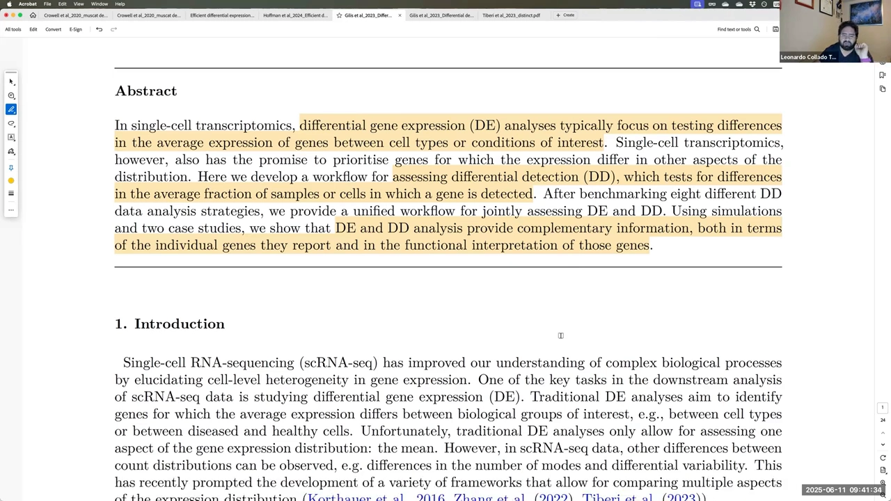

做法非常朴素 [【跳转到 29:51】](https://www.youtube.com/watch?v=TB9dfKPfns8&t=1791)：把细胞层面的计数矩阵**二值化**——基因在该细胞里被测到就是 1，没测到就是 0；再按样本聚合；此时每个观测是「若干次抛硬币里的成功次数」，**二项分布**是自然的模型。

这一步的意义在于：它把稀疏性从「麻烦」变成了「信号」。零不再只是「均值低」的结果，而是**一个可以被单独检验的检出事件**。

### 4.2 两种差异可以同时存在，也可以彼此独立

讲者展示了把 DD 与 DE 的 p 值画在一起的结果 [【跳转到 30:37】](https://www.youtube.com/watch?v=TB9dfKPfns8&t=1837)：

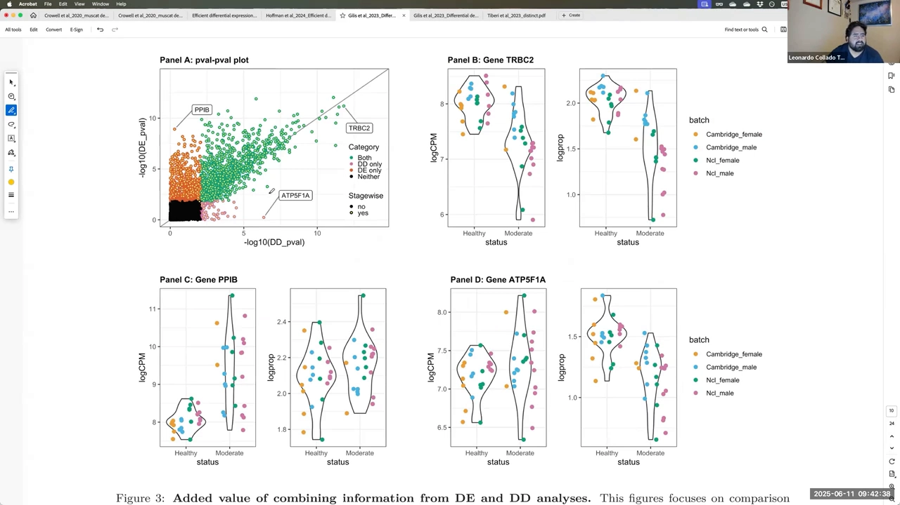

- **橙色**：只有 DE 显著（均值变了，检出率没变）；
- **绿色**：两者都显著；
- **粉色**：只有 DD 显著（均值几乎一样，但表达该基因的细胞比例差很多）。

讲者的评价很克制：在这个信号很强的数据集里，粉点只有一小撮，「并没有带来很多新的、我们认为有生物学意义的基因」 [【跳转到 31:02】](https://www.youtube.com/watch?v=TB9dfKPfns8&t=1862)。但在信号更弱的数据集里（补充材料），粉点相对更多——**这类基因可能在我们的数据里也存在** [【跳转到 33:57】](https://www.youtube.com/watch?v=TB9dfKPfns8&t=2037)。

他还给了一个具体的生物学解读 [【跳转到 32:17】](https://www.youtube.com/watch?v=TB9dfKPfns8&t=1937)：健康组里**很大一部分细胞都表达这个基因，只是每个细胞表达得低**；疾病组里**只有少数细胞表达，但表达得高**。两组的均值一样，DE 看不见，DD 看得见。至于这种差别重不重要，取决于你的系统关心的是「多少细胞在生产」还是「总共生产了多少」 [【跳转到 37:38】](https://www.youtube.com/watch?v=TB9dfKPfns8&t=2258)。

### 4.3 实现细节与两阶段校正

- **muscat 里也有 DD**：`pbD`（pseudobulk differential detection）就是把矩阵二值化后再聚合、再检验，`aggregateData()` 改一个参数即可 [【跳转到 34:13】](https://www.youtube.com/watch?v=TB9dfKPfns8&t=2053)。
- **一个容易踩的坑**：`pbD` 内部用**细胞数**作为归一化因子，所以**不能把「表达该基因的细胞数」再当协变量放进模型**，哪怕它在方差分解里看起来很重要 [【跳转到 35:08】](https://www.youtube.com/watch?v=TB9dfKPfns8&t=2108)。
- **两阶段校正**：图里带黄圈的点用了 stageR（2017 年的方法），把 DE 与 DD 两组 p 值放在一起做阶段式校正。结果是边界上的粉点大多失去黄圈——同时考虑两个检验后不再显著 [【跳转到 36:23】](https://www.youtube.com/watch?v=TB9dfKPfns8&t=2183)。

讲者对这套流程的建议是：第一次用时，**最该看的是「有多少粉点」**——也就是那些你原来完全没见过的、只有 DD 才抓得到的基因；然后逐个判断它们对当前生物学问题是否相关 [【跳转到 37:13】](https://www.youtube.com/watch?v=TB9dfKPfns8&t=2233)。

## 五、模型化路线之三：不只看均值，也不只看检出率，而是比较整条分布

第四篇是已发表的 distinct（Tiberi 等，2023），最后作者是 Mark Robinson，Helena Crowell 也是共同作者 [【跳转到 38:28】](https://www.youtube.com/watch?v=TB9dfKPfns8&t=2308)。它的目标是**一次覆盖 muscat 定义的全部差异类型**，并新增一种：DV（differential variance，均值相同、方差不同）[【跳转到 39:43】](https://www.youtube.com/watch?v=TB9dfKPfns8&t=2383)。

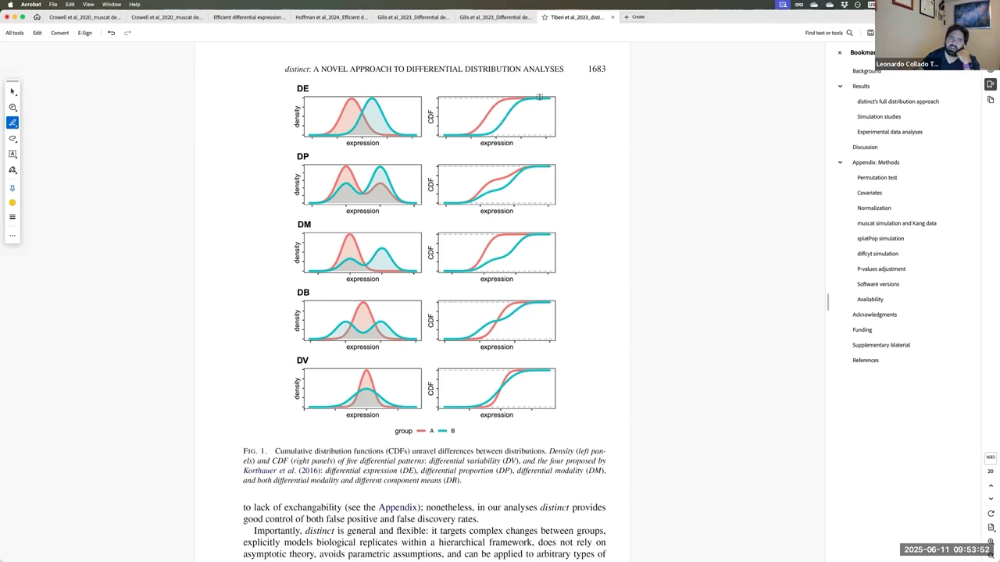

方法的核心是**累积分布函数**：把表达值从小到大累加，看两组的曲线是否重合 [【跳转到 40:08】](https://www.youtube.com/watch?v=TB9dfKPfns8&t=2408)。讲者对着图解释：DE 是两条曲线**整体平移**；DP 是曲线**镜像翻转**；DB 是形状改变。因为不再只比较一个均值，这些形状差异都能被捕捉到。

讲者也坦白自己「还没有完全读完这篇论文」，但认为它是 muscat 工作的**逻辑延续**：muscat 指出这些场景「当时没有任何方法能很好支持」，distinct 就是来补这个缺口的 [【跳转到 41:23】](https://www.youtube.com/watch?v=TB9dfKPfns8&t=2483)。

## 六、三类方法怎么选：一张取舍表

讲者在结尾把四篇论文的结论压成几句话 [【跳转到 41:23】](https://www.youtube.com/watch?v=TB9dfKPfns8&t=2483)：

- **样本量小、或每个簇细胞多** → 用 edgeR 而不是 limma-voom；
- **伪 bulk 方法整体优于细胞层面的方法**；
- **有批次效应** → 把批次建模成随机截距，并考虑 dreamlet；
- **关心「多少细胞表达这个基因」** → 用检出率模型（DD）。

把这三条路线放在同一张表里：

| | 细胞级检验（Wilcoxon／MAST） | 伪 bulk（edgeR／limma-voom） | 模型化（混合模型／检出率／分布检验） |
| --- | --- | --- | --- |
| 一个「观测」是什么 | 一个细胞 | 一个「样本 × 细胞类型」的求和 | 一个细胞（供体为随机效应），或一个「样本 × 细胞类型」的检出计数 |
| 对独立性的假设 | 细胞之间独立（**在跨条件比较里通常不成立**） | 样本之间独立 | 细胞相关但可由随机效应吸收；或检出事件独立 |
| 对零值的处理 | 零参与秩或似然的计算，不区分来源 | 聚合把零压掉，零变成「低计数」 | 检出率模型把零／非零当成独立过程；混合模型靠随机效应吸收个体差异 |
| 主要风险 | 假阳性成百上千（MAST 在基准里约一千个） | 功效受重复数与每簇细胞数限制；丢掉细胞层面异质性 | 模型设定与数据规模不匹配（如固定效应吃自由度、随机效应层级太少） |
| 什么时候合适 | 样本内部的比较（亚群结构、同一份样本里两类细胞） | 跨条件的组间比较，样本数 ≥ 3 | 有明确批次／供体结构，或关心检出率与分布形状 |

三条路线不是替代关系：**伪 bulk 回答「这个细胞类型作为一个群体变没变」，细胞级与模型化方法回答「变化发生在哪些细胞、以什么形式发生」**。同一份数据上两条路线都跑、取交集，是用两种互补的错误方向互相抵消——这一点在 [4.1.5 的 Seurat 版正文](../../4.1_实验单位与统计对象/4.1.5_生物重复、伪重复与伪%20bulk%20汇总：从细胞到样本的聚合/在Seurat里按样本与细胞类型聚合做pseudobulk差异分析.md) 里已经展开。

## 小结

- 单细胞差异表达的方法谱系按**统计单位**分三类：细胞级检验（MAST、Wilcoxon）、伪 bulk（edgeR、limma-voom、DESeq2）、模型化（混合模型 MM、检出率模型、分布检验 AD/scDD/distinct）。
- muscat 用十七种模拟场景、十六种方法做基准：**伪 bulk 的误差控制最好，细胞级 MAST 在等价表达的基因上会报出约一千个假阳性**。
- 伪 bulk 的功效被两件事卡住：**每个亚群每个样本的细胞数**（20 → 100 有大幅提升，100 之后趋平）与**重复数**（只有 2 个重复时 limma-voom 明显掉队，edgeR 更稳）。
- 混合模型（dreamlet）的价值在**批次多、每批样本少**的场景：把批次写成随机截距，避免固定效应吃掉自由度；每批 3–10 个样本时相对固定效应的提升最大。
- 检出率模型（DD）把稀疏数据的零变成信号：二值化 + 二项模型，检验「多少比例的细胞表达这个基因」，与 DE 互补；muscat 的 `pbD` 实现了这条路。
- distinct 用累积分布函数比较整条分布，覆盖 DE/DP/DM/DB 并新增 DV，是 muscat 指出的「没有方法能处理」那部分的补丁。
- 所有这些都是**模拟基准上的结论**：讲者反复提醒，模拟框架本身的好坏会影响结论，真实数据上仍要结合实验设计与效应量判断。

## 关键术语速查

| 术语 | 一句话解释 |
| --- | --- |
| DE（differential expression） | 两组之间**平均表达**的差异，传统差异分析的目标 |
| DD（differential detection） | 两组之间**检出比例**的差异：多少比例的细胞里测到了这个基因 |
| DP／DM／DB／DV | 均值相同但分布不同的四种情形：比例、峰数、双峰形状、方差 |
| 伪 bulk（pseudobulk） | 把同一「样本 × 细胞类型」的细胞计数求和成一个样本级表达谱，再按样本检验 |
| 混合模型（MM） | 把供体／批次写成随机效应的模型，在细胞层面分析但承认组内相关 |
| 随机截距 | 混合模型里「每组一个偏移量」的写法，用少量参数吸收组间差异 |
| MAST | 在细胞层面做两部分（检出 + 表达）检验的方法，基准里假阳性偏高 |
| edgeR／limma-voom | 两套为 bulk 计数设计的差异分析框架，pseudobulk 之后可直接复用 |
| stageR | 把两个相关分析（如 DE 与 DD）的 p 值放在一起做阶段式校正的方法 |
| AUPR | 精度—召回曲线下面积，基准里衡量「排序质量」的指标，越高越好 |