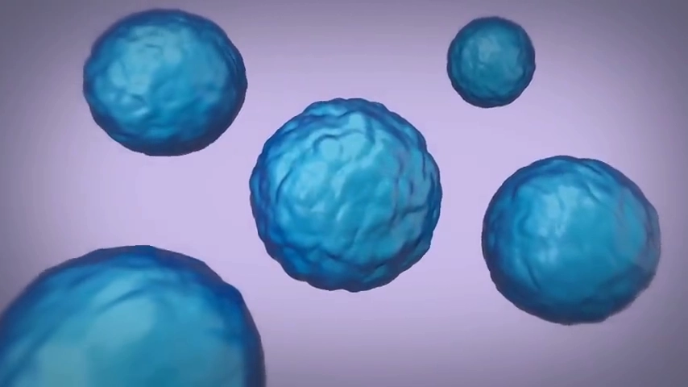
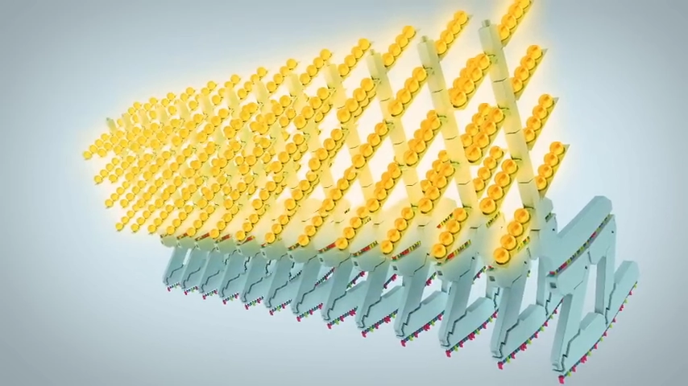
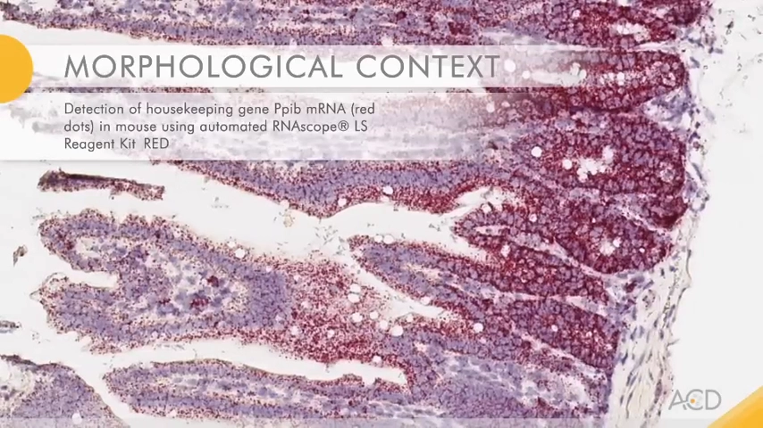
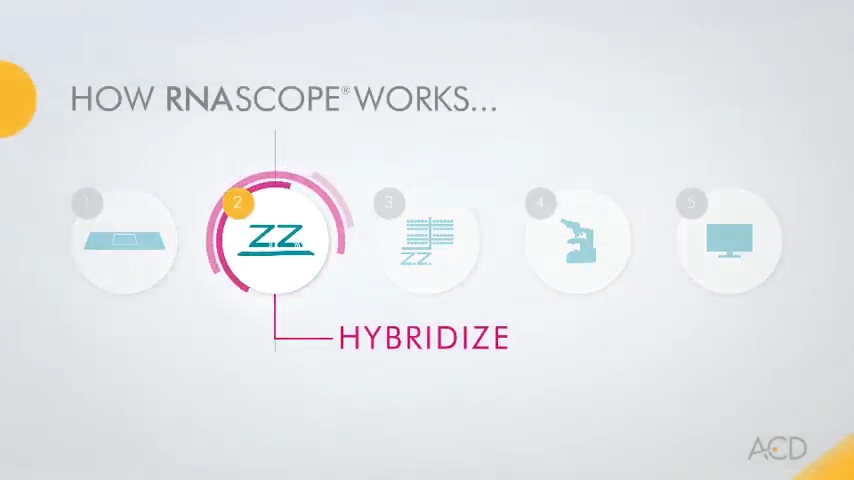
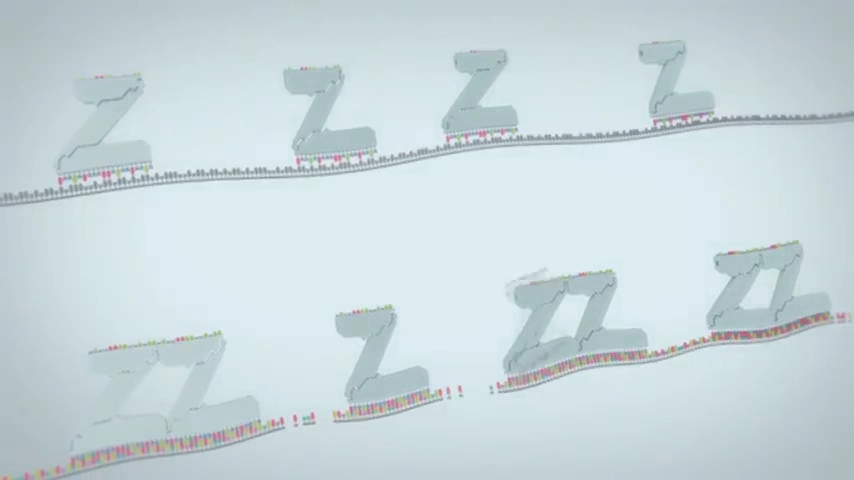
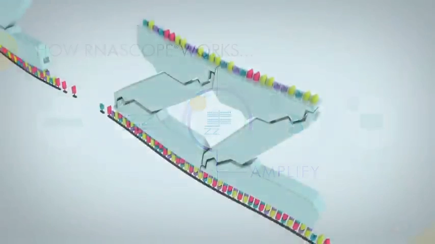
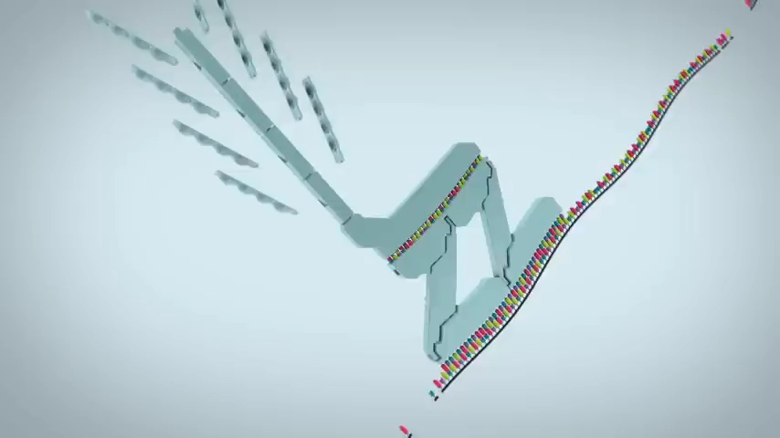
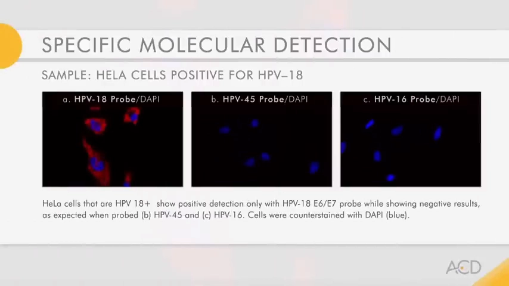

# RNAscope 原位杂交：双 Z 探针、级联放大与单分子 RNA 定位

> 视频来源：[ACD RNAscope in situ Hybridization (ISH) Technology Overview](https://www.youtube.com/watch?v=CPgZEf6EyJQ)（YouTube · Bio-Techne Spatial / ACD）｜时长约 5 分钟
> 简要导读：这是一支厂商技术概览，讲 RNAscope 这类 RNA 原位杂交怎么在**保留组织结构**的前提下把一条 RNA 变成一个可数的信号点。本文按「读出对象 → 探针设计 → 放大级联 → 特异性从哪来 → 判读边界」整理，并把它接回「测序结论的正交验证」这条主线：它测的是同一类分子（RNA），但换了观测方式（原位、单分子、按细胞计数）。

## 本讲要解决的核心问题（SCQA）

**背景**：RNA 测序和 qPCR 都要先把细胞裂解、把 RNA 抽出来。抽出来之后，**哪条 RNA 来自哪个细胞、在组织里落在哪个位置**这层信息就丢了。qPCR 给出的是一个样本的平均值，测序给出的是细胞或样本层面的计数，两者都不保留形态。

**冲突**：如果测序说「某个基因在肿瘤区域高、在间质低」，或者「只有一小群细胞表达某个低丰度基因」，裂解类方法没法直接验证这句话——它把空间和细胞归属一起抹掉了。而低丰度转录本在裂解、逆转录、扩增的每一步都可能被稀释或丢失。

**疑问**：能不能不裂解，直接在固定好的组织切片上，把某一条 RNA 分子数出来？如果能，信号怎么放大到肉眼可见，同时又不把非特异结合一起放大？

**回答（中心思想）**：RNAscope 的答案是**把「放大」这一步绑在「两个相邻探针同时正确配对」这个条件上**。探针成对设计（double Z），只有两个相邻探针串联杂交到同一条目标 RNA 上，才能拼出一个供前置放大器结合的位点；单个探针结合不触发放大。于是信号放大与背景抑制同时发生，最终**一条 RNA 分子被压成一个可数的点**，在普通显微镜下按细胞计数。

## 一、读出对象：原位、单分子、按细胞

### 1.1 测的是组织里的 RNA，不是试管里的 RNA

RNAscope 属于 RNA 原位杂交（in situ hybridization，ISH）：在**完整的组织与细胞**里检测 RNA 生物标志物。[【跳转到 00:00】](https://www.youtube.com/watch?v=CPgZEf6EyJQ&t=0) 流程上它仍然要固定和透化——先固定（fixation），再透化（permeabilization），让探针能进到细胞里、接触到 RNA。[【跳转到 00:56】](https://www.youtube.com/watch?v=CPgZEf6EyJQ&t=56)

这一步决定了它和 qPCR 的根本差别：**样本没有被拆散**。组织架构、细胞边界、邻近关系都还在，所以信号可以归到「哪一个细胞、组织的哪一层」。

### 1.2 分辨率：一个点 = 一条 RNA 分子

放大级联走完之后，**单条 RNA 分子在标准显微镜下表现为一个点状（punctuated）信号**。[【跳转到 03:06】](https://www.youtube.com/watch?v=CPgZEf6EyJQ&t=186) 这个「点」是它区别于 qPCR 和流式的关键：qPCR 给的是样本平均的 Ct 值，流式给的是每个细胞的荧光强度，而这里给的是**每个细胞里可以逐个数出来的分子个数**。

视频把它总结成两条：**单分子检测 + 单细胞分辨率**，因此可以在异质细胞群体里做「每细胞表达水平」的定量。[【跳转到 04:18】](https://www.youtube.com/watch?v=CPgZEf6EyJQ&t=258) 换句话说，它回答的是「这个细胞里有几条、那群细胞里各有几条」，而不是「这个样本平均多少」。

### 1.3 附带产物：形态学背景

因为切片还在，信号可以叠在组织形态上读。视频给的例子是小鼠肠道 FFPE 切片里看管家基因 Ppb 的 mRNA（红点）。[【跳转到 04:13】](https://www.youtube.com/watch?v=CPgZEf6EyJQ&t=253)

这层信息是裂解类方法给不出的：**同一个表达量，落在哪类细胞、哪一层结构里，判读结论可以完全不同**。

## 二、探针设计：为什么是「双 Z」

### 2.1 一个标准探针组：20 条探针覆盖至少 1 kb

一个标准设计是**20 条探针，覆盖目标区域至少 1 kb**。[【跳转到 01:31】](https://www.youtube.com/watch?v=CPgZEf6EyJQ&t=91) 也就是说，针对同一条目标 RNA，会落下二十个彼此独立的结合位点，而不是像 qPCR 那样只有一对引物。

### 2.2 每条 Z 探针的三段结构

每条 Z 形目标探针由三段组成。[【跳转到 01:47】](https://www.youtube.com/watch?v=CPgZEf6EyJQ&t=107)

| 区段 | 作用 |
| :--- | :--- |
| 下段（lower region） | 与目标 RNA 互补，按「目标特异杂交」和「杂交性质均一」来挑选 |
| 间隔区（spacer） | 把下段和上段连起来 |
| 上段（upper region，尾部） | 不结合目标；两条相邻 Z 探针的尾部**共同拼出一个 28 碱基的前置放大器结合位点** |

### 2.3 关键约束：必须两条相邻探针串联

放大能不能启动，取决于**两条相邻的独立 Z 探针是否串联杂交到目标序列上**。[【跳转到 02:13】](https://www.youtube.com/watch?v=CPgZEf6EyJQ&t=133)

单条 Z 探针结合**不会**引发放大——因为前置放大器无法结合到单条探针上。视频对此的表述很直接：这一步「防止了非特异信号的放大」，而它正是特异性的来源。[【跳转到 02:27】](https://www.youtube.com/watch?v=CPgZEf6EyJQ&t=147)

用一句话概括这套设计：**放大倍数越高，越需要一个「与门」来把关；双 Z 串联就是这个与门。**

## 三、放大级联与灵敏度

### 3.1 四步级联

信号放大通过一串杂交事件完成。[【跳转到 02:32】](https://www.youtube.com/watch?v=CPgZEf6EyJQ&t=152)

1. 双 Z 探针对杂交到目标 RNA；
2. 前置放大器（preamplifier）结合到每对双 Z 拼出的位点；
3. 放大器（amplifier）结合到前置放大器上的位点；
4. 带荧光分子或显色酶的标签探针（label probe）结合到放大器上的位点。

### 3.2 灵敏度：20 条里只要 3 条结合就能看见

这是视频里最值得记住的一个数字：**平均 20 条双 Z 探针中，只要 3 条结合就足以产生可检测信号**。[【跳转到 03:24】](https://www.youtube.com/watch?v=CPgZEf6EyJQ&t=204) 视频给出的解释是：这种设计对**目标 RNA 局部不可及或部分降解**有耐受性，因此能检出表达很低的基因，例如 PD-L1。[【跳转到 03:39】](https://www.youtube.com/watch?v=CPgZEf6EyJQ&t=219)

这条性质对判读很重要，方向要记清楚：**它是「不容易漏检」，不是「不会假阳性」**。多探针冗余提高的是检出概率；特异性仍然由「双 Z 串联才放大」这条规则承担。

## 四、特异性：区分高度相似的序列

双 Z 设计要解决的另一个问题是**交叉杂交**。视频的说法是：这套设计「消除了对非预期目标的交叉杂交」，常规情况下可以区分**同源性高达 85% 的 RNA 序列**。[【跳转到 03:44】](https://www.youtube.com/watch?v=CPgZEf6EyJQ&t=224)

例子是 HPV 亚型：在 HPV-18 阳性的 HeLa 细胞里，只有 HPV-18 E6/E7 探针给出阳性信号，HPV-45 与 HPV-16 探针为阴性。[【跳转到 03:49】](https://www.youtube.com/watch?v=CPgZEf6EyJQ&t=229)

这个例子的方法学意义在于：**它同时给出了阳性和阴性两侧的证据**。只看到「目标探针亮」不足以说明特异性，还要看到「近缘序列的探针不亮」。

## 五、判读边界：它能支持什么、不能支持什么

把上面几条合起来，可以给出一张判读清单。

| 测序／qPCR 的结论 | RNAscope 能提供什么 | 需要注意什么 |
| :--- | :--- | :--- |
| 某基因在某群细胞里表达 | 逐细胞、逐分子的原位计数，可分辨「少数细胞高表达」与「多数细胞低表达」 | 计数依赖探针组覆盖的目标区域；不同转录本亚型可能共用或避开同一段序列 |
| 某基因在组织某区域富集 | 信号与形态叠读，能定位到细胞层与组织结构 | 切片是二维截面，采样区域与切片深度会影响代表性 |
| 低丰度基因「测到了」 | 单分子点可直接确认分子存在 | 灵敏度高意味着**样本处理**（固定、透化、降解）会直接改变可及性与信号数 |
| 表达量差异的倍数 | 可做每细胞计数，得到半定量到定量的比较 | 视频未讨论内参、批间校准与阈值设定，这些不能由本片推断 |

关于最后一行要说清楚：这支视频是厂商技术概览，**它没有讲阴性对照探针、内参探针、批间校准这些质控细节**，也没有给出与 qPCR／测序的一致率数据。因此本节只能确认「读出对象与信号来源」，不能据此宣称「RNAscope 阳性就等于测序结论成立」。对照设置那一侧的证据由同节的流式与免疫组化两篇正文承担。

## 小结

- RNAscope 是**原位**的 RNA 检测：样本不裂解，信号保留细胞归属与组织形态，最终以「一个点 = 一条 RNA 分子」的形式被计数，达到单分子、单细胞分辨率。
- 探针组标准设计是 **20 条探针覆盖至少 1 kb**；每条 Z 探针分下段（结合目标）、间隔区、上段（提供放大结合位点）三段。
- 特异性的机制是**与门**：只有两条相邻 Z 探针串联杂交，尾部才拼出 28 碱基的前置放大器位点；单条探针结合不触发放大。
- 灵敏度来自级联放大 + 多探针冗余：20 条里 3 条结合即可检出，对局部不可及与部分降解有耐受性，能测低表达基因。
- 特异性有明确边界：可区分同源性高达 85% 的序列，HPV-18／45／16 的例子同时给出阳性与阴性两侧证据。
- 判读上它补的是「空间与细胞归属」这一层；质控细节（阴性探针、内参、批间校准）不在本片范围，不能由本片推断。

## 关键术语速查

| 术语 | 一句话解释 |
| :--- | :--- |
| 原位杂交（ISH） | 在固定、未打散的组织或细胞里用互补探针检测核酸，保留空间位置 |
| RNAscope | 一种以双 Z 探针 + 级联放大实现的 RNA 原位杂交技术 |
| 双 Z 探针（double Z probe） | 两条相邻、各自带尾部的探针；只有串联杂交才拼出放大位点 |
| 前置放大器（preamplifier） | 结合到双 Z 探针对所拼出的 28 碱基位点上的分子，放大级联的第一步 |
| 标签探针（label probe） | 带荧光基团或显色酶、结合在放大器上的末端探针 |
| 点状信号（punctuated signal） | 单条 RNA 分子经放大后在显微镜下呈现的一个点 |
| FFPE | 福尔马林固定、石蜡包埋的组织样本，是原位检测最常见的样本形式 |
| 透化（permeabilization） | 让探针能进入细胞接触核酸的处理步骤，与固定共同决定信号可及性 |