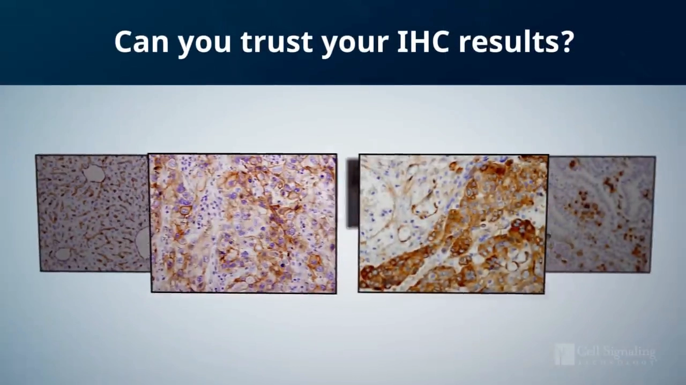
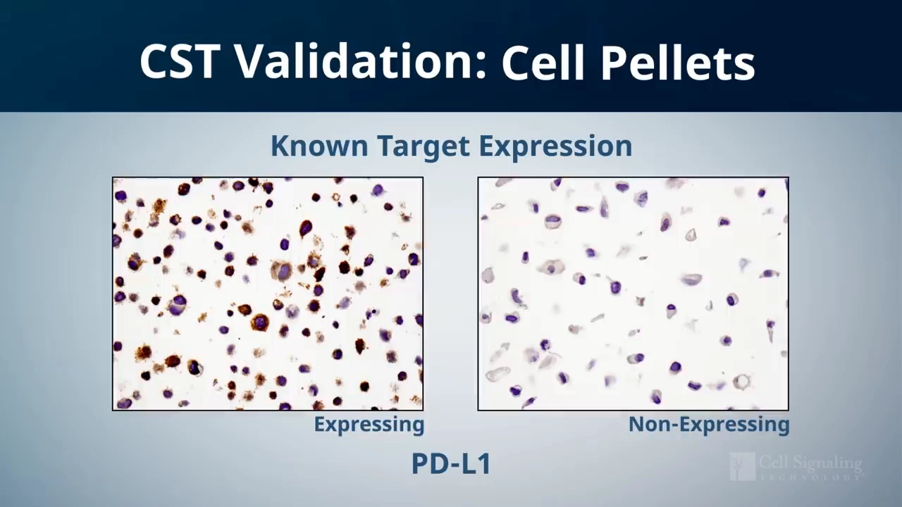
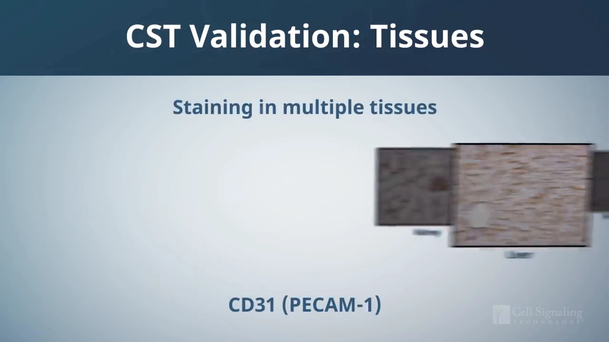
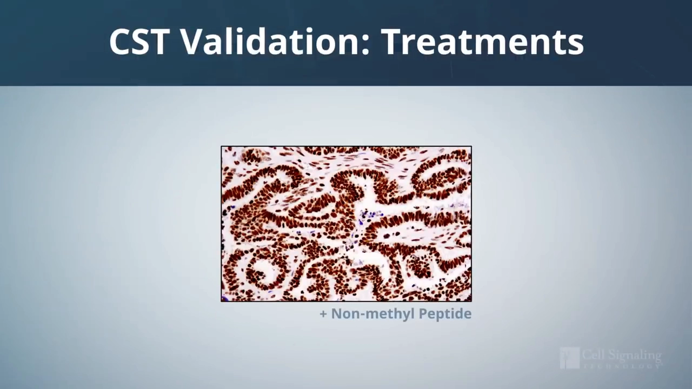
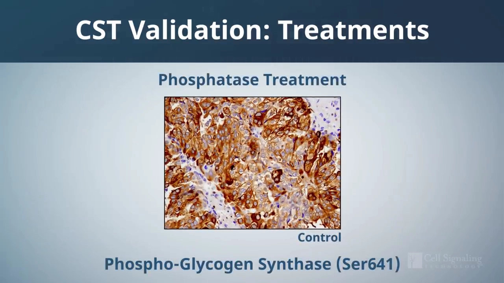
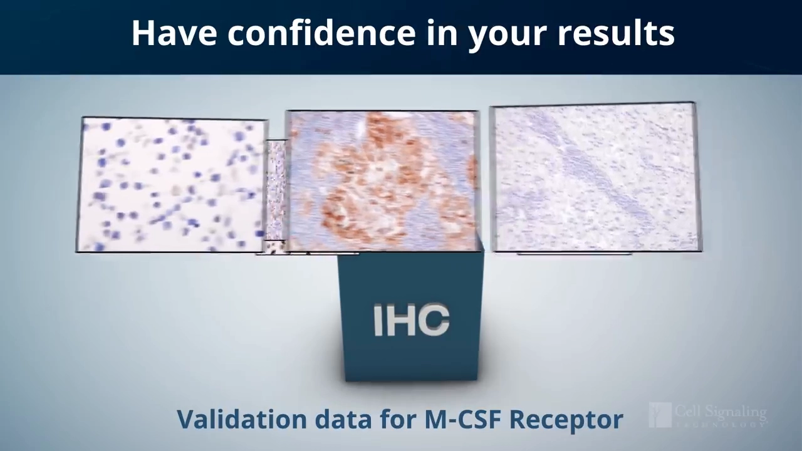

# 免疫组化的抗体验证：细胞沉淀、组织谱与封闭肽对照

> 视频来源：[Can you trust your immunohistochemistry (IHC) results? | CST Validation](https://www.youtube.com/watch?v=uCeqvDgEqbo)（YouTube · Cell Signaling Technology）｜时长约 4 分钟
> 简要导读：这支短片回答一个问题——凭什么相信一张免疫组化（IHC）切片上的棕色就是目标蛋白。它把「抗体验证」拆成一个数据包：已知表达与敲低的细胞沉淀、多组织滴定、封闭肽与磷酸酶处理、以及药物处理改变靶标。本文按「读出对象 → 为什么单次检测不够 → 四类验证 → 判读边界」整理，并把它接回「测序结论的正交验证」这条主线。

## 本讲要解决的核心问题（SCQA）

**背景**：免疫组化是检测组织里蛋白表达最直接的方法之一，而且它**保留组织内的空间环境**——同一个蛋白，落在肿瘤细胞、间质还是浸润免疫细胞上，意义完全不同。[【跳转到 00:00】](https://www.youtube.com/watch?v=uCeqvDgEqbo&t=0) 这也是它作为测序结论正交验证手段的价值：测序告诉你有多少转录本，IHC 告诉你蛋白在哪个细胞、哪一层结构里。

**冲突**：IHC 的可靠性完全取决于**抗体的特异性和性能**。切片上出现棕色，可能来自目标蛋白，也可能来自抗体与别的蛋白结合、来自封闭不充分、来自内源酶或背景染色。而这类实验往往「高风险」——样本有限、结论要被当作证据用。[【跳转到 00:05】](https://www.youtube.com/watch?v=uCeqvDgEqbo&t=5)

**疑问**：怎么才能确信这支抗体染的确实是目标蛋白？做一次验证够不够？

**回答（中心思想）**：**单次检测不足以确定特异性，需要一个综合的验证数据包。** 视频给出四类互补的验证：用**已知表达水平的细胞沉淀**（含 siRNA/shRNA 敲低）看信号是否随靶标变化；用**多组织与抗体滴定**看信号是否落在该落的地方；用**封闭肽与磷酸酶处理**检验抗体识别的是不是那个表位或那个修饰；用**药物处理**在体内改变靶标表达或定位。四类合起来，才能把「棕色」和「目标蛋白」之间的链条扣紧。

## 一、读出对象：切片上的蛋白，带空间信息

IHC 的观测单位是**组织切片上的一个区域**，读数是染色的强度与定位（细胞核、胞质、膜，以及哪些细胞类型被染上）。它测的是**蛋白**，不是 RNA；它保留**空间**，不像流式那样把细胞打散。

这一点决定了它在验证链条里的位置：

| 方法 | 读出对象 | 分辨率 | 保留空间 |
| :--- | :--- | :--- | :--- |
| qPCR | RNA（样本平均） | 样本级 | 否 |
| 流式 | 蛋白（每细胞荧光强度） | 单细胞 | 否（细胞被打散） |
| RNAscope | RNA（每细胞分子点） | 单分子、单细胞 | 是 |
| IHC | 蛋白（染色强度与定位） | 细胞／亚细胞，取决于显微镜 | 是 |

所以 IHC 与 RNAscope 回答的是同一类问题（「在组织里，这个分子落在哪」），区别在测的是蛋白还是 RNA；而 IHC 与流式回答的是同一类分子（蛋白），区别在是否保留空间与是否可定量到单细胞。

## 二、为什么单次检测不够

视频反复强调的一句话是：**单次检测不足以确定特异性**。[【跳转到 00:34】](https://www.youtube.com/watch?v=uCeqvDgEqbo&t=34) 理由是任何单一切片都同时混合了多种可能：靶标表达、抗体交叉反应、组织背景、抗原修复与封闭条件。一次染色只能给出一个结果，无法把这几项拆开。

因此视频的框架是「数据包（data package）」：**多种验证方法互相补位**，而不是靠某一次实验「证明抗体特异」。

## 三、细胞沉淀：用已知表达水平做标尺

### 3.1 已知表达与不表达的细胞系

最直接的一类验证是**石蜡包埋的细胞沉淀（cell pellets）**：挑已知靶蛋白表达水平不同的细胞系，比较染色强弱。[【跳转到 01:21】](https://www.youtube.com/watch?v=uCeqvDgEqbo&t=81) 视频给的例子是 PD-L1：表达株染色强、不表达株几乎无染色。

这个设计的逻辑与 qPCR 的阴性对照同源：**信号必须跟着靶标走**。不表达的细胞也染上，说明抗体识别的不只是目标蛋白。

### 3.2 敲低／敲除：把「已知表达」变成可操纵的变量

更强的一步是用 **siRNA 或 shRNA 改变靶标表达**，再比较对照与敲低（敲除）细胞沉淀的染色。[【跳转到 01:36】](https://www.youtube.com/watch?v=uCeqvDgEqbo&t=96) 这一步把「挑两株表达量不同的细胞」升级成「在同一背景下把靶标拿掉」——后者排除了细胞系之间其他差异的干扰。

### 3.3 处理改变表达或定位

对**总蛋白抗体和磷酸化特异性抗体**，还可以用小分子激活剂或抑制剂处理来调节靶标；配体处理则能诱导或抑制表达，甚至**改变蛋白的定位**。[【跳转到 01:43】](https://www.youtube.com/watch?v=uCeqvDgEqbo&t=103) 定位这一条对 IHC 特别有意义：只有保留空间的读出方式才看得出「信号从核跑到胞质」这类变化。

## 四、组织谱与滴定：信号要落在该落的地方

### 4.1 多组织比较

第二类验证是**多种组织类型**：选已知靶蛋白水平不同的组织做比较，评估抗体在广泛组织中的特异性与性能。[【跳转到 02:21】](https://www.youtube.com/watch?v=uCeqvDgEqbo&t=141) 视频的例子是 CD31（PECAM-1）在多种组织中的染色。

这一步的判据不是「染上了」，而是**染在了预期的细胞类型与结构上**。对血管内皮标记，信号就该沿着血管走；如果弥漫到无关区域，就说明有问题。

### 4.2 抗体滴定

视频还提到**抗体滴定**：通过系列稀释确定最佳抗体浓度，具体信息写在产品数据表与网页上。[【跳转到 02:16】](https://www.youtube.com/watch?v=uCeqvDgEqbo&t=136) 浓度过高会放大背景、过低会漏掉真实信号，这一步决定了后面所有判读的基线。

### 4.3 人源与小鼠源样本各自的验证材料

对能识别人组织的抗体，用相关**人组织样本**验证，以覆盖疾病相关靶点；对小鼠反应性抗体，则用**正常小鼠组织、同源肿瘤或其他小鼠模型**验证。[【跳转到 02:45】](https://www.youtube.com/watch?v=uCeqvDgEqbo&t=165) 这提示一件常被忽略的事：**抗体验证是在特定物种与组织上做的，换样本类型就要重新确认**。

## 五、封闭肽、磷酸酶与药物处理：直接打表位

### 5.1 封闭肽

在 IHC 中，可在适当时间点用激活剂、抑制剂或**封闭肽（blocking peptide）**处理，以控制靶标表达并验证修饰特异性。[【跳转到 02:55】](https://www.youtube.com/watch?v=uCeqvDgEqbo&t=175) 用封闭肽孵育可以检测 IHC 中的抗体特异性，并作为其他验证方法的补充。[【跳转到 03:09】](https://www.youtube.com/watch?v=uCeqvDgEqbo&t=189)

判读逻辑很直接：**如果染色能被对应的肽段封闭掉，说明抗体结合的是那段序列**；用不匹配的肽则不应当封闭。

### 5.2 磷酸酶：验证磷酸化特异性

对磷酸化特异性抗体，视频给的做法是用**磷酸酶处理**，把蛋白上的磷酸基团去掉，再看染色是否消失——以此确定抗体识别的是磷酸化形式而不是总蛋白。[【跳转到 03:16】](https://www.youtube.com/watch?v=uCeqvDgEqbo&t=196)

这一类验证的价值在于它**直接针对修饰**：磷酸化抗体最容易出现的错误就是把总蛋白也染上，而磷酸酶处理能把这两种情况分开。

### 5.3 药物处理：在体内改变靶标

在样品制备之前做药物处理，还可以控制靶蛋白表达与翻译后修饰的水平。视频的例子是对小鼠异种移植模型用 **rapamycin** 处理。[【跳转到 03:26】](https://www.youtube.com/watch?v=uCeqvDgEqbo&t=206) 这相当于把「细胞沉淀上的处理验证」搬到在体样本上：**如果药物按已知机制改变了通路，染色应当跟着变**。

## 六、判读边界：数据包能证明什么

视频的结论是：把多种验证方法纳入 IHC 数据包，可以确保每种抗体观察到的染色都特异、可信。[【跳转到 03:50】](https://www.youtube.com/watch?v=uCeqvDgEqbo&t=230)

但作为测序结论的正交验证，IHC 有三条边界必须写清楚：

1. **它验证的是「抗体识别目标蛋白」，不是「你的样本里这个蛋白变了」。** 厂商数据包说明这支抗体在验证过的样本里可靠；换物种、换组织、换固定与修复条件，都要重新确认。
2. **它是半定量的。** 染色强度受抗体浓度、孵育时间、显色时长影响，跨批次比较需要额外校准；「看起来更深」不等于「表达量更高」。
3. **它测的是蛋白，不是 RNA。** 蛋白与 mRNA 不一致是常见现象（半衰期、翻译调控、分泌与降解都会造成差异），所以 IHC 与测序不一致时，不能直接判定测序错。

这三条与本节另外几篇正文互补：qPCR 那一侧要防引物位置与扩增效率的伪影，流式那一侧要防补偿与定门造成的假阳性，RNAscope 那一侧要防样本处理改变可及性。**每一层都有各自的伪影，正交验证的意义就在于这些伪影不会同时朝同一方向错。**

## 小结

- IHC 的读出对象是**切片上的蛋白染色强度与定位**，保留空间信息，分辨率取决于显微镜，定量是半定量的。
- 可靠性取决于抗体的特异性与性能；**单次检测不足以确定特异性**，需要综合的验证数据包。
- 四类验证：① 已知表达／敲低（siRNA、shRNA）的细胞沉淀；② 多组织比较 + 抗体滴定；③ 封闭肽与磷酸酶处理，直接检验表位与修饰特异性；④ 药物处理在体内改变靶标表达或定位。
- 判据不是「染上了」，而是**信号跟着靶标走、落在该落的细胞类型与结构上、能被对应处理消除**。
- 作为测序结论的验证，IHC 的边界是：验证的是抗体而非你的样本、定量是半定量的、测的是蛋白而非 RNA。不一致时先分清是哪一层的差异。

## 关键术语速查

| 术语 | 一句话解释 |
| :--- | :--- |
| 免疫组化（IHC） | 用抗体在组织切片上检测蛋白，保留空间与形态信息 |
| 细胞沉淀（cell pellet） | 把细胞系离心成团、固定包埋后切片，用于在已知表达背景下验证抗体 |
| 抗体滴定 | 系列稀释找出最佳抗体浓度，兼顾信号强度与背景 |
| 封闭肽（blocking peptide） | 与抗体对应的抗原肽段，预孵育后应能消除特异染色 |
| 磷酸酶处理 | 去除蛋白磷酸基团，用于验证磷酸化特异性抗体 |
| 同源肿瘤（syngeneic tumor） | 与宿主同遗传背景的肿瘤模型，用于验证小鼠反应性抗体 |
| 半定量 | 结果只能比较相对强弱、不能直接换算为绝对量 |
| 抗原修复 | 石蜡切片中暴露抗原表位的处理步骤，条件会影响染色结果 |