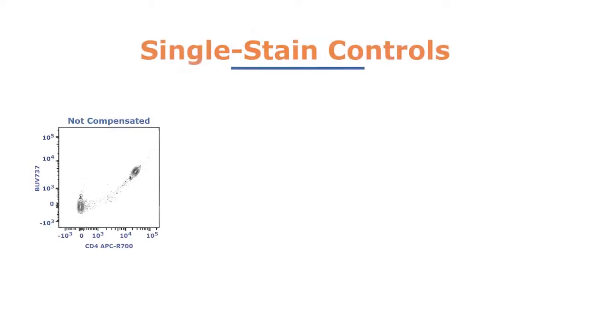
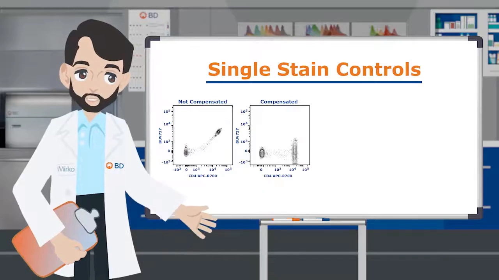
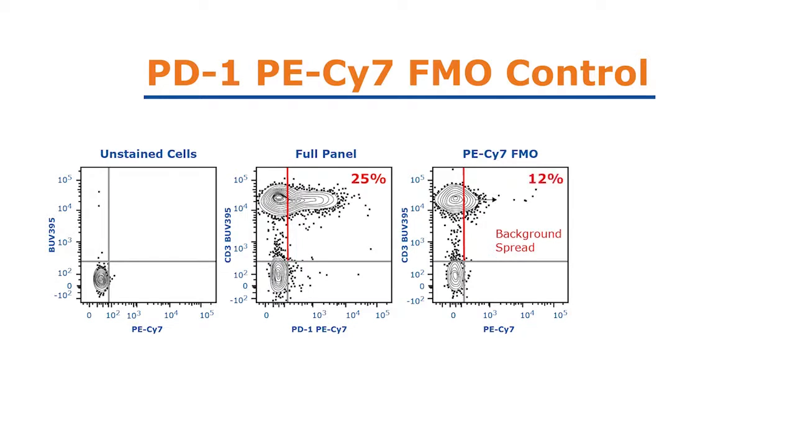
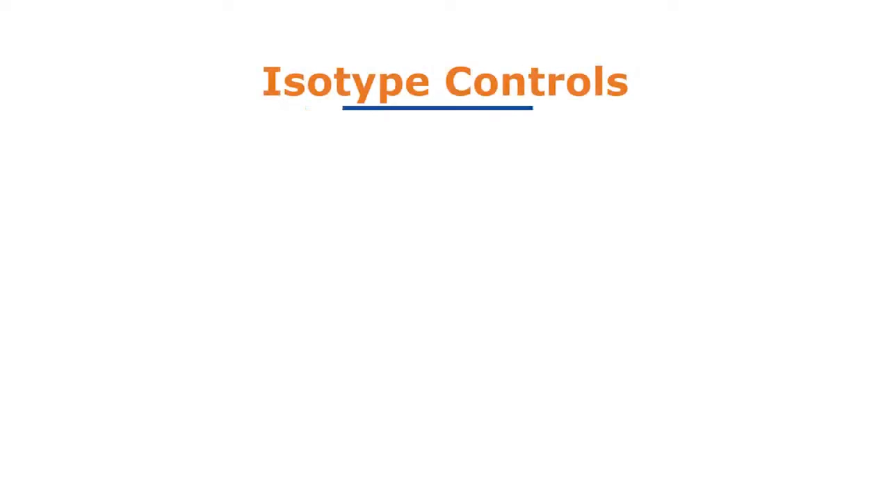
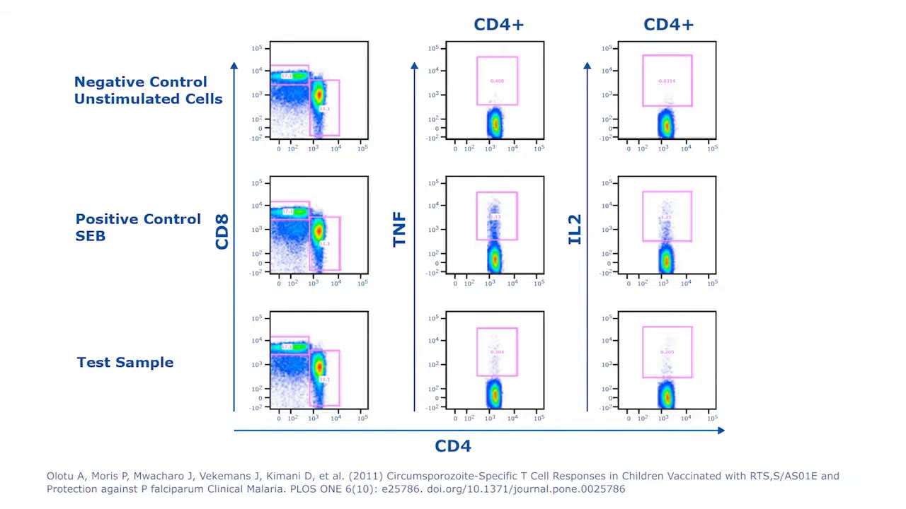

# 流式细胞术的对照设置：单染补偿、FMO 与同型对照

> 视频来源：[Stop Guessing - Choose Proper Flow Cytometry Controls](https://www.youtube.com/watch?v=8rDLE2K5ML8)（YouTube · Waters Biosciences / BD）｜时长约 5 分钟
> 简要导读：这支短片只讲一件事——多色流式里「门」画在哪里，取决于你用了哪几种对照。它把背景拆成三个来源（荧光溢漏、其他荧光团的背景扩散、抗体本身的非特异结合），再给出对应的三种对照（单染补偿、FMO、同型与生物学对照），并用同一份数据演示：换一种对照，PD-1 阳性率就从 25% 变成 12%。本文按「读出对象 → 背景来源 → 三种对照 → 判读」整理。

## 本讲要解决的核心问题（SCQA）

**背景**：流式细胞术用荧光标记抗体读单个细胞上的蛋白。一次读十几个标记的多色 panel 里，每个标记对应一个检测器，输出的是**每个细胞在每个通道上的荧光强度**；分析时靠画门（gating）把「阳性」和「阴性」分开，再算阳性比例或平均荧光强度。

**冲突**：门不是画在真空里的。CD4 这种分得很开的标记，阴阳两群一眼可见；但**弱阳性（dim）的细胞**，门画高一点就全阴、画低一点就全阳。更麻烦的是，多色 panel 里每个通道的背景都不干净：别的荧光团会漏进来，抗体本身也会非特异结合。

**疑问**：这些背景各自该用哪种对照去扣？只用一种对照够不够？如果对照用错，结论会错到什么程度？

**回答（中心思想）**：**一套对照不够，因为背景有多个来源，每种对照只能扣掉其中一种。** 单染对照用来算补偿、扣荧光溢漏；FMO（fluorescence minus one，缺一对照）用来扣「其他荧光团造成的背景扩散」；同型对照试图模拟抗体本身的非特异结合，但匹配不完美；生物学对照用**同一个试剂**在已知阴性与已知阳性的样本上跑，因此是背景判断更可靠的依据。视频的建议是：**在方法建立阶段同时跑几种对照，先确定这份实验里背景主要来自哪里，再决定用哪种对照去扣。**

## 一、读出对象：每个细胞一个荧光强度

流式的观测单位是**单个细胞**，读数是该细胞在某个检测器上的荧光强度。分析时把强度轴切成阴／阳两段（必要时再加一个「弱阳性」区间），统计各段里的细胞比例。

这决定了它与 qPCR、与测序的差别：qPCR 给的是一个样本的平均 RNA 量，测序给的是细胞或样本的转录本计数，而流式给的是**每个细胞表面（或胞内）某个蛋白表位的荧光强度**，直接落到「多少比例的细胞是阳性」这个读数上。本节其他正文分别处理 RNA（qPCR、RNAscope）与组织中的蛋白（免疫组化），几篇对照着看才能判断「测序说的表达变化」在哪一层被验证。

## 二、背景从哪来：三个来源，三种对照

视频把多色流式的背景拆成三层，每层对应一种对照。[【跳转到 00:11】](https://www.youtube.com/watch?v=8rDLE2K5ML8&t=11)

| 背景来源 | 表现 | 对应的对照 |
| :--- | :--- | :--- |
| 荧光溢漏（spillover）：一个荧光团的光漏进另一个检测器 | 单阳样本在另一通道里看起来也阳，被误读成双阳 | 单染对照 → 补偿（compensation） |
| 其他荧光团造成的背景扩散（background spread） | 补偿只扣了均值，扩散还在；门按未染对照画会偏低，阳性比例被高估 | FMO 对照 |
| 抗体本身的非特异结合 | 目标抗体自己带来的噪声，FMO 里没有这个抗体，扣不掉 | 同型对照、生物学对照 |

## 三、单染对照：先扣掉荧光溢漏

### 3.1 不补偿会凭空造出「双阳群」

视频的第一个例子：只用 CD4 APC-R700 染色的样本，如果不做补偿，APC-R700 漏进 BUV737 检测器的信号会让这份数据被误读成**存在双阳性群体**。[【跳转到 00:45】](https://www.youtube.com/watch?v=8rDLE2K5ML8&t=45)

### 3.2 单染对照怎么用

做法是**把 panel 里每个抗体单独染一份细胞**，用这些单染样本计算补偿矩阵，把漏进其他检测器的那部分信号减掉。[【跳转到 01:22】](https://www.youtube.com/watch?v=8rDLE2K5ML8&t=82)

视频同时提醒了反面：**用错对照会导致补偿过度或补偿不足**，两者都会让后续判读失真。[【跳转到 01:28】](https://www.youtube.com/watch?v=8rDLE2K5ML8&t=88) 也就是说，补偿不是「做了就行」，它的正确性完全取决于单染对照是否代表了真实 panel 里的光谱行为。

## 四、FMO：补偿扣不掉的那部分背景

### 4.1 为什么未染对照不够

补偿只处理「非特异信号漏进另一个检测器」这一件事，它**不消除溢漏造成的背景扩散**。[【跳转到 01:41】](https://www.youtube.com/watch?v=8rDLE2K5ML8&t=101) 因此多色实验里，**未染细胞对照不足以定门**——它没有把 panel 里其他荧光团带来的扩散算进去。

### 4.2 FMO 的定义与效果

FMO 对照是**包含 panel 里全部抗体、只缺掉要定门的那一个**的混合物。[【跳转到 02:05】](https://www.youtube.com/watch?v=8rDLE2K5ML8&t=125) 视频用一个 PD-1 的例子把差别量化了：

- 按**未染对照**定门：CD3 阳性细胞里有 **25%** 被判为 PD-1 阳性；
- 换成 **PD-1 的 FMO** 定门：同一个群里多出来的背景扩散占 **12%**，这部分细胞在前一张图里被错误地算成了阳性；
- 按 FMO 调整门之后，真正双阳（CD3 阳性且 PD-1 阳性）的比例约为 **13%**。[【跳转到 02:30】](https://www.youtube.com/watch?v=8rDLE2K5ML8&t=150)

这个例子的判读价值在于：**同一份数据、同一个门位置，只是换了定门依据，阳性率就差了约一倍**。而两种画法在图上都「看起来合理」。

## 五、同型对照与生物学对照

### 5.1 同型对照能做什么、不能做什么

FMO 的定义决定了它**不含目标抗体本身**，所以抗体自身的非特异结合（non-specific binding）带来的噪声，FMO 扣不掉。[【跳转到 02:55】](https://www.youtube.com/watch?v=8rDLE2K5ML8&t=175)

同型对照（isotype control）的思路是：用**同一亚型（isotype）**、但不针对目标抗原的抗体，去模拟这类抗体的非特异结合。[【跳转到 03:11】](https://www.youtube.com/watch?v=8rDLE2K5ML8&t=191)

视频随即给出它的局限：**同型对照的背景与「所有同亚型试剂」的背景并不精确匹配**。[【跳转到 03:29】](https://www.youtube.com/watch?v=8rDLE2K5ML8&t=209) 换句话说，它是个近似，不是一个可精确相减的基线。

### 5.2 生物学对照为什么更可靠

因为同型对照匹配不完美，视频认为**生物学对照（biological controls）是更好的背景对照**——理由是它用的是**与测试样本完全相同的试剂**。[【跳转到 03:29】](https://www.youtube.com/watch?v=8rDLE2K5ML8&t=209)

- **阴性生物学对照**：能排除抗体的非特异结合。例子是用**未刺激的 T 细胞**作为细胞因子表达的阴性对照。[【跳转到 03:48】](https://www.youtube.com/watch?v=8rDLE2K5ML8&t=228)
- **阳性生物学对照**：同样重要。例子是用**强促分裂原（mitogen，如 SEB）刺激细胞**，确认这套染色和检测确实能跑出阳性信号。[【跳转到 03:57】](https://www.youtube.com/watch?v=8rDLE2K5ML8&t=237)

阴性对照与阳性对照合起来才能回答一个关键问题：**「没染上」到底是样本真的不表达，还是这次实验根本没跑通**。只有阴性对照时，这两种情况在数据上无法区分。

## 六、判读：对照决定你能看见什么

视频的结论是：**最合适的对照取决于具体实验条件，因此在方法建立（assay development）阶段应当同时跑几种对照**，先确定这份实验里背景的主要来源，再选择扣它的策略。[【跳转到 04:22】](https://www.youtube.com/watch?v=8rDLE2K5ML8&t=262)

把这一节的内容压成一张判读表：

| 你观察到的现象 | 先怀疑什么 | 用哪种对照去查 |
| :--- | :--- | :--- |
| 出现了意料之外的双阳群 | 荧光溢漏未补偿 | 单染对照重算补偿 |
| 弱阳性群体的比例忽高忽低 | 门按未染对照画，背景扩散没算进去 | FMO 对照重新定门 |
| 目标抗体单独带来一片「阳性」 | 抗体非特异结合 | 同型对照 + 阴性生物学对照 |
| 阳性信号整体消失 | 染色或检测失败，而非样本阴性 | 阳性生物学对照（如促分裂原刺激） |

这张表也说明了对照的方法学地位：**对照不是「证明结果显著」的装饰，而是决定读数含义的那一步**。同一个 panel、同一批样本，换一种定门依据就能把 25% 变成 12%——所以报告流式结果时，必须写清用了哪些对照、门是按哪个对照定的。

## 小结

- 流式的读出对象是**每个细胞在某通道上的荧光强度**，分析落在「阳性比例」与「平均荧光强度」上，观测单位是单细胞。
- 多色 panel 的背景有三个来源：荧光溢漏、其他荧光团的背景扩散、抗体自身的非特异结合。**一种对照只能扣一种背景。**
- 单染对照用于计算补偿。不补偿时，CD4 单阳样本会被误读成双阳；补偿过度或不足同样会让判读失真。
- FMO（全 panel 缺一个抗体）用于定门。PD-1 例子里，未染对照定门给出 25%，其中 12% 是其他荧光团造成的背景扩散，按 FMO 定门后真双阳约为 13%。
- 同型对照模拟同亚型抗体的非特异结合，但匹配不精确；生物学对照用同一试剂，因此更可靠。
- 阴性生物学对照（未刺激细胞）排除非特异结合，阳性生物学对照（促分裂原刺激）确认检测能跑通；两者缺一，就无法区分「真阴性」与「没染上」。
- 方法建立阶段应同时跑多种对照，先找出背景的主要来源，再决定扣法。

## 关键术语速查

| 术语 | 一句话解释 |
| :--- | :--- |
| 门控（gating） | 在荧光强度轴上划定阴／阳边界，用来统计各群细胞比例 |
| 荧光溢漏（spillover） | 一个荧光团的发射光漏进另一个检测器，使单阳样本看起来像双阳 |
| 补偿（compensation） | 用单染对照算出溢漏比例并从其他通道中减掉的计算 |
| 单染对照（single-stain control） | panel 中每个抗体单独染一份细胞，用于计算补偿 |
| FMO（fluorescence minus one） | 含 panel 全部抗体、只缺要定门的那一个，用于扣除背景扩散 |
| 背景扩散（background spread） | 补偿后仍残留的分布展宽，未染对照无法反映 |
| 同型对照（isotype control） | 同亚型但非目标的无关抗体，用于估计非特异结合，匹配不精确 |
| 生物学对照 | 已知阴性或阳性的生物样本，用同一套试剂染色，判断背景与检测是否成立 |
| 弱阳性（dim） | 荧光强度接近阴性群的细胞，最依赖正确的定门依据 |