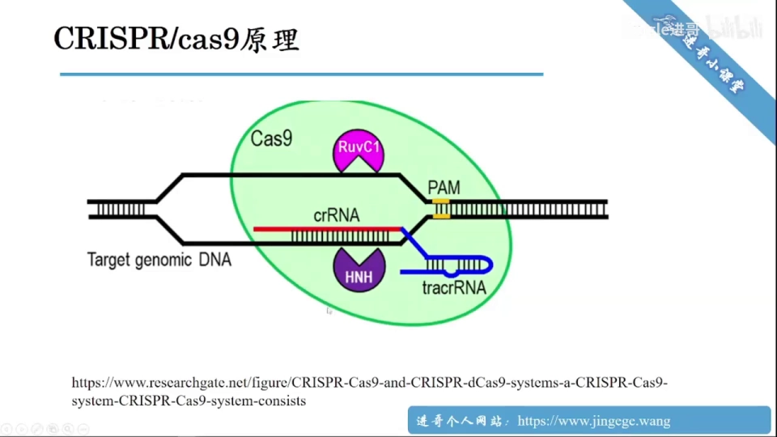
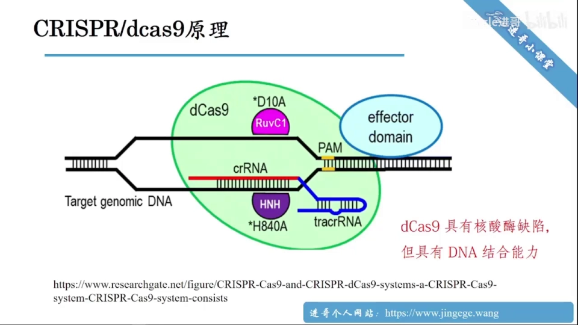
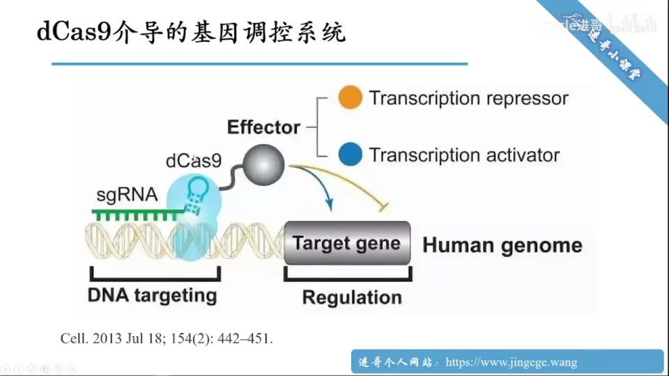
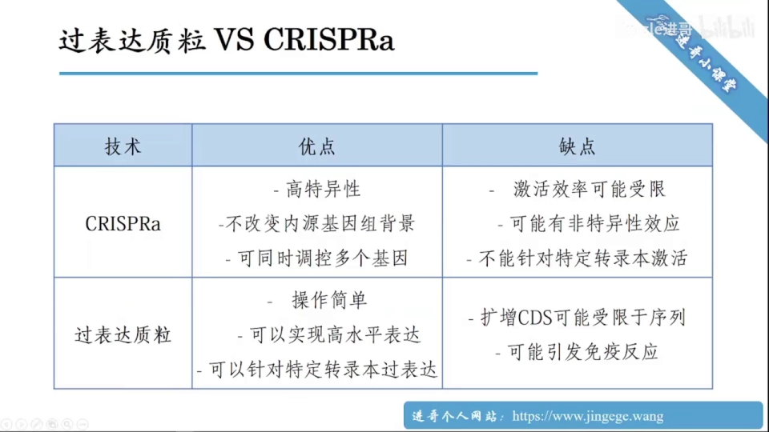
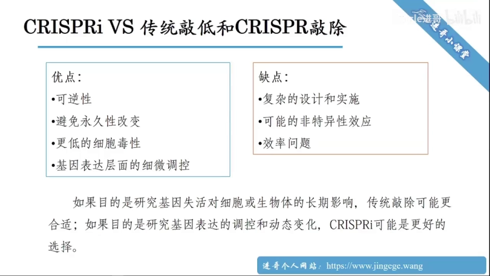
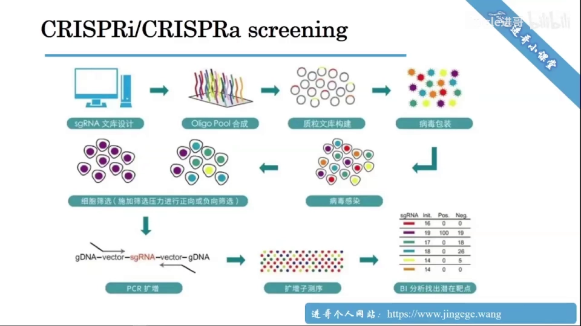
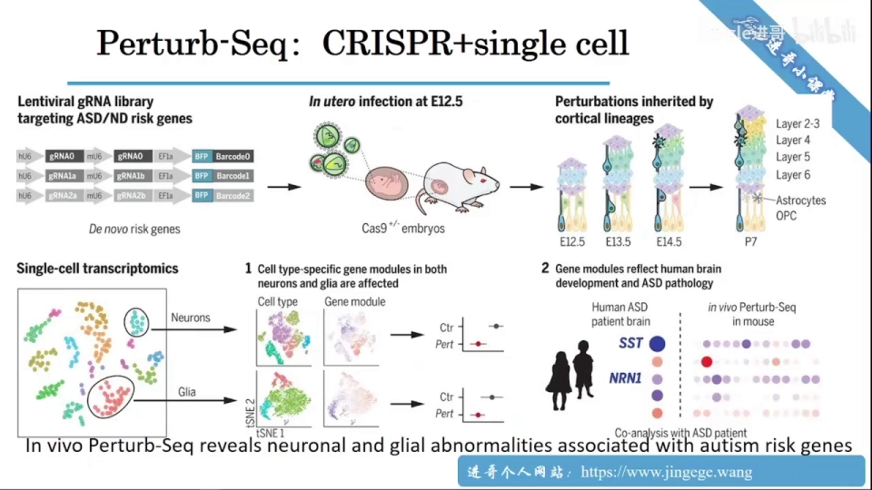

# CRISPRi 与 CRISPRa：不改变 DNA 序列，也能关掉或打开一个基因

> 视频来源：[CRISPRi 和 CRISPRa：基因表达干预的新利器](https://www.bilibili.com/video/BV1K541117Ya/)（Bilibili · Jingle进哥）｜时长约 12 分钟
> 导读：这支视频用十几分钟把 dCas9 的来历、CRISPRi / CRISPRa 的原理、它们与过表达质粒及传统敲低的取舍讲清楚了，正好补齐本节「三种 CRISPR 扰动模式」里不切割 DNA 的那两种。本文按「怎么把剪刀变成开关 → 开关怎么接上抑制器与激活器 → 两种开关各自适合回答什么问题」重排，并补上与前一篇《CRISPR 敲除不是剪掉基因》的对照。视频末尾的 Perturb-seq 案例只保留与本节相关的一层意思，测序实验流程见 5.1.4。

## 本讲要解决的核心问题（SCQA）

**背景**：想研究一个基因的功能，最直接的办法是让它不工作。上一节讲的 CRISPR 敲除能做到这一点：Cas9 切断 DNA，NHEJ 修复出错引入移码，蛋白彻底失活。

**冲突**：但敲除有两个绕不过去的限制。第一，它是**永久**的——改动写在基因组里，做完就撤不回来了，你没办法让细胞「恢复原状」再看一遍。第二，它是**二元**的——对于许多必需基因，一旦完全失活，细胞直接死掉，你什么表型都看不到。想研究「这个基因表达量降一半会怎样」「这个基因表达量翻倍会怎样」，敲除根本给不出答案。

**疑问**：有没有一种扰动，**不改变 DNA 序列**，只改「这个基因被转录成多少 mRNA」，而且强度可调、可以撤销？

**回答（中心思想）**：有，而且实现方式极其简洁——**把 Cas9 的两个切割结构域突变掉，让它失去切割能力但保留定位能力，就得到了 dCas9；再在 dCas9 上挂一个转录抑制域或激活域，它就从一个「剪刀」变成了一个可以编程的「转录开关」。** 挂抑制域就是 CRISPRi（干扰，下调转录），挂激活域就是 CRISPRa（激活，上调转录）。两者都不产生 indel、都不改基因组序列，因此可逆、可调、细胞毒性更低；代价是抑制/激活往往不完全，且效率因基因而异。

## 一、从剪刀到开关：dCas9 是怎么来的

要理解 CRISPRi 和 CRISPRa，先得回到 Cas9 本身。讲者的回顾很干脆：CRISPR-Cas9 系统由 sgRNA 和 Cas9 蛋白组成。sgRNA 里包含 crRNA 和 tracrRNA，其中 20 nt 的靶向序列负责识别基因组上的特定位置；而这段 RNA 同时充当 Cas9 核酸酶的募集序列。Cas9 通过两个结构域切开 DNA 链——一个是 **RuvC**，一个是 **HNH**——从而诱导 DNA 双链断裂 [【跳转到 00:46】](https://www.bilibili.com/video/BV1K541117Ya/?t=46)。

关键的一步转折在这里：**既然 Cas9 有两件事——「找到位置」和「切开」——那能不能只要前一件？** 讲者的说法是「顺理成章地去想」：如果我们能够保留 Cas9 识别特定位点的功能，而把它的切割活性抑制掉，那是不是就能达到「只去定位某一段 DNA 序列」的作用 [【跳转到 01:36】](https://www.bilibili.com/video/BV1K541117Ya/?t=96)。

做法就是把 RuvC 和 HNH 这两个结构域突变掉。突变之后，Cas9 的核酸酶活性就丧失了，但**保留了 DNA 结合能力**。这个蛋白就是 dCas9（dead Cas9，失活 Cas9）。讲者给出的具体突变是 **RuvC 上的 D10A** 和 **HNH 上的 H840A** [【跳转到 02:01】](https://www.bilibili.com/video/BV1K541117Ya/?t=121)。

这一步的后果值得单独强调：dCas9 结合上去之后**不能把 DNA 切开，也就是说 DNA 序列没有发生变化**。这是 CRISPRi / CRISPRa 与 CRISPR-KO 之间最根本的分界线——一个改序列，一个不改序列。

> 顺带一个容易被忽略的中间态：只突变其中一个结构域（比如只突变 RuvC 保留 HNH），Cas9 就变成了**切口酶（nickase）**，只在一条链上切一刀。这个中间态在需要提高 HDR 敲入精度、减少 indel 时会用到，但它仍然会改序列，不属于本节讲的两种「不切割」模式。

## 二、挂上 effector：同一个 dCas9，两种完全相反的用途

有了一个「能定位、不切割」的蛋白，接下来的问题就是：它结合在那里有什么用？答案是**在它上面再连一个 effector（效应结构域）** [【跳转到 02:26】](https://www.bilibili.com/video/BV1K541117Ya/?t=146)。

讲者在这里做了一个很好的类比：这其实就是分子生物学里学过的**顺式作用元件与反式作用因子**——effector 属于反式作用因子，一种是转录激活的，一种是转录抑制的 [【跳转到 02:40】](https://www.bilibili.com/video/BV1K541117Ya/?t=160)。

于是同一个 dCas9 骨架，接上不同的 effector，就得到两种完全相反的扰动：

| | CRISPRi（干扰） | CRISPRa（激活） |
| --- | --- | --- |
| effector 类型 | 转录抑制域 | 转录激活域 |
| 对转录的作用 | 抑制下游基因的转录 | 激活下游基因的转录 |
| 表达变化方向 | 下调 | 上调 |
| 对应的问题 | 基因失活会怎样 | 基因增益会怎样 |

讲者用一句话概括这个分岔：**融合一个抑制因子，后面基因的转录就会被抑制掉；连一个激活因子，后面基因的转录就会被激活** [【跳转到 03:05】](https://www.bilibili.com/video/BV1K541117Ya/?t=185)。

### 2.1 CRISPRi 到底在分子层面做了什么

把这条链条按分子事件排一遍，就能看清 CRISPRi 与 KO 的差别在哪里：

1. dCas9–sgRNA 复合物按碱基互补配对结合到靶基因上——**结合，但不切割**；
2. 挂在 dCas9 上的抑制因子在这个位置发挥转录抑制作用；
3. 结果是该基因转录出的 mRNA 变少，蛋白随之变少；
4. 但**基因序列完好无损**，DNA 上没有留下任何 indel。

第 4 步是整个模式的立身之本：因为没有改序列，所以只要撤掉 dCas9（比如用一个可诱导的载体，或者干脆不再转染），抑制就会解除，基因表达回到原来的水平。这就是讲者反复强调的**可逆性**。

> 本节未覆盖：本视频把抑制域/激活域统称为「抑制因子」「激活因子」，没有展开具体是哪些结构域（常见的抑制域与激活域家族、以及多拷贝串联的增强方案）。要选 effector 或评估不同方案的激活强度，需要另外查专门的综述与原始文献。

### 2.2 为什么 CRISPRa 不能替代过表达质粒

CRISPRa 常被拿来和「过表达质粒」比较，因为两者都是让基因表达变多。讲者做了一张对照表，结论是**两者不能互相替代，各有各的适用场景** [【跳转到 03:19】](https://www.bilibili.com/video/BV1K541117Ya/?t=199)。

CRISPRa 的优点是：

- **高特异性**：sgRNA 有靶向识别作用，指哪打哪；
- **不改变内源基因组背景**：常规 CRISPR-Cas9 切割后由非同源末端连接修复，会形成基因突变；而 CRISPRa 不切割，所以基因组背景干净；
- **可同时调控多个基因**：同时转多个 sgRNA，就能对不同基因做转录激活。

CRISPRa 的缺点也很具体：

- **激活效率可能受限**：不同的转录激活因子对不同的基因效果不一样。同时做多个基因时，可能这个基因激活很明显、那个基因激活很弱，所以需要去挑不同的激活因子。
- **可能有非特异性效应**（脱靶）。
- **不能针对特定转录本激活**。讲者认为这一条「挺重要」：大部分基因都有多个转录本，存在可变剪接；而 CRISPRa 是在转录水平上的激活，它激活的是**所有转录本**的转录。所以当你要研究某个特定转录本的功能时，用 CRISPRa 就不合适了。

过表达质粒恰好能补上最后这一条：因为过表达是针对 CDS 进行扩增的，不同转录本的 CDS 不一样，所以它可以实现**特定转录本**的过表达。它的优点还包括操作简单、能实现高水平表达（瞬时表达可以使 RNA 水平上升几十倍上百倍）。但它的缺点同样明显：质粒是外源引入的，有可能引发免疫反应（主要在体内实验时）；而且扩增 CDS 受限于序列——起始和结束位置都是固定的，设计引物很被动，有时很难扩出来，只能改用基因合成 [【跳转到 06:14】](https://www.bilibili.com/video/BV1K541117Ya/?t=374)。

**所以选型的判断依据是「你要的是哪一种『多』」**：要「这个基因的所有转录本都变多、而且不引入外源序列」，用 CRISPRa；要「只让某一个转录本变多、而且要表达量很高」，用过表达质粒。

## 三、CRISPRi 与敲除、与传统敲低的分工

讲者最实用的一张幻灯片，是把 CRISPRi 放在「传统敲低（siRNA / shRNA）」和「CRISPR 敲除」之间做三方比较 [【跳转到 07:54】](https://www.bilibili.com/video/BV1K541117Ya/?t=474)。

**CRISPRi 的优点：**

- **可逆性**：因为它加的是一个抑制因子，把这个抑制因子去除掉之后，效果就被逆转了。
- **避免永久性改变**：CRISPR 敲除是对基因组的编辑，是永久性改变；CRISPRi 不是。
- **更低的细胞毒性**：这是「不完全抑制」带来的直接好处——像敲除那样把基因功能完全消除，对于重要的必需基因，细胞可能直接存活不了；这时候就需要敲低而不是敲除 [【跳转到 07:04】](https://www.bilibili.com/video/BV1K541117Ya/?t=424)。
- **基因表达层面的细微调控**：可以做出「降一部分」而不是「归零」的效果。

**CRISPRi 的缺点：**

- **复杂的设计和实施**：比敲低要多考虑 dCas9 的表达、effector 的选择、sgRNA 的位置（打启动子还是打基因体）。
- **可能的非特异性效应**：由脱靶效应引起。
- **效率问题**：抑制效率仍值得进一步优化。

讲者给出的选型判据非常干脆 [【跳转到 07:54】](https://www.bilibili.com/video/BV1K541117Ya/?t=474)：

> 如果目的是研究基因失活对细胞或生物体的**长期影响**，传统的敲除或者敲低更加合适；如果目的是研究基因表达的**调控和动态变化**，那 CRISPRi 可能更加合适一点。

这句话值得展开一层，因为它正好解释了本节为什么要区分三种模式：

- **KO 回答「没有这个基因，细胞会怎样」**——这是一个关于基因**必要性**的问题，答案是一个稳定的终态，所以需要永久、彻底的扰动。
- **CRISPRi 回答「少一点这个基因，细胞会怎样」**——这是一个关于基因**剂量**的问题，答案是连续的、依赖扰动强度的响应，所以需要可调、可逆的扰动。
- **CRISPRa 回答「多一点这个基因，细胞会怎样」**——这是一个关于**增益**的问题，用于寻找「过表达能救回来」或「过表达会加剧」的效应。

> 本节边界：传统敲低（siRNA / shRNA、RISC、mRNA 降解）的通路细节不在本节范围。这里只把它当作「同样不切割、但作用在 RNA 层」的参照物。

## 四、操作上其实很简单：换一个蛋白，其余照旧

讲者特别说明了落地层面的一个事实：如果要做 CRISPRi / CRISPRa，**方法上可以沿用 CRISPR-Cas9 的整套流程** [【跳转到 08:07】](https://www.bilibili.com/video/BV1K541117Ya/?t=487)。

具体来说：买 dCas9 的质粒，然后像之前做 CRISPR-Cas9 时连 sgRNA 一样，直接把 sgRNA 连上去。主要的变化就是 **Cas9 蛋白变成了 dCas9 蛋白**，另外多加了抑制因子或激活因子；sgRNA 的连接方式完全一样。

这个「只换蛋白、不换流程」的特点，是 CRISPRi / CRISPRa 能在几年内迅速铺开、并被大规模筛选采纳的直接原因——已有的 sgRNA 文库设计、克隆、病毒包装、感染、测序分析这一整套流水线几乎不用改。

## 五、为什么单细胞扰动筛选更偏爱 CRISPRi

讲者在最后把话题引到高通量筛选上，这段内容正好解释了本节的一个关键判断：**为什么 Perturb-seq 类研究大量使用 CRISPRi，而不是 CRISPR-KO** [【跳转到 08:57】](https://www.bilibili.com/video/BV1K541117Ya/?t=537)。

流程本身是标准的 pooled screen：

1. **构建 sgRNA 文库**：比如选 100 个基因，针对每个基因设计 sgRNA；
2. **连入质粒、构建文库、病毒包装**；
3. **感染细胞**：关键约束是 **MOI 要低**，保证一个细胞只感染一个质粒、只带一个 sgRNA；
4. **加压筛选**：施加筛选压力，让不同表型的细胞比例发生变化；
5. **PCR 扩增 + 测序**：读出群体里还剩哪些 sgRNA；
6. **反推**：哪些基因的 sgRNA 富集或耗竭，就说明哪些基因重要。

讲者还提到，这套技术在高分文献里很常见。把它和 KO 对照，就能看出 CRISPRi 在单细胞筛选里的三个结构性优势：

| 维度 | CRISPR-KO | CRISPRi |
| --- | --- | --- |
| 扰动强度在细胞间是否一致 | 不一致：每个细胞的 indel 各不相同 | 相对一致：抑制效率有分布，但不由随机修复决定 |
| 是否受蛋白半衰期影响 | 受影响：已存在的蛋白要等降解 | 受影响较小：直接压转录，mRNA 与蛋白同步下降 |
| 必需基因能否筛 | 难：完全失活导致细胞死亡，信号变成「消失」 | 相对可行：部分抑制可存活，仍能读出转录响应 |
| 是否可逆 | 不可逆 | 可逆，可做时间序列 |

> 本节边界：Perturb-seq / CROP-seq 的建库方式、gRNA 与细胞 barcode 的配对、pooled 与 arrayed 的取舍、MOI 与重复设计，属于 5.1.4（单细胞扰动筛选：guide 分配、多重感染与组合设计）；扰动效应的量化与统计检验属于后续小节。这里只说一句结论：**扰动工具本身的「可调、不完全、不改序列」这三个性质，决定了它能被塞进一个细胞一个扰动的高通量框架里。**

讲者最后举了一个应用例子：有工作在活体小鼠中建立 Perturb-seq 系统，在发育胚胎中引入基因编辑，两周后在发育的脑细胞里做单细胞测序，再结合人脑数据，一次性筛出 35 个自闭症相关基因并检测它们在不同脑细胞中的功能 [【跳转到 11:07】](https://www.bilibili.com/video/BV1K541117Ya/?t=667)。

## 小结

- **dCas9 是「剪刀去刃」的结果。** RuvC 的 D10A 与 HNH 的 H840A 双突变让它失去切割能力、保留定位能力，DNA 序列因此不被改动。
- **effector 决定方向。** 同一个 dCas9 骨架，挂抑制域就是 CRISPRi（下调转录），挂激活域就是 CRISPRa（上调转录）。
- **不改序列带来三个性质：可逆、可调、低毒。** 这也是它能用在必需基因上的原因——完全失活会让细胞死掉，部分抑制不会。
- **代价是不完全与不均匀。** 抑制有残余表达，激活效率因基因而异，两者都受脱靶影响。
- **CRISPRa 不等于过表达。** CRISPRa 激活全部转录本、不引入外源序列；过表达质粒可针对特定转录本、表达量更高，但有免疫原性与序列限制。
- **选型看问题类型。** 问「长期缺失会怎样」用敲除；问「表达调控与动态变化」用 CRISPRi；问「增益功能」用 CRISPRa。
- **单细胞筛选偏爱 CRISPRi 的原因很实际。** 扰动强度在细胞间更可比、不被蛋白半衰期拖住、必需基因也能筛、还能做时间序列。

## 关键术语速查

| 术语 | 一句话解释 |
| --- | --- |
| dCas9 | 双突变失活的 Cas9，保留 DNA 结合能力但没有核酸酶活性 |
| CRISPRi | dCas9 融合转录抑制域，在转录水平下调基因表达，不改序列 |
| CRISPRa | dCas9 融合转录激活域，在转录水平上调基因表达，不改序列 |
| effector domain | 挂在 dCas9 上的效应结构域，决定是抑制还是激活 |
| nickase | 只突变一个切割域的 Cas9，单链切口，仍会改序列 |
| 可逆性 | 撤掉抑制因子后表达可恢复，是 CRISPRi 相对敲除的核心优势 |
| 必需基因 | 完全失活会导致细胞死亡的基因，只能用敲低类手段研究 |
| MOI | 感染复数，pooled screen 中要压低以保证一细胞一个 sgRNA |
| 脱靶效应 | sgRNA 在非目标位点引起的扰动，三种 CRISPR 模式的共同问题 |