# CRISPR 敲除不是「剪掉基因」：双链断裂之后，是修复方式决定了敲除

> 视频来源：[零基础吃透 CRISPR-Cas9！原理、PAM 序列、实验流程全解析](https://www.bilibili.com/video/BV1aJVZ6XE13/)（Bilibili · 百力格生物）｜时长约 21 分钟
> 导读：这支视频把 CRISPR-Cas9 从「查找替换」的类比一路讲到 PAM、修复路径、sgRNA 设计与递送方式，正好覆盖本节要回答的第一个问题——**敲除在分子层面到底改了什么**。视频后三分之一是讲者所在公司的产品与服务介绍，与原理无关，本文不收录。CRISPRi / CRISPRa 两种不切割 DNA 的模式见本小节另一篇《CRISPRi 与 CRISPRa：不改变 DNA 序列也能关掉或打开基因》。

## 本讲要解决的核心问题（SCQA）

**背景**：做基因功能研究，最朴素的做法是「让这个基因不工作，看细胞会怎样」。过去这类实验主要靠 RNA 干扰（RNAi）——做一个 siRNA 把目标基因「敲低」。它简单、快、便宜，是绝大多数实验室的默认选项。

**冲突**：但 RNAi 有一个绕不过去的天花板：它作用在细胞质里已经转录出来的 mRNA 上，蛋白层面总会有「漏网之鱼」的残留。如果你的结论要建立在「这个蛋白真的完全不存在」之上，残留就是致命的。而 CRISPR-Cas9 号称能从 DNA 源头解决问题，可它本身只是一把剪刀——**剪刀只负责切断，切断并不等于基因失活**。

**疑问**：那么从「Cas9 在 DNA 上切一刀」到「这个基因的蛋白彻底不表达」，中间到底发生了什么？为什么同一把剪刀，既能做出敲除（knockout），也能做出敲入（knock-in）？

**回答（中心思想）**：**CRISPR-Cas9 只负责制造一个 DNA 双链断裂（DSB），真正决定扰动结果的是细胞如何修复这个断裂。** 走 NHEJ（非同源末端连接）这条「应急硬接」的路，末端会被随机增删几个碱基，导致移码、翻译错乱或提前终止，于是蛋白功能丧失——这就是敲除；走 HDR（同源介导修复）这条「照图纸重建」的路，人为提供模板就能把指定序列塞进去——这就是敲入。所以「敲除」不是一个动作，而是「切割 + 特定修复路径」两件事的合成结果。理解了这一层，才能理解敲除为什么是**永久的、不可调的、二元**的，也才能理解它在单细胞筛选里为什么比 CRISPRi 更难用。

## 一、先把坐标定清楚：CRISPR 改的是 DNA，RNAi 改的是 RNA

讲者开场给的定义很干脆：基因编辑就是在分子水平上，对目标基因组里特定的 DNA 片段进行精确的**敲除、插入或者替换**。CRISPR 是基因编辑领域发展到现在的第三代革命性工具，可以类比成 Word 文档里的「查找和替换」——只不过 Word 修改的是文字，而 CRISPR 是在分子水平上**永久性地**改变 DNA [【跳转到 00:35】](https://www.bilibili.com/video/BV1aJVZ6XE13/?t=35)。

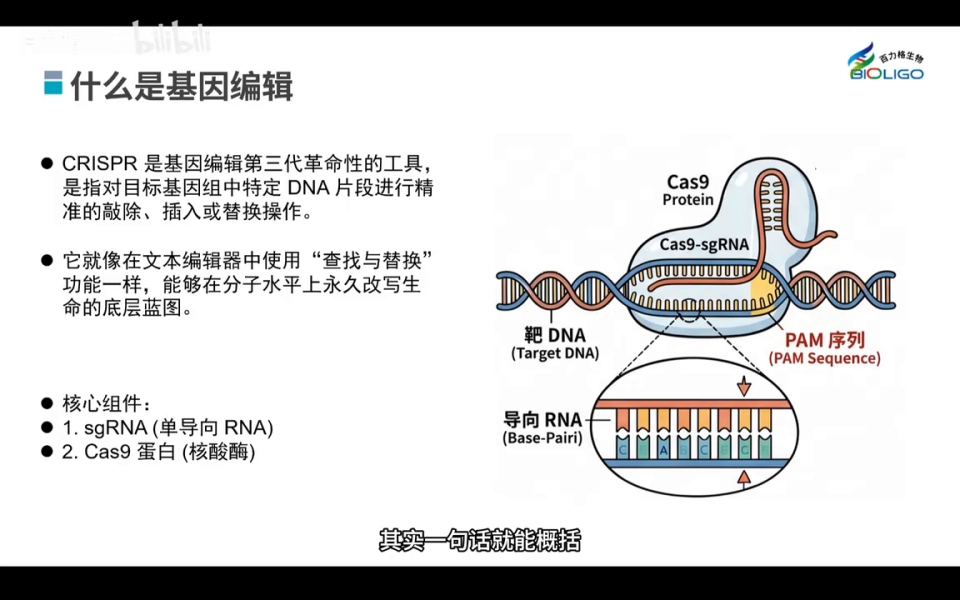

这个系统只有两个核心组件：

| 组件 | 角色 | 关键性质 |
| --- | --- | --- |
| sgRNA（单导向 RNA） | 导航 | 内含约 20 nt 靶向序列，按碱基互补配对定位 |
| Cas9 蛋白 | 剪刀 | RNA 介导的核酸内切酶，负责切断 DNA 双链 |

讲者在这里做了一个很有用的对照：很多人会问「我平时用 siRNA 敲低就够了，为什么还要 CRISPR」。答案不在「谁更强」，而在**作用层级**不同 [【跳转到 01:48】](https://www.bilibili.com/video/BV1aJVZ6XE13/?t=108)。

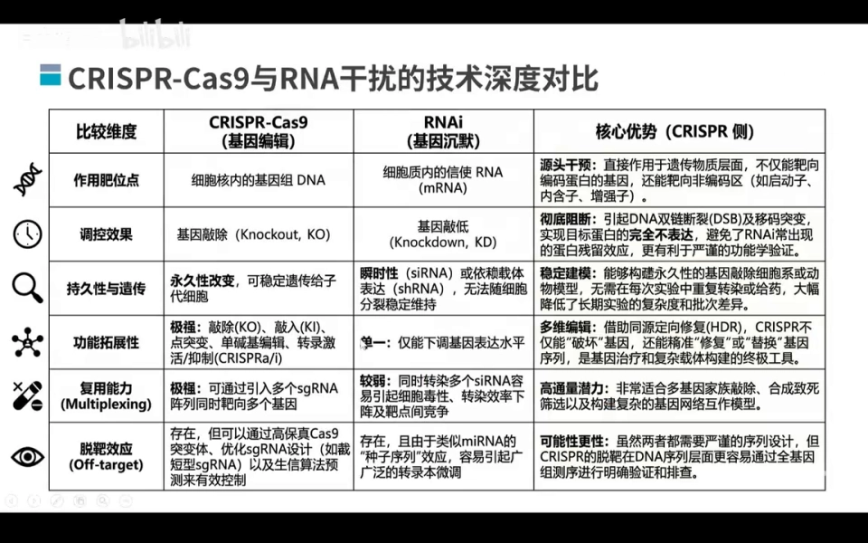

这张表把差别拆成六个维度，其中前两行是根，后面四行都是它的推论：

1. **作用靶点**：RNAi 在细胞质里结合成熟的 mRNA；CRISPR 在细胞核里直接改基因组 DNA。前者是「把已经抄好的作业收走」，后者是「改掉原始模板」。
2. **调控效果**：RNAi 得到的是 knock down（敲低），CRISPR 得到的是 knock out（敲除）。讲者的原话是：siRNA 这种方式非常简单高效，但总会有漏网之鱼，容易出现**蛋白残留**；而 CRISPR 从源头彻底阻断，让目标蛋白完全不表达，这对严谨的基因功能学验证优势巨大 [【跳转到 02:13】](https://www.bilibili.com/video/BV1aJVZ6XE13/?t=133)。
3. **持久性与遗传**：改的是 DNA，所以改变是永久性的、可以稳定遗传给子代细胞。瞬时转染的 siRNA 过几天效果就没了，要重复给药；而 CRISPR 可以直接构建永久性的敲除细胞系或动物模型，省掉重复转染，也就减少了长期实验里的批次差异。
4. **功能拓展性**：siRNA 只能下调表达；CRISPR 除了破坏，还能借助 HDR 精确替换或插入序列（敲入），也能做点突变、单碱基编辑，以及（把剪刀钝化之后的）转录激活与抑制。
5. **复用能力**：同时转染多个 siRNA 容易引起细胞毒性、效率也差；CRISPR 只需引入多个 sgRNA 阵列就能同时打多个基因，适合多基因家族筛选、合成致死筛选、构建复杂的基因网络互作模型。
6. **脱靶效应**：两者都有。siRNA 因为类似 miRNA 的「种子序列效应」，容易引起转录本层面的广泛微调；CRISPR 的脱靶发生在 DNA 层面，虽然同样需要严谨设计，但**原则上可以通过全基因组测序去排查**——这一点在讲者看来是决定性的：「做到心里有底」。

> 本节边界：RNAi 的通路细节（siRNA / shRNA、RISC、mRNA 降解）不在本节范围。这里只把它当作「作用层级更低一层」的参照物，用来定位 CRISPR 改的是 DNA 这件事。

讲者用一句话收束这张表：**如果说 siRNA 是一个常规的调节基因表达的工具，那么 CRISPR 就是一个更加强大、能进行更加底层操作的重构工具** [【跳转到 04:18】](https://www.bilibili.com/video/BV1aJVZ6XE13/?t=258)。

## 二、这套工具是从细菌的免疫系统里借来的

CRISPR 不是凭空发明的，它借鉴的是细菌的适应性免疫。讲者把自然界的过程拆成四步，这四步也正好是后面理解实验室版本的地图 [【跳转到 04:41】](https://www.bilibili.com/video/BV1aJVZ6XE13/?t=281)。

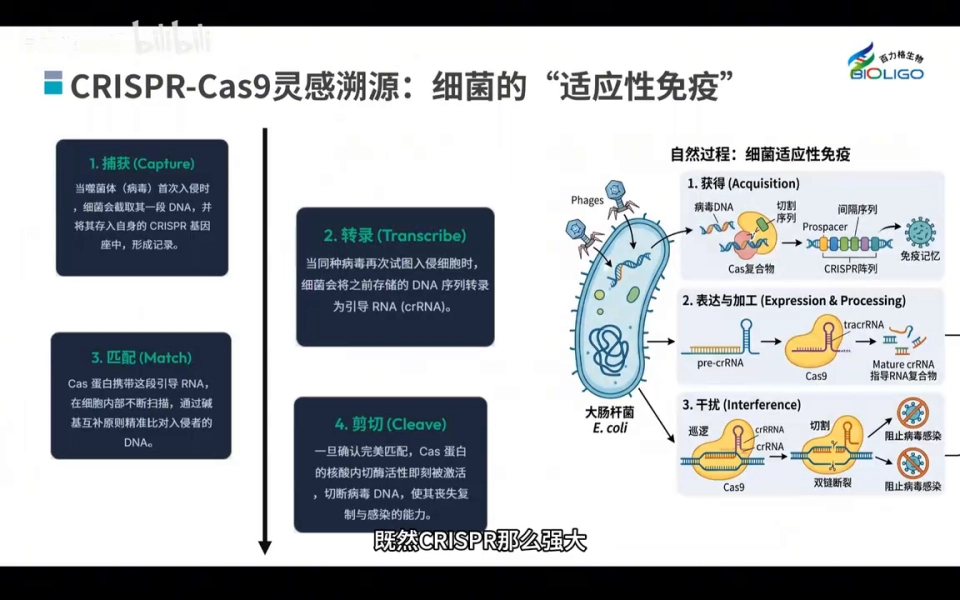

1. **捕获（Capture）**：噬菌体（病毒）第一次入侵细菌时，如果细菌没死，它会切下一小段病毒的 DNA，存进自己的 CRISPR 基因座，相当于给这个病毒「存档」。
2. **转录（Transcribe）**：同种病毒再次入侵时，细菌把存档的 DNA 序列转录成引导 RNA（crRNA）。
3. **匹配（Match）**：Cas 蛋白携带这段引导 RNA 在细胞内不断扫描，按碱基互补配对原则逐个核对入侵者的 DNA。
4. **剪切（Cleave）**：一旦确认完美匹配，Cas 蛋白的核酸内切酶活性被激活，切断病毒 DNA，使其失去感染与复制能力。

在实验室里，这套机制被拆成了两个可以独立替换的模块 [【跳转到 06:26】](https://www.bilibili.com/video/BV1aJVZ6XE13/?t=386)。

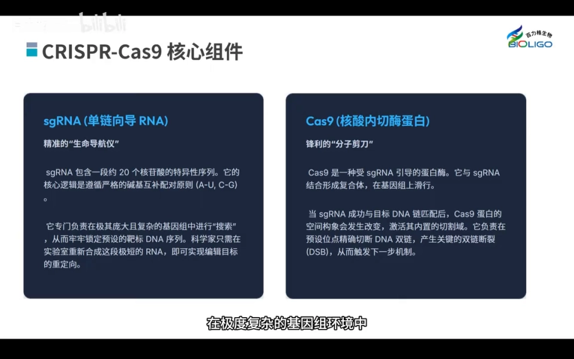

- **sgRNA 是可编程的那一半**。它包含约 20 个核苷酸的特异性序列，遵循严格的碱基互补配对（A-U、C-G），专门负责在庞大复杂的基因组里「搜索」并锁定靶标。讲者强调这是 CRISPR 在应用端的核心优势：过去的基因编辑技术里，改变靶点意味着要重新做极其繁琐的蛋白工程改造；而在 CRISPR 系统里，Cas9 是通用元件，**研发人员只需要换掉这 20 个碱基的 RNA 序列**，就能极其高效地改变靶点。
- **Cas9 是通用的那一半**。它与 sgRNA 结合形成复合物，在基因组上滑行；当 sgRNA 与靶 DNA 匹配成功，Cas9 的空间构象改变，激活内置的切割域，在预设位点精确切断双链，产生 DSB。

### 2.1 PAM：Cas9 下剪刀前必须核验的通行证

这里有一个非常容易被误解的地方，讲者专门停下来讲：**并不是 sgRNA 先去和目标 DNA 匹配，而是 Cas9 必须先找到并结合 PAM 序列** [【跳转到 07:38】](https://www.bilibili.com/video/BV1aJVZ6XE13/?t=458)。

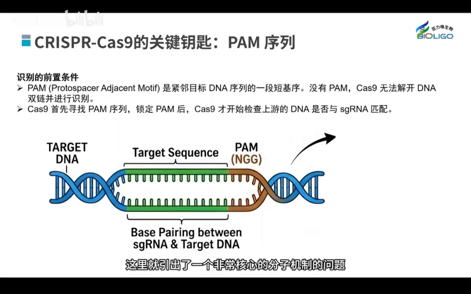

PAM（Protospacer Adjacent Motif，前间隔序列邻近基序）是紧邻目标 DNA 序列的一段短基序。以最常用的 SpCas9 为例，经典 PAM 是 **NGG**。工作顺序是：

1. Cas9 在 DNA 双链上不断巡航，寻找并锁定 NGG；
2. 锁定后触发局部构象变化，迫使紧邻 PAM 的 DNA 双链解旋；
3. 双链解开之后，Cas9 才允许 sgRNA 介入，检查 PAM 上游那段靶序列是否与自己完美互补；
4. 匹配成功才切割。

**如果目标位置附近没有 PAM，即使旁边的 DNA 序列与 sgRNA 100% 互补，Cas9 也完全无法解开双链，后续剪切绝对不会发生。** 因此在做底层的生物信息分析和 sgRNA 设计时，寻找并确定合适的 PAM 位点永远是整个序列设计逻辑的第一步 [【跳转到 09:18】](https://www.bilibili.com/video/BV1aJVZ6XE13/?t=558)。

对做扰动组学的人来说，这一条有个直接推论：**CRISPR 的「可扰动范围」不是全基因组，而是全基因组里带 PAM 的那些位置。** 启动子、增强子这些非编码区能不能被靶向，同样受 PAM 分布约束。

## 三、三阶段全流程：切割结束的那一刻，编辑才刚刚开始

讲者用一张全图把 CRISPR-Cas9 的流程复盘成三个阶段 [【跳转到 09:23】](https://www.bilibili.com/video/BV1aJVZ6XE13/?t=563)。

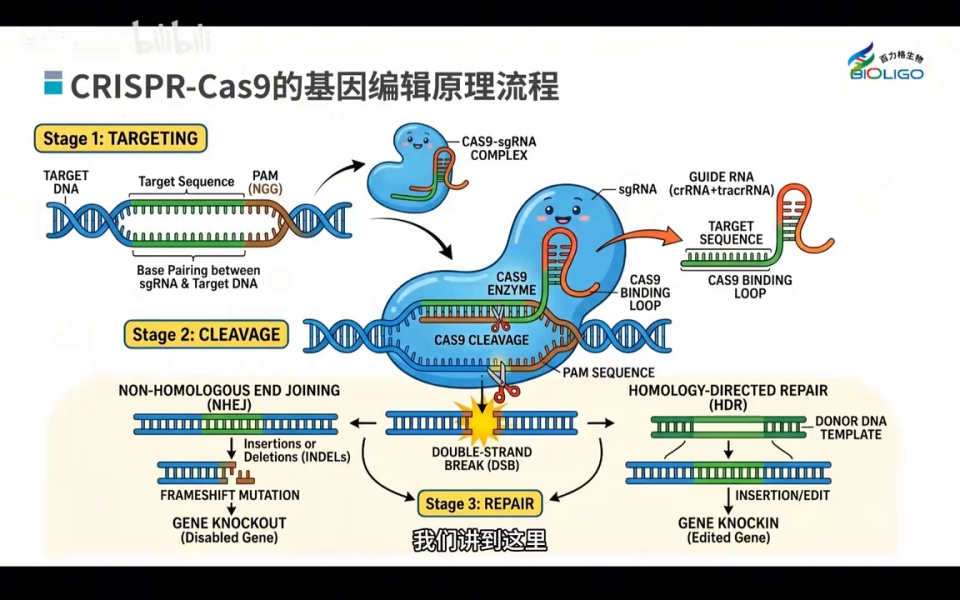

**阶段一：靶向识别。** 向导 RNA 与 Cas9 组装成复合物，Cas9 先找 PAM、解开双链，sgRNA 像拉链一样与目标序列精确互补配对。

**阶段二：切割。** 配对成功后立即触发切割，Cas9 构象改变，在 PAM 上游特定位置切断双链，产生 DSB。

**阶段三：修复。** 讲者在这里说了一句关键的话：**到这一步，CRISPR-Cas9 系统的任务就已经结束了**，接下来真正完成编辑动作的是修复。面对双链断裂，细胞会启动两条截然不同的路径 [【跳转到 10:27】](https://www.bilibili.com/video/BV1aJVZ6XE13/?t=627)。

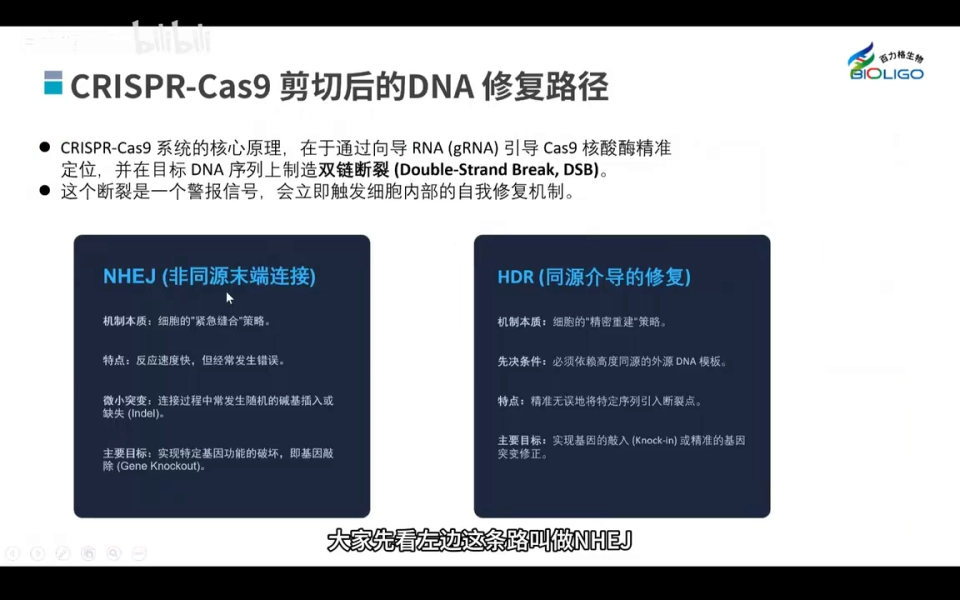

| | NHEJ（非同源末端连接） | HDR（同源介导修复） |
| --- | --- | --- |
| 机制本质 | 细胞的「紧急缝合」策略 | 细胞的「精密重建」策略 |
| 特点 | 反应速度快，但经常发生错误 | 必须依赖高度同源的外源 DNA 模板，精准无误 |
| 产物 | 连接过程中随机插入或缺失碱基（indel） | 将特定序列引入断裂点 |
| 主要目标 | 破坏特定基因功能，即基因敲除 | 基因敲入或精准的基因突变修正 |

### 3.1 敲除的分子链条：indel → 移码 → 提前终止

把 NHEJ 这条路展开，就是本节最核心的那条因果链 [【跳转到 10:52】](https://www.bilibili.com/video/BV1aJVZ6XE13/?t=652)：

> 细胞会直接把断掉的末端强行硬接起来。这种强行拼接极其容易出错，经常会随机多出或丢失几个碱基，会导致移码突变，直接让后续的蛋白翻译完全错乱或提前终止——**这就是我们实现基因敲除的核心原理**。

用密码子的语言重述一遍。编码区以三个碱基为一个密码子，读码框（reading frame）一旦确立，后面所有密码子都按这个相位读下去。假设断裂点附近被 NHEJ 多加了 1 个碱基，那么从这个点往后，每一个密码子的边界都错开一位：

$$
\text{原始读码框}: \quad \underbrace{\text{ATG}}_{\text{Met}}\ \underbrace{\text{GCC}}_{\text{Ala}}\ \underbrace{\text{AAG}}_{\text{Lys}}\ \cdots
$$

$$
\text{插入 1 nt 后}: \quad \underbrace{\text{ATG}}_{\text{Met}}\ \underbrace{\text{GGC}}_{\text{Gly}}\ \underbrace{\text{CAA}}_{\text{Gln}}\ \cdots \quad \text{此后全部错位}
$$

错位的直接后果是三重的：

1. **氨基酸序列从断裂点之后全部改变**——即使蛋白还能翻译出来，也是一个序列面目全非的多肽；
2. **很快撞上提前终止密码子**（UAA / UAG / UGA），翻译提前终止，得到一个截短的、通常没有功能的片段；
3. **转录本本身也可能变得不稳定**：提前终止密码子往往让 mRNA 更快被降解，于是连「截短的蛋白」都未必攒得起来。

反过来，如果 indel 恰好是 3 的整数倍，读码框不变，只是少一个或几个氨基酸——这种「整码」突变**未必**能敲掉功能。这也是为什么敲除效率不是一个「有/无」的开关，而是一个需要逐个克隆验证的分布问题（这一步对应下文实验流程的第六步：编辑效果验证）。

### 3.2 为什么敲除是「永久、不可调、二元」的

把上面的链条和「改的是 DNA」这件事合起来看，敲除的三个性质就是必然的：

- **永久**：改动写在基因组里，随细胞分裂遗传给子代。没有「撤药」这个动作可以让它恢复。要恢复只能重新做实验、换一株细胞。
- **不可调**：NHEJ 的结果是随机的 indel，你无法指定「把表达量降到 30%」。同一个基因、同一个 sgRNA，在不同细胞里得到的 indel 可能各不相同，因此残余蛋白的量也是随机的，而不是你设定的。
- **二元（在表型层面）**：一个等位基因要么移码失活、要么没有。对二倍体细胞来说，还有「只敲掉一个等位基因」的杂合状态，但那是基因型层面的中间态，不是表达量层面的连续可调。

对单细胞扰动筛选来说，这三个性质合起来就是麻烦：**每个细胞拿到的 indel 不一样，扰动强度因此不是一个统一的值**。这一点在后续讨论扰动效率与响应测量时会再展开。

## 四、把一个理论变成一次实验：六步流程与三条设计原则

讲者把实验流程拆成六步，每一步都标了「为什么必须这么做」 [【跳转到 11:30】](https://www.bilibili.com/video/BV1aJVZ6XE13/?t=690)。

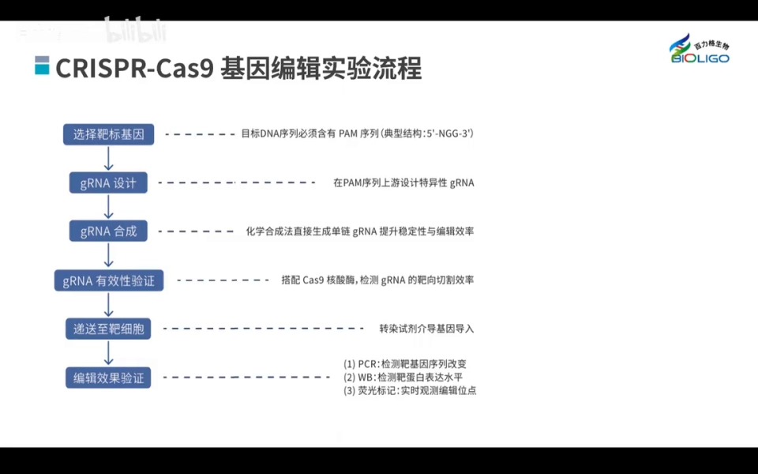

1. **选择靶标基因**：硬性前提是目标 DNA 序列里必须含 PAM（SpCas9 是 NGG）。没有这个路标，Cas9 无法工作。
2. **sgRNA 设计**：在 PAM 序列上游精准设计出具有特异性的 sgRNA。
3. **sgRNA 合成**：现在通常推荐化学合成法直接生成单链 sgRNA，比传统质粒表达方式更直接有效。
4. **sgRNA 有效性验证**：进入复杂细胞环境前，先与 Cas9 搭配，在体外检测靶向切割效率——讲者的比喻是「上战场前的实弹打靶测试」。
5. **递送至靶细胞**：用转染试剂介导等手段把验证过的编辑工具送进去。
6. **编辑效果验证**：从三个维度检测——核酸层面用 PCR 看靶基因 DNA 序列是否改变；蛋白层面用 WB 看靶蛋白表达水平是否真的被敲除；细胞层面还可以结合荧光标记做实时可视化观测。

### 4.1 sgRNA 设计的五条原则

讲者认为决定实验成败的最关键一环就是 sgRNA 设计，并给出五条原则 [【跳转到 14:21】](https://www.bilibili.com/video/BV1aJVZ6XE13/?t=861)。

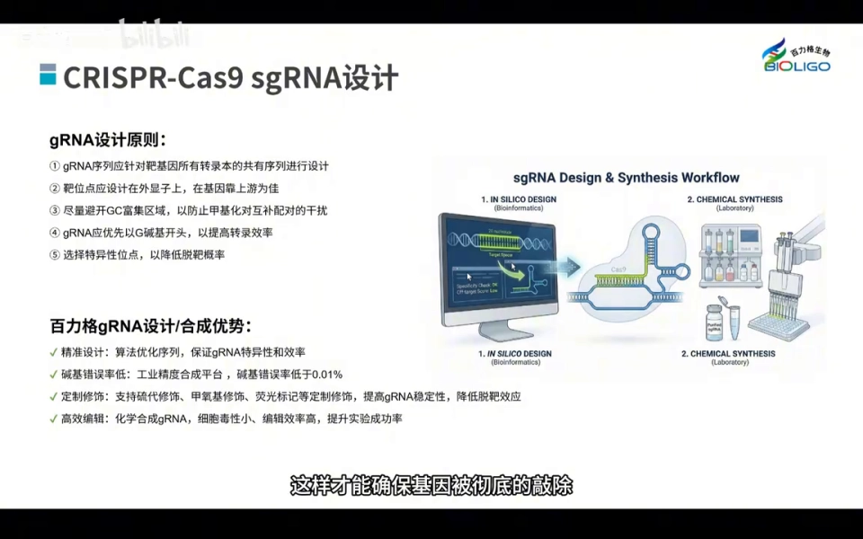

1. **针对所有转录本的共有序列**：这样才能确保基因被彻底敲除、不留死角。注意这一条和 CRISPRa 的处境正好相反——CRISPRa 只能激活全部转录本，而敲除必须打到所有转录本共有的部分。
2. **靶点选在外显子上，位置越靠上游越好**：越早引发移码，越早阻断蛋白表达。
3. **尽量避开 CpG 岛富集的区域**：这些区域容易发生甲基化，会严重干扰靶向的互补配对。
4. **sgRNA 优先以 G 开头**：实践上能显著提高转录效率（视频未展开原因，只给了这条经验规则）。
5. **特异性至上**：选特异性极高的位点，把脱靶概率降到最低。

### 4.2 三种递送方式：改的是「工具以什么形态进细胞」

工具设计好了，还要送进细胞。讲者梳理了三种主流递送方式，它们的差别本质上是「Cas9 以 DNA、RNA 还是蛋白的形态出现」 [【跳转到 16:06】](https://www.bilibili.com/video/BV1aJVZ6XE13/?t=966)。

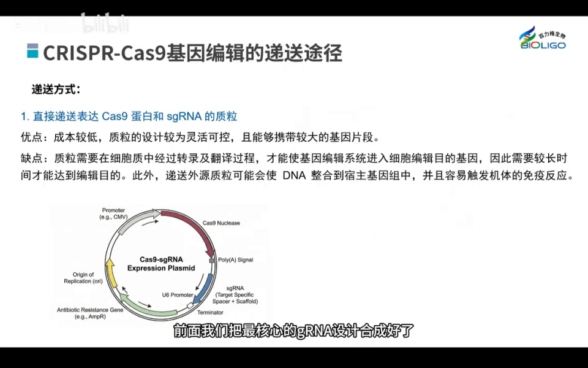

| 递送形态 | 优点 | 缺点 |
| --- | --- | --- |
| 质粒（表达 Cas9 + sgRNA） | 成本较低、设计灵活可控、容量大 | 需在细胞内转录翻译才能组装，起效慢；外源 DNA 有整合进宿主基因组的风险，易触发免疫反应 |
| mRNA（Cas9 mRNA + sgRNA） | 省去转录步骤，作用迅速；大幅减少基因组整合风险 | mRNA 本身脆弱、负载能力小、体内外都不稳定、易被降解 |
| RNP（Cas9 蛋白 + sgRNA 预组装复合物） | 递送进去即可瞬时完成编辑；免疫原性极低；完全无整合风险 | 成本相对较高；体内递送效率仍有待突破 |

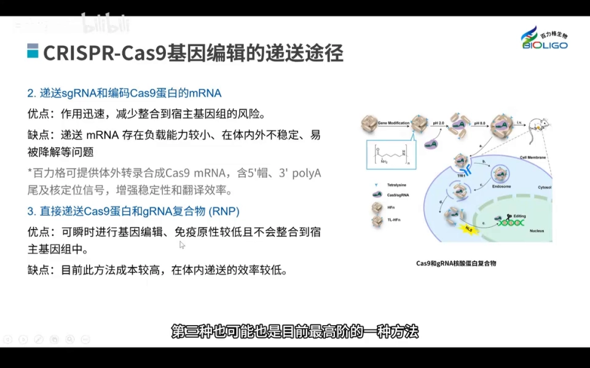

讲者的总结是：**从质粒到 mRNA 再到 RNP，没有绝对完美的递送方式，只有最适合当前实验目的的方案** [【跳转到 18:36】](https://www.bilibili.com/video/BV1aJVZ6XE13/?t=1116)。

对做单细胞扰动实验的人来说，这张表里最要紧的一列是「**起效快慢**」与「**是否持续表达**」。质粒会持续表达 Cas9，编辑窗口长，但也意味着脱靶累积的时间窗更长；RNP 是「一次性」的，编辑发生在很短的窗口内，之后就降解掉了。这个差别会直接影响你在什么时间点收细胞、测到的转录组反映的是「刚被扰动」还是「已经适应扰动很久」。

## 五、把敲除放回本节的三模式框架里

到这里可以回答本节的核心问题了。三种 CRISPR 扰动模式的差别，可以压缩成一句话：**它们分别作用在「DNA 序列」「转录起始」「转录激活」这三个不同的层级上。**

| | CRISPR-KO | CRISPRi | CRISPRa |
| --- | --- | --- | --- |
| 分子动作 | Cas9 切双链 + NHEJ 引入 indel | dCas9 融合抑制域，阻断转录 | dCas9 融合激活域，促进转录 |
| 是否改变 DNA 序列 | 是（indel） | 否 | 否 |
| 效果 | 蛋白功能丧失 | 转录水平下调 | 转录水平上调 |
| 可逆性 | 不可逆 | 可逆 | 可逆 |
| 剂量可调 | 否 | 是（部分） | 是（部分） |
| 完全性 | 完全丧失（若双等位基因均移码） | 不完全，有残余表达 | 不完全，激活效率因基因而异 |

其中 CRISPRi 与 CRISPRa 两列的原理、优缺点与选型细节，见本小节另一篇《CRISPRi 与 CRISPRa：不改变 DNA 序列也能关掉或打开基因》。这里只点出与本篇相关的两条对照：

- **KO 是唯一真正「改序列」的模式**，因此也是唯一会随细胞分裂永久遗传的模式。这既是它的优势（稳定细胞系、动物模型），也是它在单细胞筛选里的负担（每个细胞的 indel 不同，扰动强度不统一）。
- **KO 的「完全丧失」是有条件的**：只有双等位基因都发生移码，才是真正的功能丧失；杂合、整码 indel、以及蛋白半衰期很长的情况，都会留下残余功能。这一点在后续讨论脱靶与实验局限时会再遇到。

## 小结

- **Cas9 只负责切，不负责敲除。** 敲除是「切割 + NHEJ 修复出错」两件事的合成结果；同一把剪刀走 HDR 就变成敲入。
- **PAM 是硬约束。** Cas9 先找 PAM（SpCas9 为 NGG）再解旋再比对，没有 PAM 就没有编辑，因此可扰动范围受 PAM 分布限制。
- **NHEJ 的产物是 indel，indel 的后果是移码。** 移码导致断裂点之后氨基酸全变、提前终止、转录本可能被降解——蛋白功能因此丧失。整码 indel 未必敲掉功能。
- **敲除是永久、不可调、表型二元的。** 它适合回答「这个基因长期缺失会怎样」，不适合回答「表达量降一半会怎样」。
- **sgRNA 设计的核心矛盾是「打得准」与「打得狠」。** 针对所有转录本共有序列、靠上游外显子、避开 CpG 岛、优先 G 开头、特异性至上——五条原则里前两条保效率，后三条保特异。
- **递送形态决定了扰动的时间窗。** 质粒持续表达、起效慢、有整合风险；mRNA 快而不稳；RNP 一次性、瞬时、无整合。
- **和 RNAi 的分界线是作用层级。** RNAi 在细胞质里降解 mRNA（敲低、瞬时、有蛋白残留），CRISPR 在细胞核里改 DNA（敲除、永久、可排查脱靶）。

## 关键术语速查

| 术语 | 一句话解释 |
| --- | --- |
| sgRNA | 单导向 RNA，含约 20 nt 靶向序列，负责把 Cas9 带到特定位点 |
| PAM | 前间隔序列邻近基序，Cas9 识别并解旋的前置条件，SpCas9 为 NGG |
| DSB | DNA 双链断裂，Cas9 切割的直接产物，也是触发修复的信号 |
| NHEJ | 非同源末端连接，细胞的应急缝合，易出错，产生 indel |
| HDR | 同源介导修复，需外源同源模板，可精确插入或修正序列 |
| indel | 插入或缺失突变，NHEJ 的典型产物，长度非 3 倍数时导致移码 |
| 移码突变 | 读码框相位被改变，断裂点之后氨基酸序列全变并常提前终止 |
| Knockout（KO） | 敲除，让基因产物完全失去功能，通常需双等位基因均失活 |
| Knockdown（KD） | 敲低，降低表达但不消除，RNAi 与 CRISPRi 属此类 |
| RNP | Cas9 蛋白与 sgRNA 预组装的核糖核蛋白复合物，瞬时编辑、无整合风险 |