# Perturb-seq 与 CROP-seq：要让单细胞测序读到 gRNA，就得先把它做成一条带 polyA 的 mRNA

> 视频来源：[如何看待下一个大火的 Perturb-seq 技术？](https://www.bilibili.com/video/BV1o5iQBhEaw/)（Bilibili · 新格元 Singleron）｜时长约 14 分钟
> 导读：这是一支偏「技术选型」的直播分享：讲者不铺陈 CRISPR 原理，而是直接回答一个问题——**gRNA 凭什么能被单细胞测序读到**，然后把 Perturb-seq、CROP-seq、direct capture 三条载体路线和两种建库方案摆在一起对比，最后用两个真实项目的数据说明检出率与多重感染率长什么样。视频末尾两分钟是问答（测序深度、体内编辑），本文一并收录；产品与服务介绍部分不收录。字幕为 B 站 AI 字幕，术语按上下文订正（原文把 sgRNA 识别成「SDRA」、把 Perturb-seq 识别成「PTSC」等）。

## 本讲要解决的核心问题（SCQA）

**背景**：单细胞 RNA 测序（scRNA-seq）已经能读出每个细胞里哪些基因在表达。CRISPR 又能让研究者指定「敲掉哪个基因」。把这两件事拼起来，就是 pooled 的遗传筛选：文库里有上千条 sgRNA，每条敲一个基因，混在一起感染细胞，然后逐个细胞读出「它是谁、被敲了什么、敲完之后转录组长什么样」。

**冲突**：麻烦在于，常规 scRNA-seq 的捕获方式是**只抓 mRNA 的 polyA 尾巴**——磁珠上挂着 polyT 探针，凡是带 polyA 的转录本才会被拉下来、被打上这个细胞的 barcode。而 sgRNA 是一条由 U6 启动子（RNA 聚合酶 III）转录出来的小 RNA，**既没有 polyA 尾巴，也没有 5′ 端的固定把手**。也就是说，在 3′ 端单细胞测序的读数里，gRNA 天然是「隐形」的：你能看到细胞被扰动后的转录组变化，却不知道这个细胞到底吃了哪条 sgRNA。

**疑问**：那要怎么把「扰动身份」写进同一个细胞的测序读数里？Perturb-seq 和 CROP-seq 到底差在哪一步？

**回答（中心思想）**：**三条主流路线解决的都是同一件事——给 gRNA 装上一个 3′ 端单细胞测序能认出来的「尾巴」。** Perturb-seq 让 sgRNA 顺带带上一段带 polyA 的 barcode 表达盒，gRNA 是被「搭便车」测到的；CROP-seq 用双启动子让同一条 sgRNA 序列同时被 Pol II 转录成一条带 polyA 的转录本，从而能被常规 3′ 平台直接读到；direct capture 则不改表达方式，直接在 sgRNA 的茎环或 3′ 端插一段 capture sequence 当「把手」。理解了「尾巴从哪来」，就能理解三条路线各自的代价：Perturb-seq 的检出率受表达量限制、CROP-seq 要评估双启动子下的编辑效率、direct capture 要多设计探针甚至多一步环化。

## 一、先看这条路线是怎么长出来的：从不到 100 个扰动到上万个扰动

讲者开场没有直接讲技术，而是先给了一张「技术演进图」，把 2016 到 2022 年出现的一批方法按**发表时间**和**扰动数量**两个维度铺开 [【跳转到 00:55】](https://www.bilibili.com/video/BV1o5iQBhEaw/?t=55)。

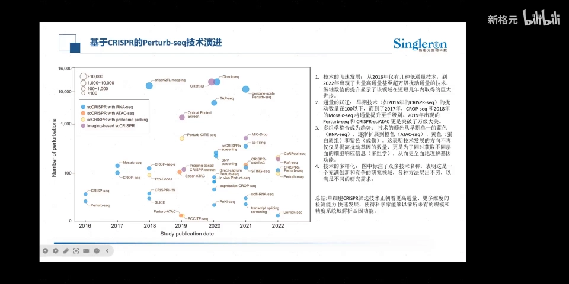

这张图上有三个信息值得记住：

1. **早期通量很低**。2016 年前后起步的那批方法（Perturb-seq、CRISP-seq 等）扰动数量都在 100 以下，属于「能做出原理验证」的规模。
2. **2017–2018 年出现第一次跃迁**。CROP-seq、Mosaic-seq 这类方案把通量推到了 1000 量级，原因是它们把「gRNA 怎么被读到」这件事工程化了——不再依赖单独建库。
3. **2019 年之后是「多组学 + 更高通量」两条线同时走**。黄色点（蛋白组学读出，如 Perturb-CITE-seq）、橙色点（ATAC 读出，如 Perturb-ATAC、spear-ATAC）说明扰动筛选不再只盯着转录组；而 2022 年前后出现的 genome-scale Perturb-seq、CRaft-seq 等，把扰动数量推到了上万个。

讲者用一组数字概括了这个演进 [【跳转到 00:30】](https://www.bilibili.com/video/BV1o5iQBhEaw/?t=30)：**细胞数从几百个做到几万甚至几十万个，覆盖的 sgRNA 种类从个位数突破到上千种以上**。这个量级变化不是「测序变便宜了」这么简单，它意味着后面要讲的载体设计必须同时满足两个要求：gRNA 要**稳定可测**，而且**一条细胞里最好只有一条 gRNA**（否则扰动身份就混了，见第七节）。

> 顺带订正一处讲者口误：视频里说「Perturb-seq 是在 CROP-seq 基础上演进过来的」。严格按时间线，Perturb-seq（2016）早于 CROP-seq（2017），图上两者都在起点附近；更准确的说法是**它们共享同一个思路**——把 gRNA 做成一条能被 3′ 端单细胞测序捕获的转录本，只是工程实现方式不同。

## 二、核心矛盾：3′ 端单细胞测序只认 polyA 尾巴

要理解三条路线的差别，先把「测序到底抓到了什么」这一步拆开。常规 3′ 端单细胞测序的捕获端是一颗带 **polyT 探针**的磁珠：细胞裂解后，mRNA 的 polyA 尾巴和 polyT 探针配对，被拉到磁珠上；同一个磁珠上还带着这个细胞的 cell barcode 和 UMI。于是**凡是带 polyA 的转录本，都会被打上这个细胞的身份证号**。

而 sgRNA 的处境完全不同：

| 特征 | mRNA | sgRNA（U6 转录） |
| --- | --- | --- |
| 聚合酶 | RNA 聚合酶 II | RNA 聚合酶 III |
| polyA 尾巴 | 有 | 没有 |
| 5′ 端固定把手 | 有（可做模板转换） | 没有 |
| 能否被 polyT 磁珠捕获 | 能 | **不能** |

所以「让 gRNA 进入读数」这件事，本质上是一个**分子工程问题**：要么给 gRNA 配一条带 polyA 的「代理转录本」，要么把 gRNA 本身改造成带 polyA 的转录本，要么在 gRNA 上插一段能被特异性探针认出来的序列。讲者把常用方案归成三类，逐一介绍 [【跳转到 00:55】](https://www.bilibili.com/video/BV1o5iQBhEaw/?t=55)。

## 三、路线一：Perturb-seq——sgRNA 搭上一条带 polyA 的 barcode 表达盒

第一种思路最「省事」：**不去改 sgRNA，而是在同一个载体上再放一个带 polyA 的表达盒，用它来标记这条 sgRNA**。这个标记就是 GBC（guide barcode，向导 barcode）——一段与 sgRNA 一一对应的短序列 [【跳转到 01:20】](https://www.bilibili.com/video/BV1o5iQBhEaw/?t=80)。

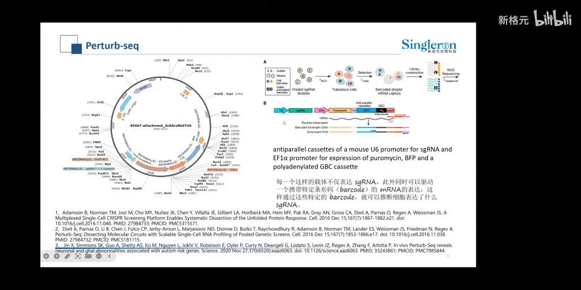

这张幻灯片右下角的结构图是整条路线的关键，可以拆成两个「反方向排列」的表达盒：

- **U6 启动子 → sgRNA**：负责产生有编辑活性的 sgRNA，方向朝左。
- **EF1α 启动子 → puromycin 抗性 + BFP + GBC 表达盒**：负责产生一条**带 polyA 尾巴的 mRNA**，方向朝右。puromycin 用来做药物筛选（只留下真的被感染的细胞），BFP 是荧光标记，GBC 则是那条「身份证」。

于是测序时发生的事就很自然了 [【跳转到 01:45】](https://www.bilibili.com/video/BV1o5iQBhEaw/?t=105)：

1. 载体转染进细胞后，GBC 表达盒被转录成一条带 polyA 的 mRNA；
2. 这条 mRNA 和细胞内源 mRNA 一起，被同一个细胞的 polyT 磁珠捕获，打上同一个 cell barcode；
3. 测序读出这段 GBC 序列，再按「GBC ↔ sgRNA」的对应表反查，就知道这个细胞被哪条 sgRNA 打了。

这里有一个容易被忽略的前提：**GBC 与 sgRNA 的对应关系不是测序测出来的，而是建库时保证的**——每一条 sgRNA 克隆都配一条已知的 GBC，一一对应。所以这条路线的准确性取决于文库构建时这个对应表有没有串。

代价也很清楚：**gRNA 是「顺带」被测到的**。它能不能被读到，取决于 GBC 表达盒转录得够不够多、捕获效率够不够高。表达量低的细胞就可能测不到 GBC，成为一个「表型有了、身份丢了」的细胞。这正是后面第六、七节里「undetermined cells」那一栏的来源。

## 四、路线二：CROP-seq——双启动子，让同一条 sgRNA 也被 Pol II 转录一遍

CROP-seq 换了一个思路：**不额外加 barcode，而是让 sgRNA 序列本身出现在一条 Pol II 转录本里**。讲者的描述是「它在载体设计上有些区别，主要特点是采用了双启动子策略」 [【跳转到 02:10】](https://www.bilibili.com/video/BV1o5iQBhEaw/?t=130)。

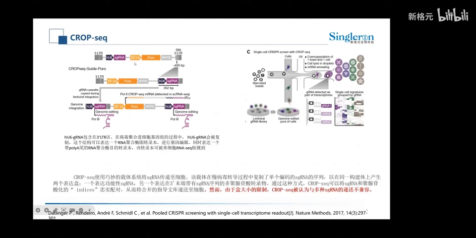

两个启动子的分工是：

- **U6 启动子**：转录出一条具有基因编辑活性的 sgRNA——这条负责「干活」。
- **EF1α 启动子**：把 U6 的固定序列、sgRNA 序列以及一段 polyA 尾巴一起转录出来——这条负责「被读到」 [【跳转到 02:35】](https://www.bilibili.com/video/BV1o5iQBhEaw/?t=155)。

有了 polyA 尾巴，这条转录本就能被 polyT 磁珠捕获，于是「单细胞转录组 + sgRNA」在一次测序里同时完成 [【跳转到 03:00】](https://www.bilibili.com/video/BV1o5iQBhEaw/?t=180)。幻灯片上的机制说明把这件事讲得更细：**U6-gRNA 表达盒被放在 3′ LTR 区**，慢病毒整合进基因组的过程中这个结构会被复制到 5′ LTR 一侧，于是同一个构建体上出现了两个表达盒——一个由 Pol III 转录出有编辑活性的 sgRNA，另一个由 Pol II 转录出一条带 polyA、含 sgRNA 序列的转录本，后者可被 scRNA-seq 直接检测到。这就是「一次整合、两种转录」的巧妙之处。

CROP-seq 的优势与代价同样明确：

- **优势**：常规 3′ 平台就能读，**不需要为 sgRNA 单独建一个文库**，湿实验流程最接近普通 scRNA-seq。
- **代价一**：因为是双启动子策略，**很多 sgRNA 递送系统在这样设计下不一定能有效发挥基因编辑作用**，讲者的建议是「根据自己的具体需求评估用哪一种更合适」 [【跳转到 03:25】](https://www.bilibili.com/video/BV1o5iQBhEaw/?t=205)。
- **代价二**（幻灯片文字）：受**表达盒容量**的限制，CROP-seq 被认为**与多 sgRNA 递送不兼容**——想做组合扰动就得换方案。

> 本节边界：组合扰动（一个细胞里同时敲多个基因）的编码与判读见本页导读的 ③；这里只说明 CROP-seq 的载体容量对它有约束。
## 五、路线三：direct capture——不改表达方式，改 sgRNA 本身

第三条路线的出发点是「**只转入并转录生成一条 sgRNA**，这条 sgRNA 既发挥基因编辑活性，同时又是测序的靶标」 [【跳转到 03:50】](https://www.bilibili.com/video/BV1o5iQBhEaw/?t=230)。好处是载体最简单、最接近标准的敲除载体；坏处是这条 sgRNA **既没有 polyA 尾巴，也没有 5′ 端固定序列**，polyT 磁珠抓不到它。

文献给出的解法是**在 sgRNA 的二级结构上做改造，插进去一段 capture sequence**（捕获序列），让特异性探针能认出它 [【跳转到 04:15】](https://www.bilibili.com/video/BV1o5iQBhEaw/?t=255)。

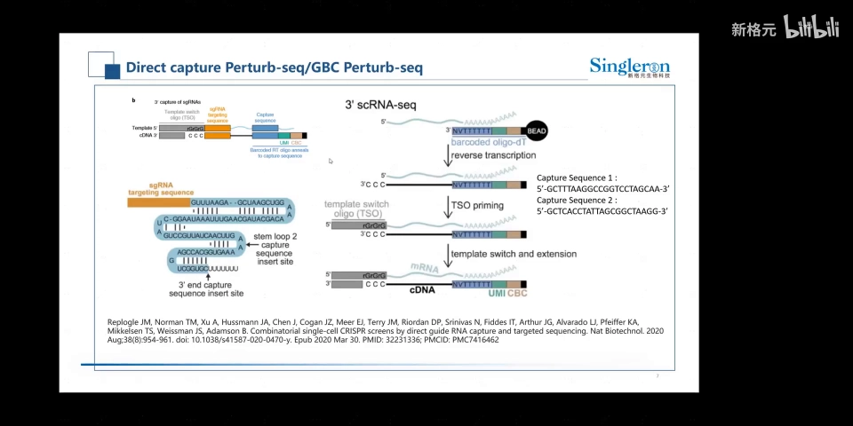

这张图回答了两个实操问题：

1. **插在哪里**：图上标了两个插入位点——**茎环 2（stem loop 2）**和 **3′ 端**。讲者说他们测试了一些位置，发现这两个位置都可以设计 capture sequence，**而且对 sgRNA 的编辑效率不会产生太大影响**，所以是一个可行的方向。
2. **插什么**：右侧给了两条具体的捕获序列（Capture Sequence 1 与 2），长度都在 20 nt 出头，作用是让建库时的探针有地方退火。

这条路线的名字来自文献里的做法（direct guide RNA capture，直接捕获 sgRNA），幻灯片右下角标注的是 Replogle 等 2020 年发表在 *Nature Biotechnology* 上的工作。它的定位很清楚：**当你不想为了「被读到」而改动 sgRNA 的表达方式时，就在不破坏编辑功能的位置上给 sgRNA 装一个把手。**

## 六、三条路线落到湿实验：一次捕获，两种建库

把三条路线放到完整流程里看，就更容易理解它们的分工。讲者给了一张「单细胞 CRISPR 基本流程」总图 [【跳转到 05:03】](https://www.bilibili.com/video/BV1o5iQBhEaw/?t=303)。

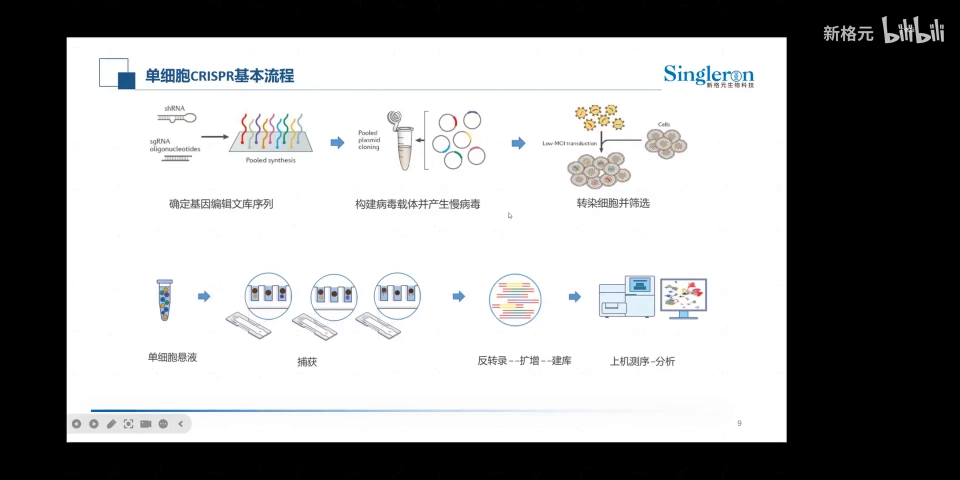

这张图上有两点值得注意：

- **前三步（文库设计 → 载体构建与病毒包装 → 低 MOI 转染与筛选）由实验方完成**，讲者明确说这部分「需要客户端来操作」；后四步（单细胞分离 → 捕获 → 逆转录扩增建库 → 上机测序）才是单细胞平台做的事。
- **「低 MOI 转染」这一步在图上被单独标了出来**，说明它不是可选项，而是这类实验的默认设置（原因见第七节的 multiplet 数据）。

单细胞分离之后的流程「跟常规单细胞转录组是一致的」——分离、捕获、逆转录、扩增、测序。差别只出现在**捕获之后怎么把 sgRNA 那条转录本捞出来**。讲者把项目上的方案分成两种 Case。

### 6.1 Case 1：sgRNA 转录本自带 polyA 尾巴和 PCR handle

第一种情况对应 Perturb-seq 与 CROP-seq 这两种载体——它们的 sgRNA 转录本**已经带 polyA 尾巴，5′ 端还有固定的 P5 handle 序列**，所以「可以直接拿它去建库」 [【跳转到 06:18】](https://www.bilibili.com/video/BV1o5iQBhEaw/?t=378)。

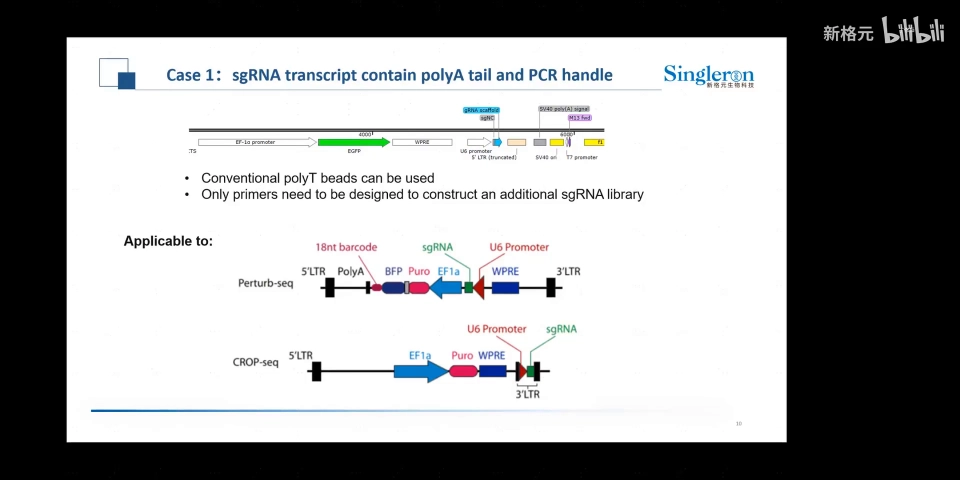

这张图的标题下面写了两条关键结论，是本节最该记住的实操要点：

- **Conventional polyT beads can be used**：常规 polyT 磁珠就能用，不需要换捕获体系；
- **Only primers need to be designed to construct an additional sgRNA library**：只需要设计引物，就能在原有文库基础上再建一个 sgRNA 文库。

具体到分子层面，捕获与逆转录是这样发生的 [【跳转到 06:43】](https://www.bilibili.com/video/BV1o5iQBhEaw/?t=403)：

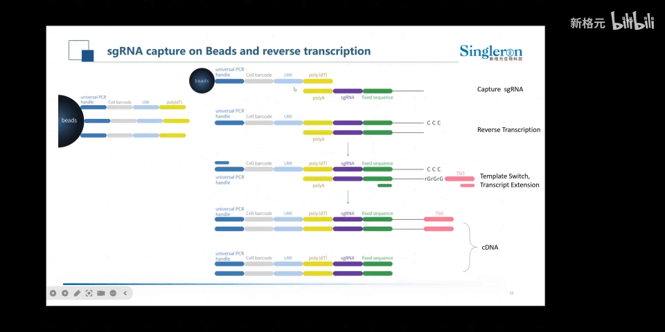

1. 磁珠上的 polyT 探针抓住 sgRNA 转录本的 polyA 尾巴，**与内源 mRNA 同步被捕获**——注意图上 sgRNA 转录本和 mRNA 共用同一套 cell barcode 与 UMI，这正是「同一个细胞」的物理保证；
2. 逆转录酶从 polyT 往 5′ 方向合成第一链；
3. 到达 5′ 端的固定序列后，通过**模板转换（template switch）**加上 TSO 接头；
4. 得到带 cell barcode、UMI、sgRNA 序列与固定序列的 cDNA。

接下来是富集与加接头 [【跳转到 07:08】](https://www.bilibili.com/video/BV1o5iQBhEaw/?t=428)：

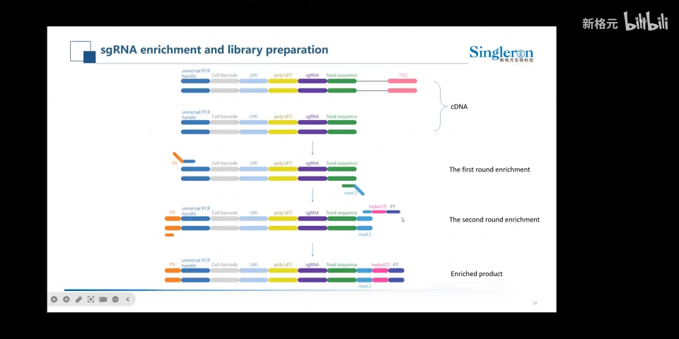

第一轮富集用 sgRNA 特异的引物把这段 cDNA 拉出来，第二轮再加上 P5、P7 测序接头，就得到可以直接上机的 enriched product。**这就是「只设计引物、不重做捕获」的含义**：捕获和逆转录跟普通 scRNA-seq 完全共用，差别只在扩增阶段的引物。

### 6.2 Case 2：sgRNA 没有 polyA 尾巴，也没有 PCR handle

第二种情况对应 `lentiCRISPR v2` 这类载体——它「可以直接转录出一条 sgRNA」，但这条 sgRNA **既没有 polyA 尾巴，也没有 5′ 端固定序列**，只有 protospacer 前后一些各不相同的序列，所以「检测难度比前面那种要大一些」 [【跳转到 09:13】](https://www.bilibili.com/video/BV1o5iQBhEaw/?t=553)。

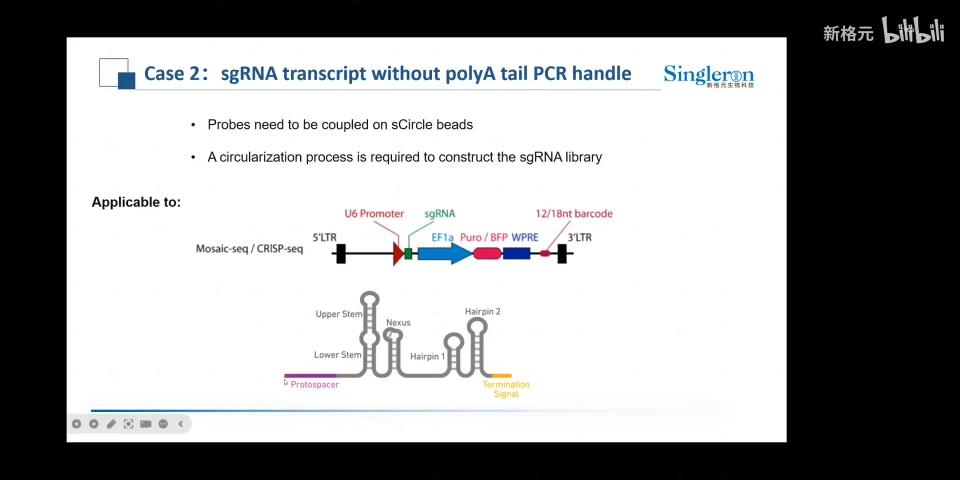

幻灯片给出的两条结论是：

- **Probes need to be coupled on sCircle beads**：探针要耦联到磁珠上（而不是靠 polyT 捕获）；
- **A circularization process is required to construct the sgRNA library**：建库需要一步**环化**。

流程比 Case 1 多了两个动作 [【跳转到 10:03】](https://www.bilibili.com/video/BV1o5iQBhEaw/?t=603)：

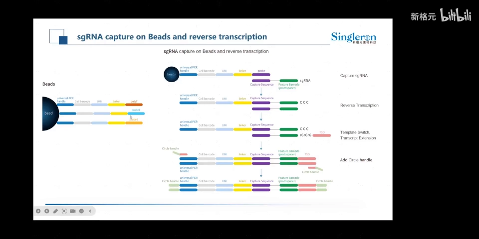

1. **特异性探针捕获**：探针退火在 sgRNA 的 capture sequence 区域，把这条没有 polyA 的 sgRNA 拉到磁珠上；
2. **逆转录 + TSO**：与 Case 1 相同，得到 cDNA；
3. **加 circle handle**：在 cDNA 末端接上环化用的接头；
4. **环化并反转方向**：把线性产物环化，再以环化产物为模板扩增，从而把测序方向「翻转」过来 [【跳转到 10:28】](https://www.bilibili.com/video/BV1o5iQBhEaw/?t=628)。

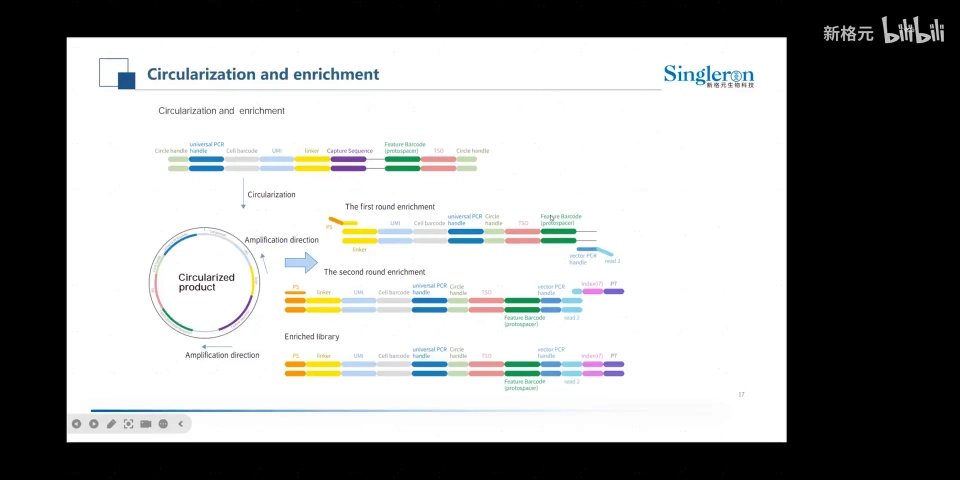

为什么要绕这一圈？因为 sgRNA 的序列方向与测序引物的方向相反，直接扩增拿不到可读的产物；**环化相当于把方向掉个头，让两端的序列都能被 feature barcode 的引物扩增出来**。讲者的总结是：这种方式相对复杂，**不仅需要设计靶向探针，还需要通过环化策略把方向转过来才能检测**。

## 七、真实项目数据：检出率、多重感染率与「没测到」的那一小撮

讲者给了两个项目案例，正好对应上面两种 Case。这两个案例的价值在于：它们把「设计上的差别」变成了「数据上的差别」。

### 7.1 Case 1（Perturb-seq / CROP-seq 类载体）：36,702 个细胞，32 种 sgRNA

先看转录组本身的质量 [【跳转到 07:33】](https://www.bilibili.com/video/BV1o5iQBhEaw/?t=453)：

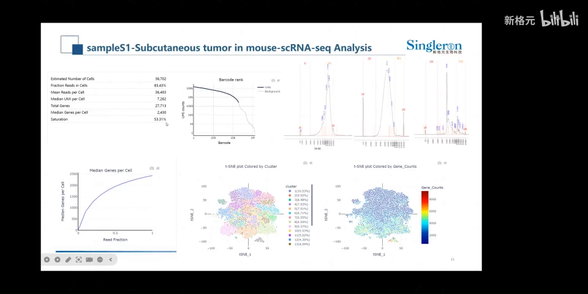

关键指标：**估算细胞数 36,702，细胞内 reads 占比 83.47%，每细胞中位计数 28,645，中位基因数 2,430，饱和度 53.31%**。讲者特意指出「这个数据本身还没有测饱和，如果有需求其实还可以继续往下测」——饱和度 53% 意味着还有一半的转录本没被测到，加深测序还能继续提升基因检出。

再看 sgRNA 的检出情况 [【跳转到 08:48】](https://www.bilibili.com/video/BV1o5iQBhEaw/?t=528)：

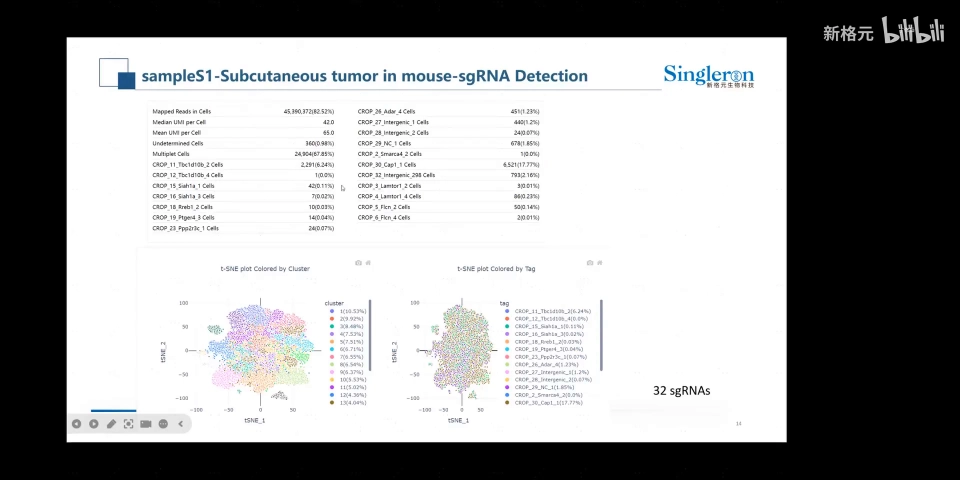

这张表是本节最值得逐行读的一张：

| 指标 | 数值 | 怎么理解 |
| --- | --- | --- |
| Mapped Reads in Cells | 45,960,372（52.32%） | 落在细胞内的 sgRNA 文库 reads 占比 |
| Undetermined Cells | 360（0.98%） | **测到转录组、但没测到 sgRNA** 的细胞 |
| Single sgRNA Cells | 11,438（31.16%） | 只检出一种 sgRNA，扰动身份唯一 |
| Multiplet Cells | 24,904（67.85%） | **同时检出 ≥2 种 sgRNA**，扰动身份不唯一 |

讲者的解读是：只有 0.98% 的细胞没有检测到具体 sgRNA，绝大多数细胞都检出了；但其中相当一部分是 multiplet，「这在项目上经常出现，可能跟 sgRNA 的转染 MOI 有关」 [【跳转到 08:48】](https://www.bilibili.com/video/BV1o5iQBhEaw/?t=528)。

这里有个容易误读的地方值得说清：**「检出率高」和「扰动身份干净」是两件事**。0.98% 的 undetermined 说明捕获体系很灵敏；但 67.85% 的 multiplet 说明**大部分细胞吃进了不止一条 sgRNA**，这些细胞在后续分析里要么被丢弃、要么只能谨慎处理——真正能干净归因的只有那 31.16%。这也是为什么「低 MOI」在流程图上被单独标出来：MOI 降下来，multiplet 才会降下来。

### 7.2 Case 2（无 polyA 的 sgRNA）：12,294 个细胞，3000 多种 sgRNA

第二个案例的转录组质量如下 [【跳转到 10:53】](https://www.bilibili.com/video/BV1o5iQBhEaw/?t=653)：**估算细胞数 12,294，细胞内 reads 占比 55.2%，中位基因数 3,293，饱和度 39.87%**。讲者提到「在 49K 的测序深度下中位基因做到了 3200 多」，并且 sgRNA 的分布「特异性都比较高」。

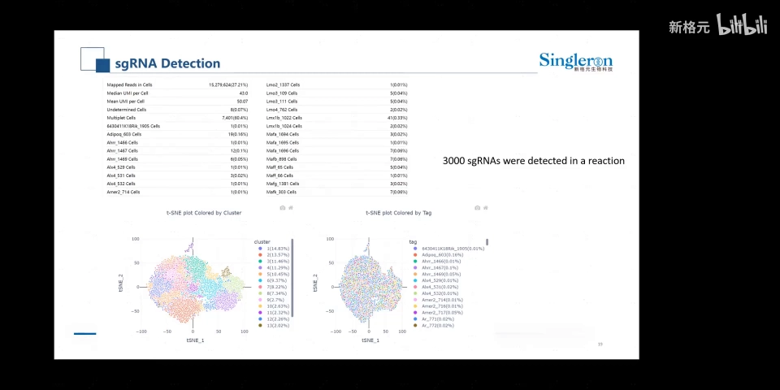

这个案例的看点在于**规模与检出率同时上去了**：

- **3000 多种 sgRNA**，比 Case 1 的 32 种高了两个数量级；
- **undetermined cells 只有 0.07%**，讲者的说法是「意味着 99% 以上的细胞都成功检测到了 sgRNA」；
- 但 **multiplet 比例相对更高**，「相当于有比较多的细胞同时检测到至少两种 sgRNA 序列」 [【跳转到 11:43】](https://www.bilibili.com/video/BV1o5iQBhEaw/?t=703)。

把两个案例放在一起，可以读出一条很实用的经验：**sgRNA 种类越多，文库越复杂，多重感染越难压住**。这不是建库方案的问题，而是感染环节的 MOI 与文库复杂度共同决定的——所以「一个扰动要有多少细胞、MOI 控制在多少」必须在实验设计阶段就算清楚。

> 本节边界：MOI 的计算、对照 gRNA 的设计、生物学重复数不在本文范围；gRNA 计数矩阵怎么归属到细胞、阈值怎么定见 [《单细胞 CRISPR 筛选的 gRNA 归属与多重感染判定》](单细胞CRISPR筛选的gRNA归属与多重感染判定.md)。这里只把数据当作「载体设计的效果检验」来看。

## 八、三条路线怎么选：一张表看清取舍

把前面三节的内容压成一张表，选型时按行对照即可：

| 维度 | Perturb-seq（GBC 方案） | CROP-seq（双启动子） | direct capture（茎环插入） |
| --- | --- | --- | --- |
| gRNA 如何被测到 | 同载体上另有一个带 polyA 的 GBC 表达盒，测 GBC 反查 sgRNA | 同一条 sgRNA 序列被 Pol II 转录成带 polyA 的转录本 | 在 sgRNA 茎环 2 或 3′ 端插入 capture sequence，探针直接抓 |
| 载体复杂度 | 中（U6-sgRNA + EF1α-Puro/BFP/GBC，反向排列） | 中（U6-gRNA + EF1α-Puro，U6 盒置于 3′ LTR） | 低（标准敲除载体，只多一段短插入） |
| 建库方式 | 常规 polyT 捕获 + 引物扩增 | 常规 polyT 捕获 + 引物扩增 | 需特异性探针，无 polyA 时还要环化 |
| 是否要单独建 sgRNA 文库 | 要（只设计引物即可） | 要（只设计引物即可） | 要（探针 + 环化，最复杂） |
| 主要风险 | GBC 表达量低时测不到；GBC 与 sgRNA 对应表必须建库时保证 | 双启动子下编辑效率需评估；表达盒容量限制，不适合多 sgRNA 递送 | 探针设计依赖序列；流程步骤最多 |
| 实测表现（本讲案例） | 32 种 sgRNA，undetermined 0.98% | 同 Case 1 | 3000 种 sgRNA，undetermined 0.07% |

讲者对选型的态度很务实：CROP-seq「在单细胞检测上比较方便」，但因为双启动子，「很多 sgRNA 递送系统不一定能有效发挥基因编辑作用」，所以**要按自己的具体需求评估用哪一种** [【跳转到 03:25】](https://www.bilibili.com/video/BV1o5iQBhEaw/?t=205)。换句话说，这里没有「最好的方案」，只有「在你的载体、你的读出平台、你的通量要求下最省事的方案」。

三条路线之外，还有四条**共同的实验设计约束**——它们与选哪条路线无关，任何一条路线踩了都会让数据不可用：

1. **MOI 要低**。流程图上「低 MOI 转染」被单独标出；两个案例里 60%–68% 的 multiplet 比例就是 MOI 偏高的直接后果。
2. **必须有非靶向对照 gRNA（NTC）**。没有基线，就无法区分「敲掉这个基因造成的表达变化」和「感染、Cas9 表达、细胞状态漂移造成的背景变化」。
3. **每个扰动要有足够多的细胞**。效应估计靠的是同一 sgRNA 组内细胞的平均，细胞太少时噪声会盖过信号。
4. **扰动效率要单独验证**。载体上有 sgRNA 不等于基因真的被敲掉了——敲除效率要用 qPCR、蛋白或报告基因单独测。

> 第 2–4 条的细节（对照与重复、扰动效率与响应测量）不在本文范围，本节只点到。

## 九、问答里的两个实操问题：测多少数据、能不能做体内编辑

视频最后两分钟是问答，两个问题都跟选型直接相关。

**问题一：sgRNA 文库一般建议测多少数据量？** [【跳转到 12:22】](https://www.bilibili.com/video/BV1o5iQBhEaw/?t=742)

讲者给的参考值是分档的：

| 情形 | 建议数据量 |
| --- | --- |
| 常规芯片 + 少量 sgRNA（几十种） | 约 10 G |
| sgRNA 种类上百种、上千种 | 20 G 甚至 30 G |
| 高密度芯片 | 20 G 起步 |

逻辑很清楚：**数据量要跟「文库复杂度」匹配**。sgRNA 种类越多，越需要更多 reads 才能让每条 sgRNA 都有足够的计数，否则会出现「某些 sgRNA 只有个位数 reads」的情况，后续按 sgRNA 分组做差异表达时噪声极大。

**问题二：体内基因编辑的细胞可以做吗？** [【跳转到 12:47】](https://www.bilibili.com/video/BV1o5iQBhEaw/?t=767)

可以。讲者说明演示的两个案例都是体外做基因编辑，但**体内编辑理论上这套技术也能做**：先完成前置的基因编辑，再把组织取出来、解离成单细胞悬液，上单细胞平台即可。换句话说，这套方案对「扰动发生在体内、读出发生在体外」的场景同样适用——这也是近年在体 Perturb-seq（in vivo Perturb-seq）能成立的技术前提。

## 小结

- **整个小节的矛盾只有一个**：3′ 端单细胞测序靠 polyT 抓 polyA 尾巴，而 U6 转录的 sgRNA 既没有 polyA 也没有 5′ 把手，所以天然测不到。
- **三条路线是三种「装尾巴」的方式**：Perturb-seq 给 sgRNA 配一条带 polyA 的 GBC 表达盒（搭便车）；CROP-seq 用双启动子让同一条 sgRNA 序列被 Pol II 转录成带 polyA 的转录本；direct capture 在 sgRNA 茎环 2 或 3′ 端插一段 capture sequence 当把手。
- **建库只有两种 Case**：转录本自带 polyA 与 P5 handle 的，用常规 polyT 磁珠捕获、只需设计引物；没有 polyA 的，要耦联特异性探针，还要多一步环化把方向转过来。
- **实测数据要分两栏看**：undetermined cells（没测到 sgRNA）反映捕获灵敏度，Case 1 是 0.98%、Case 2 是 0.07%；multiplet cells（测到多条 sgRNA）反映 MOI 控制，两个案例分别是 67.85% 与 60.4%——后者才是这类实验真正的瓶颈。
- **通量与复杂度是权衡**：Case 1 用 32 种 sgRNA、Case 2 用 3000 多种，随着文库复杂度上升，多重感染更难压住，测序数据量也要跟着从 10 G 提到 20–30 G。
- **选型没有标准答案**：CROP-seq 建库最省事但受双启动子与表达盒容量限制；direct capture 载体最简单但建库最复杂；Perturb-seq 介于两者之间，代价是检出率依赖 GBC 的表达量。
- **四条共同约束**：低 MOI、非靶向对照、每扰动足够细胞数、扰动效率单独验证——它们与选哪条路线无关。

## 关键术语速查

| 术语 | 一句话解释 |
| --- | --- |
| Perturb-seq | 把 sgRNA 与一条带 polyA 的 barcode 表达盒放在同一载体上，用单细胞转录组同时读出「扰动身份 + 转录组」的 pooled 筛选方案 |
| CROP-seq | 用双启动子（U6 + EF1α）让同一条 sgRNA 序列既被 Pol III 转录出有活性的 sgRNA，又被 Pol II 转录成带 polyA 的转录本，从而被常规 3′ 平台读到 |
| direct capture | 不改表达方式，直接在 sgRNA 的茎环 2 或 3′ 端插入 capture sequence，用特异性探针捕获 sgRNA |
| GBC（guide barcode） | 与 sgRNA 一一对应的短 barcode，随载体一起转录成带 polyA 的 mRNA，测到它就等于测到了 sgRNA |
| polyA 尾巴 | mRNA 3′ 端的一串腺嘌呤，是 3′ 端单细胞测序用 polyT 探针捕获的分子基础 |
| polyT 磁珠 | 表面耦联 polyT 探针的磁珠，同时携带 cell barcode 与 UMI，是 3′ 端单细胞捕获的核心耗材 |
| U6 启动子 | RNA 聚合酶 III 启动子，专门转录短的非编码 RNA（如 sgRNA），产物没有 polyA 尾巴 |
| EF1α 启动子 | RNA 聚合酶 II 启动子，转录产物是 mRNA，可带 polyA 尾巴，因此能被单细胞测序读到 |
| TSO（template switch oligo） | 逆转录到达 cDNA 5′ 端后用于「模板转换」的接头，让 cDNA 末端接上已知序列以便扩增 |
| capture sequence | 人为插入 sgRNA 的一段短序列，给建库探针提供退火位点 |
| 环化（circularization） | 把线性 cDNA 首尾连接成环再扩增，用于把测序方向翻转过来，是无 polyA sgRNA 建库的关键一步 |
| undetermined cells | 测到了转录组、但没测到 sgRNA 的细胞，反映 sgRNA 捕获的灵敏度 |
| multiplet cells | 同一细胞里检出两条及以上 sgRNA，扰动身份不唯一，通常由 MOI 偏高造成 |
| MOI（multiplicity of infection） | 平均每个细胞被多少个病毒颗粒感染，是控制「一细胞一扰动」的核心参数 |
| NTC（non-targeting control） | 不靶向任何基因的对照 sgRNA，用作扰动效应的基线 |
