# 用 LPS 和细胞因子把巨噬细胞推向 M1 或 M2：一次「环境 + 细胞因子」扰动的完整设计

> 视频来源：[Elabscience _ Raw264.7极化诱导M1/M2经验分享](https://www.bilibili.com/video/BV1bt4y1Z7BN/)（Bilibili · Elabscience伊莱瑞特）｜时长约 47 分钟
> 导读：这是一场实验经验分享型直播，讲者从「怎么判断细胞状态」讲起，一路讲到 M1/M2 的诱导原理、剂量与时间的摸索、以及一组真实的验证数据。它的价值不在概念，而在**把一次刺激实验里所有会翻车的变量都摊开讲了**：血清要不要热灭活、传了几代、细胞从哪来、接多少板、诱导多久、什么时候该撤血清。本文按「为什么这是环境扰动 → 两条通路怎么分工 → 读出怎么设计 → 剂量与时间怎么摸 → 培养条件怎么固定」重排，并删去了直播中的抽奖互动与产品清单。

## 本讲要解决的核心问题（SCQA）

**背景**：在扰动实验里，最容易做的一类「刺激」就是给细胞加一个它本来就会遇到的分子：细菌的脂多糖（LPS），或者免疫细胞之间传递信号的细胞因子（IFN-γ、IL-4、IL-13）。这些分子不改变基因组，也不像药物那样是外来的化学结构，它们本来就是细胞环境的一部分。

**冲突**：同一个巨噬细胞，加 LPS 会变成促炎的 M1，加 IL-4 会变成抑炎的 M2——听起来只要「加对东西」就行了。但这场分享里，讲者真正花时间的地方不是「加什么」，而是「加多少、加多久、细胞是什么状态、血清怎么处理」。因为这些变量任何一个不对，结论就会翻转：同一株 RAW264.7，不同来源的细胞诱导效率差出一大截；同一批细胞，传了十几代之后 IL-4 就完全诱导不动了；同一个刺激，处理 24 小时和 48 小时给出的最佳条件并不一样。

**疑问**：怎样把「刺激一下细胞」变成一个**可重复、可解释、可归因**的扰动实验？

**回答（中心思想）**：**把刺激拆成一条可逐环验证的链：刺激物 → 受体 → 胞内通路 → 转录程序 → 表面标志与分泌因子 → 细胞功能，每一环都要有独立的读出；而剂量、时间与培养条件这三个「非分子」变量必须自己摸、并且固定下来写进方法。** 环境刺激实验之所以难，不是难在机制不清楚，而是难在这条链上任何一环的读数都会被培养条件篡改——所以它比基因扰动更依赖「把条件当变量管理」。

## 一、为什么巨噬细胞极化是「环境 + 细胞因子」扰动的教科书案例

### 1.1 同一株细胞，两种命运

讲者给的定义很干脆：M1 是促进免疫应答、或者说炎症反应的分型，M2 的作用跟 M1 刚好相反，是一个抗炎的分型 [【跳转到 15:42】](https://www.bilibili.com/video/BV1bt4y1Z7BN/?t=942)。

为什么要抗炎？讲者用了一个很好用的类比：如果一个军队只知道进攻，敌人杀完了怎么办？它可能乱杀，杀自己人。所以需要一个调节，让 M1、或者说让炎症反应不要那么强烈，「消消气」，让它平衡一下——这非常像交感神经和副交感神经的关系 [【跳转到 16:07】](https://www.bilibili.com/video/BV1bt4y1Z7BN/?t=967)。

这个类比点出了本节的关键：**M1 与 M2 不是两种细胞，而是同一个细胞在两种环境下的两个状态**。这正是「环境扰动」的定义——基因组没变，表达程序变了。

### 1.2 一张表看清「刺激物 → 通路 → 标志物 → 功能」

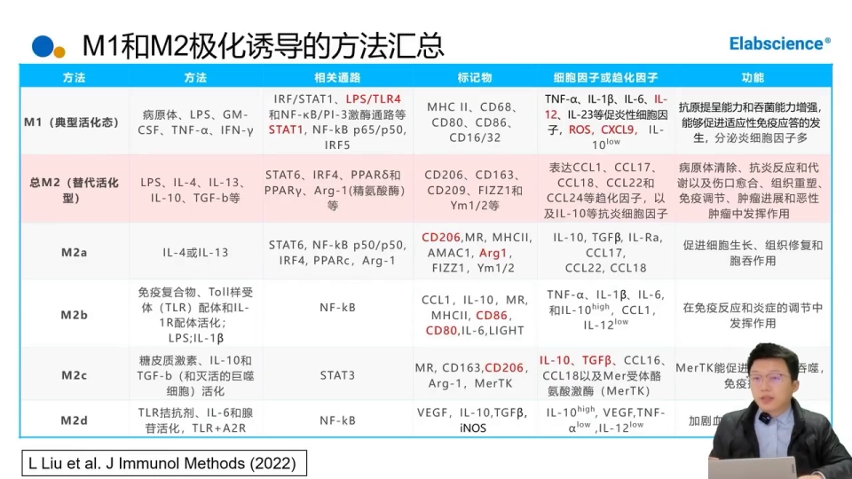

这张汇总表是全场信息密度最高的一页，它把 M1、M2 总型以及 M2a/M2b/M2c/M2d 四个亚型并排放在一起 [【跳转到 12:22】](https://www.bilibili.com/video/BV1bt4y1Z7BN/?t=742)。读这张表要注意三件事：

1. **刺激物是分层的**。M1 用病原体来源的 LPS、或者细胞因子 GM-CSF、TNF-α、IFN-γ；M2 用 IL-4、IL-13、IL-10、TGF-β。也就是说，同一类扰动（「加一个信号分子」）里，**分子来源不同，走的是完全不同的受体**。
2. **通路是并行的，不是串联的**。M1 走 IRF/STAT1、LPS/TLR4 和 NF-κB/PI3-激酶通路；M2 走 STAT6、IRF4、PPARδ 与 PPARγ、Arg-1。这些不是一条链上的不同环节，而是各自独立的入口。
3. **标志物是「组合」而不是「单个」**。M1 的 CD86、M2 的 CD206 都只是组合里的一项，单独看一项很容易误判——这一点在后面的 M2b 上会立刻体现。

### 1.3 一个立刻让人警惕的细节：M2b 也表达 CD86

讲者在讲 M2 分型时特意停了一下：M2b 的刺激物里也有 LPS，而且它后面的标志物里也有 CD86，和 M1 是一样的 [【跳转到 16:57】](https://www.bilibili.com/video/BV1bt4y1Z7BN/?t=1017)。

这句话的杀伤力在于：**如果你只用 CD86 一个指标判断 M1，你会把 M2b 误判成 M1。** 而 M2b 恰恰是被 LPS 诱导出来的。也就是说，同一个刺激物在不同剂量、不同共刺激条件下，可以把细胞推向表型上「看起来像 M1、功能上属于 M2」的中间态。这不是实验做错了，而是这套分类本身是人为划的边界。

> 这也是「环境刺激」类扰动与基因扰动的一个根本差别：基因敲除的结果是离散的（有或没有），而刺激的结果是**连续的表型谱**，你划的阈值决定了你报出来的比例。

## 二、两条通路的分子分工：LPS 走 TLR4，细胞因子走 JAK-STAT

### 2.1 LPS：TLR4 → 活性氧/PI3K → MAPK → 促炎因子

讲者把 LPS 这条通路一层层拆开 [【跳转到 17:43】](https://www.bilibili.com/video/BV1bt4y1Z7BN/?t=1063)：

- LPS 的受体是 **TLR4（Toll 样受体 4）**；
- 受体激活后，下游**活性氧增加**，以及 **PI3K 活化、磷酸化**；
- 再往下走到 **MAPK 通路**，一直到碱性磷酸酶、一些核酸与表达相关的指标；
- 最终导致**促炎细胞因子表达上升**。

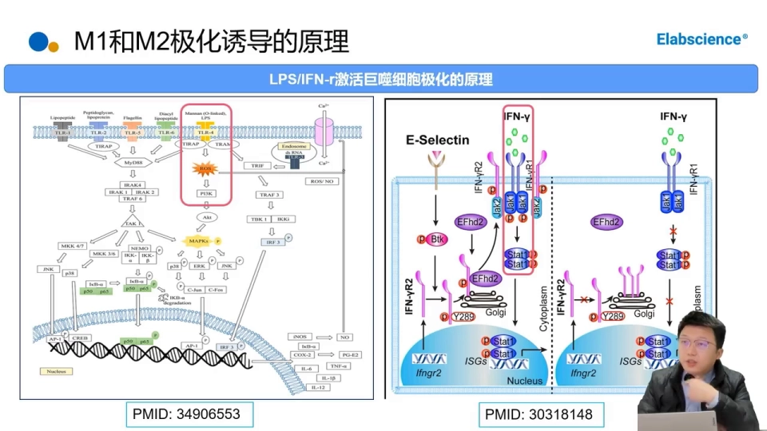

这张图左侧是 LPS/TLR4 的完整级联（MyD88、IRAK、TRAF6、TAK1，再分叉到 NF-κB 和 MAPK/p38/JNK），右侧是 IFN-γ 的 JAK-STAT 通路。**两条通路在核内汇合到同一批炎症基因上**——这就是为什么 LPS 和 IFN-γ 常常一起用：它们不是重复，而是协同。

### 2.2 IFN-γ：JAK1 → STAT1

IFN-γ 这一侧干净得多。讲者的说法是：IFN-γ 的受体接收信号之后，胞内被磷酸化的是 **JAK1**，JAK1 磷酸化之后进一步导致下游的 **STAT1** 磷酸化 [【跳转到 18:28】](https://www.bilibili.com/video/BV1bt4y1Z7BN/?t=1108)。

这是一条典型的「受体 → JAK → STAT → 入核」路径，也是本节要强调的一点：**细胞因子不是直接进细胞的，它只负责在膜上「敲门」，真正的信号传递由胞内的激酶完成。** 所以细胞因子扰动的剂量-响应，本质上是受体占有率的问题；而它的响应速度，取决于磷酸化级联的速度——这也是为什么细胞因子刺激的转录响应可以在很短时间内出现。

### 2.3 IL-4 / IL-13：JAK1 → STAT6 → Arg-1 与 CD206

M2 这一侧，讲者说 M2 比较常见的是用**白介素 4 和白介素 13** 作为激活剂。IL-4 到了相应的受体（白介素 4 受体 α）之后，后续会激活 **STAT6**；这里也存在 **JAK1**，JAK1 和 STAT6 都会产生磷酸化，最后让**精氨酸酶（Arg-1）升高**，同时 **CD206 这个甘露糖受体的表达也会升高** [【跳转到 18:41】](https://www.bilibili.com/video/BV1bt4y1Z7BN/?t=1121)。

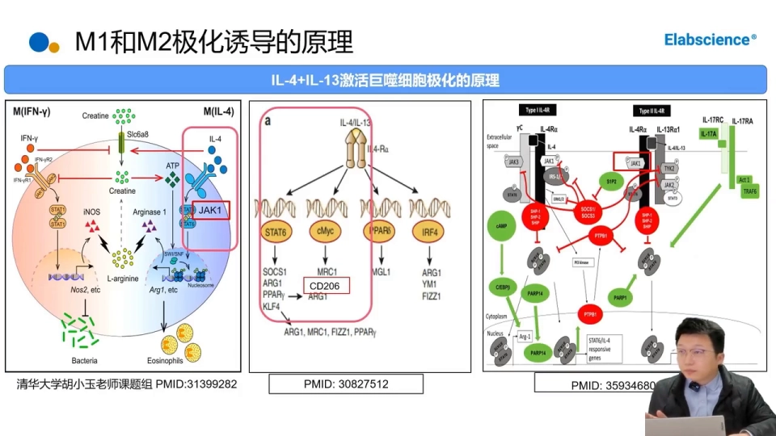

这张图最有价值的是中间和右边的对照：**CD206 不是随便挑的一个 marker，它是 STAT6 转录程序直接的下游产物。** 这一点决定了 marker 的可信度——你测的不是一个「碰巧在 M2 上高表达的表面蛋白」，而是这条通路自己的输出。做扰动实验时，**优先选通路直接下游的读出**，比选一个「文献里常用的 marker」要稳得多。

### 2.4 JAK1 是两条通路的共用节点，这解释了 M2 为什么不稳定

讲者接着做了一个很漂亮的观察：综合 M1 和 M2 两张通路图会发现，**JAK1 在两边都出现了**——IFN-γ 那边有，IL-4 那边也有 [【跳转到 19:56】](https://www.bilibili.com/video/BV1bt4y1Z7BN/?t=1196)。

这说明细胞里的通路是一个**网络结构**，往往会出现这种处在中间位置的分子，间接的影响途径就是通过某些中间分子、通过 crosstalk 的方式实现的 [【跳转到 20:06】](https://www.bilibili.com/video/BV1bt4y1Z7BN/?t=1206)。

由此推出一个实验上很重要的现象：**M2 不太稳定**。如果往 M2 里加入合适的脂多糖或者 γ 干扰素，它可能会**逆转回 M1**；但 **M1 一般不会逆转回 M2** [【跳转到 20:31】](https://www.bilibili.com/video/BV1bt4y1Z7BN/?t=1231)。

> 这个不对称性对设计实验的含义：**M2 是一个需要「持续维持」的状态，M1 是一个「一旦触发就锁定」的状态。** 所以做 M2 的时间序列，你必须保证刺激一直在；而做 M1，撤掉刺激后表型还会留一段时间。这直接决定了你要不要做「刺激-撤除」（pulse-chase）设计，以及撤除之后等多久取样。

### 2.5 一个容易忽略的自分泌环

讲者在讲标志物时提了一句很有意思的话：M1 细胞自己也会表达 TNF-α——相当于 TNF-α 刺激它，它又分泌 TNF-α，有点**自分泌**的意思 [【跳转到 14:02】](https://www.bilibili.com/video/BV1bt4y1Z7BN/?t=842)。

这句话解释了为什么细胞因子刺激的时间曲线往往不是「加了就升、撤了就降」的方波，而是带正反馈的斜坡：**外源刺激启动程序，程序自己又生产刺激**。所以在做时间梯度时，早期看到的是外源刺激的直接响应，晚期看到的是自分泌放大后的响应——两者混在一起，就不能简单归因于「剂量」。

## 三、读出怎么设计：从流式到功能，多尺度佐证

### 3.1 流式：先框细胞，再看子群

讲者给的验证思路很具体 [【跳转到 22:16】](https://www.bilibili.com/video/BV1bt4y1Z7BN/?t=1336)：

- 先看 **F4/80 和 CD11b 双阳性**，这是巨噬细胞的「身份门」；
- 在双阳性子群里，**CD86 正、CD206 负**，就是 CD86 单阳，一般作为 M1 的指标；
- 相反，**CD206 正、CD86 负**，一般就是 M2 [【跳转到 22:41】](https://www.bilibili.com/video/BV1bt4y1Z7BN/?t=1361)。

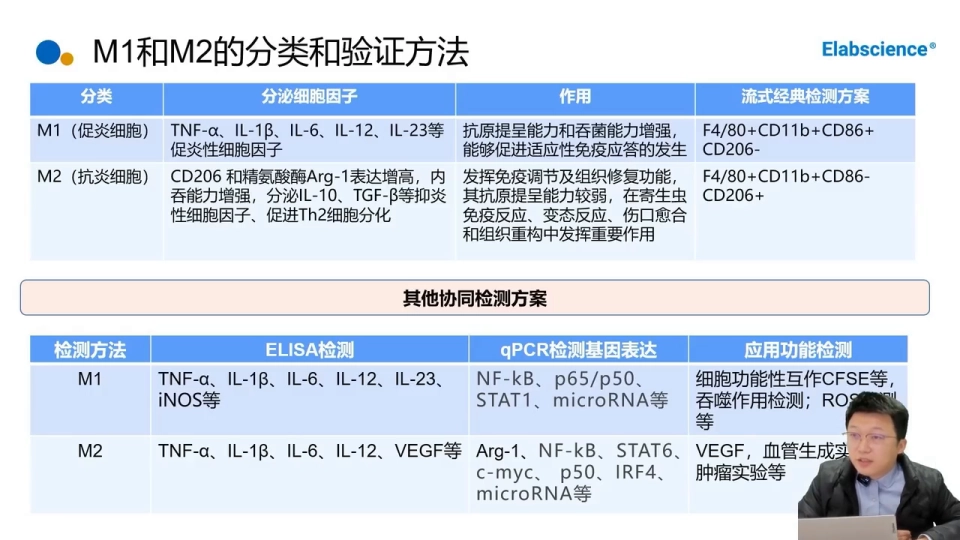

这张表把「一个指标」扩成了「一组指标」，逻辑是**同一结论的多尺度佐证**：流式给比例，ELISA 给分泌蛋白，qPCR 给通路分子，功能实验给表型后果。讲者的原话是：如果只做流式，边界也是可以认的；但如果把不同层面的检测指标都做一遍，论述会更加严谨、更加充分 [【跳转到 23:06】](https://www.bilibili.com/video/BV1bt4y1Z7BN/?t=1386)。

### 3.2 功能读出：为什么用 CFSE 看 T 细胞增殖

讲者用了一个乍看很绕的设计：把极化好的 M1 细胞和小鼠脾脏细胞按 1:60 共培养，加上 CD3 和 IL-2，48 小时后检测 **CD8 阳性 T 细胞的增殖** [【跳转到 33:59】](https://www.bilibili.com/video/BV1bt4y1Z7BN/?t=2039)。

为什么测 CD8 增殖能反映 M1 的抗原提呈能力？讲者的推理是：巨噬细胞先诱导 T 细胞分化成细胞毒性效应 T 细胞，后者增殖之后去杀伤肿瘤细胞；而**活化过程里抗原提呈起到了决定性的作用**，所以 CD8 增殖变强，就说明巨噬细胞活化 CD8 的能力增强 [【跳转到 38:04】](https://www.bilibili.com/video/BV1bt4y1Z7BN/?t=2284)。

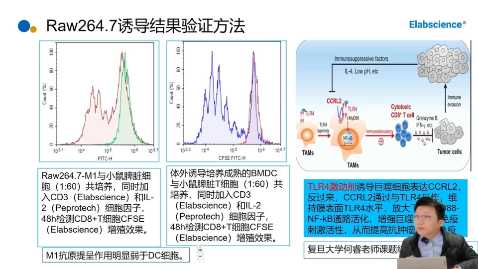

CFSE 的读法讲者解释得很清楚：CFSE 是低毒性的染料，进入细胞之后，**会随着细胞分裂代数的增加而荧光强度下降** [【跳转到 38:34】](https://www.bilibili.com/video/BV1bt4y1Z7BN/?t=2314)。如果每次分裂荧光减半，那么分裂 $n$ 代之后：

$$
F_n = F_0 \cdot 2^{-n}
$$

所以分裂代数越多，峰越靠左、峰越高。讲者据此给出的结论是：右侧峰靠左且更高，说明 CD8 增殖更强，因此 **M1 的抗原提呈作用弱于 DC 细胞** [【跳转到 39:24】](https://www.bilibili.com/video/BV1bt4y1Z7BN/?t=2364)。

> 这个设计的价值不在结论，而在**示范了「功能读出」怎么和「分子读出」对齐**：流式告诉你细胞变成了 M1，CFSE 告诉你这个 M1 真的能干活。做扰动实验时，如果只有 marker 没有功能，你无法排除「marker 变了但细胞没变」的情况。

### 3.3 验证的逻辑：从体内一路降到基因

讲者把整个验证思路总结成一条「还原论」的链条：最开始是通过体内实验验证某种干预有效果，在还原论思想下，希望找到疾病和分子机理之间的因果联系，所以一直细分到细胞层面，希望能从细胞生物学层面、蛋白层面一直下降到基因层面，形成一个完整链路的证明；这个证明越完整、正反验证越完备，文章的层次就越高 [【跳转到 25:10】](https://www.bilibili.com/video/BV1bt4y1Z7BN/?t=1510)。

这条链条对单细胞扰动实验的启示是：**单细胞测序只提供链条里的一环（转录组），它不能替代 marker 与功能验证。** 反过来，如果只有流式和 ELISA，你也看不到「同一群里细胞其实分成了几种响应模式」——这正是单细胞能补上的部分（差异表达、通路与细胞比例分析不在本节范围）。

## 四、剂量与时间：必须自己摸，而且要看趋势的形状

### 4.1 RAW264.7 的 M1：饥饿法 + 两段 24 小时

讲者展示的第一组数据是 RAW264.7 的 M1 诱导，从上到下五个组，差异就是 LPS 和 IFN-γ 的浓度差异；摸索之后最佳条件是第二组，判断依据是 CD86 单阳、也就是 M1 型的百分比 [【跳转到 26:25】](https://www.bilibili.com/video/BV1bt4y1Z7BN/?t=1585)。

这里有一个容易被忽略的设计：**饥饿处理**。做法是先加药处理 24 小时，然后把完全培养基换成**不含血清**的培养基，用同样浓度的药再处理 24 小时 [【跳转到 26:50】](https://www.bilibili.com/video/BV1bt4y1Z7BN/?t=1610)。

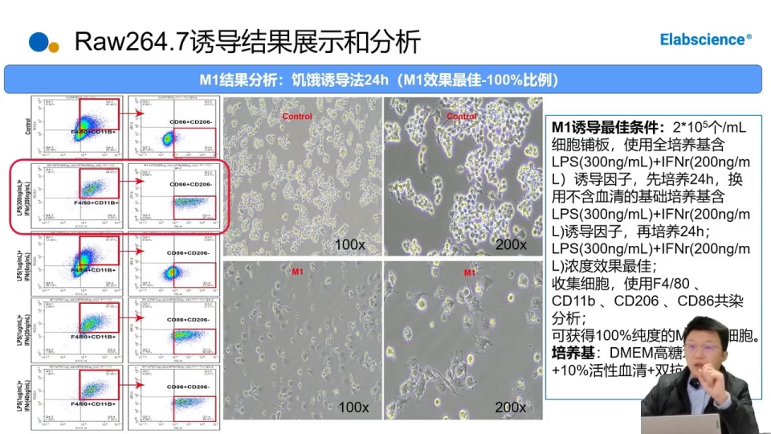

这张图右侧把条件写全了，值得逐项看：**2×10⁵ 个/mL 细胞铺板；全培养基含 LPS 300 ng/mL + IFN-γ 200 ng/mL 诱导因子，先培养 24 小时；换用不含血清的基础培养基含同样浓度的诱导因子，再培养 24 小时；DMEM 高糖 + 10% 活性血清 + 双抗。**

这里的「饥饿」是一个**叠加在刺激之上的第二个环境扰动**。撤血清本身就会改变细胞的转录程序（生长因子信号消失、代谢转向），所以它不是中性的「减少干扰」操作，而是一个必须写进方法、并且要有对应对照的处理。讲者用它来提高诱导纯度，但严格说，**「饥饿 + 刺激」组的对照应该是「饥饿 + 不刺激」**，否则你无法区分哪些基因是刺激引起的、哪些是撤血清引起的。

### 4.2 J774A.1：同一套刺激，不需要饥饿

讲者接着做了 J774A.1 的 M1：同样摸了 LPS 和 γ 干扰素的浓度，得到比较合适的浓度；然后发现**它的敏感性高于 RAW264.7**，因为它**不需要饥饿处理**，直接用这样的浓度处理 48 小时，就可以得到比较高程度的 M1 细胞 [【跳转到 39:38】](https://www.bilibili.com/video/BV1bt4y1Z7BN/?t=2378)。

这条对比很重要：**同一个刺激方案在不同细胞系上的最优条件不一样**。所以「文献里用 300 ng/mL LPS 处理 24 小时」这句话，换一株细胞就未必成立。这也是为什么讲者反复强调「摸浓度、摸时间」——不是不信任文献，而是**剂量-响应曲线是细胞系特异的**。

### 4.3 M2：一个「梯度没摸到顶」的教科书式警告

M2 这一侧，讲者摸了 IL-4 和 IL-13 的浓度。结果是这样的：流式图上从上到下，M2 比例是 41.6%、44.53%、47.14%——**一个单调趋势** [【跳转到 43:41】](https://www.bilibili.com/video/BV1bt4y1Z7BN/?t=2621)。

讲者立刻给了警告：其实不一定，只是目前来看，在这个实验分组里 60 纳克每毫升最好；但很有可能，如果扩大浓度梯度范围，在 60 纳克每毫升以上可能会有一个更好的效果。所以如果出现了这种**非峰值（单调）的趋势**，说明梯度还没摸到顶 [【跳转到 44:06】](https://www.bilibili.com/video/BV1bt4y1Z7BN/?t=2646)。

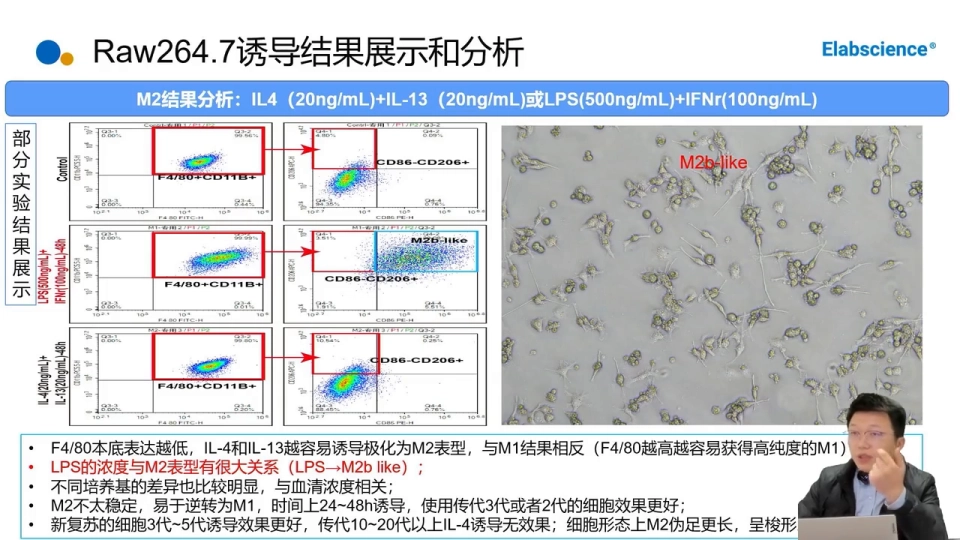

这张图还顺带展示了一个容易被忽略的事实：**同一张板上的两个「M2 组」，其实走向了两个不同的亚型**。IL-4 + IL-13 那组落成 CD86 负、CD206 正的典型 M2；而 LPS + IFN-γ 那组落成 CD86 与 CD206 双阳，讲者把它标为 M2b-like [【跳转到 31:49】](https://www.bilibili.com/video/BV1bt4y1Z7BN/?t=1909)。也就是说，**刺激物的组合方式本身就在选择亚型**，不是「都叫 M2」就等价。

> 这是本节最实用的一条方法学建议：**剂量梯度只有在出现「上升—平台—下降」时，你才能说找到了最优浓度。** 如果曲线还在单调上升，你报出来的「最佳浓度」其实只是「你测过的最高浓度」。这条判断标准与量效关系的参数化描述（EC50、Hill 系数）是同一件事的两面，只是这里用的是经验梯度而不是拟合曲线，见 [《小分子药物为什么必须做剂量梯度：量效曲线、EC50 与治疗指数》](../../../../../../深度学习/数学与统计基础/M01_统计学习与科学评估基础/3_统计推断与实验设计/3.2_合理的实验单位/3.2.5_因子设计与交互效应：多因素组合、区组与部分因子设计/小分子药物为什么必须做剂量梯度：量效曲线、EC50%20与治疗指数.md)。

### 4.4 时间：不是越长越好，而且和接种密度耦合

讲者给了几组时间数据，放在一起看很有意思：

- **BMDM 的 M1**：48、72、96 小时的纯度分别是 65%、65%、64%、67%，**没有显著性差异**，所以用 LPS 和 IFN-γ 诱导 48 到 96 小时都可以 [【跳转到 41:18】](https://www.bilibili.com/video/BV1bt4y1Z7BN/?t=2478)。
- 但要注意：如果诱导时间太长，要**注意补液**，不要让细胞干了 [【跳转到 41:43】](https://www.bilibili.com/video/BV1bt4y1Z7BN/?t=2503)。
- **J774A.1 的 M2**：24 小时效果相对好一点，48 小时可能效果弱一点——**这可能是因为密度比较高了**。所以如果处理时间太长，就要相对降低接板量 [【跳转到 40:48】](https://www.bilibili.com/video/BV1bt4y1Z7BN/?t=2448)。

这三条合起来说明一件事：**时间和密度是耦合的，不能单独调**。同样的刺激强度，铺得密、养得久，细胞会因为接触抑制、营养耗竭、代谢产物累积而改变状态——你测到的「时间效应」里混着「密度效应」。

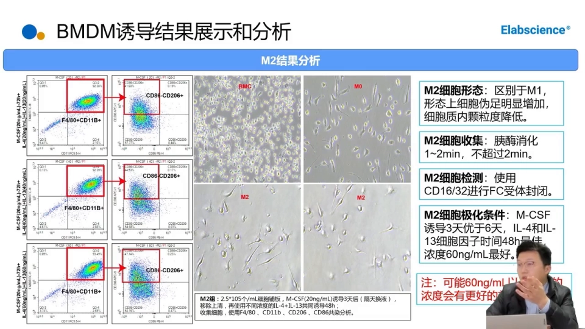

这张图把 BMDM 的完整流程写清楚了：**2.5×10⁵ 个/mL 铺板，M-CSF 20 ng/mL 诱导 3 天后（隔天换液），移除上清，再用不同浓度的 IL-4 + IL-13 诱导 48 小时**；收集细胞后用 F4/80、CD11b、CD206、CD86 共染分析。注意这里的「先诱导成 M0」是原代细胞特有的两步法——**原代单核细胞必须先分化成巨噬细胞，才能谈极化** [【跳转到 03:18】](https://www.bilibili.com/video/BV1bt4y1Z7BN/?t=198)。

## 五、培养条件：最容易被忽略、也最容易翻车的变量

讲者开场说了一句很实在的话：免疫细胞在体内非常容易照顾，到了体外就会变得「唯唯诺诺」、非常脆弱 [【跳转到 00:05】](https://www.bilibili.com/video/BV1bt4y1Z7BN/?t=5)。接下来四十多分钟，几乎一半时间在讲怎么把体外条件稳住。

### 5.1 血清：为什么要热灭活

RAW264.7 的培养条件是 DMEM + **20% 热灭活血清**。讲者解释了原因：如果研究的是体外的免疫相关细胞，血清一般要做热灭活，目的是**去除血清里的补体系统**，或者去除它的干扰——因为补体和免疫细胞碰上，在体内会「擦出火花」，在体外也会或多或少有影响 [【跳转到 02:03】](https://www.bilibili.com/video/BV1bt4y1Z7BN/?t=123)。

这条对「环境扰动」的含义是：**血清不是背景，是刺激源**。未灭活的血清里含有补体，补体本身就能激活免疫细胞。所以如果你做的是免疫细胞的刺激实验，血清批次和是否灭活，会直接改变你的「未刺激对照」基线。

### 5.2 传代次数：3～5 代以内，超过 10～20 代 IL-4 就失效

讲者反复强调：**传代次数尽量选五代以内**。原因是细胞系经过很多手、很多次传代之后，可能会提前分化，所以要在它分化以及更多变量介入之前把实验做完 [【跳转到 29:50】](https://www.bilibili.com/video/BV1bt4y1Z7BN/?t=1790)。

更具体的数据在 M2 那一段：复苏之后在 **3～5 代**做实验效果比较好；而如果把细胞传了 **10～20 代以上**，**IL-4 的诱导就没有效果了**，有点免疫失能的意思 [【跳转到 33:04】](https://www.bilibili.com/video/BV1bt4y1Z7BN/?t=1984)。

> 这是一个非常强的警告：**同一株细胞系在低代次和高代次，对同一个细胞因子的响应可以完全消失。** 如果你在单细胞实验里发现「IL-4 刺激组和对照没有差异」，第一个要排查的不是通路，而是这批细胞传了多少代。

### 5.3 细胞来源批次：F4/80 本底决定诱导效率，而且 M1 与 M2 方向相反

讲者专门做了「不同来源的 RAW264.7」的对比，理由是行业通病：不同来源的细胞，表达谱——即使是细胞系——可能还是会有些不一致，因为不同批次、不同人的操作、经过很多代传播之后，表达谱和最开始那一代是否一致，都要打个问号 [【跳转到 27:40】](https://www.bilibili.com/video/BV1bt4y1Z7BN/?t=1660)。

结论很有意思 [【跳转到 28:35】](https://www.bilibili.com/video/BV1bt4y1Z7BN/?t=1715)：

- **做 M1**：某一组 F4/80 的本底表达越高（也就是 F4/80 和 CD11b 双阳性的比例越高），它子群里得到的 M1 型细胞纯度就越高。
- **做 M2**：关系**相反**——F4/80 的本底信号越低越好，整体信号越低，反而诱导出的 M2 型纯度更高、更容易诱导 [【跳转到 30:59】](https://www.bilibili.com/video/BV1bt4y1Z7BN/?t=1859)。

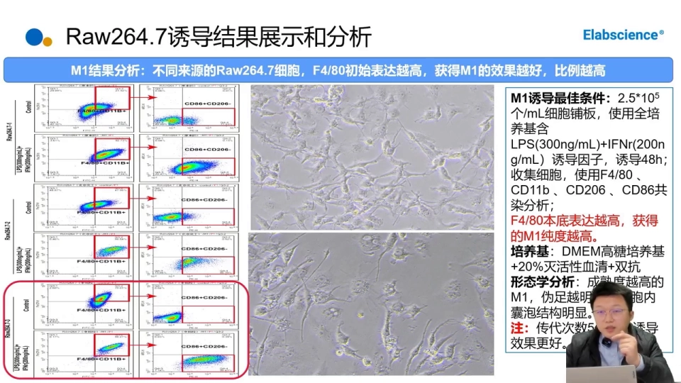

这张图右侧的注记把条件列全了：**2.5×10⁵ 个/mL 铺板、LPS 300 ng/mL + IFN-γ 200 ng/mL 诱导 48 小时、DMEM 高糖 + 20% 灭活血清、传代次数 5 代以内**。注意这里的血清是 20%，比前面 M1 那组的 10% 更高——**同一篇分享里，不同实验用的血清浓度并不相同**，这本身就是「条件需要按体系优化」的证据。

### 5.4 细胞状态判断：先「多看」，再「描述」

讲者在讲培养之前，花了不少时间讲怎么判断细胞状态，方法朴素但有效：**多看**——横向看不同细胞的正常状态，再对比正常与异常；然后**尝试描述你看到的东西**，比如大小、背景是否澄清、形态是成片还是散在、透光性如何 [【跳转到 05:29】](https://www.bilibili.com/video/BV1bt4y1Z7BN/?t=329)。

他给出的异常信号也很具体：RAW264.7 状态不好时，背景比较脏、细胞膜不够光滑，用更大倍数看说明膜上有破损或者有渗出的成分 [【跳转到 06:56】](https://www.bilibili.com/video/BV1bt4y1Z7BN/?t=416)；J774A.1 凸起比较多、形态有改变，通常提示**有分化的趋势** [【跳转到 08:11】](https://www.bilibili.com/video/BV1bt4y1Z7BN/?t=491)。

> 为什么这件事和扰动实验有关？因为**「细胞状态」是扰动的隐藏协变量**。同一剂量在不同状态下的细胞上，响应可以完全不同。所以单细胞扰动实验里，那些看起来像「响应异质性」的东西，有一部分可能只是「起始状态异质性」。

### 5.5 操作细节：不用胰酶、要封闭、CD206 的克隆号陷阱

讲者最后给了一串非常实操的 tips，每一条都能直接改变读数：

1. **未极化的巨噬细胞不要用胰酶消化**；诱导成 M1/M2 之后可以用胰酶，但**消化时间不要超过 2 分钟**；如果 2 分钟后有的消化了、有的没消化，就**分部消化**——把已消化的终止、收集，继续消化剩下的，同样不超过 2 分钟 [【跳转到 42:33】](https://www.bilibili.com/video/BV1bt4y1Z7BN/?t=2553)。
2. **做任何巨噬细胞实验都要记得封闭**，使用受体封闭剂（如 CD16/32），不管是 M1 还是 M2，特别是 M1 [【跳转到 42:08】](https://www.bilibili.com/video/BV1bt4y1Z7BN/?t=2528)。
3. **CD206 有克隆号陷阱**：有的抗体识别的是 CD206 胞内区域；而 CD206 是跨膜蛋白，在介导某些过程（如 ADCC）时可能会内吞，和抗体一块陷到细胞里面去，所以某些克隆号可能更有效 [【跳转到 46:11】](https://www.bilibili.com/video/BV1bt4y1Z7BN/?t=2771)。

第 3 条尤其值得记住：**同一个 marker 名字，不同克隆号测到的可能是不同的东西。** 这在多批次、多中心的数据整合里是一个真实的批次来源。

### 5.6 细胞系还是原代细胞：敏感性与重复性的取舍

讲者给了一张对比表，把三种常用细胞的选择讲清楚了 [【跳转到 10:56】](https://www.bilibili.com/video/BV1bt4y1Z7BN/?t=656)：

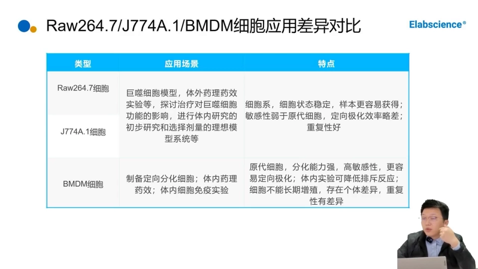

- **细胞系（RAW264.7、J774A.1）**：状态稳定、样本容易获得、重复性好，适合体外药理药效实验、体内研究的前置摸索；但**敏感性弱于原代细胞，定向极化效率略差**。
- **原代细胞（BMDM）**：分化能力强、敏感性高、更容易定向极化；但**不能长期增殖，存在个体差异，重复性有差异**。

讲者的建议是：不是生物专业、或者刚开始学养细胞的人，先从细胞系开始；等培养经验有一定积累之后，再去「霍霍」原代细胞 [【跳转到 11:21】](https://www.bilibili.com/video/BV1bt4y1Z7BN/?t=681)。

> 这张表其实回答了一个本节的核心问题：**为什么环境刺激实验这么难重复？** 因为你在「敏感性」和「重复性」之间必须选一个。选原代，你拿到了更接近体内的响应，但引入了个体差异；选细胞系，你拿到了稳定，但可能根本诱导不动。

### 5.7 一张小结表，把条件清单收齐

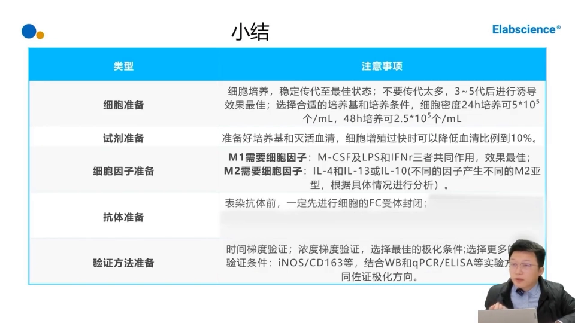

这张小结表基本就是一份「环境刺激实验的条件清单」[【跳转到 45:46】](https://www.bilibili.com/video/BV1bt4y1Z7BN/?t=2746)：

| 环节 | 讲者给出的注意事项 |
| --- | --- |
| 细胞准备 | 稳定传代至最佳状态，不要传代太多，3～5 代后诱导效果最佳；24 小时培养铺 5×10⁵ 个/mL，48 小时培养铺 2.5×10⁵ 个/mL |
| 试剂准备 | 备好培养基与灭活血清；细胞增殖过快时可把血清比例降到 10% |
| 细胞因子准备 | M1 需要 M-CSF、LPS 与 IFN-γ 共同作用效果最好；M2 用 IL-4 与 IL-13（或 IL-10，不同因子产生不同 M2 亚型） |
| 抗体准备 | 染表面抗原前一定先做 Fc 受体封闭 |
| 验证方法 | 时间梯度验证、浓度梯度验证，选出最佳极化条件；结合 iNOS/CD163、WB、qPCR、ELISA 等同向佐证 |

## 六、把它放回单细胞扰动实验里

这场分享的所有数据都是流式和显微图像，没有单细胞测序。但它恰好提供了单细胞扰动实验最缺的那部分——**上游条件怎么定**。把两边接起来，有四点值得记住：

**第一，刺激的「剂量」不是一个数，而是一组条件。** 同一篇分享里，LPS 用了 300 ng/mL（RAW264.7 的 M1）和 500 ng/mL（诱导 M2b-like）；IFN-γ 用了 200 ng/mL 和 100 ng/mL；IL-4/IL-13 用了 20 ng/mL 和 60 ng/mL。这些数字不是互相矛盾的，而是**不同细胞、不同目标表型下的最优点**。单细胞实验里如果只用一个剂量，你看到的差异表达很可能只是「这个剂量下的响应」，而不是「这个刺激的响应」。

**第二，时间点必须按响应层级来选。** 磷酸化是分钟级、标志物表达是小时级、表型与功能是天级。讲者在 BMDM 上看到 48～96 小时无差异，在 J774A.1 上看到 48 小时反而弱于 24 小时——**同一刺激在不同体系上的时间曲线形状不同**，所以时间点不能照抄。

**第三，培养条件是必须记录的元数据。** 血清浓度与是否灭活、传代次数、细胞来源批次、接种密度、是否饥饿、消化方式——这些在单细胞数据里通常只以一行「culture condition」出现，但它们每一个都能改变结论。**如果要做跨数据集整合，这些字段比测序深度更值得对齐。**

**第四，未刺激对照要「同条件」。** 如果刺激组做了血清饥饿，对照也必须做血清饥饿；如果刺激组换了培养基，对照也要换。否则你测到的差异里混着培养基效应。对照设计的一般原则见 [《对照与假说：无关变量、溶剂对照与预期结果》](../../../../B01_生命科学基础主干/5_生物学测量、实验设计与证据链/5.1_观测与干预/5.1.2_实验设计与证据链：对照、重复、相关与因果/对照与假说：无关变量、溶剂对照与预期结果.md)，这里只强调环境刺激特有的这一条。

> 与相邻小节的边界：本节讲的是「刺激物怎么加、加多少、加多久」。化合物本身的量效关系（IC50、Hill 系数）见 [《小分子药物为什么必须做剂量梯度：量效曲线、EC50 与治疗指数》](../../../../../../深度学习/数学与统计基础/M01_统计学习与科学评估基础/3_统计推断与实验设计/3.2_合理的实验单位/3.2.5_因子设计与交互效应：多因素组合、区组与部分因子设计/小分子药物为什么必须做剂量梯度：量效曲线、EC50%20与治疗指数.md)；刺激之后怎么从单细胞数据里做差异表达、通路与细胞比例分析，属差异表达与功能解释，不在本节范围。

## 小结

- **巨噬细胞极化是环境扰动的教科书案例**：同一株细胞，LPS 推向 M1、IL-4/IL-13 推向 M2，基因组不变、表达程序变。
- **两条通路并行**：LPS 走 TLR4 → 活性氧/PI3K → MAPK → 促炎因子；IFN-γ 走 JAK1 → STAT1；IL-4/IL-13 走 IL-4Rα → JAK1 → STAT6 → Arg-1 与 CD206。
- **JAK1 是共用节点**，这解释了 M2 不稳定、可被 LPS/IFN-γ 逆转回 M1，而 M1 不逆转——所以 M2 需要持续维持，M1 一旦触发就相对锁定。
- **CD86 单独看会误判**：M2b 也表达 CD86，且由 LPS 诱导。marker 必须成组看，并优先选通路直接下游的读出。
- **读出要多尺度**：流式给比例、ELISA 给分泌、qPCR 给通路分子、CFSE/ROS/血管生成给功能；只有 marker 没有功能，无法排除「marker 变了但细胞没变」。
- **剂量必须自己摸，而且要看曲线形状**：单调上升说明梯度没摸到顶，报出来的「最佳浓度」只是「测过的最高浓度」。
- **时间与密度耦合**：处理越久，接种密度要越低；诱导太久要补液。
- **培养条件是隐藏变量**：血清是否热灭活（去补体）、传代 3～5 代（10～20 代后 IL-4 失效）、细胞来源批次（F4/80 本底高利于 M1、低利于 M2）、接种密度、消化方式、Fc 受体封闭、抗体克隆号。
- **细胞系与原代之争本质是敏感性与重复性的取舍**：原代更接近体内但个体差异大，细胞系稳定但可能诱导不动。

## 关键术语速查

| 术语 | 一句话解释 |
| --- | --- |
| LPS（脂多糖） | 革兰阴性菌外膜成分，经 TLR4 激活先天免疫，是常用的 M1 诱导物 |
| TLR4 | Toll 样受体 4，LPS 的受体，激活后走 NF-κB 与 MAPK 两条分支 |
| IFN-γ | 由活化 T/NK 细胞分泌的细胞因子，经 JAK1-STAT1 驱动 M1 程序 |
| IL-4 / IL-13 | 驱动 M2 程序的细胞因子，经 IL-4Rα-JAK1-STAT6 上调 Arg-1 与 CD206 |
| JAK-STAT | 细胞因子受体的经典信号通路：JAK 磷酸化受体、STAT 磷酸化后入核作转录因子 |
| M1 / M2 | 巨噬细胞的促炎 / 抗炎两个极化状态，是同一细胞在不同刺激下的两种表型 |
| M2b | M2 的一个亚型，可由 LPS 诱导，表型上 CD86 与 CD206 双阳，容易与 M1 混淆 |
| CD86 / CD206 | 常用的 M1 / M2 表面标志；CD206 是甘露糖受体，为 STAT6 程序的直接下游 |
| Arg-1（精氨酸酶 1） | M2 的标志性代谢酶，由 STAT6 上调 |
| 热灭活血清 | 56℃ 处理过的血清，用于去除补体活性，避免补体直接激活免疫细胞 |
| Fc 受体封闭 | 染色前用 CD16/32 等封闭剂占住 Fc 受体，避免抗体非特异结合造成假阳性 |
| CFSE | 低毒荧光染料，随细胞分裂逐代稀释，用于追踪增殖代数 |
| BMDM | 骨髓来源巨噬细胞，需先用 M-CSF 诱导分化为 M0 再极化 |
| 饥饿处理 | 撤去血清培养一段时间，用于降低背景信号，但本身也是一种环境扰动 |