# 线粒体突变谱系追踪：自发条码、克隆树与状态证据的分界

> 视频来源：[单细胞多组学谱系追踪重构人类造血系统](https://www.bilibili.com/video/BV1fC41187qG/)（B 站 · BioArt「与一作面对面」第 131 期，主讲翁琛，MIT Whitehead Institute / Boston Children's Hospital，约 68 分钟，含问答）
> 导读（100 字以内）：这篇讲的是一件事：怎样用细胞自己积累的线粒体突变当条码，把「谁是谁的后代」测出来，再和同一细胞的转录组、ATAC 叠在一起读。重点在检出率如何变成分辨率、平行演化如何伪装成共享，以及谱系证据与状态轨迹的分工。字幕中的错拼（如「普世追踪」→谱系追踪、「read/regime」→ReDeeM、「抑制性」→异质性）已按上下文与幻灯片订正。

## 本讲要解决的核心问题（SCQA）

**背景**：单细胞转录组已经能给每个细胞标出「它现在像什么」——哪一类细胞、处在什么状态、在拟时序上排第几。上一节（5.2.1）已经讲过，这类状态轨迹是用表达相似度排出来的顺序，方向还要靠人指定根。

**冲突**：但「它现在像什么」和「它从谁分裂而来」是两个问题。两个细胞可以长得几乎一样却毫无亲缘关系（比如两次独立分化到同一状态），也可以长得很不一样却是同一个克隆的兄弟。要回答后者，必须有一条**会随分裂遗传、又会随时间累积**的标记。在培养细胞和小鼠里可以人工写入条码，在人身上却没法这么做。

**疑问**：不用人工写入，人体内还有什么东西能当条码？这些条码怎样变成一棵树？树建出来以后，哪些结论能下、哪些不能下？它和拟时序、RNA velocity 给出的「方向」到底差在哪里？

**回答（中心思想）**：**谱系追踪测的是继承，不是相似。** 人体内可用的自发条码是体细胞突变，其中线粒体 DNA 因为拷贝多、突变率高，最适合在单细胞水平读出；把共享突变拼起来可以得到克隆/亚克隆树，但**这棵树的连接数直接受检出率限制**——没有共享突变不等于没有共同祖先，只可能是没测到；同一个突变也可能在两个独立分支上各发生一次（平行演化），伪装成共享。把谱系树与同一细胞的转录组、ATAC 叠在一起，才能问「哪个克隆偏好哪种状态、产出哪类细胞」；而 velocity 看的是几小时内的将来，谱系看的是几个月到几年的过去，两者互补而不能互相替代。

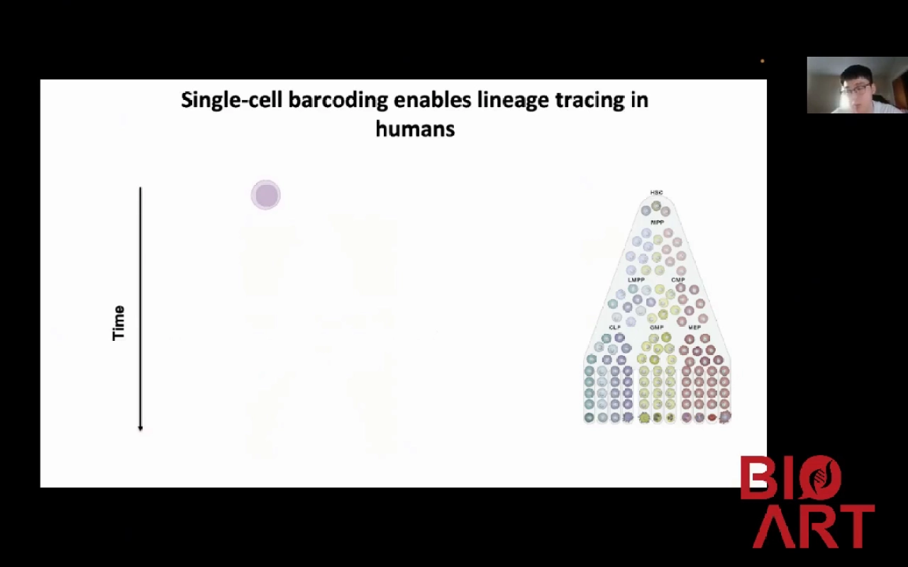

## 一、谱系追踪回答的是「谁是谁的后代」

### 1.1 三个问题里最容易被跳过的那一个

讲者把研究动机拆成三个问题：骨髓里到底存在多少不同的造血干细胞？这些干细胞在可塑性上有什么可遗传的差别？它们分化时如何调控网络、产生不同的血细胞？[【跳转到 04:16】](https://www.bilibili.com/video/BV1fC41187qG/?t=256)

这三个问题的共同点是：**答案不在单个细胞的表达谱里，而在细胞之间的亲缘关系里**。同一个「HSC」标签下，可能有一部分克隆长期静息、有一部分持续产出，也可能有的克隆偏好髓系、有的偏好淋系。只看表达谱，你只能看到状态；要看到「谁的后代」，必须追继承。

讲者给的目标图很直白：每个圈是一个细胞，目标是从数据里重构出树状的谱系结构。不同的树形对应不同的生物学情形——单克隆的强烈扩增（常见于侵袭性肿瘤）、渐进式的克隆扩增、来源非常复杂的多克隆结构，以及某个亚克隆获得转移能力后跑到血管里 [【跳转到 06:05】](https://www.bilibili.com/video/BV1fC41187qG/?t=365)。

### 1.2 条码的三条写入路线

要重构树，就得让细胞在分裂时把某个标记传下去。讲者把方法分成三类，区别在于**条码是一次性写入、持续写入，还是根本不用写**：

| 路线 | 条码怎么来 | 能分辨到什么 | 用在哪 |
| --- | --- | --- | --- |
| 静态条码（static barcoding） | 用慢病毒等导入一段随机 DNA，插入后固定 | 克隆水平：同一克隆的所有细胞带同一个条码 | 培养细胞、小鼠 |
| 演化条码（evolving barcoding） | 导入一段 target array，用 CRISPR/Cas 持续往里面加 indel | 亚克隆水平：随时间累积的 indel 组合能排出先后 | 小鼠（需基因编辑） |
| 自发条码（natural barcoding） | 体细胞突变自己积累，不需要导入 | 克隆/亚克隆，分辨率取决于突变率与检出能力 | 人、任何不能编辑的系统 |

前两类都需要 genetic engineering，只能在培养细胞或动物模型里做；人身上不可能引入 CRISPR 或慢病毒 [【跳转到 13:17】](https://www.bilibili.com/video/BV1fC41187qG/?t=797)。第三类不需要编辑，代价是**你不能控制它写多快、写在哪**。

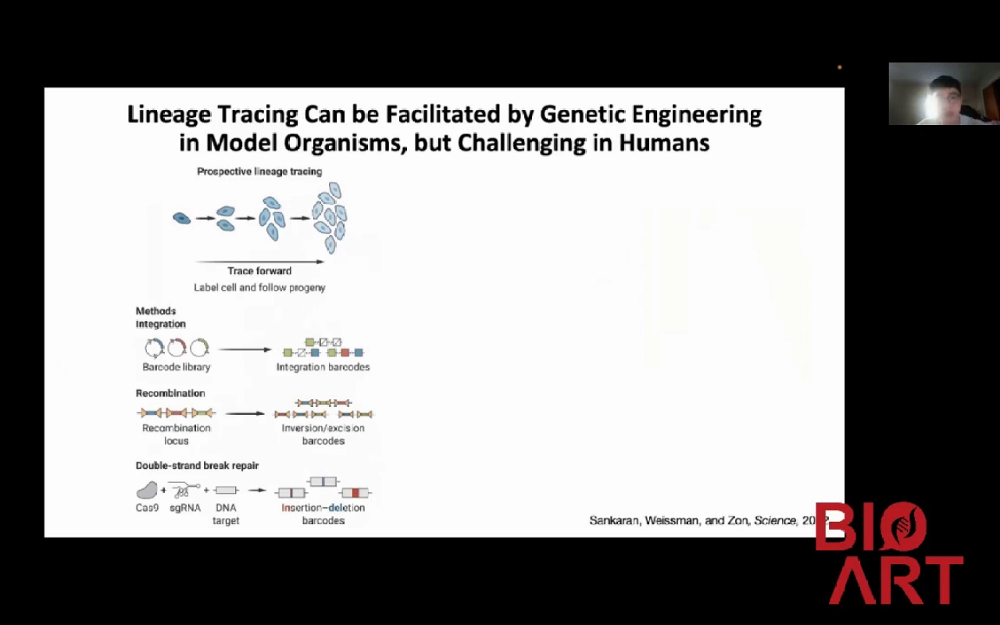

### 1.3 共享越多，共同祖先越近

三类方法的读法完全一样：**两个细胞共享的条码越多，它们越可能来自更近的共同祖先**。讲者用「排列组合」来描述这件事——一个细胞拿到哪些条码、另一个细胞拿到哪些条码，重叠的部分就是它们共同经历过的历史 [【跳转到 11:37】](https://www.bilibili.com/video/BV1fC41187qG/?t=697)。

这里有一个容易忽略的前提：**条码必须在分裂时被复制给两个子细胞，而且此后不再改变**。静态条码满足「不再改变」但不记录时间；演化条码和自发突变既继承又累积，所以能排出亚克隆的先后。也正因为如此，条码方法给出的信息是「继承史」，而不是「当前状态」——这一点会在第五节和第六节反复回到。

## 二、人体内只能用自发突变，而核基因组太难读

### 2.1 工程化条码进不了人

讲者把这张幻灯片停在「Lineage tracing in native humans is challenging」上：整合、重组、双链断裂修复这三类工程化路线，都需要先把工具送进细胞。人身上没有合法可行的办法做到这件事 [【跳转到 14:07】](https://www.bilibili.com/video/BV1fC41187qG/?t=847)。

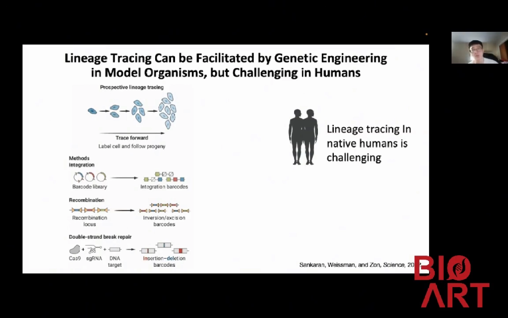

但讲者紧接着指出：**同样的原理其实一直在发生**。人的发育和衰老过程中，核基因组和线粒体基因组都在不断积累体细胞突变（SNV、微卫星变化等）。这些突变就是自发的条码，不需要导入 [【跳转到 14:07】](https://www.bilibili.com/video/BV1fC41187qG/?t=847)。

### 2.2 核基因组只有两个拷贝，检出是瓶颈

自发条码的麻烦不在「有没有」，而在「测不测得到」。讲者把分辨率拆成两个因子：**突变率**和**检测能力** [【跳转到 14:57】](https://www.bilibili.com/video/BV1fC41187qG/?t=897)。

核基因组在单细胞里只有两个拷贝，单细胞测序又有大量 dropout，想稳定检出体细胞突变非常困难。这不是算法问题，是物理上的信息量问题：一个位点最多两个等位基因，丢一个就只剩一半证据。

### 2.3 线粒体 DNA 的三个优势

线粒体 DNA（mtDNA）绕开了这个瓶颈，讲者给了三条理由 [【跳转到 16:12】](https://www.bilibili.com/video/BV1fC41187qG/?t=972)：

1. **拷贝数多**：一个细胞里有 100 到 1000 个 mtDNA 拷贝，而不是 2 个，单细胞水平检出率大大提高；
2. **突变率高**：约为核基因组的 10 到 100 倍，正好给出「月—年」尺度上够用的时间分辨率；
3. **能和多组学配对**：mtDNA 可以在单细胞基因组学流程里读到，同时保留基因表达、表观等信息。

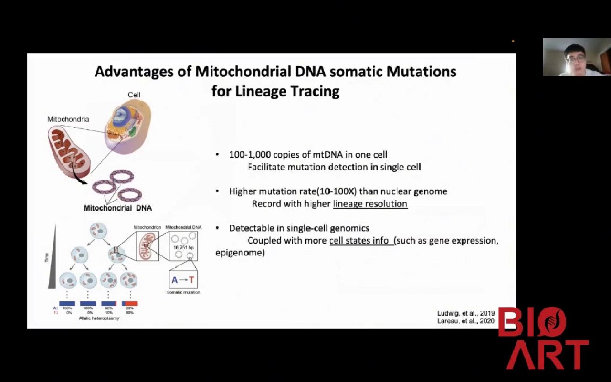

这里要区分一个概念：mtDNA 突变有**异质性（heteroplasmy）**——同一个细胞内，带某个突变的拷贝占多大比例。讲者后来在问答里专门解释了为什么最终把它二值化（见 6.2）。

### 2.4 用慢病毒条码做 ground truth

在把 mtDNA 突变当条码之前，先要证明它确实反映克隆关系。讲者的做法是找一个已知答案的体系：培养细胞里用慢病毒导入随机静态条码，把它当 ground truth，再比较 mtDNA 突变分出的组和静态条码分出的组 [【跳转到 17:52】](https://www.bilibili.com/video/BV1fC41187qG/?t=1072)。

结果两者吻合得很好。但讲者马上补了一句限制：**这只验证了克隆水平**。如果每个细胞只有零个或一个突变，就没有足够的信息去重构「连续」的树 [【跳转到 18:42】](https://www.bilibili.com/video/BV1fC41187qG/?t=1122)。

## 三、检出率就是分辨率：采样不足会制造假分离

### 3.1 80% 的细胞只有 0 或 1 个突变

这是全讲最值得记住的一张图。左边是用静态条码验证 mtDNA 突变可以标记克隆的热图；右边是两个残酷的分布：**80% 的细胞只呈现 0 个或 1 个变异**，由此建出的细胞—细胞网络连接非常稀疏 [【跳转到 19:07】](https://www.bilibili.com/video/BV1fC41187qG/?t=1147)。

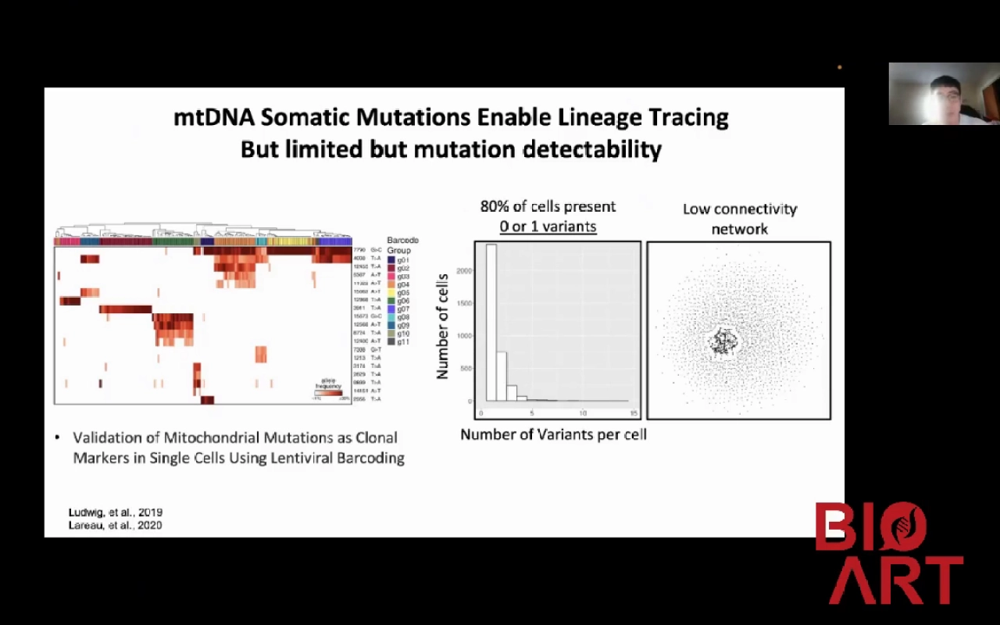

这张图的意义不是「方法不行」，而是给出了一条判读规则：**在这张稀疏网络里，两个细胞没有连边，不能直接读成「它们没有亲缘关系」**。讲者的原话是：很多细胞你找不到和另一个细胞共享的突变，其实只是因为你检出能力有限 [【跳转到 19:07】](https://www.bilibili.com/video/BV1fC41187qG/?t=1147)。

这就是「采样限制推断」的具体形态：**缺失的证据被误读成否定的证据**。在群体遗传学里这叫抽样不足，在单细胞谱系里它同时包含两层——取样取了多少细胞，以及每个细胞里测到了多少突变。

### 3.2 ReDeeM 把每个细胞的突变中位数从 1 提到 9

针对这个瓶颈，讲者开发了 ReDeeM（single-cell Regulatory multi-omics with deep mitochondrial mutation profiling）：在单细胞流程里不破细胞膜、尽量保留线粒体片段，同时建三个带同一 cell barcode 的 library——scRNA、scATAC 和富集后的 mtDNA 深度测序 [【跳转到 20:59】](https://www.bilibili.com/video/BV1fC41187qG/?t=1259)。

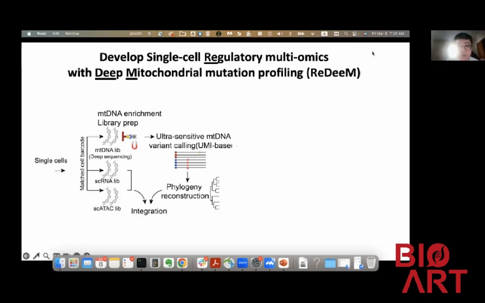

效果直接体现在分布上：每个细胞的 mtDNA 突变中位数从 1 提到 9，细胞—细胞网络的连接度从「中位数 0、均值 4.0」升到「中位数 16、均值 50.8」[【跳转到 23:49】](https://www.bilibili.com/video/BV1fC41187qG/?t=1429)。

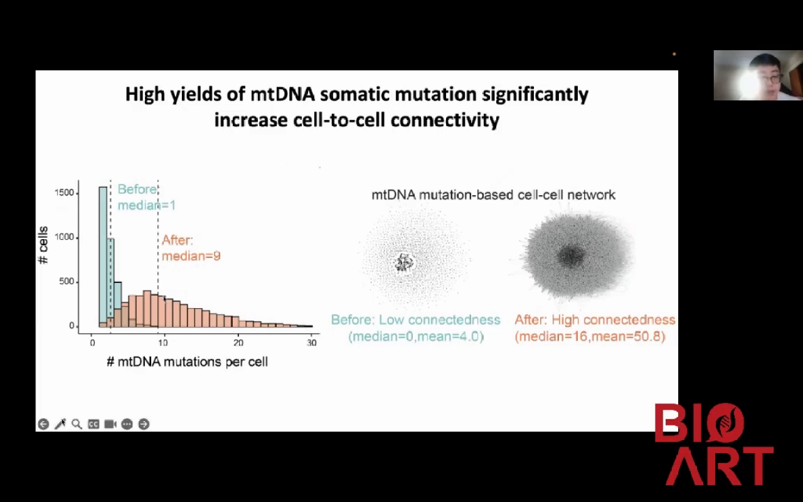

这张图说明的是一件事：**谱系树的分辨率不是由「有没有条码」决定的，而是由「每个细胞能读出几个条码」决定的**。同一个样本、同一批细胞，只是把测序深度和富集做上去，树就从「几乎连不起来」变成「可以分辨亚克隆」。

### 3.3 突变是真的吗：用突变特征做质检

拿到 4830 个突变之后，还要排除测序错误。讲者检查了突变特征（mutational signature），看到明显的 C→G 与 T→C 富集，符合已知的线粒体突变倾向，以此作为「这些突变是真的」的一项证据 [【跳转到 22:59】](https://www.bilibili.com/video/BV1fC41187qG/?t=1379)。

这一步在方法上很关键：**条码方法的可信度，取决于你能不能独立验证条码本身**。人工条码有参考字典可以纠错；自发突变没有字典，只能靠突变特征、跨供体频率等旁证。

### 3.4 条码容量与碰撞是另一条独立的限制

采样不足会让「有亲缘」看起来像「没亲缘」；条码碰撞则相反，会让「没亲缘」看起来像「有亲缘」。本节的另一篇材料专门处理后者：CARLIN 只有 4.4 万种条码，而一只成年小鼠有 $10^{10}$ 个细胞，条码空间不够时不同克隆必然撞码；即使扩到 $10^{18}$，仍要剔除「出现频率过高」的条码，否则无法用它标记特定克隆（见 [条码容量决定谱系分辨率](条码容量决定谱系分辨率：CARLIN、DARLIN%20与单细胞多组学追踪.md) §2–§3）。更早的 Polylox 工作则用产生概率 $P_{gen}$ 做同样的过滤（见 [4.3.4 细胞谱系与谱系追踪](../../../../B01_生命科学基础主干/4_细胞、个体与变化/4.3_细胞增殖、生殖与命运调控/4.3.4_干细胞、自我更新与细胞分化/细胞谱系与谱系追踪：条形码如何重建造血干细胞的分化树.md) §4.3）。

把两条限制放在一起看，谱系推断的误差是双向的：

- **检出不足** → 假分离：真有共同祖先的细胞被拆到不同分支；
- **条码碰撞/高频条码** → 假共享：不同克隆被合并成同一个分支。

## 四、从共享突变到一棵树：分叉是推断出来的

### 4.1 热图先于树

建树的第一步不是画树，而是一张矩阵：每一行是一个 mtDNA 突变，每一列是一个细胞，颜色是异质性水平。11,019 个细胞、4,831 个突变排在一起，就能看出哪些细胞在哪些突变上一起「发红」——这些块就是共享突变的群体 [【跳转到 31:24】](https://www.bilibili.com/video/BV1fC41187qG/?t=1884)。

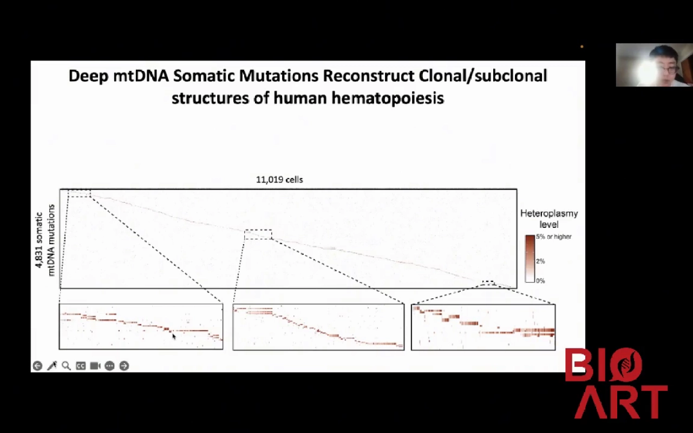

讲者强调：**树是从这个共享矩阵算出来的**。它不是显微镜下看到的一次次分裂，而是「哪些细胞共享更多突变」的聚类结果。这一点与 5.2.1 讲的拟时序是同一种性质——都是推断；区别只在推断用的信息：这里用继承下来的突变，那里用当下的表达相似度。

### 4.2 用 CRISPR 演化条码做独立验证

为了验证 mtDNA 树，讲者和合作者设计了一个同一细胞里并行两套条码的实验：一套是 CRISPR target array 累积的 indel（演化条码），一套是 ReDeeM 的 mtDNA 突变。两套条码互相独立，如果它们给出相同的亲疏结构，就说明 mtDNA 树不是伪影 [【跳转到 25:04】](https://www.bilibili.com/video/BV1fC41187qG/?t=1504)。

结果用两个指标呈现：把 mtDNA 定义的克隆 cluster 高亮到 CRISPR 定义的降维图上，两者吻合得很好；再进一步，对每个细胞找它在 mtDNA 树上的近邻，看这些近邻在 CRISPR 空间里是否也靠近，讲者把这一致性叫 agreement of closeness（AOC）[【跳转到 28:24】](https://www.bilibili.com/video/BV1fC41187qG/?t=1704)。

这里的逻辑值得初学者记住：**谱系推断需要外部锚点**。只用一种条码时，你无法区分「真实的共享」和「条码系统自身的偏差」；两种独立条码在同一批细胞里给出同一棵树，才把这种可能排除掉。

### 4.3 树的读法：clade 是克隆组，不是一次分裂

讲者在人的骨髓数据上把树的末端分成一个个 clade，每个 clade 定义为一个 HSC 克隆组：**同一克隆组内部的细胞在谱系上高度相近**，而不是「它们在同一天由同一个母细胞分裂而来」[【跳转到 39:10】](https://www.bilibili.com/video/BV1fC41187qG/?t=2350)。

这个区别很重要。树的**拓扑**（谁和谁更近）比**分叉时刻**可靠得多：突变是随机累积的，两个分支各积累了多少突变，只能给出粗略的相对先后，不能换算成「第几天分开」。所以读谱系树时，能说的是「这几个克隆属于同一支、那一支更早分离」，不能说的是「分叉发生在胚胎第 12 天」。

## 五、把树和状态叠在一起：谱系 + 转录组 + ATAC

### 5.1 一个细胞，两套坐标

ReDeeM 的关键设计是让同一批细胞同时拥有两套信息：一套是**谱系坐标**（它属于哪个克隆、在树的哪个位置），一套是**状态坐标**（它的转录组、染色质可及性）。讲者把这棵树画成环形，再把每个细胞的状态 UMAP 放在旁边对照 [【跳转到 32:27】](https://www.bilibili.com/video/BV1fC41187qG/?t=1947)。

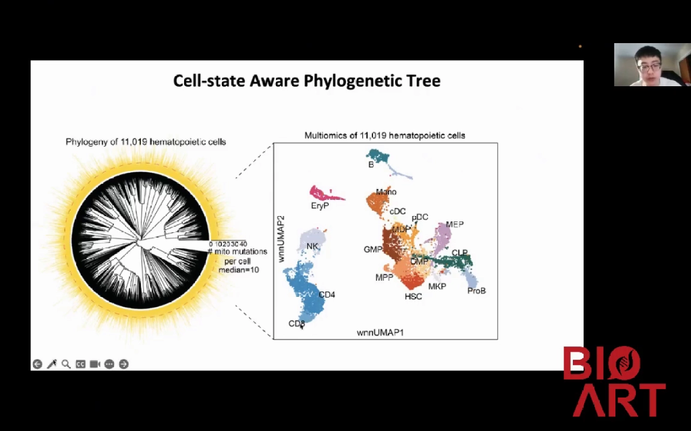

这张图是本节「真实继承信息 vs 状态相似性」最直观的呈现：**左边回答「谁和谁同源」，右边回答「谁现在像谁」**。两边可以一致，也可以不一致；不一致的地方恰恰是生物学问题所在。

### 5.2 细胞类型的「克隆邻居」

第一个问题是：同一类细胞，在谱系上最接近的是不是还是同类细胞？讲者的做法是给每个细胞找它在 mtDNA 树上的近邻，再看这些近邻属于哪种细胞类型，做成一张热图 [【跳转到 33:50】](https://www.bilibili.com/video/BV1fC41187qG/?t=2030)。

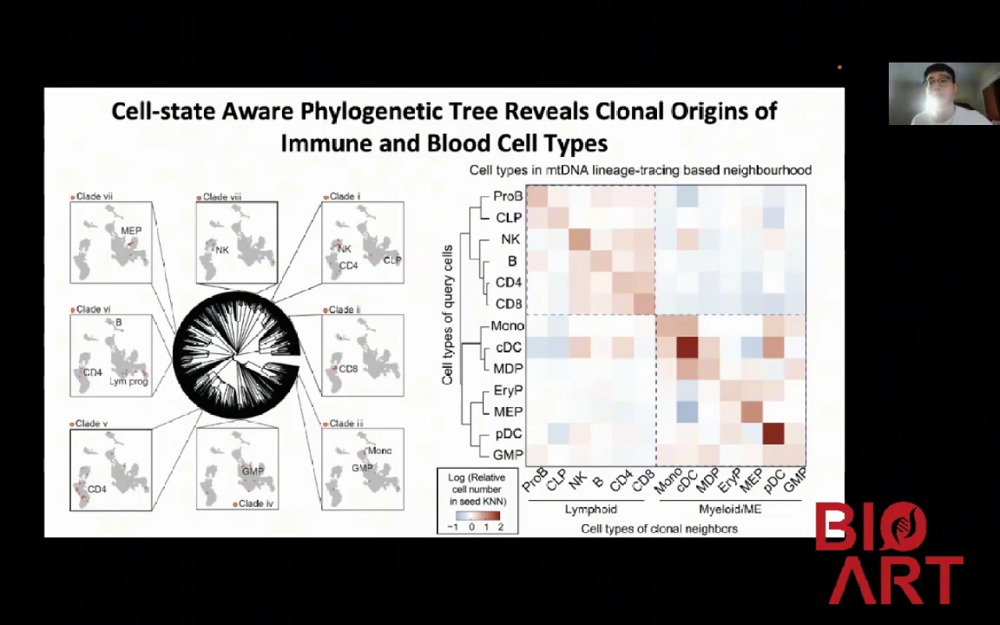

结果有两条：对角线很亮，说明**大多数细胞类型在谱系上最近的邻居就是同类**，符合「最近刚分化出来」的预期；同时淋系与髓系分成两个大块，整体发育关系与教科书一致。讲者还提到一个额外发现：树突状细胞（DC）的克隆邻居比较多样，一部分来自淋系、一部分来自髓系，这与领域里关于 DC 起源的争议相呼应 [【跳转到 35:05】](https://www.bilibili.com/video/BV1fC41187qG/?t=2105)。

注意这里的措辞：**这是「克隆邻居的分布」，不是「DC 由淋系转变而来」的直接观测**。它支持的结论是「DC 与淋系共享较近的祖先」，不支持「某个淋系细胞当场变成了 DC」。

### 5.3 克隆偏好某种状态，而且四个月后还在

第二个问题更细：在 5,393 个 HSC 里，克隆组和状态亚群之间有没有偏好？讲者把 HSC 分成 14 个亚群（RNA、ATAC、或两者联合都能得到同样的 14 群），再和 78 个克隆组做富集分析 [【跳转到 40:54】](https://www.bilibili.com/video/BV1fC41187qG/?t=2454)。

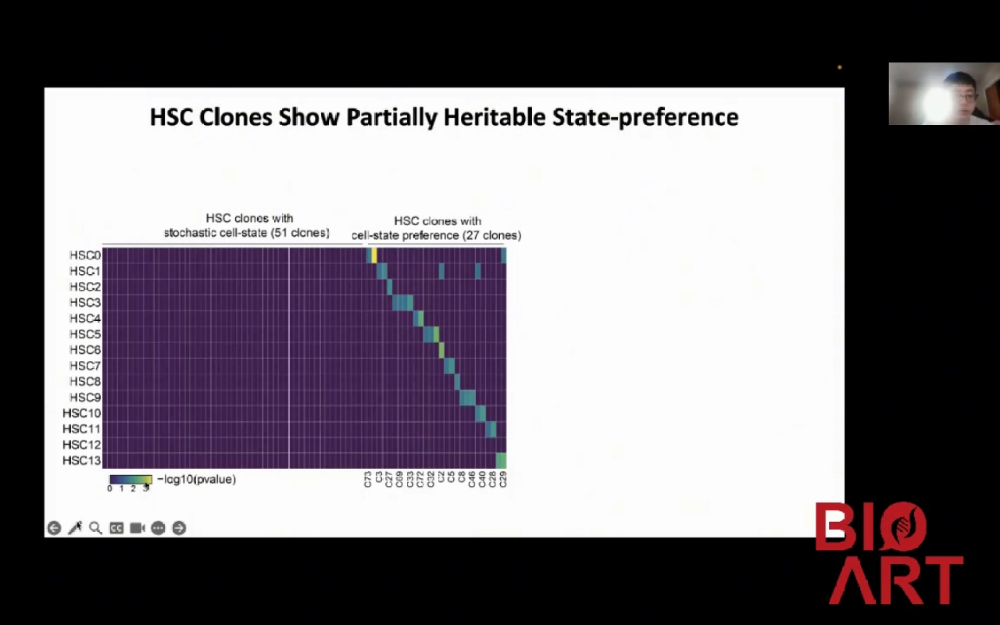

结果是：**78 个克隆组里有 27 个显著富集在某一个或某几个状态亚群**，另外 51 个没有明显偏好。更关键的是，同一个供体间隔四个月取两次骨髓，这种偏好高度一致 [【跳转到 40:54】](https://www.bilibili.com/video/BV1fC41187qG/?t=2454)。

这一步把「状态」和「继承」接上了：**状态偏好本身是可遗传的**。如果只看一次快照，你无法区分「这个克隆偏好某状态」和「这批细胞碰巧处于某状态」；两次取样加上克隆身份，才让这个结论成立。

### 5.4 克隆输出与分化偏向

除了状态偏好，讲者还问行为层面的问题：一个 HSC 克隆能产出多少成熟血细胞、产出哪几类？他们开发了一个算法，把同一供体里已分化的血细胞按 mtDNA 突变 assign 回 HSC 克隆组，从而直接测每个克隆的 output activity [【跳转到 42:34】](https://www.bilibili.com/video/BV1fC41187qG/?t=2554)。

结果有三层：

- 所有 HSC 克隆组都在产出子细胞，但产出能力有 3 到 5 倍的差异，且两次取样高度吻合 [【跳转到 43:49】](https://www.bilibili.com/video/BV1fC41187qG/?t=2629)；
- 约 2/3 的 HSC 在产出成熟血细胞时有偏向（skew），不是完全只产一种，但明显偏向髓系或淋系 [【跳转到 44:44】](https://www.bilibili.com/video/BV1fC41187qG/?t=2684)；
- 这种分化偏向在四个月前后同样稳定 [【跳转到 45:34】](https://www.bilibili.com/video/BV1fC41187qG/?t=2734)。

### 5.5 偏向写在表观上，还没写在表达上

为什么有的克隆产出多、有的偏向淋系？讲者按行为给克隆排序，做差异 peak 分析，发现一个反直觉的结果：**这些 HSC 在干细胞水平的基因表达差别并不大，差异主要在 ATAC peak 上** [【跳转到 46:07】](https://www.bilibili.com/video/BV1fC41187qG/?t=2767)。

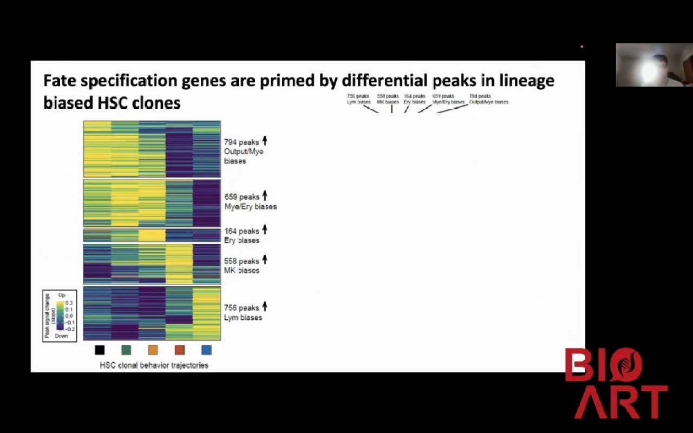

例如淋系偏向的克隆有 756 个特异开放的 peak，这些 peak 周围的基因多与免疫、淋系相关，但在干细胞阶段并不表达。讲者的假设是：**命运偏向先在表观层面被 priming，等真正分化时才在表达上兑现** [【跳转到 47:03】](https://www.bilibili.com/video/BV1fC41187qG/?t=2823)。

这正好解释了为什么单看转录组状态会漏掉命运信息：状态相似的两个 HSC，可能在染色质上已经分道扬镳。

## 六、谱系证据的边界

### 6.1 平行演化：同一个突变独立发生两次

问答里有人问：线粒体突变有倾向性，追踪时间长了会不会不准？讲者的回答点出了自发条码最本质的假象——**平行演化（parallel evolution / homoplasy）**：两个完全独立的分支各自独立地获得了同一个突变，看起来像共享，其实不是遗传下来的 [【跳转到 61:20】](https://www.bilibili.com/video/BV1fC41187qG/?t=3680)。

这与人工条码的「碰撞」是同一类错误，只是机制不同：人工条码是条码空间不够导致撞码，自发突变是突变率与位点偏好导致「同一个答案被独立写了两次」。

讲者的处理办法很实用：**跨供体频率加权**。不同人是独立样本，如果某个突变在很多供体里都高频出现，它更可能是平行演化的产物，计算细胞间距离时就把它的权重降低 [【跳转到 61:45】](https://www.bilibili.com/video/BV1fC41187qG/?t=3705)。另外他们检查了突变在 16K 线粒体基因组上的分布，总体比较分散，没有严重集中在少数热点 [【跳转到 62:35】](https://www.bilibili.com/video/BV1fC41187qG/?t=3755)。

还有一层保险：**用多个突变的组合而不是单个突变**。每个细胞平均有 9 到 10 个突变，一两个有问题可以被其余突变补偿 [【跳转到 63:50】](https://www.bilibili.com/video/BV1fC41187qG/?t=3830)。

### 6.2 异质性要不要用：二值化更干净

mtDNA 突变有异质性水平（带突变的拷贝比例），直觉上「高异质性的两个细胞更近」似乎合理。讲者说他们最终选择**二值化**（有突变/无突变），原因是有两种解释无法区分 [【跳转到 57:35】](https://www.bilibili.com/video/BV1fC41187qG/?t=3455)：

- 一种解释：两个高异质性的细胞确实是最近刚分裂出来的，所以更近；
- 另一种解释：线粒体在分裂时**不均等分配**，一个细胞拿到大量带突变的线粒体、另一个拿到少量，于是异质性差异只反映分配随机性，不反映谱系距离。

既然两种解释都成立，用异质性数值就会引入无法校准的偏差；二值化牺牲了信息，换来更干净的谱系信号。

### 6.3 与 velocity 的分工：过去 vs 将来

问答里有人直接问：ReDeeM 和 Dynamo（RNA velocity 类方法）有什么异同？讲者的回答可以当作本节与 5.2.3/5.2.4 的分界线 [【跳转到 64:40】](https://www.bilibili.com/video/BV1fC41187qG/?t=3880)：

- **谱系追踪**的时间尺度是几个月到几年，问的是「这个克隆在过去这段时间里发生了什么」，看的是**过去**；
- **velocity** 看的是代谢标记/剪接动力学，时间尺度是几小时，问的是「这个细胞当前有哪些 potential、接下来想往哪走」，看的是**将来**。

两者互补，不能互相替代：velocity 给出的是短期的状态导数，谱系给出的是长期的继承史。把两者叠起来，才有可能同时回答「它从哪来」和「它要去哪」。

### 6.4 衰老：克隆多样性下降是能下的结论

讲者最后用两个年轻、两个衰老供体比较克隆结构：衰老个体的 mtDNA 突变负荷升高，谱系树的克隆多样性明显下降，出现多个克隆扩增；换一个队列（5 年轻 + 3 衰老）重复，克隆多样性同样显著下降 [【跳转到 50:16】](https://www.bilibili.com/video/BV1fC41187qG/?t=3016)。

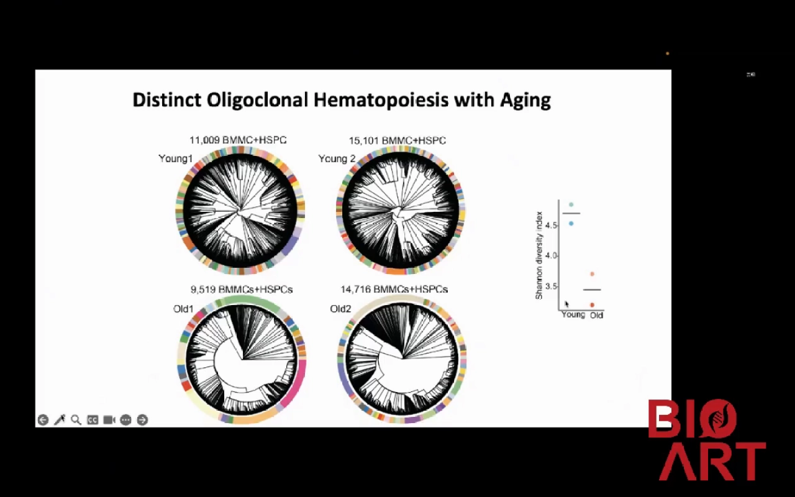

更进一步，他们把这几个扩增按谱系路径分类：A、B 偏向淋系，C 偏髓系，D 偏髓系祖细胞，说明**衰老中的克隆扩增不是单一来源，而是由不同分化路径介导的** [【跳转到 51:05】](https://www.bilibili.com/video/BV1fC41187qG/?t=3065)。

这里能下的结论是「克隆多样性的变化 + 扩增克隆的谱系归属」；不能下的是「哪个突变导致了这个扩增」——讲者明确说这部分工作还在进行。

## 七、这份证据能支持什么、不能支持什么

把全讲收拢成一张判读表：

| 能支持 | 依据 | 不能支持 |
| --- | --- | --- |
| 两个细胞属于同一克隆/亚克隆 | 共享多个独立突变，且跨条码系统验证 | 「它们是母女细胞」这种逐次分裂关系 |
| 克隆之间的相对亲疏与分支归属 | 树拓扑 + clade 定义 | 精确的分叉时间（第几天、第几小时） |
| 某克隆偏好某状态、某输出谱 | 克隆 × 状态富集 + 两次取样重复 | 该偏好由哪个基因/突变造成 |
| 衰老伴随克隆多样性下降与多路径扩增 | 两个队列的树与多样性指数 | 扩增的因果驱动因素 |
| 某类细胞的祖先来自哪一支 | 克隆邻居的分布 | 某个具体细胞当场转变的实时过程 |

反过来，三类「看起来像结论」的表述要打问号：

1. **「这两个细胞没有共享突变，所以无关」**——在检出率不足时，这只能说明没测到（§3.1）；
2. **「这两个细胞共享一个突变，所以同源」**——单个突变可能是平行演化，尤其在突变率高的位点（§6.1）；
3. **「拟时序上 A 在 B 前面，所以 A 是 B 的祖先」**——排序用的是状态相似度，不是继承（5.2.1）。

## 小结

- **谱系追踪测继承，不测相似**：静态条码、CRISPR 演化条码、自发体细胞突变三条路线，读法都是「共享越多、共同祖先越近」。
- **人体内只能靠自发突变**：核基因组两个拷贝、dropout 严重；mtDNA 拷贝多（100–1000）、突变率高（10–100 倍），才让单细胞谱系追踪在人体内可行。
- **检出率就是分辨率**：80% 的细胞只有 0 或 1 个突变时，网络几乎连不起来；ReDeeM 把中位数从 1 提到 9，树才从「连不上」变成「能分亚克隆」。没有共享突变 ≠ 没有亲缘。
- **树是推断出来的**：从共享突变矩阵聚类得到，分叉是拓扑上的相对位置，不是观察到的分裂事件；需要用独立的 CRISPR 条码做交叉验证。
- **谱系 + 状态才是完整证据**：同一细胞同时读 mtDNA、转录组、ATAC，才能问「哪个克隆偏好哪种状态、产出哪类细胞」；HSC 的命运偏向先在 ATAC 上 priming，表达上还看不出来。
- **自发条码有它自己的假象**：平行演化会让独立分支看起来共享，需要用跨供体频率加权、多位点组合来压制；异质性数值受不均等分配干扰，二值化更干净。
- **与 velocity 分工明确**：谱系看几个月到几年的过去，velocity 看几小时的将来，互补而不互替。

## 关键术语速查

| 术语 | 一句话解释 |
| --- | --- |
| 谱系追踪（lineage tracing） | 给细胞一个可遗传标记，通过标记的共享与累积反推细胞之间的亲缘关系 |
| 静态条码（static barcode） | 插入后不再改变的随机 DNA 序列，只能分辨克隆，不记录时间 |
| 演化条码（evolving barcode） | 用 CRISPR 持续写入 indel 的 target array，累积的组合能排出亚克隆先后 |
| 自发条码（natural barcode） | 细胞自己积累的体细胞突变，不需导入，可用于人体 |
| 线粒体 DNA（mtDNA） | 每个细胞 100–1000 个拷贝、突变率约为核基因组 10–100 倍的环状基因组 |
| 异质性（heteroplasmy） | 同一细胞内带某个 mtDNA 突变的拷贝所占比例 |
| 克隆（clone） | 由一个祖先细胞分裂产生的细胞群体；克隆组是谱系树上共享近祖的细胞集合 |
| 亚克隆（subclone） | 克隆内部随时间继续分化出的一支，需要演化条码或高分辨率突变才能分辨 |
| 平行演化（parallel evolution / homoplasy） | 两个独立分支各自独立获得同一突变，伪装成共享 |
| 检出率（detection rate） | 单细胞流程能读出的突变比例；它直接决定谱系树能连多密 |
| 拟时序（pseudotime） | 按表达相似度排出的状态顺序，不是继承关系 |
| RNA velocity | 由剪接/代谢标记推断的短时间尺度状态导数，看的是将来而非过去 |
| ReDeeM | 同一细胞并行测 mtDNA 深度突变、scRNA、scATAC 的多组学谱系追踪系统 |
| agreement of closeness（AOC） | 用两套独立条码比较「近邻是否一致」的验证指标 |