# RNA velocity 动态模型：稳态假设的边界、参数估计与基因筛选

> 视频来源：[MIA: Volker Bergen, RNA velocity generalized to transient cell states through dynamical modeling](https://www.youtube.com/watch?v=QWfd_kSNPgk)（Broad Institute · Models, Inference & Algorithms 系列）｜时长约 61 分钟
> 讲者是 scVelo 动态模型的作者之一。这支报告先把「稳态模型」的假设逐条摊开，再说明动态模型如何用一条完整的相轨迹替掉这些假设，最后讲参数可辨识性、基因筛选和失效条件。本文按报告顺序整理，公式与数字均来自视频画面与字幕。

## 本讲要解决的核心问题（SCQA）

**背景**：RNA 速率的第一代做法（velocyto，2018）只需要两个数：每个细胞里每个基因的未剪接计数 $u$ 与已剪接计数 $s$。它假设这群细胞里存在稳态，用稳态处的 $u/s$ 比值当参考线，把每个点相对这条线的残差当作速率。

**冲突**：这个做法把「稳态被采样到」写进了前提。可真实体系里经常没有稳态：转录只开了一小时就关掉、取样只覆盖了相轨迹的一小段、或者细胞正处在快速响应中。这时拟合出来的比值线是外推的，残差也就不是速率。

**疑问**：能不能不依赖稳态？如果把「时间」本身当作未知量一起解出来，需要付出什么代价——多出哪些参数、哪些参数变得不可辨识、结果又该怎么筛选基因和判断可信度？

**回答（中心思想）**：动态模型把 $\mathrm{d}u/\mathrm{d}t$ 与 $\mathrm{d}s/\mathrm{d}t$ 这组线性常微分方程**完整解出来**，把每个细胞的采样时刻 $t_i$ 和它所属的转录状态 $k_i$ 当作潜变量，用期望最大化在「参数」与「潜变量」之间交替求解。代价是：必须假设跨基因共享剪接速率与降解速率、必须靠统一时间把第三个速率从不可辨识变成可辨识、并且必须用基因似然把「有动力学的基因」和「纯噪声」分开。收益是：不再需要稳态，还能顺带得到潜在时间（latent time）与转录开关时间。

## 一、为什么需要相空间里的箭头

### 1.1 相似度排序能做什么、不能做什么

报告先回顾了常规路线：把细胞看成一张相似度图，从一个起点做扩散游走，就得到一条按转录组相似度排出的轨迹 [【跳转到 05:10】](https://www.youtube.com/watch?v=QWfd_kSNPgk&t=310)。这相当于一张延时摄影：你没有视频，但把快照按相似度排好，也能看出一点过程 [【跳转到 05:35】](https://www.youtube.com/watch?v=QWfd_kSNPgk&t=335)。

问题出在更复杂的情形：一旦要判断**谱系决定**、要判断分叉点上哪些细胞已经确定了命运，仅靠相似度就不够了，需要额外的信息 [【跳转到 06:00】](https://www.youtube.com/watch?v=QWfd_kSNPgk&t=360)。理想情况下你希望拿到完整的相空间，在相似度图上再叠一个箭头——这就是 RNA velocity [【跳转到 06:25】](https://www.youtube.com/watch?v=QWfd_kSNPgk&t=385)。

### 1.2 两个计数模态是怎么来的

从 DNA 转录出前体 mRNA（带内含子和外显子），内含子被剪掉、外显子连接起来，得到成熟 mRNA，最后降解 [【跳转到 08:12】](https://www.youtube.com/watch?v=QWfd_kSNPgk&t=492)。

关键在于：**标准建库方案本身就能区分这两类分子**——看 reads 里有没有内含子、有没有外显子—内含子边界即可 [【跳转到 09:02】](https://www.youtube.com/watch?v=QWfd_kSNPgk&t=542)。于是同一个基因有了两个模态：未剪接（旧）与已剪接（新）。报告把这一点称作「数据里自带的时间序列线索」。

### 1.3 线性常微分方程

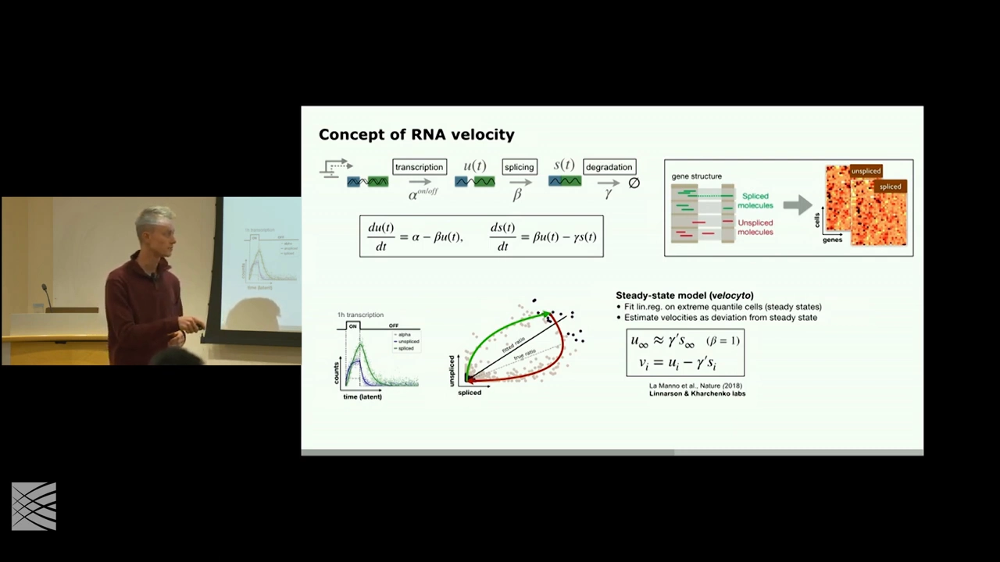

$$\frac{\mathrm{d}u(t)}{\mathrm{d}t} = \alpha - \beta u(t), \qquad \frac{\mathrm{d}s(t)}{\mathrm{d}t} = \beta u(t) - \gamma s(t)$$

三个速率、两个方程。报告强调，和金融里的时间序列不同：**这里的时间不是测出来的，时间是潜变量，必须一起推断** [【跳转到 09:52】](https://www.youtube.com/watch?v=QWfd_kSNPgk&t=592)。原因很直接——测序对细胞是破坏性的，一个细胞只能测一次，所以你只有快照 [【跳转到 10:17】](https://www.youtube.com/watch?v=QWfd_kSNPgk&t=617)。

## 二、稳态模型：一条比值线加三个假设

### 2.1 诱导与抑制两段

设想转录开三小时然后关掉：先是诱导期，未剪接先升、已剪接随后跟上；转录终止后进入抑制期，未剪接先指数衰减、已剪接随后跟上 [【跳转到 10:42】](https://www.youtube.com/watch?v=QWfd_kSNPgk&t=642)。在相平面（横轴 $s$、纵轴 $u$）上，这条轨迹是一段带曲率的环。

如果这段轨迹的两端都有细胞被采样到（也就是存在稳态），事情就可以大大简化 [【跳转到 11:07】](https://www.youtube.com/watch?v=QWfd_kSNPgk&t=667)。

### 2.2 稳态模型做了什么

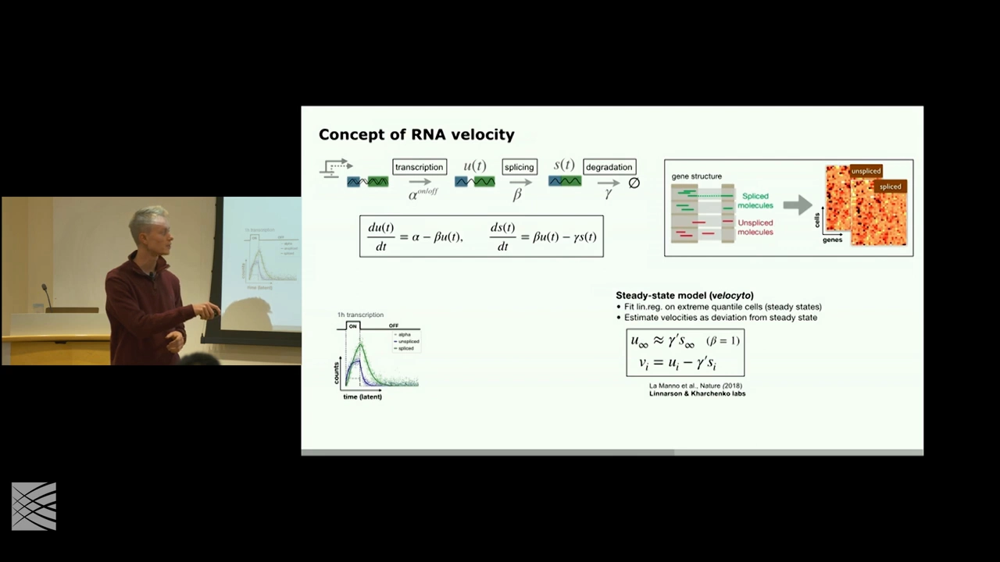

报告把稳态模型概括成两步 [【跳转到 11:57】](https://www.youtube.com/watch?v=QWfd_kSNPgk&t=717)：

1. **在极端分位数细胞上做线性回归**，得到稳态处的 $u/s$ 比值；
2. **把速率估计为相对稳态的偏差**，即 $v_i = u_i - \gamma' s_i$。

这里已经藏了两个假设：

- **假设 A：稳态被采样到。** 回归只用了「极端分位数」的那些细胞，它们被当作稳态样本；中间那些细胞的信息完全没进入拟合。
- **假设 B：跨基因共享剪接速率。** 因为方程里 $\beta$ 与 $\gamma$ 只以比例出现、不可辨识，所以把 $\beta$ 设为 1，等价于假定所有基因共用同一个剪接速率 [【跳转到 12:22】](https://www.youtube.com/watch?v=QWfd_kSNPgk&t=742)。

### 2.3 假设 A 什么时候崩

报告给了一个非常具体的反例：如果转录不是三小时而只有一小时，细胞可能还没到稳态就切进了抑制期 [【跳转到 13:12】](https://www.youtube.com/watch?v=QWfd_kSNPgk&t=792)。

这时相轨迹的形状变成「提前拐弯」：未剪接还没升到平台就开始下降。如果你仍然只在极端点上拟合，得到的比值线就会偏，速率也跟着偏——报告的原话是「用拟合出的比值可能相当误导」[【跳转到 13:37】](https://www.youtube.com/watch?v=QWfd_kSNPgk&t=817)。

第二种崩法更常见：**只测到动力学的一部分**。取样窗口只覆盖了相轨迹的一段，既没有起点也没有稳态，模型仍然会失败 [【跳转到 14:02】](https://www.youtube.com/watch?v=QWfd_kSNPgk&t=842)。报告把这类情形归给「快速变化的系统」——发育、响应型扰动。

### 2.4 稳态模型的三个代价

报告自己总结了稳态模型的缺点 [【跳转到 14:27】](https://www.youtube.com/watch?v=QWfd_kSNPgk&t=867)：

- 必须假设有稳态被采样到；
- 没有用上全部样本，只用了极端点；
- 无法学习相轨迹的曲率，而曲率正是区分「诱导中」与「已达稳态」的信息。

## 三、动态模型：把时间当作潜变量解出来

### 3.1 完整解

报告说，他们一开始只是想加入随机性，后来干脆决定「把它完全解出来」——包括时间、包括转录状态、包括所有参数 [【跳转到 14:52】](https://www.youtube.com/watch?v=QWfd_kSNPgk&t=892)。

这个常微分方程是线性的，可以直接写出解析解 [【跳转到 15:17】](https://www.youtube.com/watch?v=QWfd_kSNPgk&t=917)：

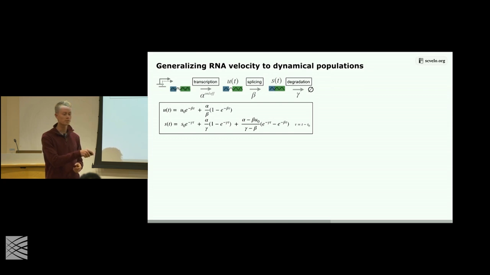

$$u(t) = u_0 e^{-\beta\tau} + \frac{\alpha}{\beta}\left(1 - e^{-\beta\tau}\right)$$

$$s(t) = s_0 e^{-\gamma\tau} + \frac{\alpha}{\gamma}\left(1 - e^{-\gamma\tau}\right) + \frac{\alpha - \beta u_0}{\gamma - \beta}\left(e^{-\gamma\tau} - e^{-\beta\tau}\right), \quad \tau = t - t_0$$

解里有一堆项：描述「开」的动力学、描述「关」的动力学、以及描述未剪接与已剪接协同变化的项。参数一多，看起来「几乎不可能解出来」[【跳转到 15:17】](https://www.youtube.com/watch?v=QWfd_kSNPgk&t=917)。

### 3.2 参数与潜变量的分工

报告把未知量分成两类 [【跳转到 15:42】](https://www.youtube.com/watch?v=QWfd_kSNPgk&t=942)：

| 类别 | 内容 | 是否关心 |
| --- | --- | --- |
| 速率参数 $\theta$ | $\alpha^{off}$、$\alpha^{on}$、$\beta$、$\gamma$ | 关心（方向速率就是它们） |
| 细胞特异的潜变量 $\eta_i$ | 采样时间 $t_i$、所属转录状态 $k_i$ | 不直接关心，但必须解出来 |

转录状态被建模成四个：诱导、抑制、以及两个稳态 [【跳转到 16:07】](https://www.youtube.com/watch?v=QWfd_kSNPgk&t=967)。另外还要考虑基础转录（basal transcription）——抑制期不一定完全关掉，可能还有一个低水平的转录速率。

### 3.3 鸡生蛋问题与 EM

如果时间序列已知、开关点已知，就能推断速率；反过来，速率已知就能推断时间点。两个都未知，就成了鸡生蛋问题 [【跳转到 16:32】](https://www.youtube.com/watch?v=QWfd_kSNPgk&t=992)。

解法是期望最大化（EM）：固定一组参数、解另一组，再交换，迭代到收敛 [【跳转到 16:57】](https://www.youtube.com/watch?v=QWfd_kSNPgk&t=1017)。报告很实在地加了一句：**不保证收敛**，但在他们关心的情形里能收敛。

具体流程是三步循环：

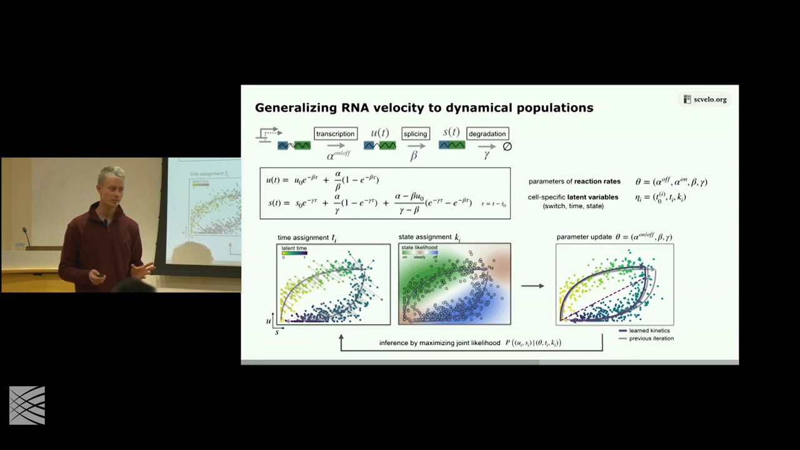

1. **初始化**：用稳态模型的参数作为起点。报告承认，一开始拟合得很不好、离数据很远 [【跳转到 17:22】](https://www.youtube.com/watch?v=QWfd_kSNPgk&t=1042)。
2. **时间分配**：把每个观测投影到当前这条相轨迹上，找到对应的时刻 $t_i$——因为轨迹由常微分方程显式给出，这一步就是找「曲线上离这个点最近的时刻」[【跳转到 17:22】](https://www.youtube.com/watch?v=QWfd_kSNPgk&t=1042)。
3. **状态分配**：对每个样本，计算它到「开」曲线、到「关」曲线、到两个稳态的最短距离，得到四个似然，取最大或对似然积分 [【跳转到 18:12】](https://www.youtube.com/watch?v=QWfd_kSNPgk&t=1092)。
4. **参数更新**：用梯度下降（带动量）优化由似然导出的损失函数 [【跳转到 18:37】](https://www.youtube.com/watch?v=QWfd_kSNPgk&t=1117)。如果假设残差方差在所有样本上相同，似然就退化成均方误差，优化非常简单 [【跳转到 19:02】](https://www.youtube.com/watch?v=QWfd_kSNPgk&t=1142)。

### 3.4 两个实现细节

**时间可以显式算出来。** 理论上最优的时间分配是正交投影（到曲线上最短距离）；为了效率，他们改成把 $s$ 写成 $u$ 与时间的函数，再反解出时间——也就是把时间写成 $s$ 与 $u$ 的显式表达式 [【跳转到 19:33】](https://www.youtube.com/watch?v=QWfd_kSNPgk&t=1173)。只有最后一次迭代才真正做基于似然的求解。

**噪声模型不是关键。** 有人问噪声模型，报告回答：用的是全似然，验证过拟合，真实数据上看起来也没问题；也试过其他噪声模型，但「不会让它更好或更坏」[【跳转到 20:38】](https://www.youtube.com/watch?v=QWfd_kSNPgk&t=1238)。

**但似然本身是有用的。** 因为每个样本都有一个似然，当某个点落在相轨迹中心附近、归属本来就模糊时，它的似然会自动变低——这相当于把不确定性内建进了模型 [【跳转到 22:08】](https://www.youtube.com/watch?v=QWfd_kSNPgk&t=1328)。

### 3.5 动态模型到底换掉了什么

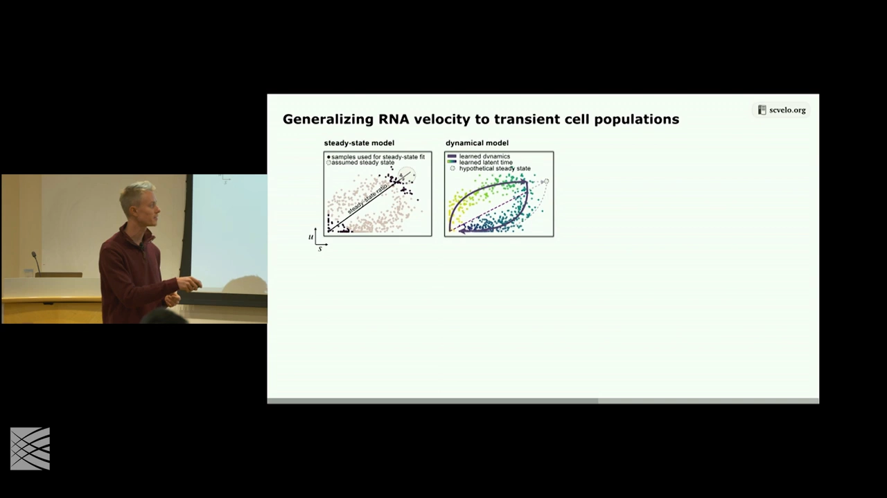

报告的核心主张是：动态模型得到的速率**对转录开关不敏感**，因为开关本身被一起学出来了；因此不再依赖任何稳态，甚至可以拟合**没有被观测到的稳态** [【跳转到 25:12】](https://www.youtube.com/watch?v=QWfd_kSNPgk&t=1512)。

他们用模拟验证了这一点：2,000 个基因、对数正态分布的参数，把转录诱导时长在 2 到 10 小时之间变动。10 小时大概率会到稳态，2 小时大概率不会。结果是：**稳态模型的估计误差会随诱导时长系统性上升，动态模型则完全不受影响** [【跳转到 25:42】](https://www.youtube.com/watch?v=QWfd_kSNPgk&t=1542)。

## 四、参数可辨识性：从两个到三个

### 4.1 两个参数可以直接估

在模拟数据上，动态模型能相当好地恢复真实速率：转录速率、剪接速率、降解速率的估计值与真值相关系数都在 0.85–0.88 左右 [【跳转到 26:32】](https://www.youtube.com/watch?v=QWfd_kSNPgk&t=1592)。

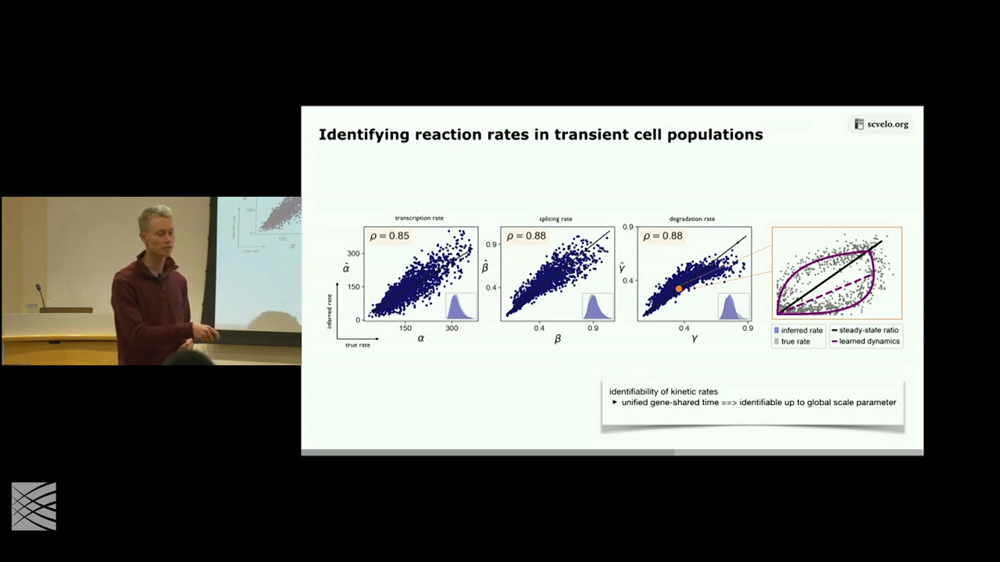

但报告明确指出：**只有两个参数是可辨识的**，第三个要靠额外约束。

### 4.2 统一时间把第三个参数救回来

关键观察是：到目前为止，时间对每个基因是**各自学**的——每个基因一条时间曲线。但真实情况是这些时间来自同一个底层时钟，所以可以施加约束：所有基因的时间曲线应该一样长、形状一致 [【跳转到 27:22】](https://www.youtube.com/watch?v=QWfd_kSNPgk&t=1642)。

把时间统一成「基因共享时间」之后，剪接速率也能被辨识出来——但只到**一个全局尺度参数**为止：所有基因、所有参数共用一个 $\lambda$ [【跳转到 27:22】](https://www.youtube.com/watch?v=QWfd_kSNPgk&t=1642)。

如果再额外假定时间曲线的总长度（比如 20 小时），连绝对数值都能定下来 [【跳转到 27:47】](https://www.youtube.com/watch?v=QWfd_kSNPgk&t=1667)。

这段是整场报告里最值得记住的方法论：**可辨识性不是一个技术细节，而是「你愿意额外假设什么」的交换**。稳态模型用「共享剪接速率 + 有稳态」换来了简单；动态模型用「共享时间 + 共享尺度」换来了三个速率。

## 五、基因筛选：用似然而不是方差

### 5.1 为什么需要筛选

有了解析解之后，速率就是把参数代回去：$\mathrm{d}s/\mathrm{d}t$ 直接可算 [【跳转到 28:12】](https://www.youtube.com/watch?v=QWfd_kSNPgk&t=1692)。但问题在于，**不是所有基因都有可辨识的动力学**。噪声基因也能拟合出一条曲线，只是它没有意义。

### 5.2 基因似然

因为模型是基于似然的，可以把每个细胞的似然按基因聚合，得到**每个基因一个总似然** [【跳转到 31:07】](https://www.youtube.com/watch?v=QWfd_kSNPgk&t=1867)。

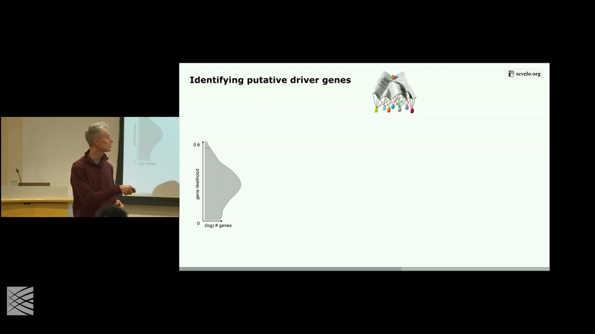

报告的描述很具体：

- 取似然最高的那批基因，能看到它们确实呈现漂亮的上调/下调动力学，收敛后的似然可以到 0.7 左右；
- 随机挑基因、或从似然分布的**低分位数**里挑，看到的「纯噪声」，这些基因对速率几乎没有贡献，而且常常不收敛，最优点落在 0.1 附近 [【跳转到 31:32】](https://www.youtube.com/watch?v=QWfd_kSNPgk&t=1892)。

报告把这件事的意义讲得很清楚：这相当于在**时间分辨率上**做了一次类似差异表达的分析——不是问「两组之间有没有差别」，而是问「这个基因有没有可辨识的转录动力学」[【跳转到 31:57】](https://www.youtube.com/watch?v=QWfd_kSNPgk&t=1917)。

### 5.3 前 30 个基因就能重建向量场

为了验证这批「驱动基因」不是拟合出来的假象，他们做了个计算实验：只用似然最高的 30 个基因去重建速率向量场，结果**几乎完美重建**；反过来，去掉这 30 个、只用其余约 8,000 个基因，向量场完全崩掉 [【跳转到 32:22】](https://www.youtube.com/watch?v=QWfd_kSNPgk&t=1942)。

这说明动力学信息高度集中在少数基因上。报告同时给了一个重要限定：这些只能叫 **putative drivers（推定驱动基因）**——因为 3′ 端建库对 intron 的捕获效率取决于内含子离 3′ 端有多远，内含子位置不好的基因本来就不容易被观测到 [【跳转到 33:34】](https://www.youtube.com/watch?v=QWfd_kSNPgk&t=2014)。

### 5.4 实际筛选参数

问答里给了两条经验 [【跳转到 49:04】](https://www.youtube.com/watch?v=QWfd_kSNPgk&t=2944)：

- **细胞数**：尽量多，但**必须按批次拆开**；如果确定有批次效应，就分批单独做。
- **基因数**：影响不大，只要覆盖到驱动基因即可；常规做法是取 2,000–5,000 个高变基因，「完全够用」。

## 六、在真实数据上：稳态模型哪里会出错

### 6.1 海马数据集：稳态模型的噪声来自极端点

在海马数据上，两个模型都能给出「神经祖细胞 → 颗粒细胞」以及「→ 星形胶质细胞」的整体图像 [【跳转到 28:12】](https://www.youtube.com/watch?v=QWfd_kSNPgk&t=1692)。差别出现在**离谱系较远的细胞类型**上。

原因报告讲得很直白：稳态模型在极端分位数上拟合，然后取残差；这些残差会以**离群值**的形式冒出来，这就是速率噪声的来源。想知道投影出来的箭头为什么乱，就回去看相平面——乱的地方就是相平面上被误当作稳态的极端点 [【跳转到 28:37】](https://www.youtube.com/watch?v=QWfd_kSNPgk&t=1717)。

动态模型对这些点的处理不同：它给这些点**很低的似然**，因为它们无法被瞬态轨迹解释，于是被归到稳态；因此动态模型把它们识别成终点，而稳态模型给出的是「一致性上的噪声」[【跳转到 30:17】](https://www.youtube.com/watch?v=QWfd_kSNPgk&t=1817)。

### 6.2 胰腺内分泌发育：反流与细胞周期

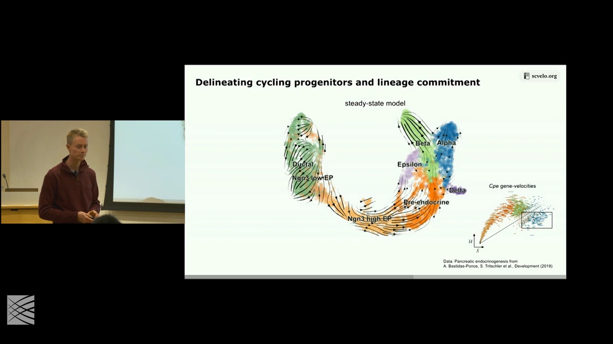

在胰腺内分泌发育数据上（四种命运：α、β、δ、ε 细胞），稳态模型能抓住整体动力学，但局部出现**反流**——流向看起来自相矛盾 [【跳转到 34:51】](https://www.youtube.com/watch?v=QWfd_kSNPgk&t=2091)。追到驱动基因的相平面上才发现：极端点拟合把 α 细胞「切」成了诱导期和抑制期两段，于是产生负残差，反流就是这么来的 [【跳转到 35:16】](https://www.youtube.com/watch?v=QWfd_kSNPgk&t=2116)。

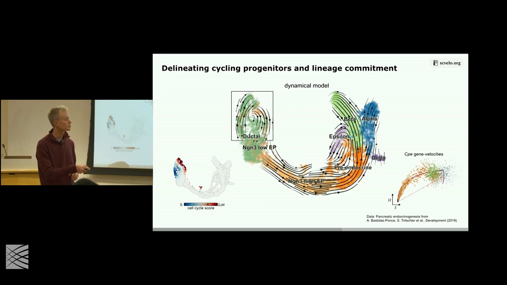

动态模型给出的是相当平滑的向量场，而且**没有加额外平滑**，完全来自单细胞速率 [【跳转到 36:06】](https://www.youtube.com/watch?v=QWfd_kSNPgk&t=2166)。报告还提到一个有趣的细节：有一块区域他一开始以为是 bug，后来用实验和细胞周期打分验证，发现那确实是细胞周期 [【跳转到 36:56】](https://www.youtube.com/watch?v=QWfd_kSNPgk&t=2216)。

## 七、顺带得到的两样东西：潜在时间与开关时间

### 7.1 潜在时间不是伪时间

因为每个细胞都有 $t_i$，把所有基因的时间增量取中位数，就得到一个**统一时间点**：某个基因给出的时间可能模糊（早一点晚一点都说得通），但其他基因会替它做决定 [【跳转到 38:11】](https://www.youtube.com/watch?v=QWfd_kSNPgk&t=2291)。

这样得到的潜在时间（latent time）根植于某个细胞，而这个根是**从向量场本身推断出来的**，不需要用户指定 [【跳转到 38:36】](https://www.youtube.com/watch?v=QWfd_kSNPgk&t=2316)。

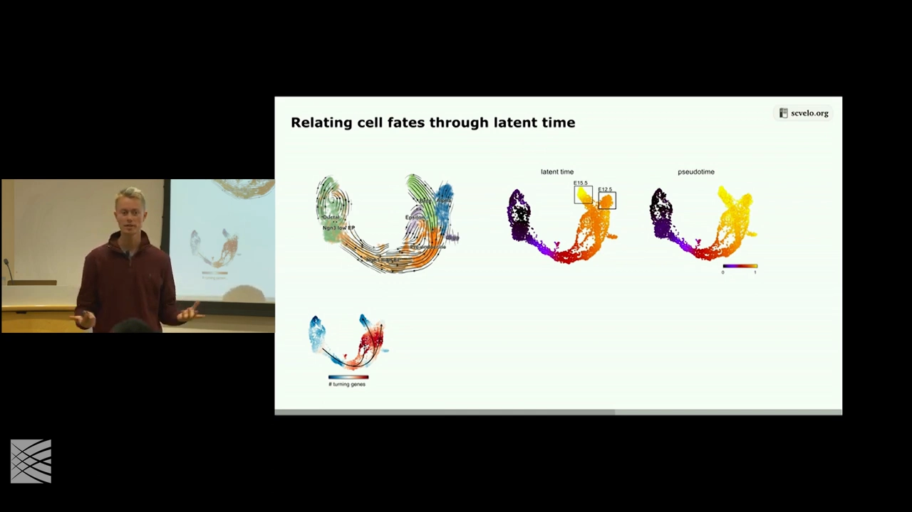

报告给了一个直接对照：在胰腺数据上，α 细胞在胚胎第 9–12 天产生，β 细胞在胚胎第 12–15 天及之后产生。伪时间沿着相似度图走，**无法区分 α 与 β**，两者被同等对待；潜在时间则把两种命运的前后关系理出来了——先 α 后 β [【跳转到 39:26】](https://www.youtube.com/watch?v=QWfd_kSNPgk&t=2366)。

这条对照很重要：**潜在时间不是伪时间的另一种算法，而是另一路信息**——它来自转录动力学，与相似度连通性无关 [【跳转到 39:01】](https://www.youtube.com/watch?v=QWfd_kSNPgk&t=2341)。

### 7.2 开关时间与命运决定

动态模型还学到每个基因的**开关时间**：转录从诱导切到抑制（或切到稳态）的那个时刻。把所有基因的开关计数画到嵌入图上，会发现开关密集的区域正好落在分支点上 [【跳转到 41:06】](https://www.youtube.com/watch?v=QWfd_kSNPgk&t=2466)。

进一步，可以把基因似然的计算**限制在某个区域**（比如某个分支点），找出在这个区域里动力学最漂亮的基因，再沿潜在时间展示它们的级联 [【跳转到 42:21】](https://www.youtube.com/watch?v=QWfd_kSNPgk&t=2541)。这样得到的不是「哪些基因差异表达」，而是「哪些基因在这个时刻、这个位置切换」。

## 八、什么时候不能信：报告自己列出的失效条件

报告最后一页的标题是「After all, can I trust my arrows?」——能不能信这些箭头 [【跳转到 54:04】](https://www.youtube.com/watch?v=QWfd_kSNPgk&t=3244)。

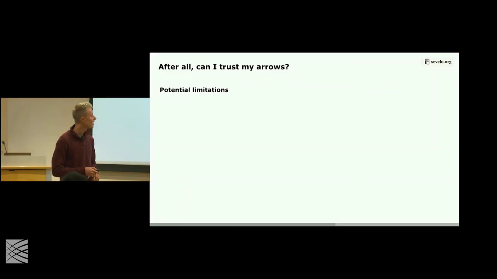

### 8.1 可变剪接

如果相平面上出现**两条不同斜率的线**，基本可以确定是可变剪接（alternative splicing）造成的——同一个基因的不同异构体有不同的剪接动力学，单一速率的模型描述不了 [【跳转到 54:04】](https://www.youtube.com/watch?v=QWfd_kSNPgk&t=3244)。

### 8.2 降解速率在变

更麻烦的是降解速率本身随状态变化：报告说降解本身也受调控、属于差异基因调控的一部分，如果降解沿轨迹缓慢上升，那么在最坏的情况下，**相轨迹末端的方向性会整个反过来** [【跳转到 54:29】](https://www.youtube.com/watch?v=QWfd_kSNPgk&t=3269)。

这一条尤其值得记住：它不是「精度下降」，而是**方向可能整体反向**。目前他们的处理是设一些阈值把这些基因过滤掉，报告承认这只是权宜之计。

### 8.3 状态归属的歧义

单看一个基因时，很难判断某个点到底是「下游流动」还是「处在诱导期」；目前唯一把基因耦合起来的手段是潜在时间，报告认为这还能做得更好 [【跳转到 55:19】](https://www.youtube.com/watch?v=QWfd_kSNPgk&t=3319)。

细胞数很少时这个问题最突出：一条直线既可以归到诱导、也可以归到抑制，模型无从判断 [【跳转到 45:49】](https://www.youtube.com/watch?v=QWfd_kSNPgk&t=2749)。

### 8.4 投影失败与孤立细胞

高维速率向量要投影到嵌入图上，做法是看「哪些细胞间转移与这个速率向量相关」，得到转移概率，再算期望位移 [【跳转到 55:44】](https://www.youtube.com/watch?v=QWfd_kSNPgk&t=3344)。

这个投影会失败：如果**没有细胞落在速率向量指向的位置**，就没有匹配的转移，投影不可靠。报告说这通常只发生在细胞数很少时，但孤立细胞（不与主轨迹相连）也会出问题 [【跳转到 56:09】](https://www.youtube.com/watch?v=QWfd_kSNPgk&t=3369)。

### 8.5 根细胞的识别

潜在时间需要根。当前实现很简单：取转移矩阵的左特征向量，得到终点状态 [【跳转到 43:49】](https://www.youtube.com/watch?v=QWfd_kSNPgk&t=2629)。问题是**孤立细胞没有出流，也会被识别成根**，于是潜在时间整体错位 [【跳转到 44:10】](https://www.youtube.com/watch?v=QWfd_kSNPgk&t=2650)。他们后来加了一版同时从终点回推的实现，让结果稳健一些 [【跳转到 45:00】](https://www.youtube.com/watch?v=QWfd_kSNPgk&t=2700)。

### 8.6 批次与群体间剪接差异

如果某个群体的剪接动力学与其余群体完全不同（可能来自批次，也可能来自真实的剪接差异），相平面上会分成互不相连的两团。报告的建议是：**有批次标签就分批做、分别检查** [【跳转到 47:36】](https://www.youtube.com/watch?v=QWfd_kSNPgk&t=2856)。

### 8.7 没有经验法则

被问到「多少细胞、多少基因才够」时，报告的回答是：没有 rule of thumb，**必须回到相平面去看模型到底推断出了什么**，再据此判断 [【跳转到 46:36】](https://www.youtube.com/watch?v=QWfd_kSNPgk&t=2796)。这与「箭头好不好看」是两件事。

## 九、报告给出的可信度工具

因为上述失效条件无法全部消除，报告强调他们在流程里放了**多种置信度度量**与探索性分析，用来检查两件事 [【跳转到 56:59】](https://www.youtube.com/watch?v=QWfd_kSNPgk&t=3419)：

- 高维空间里的速率本身是否可信；
- 投影到嵌入图之后的箭头是否可信。

其中一个是**自洽性打分**（self-consistency）：看一个细胞的速率与它邻居的速率有多一致。动态模型在这项上得分更高，因为它不像稳态模型那样依赖极端点、对噪声更不敏感 [【跳转到 30:17】](https://www.youtube.com/watch?v=QWfd_kSNPgk&t=1817)。

报告还提到一个基于矩（moment）的扩展：把转录、剪接、降解当作概率事件写出化学主方程，用一阶与二阶矩（方差、协方差）做闭包，可以改进稳态估计，让向量场更连贯 [【跳转到 49:48】](https://www.youtube.com/watch?v=QWfd_kSNPgk&t=2988)。这部分他们只做了稳态模型的扩展，动态模型还没做。

## 小结

- **稳态模型 = 一条比值线 + 两个假设**：必须有稳态被采样到；跨基因共享剪接速率（$\beta=1$，因为不可辨识）。它只用极端分位数，中间样本的信息被丢掉。
- **假设会在两种情形崩**：转录时间太短、细胞没到稳态就切换；取样只覆盖相轨迹的一段。
- **动态模型 = 解出整条相轨迹**：把时间 $t_i$ 与转录状态 $k_i$ 当潜变量，用 EM 在参数与潜变量之间交替，损失函数在等方差假设下退化为均方误差。
- **可辨识性靠额外假设换**：两个速率可直接估；统一「基因共享时间」后剪接速率可辨识到全局尺度；再假定时间总长才能定绝对值。
- **基因筛选靠似然，不靠方差**：每个基因一个总似然，高似然端是真正有动力学的基因，低似然端是噪声；前 30 个高似然基因就能重建向量场，但它们只能叫「推定驱动基因」（3′ 建库对内含子的捕获有偏）。
- **顺带得到潜在时间与开关时间**：潜在时间来自转录动力学、与相似度无关，能分开伪时间分不开的顺序（先 α 后 β）；开关密集处对应命运决定的分支点。
- **失效条件要逐条查**：可变剪接（相平面出现两条斜率）、降解速率随状态变化（方向可能整体反向）、状态归属歧义（细胞少时最严重）、孤立细胞导致投影失败与根识别错误、批次或群体间剪接差异。
- **没有经验法则**：细胞数尽量多但要分批，基因取 2,000–5,000 高变基因够用；最终判断要回到相平面和置信度度量，而不是箭头好不好看。

## 关键术语速查

| 术语 | 一句话解释 |
| --- | --- |
| steady-state model（稳态模型） | 在极端分位数细胞上拟合 $u/s$ 稳态比值，把速率当作相对该比值的残差；要求稳态被采样到 |
| dynamical model（动态模型） | 解出完整的 $\mathrm{d}u/\mathrm{d}t$、$\mathrm{d}s/\mathrm{d}t$ 相轨迹，把每个细胞的采样时间与转录状态当潜变量 |
| latent variable（潜变量） | 模型里不直接观测、需要推断的量：这里是采样时间 $t_i$ 与转录状态 $k_i$ |
| EM（期望最大化） | 固定参数解潜变量、固定潜变量解参数的交替迭代；不保证收敛 |
| identifiability（可辨识性） | 参数能否由数据唯一确定；$\beta$ 与 $\gamma$ 只以比例出现时不可辨识，需设 $\beta=1$ 或施加共享时间约束 |
| gene-shared time（基因共享时间） | 假定所有基因的时间曲线来自同一个底层时钟，用来把剪接速率辨识到一个全局尺度 |
| gene likelihood（基因似然） | 把一个基因在所有细胞上的似然聚合成的总分，用来区分「有动力学」与「纯噪声」 |
| putative drivers（推定驱动基因） | 似然最高、能重建向量场的那批基因；受 3′ 建库对内含子捕获偏好影响，不等于因果驱动 |
| latent time（潜在时间） | 由转录动力学推断出的统一时间轴，根由向量场自行确定，与相似度排序无关 |
| switching time（开关时间） | 基因从诱导切换到抑制（或稳态）的时刻；开关密集处常对应命运决定的分支点 |
| backflow（反流） | 稳态模型在局部给出与整体谱系相反的方向，常由极端点被误当稳态造成 |
| self-consistency（自洽性） | 一个细胞的速率与邻居速率的一致性打分，用来衡量向量场的可信度 |