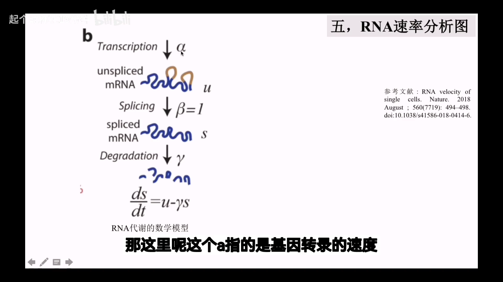
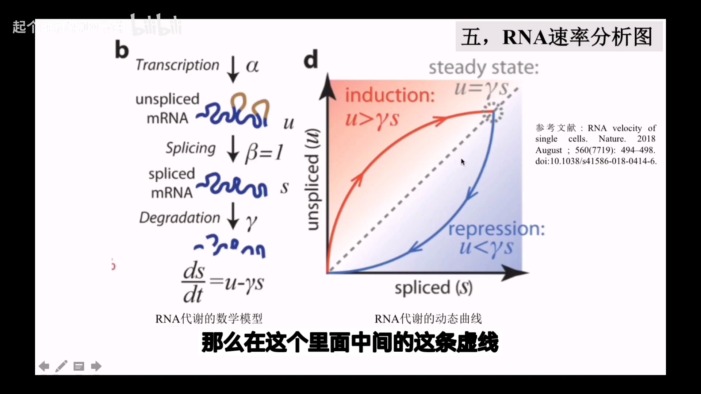
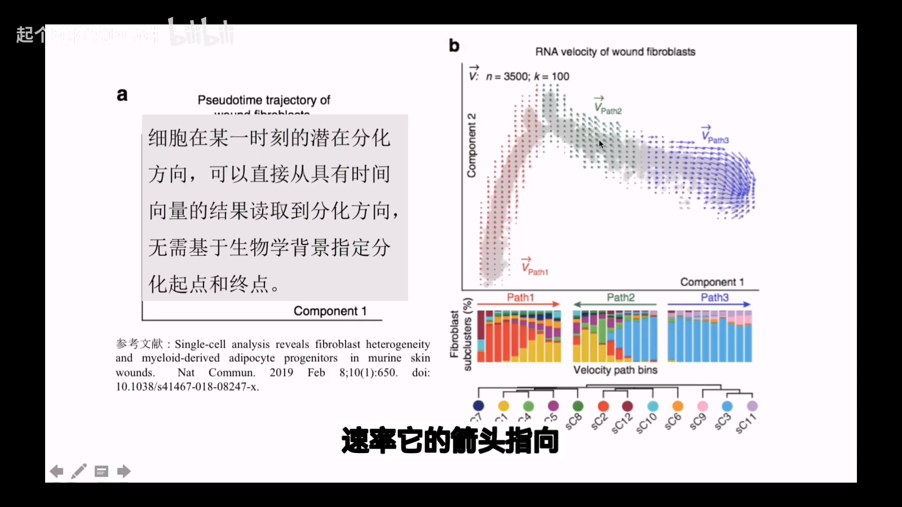
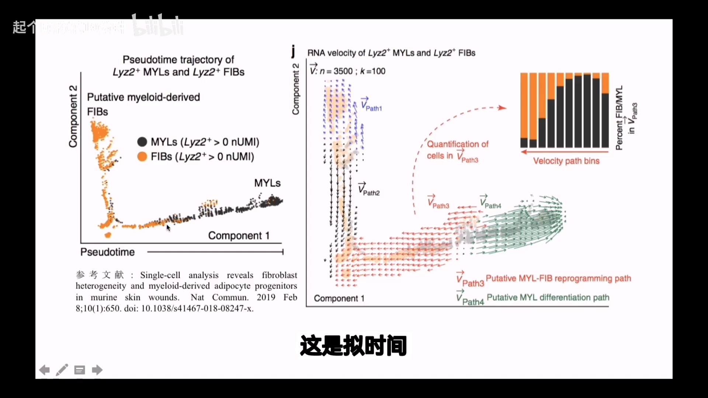

# RNA 速率图的读法：剪接动力学、相平面与速率向量

> 视频来源：[单细胞测序 5 — RNA 速率图](https://www.bilibili.com/video/BV1TB4y1s7X8/)（B 站 · 起个昵称花 10 分钟）｜时长约 10 分钟
> 这支视频用一张原始论文的示意图，把 RNA 速率（RNA velocity）的**代谢模型、相平面、速率向量和结果图**串成一条线。本文按视频顺序整理，并把「哪些是模型给的、哪些是读图时要注意的」标出来。

## 本讲要解决的核心问题（SCQA）

**背景**：单细胞测序做完降维聚类，常见的一张图是 RNA 速率图：一堆细胞上叠着长短不一的箭头，箭头指向被解释成「细胞接下来往哪走」。

**冲突**：这张图看起来像拍到了细胞运动，但测序拿到的只是一批细胞的**分子计数快照**。箭头既不是观测到的位移，也不是真实时间里的速度；它是由「未剪接 / 已剪接」两类计数经过一个动力学模型算出来的量。

**疑问**：未剪接和已剪接的计数为什么能推出方向？「速率」到底是谁对谁的导数？图上那条虚线是什么，为什么线两侧的箭头方向相反？这套推理依赖什么假设？

**回答（中心思想）**：RNA 速率把**一个基因的转录—剪接—降解**写成一个三速率的代谢链，用未剪接（$u$）与已剪接（$s$）两类计数的**比例偏离稳态的程度**当作基因表达状态的时间导数 $\mathrm{d}s/\mathrm{d}t$；把每个基因的这个导数拼起来，就得到单个细胞在表达空间里的一个向量。所以整张图的含义完全取决于两件事：**代谢模型对不对**，以及**稳态这条参考线画得准不准**。

## 一、一条基因的代谢链：三个速率、两个计数

### 1.1 三个速率

视频引的是 2018 年 Nature 上提出 RNA 速率的那篇文章，文章给出了一个 RNA 代谢的数学模型 [【跳转到 00:05】](https://www.bilibili.com/video/BV1TB4y1s7X8/?t=5)。模型里只有三个速率：

| 符号 | 名称 | 作用 |
| --- | --- | --- |
| $\alpha$ | 转录速率 | DNA 转录出未剪接 mRNA 的速度 |
| $\beta$ | 剪接速率 | 未剪接 mRNA 被剪接成成熟 mRNA 的速度 |
| $\gamma$ | 降解速率 | 成熟 mRNA 被降解的速度 |

对应的两个观测量是：未剪接 mRNA 的分子数 $u$（视频里念作「未剪切」，指还带内含子的 pre-mRNA），和已剪接 mRNA 的分子数 $s$（成熟 mRNA）[【跳转到 00:30】](https://www.bilibili.com/video/BV1TB4y1s7X8/?t=30)。

### 1.2 为什么只要两个计数就够

模型的关键简化写在图的下方：$\mathrm{d}s/\mathrm{d}t = u - \gamma s$。这一行里，剪接速率 $\beta$ 被设成了 1，也就是把「一个未剪接分子变成已剪接分子」当作时间单位，于是 $u$ 直接充当了 $s$ 的生成项。

也就是说，**未剪接计数代表「正在被生产、还没变成熟」的那部分**，已剪接计数代表「已经成熟、正在被降解」的那部分。两者相减，得到的就是成熟 mRNA 在这一瞬间是净增加还是净减少。这就是「两类计数为什么能给出方向」的全部来源：方向不是从计数本身读出来的，而是从**计数与稳态预期的偏差**读出来的。

### 1.3 速率就是基因表达状态的时间导数

视频用一句话定义 RNA 速率：**它是基因表达状态的时间导数**，可以通过单细胞测序时统计的已剪接与未剪接 mRNA 分子数来估计 [【跳转到 00:55】](https://www.bilibili.com/video/BV1TB4y1s7X8/?t=55)。

这句话有两层含义，读图时都要记住：

- **它是导数，不是位置**：$s$ 的绝对值说明这个基因现在有多高的表达，$\mathrm{d}s/\mathrm{d}t$ 说明它正在往上还是往下走。
- **它是每个基因各算一次**：先得到「基因 × 细胞」的一张速率表，再把这些速率按基因拼成一个向量，才成为「细胞的速率」。

## 二、稳态假设：测到的表达量是什么

### 2.1 测序测到的其实是稳态丰度

视频给了一个容易被忽略的前提：多数情况下，我们测到的基因表达量，**只是转录、剪接、降解这一系列反应达到稳态时的 RNA 分子丰度** [【跳转到 01:20】](https://www.bilibili.com/video/BV1TB4y1s7X8/?t=80)。

这句话把问题反过来了：既然观测值默认是稳态值，那么「偏离稳态多少」就成了唯一能提供动力学信息的量。模型因此不需要知道真实时间，只需要知道**此刻离稳态有多远**。

### 2.2 相平面上的三种区域

把每个细胞的 $(s, u)$ 画成散点，就得到一张相平面图（phase portrait）。图上那条虚线是 $u = \gamma s$，也就是 $\mathrm{d}s/\mathrm{d}t = 0$ 的稳态线 [【跳转到 01:45】](https://www.bilibili.com/video/BV1TB4y1s7X8/?t=105)：

| 位置 | 关系 | 速率 | 生物学读法 |
| --- | --- | --- | --- |
| 虚线上 | $u = \gamma s$ | $\mathrm{d}s/\mathrm{d}t = 0$ | 稳态，表达不增不减 |
| 虚线上方 | $u > \gamma s$ | 正值 | 未剪接量高于稳态预期，基因在被诱导上调 |
| 虚线下方 | $u < \gamma s$ | 负值 | 未剪接量低于稳态预期，基因在下调 |

视频对上方区域的解释是「未剪接 mRNA 的丰度高于你预期的稳定状态」，下方则是「基因表达应该是在下调」[【跳转到 02:10】](https://www.bilibili.com/video/BV1TB4y1s7X8/?t=130)。注意这里的因果方向：**不是先知道细胞在分化，才说基因上调；而是先算出偏离稳态的方向，才推断基因在动。**

### 2.3 稳态假设什么时候不成立

这条虚线是**拟合**出来的，不是先验给定的。它的位置取决于「这群细胞里确实有细胞处在稳态」这个前提。如果取样只覆盖了诱导期的一小段、没有任何细胞真正到达稳态，那么拟合出的比值线就会偏，线两侧的区域划分也跟着偏——这时箭头方向就不可信。

视频本身没有展开这一点（它只讲了怎么读图），但这是理解后面「动态模型」为什么存在的入口：**稳态模型把「有稳态可采样」当作前提，动态模型则试图把这个前提去掉**。两种模型的差别与失效条件见 [RNA velocity 动态模型：稳态假设的边界、参数估计与基因筛选](RNA%20velocity%20动态模型：稳态假设的边界、参数估计与基因筛选.md)。

## 三、从基因速率到细胞速率

### 3.1 模型值与实测比值的比对

速率不是直接测出来的。视频描述的做法是：构建转录动力学模型，把**模型模拟出来的速率值**与**实际测到的未剪接、已剪接分子数的比率**做计算，最后算出一个基因的速率 [【跳转到 02:35】](https://www.bilibili.com/video/BV1TB4y1s7X8/?t=155)。

这句话点出了 RNA 速率的估计结构：模型提供「在某个状态下 $u$ 与 $s$ 应该是什么比例」，数据提供「实际比例是多少」，两者的差就是速率。所以**模型和数据必须能对上同一个坐标系**——这也是为什么速率对上游的剪接计数口径敏感。

### 3.2 一个细胞一个向量

单个基因的速率只是一个数。把细胞中所有基因的速率组合起来，就得到这个细胞在表达空间中的一个向量，视频说它可以用来估计单个细胞未来的状态，也就是「命运的去向」[【跳转到 03:00】](https://www.bilibili.com/video/BV1TB4y1s7X8/?t=180)。

这里要区分两个层次：

- **基因层面**：每个基因一个 $\mathrm{d}s/\mathrm{d}t$，有正有负，可以单独看某个基因是在升还是在降；
- **细胞层面**：把几千个基因的速率拼成一个高维向量，它才是「这个细胞往哪走」。

### 3.3 向量叠加到二维图上

高维向量要画到二维嵌入图（tSNE/UMAP 一类）上，做法是给每个细胞叠加一个箭头：箭头方向代表运动方向，长短代表速度大小 [【跳转到 03:55】](https://www.bilibili.com/video/BV1TB4y1s7X8/?t=235)。视频把 RNA 速率称作「基因表达空间中的一个向量」，认为它代表单个细胞运动的方向和速度 [【跳转到 04:20】](https://www.bilibili.com/video/BV1TB4y1s7X8/?t=260)。

**这一步是投影，不是测量**。箭头画在二维图上，但它来自高维表达空间；二维图本身的邻域保持、箭头如何从高维投影到二维，都会影响你看到的形状。这部分（方向场、邻接投影与失败模式）属于 [5.2.4 RNA velocity 推断与核验](../../../README.md#b04-5-2-4)，本节只到「向量是什么」为止。

## 四、结果图怎么读：箭头、长度与路径

### 4.1 箭头方向 = 下一时刻的表达变化

视频用一个成纤维细胞的例子演示读法：速率图把细胞分成几组向量，箭头指向不同，表示细胞下一时刻命运分化的方向 [【跳转到 08:17】](https://www.bilibili.com/video/BV1TB4y1s7X8/?t=497)。

读这张图时要注意三件事：

- **箭头的颜色/分组是人为划的**：视频里把速率分成三组或四组（pass1–pass4），这是分析时按方向或路径聚类的结果，不是细胞自带的标签。
- **箭头长度是速度大小**：视频说箭头越长说明基因表达在加速，越短说明在减速 [【跳转到 06:25】](https://www.bilibili.com/video/BV1TB4y1s7X8/?t=385)。
- **箭头变短不等于「停止分化」**：视频把末端变短解释为「到了分化末端、细胞已经停止分化」。这是一个**基于模型的推断**，不是观测：箭头短只说明按当前模型算出的表达变化率小，也可能来自计数稀疏、模型失配或投影失败。读图时把它读成「速率接近零」，而不是直接读成「细胞停止分化」。

### 4.2 与拟时序图的分工

视频专门对比了左边的拟时序图和右边的速率图 [【跳转到 04:45】](https://www.bilibili.com/video/BV1TB4y1s7X8/?t=285)：

| | 拟时序 | RNA 速率 |
| --- | --- | --- |
| 给出什么 | 细胞在相似度轨迹上的排序 | 每个细胞下一时刻的表达变化方向 |
| 方向从哪来 | 人指定的根节点 + 相似度 | 剪接动力学的偏离稳态方向 |
| 前提 | 细胞之间存在转变关系、群内在变化 | 代谢模型成立、稳态可采样 |

视频在这里的表述比较绝对：它说速率图「可以直接从具有时间向量的结果读取到细胞的分化方向，不需要生物学背景去指定起点和终点」[【跳转到 05:35】](https://www.bilibili.com/video/BV1TB4y1s7X8/?t=335)。

这句话需要打一个折扣：**不需要人工指定根节点，不等于方向不需要验证**。速率方向仍然依赖模型假设、基因筛选和投影方式，也可能整体反向。所以更稳妥的读法是：「RNA 速率为方向提供了独立于相似度排序的一路证据」，而不是「RNA 速率自动给出正确答案」。拟时序一侧的根选择问题见 [5.2.1 拟时序与状态轨迹](../../../README.md#b04-5-2-1)，速率方向的核验见 [5.2.4](../../../README.md#b04-5-2-4)。

### 4.3 配套的占比图

视频最后展示的柱状图，是把细胞按速率路径分段（pass1–pass4）后，统计每段里各类细胞类型的占比 [【跳转到 07:15】](https://www.bilibili.com/video/BV1TB4y1s7X8/?t=435)。它的作用是把「箭头往哪指」翻译成「哪类细胞在哪一段富集」，本质上是把速率结果与已有的细胞类型注释对齐，属于结果呈现，不增加新的动力学证据。

## 五、这张图的证据边界

把视频里的要点收拢，读一张 RNA 速率图之前应当能回答：

1. **模型是哪一套**：稳态模型（拟合一条比值线取残差）还是动态模型（拟合整条相轨迹）？两者的假设不同，失效条件也不同。
2. **稳态线怎么来的**：这群细胞里是否真的有细胞处在稳态？如果取样只覆盖诱导期，比值线就是外推出来的。
3. **速率是每个基因算的还是平滑过的**：单个基因的速率噪声很大，图上看到的箭头通常经过邻域平滑；平滑会掩盖单细胞的异质性。
4. **箭头是投影结果**：二维箭头来自高维向量到嵌入图的投影，投影本身可能失败（尤其细胞数少、存在孤立细胞时）。
5. **方向是否被独立证据支持**：真实时间点、谱系条码、扰动实验都能提供另一路方向证据；单靠箭头不足以断言命运。

## 小结

- **三个速率、两个计数**：转录 $\alpha$、剪接 $\beta$、降解 $\gamma$；未剪接 $u$ 与已剪接 $s$ 是观测量。
- **速率是时间导数**：$\mathrm{d}s/\mathrm{d}t = u - \gamma s$（取 $\beta = 1$），所以速率衡量的是「离稳态有多远」，不是表达量本身。
- **相平面把方向分成三块**：$u = \gamma s$ 上速率为零，上方为正（诱导），下方为负（抑制）。
- **稳态是假设**：观测值默认被当作稳态丰度；没有稳态可采样时，比值线会偏，方向跟着偏。
- **从基因到细胞**：每个基因一个速率，拼成细胞的高维向量，再投影成二维箭头。
- **箭头是模型输出**：箭头方向、长度、分组都经过模型与投影两道加工；「箭头变短」应读成「速率接近零」，而不是「细胞停止分化」。
- **与拟时序的分工**：拟时序给排序、方向靠人指定；RNA 速率给方向、但方向本身仍需核验。

## 关键术语速查

| 术语 | 一句话解释 |
| --- | --- |
| RNA velocity（RNA 速率） | 基因表达状态的时间导数，由未剪接/已剪接计数的偏离稳态程度估计 |
| unspliced / spliced（未剪接 / 已剪接） | 还带内含子的 pre-mRNA 计数 $u$，与成熟 mRNA 计数 $s$ |
| $\alpha$ / $\beta$ / $\gamma$ | 转录速率、剪接速率、降解速率；稳态模型里常把 $\beta$ 设为 1 |
| phase portrait（相平面图） | 以 $s$ 为横轴、$u$ 为纵轴的散点图，用来显示细胞在代谢轨迹上的位置 |
| steady state（稳态） | $u = \gamma s$ 的状态，此时 $\mathrm{d}s/\mathrm{d}t = 0$；观测表达量默认被当作稳态值 |
| induction / repression | 相平面上 $u > \gamma s$（上调）与 $u < \gamma s$（下调）两个区域 |
| velocity vector（速率向量） | 一个细胞所有基因速率拼成的高维向量，代表它在表达空间中的运动方向与速度 |
| velocity path（速率路径） | 把速率向量按方向分组后得到的若干条路径（视频里的 pass1–pass4） |
| 稳态模型 vs 动态模型 | 前者拟合一条稳态比值线取残差；后者拟合整条诱导—抑制相轨迹并推断潜时间 |