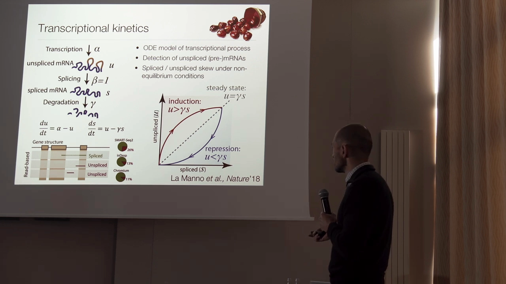
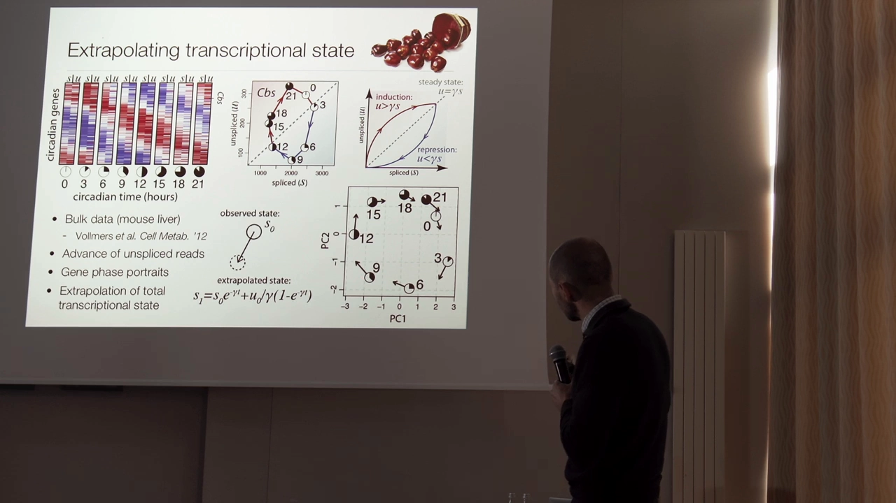
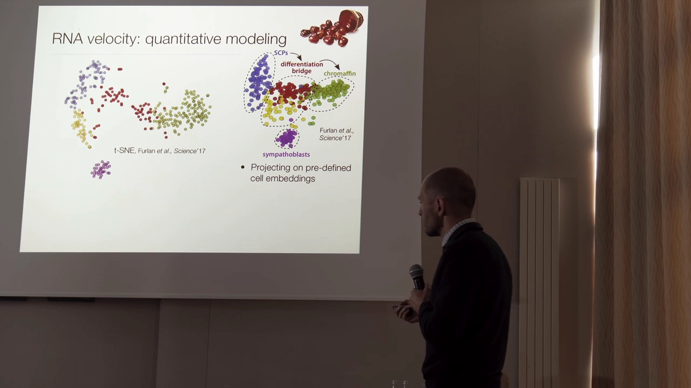
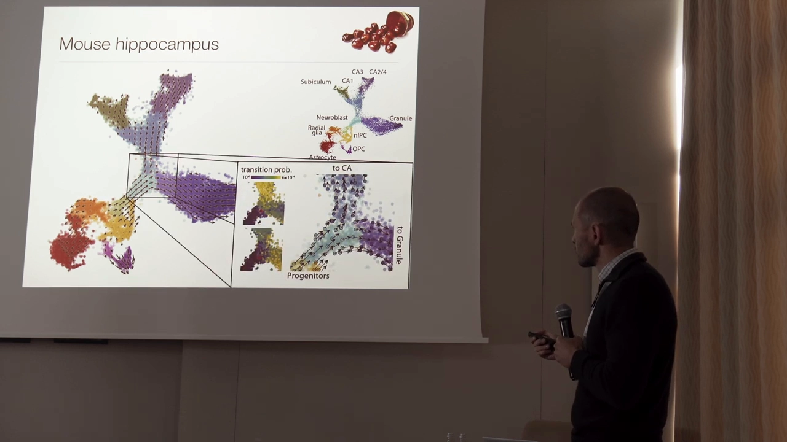
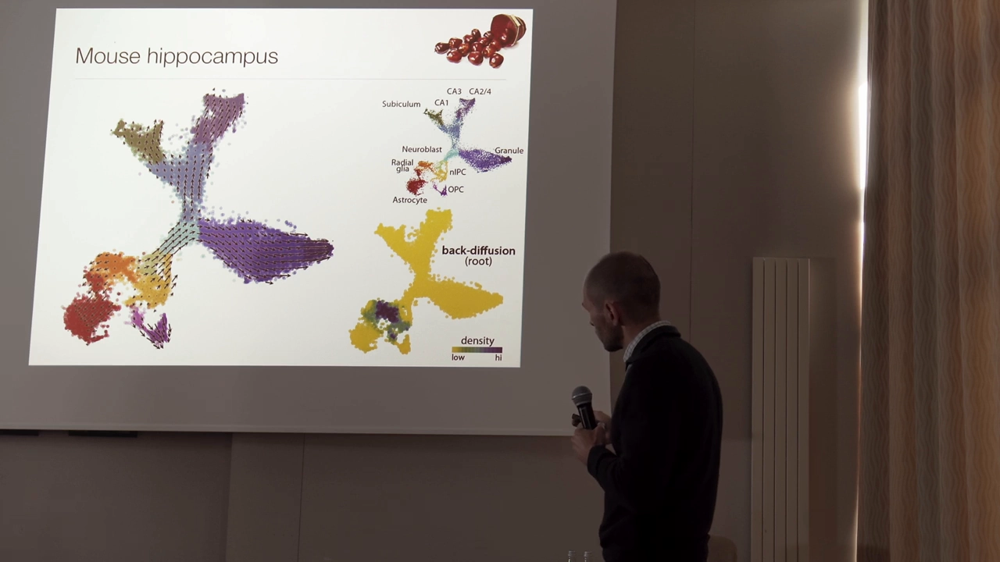
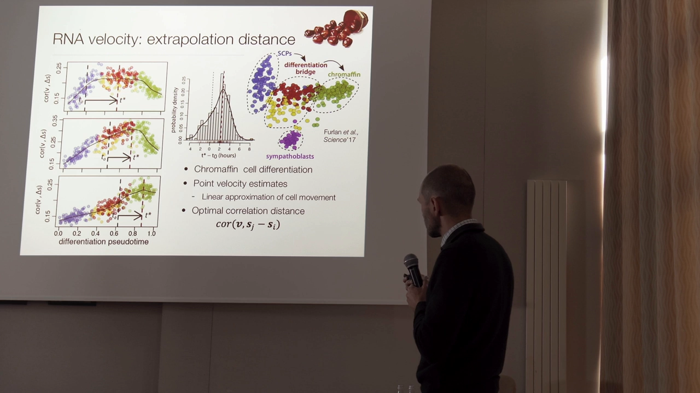
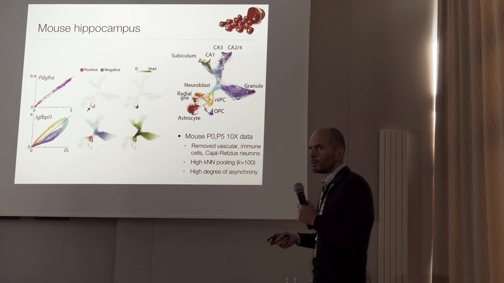
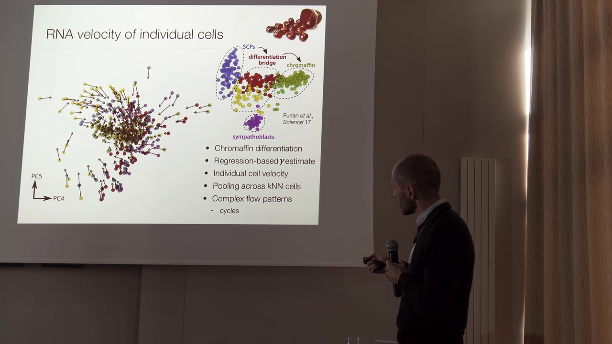

# 速度图的投影与核验：邻接权重、向量场与真实方向证据

> 视频来源：[Peter Kharchenko - Transcriptional Dynamics with Single-Cell Data (ITN-CONTRA)](https://www.youtube.com/watch?v=nNOOEl-yo50)（YouTube · ITN CONTRA，2018 年 12 月）｜时长约 49 分钟
> 简要导读：这是 RNA 速率方法（幻灯片标注 La Manno et al., *Nature* 2018）作者之一对整套流程的复盘，重点不在公式推导，而在「速率怎么变成箭头」以及「箭头凭什么可信」。本文按「三个层次 → 邻接投影 → 转移概率 → 核验 → 失败模式」重排，剪接动力学的建模细节不在本文范围。

## 本讲要解决的核心问题（SCQA）

**背景**：单细胞测序一次只能拍一张快照，而我们要回答的是「细胞正在往哪走」。RNA 速率用未剪接与已剪接两类计数的偏离程度，给每个基因估一个时间导数，再把这些导数拼成每个细胞的一个高维向量。

**冲突**：这个高维向量没法直接看。要把它画到二维图上，必须经过一次投影；而投影这一步，讲者自己的评价是「整个工作里最成问题的步骤之一」[【跳转到 35:30】](https://www.youtube.com/watch?v=nNOOEl-yo50&t=2130)。投影会改变向量的方向与长度，还会把细胞密度、邻域选择、降维方法各自的偏好混进箭头里。

**疑问**：从「一个基因一个速率」到「图上的一支箭头」，中间到底做了哪些加工？每一步各自引入了什么失真？拿到一张速度图，用什么独立证据判断方向可信？

**回答（中心思想）**：箭头是三层加工的结果——基因层拟合出的速率、细胞层的高维向量、以及投影到二维图上得到的期望位移。方向的可信度不能由箭头自身的美观程度判断，只能由**独立于速率的信息**（已知的分化方向、真实时间点、模拟真值）来核验；而投影本身会系统性地抹掉异质性与次要过程，所以「箭头指向哪里」和「细胞最终变成什么」是两件事。

## 一、三个层次：基因速率、细胞向量、二维箭头

### 1.1 第一层：每个基因一个导数

讲者先复述了建模前提：转录产生未剪接 mRNA（$u$），剪接把它变成成熟 mRNA（$s$），成熟 mRNA 再被降解。写成两条方程就是

$$
\frac{\mathrm{d}u}{\mathrm{d}t} = \alpha - u, \qquad \frac{\mathrm{d}s}{\mathrm{d}t} = u - \gamma s
$$

（这里把剪接速率 $\beta$ 归一到 1，与原始论文一致。）[【跳转到 21:38】](https://www.youtube.com/watch?v=nNOOEl-yo50&t=1298)

相平面上那条虚线就是稳态线 $u = \gamma s$。细胞落在线上方，说明它在生产比「维持当前成熟量」更多的未剪接产物，于是成熟量接下来会上升；落在下方则相反 [【跳转到 21:38】](https://www.youtube.com/watch?v=nNOOEl-yo50&t=1298)。**这一层的输出是「每个基因一个数」**：这个基因接下来会升还是会降。

### 1.2 第二层：一个细胞一个高维向量

把每个基因的导数按基因排成一列，就得到这个细胞的速率向量。讲者特意强调它的性质：**速率和表达状态一样，是一个噪声很大的高维向量**；只是把维度降下来之后，图像通常才变得清楚 [【跳转到 32:10】](https://www.youtube.com/watch?v=nNOOEl-yo50&t=1930)。

这句话决定了后面所有的麻烦。一个几千维、每一维都带噪声的向量，要变成图上的一支箭头，中间不可能没有信息损失。

### 1.3 第三层：线性外推在弯曲轨迹上必然滞后

在进入投影之前，讲者先用一个自洽性检查说明「外推」这件事的极限。他用小鼠肝脏的昼夜节律数据（bulk）演示：把观测到的成熟表达状态按一阶导数外推一个时间步，就得到预测的下一状态，这个外推方向就是 RNA 速率 [【跳转到 23:25】](https://www.youtube.com/watch?v=nNOOEl-yo50&t=1405)。

把细胞画在 PC1–PC2 上，它们落成一个圆；箭头指向外推点。**关键观察**：箭头并不沿圆周走，而是**切于圆周**——讲者的比喻是「像自行车轮甩出去的泥」[【跳转到 24:15】](https://www.youtube.com/watch?v=nNOOEl-yo50&t=1455)。

原因是外推只用了**一阶导数**，而真实过程有反馈回路、有曲率。曲率越大，线性外推偏离真实流形就越远；轨迹越接近直线、维持时间越长，外推能撑的距离才越远 [【跳转到 25:05】](https://www.youtube.com/watch?v=nNOOEl-yo50&t=1505)。

这一条不是实现缺陷，而是方法本身的几何性质。它已经预告了本节的结论：**箭头表示的是「此刻的瞬时方向」，不是「细胞最终会到达的位置」**。

## 二、邻接投影：箭头到底是怎么算出来的

### 2.1 为什么必须投影

单细胞数据里，人们不用主成分画图，而用 t-SNE 一类方法，因为主成分在群体结构复杂时效果不好。但 t-SNE 图有个代价：**坐标轴在基因层面没有任何含义**，它只是把表达相似的细胞放在一起 [【跳转到 34:40】](https://www.youtube.com/watch?v=nNOOEl-yo50&t=2080)。

于是问题变成：速率向量活在高维表达空间里，怎么把它画到一张「轴没有含义」的图上？讲者的原话是，这是「整个工作里最成问题的步骤之一」[【跳转到 35:30】](https://www.youtube.com/watch?v=nNOOEl-yo50&t=2130)。

### 2.2 邻域里唯一的参照物是别的细胞

投影的做法是「就地取材」：对一个给定细胞，取它的邻域，**邻域里唯一的参照物就是其他细胞**。然后判断速率向量是指向这些细胞，还是指向别的方向 [【跳转到 35:55】](https://www.youtube.com/watch?v=nNOOEl-yo50&t=2155)。

具体一步是：把速率向量投影到「本细胞指向某个邻居的表达差向量」上，得到一个权重；对邻域里所有细胞都算一次，就得到期望位移 [【跳转到 36:20】](https://www.youtube.com/watch?v=nNOOEl-yo50&t=2180)。

用公式写出来（按讲者口述整理，非幻灯片原式），设 $v_i$ 是细胞 $i$ 的速率向量，$x_j$ 是邻居 $j$ 的表达向量，则

$$
\Delta_i \propto \sum_{j \in \mathcal{N}(i)} w_{ij}\,(x_j - x_i), \qquad w_{ij} = \frac{v_i \cdot (x_j - x_i)}{\lVert x_j - x_i \rVert}
$$

这里的 $w_{ij}$ 就是「速率朝这个邻居指了多少」。它既是权重，也是后面转移概率的原料。

### 2.3 密度偏向：为什么必须减去一条基线

直接这样算会出问题。讲者指出：**期望位移被附近细胞的密度强烈驱动**。如果某片区域上方细胞多，那么即使速率是零，期望位移也会一直朝上——因为邻居大多在上面 [【跳转到 36:45】](https://www.youtube.com/watch?v=nNOOEl-yo50&t=2205)。

修正办法很直接：**假设速率等于零，把同样的计算再做一遍**，得到纯密度造成的位移，然后从结果里减掉它。图上真正画出来的箭头，是这个差值的平移 [【跳转到 37:10】](https://www.youtube.com/watch?v=nNOOEl-yo50&t=2230)。

这一步值得记住：**你看到的每一支箭头，都是「有速率的期望位移」减去「零速率的期望位移」**。它同时说明为什么箭头对邻域大小、邻域密度很敏感——基线本身就在随这些参数变化。

### 2.4 网格平均得到向量场

单个细胞的箭头很乱（下一节会看到）。对复杂数据集，讲者的做法是把细胞按网格聚合：每个网格点上取周围细胞速率的平均，得到一张**向量场** [【跳转到 38:00】](https://www.youtube.com/watch?v=nNOOEl-yo50&t=2280)。

到这一步，图才「像那么回事」。但这个「像」本身就是平滑换来的：网格越大，图越干净，单细胞的差异也越看不见。

## 三、从箭头到细胞间转移概率

### 3.1 转移概率：一个指数核，讲者承认「有点任意」

有了「速率朝哪个邻居指」的权重，就可以把它变成转移概率：把权重过一层指数函数，归一化，得到细胞 $i$ 走向邻居 $j$ 的概率。

讲者在问答里对这个选择很坦白：扩散的设定「有一点任意（somewhat arbitrary）」，他们只是要求「转移概率与速率和表达差的方向一致」这一条性质成立 [【跳转到 42:35】](https://www.youtube.com/watch?v=nNOOEl-yo50&t=2555)。

**这是一个重要的口径**：转移概率不是从数据里测出来的量，而是一个人为选定的核函数作用在速率上的结果。换一个核，概率的绝对值就会变；能稳定保留下来的，只有「谁比谁更可能」这个序关系。

### 3.2 沿 kNN 图按速率偏置做扩散：sink 与 source

有了转移概率，就可以把整份数据看成一个 kNN 图，用速率去偏置图上的随机游走 [【跳转到 38:25】](https://www.youtube.com/watch?v=nNOOEl-yo50&t=2305)。

- **前向扩散**：顺着速率走若干步，细胞会聚集到高密度区，这些位置最接近终末分化细胞，也就是 **sink**。
- **反向扩散**：逆着速率走，细胞会汇聚到它们来的地方，也就是 **source**（根）。

这套做法把「找起点」从人工指定变成了一个可复现的计算。但它继承的仍是同一份速率：**如果速率方向整体反了，source 和 sink 会一起反**。

### 3.3 分支点：相邻细胞可以走向不同命运

讲者展示了海马数据里一个分支点的细节：两个表达状态非常接近的细胞，扩散给出的去向却不同——一个更可能进入 CA 神经元那一支，另一个更可能走向颗粒细胞 [【跳转到 40:05】](https://www.youtube.com/watch?v=nNOOEl-yo50&t=2405)。

同一张图的右下角给出了转移概率的局部放大：在分支点上，「走向 CA」与「走向颗粒细胞」的概率分布在不同细胞之间明显不同（见上一节配图）。

他的解读是：这两个细胞的**成熟表达状态**几乎一样，但它们的**未剪接部分**已经不一样了，所以「它们已经在做别的事情了」[【跳转到 40:05】](https://www.youtube.com/watch?v=nNOOEl-yo50&t=2405)。这正好是 RNA 速率相对拟时序的增量：拟时序只能按成熟表达的相似度排序，分不开这种「状态相同、去向不同」的情况。

但注意这里的分辨率来源：**是未剪接计数的差异，不是命运本身被观测到了**。

## 四、核验：方向要对什么负责

### 4.1 已知真实方向时，算相关

讲者给的第一种核验方式最朴素：**对已知真实分化方向的过程**（例如有别的证据支持的方向），把预测的速率与该方向上的表达导数做相关 [【跳转到 31:20】](https://www.youtube.com/watch?v=nNOOEl-yo50&t=1880)。

结果是：与轨迹相关的基因大多得到正相关，但**总会有一些基因是错的**。讲者的定性是「这终究是一个统计预测」[【跳转到 31:20】](https://www.youtube.com/watch?v=nNOOEl-yo50&t=1880)。

这个核验的边界要说清楚：它检验的是「速率与已知方向是否一致」，**不能用来发现未知方向**。如果拿它去验证一个本来就想知道答案的过程，就变成循环论证了。

### 4.2 外推距离与时间尺度：约 2 小时

第二种核验是问「外推能撑多远」。做法是：取 $t_0$ 时刻的细胞，按外推速率算它应该落在哪里，再在真实时间序列里找相关性最高的细胞，得到时间差 $t^* - t_0$ [【跳转到 35:30】](https://www.youtube.com/watch?v=nNOOEl-yo50&t=2130)。

在这份数据上，$t^* - t_0$ 的分布集中在 **2 小时**左右。讲者强调这个数字完全取决于过程本身：**过程越接近线性、维持越久，外推能撑的距离越长**；曲率越大就越短 [【跳转到 35:30】](https://www.youtube.com/watch?v=nNOOEl-yo50&t=2130)。

所以「速率能外推多久」不是一个可以跨数据集搬运的常数。它同时给出了一个隐含的判读规则：**当你想用它判断「几天后的命运」时，你已经在用它不覆盖的时间尺度了**。

### 4.3 真实时间点与平滑尺度

第三个案例是小鼠海马：把 P0 与 P5 两个真实时间点的 10x 数据合起来，去掉血管、免疫细胞与 Cajal–Retzius 神经元，用很大的邻域（$k=100$）做池化 [【跳转到 37:10】](https://www.youtube.com/watch?v=nNOOEl-yo50&t=2230)。

这里有两件事值得注意：

- **邻域大小是可调参数，而且直接决定图的样子**。同一份数据，$k=5$ 时箭头乱成一团，$k=100$ 时流场清晰。讲者对此的解释是「数据稀疏，所以只能估一小群细胞的速率」[【跳转到 33:00】](https://www.youtube.com/watch?v=nNOOEl-yo50&t=1980)。
- **真实时间点能提供的核验是有限的**。P0 与 P5 按小鼠出生后天数记相隔五天，而速率的外推尺度是小时级（§4.2），两者不在同一量级；时间点在这里主要用来给出「整体方向」的参照，而不是逐细胞核对。

### 4.4 基因选择：默认的过表达基因

问答里有人问基因是怎么选的。讲者的回答是：跑 Pagoda 2 时默认取**前 2,000–3,000 个过表达（overdispersed）基因**，其余基因影响不大；他们**没有手工挑选**基因 [【跳转到 41:45】](https://www.youtube.com/watch?v=nNOOEl-yo50&t=2505)。

这一点在核验时容易被忽略：**基因筛选是流程默认值，不是针对方向的判断**。换一套筛选（例如按似然筛，见 [5.2.3](../../../README.md#b04-5-2-3)）会得到不同的向量场，而两种筛选都没有「生物学正确性」的保证。

## 五、失败模式：投影这一步会丢掉什么

### 5.1 单个细胞的箭头基本是噪声

讲者先给了一张「每个细胞独立画箭头」的图：主成分空间里箭头方向杂乱，只有在分化桥这一段能看到一致的左→右运动 [【跳转到 32:35】](https://www.youtube.com/watch?v=nNOOEl-yo50&t=1955)。

换一组主成分（PC3/PC4）后，同一批细胞呈现出**反向流**：蓝紫细胞从左往右，红绿细胞从右往左，本质上是「进入桥状态」和「离开桥状态」两股流叠在一起 [【跳转到 33:40】](https://www.youtube.com/watch?v=nNOOEl-yo50&t=2020)。讲者指出，这种反向流**没法用势能模型描述**——势能景观里不会出现两股相反的水流。

这提醒我们：**「箭头乱」不一定意味着方法失败，也可能是二维投影把两股方向相反的流压到了同一个平面上**。

### 5.2 投影只落在近邻：异质性与次要过程被抹掉

这是投影最实质的失真。因为箭头只由「指向近邻的期望位移」决定：

- **异质性被平滑掉**。轨迹起点的细胞方向本该各不相同，投影后趋于一致。
- **次要过程被隐藏**。海马数据里，放射状胶质细胞的细胞周期与分化是耦合的，但 t-SNE 的轴由「最显著的差异」决定，而最显著的是分化，细胞周期就看不见了 [【跳转到 39:15】](https://www.youtube.com/watch?v=nNOOEl-yo50&t=2355)。讲者的判断是「这是今天大多数工具的普遍问题」。
- **反向尝试也不理想**。他也试过把投影直接对准速率空间，但细胞周期这类运动在速率空间里比在表达空间里更剧烈，会「占掉太多画面」[【跳转到 47:05】](https://www.youtube.com/watch?v=nNOOEl-yo50&t=2825)。

### 5.3 投影存在原理上就会失败的边界情形

讲者提到论文补充材料里列了一些**在原理上就不成立**的边界情形，并说明这套投影「在大多数情况下能给出合理的猜测」[【跳转到 37:35】](https://www.youtube.com/watch?v=nNOOEl-yo50&t=2255)。

这句话的分量在于：它不是「参数没调好」，而是「某些几何构型下这个方法没有定义良好的答案」。判读时能做的，是检查自己的数据是否落在这些构型附近（细胞极少、存在与主轨迹不相连的孤立群、邻域内细胞数不足）。

### 5.4 时间尺度错配

讲者在问答里明确说：这套方法**不能直接用于更长的时间尺度**，因为它工作在 mRNA 动力学自身的时间尺度上 [【跳转到 46:15】](https://www.youtube.com/watch?v=nNOOEl-yo50&t=2775)。

要跨到更长的尺度，只能再引入别的假设（遍历性、沿流形的扩散），或者补充别的实验数据（蛋白、翻译、降解）。换句话说，**「速率指向」与「命运」之间隔着一层必须额外论证的桥**。

## 六、证据边界：箭头不是命运

把上面几条收拢，读一张速度图之前应当能回答：

1. **这是第几层的信息**：是基因层的导数、细胞层的高维向量，还是已经过邻接投影与网格平滑的二维箭头？层次越高，平滑越多。
2. **投影用了什么邻域**：邻域大小、是否做了零速率基线校正、是否做了网格平均。这三个参数直接决定箭头的方向与长度。
3. **转移概率的核是什么**：它是一个人为选定的指数核，只有序关系比较稳，绝对数值不宜当真。
4. **方向有没有独立证据**：已知分化方向上的相关、真实时间点、模拟真值。三者的检验力不同，都不能替代「这个方向在生物学上是否成立」。
5. **时间尺度对不对**：速率是小时级的瞬时方向，命运是天级的过程。跨尺度断言需要额外证据。
6. **有没有被投影抹掉的过程**：细胞周期、反向流、异质性，都可能因为「不是最显著的差异」而消失。

一句话：**箭头是「按当前模型、当前基因集、当前邻域，算出来的下一步期望位移」**。它可以作为进一步分析的起点（讲者说这些估计「为进一步的定量分析提供了基础」[【跳转到 38:00】](https://www.youtube.com/watch?v=nNOOEl-yo50&t=2280)），但不是命运的观测。

## 小结

- **三层加工**：基因层估导数 → 细胞层拼高维向量 → 投影成二维箭头。速率本身是噪声很大的高维向量，降维后才「看起来清楚」。
- **线性外推必然滞后**：一阶导数外推在弯曲轨迹上切于曲线（自行车轮甩泥），曲率越大偏离越远。箭头是瞬时方向，不是终点。
- **邻接投影的构造**：把速率投影到「指向每个邻居的表达差」上得权重，求期望位移；必须减去零速率基线以消除密度偏向；网格平均后得到向量场。
- **转移概率是人为核**：指数核 + 归一化，讲者自称「有点任意」，稳定的只有序关系。
- **扩散找 source/sink**：前向扩散给终末状态，反向扩散给根；分支点上相邻细胞可因未剪接差异走向不同命运。
- **核验只能靠独立信息**：已知方向上的相关、外推距离（本数据约 2 小时）、真实时间点、模拟真值。相关检验不能用来发现未知方向。
- **失败模式**：单细胞箭头是噪声；投影只落在近邻，抹掉异质性与次要过程（如细胞周期）；二维嵌入的轴无基因含义；存在原理上失效的几何构型；时间尺度不可越级外推。
- **基因筛选是流程默认值**：默认取前 2,000–3,000 个过表达基因，不是针对方向的判断。

## 关键术语速查

| 术语 | 一句话解释 |
| --- | --- |
| RNA velocity（RNA 速率） | 转录状态的一阶时间导数，由未剪接/已剪接计数的偏离稳态程度估计 |
| 相平面（phase space） | 以已剪接 $s$ 为横轴、未剪接 $u$ 为纵轴的散点图，虚线 $u=\gamma s$ 为稳态 |
| 邻接投影（neighborhood projection） | 把高维速率投影到「指向每个近邻的表达差」上，得到二维图上的期望位移 |
| 密度偏向（density bias） | 期望位移被附近细胞密度驱动；需减去零速率基线来校正 |
| 向量场（vector field） | 把细胞按网格聚合、平均速率后得到的平滑流场 |
| 转移概率（transition probability） | 细胞走向某个邻居的概率，由速率与表达差的一致程度经指数核归一化得到 |
| 前向/反向扩散 | 沿 kNN 图按速率偏置随机游走；前向给 sink（终末状态），反向给 source（根） |
| 外推距离（extrapolation distance） | 外推状态与真实时间序列中最相关细胞的间隔 $t^*-t_0$，反映速率能撑多远 |
| 遍历性假设（ergodicity） | 假设过程在快照里被均匀采样，于是静态图可以读成动态路径 |