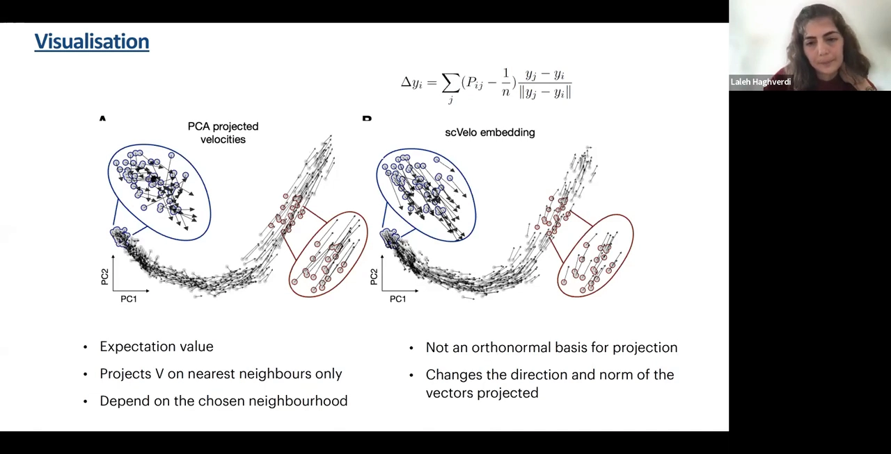
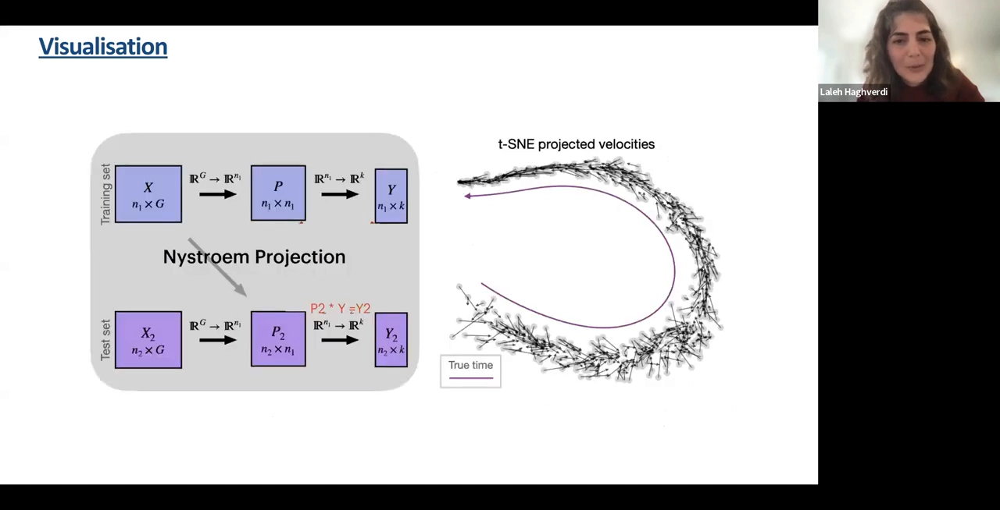
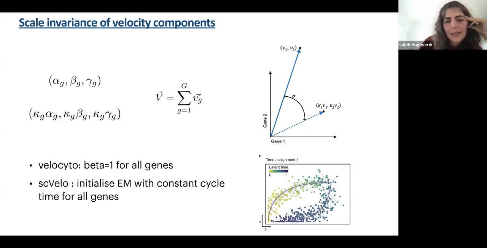
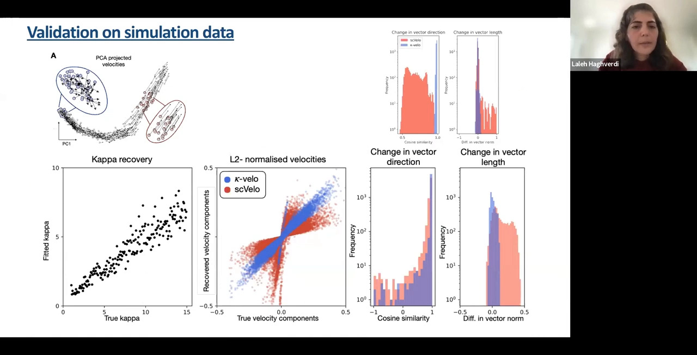
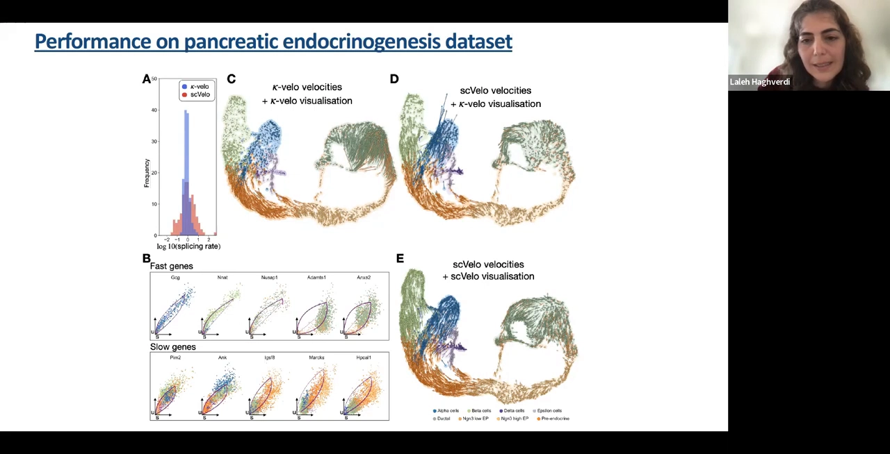
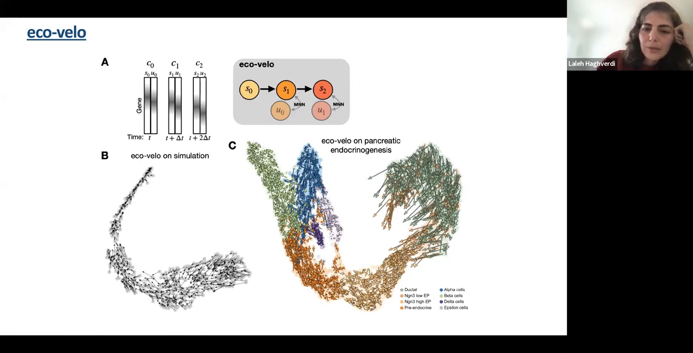

# 速率向量的投影失真：邻接期望、基因尺度与批次边界

> 视频来源：[SCOG Virtual Lecture Series - Laleh Haghverdi (BIMSB/MDC, Berlin)](https://www.youtube.com/watch?v=Jm18wa5ER1w)（YouTube · Single Cell Omics Germany，2022 年 4 月）｜时长约 50 分钟
> 简要导读：这是一场「批判性复盘」报告。讲者不推导新的动力学模型，而是把 RNA 速率流程里两处系统性失真摊开：一是把高维速率投影成二维箭头的那一步，二是把多个基因的速率相加时每个基因的尺度自由度。前半场是报告，后半场问答涉及单核数据、批次与时间尺度，信息密度很高。

## 本讲要解决的核心问题（SCQA）

**背景**：RNA 速率给每个基因一个时间导数，把这些导数按基因加起来，就得到每个细胞的一个高维速率向量。要把它画到降维图上，主流做法是「投影到近邻」。

**冲突**：讲者指出，这个投影**不是**一个保向量的操作。它算的是一个期望值，因此是又一层平滑；它只把速率投影到最近邻上，因此依赖你选了哪个邻域；降维嵌入本身也不是正交基，投影会改变向量的方向与模长 [【跳转到 17:49】](https://www.youtube.com/watch?v=Jm18wa5ER1w&t=1069)。另一处失真在求和之前：动力学方程对参数有整体尺度不变性，多基因相加时每个基因的尺度会直接改变合向量的方向。

**疑问**：这两处失真各自有多大？有没有替代做法？什么样的数据根本做不了 RNA 速率？做出来的方向能不能跨批次、跨时间尺度使用？

**回答（中心思想）**：从「每基因一个速率」到「图上的一支箭头」，中间至少有两处会系统性改变方向的加工——**邻接投影**与**基因间尺度归一**。两者都不是精度问题，而是方向问题：换一个邻域、换一种尺度假设，箭头可能指向别处。因此箭头只能作为「在给定投影与给定尺度假设下的方向估计」，并且要先确认数据本身具备做这件事的前提（有 spliced 计数、批次可控）。

## 一、投影之前的两次求和

### 1.1 速率是「对已剪接计数的导数」

讲者先复述前提：未剪接与已剪接两类计数给出一个时间维度；速率就是已剪接计数对时间的导数；把每个基因的速率向量加起来，得到细胞的高维速率 [【跳转到 06:34】](https://www.youtube.com/watch?v=Jm18wa5ER1w&t=394)。

这里已经埋了两个后续要展开的问题：

- **单细胞的噪声**。基因表达本身不平滑，一旦动力学有噪声，「平均速率」就不再等于「瞬时速率」，因为东西在上下波动 [【跳转到 10:19】](https://www.youtube.com/watch?v=Jm18wa5ER1w&t=619)。
- **两类计数本身不准**。已剪接与未剪接的测量都很不准确，所以必须做大量平滑才能拟合出理论预期的相轨迹形状；而平滑又与「想看单细胞之间的速率差异」这个目的相冲突 [【跳转到 10:44】](https://www.youtube.com/watch?v=Jm18wa5ER1w&t=644)。

讲者把整场报告的问题归成三类：**预处理、可视化、速率估计**——这三处的问题让我们拿不到本来想从数据里拿的东西 [【跳转到 11:59】](https://www.youtube.com/watch?v=Jm18wa5ER1w&t=719)。

### 1.2 为什么不能只靠拟时序

报告给了一个明确的定位：拟时序只给出「整体方向」，即细胞从起始状态往分化状态移动的大方向；它抓不到细胞之间的随机性——比如一个位置可以走向两个位置的可塑性、对药物的异质响应、或者细胞会不会沿拟时序往回走 [【跳转到 12:49】](https://www.youtube.com/watch?v=Jm18wa5ER1w&t=769)。

这也解释了为什么值得为「方向」付出投影失真的代价：**要的是细胞级别的方向，而不只是群体级别的排序**。拟时序的排序与根选择属于 [5.2.1](../../../README.md#b04-5-2-1)。

## 二、邻接投影：公式、三个副作用、一个替代

### 2.1 公式

讲者写出的位移公式是（原文用 $P_{ij}$ 表示从细胞 $i$ 转移到邻居 $j$ 的概率）：

$$
\Delta y_i = \sum_j \left( P_{ij} - \frac{1}{n} \right) \frac{y_j - y_i}{\lVert y_j - y_i \rVert}
$$

其中 $y_i$、$y_j$ 是细胞在**低维嵌入**里的坐标，$P_{ij}$ 由速率向量算出。这个公式里有两处值得停下来看：

- 括号里的 $-\frac{1}{n}$ 是**密度基线**：它减掉「速率取零时同样的期望位移」，否则箭头会被邻居密度牵着走。
- 分母 $\lVert y_j - y_i \rVert$ 是**方向归一**：只保留「朝哪个邻居」的方向，不保留距离。

### 2.2 副作用一：这是期望值，也就是又一层平滑

讲者强调，这个求和给出的是「下一步会在哪」的**期望值**，因此是又一层数据平滑 [【跳转到 17:00】](https://www.youtube.com/watch?v=Jm18wa5ER1w&t=1020)。

更细的一点是：这个求和**在数学上并不「正常」**——低维空间里的近邻彼此是相关的，所以这不是一次规范的向量求和，而是一个期望值 [【跳转到 17:00】](https://www.youtube.com/watch?v=Jm18wa5ER1w&t=1020)。

### 2.3 副作用二：只投影到近邻，依赖邻域选择

因为速率只被投影到「这个细胞的最近邻」上，结果**取决于你取了哪个邻域**；而这一步最终会**改变速率向量的方向与模长** [【跳转到 17:49】](https://www.youtube.com/watch?v=Jm18wa5ER1w&t=1069)。

上一节配图里左右两栏的对比就是这条失真的直接证据：同一份模拟数据，左边用 PCA 投影、右边用 scVelo 嵌入，箭头形态不同。

这条失真是可检验的：讲者用模拟数据做了对比——模拟里轨迹起点本来有大量方向噪声、末端方向趋于一致，但主流工具的投影把**起点的异质性抹掉了** [【跳转到 15:19】](https://www.youtube.com/watch?v=Jm18wa5ER1w&t=919)。

换句话说：**你在图上看到的「起点方向很一致」，可能是投影造出来的，而不是数据里的**。

### 2.4 副作用三：嵌入不是正交基

讲者指出，降维嵌入（如 t-SNE、UMAP）**不是正交基**，把向量投影到这样的基上，会改变被投影向量的方向与模长 [【跳转到 17:49】](https://www.youtube.com/watch?v=Jm18wa5ER1w&t=1069)。

这一点常被忽略：二维图上的箭头长度，既不是速率的模长，也不是任何有单位的量。它只是「在这个嵌入里，朝这个方向走多远」。

### 2.5 替代做法：把箭头端点当作新数据，用 Nyström 投影

讲者的方案是换一个投影思路：**不要投影向量，而是投影点**。

- 训练集：原始数据（$n_1$ 个细胞 × $G$ 个基因）→ 细胞间转移矩阵 $P$（$n_1 \times n_1$）→ 嵌入 $Y$（$n_1 \times k$）。
- 测试集：箭头端点（$n_2 \times G$）→ 端点对所有原始点的转移矩阵 $P_2$（$n_2 \times n_1$）→ 直接算出端点在同一个嵌入里的坐标 $Y_2 = P_2 Y$。

这样做的好处是：**箭头 = 端点的嵌入坐标减去起点的嵌入坐标**，起点和端点用的是同一个映射，不需要在低维空间里对向量做「投影」这种非正交操作。讲者说这套方法适用于 t-SNE、UMAP、扩散映射等各种非线性嵌入 [【跳转到 18:12】](https://www.youtube.com/watch?v=Jm18wa5ER1w&t=1092)。

在模拟数据上，用 t-SNE 加 Nyström 投影，起点的异质性被保留下来、末端方向趋于一致 [【跳转到 20:17】](https://www.youtube.com/watch?v=Jm18wa5ER1w&t=1217)。

## 三、基因间尺度：求和时藏着一个自由度

### 3.1 尺度不变性

这是报告里最技术、也最容易被跳过的一段。动力学方程对参数有**整体尺度不变性**：如果 $(\alpha_g, \beta_g, \gamma_g)$ 是一组解，那么

$$
(\kappa_g \alpha_g,\ \kappa_g \beta_g,\ \kappa_g \gamma_g)
$$

也是解 [【跳转到 20:38】](https://www.youtube.com/watch?v=Jm18wa5ER1w&t=1238)。

单看一个基因，这无关紧要——尺度因子会被吸收掉。但一旦把多个基因的速率加起来：

$$
\vec{V} = \sum_{g=1}^{G} \vec{v}_g
$$

每个基因的 $\kappa_g$ 就变成了一个**独立的权重**。讲者的图示很直白：两个基因的速率 $(v_1, v_2)$ 分别乘上 $\kappa_1$、$\kappa_2$ 之后，合向量的**方向与长度都可以完全改变** [【跳转到 21:28】](https://www.youtube.com/watch?v=Jm18wa5ER1w&t=1288)。

**这是本节最重要的结论之一**：箭头方向不只取决于「每个基因往哪变」，还取决于「每个基因的速率被放大了多少倍」。而后者不是数据里的量，是一个必须由额外假设定下来的自由度。

### 3.2 两种现成假设都不现实

- **velocyto**：假设所有基因的剪接速率相同（$\beta=1$），以此消掉这个自由度 [【跳转到 21:53】](https://www.youtube.com/watch?v=Jm18wa5ER1w&t=1313)。
- **scVelo**：在 EM 初始化时假设所有基因的**完整周期时长**相同 [【跳转到 21:53】](https://www.youtube.com/watch?v=Jm18wa5ER1w&t=1313)。

讲者的评价是：**这两个假设在生物系统里都不太现实** [【跳转到 22:43】](https://www.youtube.com/watch?v=Jm18wa5ER1w&t=1363)。

### 3.3 用细胞密度估 $\kappa_g$

他们提出的替代假设是：**在某个状态捕获到细胞的概率，正比于细胞在该状态停留的时间**。走得快的阶段，被采到的细胞就少 [【跳转到 22:43】](https://www.youtube.com/watch?v=Jm18wa5ER1w&t=1363)。

有了这个假设，就可以把「两个细胞之间的时间差」换成「两个细胞之间被采到的细胞数」，再从图上拟合出每个基因的 $\kappa_g$ [【跳转到 24:23】](https://www.youtube.com/watch?v=Jm18wa5ER1w&t=1463)。

讲者自己给了限定：如果你是按特定细胞类型挑样本的，这个假设就不成立；他们也忽略了轨迹不同位置上出生率与死亡率可能不同 [【跳转到 22:43】](https://www.youtube.com/watch?v=Jm18wa5ER1w&t=1363)。**这是一个明确标注了适用条件的假设，不是普适规律。**

### 3.4 用模拟数据核验：余弦相似度

怎么判断估出来的尺度对不对？讲者的做法是模拟：已知真值，比较

- 拟合的 $\kappa$ 与真实 $\kappa$ 的相关；
- **推断向量与真实向量的余弦相似度**（夹角），以及模长差。

结果是在这两项上他们的方法优于 scVelo [【跳转到 25:23】](https://www.youtube.com/watch?v=Jm18wa5ER1w&t=1523)。

这里的方法论值得单独记住：**「方向对不对」是可以被量化的**——在模拟里用与真值的余弦相似度，在真实数据里用已知方向上的相关。这比「箭头看起来顺不顺」严格得多。

## 四、真实数据上，这些失真长什么样

### 4.1 胰腺内分泌发育：快基因与慢基因

在胰腺内分泌发育数据上，讲者展示了两件事 [【跳转到 25:53】](https://www.youtube.com/watch?v=Jm18wa5ER1w&t=1553)：

- **剪接速率的取值范围**。scVelo 估出的剪接速率跨度极大（幻灯片上的 $\log_{10}$ 剪接速率大致从 $-2$ 到 $2$，即四个数量级），他们的方法给出的范围更合理 [【跳转到 27:08】](https://www.youtube.com/watch?v=Jm18wa5ER1w&t=1628)。
- **快基因与慢基因并存**。图上能看到一批快基因（如 *Gcg*、*Nnat*）和一批慢基因（如 *Plin2*、*Igfbp1*），而 scVelo 的做法是假设所有基因周期时长相同 [【跳转到 26:43】](https://www.youtube.com/watch?v=Jm18wa5ER1w&t=1603)。

这张图的读法很关键：图里并排展示了「κ-velo 速率 + κ-velo 可视化」「scVelo 速率 + κ-velo 可视化」「scVelo 速率 + scVelo 可视化」三种组合。**同一份数据，换速率估计或换可视化，箭头形态都会变**。这正好把本节的两处失真摆在一起。

### 4.2 一个更激进的简化：eco-velo

报告还给了第二个方法 eco-velo，思路是把假设再加一条：如果 $\beta$ 与 $\gamma$ 对所有基因都相同，那么可以推出 $s \approx u$，于是箭头可以直接由「已剪接计数指向最近的未剪接计数」得到——两端各取互为最近邻的点 [【跳转到 31:16】](https://www.youtube.com/watch?v=Jm18wa5ER1w&t=1876)。

讲者对这个方法的态度很坦率：假设「不太现实」，但考虑到参数拟合与平滑的种种问题，在当前状态下它仍可能是个有用的方法；建议只挑剪接与降解速率比较接近的基因来用 [【跳转到 32:06】](https://www.youtube.com/watch?v=Jm18wa5ER1w&t=1926)。

## 五、边界：什么数据做不了、什么条件下不可信

这一节全部来自问答，但信息量比正文更大。

### 5.1 单核数据：没有 spliced 计数就没有时间维度

第一个问题问单核 RNA 测序怎么办——核内转录本大多是未剪接的，拿不到可靠的 spliced/unspliced 比例。

讲者的回答是直接的：**「我不认为你能做什么」**。可以用拟时序拿到整体方向，但要算细胞状态速率，必须有来自两个不同阶段的测量；如果数据里没有 spliced 计数，就没有那个时间维度 [【跳转到 39:38】](https://www.youtube.com/watch?v=Jm18wa5ER1w&t=2378)。

这是一个**前提性边界**，不是参数调优能解决的。

### 5.2 多批次：讲者说「目前不太乐观」

第二个问题问整合多个批次/多个时间点的图谱怎么做速率。讲者的回答分两层 [【跳转到 40:28】](https://www.youtube.com/watch?v=Jm18wa5ER1w&t=2428)：

- 你需要的始终是「$s$ 对 $u$」的相平面，让不同颜色的细胞能拟合出那条杏仁形轨迹；
- 批次校正方法**通常会残留批次效应**，所以「目前多批次数据的情况不太乐观」[【跳转到 42:08】](https://www.youtube.com/watch?v=Jm18wa5ER1w&t=2528)。

提问者追问：能不能在单个样本里算转移，再投影到整合后的扩散映射上？讲者说 eco-velo 可能更适合这种场景，但他们试过，看到了困难，**「这需要更多研究，我没法回答太多」**[【跳转到 42:08】](https://www.youtube.com/watch?v=Jm18wa5ER1w&t=2528)。

这段对话值得原样保留：**这是 2022 年的判断，且讲者明确说自己没有答案**。不应把它读成「多批次永远做不了」，也不应忽略它读成「批次校正之后就能直接用」。

### 5.3 时间尺度：小时级的平均，天级的发育

有人问：RNA 速率的尺度与发育的时间尺度差得很远，这还能用来研究发育吗？

讲者的回答把两个尺度摊开 [【跳转到 45:58】](https://www.youtube.com/watch?v=Jm18wa5ER1w&t=2758)：

- 胰腺数据里，开头的细胞周期不到一天，整条分化轨迹**大约四天**；
- 而 spliced 与 unspliced 之间的时间尺度是**分钟到小时**；
- 所以速率给出的是「几小时内的平均速度」，不是「几天后的去向」。

她的论证是：我们不需要捕捉整个系统的时间尺度，只要在轨迹的每一段都有细胞被采到，就可以说「这几小时内的平均方向是这个」[【跳转到 46:42】](https://www.youtube.com/watch?v=Jm18wa5ER1w&t=2802)。

这个论证成立的前提是**遍历性**：每一段都有细胞被采到。这也正是它的软肋——如果某个阶段过得很快、几乎没采到细胞，那一段的方向就没有依据。

### 5.4 「很多论文的结论是错的」

提问者说了一句很重的话：如果去翻用 velocity 的论文，**能找到很多错误结论**，原因就是稳健性和上面提到的这些问题 [【跳转到 42:38】](https://www.youtube.com/watch?v=Jm18wa5ER1w&t=2558)。

讲者没有反驳。她接着讨论的是：能不能用估出来的 $\kappa$ 反过来判断「模型什么时候会失败」——比如存在转录爆发、或者快慢过程混杂时，计数根本采不好 [【跳转到 42:38】](https://www.youtube.com/watch?v=Jm18wa5ER1w&t=2558)。

这条线索没有给出可执行的判据，但方向很清楚：**尺度参数本身可以当作一个诊断量**，而不只是求和时的权重。

### 5.5 预处理也会造出「多重动力学」

报告提到论文里还有一块没时间讲：预处理。他们发现，此前被报告为「有多重动力学」的许多基因，其实只是**预处理不一致造成的假象**，可以在预处理阶段过滤掉 [【跳转到 33:11】](https://www.youtube.com/watch?v=Jm18wa5ER1w&t=1991)。

这一条对判读的意义是：相平面上出现「两条斜率」时，先别急着解释成可变剪接——**先排除预处理口径不一致**。可变剪接作为失效条件见 [5.2.3](../../../README.md#b04-5-2-3)。

## 六、证据边界：箭头是「给定假设下的方向估计」

把这场报告收拢，读一张速度图之前应当能回答：

1. **投影是怎么做的**：是「把向量投影到近邻」，还是「把端点当新数据点投影」？前者是期望值、依赖邻域、非正交；后者保留起点异质性。
2. **邻域取多大**：邻域变了，方向和模长都会变。
3. **基因间尺度怎么定**：velocyto 的共享剪接速率、scVelo 的共享周期时长、还是按细胞密度估的 $\kappa_g$？三者给出不同的合向量方向。
4. **数据够不够做这件事**：有 spliced 计数吗？是单核数据吗？多批次有没有残留效应？
5. **时间尺度对不对**：速率是小时级平均，命运是天级过程；跨尺度需要遍历性假设或额外实验数据。
6. **有没有被预处理污染**：相平面上的「多重动力学」，先排除预处理不一致。

一句话：**箭头方向 = 速率估计 × 基因尺度假设 × 投影方式**。三者任一改变，箭头就可能改变；而这三者都不是数据直接给出来的。

## 小结

- **两次求和，两处失真**：先把基因速率求和成细胞向量（受 $\kappa_g$ 影响），再把向量投影成二维箭头（受邻域与嵌入影响）。
- **邻接投影是期望值**：$\Delta y_i = \sum_j (P_{ij} - 1/n)(y_j-y_i)/\lVert y_j-y_i\rVert$；它是又一层平滑，只投影到近邻，依赖邻域选择，且嵌入不是正交基，会改变方向与模长。
- **投影会抹掉起点异质性**：模拟里起点的方向噪声，在主流工具的投影后看不见了。
- **Nyström 替代方案**：把箭头端点当新数据点，先算到原始细胞的转移矩阵，再映射到同一嵌入；起点与端点用同一映射，不需要在低维空间做非正交投影。
- **尺度不变性是真问题**：$(\kappa_g\alpha_g, \kappa_g\beta_g, \kappa_g\gamma_g)$ 也是解，多基因求和时 $\kappa_g$ 直接改变合向量方向。velocyto 与 scVelo 的两种跨基因假设都不现实；按细胞密度估 $\kappa_g$ 是带条件的替代。
- **核验要量化方向**：模拟里用与真值向量的余弦相似度，真实数据里用已知方向上的相关，而不是看箭头顺不顺眼。
- **前提性边界**：单核数据没有 spliced 计数就做不了；多批次目前「不太乐观」；速率是小时级平均，不能直接外推到天级命运。
- **预处理也会制造假象**：被报告为「多重动力学」的基因，很多只是预处理不一致。

## 关键术语速查

| 术语 | 一句话解释 |
| --- | --- |
| 邻接投影（neighborhood projection） | 把高维速率投影到「指向每个近邻的表达差」上，求和得到二维图上的期望位移 |
| 密度基线（$-1/n$ 项） | 减掉「速率取零时的期望位移」，消除邻居密度对箭头的牵引 |
| Nyström 投影 | 把新数据点（这里是箭头端点）先映射到原始细胞的转移矩阵，再落到已有嵌入里 |
| 尺度不变性（scale invariance） | 动力学方程对 $(\alpha,\beta,\gamma)$ 的整体缩放不变，因此多基因求和时每个基因的尺度是自由参数 |
| $\kappa_g$ | 第 $g$ 个基因的尺度因子；决定它在合向量里的权重，从而影响箭头方向 |
| 余弦相似度（cosine similarity） | 两个向量夹角的余弦；模拟数据里用来量化「推断方向与真实方向差多少」 |
| eco-velo | 追加「$\beta$、$\gamma$ 跨基因相同」假设后得到的极简方法：箭头由已剪接计数指向互为最近邻的未剪接计数 |
| 遍历性假设（ergodicity） | 假设过程在快照里被均匀采样；速率能代表「几小时平均方向」的前提 |
| 单核 RNA 测序（snRNA-seq） | 以细胞核为输入的测序；核内转录本多为未剪接，缺少可靠的 spliced 计数 |