# AIRE 与自身反应性细胞的三条出路：删除、受体编辑与无能

> 视频来源：[【诺奖】免疫耐受（中枢耐受和外周耐受的形成机制、自身免疫性疾病等）【免疫学期末速成15】](https://www.bilibili.com/video/BV1eM411Z7jZ/)（Bilibili · 咖啡冻迪笛医学）｜时长约 19 分钟
> 简要导读：这是一节以"机制 + 随堂题"推进的复习课，讲法偏考点导向：先给耐受的定义与分类，再用克隆选择学说解释中枢耐受，然后逐条过 T 细胞胸腺选择、AIRE、B 细胞的三种结局、外周耐受的四种机制与免疫豁免，最后点到自身免疫的危险因素。本文保留全部机制与例题结论，把"耐受的总览与人工干预"留给本小节另一篇（《免疫耐受的两道防线》）。

## 本讲要解决的核心问题（SCQA）

**背景**：淋巴细胞在胸腺和骨髓里通过基因重排产生海量的抗原受体，每一个受体的特异性基本是随机的。随机，就意味着必然有一批受体恰好认自己。

**冲突**：胸腺不可能把全身每个器官的抗原都搬进来展示一遍——胰岛的、肾上腺的、晶状体的抗原平时只在各自的组织里表达。如果胸腺"没见过"这些抗原，那识别它们的 T 细胞就会被当作"无害"放出去。

**疑问**：胸腺靠什么"见过"全身的组织限制性抗原？见过之后，对这些自身反应性细胞有几种处置方式？处置失败会得什么病？

**回答（中心思想）**：中枢耐受建立在**克隆选择学说**之上：胚胎期产生大量不同特异性的细胞克隆，凡与自身抗原结合者被清除或抑制成"禁忌克隆"。具体处置有**三条出路**——**删除（凋亡）、受体编辑（改掉受体）、无能（活着但叫不动）**。胸腺靠 **AIRE** 在髓质上皮细胞里"异位表达"组织限制性抗原，让阴性选择能覆盖到全身；AIRE 突变则自身反应性 T 细胞逃逸，导致 APS-1。外周再用无能、抑制（Treg）、免疫忽视、凋亡四种机制补刀，免疫豁免部位再加物理屏障。**耐受一旦破裂，就是自身免疫的入口**。

## 一、先划清三条界线：耐受、耐受原与免疫抑制

免疫耐受（immunological tolerance）指机体接受某种抗原作用后，产生**特异性的免疫无应答状态**：不再应答，再次接受同一抗原刺激也不能产生对应抗体。但它**对其他抗原仍有正常的免疫应答能力**——换句话说，不是 T 细胞坏了，而是这个抗原"很特殊"，不会引起应答。能诱导耐受的抗原叫**耐受原（tolerogen）**。

课程用三个对比把概念钉住：

- **自身耐受 vs 获得性耐受**：自身耐受是胚胎期就接触自身抗原而形成的，各器官的抗原都靠它，属天然耐受；获得性耐受是出生之后诱导出来的，比如**口服耐受**——你吃馒头、吃榨菜不能每次都引发免疫反应，否则什么都吃不了。
- **耐受 vs 免疫抑制**：免疫耐受有**特异性**和**记忆性**（和适应性免疫一样）；而免疫抑制（immunosuppression）是对**任何抗原**都不应答，通常由遗传性免疫细胞功能障碍或免疫抑制药物引起。Treg 也有免疫抑制作用，但那是机制层面的"局部压制"，不是全身性的免疫抑制。
- **中枢耐受 vs 外周耐受**：中枢耐受是胚胎期未成熟的 T、B 淋巴细胞在中枢免疫器官与自身抗原结合，发生凋亡或处于克隆无能状态所形成的耐受；外周耐受是成熟 T、B 细胞在外周免疫器官与外源性抗原、自身抗原或 Treg 相互作用后，处于克隆无能或凋亡所形成的不应答。

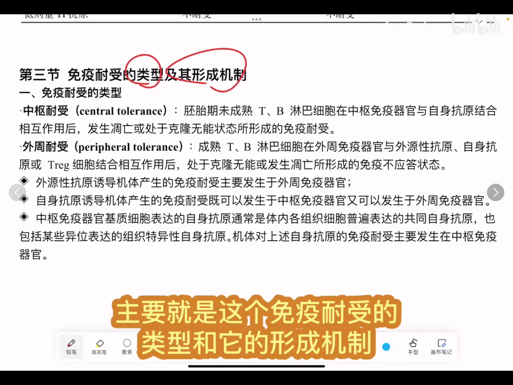

[【跳转到 02:56】](https://www.bilibili.com/video/BV1eM411Z7jZ/?t=176)

课程在这里补了一句很重要的边界：**外源性抗原诱导的耐受主要发生在外周**，而**自身抗原诱导的耐受既可以在中枢、也可以在外周**。因为中枢基质细胞表达的自身抗原多是各组织普遍表达的"共同自身抗原"，那些只在某个器官表达的组织特异性抗原，多数不在中枢基质细胞上表达，对它们的耐受主要在外周完成。

## 二、克隆选择学说：耐受是"筛掉会打自己的克隆"

中枢耐受的底层逻辑是 Burnet（1959）提出的**克隆选择学说**，课程把它拆成三步：

1. 胚胎期机体免疫细胞高度突变分化，形成大量具有不同抗原识别特性的细胞克隆；
2. 这些克隆处于未成熟阶段，一旦通过表面受体与相应自身抗原结合，就被**清除或抑制**，成为**禁忌克隆（forbidden clone）**；
3. 出生后，体内缺乏能与自身抗原结合的免疫细胞，所以对自身抗原表现为无反应性，即形成天然免疫耐受。

而体内未与自身抗原结合的那些成熟免疫细胞，遇到外来抗原刺激后照常发生免疫应答。

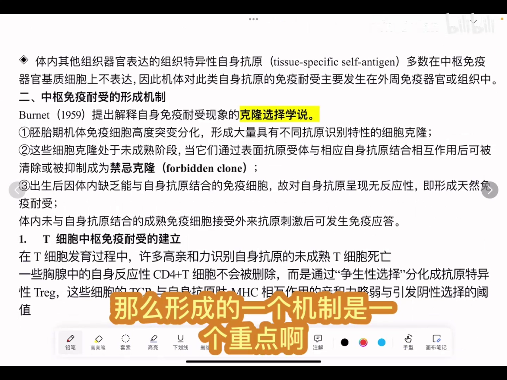

[【跳转到 03:53】](https://www.bilibili.com/video/BV1eM411Z7jZ/?t=233)

这里有一个容易被忽略的细节：**不是所有识别自身抗原的 CD4⁺ T 细胞都被删除**。一部分自身反应性 CD4⁺ T 细胞会被保留下来，通过"争生性选择"分化为抗原特异性 **Treg**——它们的 TCR 与自身抗原肽-MHC 相互作用的**亲和力略弱**于引发阴性选择的阈值。这正是"弱信号变刹车"的分子解释。

## 三、胸腺里的三岔路口：亲和力决定命运

T 细胞在胸腺里的发育路径是：双阳性（DP，同时表达 CD4、CD8、CD3）→ 单阳性（SP）。课程把皮质（cortex）阶段的选择讲成了一次按亲和力分流的三岔路口：

| 与自身抗原肽-MHC 的亲和力 | 比例 | 结局 |
| --- | --- | --- |
| 高亲和力 | 2%~5% | 阴性选择，凋亡 |
| 低/中等亲和力 | 2%~5% | 阳性选择，存活并分化为 CD4⁺ 或 CD8⁺ |
| 无相互作用 | 90%~96% | 因"被忽视"而死亡（death by neglect） |

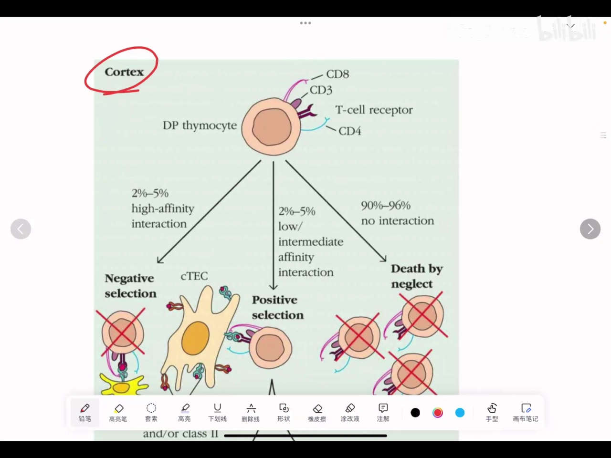

[【跳转到 05:23】](https://www.bilibili.com/video/BV1eM411Z7jZ/?t=323)

这张图里最反直觉的数字是最后一行：**绝大多数胸腺细胞死于"没人理"**。阳性选择本质上是"给我一个活下去的理由"——你的 TCR 必须能识别自身 MHC（这是日后识别"自己 MHC 上摆的别人的肽"的前提），否则连被筛选的资格都没有。这也解释了为什么阳性选择由皮质胸腺上皮细胞（cTEC）负责：它提供的是"自身 MHC"这个背景。

分流之后，细胞进入髓质（medulla），在这里完成两件事：确定自己到底是 CD4⁺ 还是 CD8⁺，以及接受髓质区的阴性选择。

## 四、AIRE：把全身的抗原"搬"进胸腺

髓质阴性选择要解决一个物理上的难题：**组织限制性抗原（tissue-restricted antigens, TRAs）平时只在特定器官表达**，胸腺怎么拿它们来考试？

答案是**髓质胸腺上皮细胞（mTEC）**里的 **AIRE（autoimmune regulator，自身免疫调节因子）**。AIRE 让 mTEC 异位表达大量组织限制性抗原——胰岛的、肾上腺的、甲状腺的，都被"搬"到胸腺里摆出来。于是自身反应性 T 细胞在胸腺里就能遇到本该在远处器官才遇到的抗原，从而被阴性选择删除，或者被改造成 Treg。

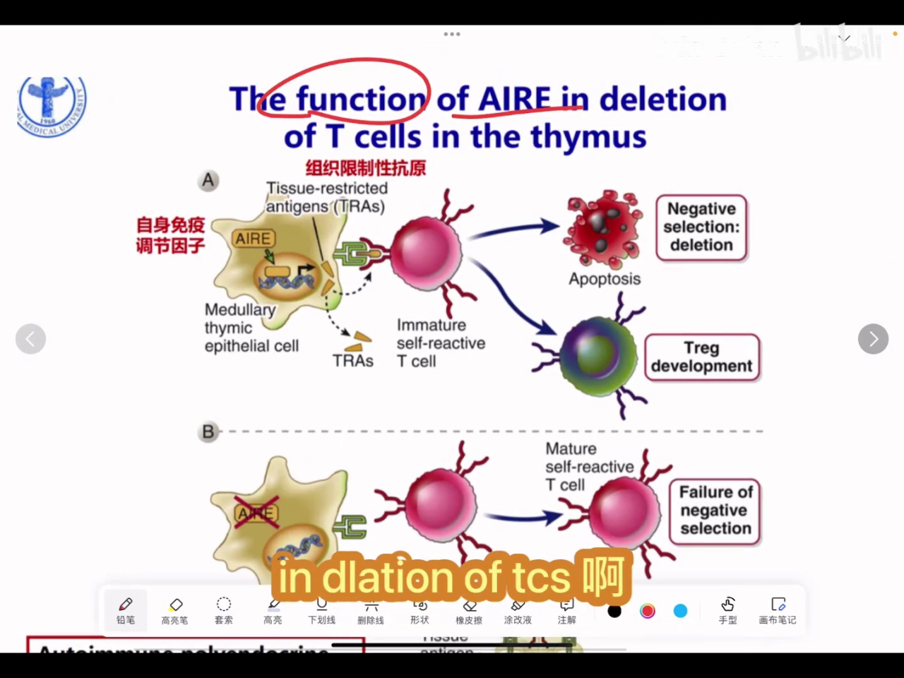

[【跳转到 06:19】](https://www.bilibili.com/video/BV1eM411Z7jZ/?t=379)

这张图分上下两半，正好是一组对照实验的逻辑：

- **A（有 AIRE）**：mTEC 表达 TRA → 呈递给未成熟自身反应性 T 细胞 → 走向**阴性选择（凋亡）**或 **Treg 发育**；
- **B（无 AIRE）**：TRA 表达缺失 → **阴性选择失败** → 成熟自身反应性 T 细胞逃逸到外周。

逃逸的后果就是疾病。课程用一道病例题把这条因果链走完：一个女孩有持续的口腔与皮肤真菌感染、低钙抽搐，检查发现甲状旁腺、肾上腺、胰腺功能都不全，基因检测为 **AIRE 基因纯合突变**，诊断为 **APECED（自身免疫性多内分泌腺病-念珠菌病-外胚层营养不良）**，也叫 **APS-1（自身免疫性多内分泌腺综合征 1 型）**——多个内分泌器官被自身免疫破坏。

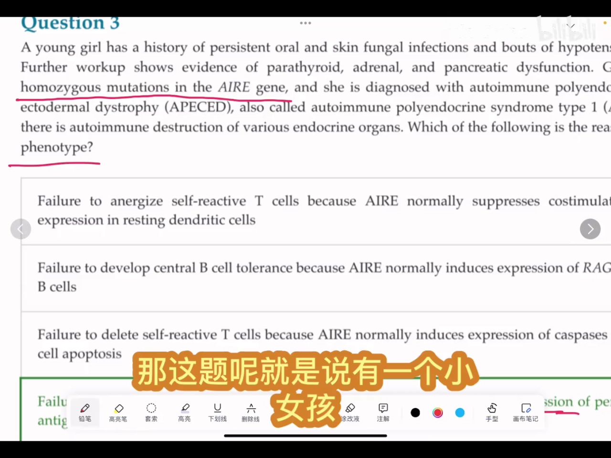

[【跳转到 07:06】](https://www.bilibili.com/video/BV1eM411Z7jZ/?t=426)

题目给出的几个干扰项本身就很值得看，因为它们分别对应"错误归因"：

- "AIRE 不能使自身反应性 T 细胞失能，因为 AIRE 通常抑制静息 DC 的共刺激分子表达"——错，AIRE 的作用点在**中枢删除**，不是外周失能；
- "AIRE 不能建立 B 细胞中枢耐受，因为 AIRE 通常诱导 B 细胞 RAG 表达"——错，AIRE 是胸腺 mTEC 的事，与 B 细胞受体编辑无关；
- "AIRE 不能删除自身反应性 T 细胞，因为 AIRE 通常诱导 caspase 表达"——错在机制归属：删除靠的是**抗原呈递触发的阴性选择**，而不是 AIRE 直接去开凋亡开关。

**AIRE 的定位只有一句话：它是"抗原展示"的开关，不是"杀人"的开关。** 这句话能把上面三个干扰项一次排除。

## 五、B 细胞的三种结局：删除、无能、受体编辑

B 细胞的中枢耐受在骨髓里完成，未成熟 B 细胞通过表面 BCR（IgM）与骨髓微环境基质细胞表面的自身抗原相互作用，有三种结局：

1. **克隆清除**：与自身抗原**高亲和力**结合 → 凋亡 → 自身反应性 B 细胞被清除；
2. **克隆无能**：与**高浓度可溶性自身抗原**结合 → BCR 表达受阻或功能丧失 → 细胞活着但无法被激活；
3. **受体编辑**：部分自身反应性 B 细胞受自身抗原刺激后**重新启动免疫球蛋白基因重排**，通过重链或轻链位点的二次重排改变特异性，不再对相应自身抗原应答。

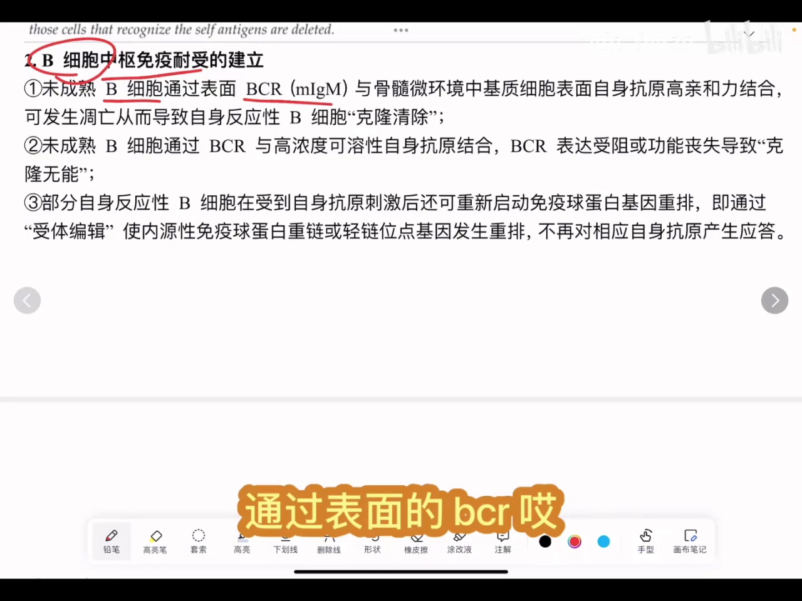

[【跳转到 07:39】](https://www.bilibili.com/video/BV1eM411Z7jZ/?t=459)

课程用一句大白话总结这三种结局：**"要不然改过自新，要不然自杀。"** 受体编辑就是改过自新，凋亡就是自杀，克隆无能则是"不杀你，但把你关起来"。

这里也有一道判断题值得记住：识别自身抗原之后**不可能**发生的事是"直接变成 Th 细胞继续发育"——一个已经证明自己会打自己的 T 细胞，不会被允许再去做辅助性 T 细胞。它可以死，可以变成 Treg，但不能若无其事地毕业。

## 六、外周耐受：四种机制与一个"忽视"

胸腺和骨髓的筛选不可能百分之百干净，加上还有后天获得的耐受需求，所以外周还要再来一轮。课程用一张图把正常应答与三种耐受结局并排放在一起，这张图是本节的骨架：

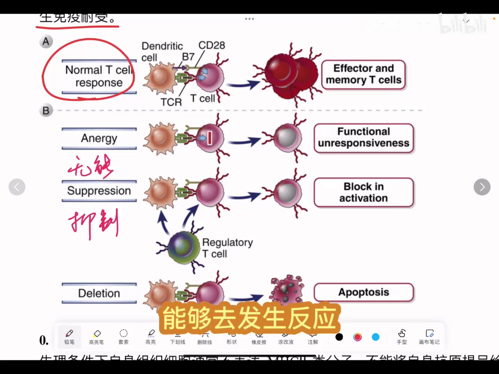

[【跳转到 09:32】](https://www.bilibili.com/video/BV1eM411Z7jZ/?t=572)

正常 T 细胞要发生反应，需要两个信号：**TCR 识别抗原-MHC 是第一信号，B7-CD28 是第二信号**。外周的耐受机制，本质上就是在这两个信号上做文章。

### 6.1 克隆无能（anergy）：把第二信号拿掉

课程特别强调一个区分：**"缺乏第一信号"不算克隆无能**。生理条件下自身组织细胞通常不表达 MHC II 类分子，无法把自身抗原呈递给 CD4⁺ T 细胞，这叫"没有抗原识别"，而不是无能。

真正的克隆无能是**有第一信号、缺第二信号**：

- 未成熟 DC 能为自身反应性 T 细胞提供第一信号，但**低表达 B7** 等共刺激分子，无法有效诱导第二信号，使这些 T 细胞处于无能状态；
- 某些器官/组织细胞能表达"自身抗原肽-MHC"复合物提供第一信号，但**不能表达 B7 和 CD40**，同样使自身反应性 T 细胞克隆无能。

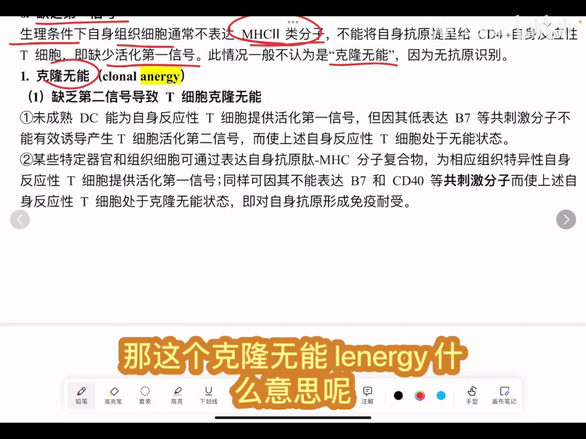

[【跳转到 10:35】](https://www.bilibili.com/video/BV1eM411Z7jZ/?t=635)

B 细胞的克隆无能是**跟着 T 细胞走**的：B 细胞的激活需要 CD4⁺ 辅助性 T 细胞，T 细胞一旦无能，B 细胞也就失去了最重要的帮手。

### 6.2 免疫忽视：抗原太少，根本没被看见

还有一类耐受不靠"压制"，而靠"没碰上"：某些组织细胞的自身抗原水平本来就极低，达不到激活 T 细胞的阈值，于是形成**免疫忽视（immunological ignorance）**。它和克隆无能的区别在于：无能是"见过了但不让动"，忽视是"压根没见着"。

### 6.3 Treg 抑制：两群细胞、三件武器

调节性 T 细胞（Treg）是一类具有**负向调节作用**的 CD4⁺ T 细胞，包括天然调节性 T 细胞（nTreg）和诱导性调节性 T 细胞（iTreg）。它有一个很值得注意的非对称性：**Treg 对抗原的识别是特异性的、受 MHC II 类分子限制，但活化之后对相关免疫细胞的抑制是非特异性的**——也就是说，它被某个抗原"点名"启动，然后对周围一片细胞无差别地踩刹车。

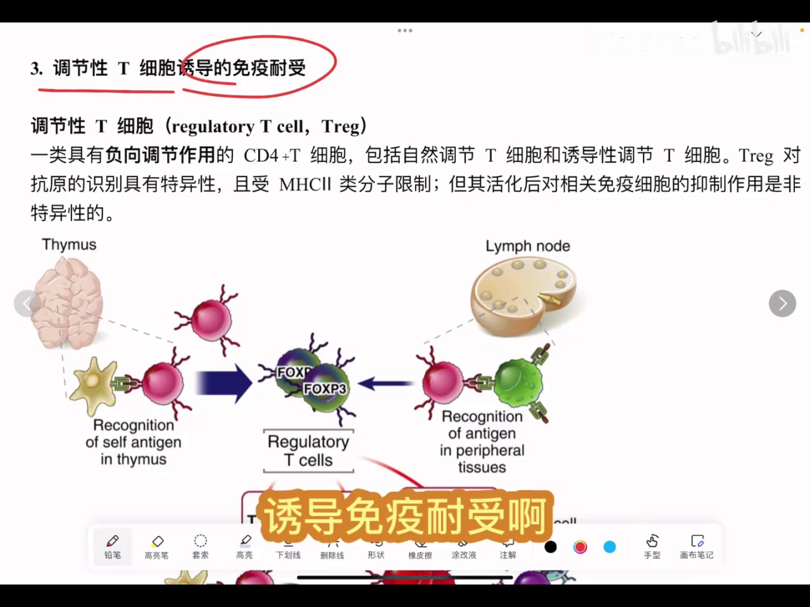

[【跳转到 11:42】](https://www.bilibili.com/video/BV1eM411Z7jZ/?t=702)

**nTreg** 在胸腺中分化发育而成，组成性表达抑制性膜分子 **CTLA-4**，表面标志为 CD4⁺CD25⁺FoxP3⁺。它通过与经典 DC 密切接触发挥负向调控，机制有三步：

1. 通过 TCR-CD3 复合体和 CD4 与经典 DC 表面的"自身/非己抗原肽-MHC II"复合物结合；
2. 凭借高浓度 **CTLA-4** 与 T 细胞表面的共刺激分子 **CD28 竞争结合 DC 表面的 B7**；
3. 结果是 CD4⁺/CD8⁺ T 细胞拿不到有效的共刺激信号（第二信号），处于**克隆无能**状态。

此外 nTreg 还能合成分泌 **IL-10** 和 **TGF-β** 等抑制性细胞因子，对 T 细胞和 APC 产生免疫抑制。

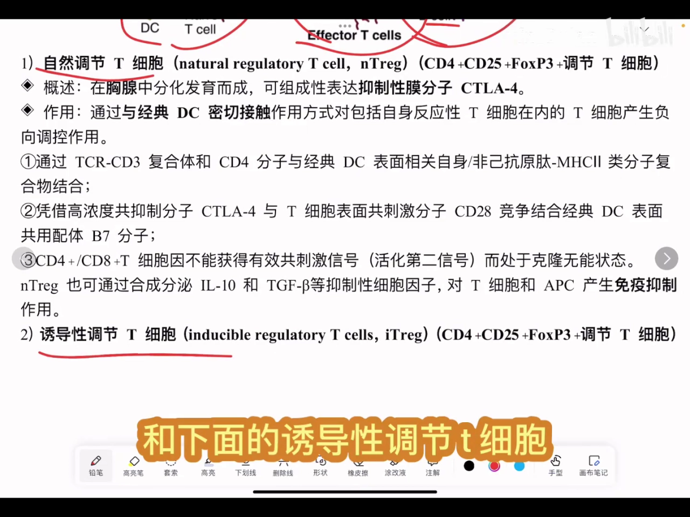

[【跳转到 13:00】](https://www.bilibili.com/video/BV1eM411Z7jZ/?t=780)

**iTreg** 则是在外周免疫器官和感染组织部位，由 CD4⁺ 初始 T 细胞接受抗原刺激后，在 **TGF-β 和 IL-2** 作用下诱导形成的，主要靠分泌 TGF-β 与 IL-10 抑制 T 细胞活化。

课程在这里连出两道题，正好检验有没有抓住重点：

- "下列哪一个不是 Treg 的特性？"——**分泌 γ 干扰素**。Treg 的工作是抑制，不是分泌 IFN-γ 去激活别人。
- "下列哪个分子表达在 Treg 上、并能阻止 B7 的共刺激？"——**CTLA-4**。这正是上面第 2 步。

### 6.4 克隆清除：两条凋亡通路

外周的最后一招是让细胞死掉。课程给的框架是两条通路：**外源性通路**（死亡受体途径）与**内源性通路**（线粒体途径），而活化诱导的细胞死亡（**AICD**）属于前者。

### 6.5 免疫豁免部位：物理屏障 + 主动抑制

还有一些部位"天生不欢迎免疫细胞"。眼晶状体蛋白、眼葡萄膜色素蛋白、精子这类**隐蔽自身抗原**，被局部组织的物理屏障与自身反应性淋巴细胞隔开，从而形成耐受；这些部位的组织细胞还可以**高表达 FasL 或 TGF-β**，让带相应受体的自身反应性淋巴细胞凋亡或失活。

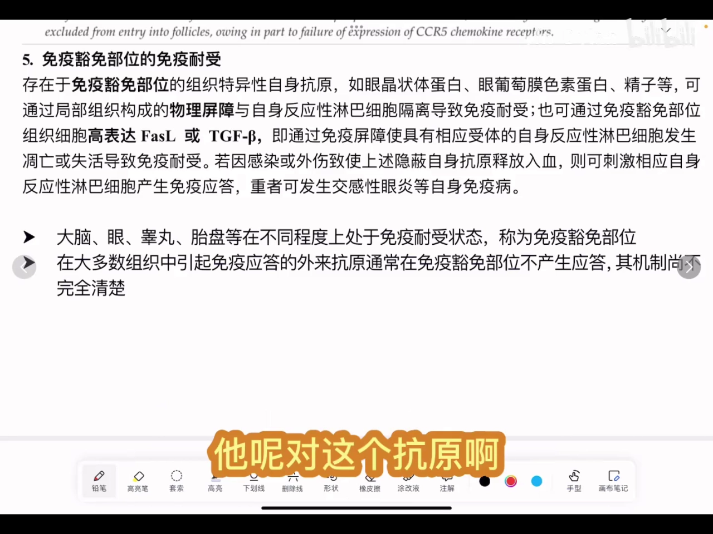

[【跳转到 16:13】](https://www.bilibili.com/video/BV1eM411Z7jZ/?t=973)

这张幻灯片的后半句是本节的"反转"：**屏障一旦破损，隐蔽抗原释放入血，就会刺激相应的自身反应性淋巴细胞产生免疫应答**，重者可发生**交感性眼炎**等自身免疫病。耐受不是"这些抗原不存在"，而是"它们被关起来了"。

## 七、耐受破裂：自身免疫的入口

课程最后点到自身免疫，明确说这部分"稍微讲一下就好"——它的发生机制还不是很清楚，但危险因素比较清楚：

- **遗传易感**：主要是 **HLA 基因**，因为它编码 MHC 复合体；
- **环境暴露**：感染、局部组织损伤等。

自身免疫病有几个共性：可能是全身性（系统性）的，也可能是器官特异性的，取决于自身抗原的分布；不同疾病组织损伤机制各异；而且往往是**慢性、进行性和自我延续**的——课程用了一个很形象的说法："轻症的癌症"，很难治好，但也没那么凶，可能持续几十年。

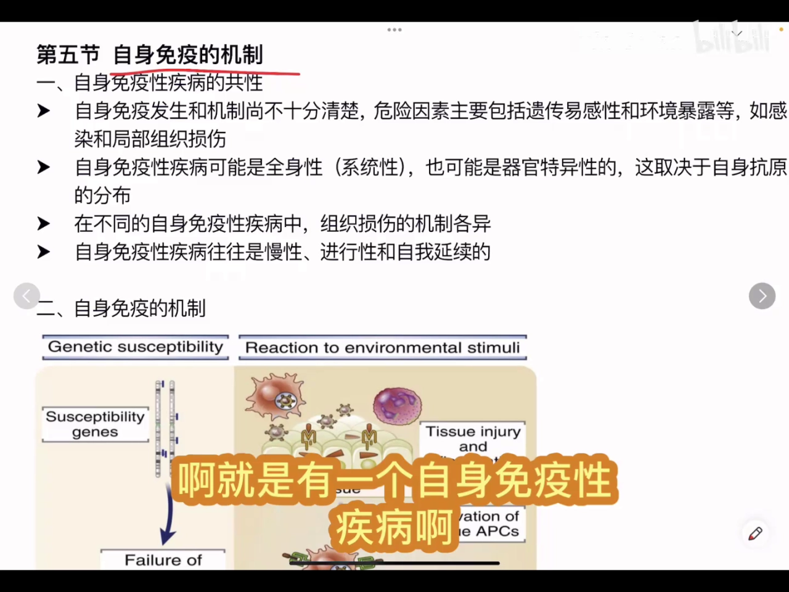

[【跳转到 17:31】](https://www.bilibili.com/video/BV1eM411Z7jZ/?t=1051)

课程列出的 HLA 关联包括类风湿、1 型糖尿病、多发性硬化症、红斑狼疮、强直性脊柱炎等。但关键的一句是：**光有易感基因不够，还要有相应的环境因素**——它是复杂遗传病，是易感基因与环境因素相互作用的结果。所以"哪个因素与自身免疫病最相关"这类题的答案是 MHC（HLA），但"为什么会发病"的答案必须同时包含环境。

## 小结

- **耐受是特异性的无应答**，有记忆性；与"对任何抗原都不应答"的免疫抑制不是一回事。
- **克隆选择学说是中枢耐受的底层逻辑**：胚胎期产生大量随机特异性的克隆，与自身抗原结合者被清除或抑制为禁忌克隆。
- **胸腺皮质是一次按亲和力分流的三岔路口**：高亲和力 → 阴性选择删除；低/中等亲和力 → 阳性选择存活；无相互作用 → 因被忽视而死（占 90% 以上）。
- **AIRE 解决"胸腺看不到组织限制性抗原"的难题**：它让 mTEC 异位表达 TRA，使阴性选择能覆盖全身；AIRE 突变 → 自身反应性 T 细胞逃逸 → APS-1/APECED。
- **AIRE 是抗原展示的开关，不是凋亡开关**——这一点能一次排除多道干扰项。
- **自身反应性细胞有三条出路**：删除（凋亡）、受体编辑（改受体）、无能（活着但叫不动）；"改过自新或自杀"是 B 细胞中枢耐受的通俗版。
- **外周耐受有四种机制**：克隆无能（有第一信号缺第二信号）、Treg 抑制（CTLA-4 抢 B7、IL-10/TGF-β）、免疫忽视（抗原太少没被看见）、克隆清除（AICD 与线粒体途径）。
- **免疫豁免是"关起来"而不是"不存在"**：屏障破损、隐蔽抗原释放，就可能引发交感性眼炎这类自身免疫病。
- **耐受破裂 = 自身免疫**：HLA 易感 + 环境暴露共同作用，病程慢性、进行性、自我延续。

## 关键术语速查

| 术语 | 一句话解释 |
| --- | --- |
| 耐受原（tolerogen） | 能诱导免疫耐受的抗原 |
| 免疫抑制 | 对任何抗原都不应答，与特异性的免疫耐受不同 |
| 克隆选择学说 | Burnet 提出：与自身抗原结合的未成熟克隆被清除或抑制为禁忌克隆 |
| 禁忌克隆 | 被清除或抑制的自身反应性克隆 |
| 阳性选择 | 低/中等亲和力识别自身 MHC 的胸腺细胞存活并获得 MHC 限制性 |
| 阴性选择 | 高亲和力识别自身抗原的胸腺细胞凋亡 |
| death by neglect | 无相互作用的胸腺细胞因缺乏存活信号而死亡 |
| AIRE | 自身免疫调节因子，驱动 mTEC 异位表达组织限制性抗原 |
| TRA | 组织限制性抗原，平时只在特定器官表达 |
| APS-1 / APECED | AIRE 突变导致的多内分泌腺自身免疫综合征 |
| 受体编辑 | B 细胞重新重排免疫球蛋白基因，改变自身反应性 |
| 克隆无能（anergy） | 有第一信号但缺第二信号，细胞存活却无法活化 |
| 免疫忽视 | 自身抗原水平过低，未能达到激活阈值 |
| 免疫豁免部位 | 眼、脑、睾丸、胎盘等靠屏障与 FasL/TGF-β 隔绝免疫攻击的部位 |