# 免疫耐受的两道防线：中枢阴性选择与外周 Treg 怎样压住自身反应性

> 视频来源：[10章_免疫耐受](https://www.bilibili.com/video/BV1LiUSBQEBf/)（Bilibili · 学免疫的姚小姚）｜时长约 30 分钟
> 简要导读：这是一节按人卫版教材章节顺序推进的系统课：先给概念与分类，再讲"什么因素决定一个抗原被耐受还是被攻击"，然后依次拆开中枢耐受（T/B 细胞的阴性选择）、外周耐受（Treg、克隆失能、克隆清除、免疫豁免），最后落到人工建立或打破耐受。本文保留这条主线与全部关键分子；MHC 如何装载肽见 1.1.7，T 细胞如何被激活见 1.1.8，Treg 的亚群分类见 1.1.9，本文只讲它的耐受功能。

## 本讲要解决的核心问题（SCQA）

**背景**：在 1.1.8 里我们已经知道，T 细胞被"肽-MHC 第一信号 + 共刺激第二信号"激活，然后增殖分化；在 1.1.7 里也知道 MHC 会把细胞内的肽摆到细胞表面。这套规则本身是"见到抗原就反应"。

**冲突**：可我们体内每一个细胞都在提供自身肽，免疫系统每天都要从成千上万个自身抗原旁边走过。如果按同一套规则办事，B 细胞和 T 细胞应该立刻把自己全身的组织当成敌人打一遍。事实却是绝大多数人一辈子不发生自身免疫病。

**疑问**：自身反应性是从哪一步被拦下来的？被拦下之后，那些"漏网"的自身反应性细胞又靠什么继续被压住？这套机制什么时候会失效？

**回答（中心思想）**：免疫耐受是**对特定抗原的选择性不应答**，它靠两道防线叠加。第一道在**中枢免疫器官**：胸腺和骨髓里做阴性选择，识别自身抗原信号强的淋巴细胞直接凋亡（克隆清除），信号弱的 CD4⁺ T 细胞改造成 nTreg，B 细胞则按强、中、弱三档分别走向清除、受体编辑与失能。第二道在**外周**：Treg 用 TGF-β/IL-10、CTLA-4 抢 B7、掠夺 IL-2 三件武器压制，不成熟 DC 只给第一信号造成克隆失能，活化后的细胞再经 AICD 与线粒体途径被清除，眼、脑、睾丸、胎盘等免疫豁免区还有物理与代谢屏障。所以"耐受被打破"就是自身免疫的入口；而临床上，这套机制既可以被加强（治自身免疫病、抗移植排斥），也可以被拆掉（抗肿瘤、抗慢性感染）。

## 一、免疫耐受是对特定抗原的选择性"不应答"

课程开篇先把免疫应答分成正、负两面：对**非己**物质是正应答——产生免疫应答产物、破坏清除抗原；对**自身**物质是负应答——不产生应答、不破坏清除自身抗原。

而"不应答"又分两种，这是最容易混淆的地方：

- **非特异性不应答 = 免疫缺陷**：机体对所有抗原都无应答。这是**病理状态**，可以是先天的（免疫缺陷病），也可以是后天的（获得性免疫缺陷，比如艾滋病，或药物抑制）。
- **特异性不应答 = 免疫耐受**：只对**特定抗原**无应答。这是**正常生理状态**，可以天然形成，也可以后天获得。

两者的分水岭是：免疫耐受**不影响适应性免疫应答的整体功能**。这一句话在后面反复被用到——耐受是"点对点"的，不是"全局关机"。

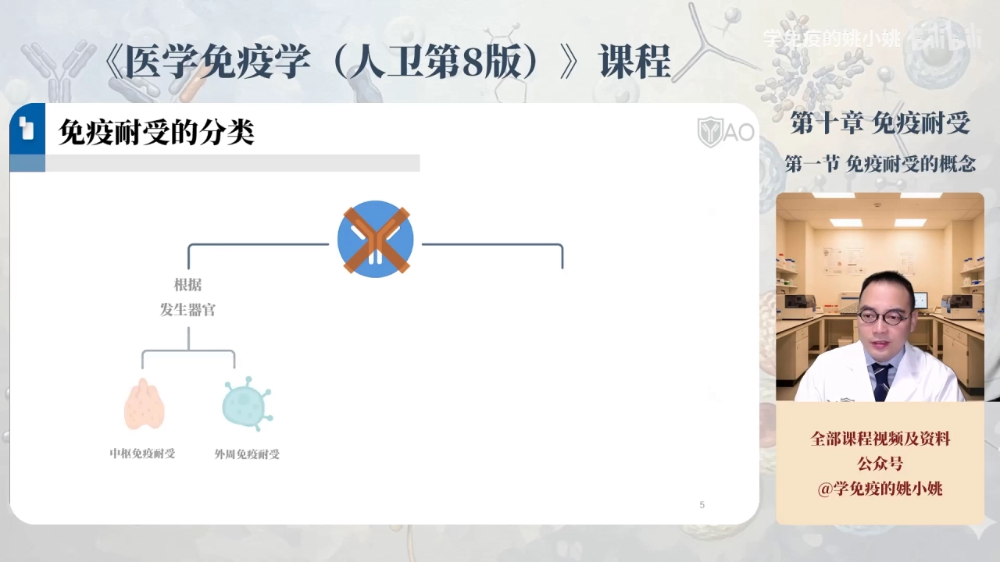

[【跳转到 01:50】](https://www.bilibili.com/video/BV1LiUSBQEBf/?t=110)

课程给了三个分类维度，后面整节课就是按第一个维度展开的：

| 分类依据 | 类型 |
| --- | --- |
| 发生器官 | 中枢免疫耐受、外周免疫耐受 |
| 发生细胞 | T 细胞耐受、B 细胞耐受 |
| 抗原进入途径 | 口服耐受、吸入性耐受 |

## 二、一个抗原被"耐受"还是被"攻击"，由宿主与抗原共同决定

诱导耐受的难易取决于两大类因素：**宿主因素**（免疫系统发育成熟程度、免疫功能状态、遗传背景）和**抗原因素**（剂量、性状、进入途径）。

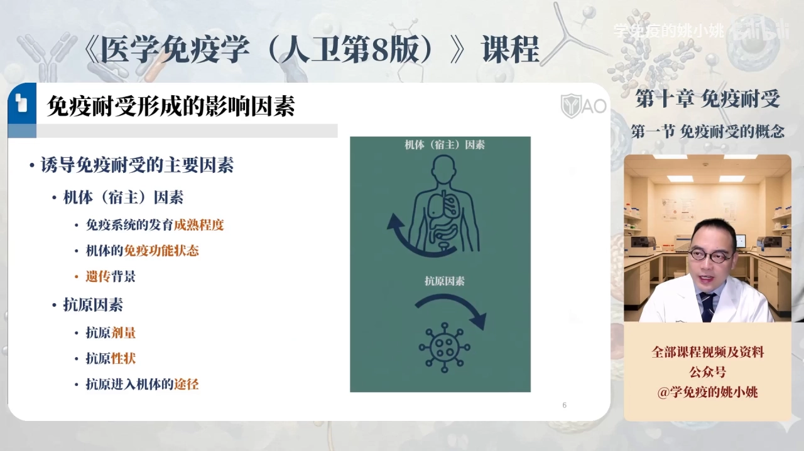

[【跳转到 02:10】](https://www.bilibili.com/video/BV1LiUSBQEBf/?t=130)

### 2.1 宿主因素之一：越不成熟，越容易被"说服"

最重要的宿主因素是免疫系统发育成熟的程度。机体倾向于把**胚胎发育时期接触过的抗原都当成自身抗原**。所以诱导耐受的难度排序是：

$$\text{成年期} > \text{新生期} > \text{胚胎期}$$

对应到细胞层面则是：成熟免疫细胞 > 未成熟免疫细胞。课程给了两个经典实验：

- **胚胎期**：异卵双胎小牛的血型嵌合体。两头小牛在子宫里血液相通，出生后彼此的血型抗原已被当作"自己"，互相输血不发生排斥。
- **新生期**：给新生小鼠注射 B 品系小鼠的脾细胞，等它成年后移植 B 品系皮肤可以存活；而移植从未接触过的 C 品系皮肤则被排斥。

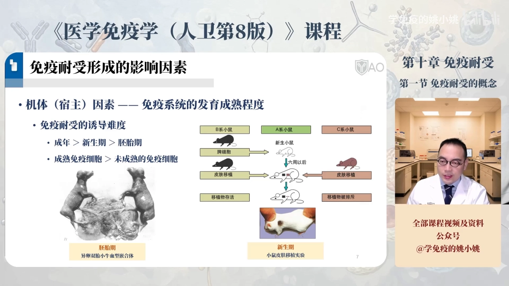

[【跳转到 02:58】](https://www.bilibili.com/video/BV1LiUSBQEBf/?t=178)

### 2.2 宿主因素之二、之三：免疫状态与遗传背景

**免疫功能状态**：健康的、免疫正常的个体不容易形成耐受，免疫功能低下的个体更容易对外来抗原形成耐受。课程用移植免疫举例——急性排斥期要大量使用免疫抑制剂压制免疫活性，而移植后较长时间的用药除了抗排斥，也在一定程度上帮助宿主建立对移植物的耐受。

**遗传背景**：某些基因背景的个体对特定抗原先天耐受。典型例子是 5%~10% 的人接种乙肝疫苗后不产生抗体，这与特定 HLA 类型（如 HLA-DR3、DR4 等）相关。但关键细节是：这些人**B 细胞不产生抗体，细胞毒性 T 细胞对乙肝抗原的应答仍然正常**。

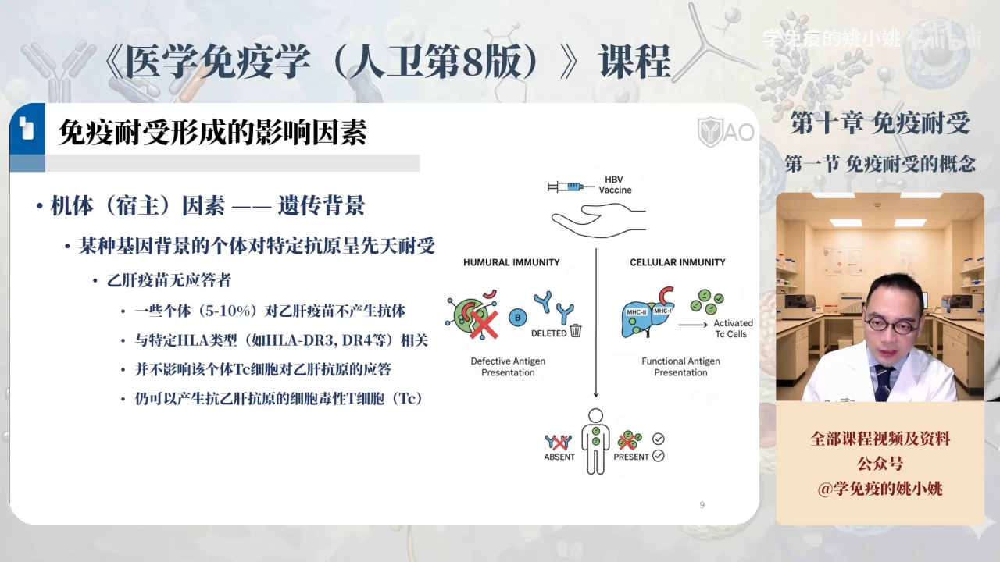

[【跳转到 04:57】](https://www.bilibili.com/video/BV1LiUSBQEBf/?t=297)

这张图正好印证了第一节那句话：**耐受是特定细胞对特定抗原的耐受，不会连累其他细胞对同一抗原的反应**。

### 2.3 抗原因素之一：剂量决定"失能"还是"删除"

抗原因素里最重要的是**剂量**。无论 T 细胞还是 B 细胞，剂量过低或过高都无法诱导正常应答，只有合适范围才引起免疫反应。两个极端各有一种耐受：

- **低带耐受**：低剂量抗原只能提供第一信号，没有第二信号（APC 未受炎症刺激，不表达 B7 之类分子），于是诱导 T/B 细胞**失能**；此外低剂量抗原持续温和刺激还会**诱导 Treg 产生**。
- **高带耐受**：高剂量抗原提供过度且持续的激活信号，触发 T/B 细胞**程序性死亡**（凋亡），即克隆清除。

高带耐受的机制是 **AICD（活化诱导的细胞死亡）**：T 细胞经历一次快速活化后会表达 FasL，去刺激附近 T 细胞表面的死亡受体 Fas，诱导大规模凋亡，让活化进入衰退期。课程用了一个开车类比：正常活化像开车，快到目的地会自然踩刹车；过高剂量相当于给车装了过强的发动机，初始速度太快，直接跳过平台期冲向凋亡。

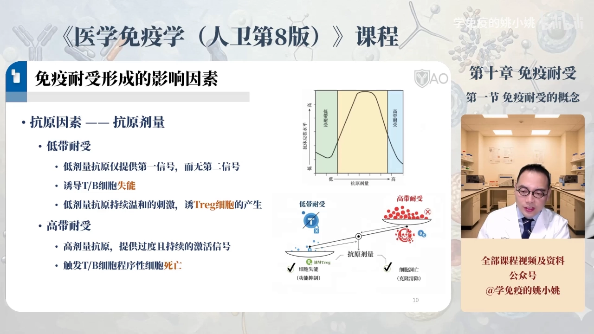

[【跳转到 08:17】](https://www.bilibili.com/video/BV1LiUSBQEBf/?t=497)

**同样是不应答，结果完全不同**：低带耐受是功能抑制（细胞还活着，但叫不动），高带耐受是克隆清除（细胞没了）。课程还给了一个结论：总体而言 **B 细胞耐受较难诱导、T 细胞耐受较易诱导**——换句话说 B 细胞更容易被激活。

### 2.4 抗原因素之二：理化性质、持续存在、表位与进入途径

- **理化性质**：不可溶的蛋白质抗原更容易引起免疫活化；可溶性蛋白中，**单体**分子倾向诱导耐受，**聚合**分子倾向激发应答。
- **持续存在**：在没有活化 APC 提供共刺激的情况下，T 细胞被持续存在的自身抗原反复刺激，容易发生活化后凋亡。课程举了肠黏膜的例子：肠道里有 **CD103⁺ DC**，能高效摄取并呈递食物抗原，但很难提供第二信号；于是针对食物抗原的 T 细胞克隆长期被"低密度刺激 + 无第二信号"，最终失能或凋亡。这就是口服耐受的细胞基础。
- **表位特点**：同一抗原可以同时带"耐受原表位"和"活化表位"。课程举 HEL 蛋白为例：N 端表位呈递后主要诱导 Treg（耐受），C 端表位呈递给辅助性 T 细胞（活化）。所以"这个抗原是耐受原还是免疫原"这个问题本身可能问得不严谨——**要看是哪个表位被谁看到**。
- **进入途径**：口服、静脉、腹腔注射、肌肉注射、皮下/皮内注射之中，**口服最容易诱导耐受，皮下/皮内注射最容易诱导活化**。这条规律直接被临床利用：脱敏治疗走口服或黏膜途径，疫苗走皮内/肌肉注射。

## 三、中枢耐受：胸腺与骨髓里的"资格考试"

按发生场所与细胞类型，免疫耐受可以分成四类：T 细胞中枢耐受、B 细胞中枢耐受、T 细胞外周耐受、B 细胞外周耐受。

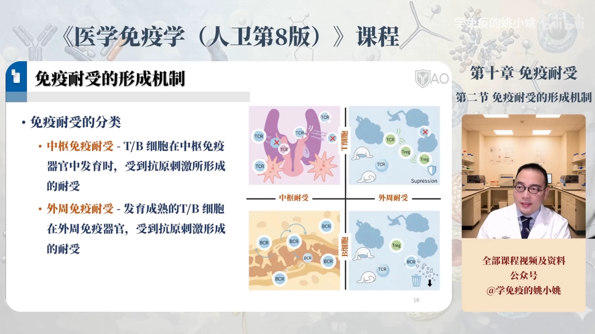

[【跳转到 12:51】](https://www.bilibili.com/video/BV1LiUSBQEBf/?t=771)

### 3.1 T 细胞的阴性选择：强信号删除，弱信号改造成 nTreg

T 细胞中枢耐受的机制就是**阴性选择**，发生在胸腺 SP（单阳性）细胞发育为成熟 T 细胞的过程中。主角是胸腺中的 DC（及胸腺上皮细胞），它把自身抗原呈递给 SP 细胞：

- **能识别自身抗原（信号强）** → 凋亡，即**克隆清除**；
- **不识别自身抗原** → 继续发育为成熟 T 细胞；
- **能识别但信号较弱** → 发育成**调节性 T 细胞（nTreg）**。

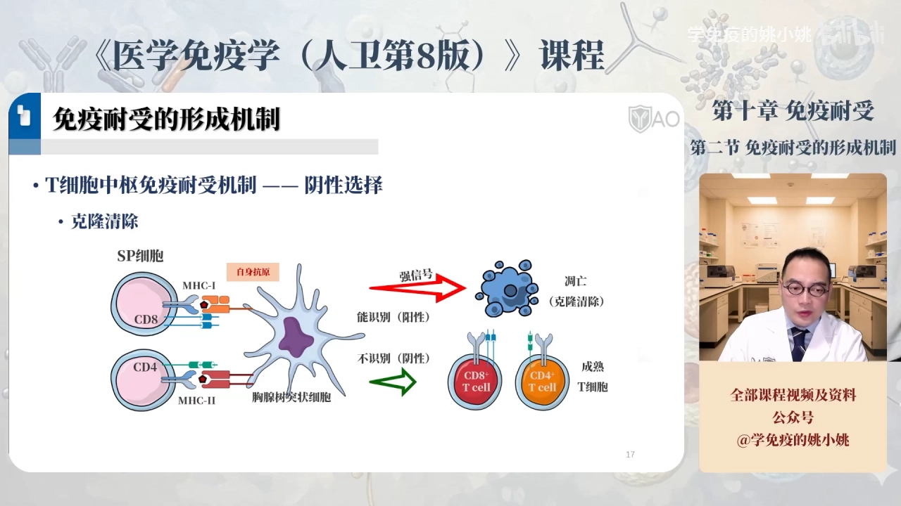

[【跳转到 14:06】](https://www.bilibili.com/video/BV1LiUSBQEBf/?t=846)

"阴性选择"这个名字有点反直觉：**只有"阴性"的、不起反应的细胞才能活下来**，能识别自身抗原、起反应的"阳性"细胞反而要死。这正是"克隆选择"的字面含义——用抗原去筛克隆，把会打自己的那批筛掉。

而那条"弱信号"支路非常关键：它不是浪费，而是把危险的自身反应性细胞**转化成了刹车**。因为这群 Treg 是在中枢免疫器官（胸腺）里发育出来的，所以叫 **nTreg（natural Treg，天然调节性 T 细胞）**，归属于中枢耐受。

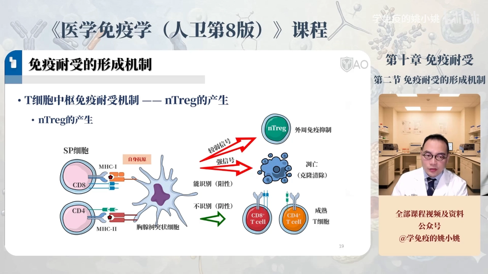

[【跳转到 14:31】](https://www.bilibili.com/video/BV1LiUSBQEBf/?t=871)

### 3.2 B 细胞的中枢耐受：强、中、弱三档处置

B 细胞的阴性选择与 T 细胞总体相似，但**更宽容**，按自身抗原结合信号的强弱分三档：

| 信号强度 | 结局 | 机制 |
| --- | --- | --- |
| 强 | 克隆清除 | 与自身抗原强结合，凋亡 |
| 中 | 受体编辑 | 重新激活 RAG 酶，合成新的轻链，改掉特异性 |
| 弱 | 细胞失能 | 下调 BCR（IgM）表达，提高活化阈值，进入外周 |

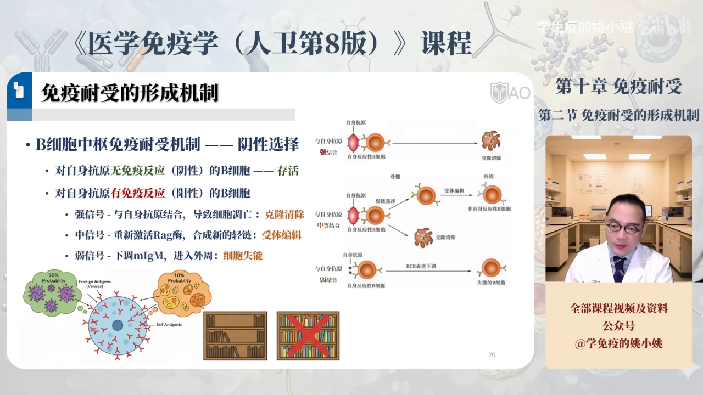

[【跳转到 16:11】](https://www.bilibili.com/video/BV1LiUSBQEBf/?t=971)

**为什么免疫系统对 B 细胞这么宽容？** 课程给了一个非常清晰的成本收益论证：假设某个 BCR 有 90% 的概率识别细菌/病毒抗原、只有 10% 的概率识别自身抗原，要不要清除它？如果标准再严一点，1%、0.1% 呢？"删除标准"越严格，付出的代价就是 repertoire 的急剧缩水——就像一座原本有一万本藏书的图书馆，最后只剩三五百本。所以免疫系统的策略是：**保留弱自身反应性的 B 细胞，赌外周耐受能兜住它**。

这段话也顺带解释了自身免疫病的一个入口：临床上很多自身免疫病，正是这些"理论上已被失能"的自身反应性 B 细胞，在外周因为炎症、药物等因素重新开始产生自身抗体，攻击自身组织。

## 四、外周耐受：漏网者的三道处置

### 4.1 Treg 的三件武器：抑制性细胞因子、抢 B7、掠夺 IL-2

T 细胞外周耐受主要靠 Treg 完成。Treg 分两群：

- **nTreg**：胸腺中直接发育而来，属中枢耐受；
- **iTreg（induced Treg）**：由辅助性 T 细胞在外周特定免疫微环境中被诱导而成，属外周耐受。

两群来源不同，**抑制功能一样**，靠三种方式工作：

1. **分泌抑制性细胞因子**：高水平分泌 **TGF-β** 与 **IL-10**——体内两个具有显著免疫抑制功能的细胞因子。
2. **高表达 CTLA-4，竞争性抢占 B7**：CTLA-4 结合 B7 的效率远高于 CD28。B7 与 CD28 结合是 T 细胞活化的"油门"，Treg 把 APC 上的 B7 占满之后，自身反应性 T 细胞表面的 CD28 就拿不到激活信号。
3. **大量消耗 IL-2**：IL-2 是 T 细胞维持生存与活化必需的细胞因子，被 Treg 掠夺性消耗后，附近的自身反应性 T 细胞因"饥饿"而死亡。

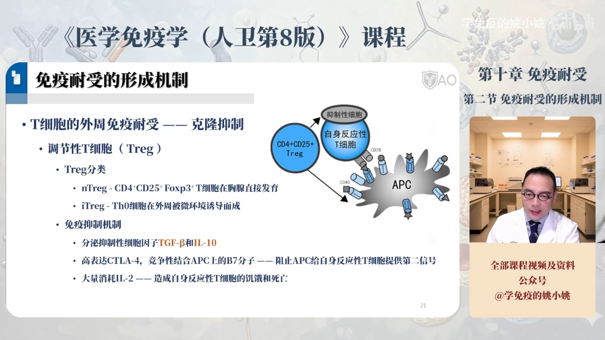

[【跳转到 18:36】](https://www.bilibili.com/video/BV1LiUSBQEBf/?t=1116)

课程还提醒：抑制性细胞不止 CD4⁺ Treg 一种。CD8⁺ T 细胞里有对应的一群 Treg，B 细胞里有 **Breg**，DC 里有 **DCreg**，巨噬细胞中的 **M2 型**偏向耐受并帮助肿瘤逃逸，此外还有**髓系来源的抑制性细胞（MDSC）**。它们共同构成免疫"阴阳"里阴的一面。

### 4.2 克隆失能：只有第一信号，没有第二信号

不成熟的 DC 虽然能呈递自身抗原，但**低表达或不表达共刺激分子**，也不能产生 T 细胞生存和活化必需的 IL-2、IL-12。结果它只能给 T 细胞提供第一信号而没有第二信号，T 细胞长期处于**失能（anergy）**状态。

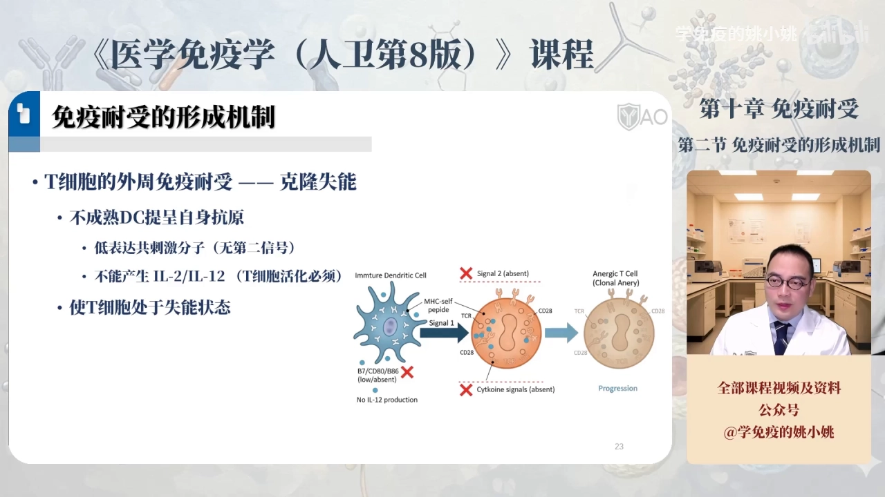

[【跳转到 20:41】](https://www.bilibili.com/video/BV1LiUSBQEBf/?t=1241)

这正好接上第二节讲过的 CD103⁺ DC 与食物抗原：肠道里那些 T 细胞克隆就是被这种"只有第一信号"的呈递方式磨到失能的。

### 4.3 克隆清除：外源性 AICD 与内源性线粒体途径

外周清除分两条路：

- **外源性**：AICD。活化的 T 细胞高表达 FasL，作用于自身或邻近 T 细胞表面的 Fas（可理解为"自毁开关"），诱导凋亡。
- **内源性**：长期失能的 T 细胞代谢出问题，线粒体中的**细胞色素 C** 泄漏到细胞质，激活 **caspase** 途径，走向凋亡。

**B 细胞的外周耐受机制与 T 细胞高度类似**，但有一个依赖关系值得记住：

- **克隆抑制**：B 细胞表面表达多种抑制性受体，提高活化阈值；
- **克隆失能**：Th 细胞被清除或失能后，B 细胞缺少 CD40 这个关键第二信号，无法活化；
- **克隆清除**：生发中心里体细胞高频突变产生的大量自身反应性 B 细胞，与活化 Th 细胞表达的 FasL 结合后被诱导凋亡。

换句话说，**B 细胞的外周耐受在很大程度上是"跟着 T 细胞走"的**——T 细胞被压住，B 细胞就失去了最重要的帮手。

## 五、免疫豁免：给关键器官加一道物理与代谢屏障

免疫豁免区（免疫豁免器官）指通常情况下不引起免疫反应的器官或部位，共同特点是有特殊的解剖结构；一旦出现炎症，可能导致严重的中枢功能与生殖障碍。典型例子是**眼、大脑、睾丸、胎盘、软骨**。

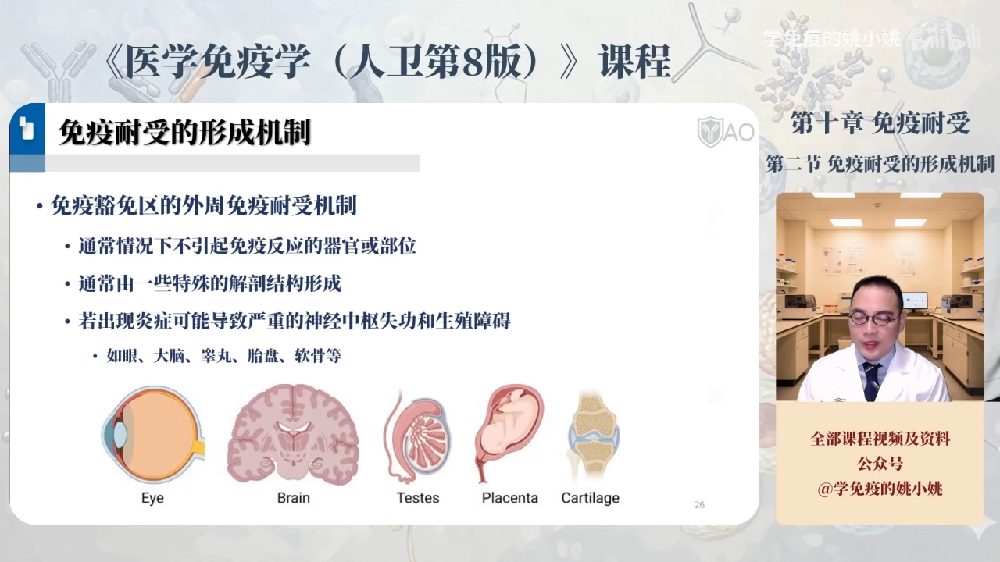

[【跳转到 23:36】](https://www.bilibili.com/video/BV1LiUSBQEBf/?t=1416)

课程用**胎盘的母胎界面**做了完整拆解，它同时用了四层机制：

1. **解剖学屏蔽**：滋养层细胞**不表达 MHC I 类和 II 类分子**。不表达 II 类可以理解；不表达 I 类意味着无法呈递内源性抗原，T 细胞激活不了。但 NK 细胞需要 MHC I 类提供抑制信号，所以这些细胞还**高表达其他 NK 抑制性配体**——结果是这里既激活不了 T 细胞，也激活不了 NK 细胞。
2. **代谢抑制**：分解色氨酸，抑制已活化、迁移到胚胎局部的 T 细胞的代谢。
3. **补体与细胞因子抑制**：分泌补体抑制分子（针对 C3、C4）以及 TGF-β、IL-10 等抑制性细胞因子，抑制补体与 Th1 活化。
4. **免疫偏离**：局部偏向 Th2 型反应，而 Th2 对靶细胞攻击性弱，有助于维持耐受。

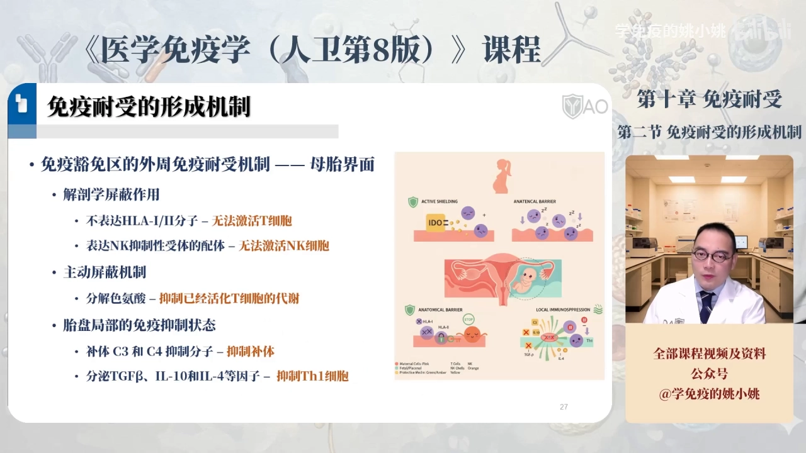

[【跳转到 24:26】](https://www.bilibili.com/video/BV1LiUSBQEBf/?t=1466)

## 六、人工干预：耐受是一柄双刃剑

课程最后一节把前面所有机制"反过来用"：需要治自身免疫病、抗移植排斥时**建立耐受**；需要抗肿瘤、抗慢性感染时**打破耐受**（肿瘤和慢性感染会主动诱导耐受，让免疫系统不再攻击）。

### 6.1 建立耐受的五种手段

- **改变抗原进入途径**：口服引入抗原可诱导系统性耐受。课程提到国际上名为 LEAP 的研究——让婴幼儿早期经口接触花生抗原，以降低花生过敏。它同时踩中了两个有利条件：**新生期**更容易诱导耐受，**口服**更容易诱导耐受。
- **改造抗原肽（变构肽）**：人工合成的变构肽能代替天然表位与 MHC 结合并呈递给 T 细胞，能被 TCR 识别，但**不能启动 TCR 下游信号转导和细胞活化**。药物**醋酸格拉替雷**就是模拟神经髓鞘抗原肽的混合多肽制剂，它与自身反应性 T 细胞结合却不激活它们，相当于"背锅侠"，替中枢神经挡下攻击。
- **阻断共刺激信号**：用抗体阻断 **CD40 配体**，切断 B 细胞获取第二信号的途径，从而抑制 B 细胞活化；这类单抗用于类风湿关节炎、系统性红斑狼疮等体液免疫相关的自身免疫病。
- **增强 Treg**：体外扩增 Treg 后回输，或用特定细胞因子（如 TGF-β）提高体内 Treg 的数量与功能。
- **重建中枢耐受**：病情严重时，用骨髓/造血干细胞移植在患者体内重建中枢免疫耐受，清除大量自身反应性 T/B 细胞。

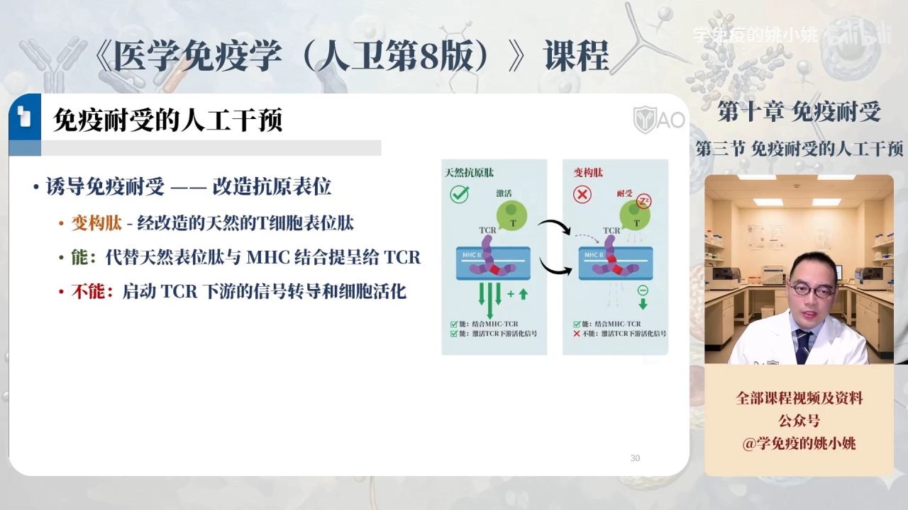

[【跳转到 27:42】](https://www.bilibili.com/video/BV1LiUSBQEBf/?t=1662)

### 6.2 打破耐受：把上面的方法倒过来

- **激活共刺激信号**，或用阻断型抗体**阻断共抑制分子（免疫检查点）**；
- **抑制 Treg 的功能**——Treg 本身是抑制性细胞，"负负得正"，压住 Treg 就增强了免疫活化；
- **促进 APC 成熟**：未成熟 DC 低表达 MHC 与共刺激分子、诱导耐受；让它成熟、高表达 MHC 与共刺激分子，就能把免疫反应推起来。

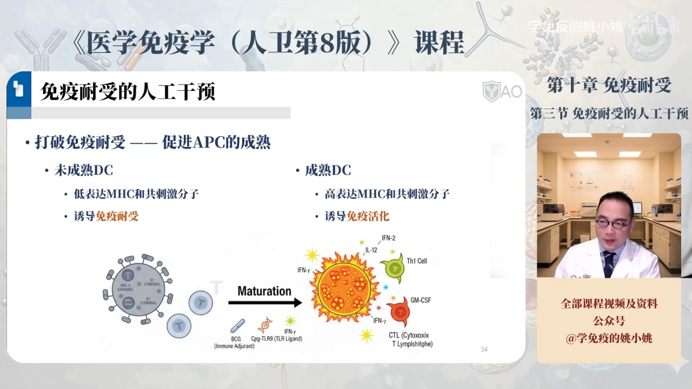

[【跳转到 29:57】](https://www.bilibili.com/video/BV1LiUSBQEBf/?t=1797)

课程最后用一张表把"建立耐受"与"打破耐受"逐项对照，这张表基本就是本节的总结：

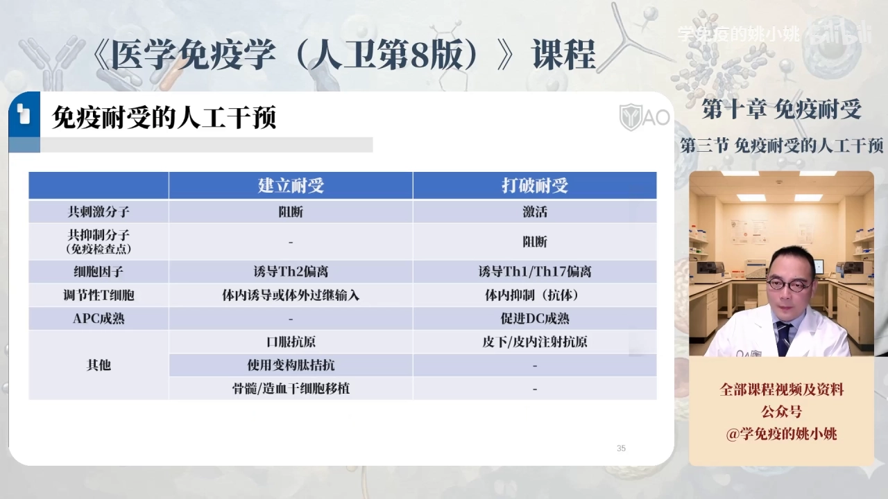

[【跳转到 30:11】](https://www.bilibili.com/video/BV1LiUSBQEBf/?t=1811)

## 小结

- **免疫耐受是"点对点"的生理性不应答**，与"全局关机"的免疫缺陷相对；判断标准是它对其他抗原的应答是否仍然正常。
- **耐受的难易由宿主与抗原共同决定**：越不成熟越易耐受（胚胎期 > 新生期 > 成年期），口服最易耐受、皮内注射最易活化，剂量过低导致失能、过高导致凋亡。
- **中枢耐受的核心是阴性选择**：T 细胞强信号删除、弱信号改造成 nTreg；B 细胞强信号删除、中信号受体编辑、弱信号失能后放行。
- **对 B 细胞宽容是算过账的**：删除标准越严， repertoire 缩水越厉害；免疫系统选择"保留弱自身反应性 + 靠外周兜底"。
- **外周耐受有四种机制**：Treg 抑制（TGF-β/IL-10、CTLA-4 抢 B7、掠夺 IL-2）、克隆失能（缺第二信号）、克隆清除（AICD 与线粒体途径）、免疫豁免（物理屏障 + 代谢与细胞因子抑制）。
- **耐受被打破就是自身免疫的入口**：失能的自身反应性 B 细胞在外周被炎症等重新点燃，就会产生自身抗体。
- **临床上耐受可以被双向调节**：建立耐受（口服抗原、变构肽、阻断共刺激、扩增 Treg、HSCT）与打破耐受（激活共刺激、阻断检查点、抑制 Treg、促 DC 成熟）是同一套机制的两种用法。

## 关键术语速查

| 术语 | 一句话解释 |
| --- | --- |
| 免疫耐受 | 机体免疫系统对特定抗原的特异性无应答状态，属正常生理现象 |
| 耐受原（tolerogen） | 能诱导免疫耐受的抗原；同一抗原也可能同时是免疫原 |
| 低带耐受 | 低剂量抗原只给第一信号、无第二信号，导致 T/B 细胞失能 |
| 高带耐受 | 高剂量抗原提供过强持续信号，触发凋亡与克隆清除 |
| 阴性选择 | 胸腺/骨髓中删除或改造自身反应性淋巴细胞的筛选过程 |
| 克隆清除 | 自身反应性细胞被诱导凋亡而消失 |
| 受体编辑 | B 细胞重新激活 RAG、重排轻链，改掉自身反应性 |
| 克隆失能（anergy） | 细胞存活但无法被激活，多因缺乏第二信号 |
| nTreg / iTreg | 胸腺中发育的天然 Treg / 外周诱导产生的 Treg |
| CTLA-4 | Treg 高表达的共抑制分子，与 CD28 竞争 B7，切断第二信号 |
| AICD | 活化诱导的细胞死亡，经 FasL-Fas 诱导凋亡 |
| 免疫豁免区 | 眼、脑、睾丸、胎盘、软骨等通常不引起免疫反应的部位 |
| 变构肽 | 能结合 MHC 与 TCR 但不能启动活化的改造肽，用于诱导耐受 |