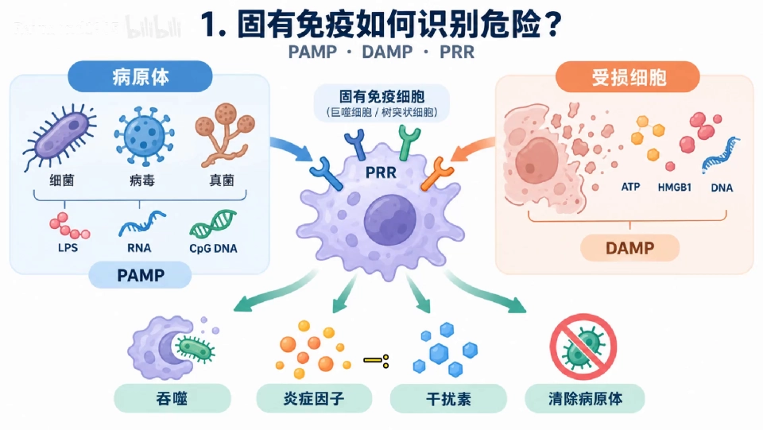
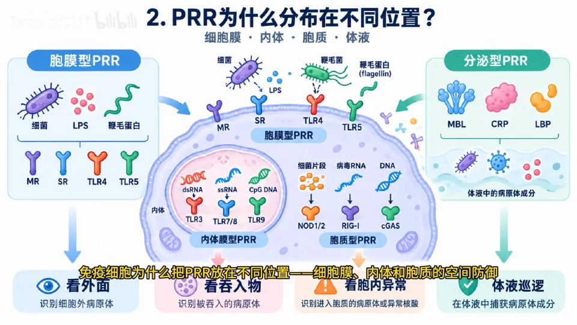
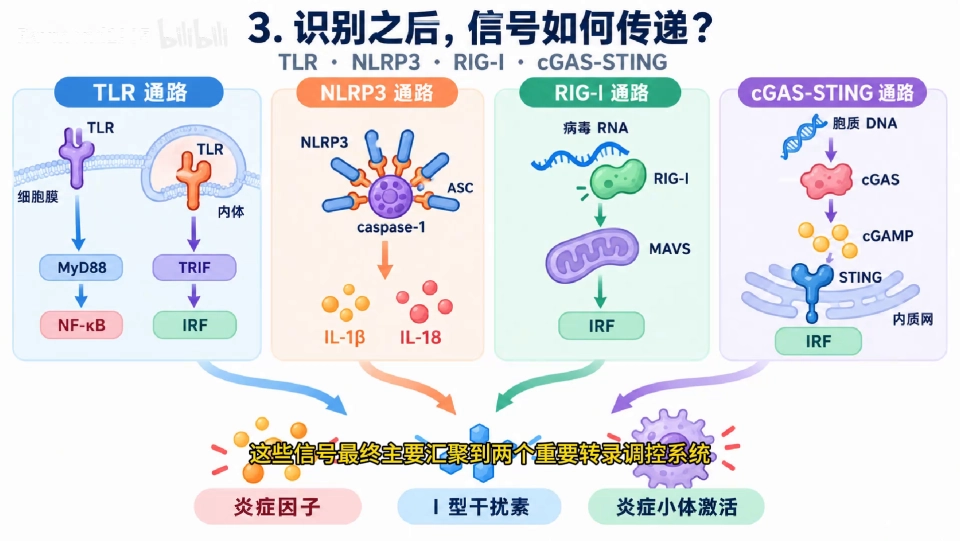
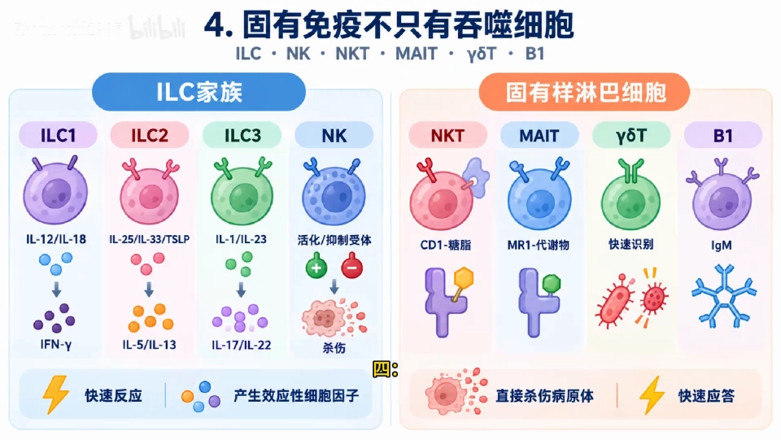
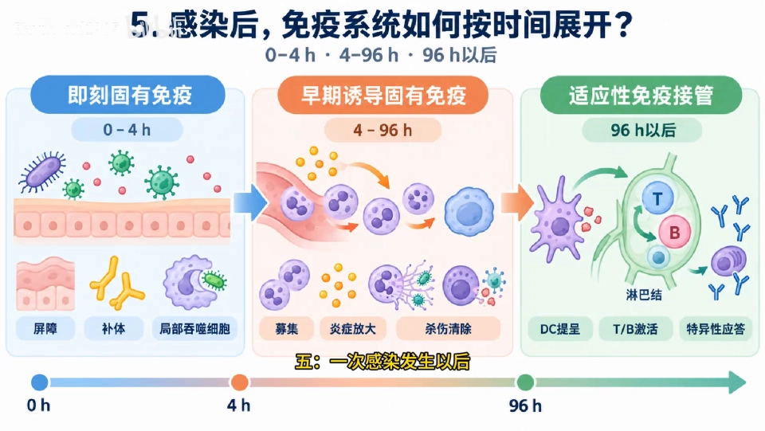
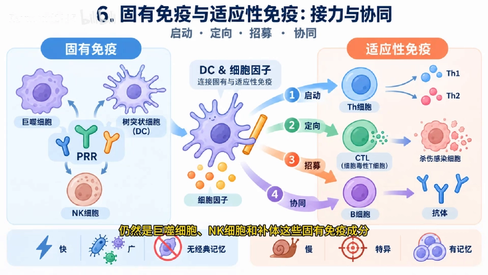

# 固有免疫如何发现危险：PAMP、DAMP 与模式识别受体的分区防御

> 视频来源：[第三章固有免疫应答](https://www.bilibili.com/video/BV1XVYe6TEbk/)（Bilibili · Raymond1985）｜时长约 17 分钟
> 导读：这支视频把「固有免疫怎么知道出事了」拆成六个问题：认什么、在哪认、怎么传信号、谁在参与、按什么时间展开、和适应性免疫什么关系。本文按这六步整理，适合作为免疫识别的第一张地图。

## 本讲要解决的核心问题（SCQA）

**背景**：免疫学讲得最多的是 T 细胞、B 细胞和它们的抗原受体，它们能精确到「某一个抗原决定簇」。

**冲突**：但感染发生后 0～4 小时里，特异性免疫根本还没启动。这段时间里机体靠什么判断「有病原体进来了」或者「自身组织受伤了」？如果固有免疫也去认具体抗原，它就必须为每种病原体准备一套受体，这显然做不到。

**疑问**：固有免疫究竟靠什么识别危险？识别之后又怎样把信号变成炎症和杀伤？

**回答（中心思想）**：固有免疫不认「身份证」，只认「危险模式」。PAMP 代表外来的病原体特征，DAMP 代表自身细胞受损后暴露的分子，两者由 PRR（模式识别受体）在细胞膜、内体、胞质和体液中分区捕捉；四条代表性通路最终只汇成三个输出——炎症因子、I 型干扰素、炎症小体激活。模式识别是整个固有免疫应答的起点。

## 一、固有免疫认的不是「某一个抗原」，而是「一类危险模式」

### 1.1 为什么必须换一种识别方式

早期的免疫学家早就知道巨噬细胞能吞噬细菌，但很长时间里说不清一件事：吞噬细胞究竟通过什么机制「认出」病原体。后来才逐渐形成「模式识别」这个概念：固有免疫系统并不像 T 细胞、B 细胞那样识别某一个非常具体的抗原，而是识别病原体或者受损细胞中**反复出现的一类共同分子结构**。

这个取舍非常划算。特异性受体要靠基因重排和克隆扩增才能凑出多样性，速度慢；而「一类共同结构」只要少数几种受体就能覆盖一大片病原体，代价是精度下降——它分不清是大肠杆菌还是沙门菌，但能分清「这是细菌」「这是病毒」。

[【跳转到 00:25】](https://www.bilibili.com/video/BV1XVYe6TEbk/?t=25)

### 1.2 两个必须掌握的概念：PAMP 与 DAMP

**PAMP（病原体相关分子模式）** 是病原微生物中比较保守、而且通常对病原体生存非常重要的一些结构。典型例子：

- 革兰阴性菌的脂多糖（LPS）；
- 细菌的鞭毛蛋白；
- 病毒的双链 RNA、单链 RNA；
- 细菌和病毒中的非甲基化 CpG DNA。

这些东西的共同特点是：在病原体中非常常见，而正常宿主细胞中通常不存在，或者不会以这种形式出现。

**DAMP（损伤相关分子模式）** 则不是来自外来微生物，而是来自我们自己的受损细胞。当细胞受到感染、缺氧、缺血、机械损伤或者发生死亡时，会释放一些正常情况下不应该大量出现在细胞外的分子，例如 HMGB1、ATP、热休克蛋白、尿酸结晶以及胞质 DNA。

这里有一个很好用的记忆框架：**PAMP 告诉免疫系统「外敌来了」，DAMP 告诉免疫系统「内部受伤了」**。两者在免疫系统看来都是「这里出问题了」，只是来源不同。

[【跳转到 01:15】](https://www.bilibili.com/video/BV1XVYe6TEbk/?t=75)

### 1.3 谁在识别：PRR 与它的表达细胞

负责识别 PAMP 和 DAMP 的就是 **PRR（模式识别受体）**。PRR 主要表达在巨噬细胞、中性粒细胞、树突状细胞，以及部分上皮细胞和内皮细胞上。

它不识别某一个细菌的「身份证」，而是在识别某一类危险模式。一旦 PRR 识别到这些信号，细胞就会被迅速激活，产生炎症因子、趋化因子、I 型干扰素，或者直接启动吞噬和杀伤机制。

[【跳转到 01:40】](https://www.bilibili.com/video/BV1XVYe6TEbk/?t=100)

## 二、为什么要把 PRR 分布在四个位置：一套分区预警系统

理解了 PRR 之后，下一个问题是：为什么人体需要这么多不同的模式识别受体？

答案藏在「位置」里。不同病原体、不同危险分子出现的位置不一样：细菌可能还漂在细胞外，病毒可能已经被吞进内体，也可能已经突破到胞质。因此免疫系统并不是把所有受体都堆在细胞膜表面，而是建立了一套有空间层次的监控系统。

[【跳转到 02:35】](https://www.bilibili.com/video/BV1XVYe6TEbk/?t=155)

### 2.1 第一层：细胞膜表面——看「外面有什么」

这一层主要负责识别细胞外的病原体：

- **甘露糖受体（MR）**：识别细菌和真菌表面的甘露糖、岩藻糖；
- **清道夫受体（SR）**：识别某些细菌成分，以及衰老凋亡细胞表面的分子；
- **细胞膜上的 TLR**：包括 TLR1/2、TLR2/6、TLR4 和 TLR5。

其中大家最熟悉的 TLR4 主要识别革兰阴性菌的 LPS，TLR5 识别细菌鞭毛蛋白。

[【跳转到 03:00】](https://www.bilibili.com/video/BV1XVYe6TEbk/?t=180)

### 2.2 第二层：内体膜——看「吞进来的核酸」

为什么这里还需要受体？因为很多病毒、细菌被细胞吞噬以后，它们的核酸会暴露在内体中。因此内体上主要分布 TLR3、TLR7、TLR8 和 TLR9：

| 受体 | 识别的配体 |
| --- | --- |
| TLR3 | 病毒双链 RNA |
| TLR7 / TLR8 | 单链 RNA |
| TLR9 | 病毒或细菌的非甲基化 CpG DNA |

### 2.3 第三层：胞质——看「突破防线的分子」

如果病毒 RNA 或者细菌、病毒 DNA 已经进入胞质，说明病原体突破了前面的防线，这时候就由胞质 PRR 负责识别。典型的包括 NOD 样受体、RIG 样受体，以及胞质 DNA 受体：

- NOD1、NOD2 识别细菌细胞壁成分；
- RIG-I 识别病毒 RNA；
- cGAS 识别异常出现在胞质中的 DNA。

### 2.4 第四层：分泌型 PRR——体液里的巡逻队

还有一类 PRR 不是固定在细胞里，而是存在于血液或者细胞外液中，例如 MBL、CRP 和 LBP。它们可以直接结合病原体，参与补体激活、调理吞噬和炎症反应。

所以，如果觉得 PRR 很多、很难记，其实不需要一个个死背，可以先记住一个空间逻辑：**细胞膜看外面，内体看被吞进来的核酸，胞质看突破防线的危险分子，血液里还有一批游离的 PRR 巡逻**。这实际上是一套非常精密的分区预警系统。

[【跳转到 04:40】](https://www.bilibili.com/video/BV1XVYe6TEbk/?t=280)

## 三、识别之后信号怎么传：四条通路，三个输出

这是全片机制性最强的部分。前面解决的是「谁在识别」，这里要解决的是「PRR 识别到病原体以后，细胞是怎么真正被激活的」。

### 3.1 TLR 通路：MyD88 / TRIF → NF-κB 与 IRF

TLR 识别 PAMP 以后，会通过细胞内的接头蛋白向下传递信号。这里最重要的是 **MyD88** 和 **TRIF**。不同 TLR 使用的接头蛋白并不完全一样：很多 TLR 主要通过 MyD88，TLR3 主要通过 TRIF，而 TLR4 比较特殊，可以同时使用 MyD88 和 TRIF。

这些信号最终主要汇聚到两个转录调控系统：

- **NF-κB**：被激活以后促进 IL-1、IL-6、TNF 等炎症因子的产生；
- **IRF**：特别与 I 型干扰素 IFN-α 和 IFN-β 的产生密切相关。

所以 TLR 信号的结果一方面是炎症，另一方面是建立抗病毒状态。

[【跳转到 05:40】](https://www.bilibili.com/video/BV1XVYe6TEbk/?t=340)

### 3.2 NLRP3 炎症小体：一个「两步走」的放大器

NLRP3 炎症小体可以理解成一个两步走的过程：

1. 前面的 PRR 信号先让细胞产生 pro-IL-1β 和 pro-IL-18，也就是还没有活性的细胞因子前体；
2. 随后，胞外 ATP、钾离子外流以及其他 PAMP、DAMP 进一步激活 NLRP3；NLRP3 与 ASC 和未活化的 caspase-1 组装成炎症小体，最终活化 caspase-1。

caspase-1 再把 pro-IL-1β 和 pro-IL-18 剪切成成熟的 IL-1β 和 IL-18，从而明显放大炎症反应。这种「先备料、再开火」的设计，避免了细胞在没有真正危险时误放炎症因子。

[【跳转到 06:30】](https://www.bilibili.com/video/BV1XVYe6TEbk/?t=390)

### 3.3 RIG-I 通路：胞质里的病毒 RNA 哨兵

RIG-I 主要在胞质中识别病毒 RNA。识别以后，它通过线粒体膜上的 MAVS 继续传递信号，最后激活 IRF，诱导产生 IFN-α 和 IFN-β，是抗病毒反应的重要组成部分。

### 3.4 cGAS-STING 通路：胞质 DNA 的报警器

正常情况下，DNA 主要存在于细胞核和线粒体中。如果大量双链 DNA 异常出现在胞质，cGAS 就会识别它。cGAS 激活以后催化产生 cGAMP，cGAMP 再结合 STING，进一步激活 IRF，诱导 I 型干扰素产生。

[【跳转到 07:20】](https://www.bilibili.com/video/BV1XVYe6TEbk/?t=440)

### 3.5 归纳：四套系统，三个输出

这四条通路虽然名称很多，但最终可以归纳成三个输出：

1. **产生炎症因子**（NF-κB 方向）；
2. **产生 I 型干扰素**（IRF 方向）；
3. **激活炎症小体**（IL-1β / IL-18 方向）。

这样理解以后，TLR、NLRP3、RIG-I 和 cGAS-STING 就不是四块孤立的知识，而是四套针对不同危险信号的细胞预警系统。

[【跳转到 07:45】](https://www.bilibili.com/video/BV1XVYe6TEbk/?t=465)

## 四、固有免疫不只有巨噬细胞：一套淋巴样快速反应部队

讲固有免疫时，学生很容易形成一个印象：好像固有免疫主要就是巨噬细胞、中性粒细胞和树突状细胞。实际上，淋巴细胞体系中也存在大量具有固有免疫特征的细胞。

### 4.1 ILC 家族：不靠特异性受体，靠细胞因子被激活

**ILC（固有淋巴样细胞）** 最大的特点之一，就是它们不像传统 T 细胞那样依赖高度多样化的特异性抗原受体，而是可以直接受到局部细胞因子的刺激，迅速产生效应。

- **ILC1**：主要受 IL-12 和 IL-18 刺激，活化后主要产生 IFN-γ，参与抗胞内细菌和抗病毒免疫；
- **ILC2**：主要受 TSLP、IL-25 和 IL-33 刺激，产生 IL-5、IL-13 等细胞因子，与抗寄生虫免疫以及过敏性炎症关系非常密切；
- **ILC3**：可以受 IL-1 和 IL-23 刺激，产生 IL-17 和 IL-22，主要参与对胞外细菌和真菌的防御。

### 4.2 NK 细胞：比较活化信号与抑制信号再决定

NK 细胞也是固有淋巴样细胞中的重要成员。它有一个非常有特点的机制：细胞表面同时存在杀伤活化受体和杀伤抑制性受体。它并不是简单地「看见肿瘤就杀」，而是综合比较活化信号和抑制信号，最后决定是否攻击靶细胞。因此 NK 细胞在病毒感染细胞和肿瘤细胞的清除中非常重要。

### 4.3 固有样淋巴细胞：NKT、MAIT、γδ T 与 B1

- **NKT 细胞**：通过有限多样性的 TCR 识别 CD1d 分子提呈的糖脂或者磷脂类抗原；
- **MAIT 细胞**：识别 MR1 分子提呈的微生物代谢物，例如核黄素代谢相关分子；
- **γδ T 细胞**：可以快速识别感染、应激或者肿瘤相关的分子，被激活后通过穿孔素、颗粒酶以及 FasL 等机制直接杀伤靶细胞；
- **B1 细胞**：可以快速识别某些细菌多糖类抗原，并迅速产生以 IgM 为主的低亲和力抗体，参与感染早期的防御。

这一部分可以帮助建立一个重要概念：固有免疫不仅有髓系「快速反应部队」，还有一套淋巴样「快速反应部队」。

[【跳转到 10:53】](https://www.bilibili.com/video/BV1XVYe6TEbk/?t=653)

## 五、按时间看：一次感染是怎样展开的

理解固有免疫一个非常好的方法，就是不要按细胞分类，而是按时间来看。教材把免疫应答大致分成三个阶段：即刻固有免疫应答、早期诱导固有免疫应答，以及后续适应性免疫应答。

### 5.1 0～4 小时：即刻固有免疫应答

这个时候机体没有时间重新制造大量免疫细胞，因此主要依赖原来就已经存在的防御力量：皮肤黏膜屏障、补体、抗菌分子，以及组织中已经存在的巨噬细胞、中性粒细胞和朗格汉斯细胞等。

这些细胞通过 PRR 迅速识别 PAMP，然后吞噬病原体，同时释放 IL-1、CXCL8 等炎症和趋化信号。特别是 CXCL8，它负责把中性粒细胞叫过来。如果病原体数量不多、毒力不强，很多感染实际上在这个阶段就能够被控制。

[【跳转到 11:27】](https://www.bilibili.com/video/BV1XVYe6TEbk/?t=687)

### 5.2 4～96 小时：早期诱导固有免疫应答

如果病原体没有被完全清除，局部炎症就开始明显放大。CCL2、CCL3、CXCL8 等趋化因子不断产生，使血液中的中性粒细胞和单核细胞大量进入组织，局部血管扩张、通透性增加，更多补体和抗菌蛋白进入感染部位。

中性粒细胞和巨噬细胞开始通过多种方式杀伤病原体，包括溶菌酶、抗菌肽、活性氧、活性氮；此外中性粒细胞还可以形成 NETs，用来捕获和杀伤细胞外病原体。

如果是病毒感染，感染细胞产生的 IFN-α/β 以及巨噬细胞产生的 IL-12，还可以激活 NK 细胞和 ILC1，NK 细胞进一步清除病毒感染细胞；而 IFN-γ 又能反过来增强巨噬细胞的杀伤能力。

[【跳转到 12:17】](https://www.bilibili.com/video/BV1XVYe6TEbk/?t=737)

### 5.3 96 小时以后：适应性免疫接管

前面吞噬了病原体的未成熟 DC 逐渐成熟并迁移到外周免疫器官，通过抗原肽-MHC 以及 CD80、CD86 等共刺激分子激活初始 T 细胞，同时 B 细胞也开始参与，最终形成抗体和抗原特异性 T 细胞应答。

[【跳转到 13:07】](https://www.bilibili.com/video/BV1XVYe6TEbk/?t=787)

把整个感染过程画成一条时间线就很清楚：**前 4 小时靠现成防御，4～96 小时靠炎症募集和固有免疫扩增，96 小时以后由适应性免疫逐渐接管**。

## 六、固有免疫与适应性免疫：不是替代，而是接力与协同

固有免疫和适应性免疫经常被放在一起比较：固有免疫反应快、识别范围比较广、受体多样性有限、通常没有经典免疫记忆；适应性免疫依赖高度多样化的 TCR 和 BCR，需要经过克隆选择和增殖分化，因此第一次应答相对较慢，但特异性更强，而且可以形成免疫记忆。

但如果只会比较两者的区别，还没有真正理解免疫系统。在真实机体中，两者不是两套独立系统，而是一套连续工作的系统。

1. **启动**：最典型的细胞是经典树突状细胞。DC 在组织中摄取病原体抗原以后，成熟并迁移到淋巴结，通过抗原肽-MHC 以及 CD80、CD86 等共刺激信号激活初始 T 细胞。没有前期的固有免疫识别，后面的适应性免疫很难被有效启动。
2. **定向**：DC 和巨噬细胞产生 IL-12 可以促进 Th1 相关应答；某些条件下 ILC2 和肥大细胞产生的细胞因子又可以促进 Th2 相关免疫。固有免疫不只是按下启动键，实际上还在给适应性免疫设定方向。
3. **招募**：感染或者肿瘤组织局部产生的趋化因子和炎症介质可以激活血管内皮，让效应 T 细胞更容易粘附、穿过血管并进入病变部位。
4. **协同**：适应性免疫产生的效应分子，最终还需要固有免疫参与才能充分发挥作用。抗体本身并不是简单地直接把细菌杀死——IgG 包被病原体以后，可以通过 Fcγ 受体促进巨噬细胞吞噬；抗体包被靶细胞以后，可以让 NK 细胞发生 ADCC；抗体还可以激活补体经典途径。

也就是说，适应性免疫产生了非常精确的「制导系统」，但真正完成很多杀伤任务的仍然是巨噬细胞、NK 细胞和补体这些固有免疫成分。

[【跳转到 15:53】](https://www.bilibili.com/video/BV1XVYe6TEbk/?t=953)

## 小结

- 固有免疫不认具体抗原，只认「一类危险模式」：PAMP 来自病原体，DAMP 来自受损自身细胞，二者由 PRR 统一接收。
- PRR 按空间分区部署：细胞膜看外面、内体看吞进来的核酸、胞质看突破防线的分子、体液中还有分泌型 PRR 巡逻。
- 四条代表性通路（TLR、NLRP3、RIG-I、cGAS-STING）最终只汇成三个输出：炎症因子、I 型干扰素、炎症小体激活。
- 固有免疫的细胞不只有髓系吞噬细胞，还有 ILC、NK、NKT、MAIT、γδ T、B1 这套淋巴样快速反应部队。
- 一次感染按 0～4 小时、4～96 小时、96 小时以后三段展开，前两段是固有免疫的主场。
- 固有免疫与适应性免疫是接力与协同关系：启动、定向、招募、协同四个环节把它们连成一套系统。

## 关键术语速查

| 术语 | 一句话解释 |
| --- | --- |
| PAMP | 病原体相关分子模式，病原体上保守且生存必需的共同结构，如 LPS、双链 RNA、CpG DNA |
| DAMP | 损伤相关分子模式，自身细胞受损或死亡后释放到胞外的分子，如 HMGB1、ATP、尿酸结晶 |
| PRR | 模式识别受体，识别 PAMP/DAMP 的受体总称，按位置分为膜型、内体型、胞质型与分泌型 |
| TLR | Toll 样受体，经 MyD88 或 TRIF 接头蛋白激活 NF-κB 与 IRF |
| NLRP3 炎症小体 | NLRP3 + ASC + caspase-1 组成的复合物，把 pro-IL-1β/pro-IL-18 剪切成成熟形式 |
| RIG-I | 胞质病毒 RNA 受体，经线粒体膜上的 MAVS 激活 IRF 产生 I 型干扰素 |
| cGAS-STING | 胞质双链 DNA 感应通路，cGAS 生成 cGAMP 后激活 STING，诱导 I 型干扰素 |
| ILC | 固有淋巴样细胞，不依赖特异性抗原受体，靠局部细胞因子被激活 |
| NETs | 中性粒细胞胞外诱捕网，用于捕获和杀伤细胞外病原体 |