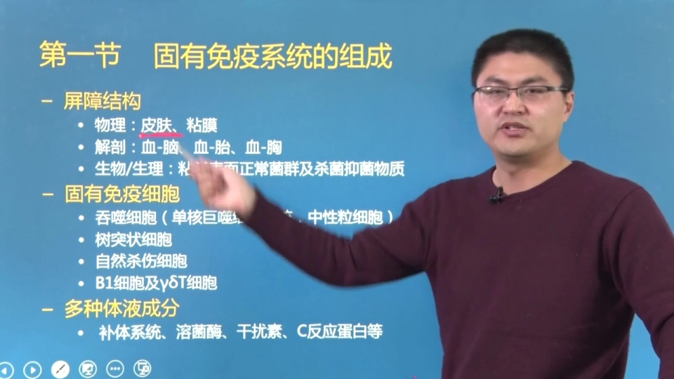
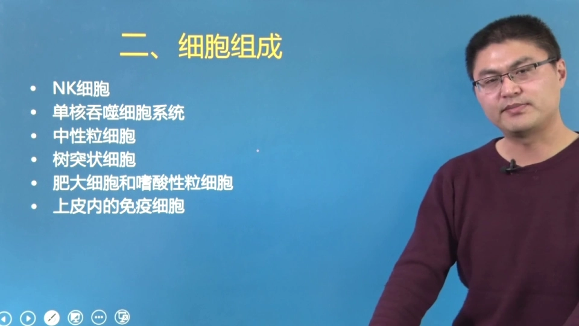
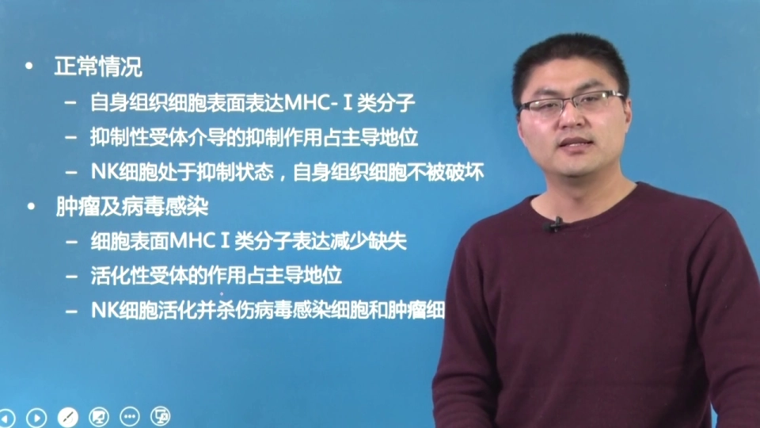
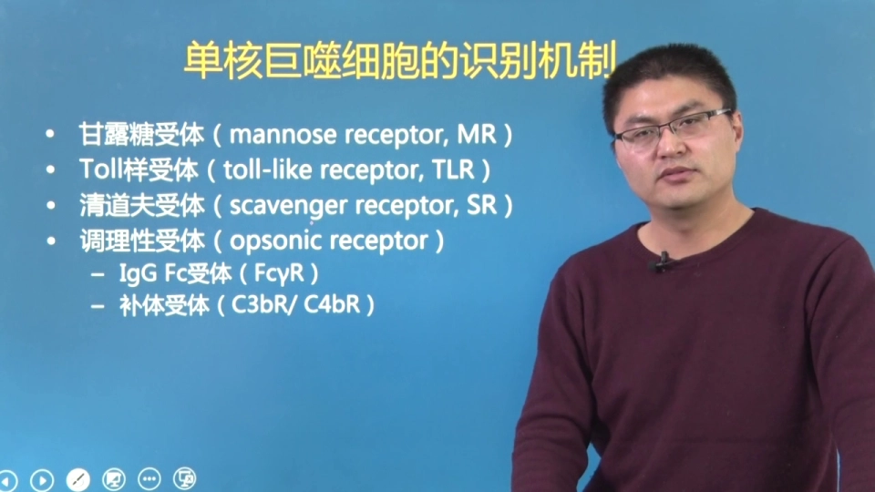
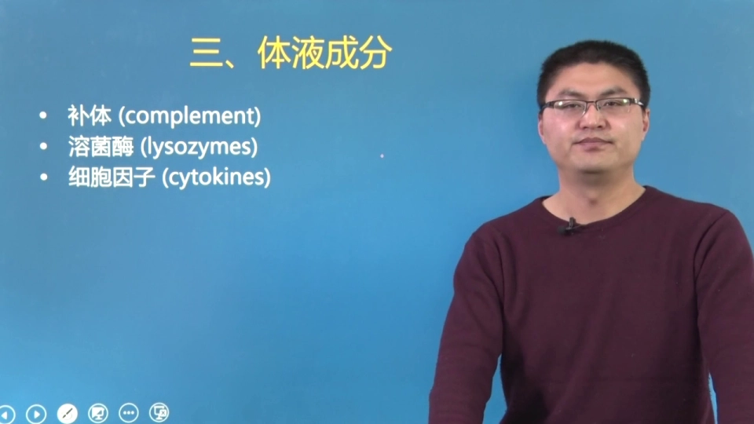
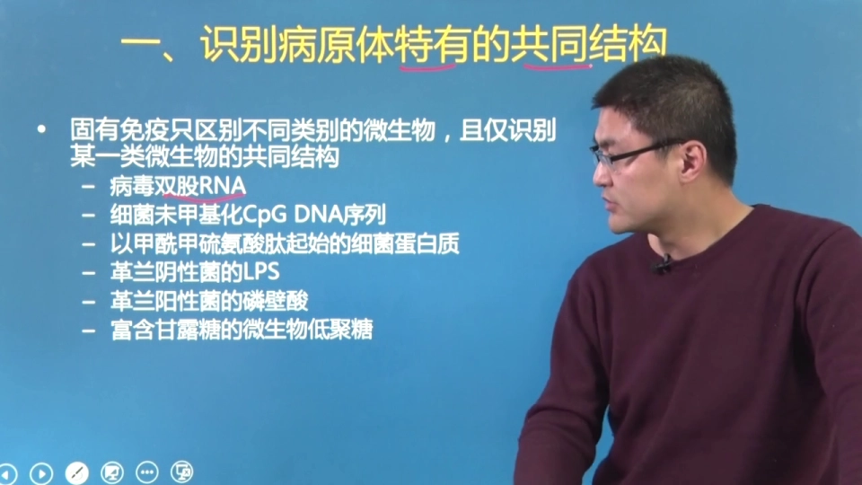
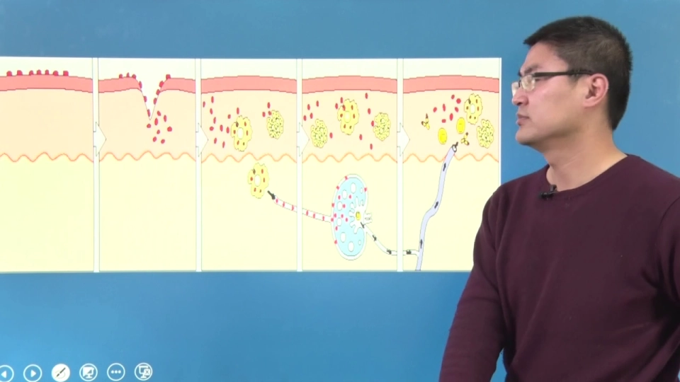
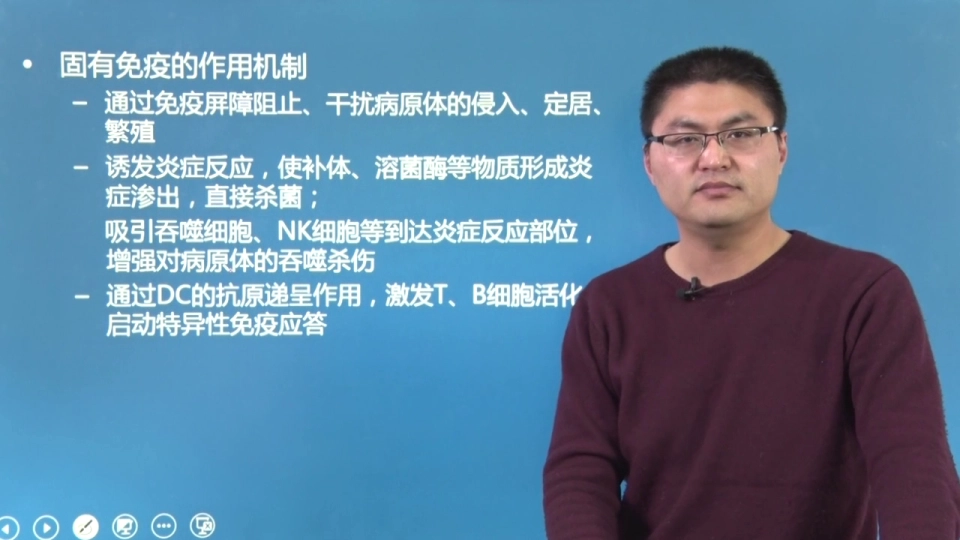

# 固有免疫的三道防线：屏障、细胞与体液的组成逻辑

> 视频来源：[2018版《医学免疫学》第七章《固有免疫》](https://www.bilibili.com/video/BV1N64y1c7F6/)（Bilibili · 嘉宁博士）｜时长约 43 分钟
> 导读：这是一堂按教材章节推进的完整课堂讲授，从「固有」这个词讲起，依次过屏障结构、细胞成分、体液成分、识别特点与功能机制，最后归纳固有免疫的六条特点。本文按这条骨架整理，并保留了讲者几处很好用的类比（皮肤是最大的免疫器官、鼻毛与鼻涕、开关的两面）。

## 本讲要解决的核心问题（SCQA）

**背景**：免疫学教材大量篇幅都在讲特异性免疫——T 细胞、B 细胞、抗体、克隆选择。相比之下，固有免疫往往只占一章。

**冲突**：可是在感染发生的最初几小时里，特异性免疫根本还没启动。而且自然界中绝大部分病原体根本没有机会进入机体——这些「没有发生的免疫反应」，靠的正是固有免疫。篇幅小不等于不重要。

**疑问**：固有免疫到底由哪些成分组成？它凭什么能广谱地识别病原体？它的功能和作用机制是什么？

**回答（中心思想）**：固有免疫由**屏障结构、固有免疫细胞、多种体液成分**三部分组成；它识别的是病原体「特有的共同结构」且「生命必需」的成分，因此广谱、快速，但精度有限；它的作用机制可以归纳为屏障阻挡、诱发炎症、抗原提呈启动特异性免疫三条。它的六大特点是：先天具备、无特异性、无记忆性、反应快、较难干预、个体差异小。

## 一、先把「固有」这个词拆开

固有免疫，顾名思义。「固有」是什么？本来就有、天生的、与生俱来，而且「固」嘛，还不容易改变——它比较稳定。

它的别名也很有信息量：**非特异性免疫、先天性免疫、天然免疫**。把这几个词放在一起分析，特点就出来了：

- **非特异性** → 广谱，相对于特异性免疫；
- **先天** → 区别于后天，与生俱来；
- **固有** → 不怎么改变，就是这样一种免疫。

讲者特别提醒了一件事：这门课大量的篇幅讲的都是特异性免疫，但这不代表非特异性的部分讲得少就不重要。**这是机体在长期进化过程中形成的天然防御功能，是机体的第一道防线**——第一道防线能不重要吗？它还是大量特异性免疫的基础。

[【跳转到 01:53】](https://www.bilibili.com/video/BV1N64y1c7F6/?t=113)

## 二、组成之一：屏障结构

固有免疫的组成里，最重要的是**屏障结构**。它分三类：

### 2.1 物理屏障：皮肤与黏膜

最重要的一个就是**皮肤**。这样说起来，皮肤也是一个免疫器官了——为什么讲总论的时候没有把皮肤划为免疫器官？因为皮肤的功能很多，通常不把它当成免疫器官，但事实上它发挥了一个非常重要的免疫功能。

讲者给了一个很有冲击力的估算：自然界中那么多种病原、那么多种抗原，其实绝大部分没有侵入我们的机体。因为皮肤的存在，这些免疫反应根本就没有发生——可以说是 99% 的情况，甚至 99.9% 的情况。所以从这个角度讲，说固有免疫比适应性免疫更重要，一点儿都不夸张；说皮肤是人体最大的免疫器官，从这个角度讲也没有什么错。

除了皮肤，还有**黏膜**。黏膜虽然比皮肤要脆弱一些，它也是一个阻挡作用。它们阻挡了绝大多数的免疫反应的发生、绝大多数的抗原入侵。

[【跳转到 03:37】](https://www.bilibili.com/video/BV1N64y1c7F6/?t=217)

### 2.2 解剖屏障：看不见的几道墙

屏障不止看得见的皮肤黏膜，还有看不见的解剖屏障：**血脑屏障、血胎屏障、血胸腺屏障**。它们的共同作用是给重要器官划出「禁区」，不让病原体随便进去。

### 2.3 生物屏障与化学屏障：菌群和胃酸

**正常菌群**属于生物屏障。正常菌群的存在形成竞争抑制——无害的细菌会抑制有害的、致病的细菌。这个道理就跟动物之间的竞争、植物之间的竞争是一个道理。

还有一类是**杀菌、抑菌物质**，比如人的胃酸。在低 pH 值环境下，绝大多数的细菌都不能生长、被杀死了，至少它也不能再繁殖了，这也是一种屏障。

### 2.4 一个延伸练习：鼻毛和鼻涕算不算屏障

讲者留了一个「动动脑子」的练习：其实屏障结构还不止教材上列出来的这些，人体很多结构都能起到屏障作用。

比如鼻毛和鼻涕。鼻涕很黏，现在空气污染这么严重，有雾霾、PM2.5，这些微小颗粒在路过鼻腔时会被鼻涕粘住，粘住之后就不会进入肺了；擤鼻涕、吐痰的时候就把它排出来了。那鼻毛起什么作用？因为鼻毛的存在，大大增加了气流遇到鼻涕的概率，增大了接触面积。

所以从这个意义上讲，鼻毛跟鼻涕也属于屏障结构，也属于固有免疫的成分。这个例子的价值不在于记住鼻毛，而在于理解**屏障的本质是「物理拦截 + 接触面积 + 排出通道」**。

[【跳转到 07:22】](https://www.bilibili.com/video/BV1N64y1c7F6/?t=442)

## 三、组成之二：固有免疫细胞

细胞成分主要指 NK 细胞、单核巨噬细胞系统、中性粒细胞、树突状细胞、肥大细胞和嗜酸性粒细胞，当然还有一些特化的免疫细胞，上皮内有一些特化的、数量很少。

### 3.1 NK 细胞：天然杀手，靠两类受体的平衡决策

NK 细胞的名字 natural killer，英文直译就是「天然杀手」。形态上，它的胞浆内有嗜天青颗粒，可以被天青染料深染；标志性分子是 CD16、CD56，它没有 CD3 分子（CD3 阴性，CD16 和 CD56 阳性）。

它的杀伤特点是：**无需抗原致敏，直接杀伤靶细胞，而且是非特异性的，也没有 MHC 限制性**。顾名思义，它是天然杀手，天性就是要杀伤靶细胞。

那它怎么避免误伤自己人？靠表面的两类受体：**活化型受体**和**抑制性受体**。活化型受体在胞浆区含有 ITAM，相应的抑制性受体含有 ITIM。这两类受体的作用相反，就好像一个开关的两面——一边是开，一边是关。两者作用的平衡，决定了 NK 细胞是表现为杀伤作用，还是不杀伤。

具体来说：

- **正常情况下**：自身组织细胞表面表达正常的 MHC I 类分子，激活抑制性受体，抑制作用居于主导地位，NK 细胞处于抑制状态，自身组织细胞不被破坏、不被杀伤。
- **异常情况下**（细胞癌变、罹患肿瘤，或者细胞遭遇病毒感染）：原本正常的细胞表面的 MHC I 类分子表达减少，甚至缺失，甚至 MHC 分子会突变，不能再传递抑制信号，活化型受体就居于主导地位，NK 细胞活化并杀伤靶细胞。

此外它表面还有 CD16 分子，实际上是一种 Fc 受体，识别结合 IgG（FcγRIII）。这时它是以抗体的 **ADCC 效应**来杀伤细胞的。

具体杀伤物质是**穿孔素和颗粒酶**，这两类物质是组合起来、搭配起来起作用的。穿孔素的作用很像是补体——它就像补体在细胞膜表面打孔、穿孔；穿孔之后可以把颗粒酶送入靶细胞内，在细胞内溶解、裂解靶细胞。另外它还有一个 **Fas 途径**：它表面有 FasL（Fas 配体），可以激活靶细胞表面的 Fas。Fas 是一个自杀受体，启动细胞自杀，这样来杀死靶细胞。

所以 NK 细胞的生物学活性主要表现为**抗感染和抗肿瘤**：抗感染主要是细胞内感染，主要是病毒感染，这时它杀死靶细胞来清除感染灶；抗肿瘤就是把肿瘤细胞杀死。另外它还有一定的免疫调节作用，因为 NK 细胞可以分泌很多种细胞因子。

[【跳转到 15:07】](https://www.bilibili.com/video/BV1N64y1c7F6/?t=907)

[【跳转到 08:25】](https://www.bilibili.com/video/BV1N64y1c7F6/?t=505)

### 3.2 单核巨噬细胞：一个细胞的三个人生阶段

单核巨噬细胞是一个统称，实际上是同一个细胞的不同发育阶段和功能阶段：

1. **前单核细胞**：刚刚在骨髓里从干细胞分化出来，还在骨髓里；
2. **单核细胞**：随后分泌入血，在血液里待几天或者几周，看有没有感染、有没有炎症；
3. **巨噬细胞**：从血液中渗出，穿过内皮间隙来到外周组织器官，体积进一步增大，形状变得更加张牙舞爪，细胞内内容物更多。

它的吞噬功能是越来越强的——可以理解为幼年、青年、成年。

单核巨噬细胞是非特异性地吞噬病原体，可以吞噬很多种病原体，并不是只会吞食某一种细菌。为什么能吞食那么多？因为它表面的受体很多，识别机制很多，可以归为几大类：

- **甘露糖受体（MR）**：甘露糖是细菌的成分，人体自己不会合成甘露糖，所以甘露糖受体识别的一定是外来的细菌，它不会识别人体自身的成分；
- **Toll 样受体（TLR）**：一大类模式识别受体；
- **清道夫受体（SR）**：清道夫就是清洁工。巨噬细胞不只清理外来病原体，还负责清理人体自然衰老、死亡的细胞。它识别的是磷脂分子——细胞活着的时候细胞膜有序排列、完整；细胞死了之后细胞膜破裂变成碎片，磷脂分子的排列从有序变成无序，暴露出来的磷脂分子就被清道夫受体识别，死细胞成分被吞进去，起到清理作用；
- **调理性受体**：即 IgG Fc 受体（FcγR）和补体受体（C3bR/C4bR）。当抗体或者补体识别了抗原靶分子，它就起一个「桥导」作用，介导巨噬细胞更高效地吞噬靶细胞、靶分子，这就是**调理作用**。

吞进去之后怎么杀？主要分两套系统：

- **氧依赖的杀菌系统**：又分 ROI（反应性氧中间物）和 RNI（反应性氮中间物）两套，杀菌作用很强；
- **氧非依赖的杀菌系统**：靠 pH 值。吞噬体内是酸性环境，而且有溶菌酶、乳铁蛋白等，会把细菌杀死。

所以它的吞噬功能很强、杀菌功能也很强，而且都是非特异性的。此外它还可以吞噬自身衰老凋亡的细胞，可以释放多种生物活性物质（主要是细胞因子）来诱导炎症反应，召集更多炎性细胞一起消灭抗原，还有**抗原提呈作用**来激活特异性免疫。

[【跳转到 20:48】](https://www.bilibili.com/video/BV1N64y1c7F6/?t=1248)

### 3.3 树突状细胞：接触面越大，抓到抗原的机会越多

树突状细胞（DC）画出来有那么多「树突」，这是很典型的结构。光学显微镜下看得不是很清楚，但能看到它会伸出很多树突——这细胞接触面很广泛。

接触面宽带来一个直接好处：它遇到病原体、遇到抗原、吞噬抗原的机会就多。它是已知功能最强的 **APC（抗原提呈细胞）**。

它也有吞噬功能，只是吞噬功能表现得比较短暂：在 DC 没有成熟之前，它的吞噬功能很强，几乎就像巨噬细胞一样强；成熟之后，它主要发挥 APC 的功能了。虽然它有吞噬功能，但这种吞噬也是非特异的，所以它也是固有免疫细胞。

[【跳转到 22:09】](https://www.bilibili.com/video/BV1N64y1c7F6/?t=1329)

### 3.4 上皮内的免疫细胞：M 细胞、γδ T 细胞与 B1 细胞

第四类是一些上皮内的免疫细胞，主要是 M 细胞、γδ T 细胞和 B1 细胞。

**M 细胞**是一种数量不是很多、主要是特化的、散在分布于肠黏膜上皮间的细胞。它是一种特殊的**抗原转运细胞**：肠道中的细菌等抗原会被 M 细胞吞进去，从这头进去、从那头出来，把抗原从肠腔一侧转运到体内，交给 DC 或者其他的 APC（比如巨噬细胞）。巨噬细胞、DC 吞食这些抗原之后加工提呈，来激活更多的 T、B 淋巴细胞。因为这个抗原转运作用也是非特异的，所以它也属于固有免疫的成分。

**γδ T 细胞**是淋巴细胞中少数的一个族群（T 淋巴细胞多数是 αβ T 细胞），主要存在于皮肤表皮和黏膜的上皮层。它的特点与 αβ T 细胞完全不一样：αβ T 细胞高度特异，而 γδ T 细胞的抗原受体有一定多样性，虽然是有限的多样性。它识别的是微生物的糖脂类抗原——这就像巨噬细胞的甘露糖受体一样，这些糖脂是病原微生物才能合成的，人体真核细胞不合成。被 γδ T 细胞识别后，它可以通过分泌细胞因子活化巨噬细胞，通过这些途径来杀伤被感染的细胞或者病原微生物，发挥一个非特异性免疫应答的作用。

**B1 细胞**也是 B 细胞的少数族群（B 细胞多数是 B2 细胞），主要存在于腹腔中。它的识别特点也很像 γδ T 细胞：主要识别细菌的多糖抗原和脂类抗原，这是人体没有的，见到这个成分就知道是异物、应该被消灭。它通过产生 **IgM 抗体**来清除这些抗原。

[【跳转到 26:12】](https://www.bilibili.com/video/BV1N64y1c7F6/?t=1572)

### 3.5 中性粒细胞：靠数量取胜

中性粒细胞在血液中大量存在，数量比单核细胞、巨噬细胞还要多，当然个头不像巨噬细胞那么大。

它的吞噬功能没有那么强，主要靠数量取胜：单个中性粒细胞不如一个巨噬细胞吞噬功能那么强，杀伤功能也没有那么强——因为它没有 RNI，没有氮中间物的杀伤系统，而且它也不能进行抗原提呈。

但因为它总量很大，所以在对抗细菌的时候，特别是胞外寄生菌感染的时候，在早期还是能起到很显著的作用。

[【跳转到 26:54】](https://www.bilibili.com/video/BV1N64y1c7F6/?t=1614)

### 3.6 肥大细胞、嗜碱性粒细胞与嗜酸性粒细胞：抗寄生虫的主力

肥大细胞和嗜碱性粒细胞实际上是一类细胞，是同一类细胞的不同阶段。它们细胞内都有大量深染的颗粒，光学显微镜下都能看到。

这些细胞在抗寄生虫感染的时候作用很显著。因为寄生虫也在进化，寄生虫的幼虫、虫卵虽然很像细菌、像这些病原微生物，但因为长期进化，比普通细菌更加强韧。一般的中性粒细胞、巨噬细胞、抗体，对付寄生虫幼虫、虫卵可能有点力不从心；但嗜酸性粒细胞、嗜碱性粒细胞来杀伤寄生虫，效果非常明显。它们杀伤寄生虫的幼虫和虫卵也是非特异的。

## 四、组成之三：体液成分

### 4.1 补体：一条特异性途径 + 两条非特异性途径

补体的活化，**经典途径是被抗体激活的**。由于抗体的识别是特异的，所以经典途径的补体活化是特异性激活。

但补体还有另外两条途径：**替代途径**和 **MBL 途径**。这两条途径是非特异性激活的——它识别的是细菌、病原微生物的一些化学成分，并不是特异地识别某一类细菌、某一类抗原，所以它具有非特异性的杀菌作用，也属于固有免疫。

### 4.2 溶菌酶：分泌液里的常驻杀菌剂

溶菌酶在我们的体液中，特别是向外分泌的一些体液中大量存在，比如唾液中、泪液中都有。它的杀菌作用也是非特异的。

### 4.3 细胞因子与干扰素：不直接杀，也能让细胞进入防御状态

很多细胞因子具有杀菌或者对抗病原微生物的功能。比如干扰素，它就算不直接杀死病毒，也会作用于细胞，让细胞增强抗病毒的作用。这些也属于固有免疫。

[【跳转到 30:21】](https://www.bilibili.com/video/BV1N64y1c7F6/?t=1821)

## 五、识别特点：为什么能广谱，又为什么够用

讲完组成，讲者转向识别：它是如何能够广谱地识别？因为它有两个识别特点。

### 5.1 识别病原体特有的共同结构

第一个特点是识别**共同结构**。「病原体特有、人体不具有」——这个「特有」表示病原体有、人没有；但病原体有的这些东西里边，它会有一些共有成分。

教材列出的典型例子包括：

- 病毒双股 RNA：人的 RNA 是单链的，但病毒可能会有双链，所以固有免疫细胞一旦能识别双链 RNA，那肯定就是病毒；
- 细菌未甲基化的 CpG DNA 序列：这也是人没有的，好多种细菌都共有；
- 以甲酰甲硫氨酸肽起始的细菌蛋白质；
- 革兰阴性菌的 LPS、革兰阳性菌的磷壁酸：这都是细菌的细胞壁成分，人体没有细胞壁；
- 富含甘露糖的微生物低聚糖。

所以固有免疫不能精准地识别到底是哪一种细菌，但是它能够区别不同类别的微生物，而且仅识别这一类微生物的共同结构。这是一个很巧妙的方法，叫做识别**分子模式**，也就是**病原体相关分子模式（PAMP）**。

这些被识别的微生物靶位，通过**模式识别受体（PRR）**来识别。PRR 就是与病原体相关分子模式相结合的受体，主要表达于固有免疫细胞表面。不同类型的微生物表达不同的分子模式，被不同的 PRR 所识别。

[【跳转到 33:17】](https://www.bilibili.com/video/BV1N64y1c7F6/?t=1997)

这种识别是一种**模糊识别**：并不是很精准地识别一个特定的抗原、抗原决定簇，但是它识别的是一类共同的特点。这样识别经常是非常快速和高效的，虽然并不精准。

### 5.2 识别病原体「生命必需」的成分

第二个特点是：固有免疫识别病原体所必需的结构成分，攻击这个必需成分。这样保证病原体难以逃避宿主的免疫攻击——为什么难以逃避？因为它必须的这一部分被攻击了、被破坏了，这个病原体就活不下去了。

比如双股 RNA 是病毒必须的，病毒没有 RNA、没有遗传物质了，那病毒也不存在了；再比如细胞壁成分 LPS、磷壁酸，没有细胞壁细菌也活不下去。因为它攻击的部分就是病原体生命必需的。

[【跳转到 31:42】](https://www.bilibili.com/video/BV1N64y1c7F6/?t=1902)

## 六、功能与作用机制：阻挡、清剿、求援

### 6.1 三个功能

学完前面两部分，功能其实可以自己总结：

1. **阻止病原体的入侵**——就是那些屏障结构；
2. **对已侵入的病原体及早、迅速反应，迅速清除**，防止机体感染。这一条非常关键：细菌、病毒繁殖速度非常快，多少分钟就能繁殖一代，如果不能迅速清除，几天之后病原体数量会达到天文数字，那时适应性免疫的「反应快」就不如固有免疫来得重要了；
3. **有效激发和影响适应性免疫，参与适应性免疫的效应阶段**。

### 6.2 一个示意图：从皮肤破损到淋巴结求援

讲者用一个非常简单的示意图把三步串起来：

- **健康人完整的皮肤**：阻挡病原微生物的入侵。这是时时刻刻都在发生的，每个人每时每刻都在发生，它阻挡了绝大多数的感染。
- **皮肤破损、有了伤口**：哪怕伤口非常微小、肉眼都看不出来，也会给细菌入侵打开门户，屏障结构被破坏了。但别着急，如果细菌非常少、致病力不那么强，皮下还有固有免疫细胞——巨噬细胞、γδ T 细胞、B1 细胞等等，可以在这里把少量入侵的细菌消灭掉。这还是固有免疫：不管来的是什么细菌，巨噬细胞都会非特异性地吞噬掉它。
- **伤口很大，或者入侵的细菌很多、致病力很强**：局部的少量免疫细胞对付不了，怎么办？巨噬细胞、APC 或者其他细胞就会游走，迁移到淋巴结去求援，发挥抗原提呈功能，把抗原信息提呈，激活更多的 T、B 淋巴细胞还有其他的免疫细胞，让全身各处的淋巴细胞、免疫细胞得到抗原信号，赶到抗原入侵的部位——也就是炎症部位——发挥免疫学功能，一起排除这个抗原。

所以后面这一部分是适应性免疫应答，前面那一部分是固有免疫应答，它们彼此是合作的，配合得很好。

### 6.3 三条作用机制

1. **屏障阻挡**：通过免疫屏障阻止、干扰病原体的侵入、定居、繁殖；
2. **诱发炎症反应**：使补体、溶菌酶等物质形成炎症渗出，直接杀菌；同时吸引吞噬细胞、NK 细胞等到达炎症反应部位，增强对病原体的吞噬杀伤；
3. **抗原提呈**：通过 DC（更严谨地说是 APC）的抗原提呈作用，激发 T、B 细胞活化，启动特异性免疫应答。

[【跳转到 39:40】](https://www.bilibili.com/video/BV1N64y1c7F6/?t=2380)

## 七、归纳：固有免疫的六条特点

到这里可以归纳固有免疫的特点了：

1. **先天具备**：天然免疫，与生俱来，而且可以相对稳定地遗传下去；

[【跳转到 40:29】](https://www.bilibili.com/video/BV1N64y1c7F6/?t=2429)
2. **没有特异性**：针对多种病原菌、病原微生物、抗原都可以作用，广泛；
3. **没有记忆性**：它表现比较稳定、波动较小。第一次应答跟第二次应答表现出的特点差不多——就像皮肤的阻挡作用，第一次阻挡跟第二次阻挡，阻挡力度取决于皮肤的坚韧，不可能这次皮肤薄、下次皮肤就变厚了；
4. **反应快**：它时刻都在发生，所以说这个「快」是非常快的；
5. **较难干预**：天生是什么样子，后天的改变非常小；
6. **个体差异小**：同一个物种不同个体间差异不大。以皮肤为例，每个人皮薄皮厚能差多少？可能有点差别，但这个差别很小。

### 为什么教材篇幅小：四个字「较难干预」

讲者最后回答了一个很实在的问题：它既然起到这么大的作用，为什么教材里篇幅很小、不把它当重点？

答案就是四个字：**较难干预**。作为医生，人为地想干预固有免疫、想让固有免疫的作用增强或者削弱都很难。既然人为干预起不了主要作用，它与生俱来的、天生的是什么样就是什么样，那么教材里就没有把它作为一个大篇幅的内容。

但大家要记着它的作用：它是时刻在发生的，是在大家根本意识不到的时候发生的。这就是属于「失去的才知道重要」的东西。

## 小结

- 固有免疫 = 非特异性免疫 = 先天性免疫 = 天然免疫，是机体在长期进化中形成的第一道防线，也是特异性免疫的基础。
- 组成分三块：屏障结构（物理、解剖、生物/生理）、固有免疫细胞、多种体液成分。
- 屏障的本质是物理拦截、增大接触面积与排出通道；皮肤与黏膜挡掉了绝大多数抗原入侵。
- 细胞各有分工：NK 靠活化/抑制受体平衡决策；单核巨噬细胞靠多种受体广谱吞噬并用 ROI/RNI 杀菌；DC 是功能最强的 APC；M 细胞负责转运抗原；γδ T 与 B1 识别微生物糖脂、多糖；中性粒细胞靠数量；嗜酸/嗜碱粒细胞主打抗寄生虫。
- 体液成分里，补体的替代途径与 MBL 途径是非特异激活，溶菌酶与干扰素也属于固有免疫。
- 识别特点是「特有的共同结构」+「生命必需成分」，所以广谱、快速、模糊，且病原体难以逃避。
- 功能是阻挡、快速清剿、激发适应性免疫；六条特点是先天、无特异、无记忆、快、难干预、个体差异小。

## 关键术语速查

| 术语 | 一句话解释 |
| --- | --- |
| 固有免疫 | 与生俱来、非特异、无记忆的防御系统，又称天然免疫或先天性免疫 |
| 解剖屏障 | 血脑屏障、血胎屏障、血胸腺屏障等看不见的结构性屏障 |
| 生物屏障 | 正常菌群通过竞争抑制致病菌定植 |
| ITAM / ITIM | 活化型受体与抑制性受体胞浆区的信号基序，作用相反，决定 NK 细胞是否杀伤 |
| ADCC | 抗体依赖细胞介导的细胞毒作用，NK 细胞通过 CD16 识别 IgG 包被的靶细胞 |
| 调理作用 | 抗体或补体包被靶标后，经 Fc 受体或补体受体使吞噬更高效 |
| ROI / RNI | 反应性氧中间物与反应性氮中间物，巨噬细胞的氧依赖杀菌系统 |
| M 细胞 | 肠黏膜上皮中特化的抗原转运细胞，把肠腔抗原转运给 APC |
| PAMP | 病原体相关分子模式，病原体特有且共有的保守结构 |
| PRR | 模式识别受体，与 PAMP 结合，实现广谱而模糊的识别 |