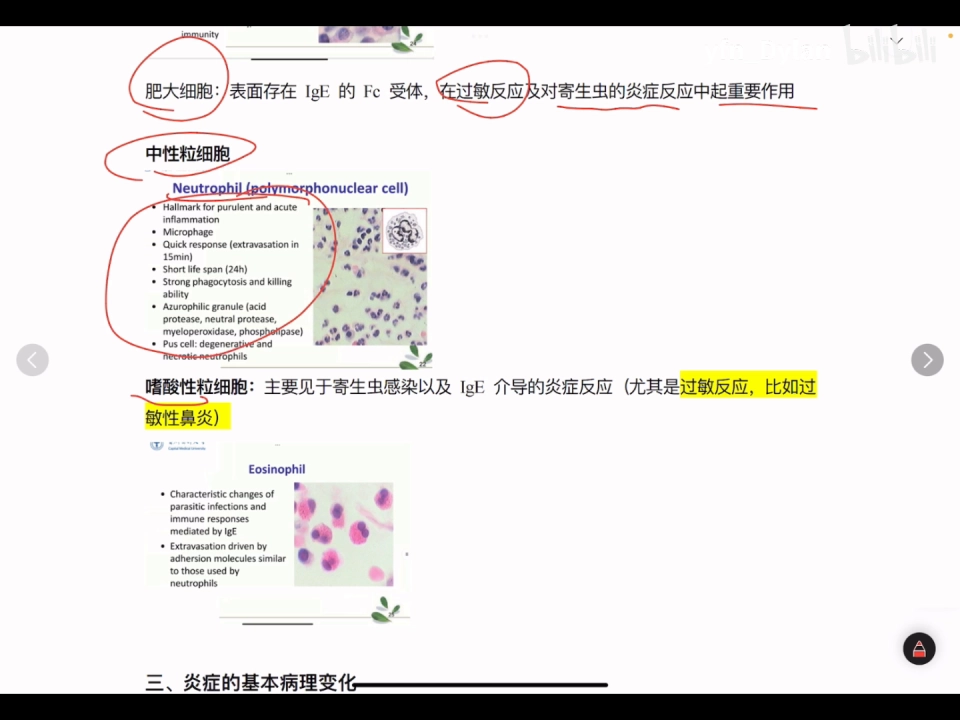
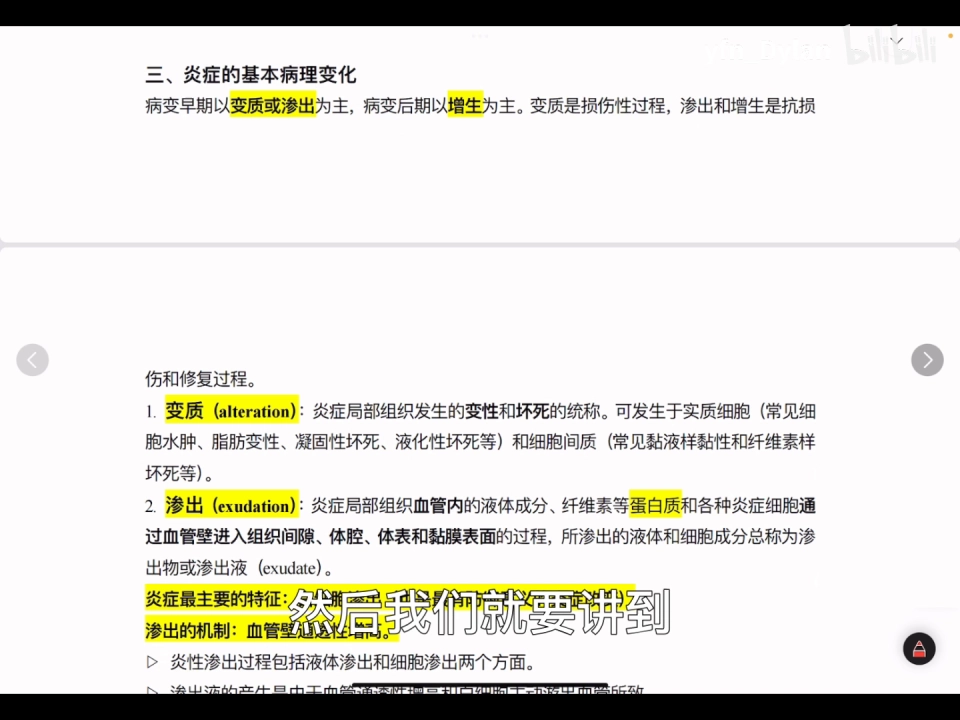
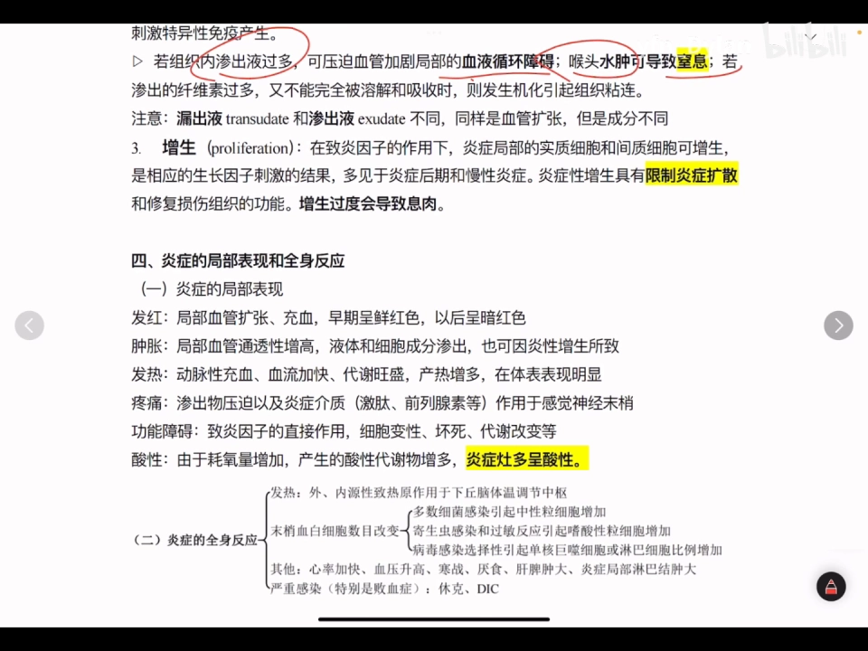
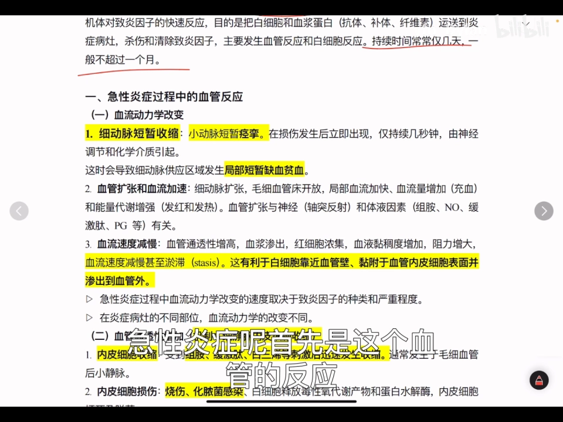
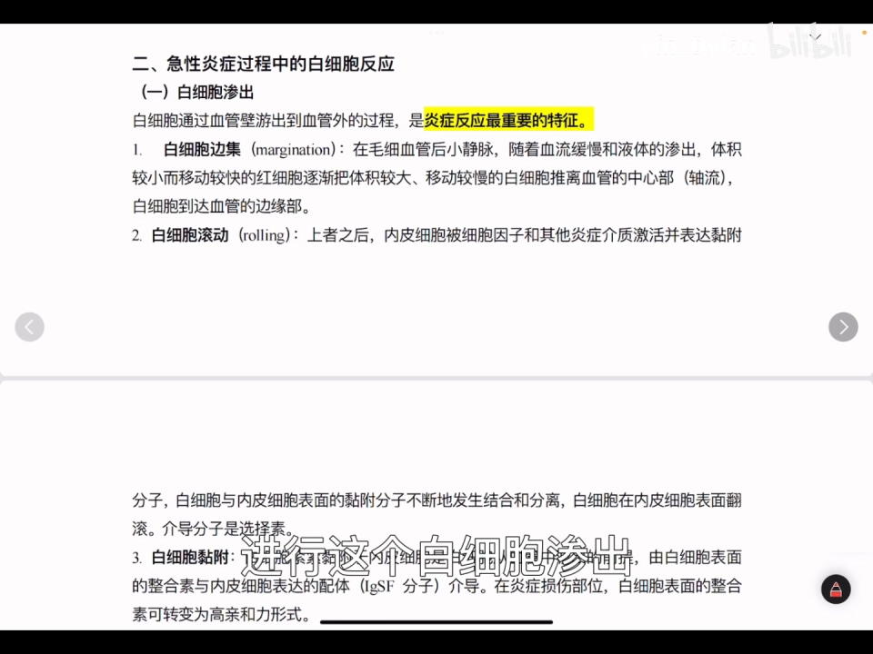
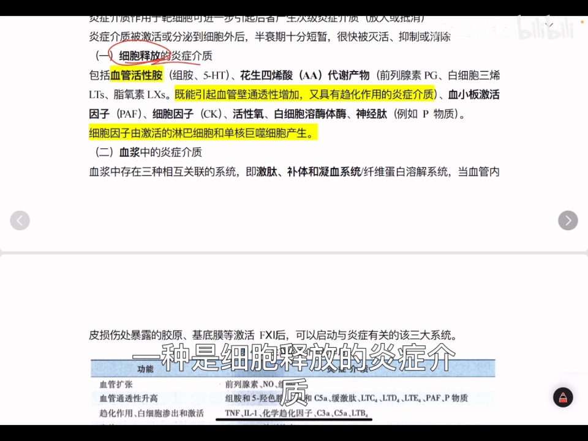
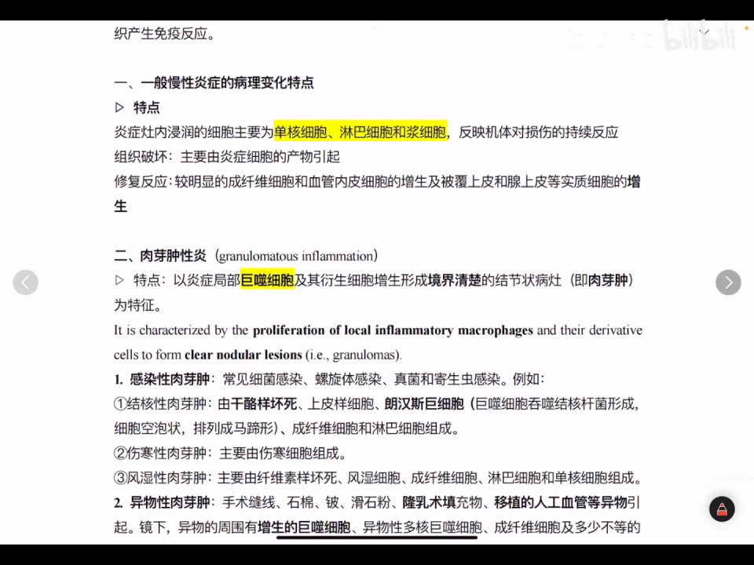

# 炎症如何发生：从血管反应到急性与慢性

> 视频来源：[炎症（炎症的概念、病理变化、急性炎症、慢性炎症）【病理学期末速成4】](https://www.bilibili.com/video/BV1Bu4y1o7tE/)（Bilibili · 咖啡冻迪笛医学）｜时长约 15 分钟
> 导读：这支视频按病理学的顺序讲炎症：先给定义和三个基本变化，再解释红肿热痛从哪来，然后顺着血管反应、白细胞渗出讲到急性炎症的四种类型，最后落到慢性炎症与肉芽肿。本文按这条线索整理，重点放在「为什么」而不是背名词。

## 本讲要解决的核心问题（SCQA）

**背景**：被蚊子咬一口会起红包，伤口感染会红、肿、热、痛，这些都是「发炎」。但发炎到底发生在哪一层？为什么同一个部位会先发红、再肿胀、最后疼痛？

**冲突**：如果只把炎症当成「免疫细胞在杀细菌」，就解释不了两件事：一是炎症必须有血管参与（没有血管的组织不会发炎），二是慢性炎症里几乎看不到大量中性粒细胞，反而以增生为主。

**疑问**：炎症在组织层面究竟发生了什么？急性炎症和慢性炎症为什么表现完全不同？

**回答（中心思想）**：炎症是具有血管系统的活体组织对损伤因子的防御反应，中心环节是**血管反应**。急性炎症以「渗出」为主——血管扩张、通透性升高、白细胞游出，于是出现红、肿、热、痛；慢性炎症以「增生」为主——浸润细胞换成单核细胞、淋巴细胞和浆细胞，持续下去就形成肉芽肿。同一套防御逻辑，在时间尺度上呈现两种面貌。

## 一、炎症是什么：一个有前提的防御反应

### 1.1 定义里的三个关键词

炎症首先是什么？就是一些外源性和内源性的损伤因子造成损伤之后，机体要对它进行修复。所以炎症的过程可以拆成三步：**局限和消灭这些损伤因子 → 清除和吸收坏死的组织细胞 → 修复损伤**。

病理学给它的名词解释是：**具有血管系统的活体组织**，对各种损伤因子的刺激所产生的一种以**防御反应**为主的基本病理过程。这个定义里有三个不能省的前提：

- **活体**：死掉的组织不会发炎；
- **血管系统**：单个细胞或一团细胞谈不上炎症，必须有血管参与；
- **损伤因子刺激**：没有刺激就没有反应。

而**血管反应是这个过程的中心环节**，炎症本质上是损伤、抗损伤以及修复三者的动态过程。

[【跳转到 00:50】](https://www.bilibili.com/video/BV1Bu4y1o7tE/?t=50)

### 1.2 原因：生物性因子最常见

那么炎症的原因呢？只要是能引起损伤的因子都能引起炎症。其中**生物性因子是最常见的致病因子、致炎因子**，比如病毒、细菌。

[【跳转到 00:58】](https://www.bilibili.com/video/BV1Bu4y1o7tE/?t=58)

### 1.3 参与炎症的细胞：各有分工

讲炎症绕不开炎症细胞。视频里按功能把它们过了一遍：

- **单核巨噬细胞**：负责吞噬清除、组织修复，还能分泌炎性介质；
- **淋巴细胞**：主要出现在病毒感染的炎症中，和巨噬细胞相互作用，其中包括 B 细胞和 T 细胞；
- **肥大细胞**：对过敏反应以及寄生虫的炎症反应起重要作用；
- **中性粒细胞**：化脓性炎最常见的细胞；
- **嗜酸性粒细胞**：主要和过敏反应有关，比如过敏性鼻炎、流很多鼻涕，过敏性鼻炎里嗜酸性粒细胞是主要的作用细胞。

[【跳转到 01:53】](https://www.bilibili.com/video/BV1Bu4y1o7tE/?t=113)

## 二、三个基本病理变化：变质、渗出、增生

炎症的病理变化就是**变质、渗出、增生**这三件事。这三者不是并列的三种炎症，而是同一场炎症里同时或先后出现的三种成分。

### 2.1 变质：组织被损伤的那一部分

**变质（alteration）** 就是炎症的局部组织发生的变性和坏死，统称叫做变质。它是损伤性过程——致炎因子把局部细胞弄伤了、弄死了。

### 2.2 渗出：把「武器」从血管里搬到现场

**渗出（exudation）** 是血管内的液体成分（比如一些蛋白质）还有各种炎症细胞，通过血管壁进入组织间隙——从血管内跑到血管外，到了组织间隙、体腔、体表、黏膜表面这些地方。

这里有一个关键判断：**炎症最主要的特征就是白细胞的渗出**，因为白细胞能够进行防御，它是最具有防御意义的炎症改变。所以**渗出是急性炎症最主要的表现**。

[【跳转到 02:49】](https://www.bilibili.com/video/BV1Bu4y1o7tE/?t=169)

渗出的机制就是**血管壁通透性增高**——相当于内皮细胞之间的「网孔」变大了，白细胞就能跑出去了。

渗出液如果聚集在组织间隙，就叫**炎性水肿（edema）**；主要聚集在浆膜腔，就叫**浆膜腔积液**。通常来说渗出液是有积极意义的，但有时也会造成损伤，是一把双刃剑：渗出液过多时，可能会加剧血液循环障碍，甚至喉头水肿导致窒息。

### 2.3 增生：后期才登场的修复力量

变质、渗出之后是**增生**。增生一般都是慢性炎症才有。增生能限制炎症扩散，但是增生过度也会导致息肉。

## 三、红、肿、热、痛是怎么来的

炎症的局部表现有五项：发红、肿胀、发热、疼痛、功能障碍，另外炎症灶一般是**酸性**的，因为产生酸性代谢物。

把每一项对回到机制上，就很好记了：

| 局部表现 | 机制 |
| --- | --- |
| 发红 | 局部血管扩张、充血 |
| 肿胀 | 血管通透性增高，液体和细胞成分渗出 |
| 发热 | 动脉性充血、血流加快、代谢旺盛、产热增多 |
| 疼痛 | 渗出物压迫，加上炎症介质（激肽、前列腺素等）作用于感觉神经末梢 |
| 功能障碍 | 致炎因子直接作用、细胞变性坏死、代谢改变 |
| 酸性 | 耗氧量增加，酸性代谢产物增多 |

除了局部表现，还有**全身反应**：发热（外源性、内源性致热原作用于下丘脑体温调节中枢）、末梢血白细胞数目改变（多数细菌感染引起中性粒细胞增加，寄生虫感染和过敏反应引起嗜酸性粒细胞增加，病毒感染选择性引起单核巨噬细胞或淋巴细胞比例增加），以及其他反应如心率加快、血压升高、寒战、厌食、肝脾肿大等。

炎症的意义也是一把双刃剑：有有利的部分，也有危害的部分。

[【跳转到 04:20】](https://www.bilibili.com/video/BV1Bu4y1o7tE/?t=260)

## 四、急性炎症：一场以血管为中心的动员

急性炎症持续时间也就几天，一般不会超过一个月。它首先表现为**血管反应**。

### 4.1 血流动力学改变：收缩、扩张加速、减慢瘀滞

第一步是**细动脉的短暂收缩**，也就是这个小动脉会进行一个短暂的痉挛。痉挛之后一收缩，血就过不来了，所以会发生局部的短暂缺血、贫血。

第二步是**血管的扩张和血流加速**：细动脉扩张，血流变快。

第三步是**血流变慢**。视频里给了一个很直观的理解方式：

- 先短暂收缩一下，是为了防止致病因子继续随着血液流动扩散；
- 血流加速和扩张，是为了把白细胞什么的赶紧都召集过来；
- 血流减慢，是因为血管通透性增高、阻力增大，血流速度减慢甚至瘀滞——这时候白细胞在血流速度特别慢的时候，就能靠近血管壁，黏附到内皮细胞，然后渗出到血管外。

所以整个过程是：**缺血 → 血流加速、血管扩张 → 血流速度减慢 → 白细胞游出**。

[【跳转到 05:40】](https://www.bilibili.com/video/BV1Bu4y1o7tE/?t=340)

### 4.2 通透性为什么升高：内皮细胞收缩或损伤

血管通透性增加是什么机制？主要就是细静脉的内皮细胞收缩：受到组胺、缓激肽、白三烯这些东西刺激，内皮细胞迅速发生收缩。也有可能是因为内皮细胞的损伤，比如烧伤、化脓菌感染，这也会导致血管通透性增加。

### 4.3 白细胞渗出：边集、滚动、黏附、游出

通透性增加之后，白细胞就能穿过血管到血管外，进行白细胞渗出。这是炎症反应最重要的特征——炎症最重要的事就是让白细胞游出来，然后去杀灭致病因子。

这一过程大致是：白细胞先**边集**到血管边缘，再在内皮表面**滚动**，然后**黏附**，最后**游出**。

### 4.4 趋化：让白细胞知道该往哪走

白细胞离开血管之后，怎么能让它去到该去的地方？不能让它四处乱游，对吧？这就涉及**趋化因子**。趋化因子是一种化学刺激物质，它能介导白细胞离开血管，去我们想让它去的地方，这个过程叫做**趋化作用（chemotaxis）**。

[【跳转到 07:01】](https://www.bilibili.com/video/BV1Bu4y1o7tE/?t=421)

趋化因子比如细菌产物，是外源性最常见的一种趋化因子。细菌一有产物立马发出信号，白细胞就知道要跑到这儿来，这样就能去干掉这些细菌。

### 4.5 吞噬：识别、附着、吞入、杀伤

白细胞被激活之后，就能发挥杀伤和清除的作用。它最主要的功能就是**吞噬作用**，执行者主要是中性粒细胞和巨噬细胞。其中中性粒细胞的吞噬能力比较强，吞噬作用也最活跃，所以主要的吞噬由它来完成。

吞噬的过程是：先识别和附着，然后把它吞进去，吞进去之后在细胞内进行杀伤和降解，最后干掉它。

[【跳转到 07:55】](https://www.bilibili.com/video/BV1Bu4y1o7tE/?t=475)

### 4.6 炎症介质：让血管「漏」和让白细胞「来」

炎症介质的主要作用就是让血管壁的通透性增加。它分两类：**细胞释放的**和**血浆中的**。

- 细胞释放的：血管活性胺、花生四烯酸的代谢产物、血小板激活因子、细胞因子。其中花生四烯酸代谢产物比较特别，它**既能引起血管壁通透性增加，又具有趋化作用**；细胞因子则由淋巴细胞和单核巨噬细胞产生。
- 血浆中的：激肽、补体和凝血系统。

[【跳转到 08:26】](https://www.bilibili.com/video/BV1Bu4y1o7tE/?t=506)

## 五、急性炎症的四种病理学类型：按「渗出什么」来分

急性炎症的病理学类型，本质上是按渗出物的主要成分来分类的。

### 5.1 浆液性炎：渗出的是浆液

浆液性炎比较轻微，比如感冒流鼻涕就是浆液性炎，体现出来就是浆液的渗出，渗出液主要来自于血浆。

[【跳转到 09:23】](https://www.bilibili.com/video/BV1Bu4y1o7tE/?t=563)

发生在黏膜的叫**浆液性卡他性炎**，是黏膜的一种渗出性炎。比如感冒初期鼻黏膜排出黏液性分泌物。此外浆膜的胸膜炎、滑膜的风湿性关节炎，也都是浆液性炎（serous inflammation）。

### 5.2 纤维素性炎：渗出的是纤维蛋白

纤维素性炎（fibrinous inflammation）以纤维蛋白的渗出为主。如果说浆液性炎是浆液渗出，纤维素性炎就是纤维蛋白原渗出，也就是形成了纤维素。

它的类型有两种典型部位：

- **黏膜：伪膜性炎（假膜性炎）**。它会形成一种灰白色的膜状物。真膜就是黏膜，假膜则是纤维素形成的一层膜。比如白喉。假膜性炎继续发展可能引起溃疡——因为假膜覆盖在真膜上，假膜脱落之后原来这块就没有覆盖的东西了，那就是一个溃疡的表现。
- **浆膜：绒毛心**。它就是心包膜上的假膜，是浆膜的一种纤维素性炎。
- **肺：大叶性肺炎**。可以看到肺泡间隔之间有很多纤维蛋白、纤维素跨越肺泡壁，这就是大叶性肺炎的纤维蛋白渗出。

### 5.3 化脓性炎：渗出的是中性粒细胞

化脓性炎（suppurative inflammation）的特征就是**中性粒细胞渗出**。中性粒细胞渗出会伴有组织坏死和脓液形成。脓液里大部分细胞都已经变性坏死了，但它还含有细菌、坏死的组织碎片和少量浆液。

其中**脓肿（abscess）** 比较重要，最常见的致病菌就是金黄色葡萄球菌。

[【跳转到 11:51】](https://www.bilibili.com/video/BV1Bu4y1o7tE/?t=711)

### 5.4 出血性炎：血管壁损伤严重

出血性炎（hemorrhagic inflammation）的血管壁损伤非常严重，所以红细胞控制不住，直接全从血管壁损伤的地方流出来了，渗出物里还有大量的红细胞。这个常见于出血热等疾病。

### 5.5 结局：痊愈、迁延为慢性，或蔓延扩散

急性炎症最后的结局有三种：

1. **痊愈**：如果坏死范围比较大，由肉芽组织增生修复，叫做不完全痊愈；有的也可以是完全痊愈。
2. **迁延为慢性炎症**：急性炎症如果没能好，就转为慢性。
3. **蔓延扩散**。

[【跳转到 12:21】](https://www.bilibili.com/video/BV1Bu4y1o7tE/?t=741)

## 六、慢性炎症：细胞换了，逻辑也换了

慢性炎症相对来说没那么「急」，但它的组织学面貌和急性炎症完全不同。

### 6.1 浸润细胞换成了单核细胞和淋巴细胞

慢性炎症灶内主要的细胞是**单核细胞、淋巴细胞还有浆细胞**，最主要是单核细胞和淋巴细胞。

### 6.2 增生成为主角

慢性炎症体现出来就是一个**增生**。增生是它最主要的特点——因为急性炎症来不及增生，慢性炎症才能增生。

### 6.3 肉芽肿性炎：巨噬细胞堆成的结节

第一种慢性炎症叫**肉芽肿性炎（granulomatous inflammation）**，也是最重要的。它主要是巨噬细胞和衍生细胞增生，形成了一个境界清楚的结节状病灶，这就叫做**肉芽肿**。结核最主要就是这个肉芽肿。

[【跳转到 13:19】](https://www.bilibili.com/video/BV1Bu4y1o7tE/?t=799)

它分为两类：

- **感染性肉芽肿**：比如结核（结核性肉芽肿），还有伤寒、风湿等感染性疾病；
- **异物性肉芽肿**：比如石棉、缝线等异物留在体内，就会造成异物性肉芽肿。

还有不明原因的，比如结节病的肉芽肿。

### 6.4 增生性炎症

最后就是**增生性炎症**：在致炎因子的刺激下，组织就会增生。视频里做了一个类比——肿瘤本质上也是异常的增生，但增生性炎症肯定跟肿瘤不一样。

## 七、把急性与慢性放在一起对照

| 维度 | 急性炎症 | 慢性炎症 |
| --- | --- | --- |
| 持续时间 | 几天，一般不超过一个月 | 迁延不愈，时间长 |
| 中心环节 | 血管反应（扩张、通透性升高） | 增生为主 |
| 主要病理变化 | 变质与渗出为主 | 增生为主 |
| 浸润细胞 | 中性粒细胞为主 | 单核细胞、淋巴细胞、浆细胞为主 |
| 典型结局 | 痊愈、迁延为慢性、蔓延扩散 | 肉芽肿、纤维增生、息肉 |

这张表也回答了一个常见困惑：为什么急性炎症和慢性炎症看起来像两种病？因为它们在组织里做的是两件事——**急性期在「运兵」，慢性期在「改建」**。

## 小结

- 炎症是具有血管系统的活体组织对损伤因子的防御反应，中心环节是血管反应，目的是局限消灭损伤因子、清除坏死组织、修复损伤。
- 三个基本病理变化是变质、渗出、增生：变质是损伤，渗出和增生是抗损伤与修复。
- 急性炎症以渗出为主，白细胞渗出是最具防御意义的改变，也是炎症最重要的特征。
- 红、肿、热、痛、功能障碍和局部酸性，都可以从血管扩张、通透性升高、炎症介质作用推出。
- 急性炎症按渗出物分成浆液性、纤维素性、化脓性、出血性四类。
- 慢性炎症以增生为主，浸润细胞换成单核细胞、淋巴细胞和浆细胞；肉芽肿性炎由巨噬细胞及其衍生细胞增生形成结节状病灶。

## 关键术语速查

| 术语 | 一句话解释 |
| --- | --- |
| 变质 | 炎症局部组织发生的变性和坏死，属于损伤性过程 |
| 渗出 | 血管内液体成分与炎症细胞穿过血管壁进入组织间隙的过程 |
| 增生 | 致炎因子作用下局部实质细胞和间质细胞增生，多见于炎症后期与慢性炎症 |
| 炎性水肿 | 渗出液聚集在组织间隙 |
| 趋化作用 | 白细胞沿化学刺激物质的浓度方向定向移动 |
| 浆液性炎 | 以浆液（主要来自血浆）渗出为主的急性炎症 |
| 纤维素性炎 | 以纤维蛋白原渗出、形成纤维素为主的急性炎症，如白喉假膜、绒毛心、大叶性肺炎 |
| 化脓性炎 | 以中性粒细胞渗出为主、伴组织坏死和脓液形成的炎症，脓肿最常见致病菌为金黄色葡萄球菌 |
| 肉芽肿 | 巨噬细胞及其衍生细胞增生形成的境界清楚的结节状病灶 |