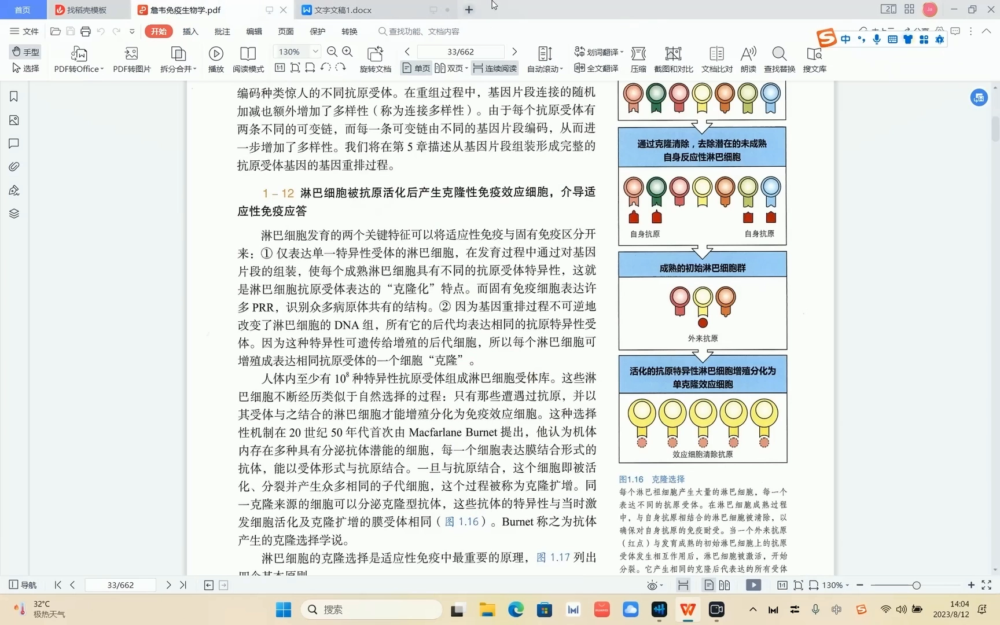
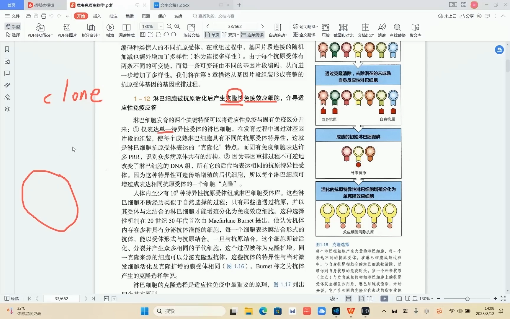
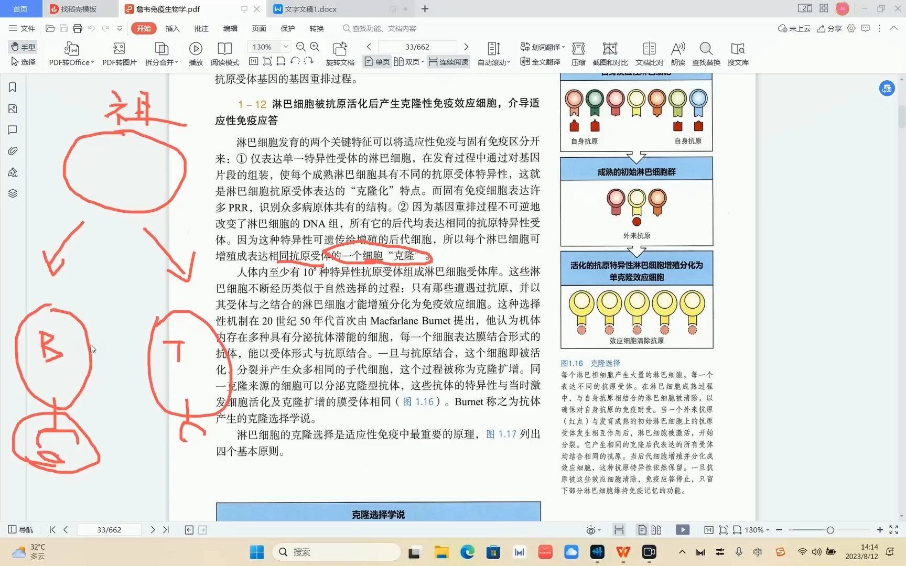
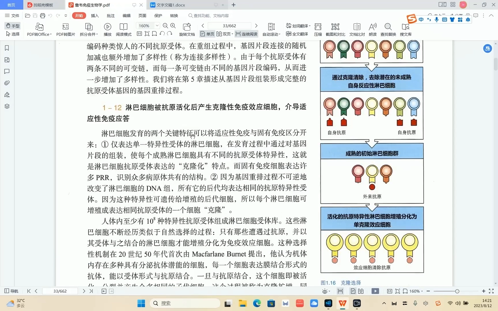
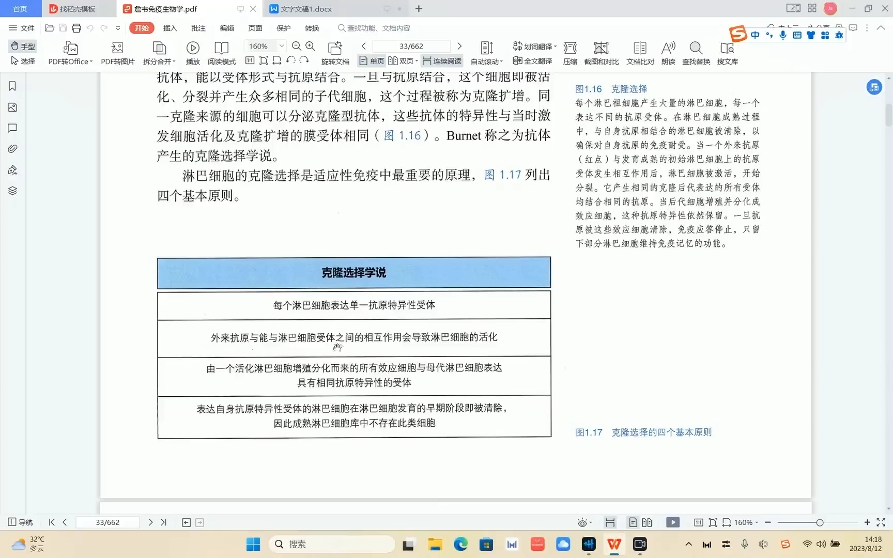
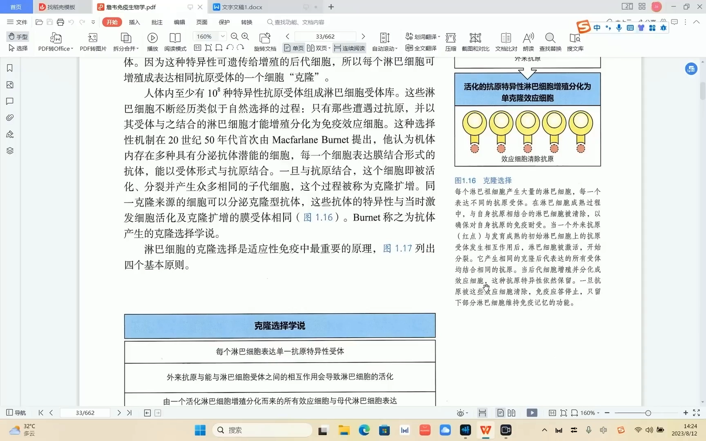

# 克隆选择学说：抗原不是"教会"淋巴细胞识别自己，而是从现成的库里挑出对的那一个

> 视频来源：[詹韦免疫生物学第十讲：适应性免疫应答（五）——淋巴细胞克隆选择学说](https://www.bilibili.com/video/BV1q8411R7jd/)（Bilibili · 泰文超人）｜时长约 27 分钟
> 简要导读：UP 主逐段讲读《詹韦免疫生物学》1-12 节，配图是教材原页与手写批注。本文只覆盖 05:48 之后的正文（克隆选择学说），开头约 5 分钟是对上一讲"可变区与 CDR"的答疑复习，属于本系列"抗体的结构语言"部分，此处不展开。受体重排的分子细节（V、D、J 片段如何拼接）也是后续"多样性与亲和成熟"章的内容，本文只把它当作已知前提引用。

## 本讲要解决的核心问题（SCQA）

**背景**：上一讲我们已经知道，抗体和 T 细胞受体（TCR）的抗原结合部位是高度可变的，而编码它们的基因只有有限的基因片段，靠不同的排列组合拼出来。

**冲突**：如果每个淋巴细胞的特异性都是随机拼出来的，那么人体里绝大多数淋巴细胞注定对眼前这个病原体"不对口"。免疫系统怎样在几天之内，从这样一个庞杂的库里变出一支专门对付它的军队？

**疑问**：抗原到底是"教会"了淋巴细胞识别自己，还是从现成的细胞里"挑"出了对的那一个？

**回答（中心思想）**：是**挑**，不是教。每个淋巴细胞在成熟时就已经固定表达**一种**特异性受体，并且这种特异性终生不变、还会原样传给它的所有后代。抗原的作用只是一个"选择开关"：结合上谁，谁就被活化、分裂成一整支同款克隆（克隆扩增），再分化成效应细胞去清除抗原；抗原被清除后，留一小部分成为记忆细胞，等同一病原体第二次来时快速应答。这就是 Burnet 提出的**克隆选择学说**——它是适应性免疫最重要的原理。

## 一、淋巴细胞有两条"克隆化"特征，正是它区别于固有免疫的地方

这一讲的底本是教材 1-12 节「淋巴细胞被抗原活化后产生克隆性免疫效应细胞，介导适应性免疫应答」，右侧配图就是教材图 1.16「克隆选择」。

[【跳转到 05:48】](https://www.bilibili.com/video/BV1q8411R7jd/?t=348)

教材用两条特征把适应性免疫和固有免疫区分开。这两条都围绕一个词：**克隆（clone）**，也就是"复制"——一个变两个、两个变四个、四个变十六个，而且长得一模一样。

### 1.1 单一特异性：一个细胞只有"一种"受体，不是"一个"受体

第一条特征：仅表达单一特异性受体的淋巴细胞，在发育过程中通过对基因片段的组装，使每个成熟的淋巴细胞具有不同的抗原受体特异性。

这里最容易误读的是"单一"。UP 主专门强调：**"单一"指的是"一种"，不是"一个"**。

- 一个 B 细胞的细胞膜上可以有很多个 BCR 分子；
- 但这些 BCR 全都是**同一种** BCR，只能识别**同一种**抗原表位。

为什么必须这样？UP 主给了一个很实在的反证：如果这个 B 细胞表面的 BCR 各认各的，有的认表位 A、有的认表位 B、有的认表位 C，那么它被活化、分化成浆细胞之后，浆细胞分泌出来的抗体到底该去攻击谁？说不清。浆细胞分泌的分泌型抗体，和当初细胞膜上那个 BCR 是同一个分子，只是从"膜结合形式"变成了"分泌出去"的形式。所以膜上的受体必须口径统一，分泌出来的抗体才有确定的靶子。

[【跳转到 09:33】](https://www.bilibili.com/video/BV1q8411R7jd/?t=573)

[【跳转到 09:08】](https://www.bilibili.com/video/BV1q8411R7jd/?t=548)

### 1.2 基因重排不可逆：特异性跟着这个细胞一辈子，并遗传给全部后代

第二条特征：因为基因重排过程不可逆地改变了淋巴细胞的 DNA 组，所以它的所有后代均表达相同的抗原特异性受体。

用 UP 主的话说：这个 BCR 就跟着这个 B 细胞一辈子。它不会今天表达这个 BCR、明天又重排一次换成另一个 BCR。正因为这份"特异性"能稳定地传给增殖出的后代，一个淋巴细胞才能增殖成"表达相同抗原受体的一个细胞克隆群体"——像电脑上的复制粘贴，粘出一大堆一模一样的细胞。

[【跳转到 14:37】](https://www.bilibili.com/video/BV1q8411R7jd/?t=877)

[【跳转到 13:22】](https://www.bilibili.com/video/BV1q8411R7jd/?t=802)

### 1.3 对照：固有免疫细胞是"广谱"的

把这两条和固有免疫一比就清楚了。一个巨噬细胞或一个树突状细胞，膜上可以有多种模式识别受体（PRR）：清道夫受体认长链脂质，Toll 样受体认病原体成分，胞浆里还有能识别病毒的蛋白。**一个细胞，多种受体，认一大类共有的结构**——这是固有免疫的打法。

而淋巴细胞反过来：**一个细胞，一种受体，认一个精确的表位**。这就是"克隆化"的含义。

[【跳转到 11:38】](https://www.bilibili.com/video/BV1q8411R7jd/?t=698)

## 二、10⁸ 种的库，靠"类似自然选择"筛出有用的那一个

人体内至少有 $10^8$ 种特异性抗原受体，组成淋巴细胞库。这个数字大到什么程度？UP 主的说法是：正因为有这么多种，机体才能对不断出现的病原体都做出应答。

代价是：库里绝大多数细胞对眼前这个病原体是不对口的。所以这些淋巴细胞要不断经历一个**类似自然选择**的过程——只有那些遭遇过抗原、并且受体真的与抗原结合上的淋巴细胞，才能被增殖活化为免疫效应细胞（效应性 B 细胞、效应性 T 细胞）。

这里可以先记住一句话：**抗原不塑造特异性，抗原只做筛选。** 特异性的来源是发育期就已经完成的受体组装；抗原的作用是"点名"。

[【跳转到 15:52】](https://www.bilibili.com/video/BV1q8411R7jd/?t=952)

## 三、Burnet 的克隆选择学说：抗原是选择者，不是教师

20 世纪 50 年代，Macfarlane Burnet 把上面这套机制总结成**抗体产生的克隆选择学说**。它的推理链条是：

1. 机体内存在多种具有分泌抗体潜能的细胞，每一个细胞都表达**膜结合形式**的抗体（即 BCR），能以受体的形式与抗原结合；
2. 一旦与抗原结合，这个细胞就被激活（activated）；
3. 被激活后它开始分裂——克隆分裂、有丝分裂——产生众多一模一样的子代细胞，这个过程叫**克隆扩增**；
4. 同一克隆来源的细胞分泌**克隆型抗体**，这些抗体的特异性与当初激发活化的那个膜受体相同。

### 3.1 克隆扩增：不是"生出更像的"，而是"生出完全一样的"

UP 主在这里做了一个很关键的对比：父母结合生下的孩子，跟父母不可能完全一样；但 B 细胞、T 细胞一旦被活化，生出来的"孩子"跟它一模一样——表面的 BCR 或 TCR 完全相同。

所以克隆扩增不是"越生越准"，而是"越生越多"。精准度在活化之前就已经定好了，扩增只是把数量堆上去。

[【跳转到 17:07】](https://www.bilibili.com/video/BV1q8411R7jd/?t=1027)

### 3.2 为什么叫"克隆选择"而不是"克隆教导"

因为顺序是反的。不是抗原进来之后教淋巴细胞怎么做受体，而是**抗原去选择**那个本来就与它高度匹配的 B 细胞或 T 细胞，让那一个增殖、分裂、活化，产生它的克隆群体。

用 UP 主的原话说：说得形象一点，其实就是抗原去选择与之对应、能够高度特异性结合的那个 BCR 或 TCR。

[【跳转到 18:22】](https://www.bilibili.com/video/BV1q8411R7jd/?t=1102)

[【跳转到 22:38】](https://www.bilibili.com/video/BV1q8411R7jd/?t=1358)

这张图把整条路径压成四步，值得反复看：**先造库 → 再删自身反应性 → 剩下一群初始细胞 → 抗原选中一个 → 单克隆扩增成效应细胞**。

## 四、克隆选择学说的四个基本原则

教材图 1.17 把上面的内容归纳成四条。这四条是本小节最该背下来的东西。

**第一，每个淋巴细胞表达单一抗原特异性受体。** "单一"是一种，不是一个（见 §1.1）。

**第二，外来抗原与淋巴细胞受体之间的相互作用会导致淋巴细胞的活化。** 无论是与 BCR 结合还是与 TCR 结合，结合本身是启动信号。

**第三，由一个活化淋巴细胞增殖分化而来的所有效应细胞，与母代淋巴细胞表达相同的抗原特异性受体。** 这就是"克隆"一词的由来，也是克隆扩增能被称作"扩增"而不是"多样化"的原因。

**第四，表达自身抗原特异性受体的淋巴细胞，在淋巴细胞发育的早期阶段就被清除，因此成熟淋巴细胞库中不存在这类细胞。** 这一条是把"选择"从一个技术描述升级成一条安全规则——详见下一节。

[【跳转到 20:02】](https://www.bilibili.com/video/BV1q8411R7jd/?t=1202)

## 五、第四条的后果：自身反应性克隆必须在成熟期被删掉

第四条讲的是**免疫耐受**。逻辑很直白：

- T 细胞在胸腺里发育成熟，B 细胞在骨髓里发育成熟；
- 成熟过程中，它们的 TCR / BCR 也要"试一试"能认什么；
- 我们希望它认的是**非己**抗原；
- 但随机拼出来的受体里，难免有一两个"不听话的孩子"能认自身组织；
- 一旦能与自身组织结合，它就会被清除。

为什么必须清除？UP 主举了细胞毒性 T 细胞的例子：CD8 阳性的杀伤性 T 细胞本来是直接攻击靶细胞的。如果它认自身组织却不被清除，被释放到外周、进入血液循环和淋巴循环，它就会攻击宿主自己的细胞——甲状腺炎、自身免疫性胰腺炎、一型糖尿病等等，都是自身反应性 T 细胞或 B 细胞的应答没被控制住的结果。

[【跳转到 20:27】](https://www.bilibili.com/video/BV1q8411R7jd/?t=1227)
[【跳转到 21:17】](https://www.bilibili.com/video/BV1q8411R7jd/?t=1277)

所以"克隆选择"其实包含两次选择：**发育期删掉认自己的，感染期扩增认病原体的**。第一次保证安全，第二次保证有效。

## 六、活化之后：一分为二，效应细胞与记忆细胞

一个淋巴细胞被抗原活化之后，走向分成两支：

- **效应细胞**：去执行适应性免疫应答。T 细胞分化成细胞毒性 T 细胞、辅助性 T 细胞（Th）等；B 细胞分化成浆细胞，分泌抗体。
- **记忆细胞**：等同一病原体第二次入侵时快速应答。

这里有一个容易被忽略的细节：**效应细胞的抗原特异性依然保留**。克隆扩增没有改变特异性，只是把同一份特异性复制了很多份。

[【跳转到 25:08】](https://www.bilibili.com/video/BV1q8411R7jd/?t=1508)

[【跳转到 25:33】](https://www.bilibili.com/video/BV1q8411R7jd/?t=1533)

## 七、免疫记忆：第二次为什么能更快

一旦抗原被效应细胞清除，免疫应答就停止，只留下部分淋巴细胞维持**免疫记忆**功能。

记忆带来的差别在于"起步时间"。初次应答时，T 细胞必须先由固有免疫细胞吞噬病原体、加工、把片段提呈到 MHC 分子上，才能被识别、被活化——这一整套流程要走完。而第二次同一病原体入侵时，记忆细胞已经认得它了，**不需要再走一遍抗原提呈这一整套流程**，所以快得多。

UP 主最后还补了一句：整个免疫应答过程还需要 Treg 细胞（调节性 T 细胞）来调节，这一部分前面讲过。

[【跳转到 25:58】](https://www.bilibili.com/video/BV1q8411R7jd/?t=1558)

至于初次应答与再次应答在抗体浓度、类别（IgM 与 IgG）和亲和力上的具体差别，属于"抗体产生的一般规律"，由本小节的另一篇博客专门展开。

## 小结

- **克隆 = 复制**：一个淋巴细胞增殖成一群体，成员的特异性完全相同。
- **单一特异性**指"一种受体"，不是"一个受体"；一个 B 细胞膜上可以有很多个 BCR，但必须是同一种。
- **基因重排不可逆**，所以特异性跟着细胞一辈子，并原样传给全部后代——这是克隆扩增能成立的前提。
- **克隆选择不是克隆教导**：抗原从 $10^8$ 种现成受体里挑出对的那一个，而不是教会细胞怎么认。
- **克隆扩增**把"一个对口的细胞"变成"一支对口的军队"，同一克隆分泌的抗体与当初的膜受体同源。
- **四个基本原则**：单一特异性、抗原结合导致活化、后代受体与母代相同、自身反应性克隆在发育早期被清除。
- **两次选择**：发育期删掉认自己的（免疫耐受），感染期扩增认病原体的（克隆扩增）。
- **活化后一分为二**：效应细胞去清除抗原，记忆细胞留下来，让第二次应答跳过抗原提呈的漫长起步。

## 关键术语速查

| 术语 | 一句话解释 |
| --- | --- |
| 克隆（clone） | 由同一个细胞分裂而来、彼此一模一样的一群细胞 |
| 克隆化表达 | 每个淋巴细胞只表达一种特异性受体，不同淋巴细胞表达不同受体 |
| 单一特异性 | 指"一种"受体而非"一个"受体；一个细胞膜上可以有多个同款受体 |
| 克隆扩增 | 被抗原选中的淋巴细胞反复有丝分裂，产生大量同款子代细胞 |
| 克隆选择学说 | Burnet 提出：抗原从现成淋巴细胞库中挑选并扩增匹配的克隆，而非教会细胞产生特异性 |
| 克隆型抗体 | 同一克隆的细胞分泌的、特异性相同的抗体 |
| 膜结合形式 / 分泌型 | BCR 留在细胞膜上；浆细胞把同一分子分泌出去，成为抗体 |
| 免疫耐受 | 识别自身抗原的淋巴细胞在发育早期被清除，使免疫系统不攻击自身 |
| 初始淋巴细胞 | 已成熟、已固定特异性，但尚未遭遇抗原、尚未活化的淋巴细胞 |
| 效应细胞 | 活化后执行清除任务的分化终末细胞，如浆细胞、细胞毒性 T 细胞 |
| 记忆细胞 | 抗原清除后长期存留的淋巴细胞，使再次应答跳过抗原提呈的起步阶段 |
| PRR（模式识别受体） | 固有免疫细胞上的广谱识别受体，一个细胞可带多种，识别病原体共有结构 |
| TCR / BCR | T 细胞受体 / B 细胞受体，分别是 T、B 细胞膜上的抗原识别分子 |
| Treg | 调节性 T 细胞，负向调节免疫应答强度 |