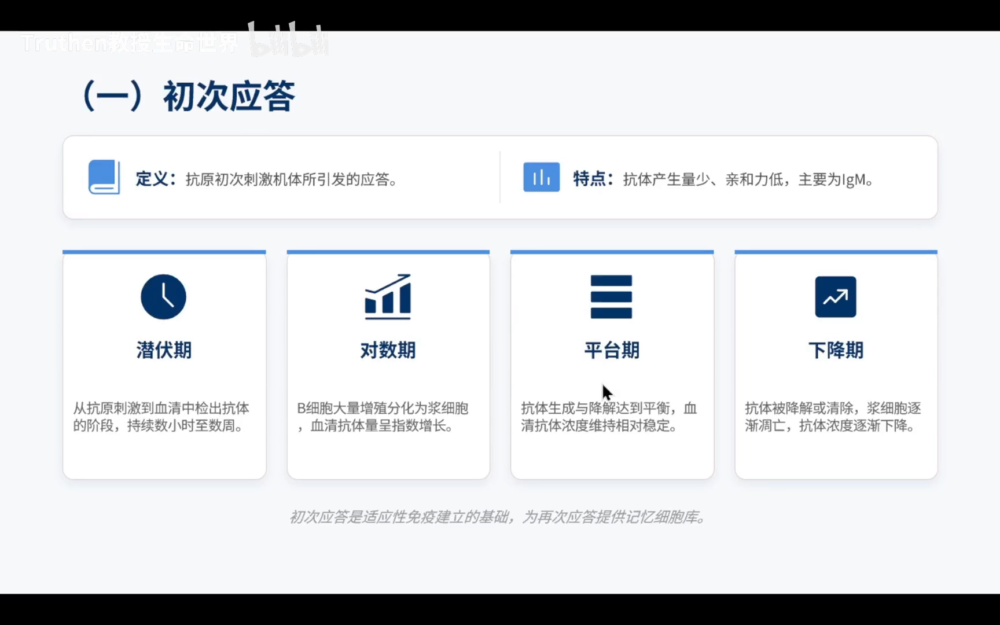
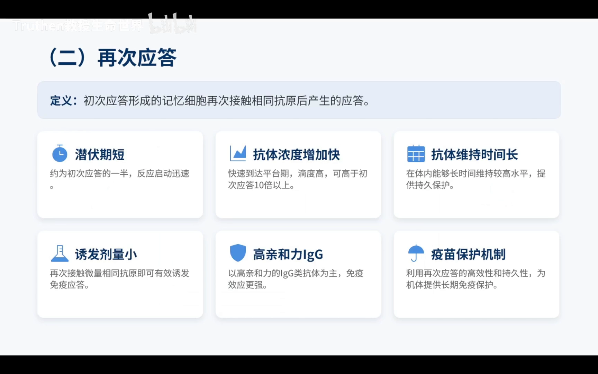
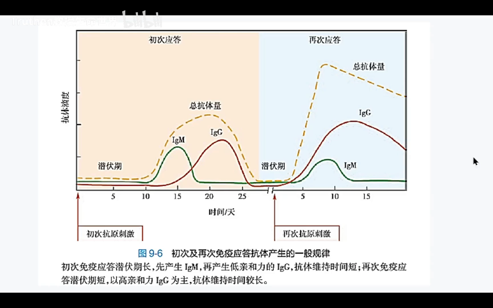

# 初次应答与再次应答：同一份抗原，第二次为什么快十倍、强十倍、还换了个抗体类别

> 视频来源：[9.3 体液免疫应答产生抗体的一般规律](https://www.bilibili.com/video/BV13nQZB1EX1/)（Bilibili · Truthen教授生命世界）｜时长约 6.5 分钟
> 简要导读：一支短小但结构完整的课件讲解，按"定义 → 四个阶段 → 再次应答的六个优势 → 疫苗学含义"的顺序讲完抗体产生的一般规律，最后用一张教科书经典曲线图收束。字幕为 AI 生成，本文已订正 IgM / IgG、佐剂、免疫原性等术语的识别错误。

## 本讲要解决的核心问题（SCQA）

**背景**：抗原进入机体后会诱导 B 细胞活化并分泌抗体。同样是这份抗原，第一次来和第二次来，身体的反应并不一样。

**冲突**：如果免疫系统每次都要从头启动，那么一个人一生中反复遇到同一种病原体，每次都要等一两周才产生抗体——这显然来不及。

**疑问**：第二次遇到同一抗原时，抗体产生的速度、数量、类别和亲和力到底发生了什么变化？这些变化靠什么实现？

**回答（中心思想）**：根据抗原刺激的次数，体液免疫应答分为**初次应答**和**再次应答**。初次应答慢、量少、亲和力低、以 IgM 为主；再次应答由初次应答留下的记忆 B 细胞发动，潜伏期缩短约一半、抗体峰值高十倍以上、维持时间更长、所需抗原剂量更小，并且主要产生**高亲和力 IgG**。二者在动力学、数量、类型、亲和力四个维度上的系统性差异，正是**疫苗**起作用的免疫学基础。

## 一、先分清两个概念：初次应答与再次应答

- **初次应答**：抗原**首次**刺激机体所引发的体液免疫应答。
- **再次应答**：由初次应答形成的**记忆细胞**再次接触**相同抗原**所引起。

两者在抗体产生的**动力学、数量、类型及亲和力**等方面存在显著差异。这四个词基本就是本讲的提纲——后面每一节都会回到它们。

[【跳转到 00:25】](https://www.bilibili.com/video/BV13nQZB1EX1/?t=25)

## 二、初次应答：一场从零开始的慢启动

### 2.1 定义与核心特点

初次应答启动时，机体手里没有任何"现成"的细胞可用，必须完整走一遍：**抗原识别 → B 细胞活化 → 增殖分化为浆细胞 → 分泌抗体**。这条链路长，所以应答速度较慢。

它的核心特点可以一句话概括：**抗体产生量少、亲和力低，主要是 IgM，后期可出现少量低亲和力的 IgG。**

[【跳转到 00:38】](https://www.bilibili.com/video/BV13nQZB1EX1/?t=38)

### 2.2 四个阶段：潜伏期、对数期、平台期、下降期

**第一阶段：潜伏期。** 从机体初次接受抗原刺激，到血清中能检测出特异性抗体为止。一般持续数天到数周。

潜伏期的长短受多种因素影响：抗原的性质、剂量、进入途径，以及**佐剂**类型和宿主免疫状态。通常抗原的**免疫原性越强，潜伏期相对越短**。

[【跳转到 01:03】](https://www.bilibili.com/video/BV13nQZB1EX1/?t=63)

**第二阶段：对数期。** B 细胞大量增殖分化为浆细胞。此时浆细胞分泌抗体的速度远大于抗体的降解速度，所以血清中的抗体滴度呈**对数增长**（这也是"对数期"这个名字的来历）。

抗原的剂量和免疫原性是决定抗体量增长速度的关键因素：高剂量、强免疫原性的抗原能诱导更多 B 细胞活化增殖，抗体滴度增长更快。

[【跳转到 01:53】](https://www.bilibili.com/video/BV13nQZB1EX1/?t=113)

**第三阶段：平台期。** 抗体的生成速度与降解速度达到**动态平衡**，血清抗体浓度维持在一个相对稳定的较高水平。

到达平台期的时间、平台的高度及维持时间因抗原不同而异：有的平台期仅持续数天，有的可长达数周。平台期的长短直接影响机体早期抗感染的持续时间。

[【跳转到 02:18】](https://www.bilibili.com/video/BV13nQZB1EX1/?t=138)

**第四阶段：下降期。** 抗体不断被降解；同时抗体与抗原结合形成免疫复合物后被清除，血清抗体浓度逐渐下降。下降期的长短也与抗原性质相关。

此外还有一个常被忽略的原因：**多数浆细胞寿命较短**，在完成抗体分泌后发生凋亡，抗体产量随之减少。最终初次应答的抗体水平逐渐回落。

[【跳转到 03:08】](https://www.bilibili.com/video/BV13nQZB1EX1/?t=188)

### 2.3 初次应答留下的最重要遗产

初次应答的抗体水平会回落，但它做了一件关键的事：**为再次应答提供了记忆细胞库**。用课件原话说——初次应答是适应性免疫建立的基础。

## 三、再次应答：记忆细胞把"慢启动"整个跳过

再次应答是指由初次应答形成的**记忆 B 细胞**在再次接触相同抗原后产生的体液免疫应答。由于记忆 B 细胞的存在，它具有显著优势：**潜伏期短、抗体浓度上升快、抗体维持时间长、诱发所需抗原剂量小，且主要产生高亲和力的 IgG 抗体**。效率远远高于初次应答。

课件把这张优势清单拆成了六个要点：

[【跳转到 03:33】](https://www.bilibili.com/video/BV13nQZB1EX1/?t=213)

### 3.1 潜伏期缩短：约初次应答的一半

原因是记忆 B 细胞能够**快速识别抗原并活化**，无需经历复杂的初始活化过程，可直接分化为浆细胞。这一步省掉的时间，正好是初次应答里"抗原识别 → 活化 → 分化"那一段。

[【跳转到 03:58】](https://www.bilibili.com/video/BV13nQZB1EX1/?t=238)

### 3.2 抗体滴度快速上升，峰值高十倍以上

再次应答能迅速到达平台期，且抗体峰值滴度可比初次应答**高十倍以上**，可快速形成高效的抗体屏障以清除病原体。

[【跳转到 04:23】](https://www.bilibili.com/video/BV13nQZB1EX1/?t=263)

### 3.3 抗体维持时间长

再次应答产生的抗体能在体内长时间维持较高水平，为机体提供持久的免疫保护。

为什么能维持这么久？课件给了一个机制：记忆 B 细胞活化后不仅能快速产生浆细胞，**还能再次形成生发中心、补充记忆 B 细胞库**。也就是说，再次应答不只是"消耗存量"，它同时也在"补充库存"。

[【跳转到 04:48】](https://www.bilibili.com/video/BV13nQZB1EX1/?t=288)

### 3.4 诱发所需抗原剂量极小

即使是微量抗原也能有效激活记忆 B 细胞，从而保证机体能快速响应低剂量的病原体入侵。

### 3.5 主要产生高亲和力 IgG，而不是 IgM

这是类别上的关键差异。IgG 分布广泛、效应功能多样，是机体抗感染的主力；高亲和力的 IgG 能更高效地结合抗原，发挥**中和、调理、激活补体**等作用。

[【跳转到 05:13】](https://www.bilibili.com/video/BV13nQZB1EX1/?t=313)

### 3.6 疫苗保护机制

再次应答的高效性和持久性，正是**疫苗接种的核心免疫学机制**：疫苗初次刺激产生记忆细胞，当遇到真实病原体时，可引发快速、高效、持久的再次应答，从而预防感染。

[【跳转到 05:38】](https://www.bilibili.com/video/BV13nQZB1EX1/?t=338)

## 四、一张图看完全部差异

课件最后给出的这张曲线图，把初次应答与再次应答的差别压缩在两条时间轴上。横轴是时间（天），纵轴是抗体滴度；左侧橙色区域是初次应答，右侧蓝色区域是再次应答，箭头标出两次抗原刺激的时点。

[【跳转到 05:55】](https://www.bilibili.com/video/BV13nQZB1EX1/?t=355)

读这张图可以按四条线索走：

1. **潜伏期**：初次应答的潜伏期长（图上约到第 10 天才起），再次应答的潜伏期显著缩短。
2. **类别顺序**：初次应答先出现 IgM 峰，再出现 IgG 峰，且 IgG 亲和力低；再次应答几乎不产生新的 IgM，主要分泌高亲和力的 IgG。
3. **峰值高度**：再次应答的抗体平台期远高于初次应答，滴度高。
4. **维持时间**：初次应答下降快、维持时间短；再次应答维持时间长。

把这四条和前面六个要点对上，就是本讲全部内容。

[【跳转到 06:20】](https://www.bilibili.com/video/BV13nQZB1EX1/?t=380)

## 五、四个维度对照一次看完

课件反复强调两者在"动力学、数量、类型、亲和力"上存在显著差异。把这四个维度摊成一张表，本讲的骨架就完整了：

| 维度 | 初次应答 | 再次应答 |
| --- | --- | --- |
| 动力学（潜伏期） | 长，数天到数周 | 显著缩短，约为初次的一半 |
| 动力学（上升速度） | 慢，需完整走识别—活化—分化 | 快，记忆 B 细胞可直接分化为浆细胞 |
| 数量（峰值滴度） | 低 | 可高于初次十倍以上 |
| 数量（维持时间） | 短，下降期很快回落 | 长，体内长时间维持较高水平 |
| 类型（主要类别） | 以 IgM 为主，后期少量 IgG | 以高亲和力 IgG 为主，几乎不产生新的 IgM |
| 亲和力 | 低 | 高 |
| 诱发所需抗原剂量 | 较大 | 极小，微量即可 |
| 来源细胞 | 初始 B 细胞 | 记忆 B 细胞 |

这张表里每一行都能回到前面的正文和那张曲线图上，不需要额外记忆。

## 小结

- 体液免疫应答按抗原刺激次数分为**初次应答**与**再次应答**，二者在动力学、数量、类型、亲和力四个维度上系统性不同。
- 初次应答必须完整走"识别 → 活化 → 增殖分化为浆细胞"的链路，因此**慢**；特点是量少、亲和力低、以 IgM 为主。
- 初次应答分四期：**潜伏期**（数天到数周，受抗原性质、剂量、途径、佐剂、宿主状态影响）→ **对数期**（抗体滴度对数增长）→ **平台期**（生成与降解动态平衡）→ **下降期**（降解、清除、浆细胞凋亡）。
- 初次应答最重要的遗产是**记忆细胞库**。
- 再次应答由记忆 B 细胞发动：潜伏期约为初次的一半、峰值高十倍以上、维持更久、所需抗原剂量极小、以**高亲和力 IgG** 为主。
- 再次应答不仅快速产生浆细胞，还会**再次形成生发中心补充记忆库**，因此既快又持久。
- 这套规律就是**疫苗**的原理：用疫苗制造初次应答，让真实病原体到来时触发的是再次应答。

## 关键术语速查

| 术语 | 一句话解释 |
| --- | --- |
| 初次应答 | 抗原首次刺激机体引发的体液免疫应答，慢、量少、以 IgM 为主 |
| 再次应答 | 记忆 B 细胞再次接触相同抗原引发的应答，快、量多、以高亲和力 IgG 为主 |
| 潜伏期 | 从抗原刺激到血清中能检出特异性抗体的时间，初次应答数天到数周 |
| 对数期 | B 细胞大量增殖分化为浆细胞、抗体滴度呈对数增长的阶段 |
| 平台期 | 抗体生成速度与降解速度达到动态平衡、浓度相对稳定的阶段 |
| 下降期 | 抗体被降解与清除、浆细胞凋亡导致浓度回落的阶段 |
| 抗体滴度 | 血清中特异性抗体的浓度水平，常用稀释倍数表示 |
| 免疫原性 | 抗原诱导免疫应答的能力强弱，越强则潜伏期越短、增长越快 |
| 佐剂 | 与抗原一起使用的辅助成分，可增强免疫应答、影响潜伏期长短 |
| IgM | 初次应答早期主要产生的抗体类别，亲和力相对低 |
| IgG | 再次应答主要产生的抗体类别，分布广、效应功能多样，可中和、调理、激活补体 |
| 亲和力 | 单个抗原结合部位与表位结合的强弱；再次应答产生的抗体亲和力更高 |
| 生发中心 | 淋巴滤泡内 B 细胞增殖、选择与成熟的场所，再次应答中可被再次形成以补充记忆库 |
| 记忆 B 细胞 | 初次应答后长期存留的 B 细胞，再次接触抗原时可快速活化并直接分化为浆细胞 |