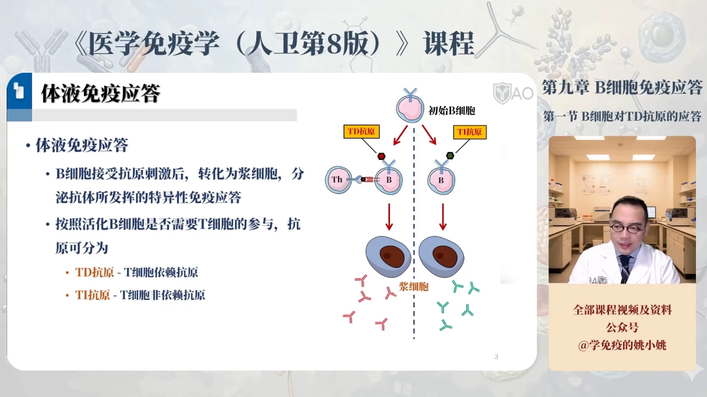
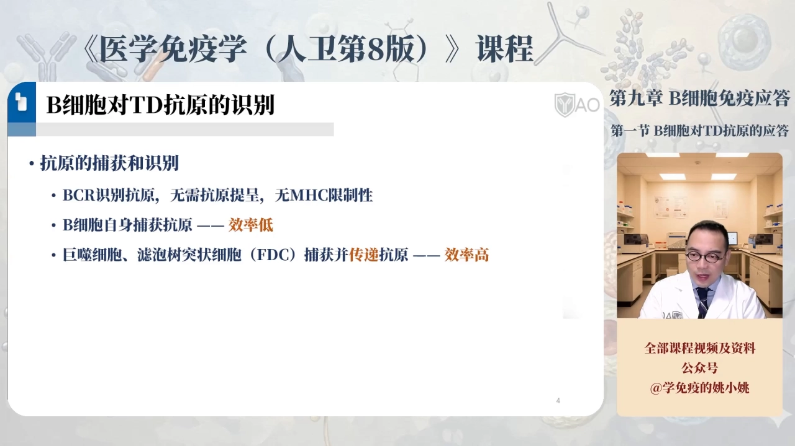
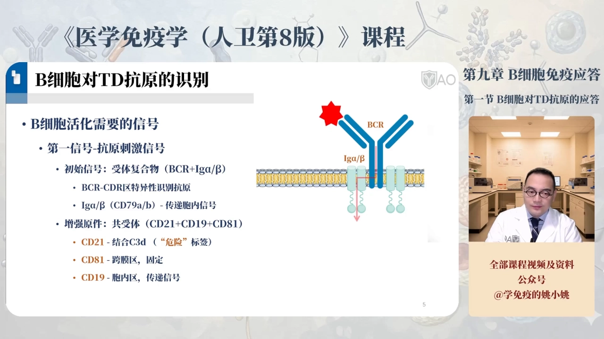
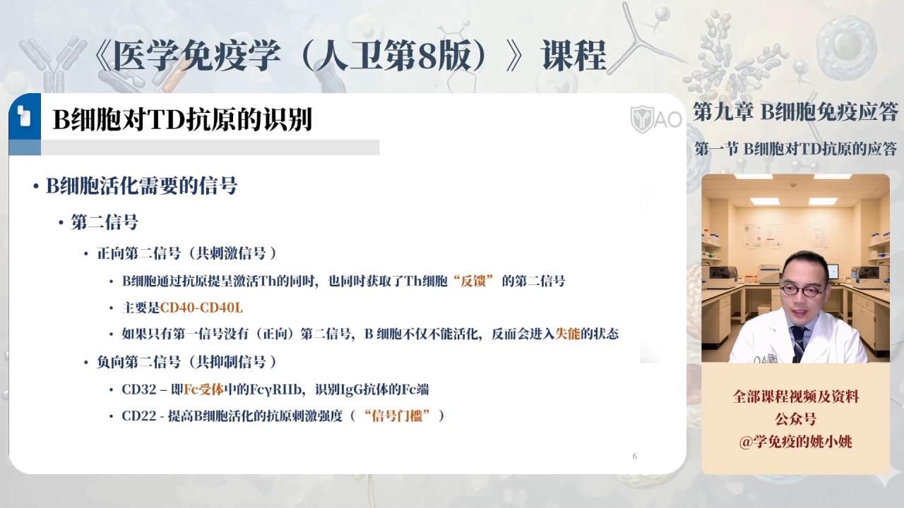
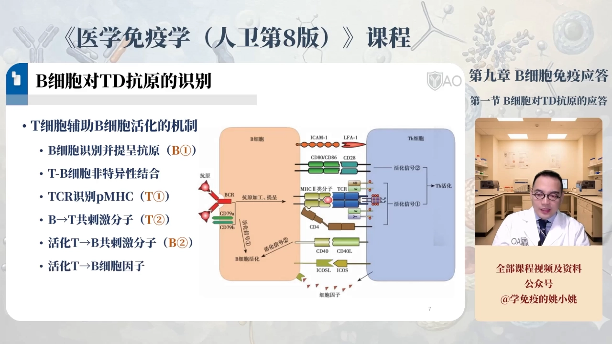
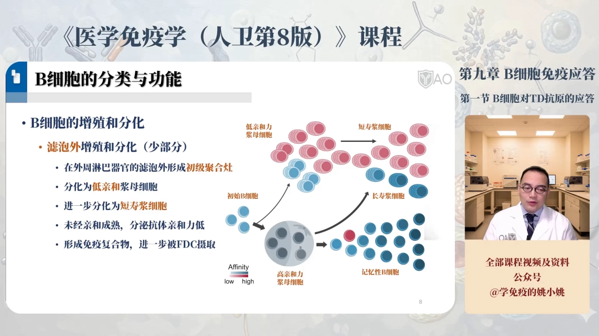
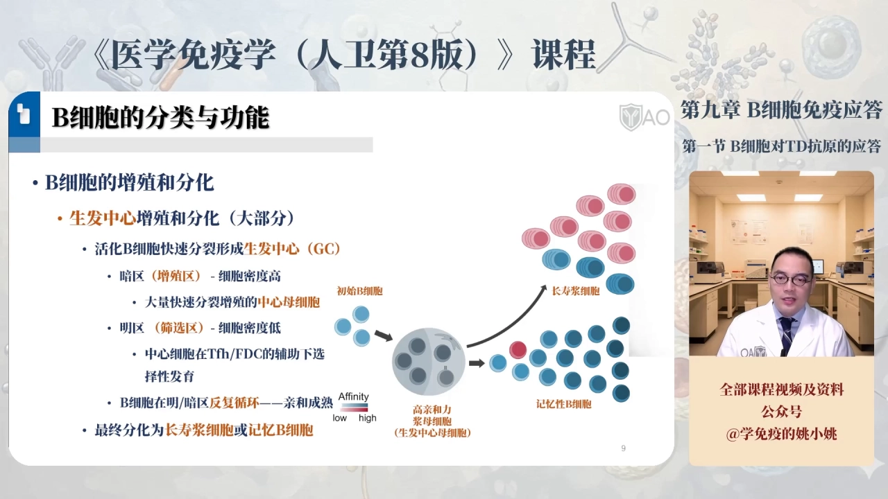
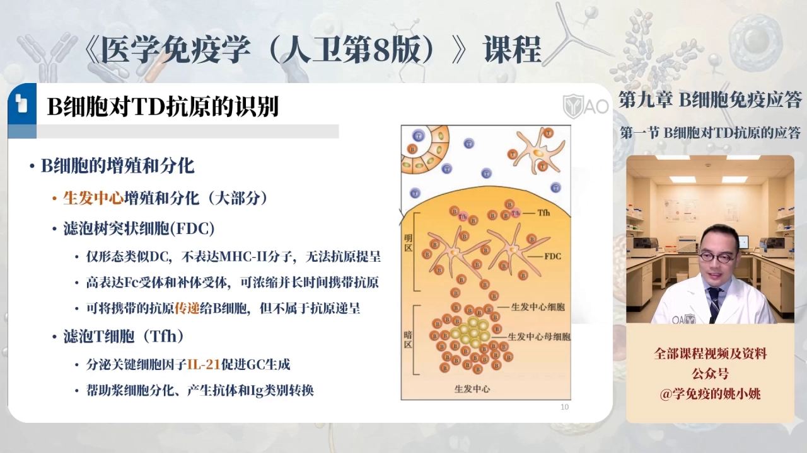
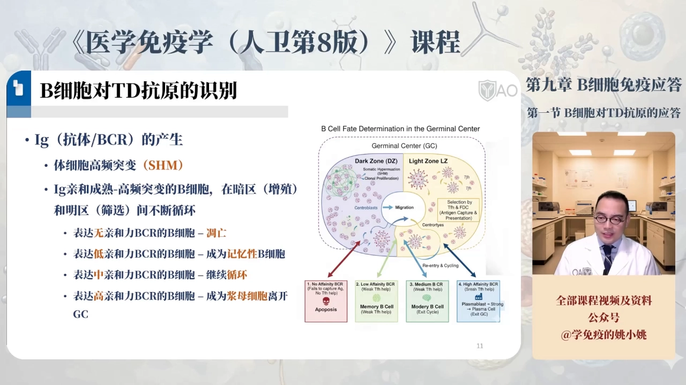

# B 细胞激活的双信号：抗原结合只是第一步，T 细胞的「确认」才让它真正启动

> 视频来源：[09章01节_B细胞对TD抗原的免疫应答](https://www.bilibili.com/video/BV1jYypBNEzC/)（Bilibili · 学免疫的姚小姚）｜时长约 22 分钟
> 简要导读：这是一堂按人卫第 8 版《医学免疫学》第九章第一节逐页讲读的课程，讲者把课本插图做成动态图，一步步拆解「B 细胞从识别抗原到进入生发中心」的全过程。本文覆盖 00:00–13:34 的激活与克隆扩增部分；视频 13:34 之后是生发中心动画、抗体类别转换与浆细胞/记忆细胞，属于本系列并行小节「体液免疫：浆细胞、记忆 B 细胞与抗体产出」的内容，本文只在末尾做一句交代。字幕为 AI 生成，本文已订正 Igα/Igβ、CD79a/b、C3d、Tfh 等术语的识别错误。

## 本讲要解决的核心问题（SCQA）

**背景**：B 细胞表面表达 BCR（B cell receptor，B 细胞受体），每个 B 细胞只表达一种 BCR，只认一种抗原表位。上一节我们已经知道，抗原的作用是从现成的淋巴细胞库里「挑」出对的那一个，被挑中的细胞会分裂成一整支同款克隆。

**冲突**：可是「BCR 结合上抗原」这件事本身，并不等于 B 细胞被激活。人体里有大量能结合 BCR 的分子——包括自身的蛋白质——如果只要结合就开火，免疫系统早就把自己打穿了。反过来，如果 B 细胞迟迟不分裂，几天之内根本凑不出足够的兵力。

**疑问**：从 BCR 结合抗原，到 B 细胞真正被激活、开始克隆扩增，中间到底还缺什么？

**回答（中心思想）**：B 细胞需要**两道信号**才算被完整激活。**第一信号**来自抗原本身，但它不是由 BCR 单独传递的，而是由「BCR + Igα/Igβ」这个受体复合物，再加上 CD21/CD19/CD81 共受体一起产生；**第二信号**由活化的辅助性 T 细胞（Th 细胞）通过 CD40L 和细胞因子「回赠」给 B 细胞。**只有第一信号、没有第二信号，B 细胞不但不活化，反而会进入失能（anergy）状态**——这就是「受体结合」与「完整激活」的分界线。拿到双信号之后，少数 B 细胞在滤泡外仓促分化应急，大部分进入生发中心暗区快速分裂，克隆扩增才算真正开始。

## 一、先分清两类抗原：需不需要 T 细胞「签字」

讲 B 细胞激活，第一步是分清抗原的种类。按「活化 B 细胞是否需要 T 细胞参与」，抗原分为两类：

- **TD 抗原**（thymus-dependent antigen，胸腺依赖抗原）：刺激 B 细胞产生抗体必须要有辅助性 T 细胞参与。
- **TI 抗原**（thymus-independent antigen，胸腺非依赖抗原）：可以直接刺激 B 细胞产生抗体，不需要 T 细胞帮忙。

[【跳转到 00:39】](https://www.bilibili.com/video/BV1jYypBNEzC/?t=39)

这张图把两条路线并排放：左边初始 B 细胞识别 TD 抗原时，中间插了一个 Th 细胞；右边识别 TI 抗原时，B 细胞直接走向浆细胞。这一节的主线是左边这条路——因为**真正需要「双信号」把关的，正是 TD 抗原引发的应答**。

顺带一个容易混的点：TD 的「胸腺依赖」说的是 T 细胞，而 T 细胞虽然成熟于胸腺，它本身却产生于骨髓。讲者特意提醒，考试题干里常在这里设陷阱。

## 二、第一信号：BCR 只负责「认」，传信号要靠 Igα/Igβ

### 2.1 B 细胞识别抗原，不需要 MHC 递呈

这是 B 细胞和 T 细胞最根本的分工差异。T 细胞的 TCR 只能看「被 MHC 分子托在细胞表面的抗原肽」，也就是必须经过抗原递呈；而 B 细胞**可以直接、独立地捕获天然抗原**，既不需要抗原递呈，也没有 MHC 限制性。

但直接捕获有个效率问题：B 细胞的个头和形态并不适合「抓东西」。所以实际免疫应答中，会有巨噬细胞、滤泡树突状细胞（FDC）这类辅助细胞先把抗原捕获、浓缩，再交给 B 细胞。

[【跳转到 01:29】](https://www.bilibili.com/video/BV1jYypBNEzC/?t=89)

这里有个用词必须抠清楚：**「传递」不是「递呈」**。

- **抗原递呈（presentation）**：树突状细胞把抗原吞进去、消化、筛选出合适的抗原肽，再挂到 MHC 分子上给 TCR 看。这是一套「加工 + 展示」的流程。
- **抗原传递（transfer）**：FDC 只是把完整的抗原浓缩、负载在自己表面，让 B 细胞更容易碰到它。全程没有加工，也没有筛选。

讲者的比喻很直白：递呈是「把菜做好端上桌」，传递只是「把食材堆到你面前」。也正因为如此，即便没有 FDC 帮忙，B 细胞照样能获取抗原，只是慢一些。

### 2.2 BCR 复合物：BCR 相当于 TCR，CD79 相当于 CD3

抗原结合到 BCR 上，只是「认出来了」。要把这个物理事件变成细胞内的化学信号，还需要一套专门的「传话装置」。

[【跳转到 02:44】](https://www.bilibili.com/video/BV1jYypBNEzC/?t=164)

这个复合物由两部分组成：

1. **BCR 本身**（膜结合型免疫球蛋白，mIg）：它的抗原结合区（V 区）朝外，负责**特异性识别抗原**。但它的胞内段很短，自己没法传信号。
2. **Igα/Igβ 异二聚体**（也就是 **CD79a/CD79b**）：跨膜存在，胞内段较长，负责**把信号传进细胞**。

讲者给了一个非常好记的对照：**BCR 相当于 T 细胞的 TCR，CD79 相当于 T 细胞的 CD3**。TCR 也只管认抗原，传信号靠 CD3；B 细胞这边是同一个套路——认路的和传令的分开干活。

### 2.3 共受体 CD21/CD19/CD81：给第一信号「加音量」

第一信号还有第二个来源：**增强原件，也就是共受体**，由 CD21、CD19、CD81 三个分子组成。三个分子各有分工：

| 分子 | 位置 | 作用 |
| :--- | :--- | :--- |
| CD21 | 胞外 | 结合 C3d（补体片段），是「危险标签」的识别器 |
| CD81 | 跨膜 | 把三者固定在一起，起稳定作用 |
| CD19 | 胞内 | 真正往细胞内传递增强信号 |

[【跳转到 03:34】](https://www.bilibili.com/video/BV1jYypBNEzC/?t=214)

为什么需要这个共受体？关键在于抗原上常常带着「标签」。补体分子 C3 经过多次降解，最终会在病原体表面留下 **C3d** 这个片段。很多细胞都能通过识别 C3d 来判断「病原体在这里」，所以讲者把它叫作**危险标签**。

于是逻辑就串起来了：BCR 认出抗原 → CD21 同时认出抗原上的 C3d → 两条信号在 CD19 处合流 → 第一信号被显著放大。幻灯片右下角那排小图还画出了 C3d 是怎么一步步从 C3 被剪出来的，以及不同降解产物结合 CD21 的强弱差异。

**一句话总结第一信号**：BCR 复合物（BCR + Igα/Igβ）负责「认 + 传」，共受体（CD21 + CD19 + CD81）负责「放大」，两者合起来才是完整的第一信号。
## 三、第二信号：Th 细胞回赠的那句「确认」

### 3.1 只有第一信号会怎样？失能

这是整节课最关键的一句话：**如果只有第一信号而没有（正向的）第二信号，B 细胞不仅不能活化，反而会进入失能（anergy）状态。**

[【跳转到 04:49】](https://www.bilibili.com/video/BV1jYypBNEzC/?t=289)

这就回答了本文开头那个疑问：**「受体结合」和「完整激活」是两件事**。BCR 结合抗原只是把「这里有个东西」报告给细胞；细胞还要等第二个确认信号，才敢分裂。等不到确认，它宁可关掉自己（失能），也不乱开火。这正是免疫系统区分「该打的病原体」和「不该打的自身分子」的关键闸门。

幻灯片还列出了**负向第二信号**，也就是「刹车分子」：

- **CD32**：即 FcγRIIb，能识别 IgG 抗体的 Fc 端。当抗体已经足够多、形成免疫复合物时，它给 B 细胞踩刹车，避免应答无限放大。
- **CD22**：提高 B 细胞活化的抗原刺激强度门槛，相当于把「信号门槛」调高。

讲者特别说明，这一条在课本里可能没写，是他补充进来让体系更完整的。

### 3.2 T–B 双向奔赴的六个步骤

第二信号从哪来？来自辅助性 T 细胞。但这里有个循环依赖的难题：T 细胞要活化，得先有人给它递呈抗原；而递呈抗原的 B 细胞，又要等 T 细胞来帮忙才能活化。这个「先有鸡还是先有蛋」的问题，课本用一张图讲清楚了。

[【跳转到 07:44】](https://www.bilibili.com/video/BV1jYypBNEzC/?t=464)

把图上的标号按顺序读一遍，就是完整的六步：

1. **B① —— B 细胞识别并递呈抗原。** BCR 结合抗原后，通过**受体介导的内吞**把抗原吞进细胞，加工后挂到 **MHC II 类分子**上，展示在细胞膜表面。
2. **T–B 非特异性结合。** B 细胞与 Th 细胞先靠黏附分子（图上标的 ICAM-1 与 LFA-1）松散地「找朋友」。这一步不挑特异性，只是让两个细胞靠得足够近。
3. **T① —— TCR 识别 pMHC。** 如果这个 Th 细胞的 TCR 正好认出 B 细胞递呈的那条抗原肽，就完成了一次完整的抗原递呈，T 细胞拿到**活化的第一信号**。
4. **T② —— B 细胞给 T 细胞共刺激。** B 细胞表面高表达 **B7（CD80/CD86）**，与 T 细胞表面的 **CD28**（「油门」分子）结合，给 T 细胞提供**活化的第二信号**。至此 Th 细胞被完全活化。
5. **B② —— 活化的 Th 细胞回赠第二信号。** 活化后的 Th 细胞高表达 **CD40 配体（CD40L）**，与 B 细胞表面的 **CD40** 结合，这就是 B 细胞**正向第二信号**的主要来源。
6. **细胞因子加持。** 与此同时，Th 细胞分泌大量细胞因子，直接作用在 B 细胞表面的细胞因子受体上。**双信号 + 细胞因子**齐备，B 淋巴细胞才被完全激活。

[【跳转到 06:29】](https://www.bilibili.com/video/BV1jYypBNEzC/?t=389)

讲者最后用一句话点破了这张图的意义：三种专职抗原递呈细胞——DC、B 细胞、巨噬细胞——**只有 DC 是「单向」活化 T 细胞的**；B 细胞递呈抗原给 T 细胞，目的是**为了自己被活化**；巨噬细胞递呈抗原活化 Th1，最终目的也是**为了自己被活化**。换句话说，B 细胞在这里既是「递呈者」又是「受益者」，它先付出一次递呈，换回一句「可以开火」的确认。

### 3.3 把「免疫原性」翻译成人话

把第一、第二信号放在一起看，就能理解一个常被问到的现象：**为什么一个只能结合 BCR、却不能带来第二信号的分子，往往不足以引发抗体应答？**

因为按这套规则，B 细胞拿到的只有第一信号。而 3.1 已经说明，孤立的第二信号缺失会让 B 细胞走向失能而不是活化。要凑齐第二信号，通常需要 Th 细胞参与——这也正是 TD 抗原（蛋白质类抗原）能引发强而持久的抗体应答、而 TI 抗原（如某些多糖）只能引发较弱且以 IgM 为主的应答的原因。**「能结合」只是免疫原性的入场券，「能带来 T 细胞的确认」才是完整激活的条件。**

## 四、克隆扩增：一条快路，一条精路

拿到双信号之后，B 细胞开始增殖分化。讲者强调，这条路**分成滤泡外和滤泡内两支**，而且两支的比例悬殊。

[【跳转到 08:34】](https://www.bilibili.com/video/BV1jYypBNEzC/?t=514)

### 4.1 滤泡外：先顶上去的权宜之计

**少部分**初始 B 细胞被抗原激活后，会在外周淋巴器官的**滤泡外**直接增殖，形成一个叫**初级聚合灶**的结构，在这里分化为低亲和力浆母细胞，再进一步变成**短寿浆细胞**。

这一支的特点是「快而糙」：

- 因为是仓促之间直接变成浆细胞的，抗体**没有经过质量筛选**，亲和力偏低；
- 但这些抗体与抗原结合后能形成免疫复合物，被 FDC 摄取，再回过头来提供给初始 B 细胞；
- 所以它的定位是**权宜之计**——用少量、低质量的抗体先把体液免疫「启动」起来，为后续精细加工争取时间。

### 4.2 生发中心：暗区增殖、明区筛选

**大部分** B 细胞被抗原刺激后并不会立刻分泌抗体，而是快速进入**生发中心（germinal center, GC）**——淋巴滤泡中那块结构。

[【跳转到 09:49】](https://www.bilibili.com/video/BV1jYypBNEzC/?t=589)

生发中心按**细胞密度**分成两区，名字来自显微镜下的明暗：

- **暗区（增殖区）**：细胞密度高，染色深，看起来暗。这里发生的是**中心母细胞的大量快速增殖**——这就是「克隆扩增」最字面意义上的那一步：一个被选中的 B 细胞，在这里复制成一大群。
- **明区（筛选区）**：细胞密度低，透光下较亮。增殖出来的 B 细胞在这里、在**滤泡辅助 T 细胞（Tfh）**和 **FDC** 的辅助下**选择性发育**。

B 细胞在明区与暗区之间**反复循环**，这个循环就是**亲和成熟**——抗体质量逐步提升的过程。

生发中心里还有两个关键「配角」：

[【跳转到 11:04】](https://www.bilibili.com/video/BV1jYypBNEzC/?t=664)

- **FDC（滤泡树突状细胞）**：形态像 DC，但**不表达 MHC-II 分子，不能递呈抗原**。它高表达 Fc 受体和补体受体，能把大量抗原浓缩并长时间携带在自己身上，**传递给** B 细胞——再次强调，是传递不是递呈。
- **Tfh（滤泡辅助 T 细胞）**：分泌关键细胞因子 **IL-21**，促进生发中心生成，并帮助 B 细胞分化、产生抗体和进行 Ig 类别转换。

### 4.3 谁留在生发中心：四种命运

生发中心里的 B 细胞会经历**体细胞高频突变（SHM）**：在快速增殖过程中，BCR 的基因以超高频率发生点突变，产生各种亲和力不同的 BCR。突变是随机的，所以结果也分成几档。

[【跳转到 12:44】](https://www.bilibili.com/video/BV1jYypBNEzC/?t=764)

| BCR 亲和力 | 结局 |
| :--- | :--- |
| 无亲和力（突变后反而认不出抗原） | 凋亡 |
| 低亲和力 | 成为记忆性 B 细胞，留作「种子选手」 |
| 中等亲和力 | 回到暗区再分裂、再突变，进入下一轮筛选 |
| 高亲和力 | 成为浆母细胞，离开生发中心去产生抗体 |

讲者的总结是：**一轮又一轮的筛选，让 B 细胞的 BCR 与抗原结合得越来越好，也就是抗体质量越来越好。** 这里要划一条界线：**克隆扩增的起点在暗区**（大量中心母细胞快速分裂），而「亲和力怎么一轮轮被筛上去」「高亲和力细胞最后变成什么」属于后续章节与并行小节的内容，本文只讲到「扩增已经发生、筛选机制已经就位」为止。

## 五、视频后半段讲了什么（本文不展开）

视频从 13:34 开始播放了一段生发中心亲和成熟的英文动画，随后（17:32 之后）转入三个话题：**抗体类别转换**（IgM 为什么总是第一顺位、γ 干扰素/TGF-β/IL-4 分别把类别推向 IgG/IgA/IgE）、**浆细胞**（富含粗面内质网、不再表达 BCR 与 MHC、迁回骨髓、多发性骨髓瘤的由来）、**记忆性 B 细胞**（不再产生抗体，但再次相遇时能迅速活化）。

这三块内容属于本系列并行小节「1.1.6 体液免疫：浆细胞、记忆 B 细胞与抗体产出」的范围，本文不重复展开。就本节的学习目标而言，需要记住的边界是：**B 细胞在生发中心拿到「高亲和力」这张通行证之后，才谈得上选哪条分化命运**——而「怎么选」是下一节的事。

## 小结

- **两道信号，缺一不可。** 第一信号来自抗原，第二信号来自活化的 Th 细胞；只有第一信号，B 细胞会进入**失能**而不是活化。这是「受体结合」与「完整激活」的分界线。
- **第一信号不是 BCR 一个人发的。** BCR（mIg）只负责识别，传信号靠 **Igα/Igβ（CD79a/CD79b）**；共受体 **CD21 + CD19 + CD81** 通过识别抗原上的 C3d「危险标签」把信号放大。
- **第二信号的主力是 CD40–CD40L**，再叠加 Th 分泌的细胞因子；此外还有 CD32、CD22 这类负向信号负责踩刹车。
- **T–B 是双向奔赴。** B 细胞先内吞抗原、用 MHC II 递呈给 Th（B①），Th 用 TCR 识别（T①）、B 细胞用 B7/CD28 给 Th 共刺激（T②），活化的 Th 再用 CD40L（B②）和细胞因子回赠 B 细胞。
- **克隆扩增分两支。** 少数在滤泡外仓促分化成短寿浆细胞（快而糙）；大部分进入生发中心，在**暗区**大量增殖、在**明区**由 Tfh 与 FDC 筛选，反复循环。
- **生发中心里的四种命运**由 BCR 亲和力决定：无亲和力凋亡、低亲和力变记忆细胞、中等亲和力继续循环、高亲和力成为浆母细胞。

## 关键术语速查

| 术语 | 一句话解释 |
| :--- | :--- |
| TD 抗原 | 胸腺依赖抗原，刺激 B 细胞产生抗体必须有辅助性 T 细胞参与 |
| TI 抗原 | 胸腺非依赖抗原，可直接刺激 B 细胞产生抗体，不需 T 细胞 |
| BCR | B 细胞受体，膜结合型免疫球蛋白，负责特异性识别抗原 |
| Igα/Igβ（CD79a/CD79b） | 与 BCR 配对的跨膜分子，负责把抗原结合信号传进胞内，相当于 T 细胞的 CD3 |
| 共受体（CD21/CD19/CD81） | 识别抗原上的 C3d 并放大第一信号的增强装置 |
| C3d | 补体 C3 降解后留在病原体表面的片段，被称为「危险标签」 |
| 第一信号 | 抗原刺激信号，由 BCR 复合物加共受体产生 |
| 第二信号 | 主要由 Th 细胞的 CD40L 与 CD40 结合提供；缺失会导致 B 细胞失能 |
| 失能（anergy） | 只有第一信号、没有第二信号时 B 细胞进入的功能关闭状态 |
| CD40L | 活化的 Th 细胞表面高表达的配体，是给 B 细胞的关键「确认」信号 |
| 初级聚合灶 | 滤泡外 B 细胞增殖形成的结构，产出低亲和力、短寿的浆细胞 |
| 生发中心（GC） | 淋巴滤泡中 B 细胞大量增殖与筛选的结构，分暗区与明区 |
| 暗区 / 明区 | 暗区为增殖区（中心母细胞快速分裂），明区为筛选区（Tfh/FDC 参与选择） |
| FDC | 滤泡树突状细胞，浓缩并传递抗原，不表达 MHC-II、不递呈抗原 |
| Tfh | 滤泡辅助 T 细胞，分泌 IL-21，帮助生发中心 B 细胞分化 |
| 体细胞高频突变（SHM） | 生发中心内 BCR 基因高频点突变，产生亲和力各异的 BCR |
