# B细胞激活之后：一条走"急救"、一条进"训练营"，最后留下浆细胞和记忆B细胞

> 视频来源：[8-9章 B细胞应答、免疫记忆与加强针](https://www.bilibili.com/video/BV1EiDeBWEx2/)（Bilibili · Raymond1985）｜时长约 5 分钟
> 简要导读：这是一支用"婴幼儿反复感染肺炎链球菌"作引子的短讲，把B细胞激活后的两条命运路线、生发中心里的两道"加工工序"、以及浆细胞与记忆B细胞这两种终产物串成一条线。激活信号（BCR、共刺激、Tfh 帮助）在本系列 1.1.5 已单独展开，本文只保留理解命运分岔所必需的部分；初次/再次应答的动力学细节见 1.1.4，本文不重复。

## 本讲要解决的核心问题（SCQA）

**背景**：抗原与B细胞相遇、B细胞被激活之后，会分化成能分泌抗体的细胞。抗体是体液免疫的效应分子，这一点在 1.1.4 已经建立。

**冲突**：同样是"产生了抗体"，质量却可能天差地别。婴幼儿对肺炎链球菌荚膜多糖的应答来得又快又猛，却几乎留不下保护；而一次成功的疫苗接种，抗体出现得慢一些，却能维持很久。可见"有没有抗体"并不是全部答案。

**疑问**：B细胞被激活之后，究竟会走向哪几条路？每条路产出什么细胞、什么抗体、能维持多久？

**回答（中心思想）**：激活后的B细胞面对一次命运分岔——一条是**滤泡外应答**，几天内把初始B细胞变成浆母细胞、再变成**短寿命浆细胞**，抢时间分泌低亲和力 IgM 压制早期感染；另一条是进入**生发中心**，在那里完成体细胞高频突变、亲和力成熟和类别转换，最后输出**长寿命浆细胞**（迁居骨髓、持续分泌高亲和力抗体）或**记忆B细胞**（静息待命、再次相遇时快速扩增分化）。前者是"急救"，后者是"升级"；抗体产出的数量、质量与持续时间，都由细胞走哪条路、停在哪个状态决定。

## 一、TI-2 抗原的"快而浅"：为什么多糖疫苗保护不住婴幼儿

这支视频从一个临床现象切入：婴幼儿特别容易反复发生肺炎链球菌这类带荚膜细菌的感染，表现为反复中耳炎、肺炎、鼻窦炎。

荚膜多糖属于典型的**胸腺非依赖性抗原**，其中一类叫 **TI-2 抗原**。它的结构特点是**表位高度重复**：一条多糖链上密密麻麻排着相同的糖基表位。

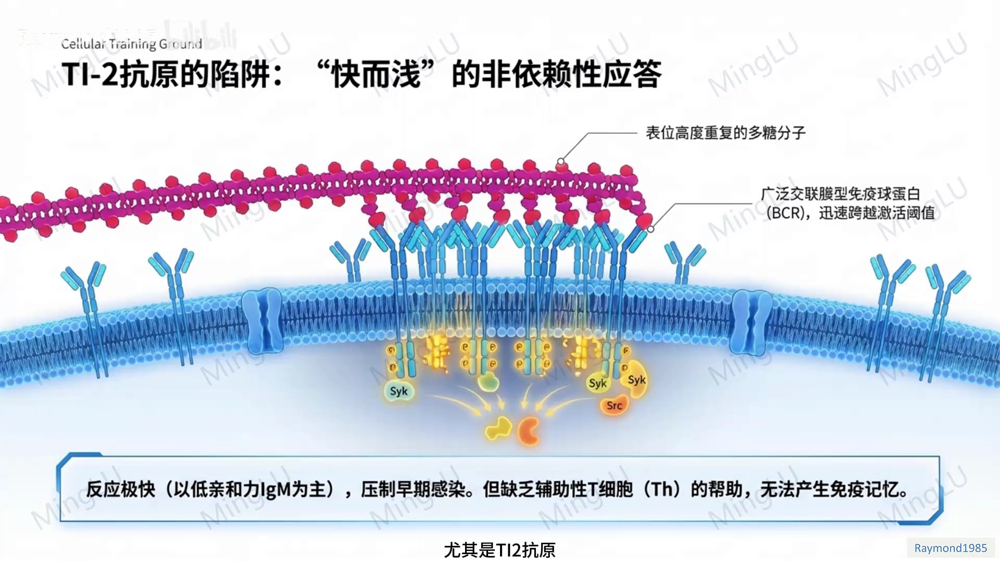

[【跳转到 00:29】](https://www.bilibili.com/video/BV1EiDeBWEx2/?t=29)

这种"重复"对B细胞是一把双刃剑。好处是：一个抗原分子能同时拉住B细胞表面许多个 BCR，把它们成片地交联起来，信号强度一下子越过激活阈值，**反应极快**，适合在感染早期迅速产生抗体，而且以 **IgM** 为主。坏处是：整个过程**没有辅助性T细胞（Th）的参与**，因此亲和力成熟不充分、类别转换有限、免疫记忆差。

这里要解释三个词：

- **亲和力**：抗体与抗原结合的紧密程度。亲和力高，少量抗体就能牢牢抓住病原；亲和力低，抓不牢、容易脱落。
- **类别转换**：抗体识别抗原的"可变区"不变，只更换决定效应功能的"恒定区"，从 IgM 换成 IgG、IgA 或 IgE（后文详述）。
- **免疫记忆**：应答结束后留下能识别同一抗原的细胞，下次再遇到时能更快、更强地反应。

没有 T 细胞帮助，这三件事都做不好。所以 TI-2 应答的保护特点是"**快而浅**"：抗体来得快，但质量不高、留不下记忆。

那为什么婴幼儿尤其吃亏？因为这类应答高度依赖 **B1 细胞**和**边缘区B细胞**，而婴幼儿这两个亚群发育还不成熟。

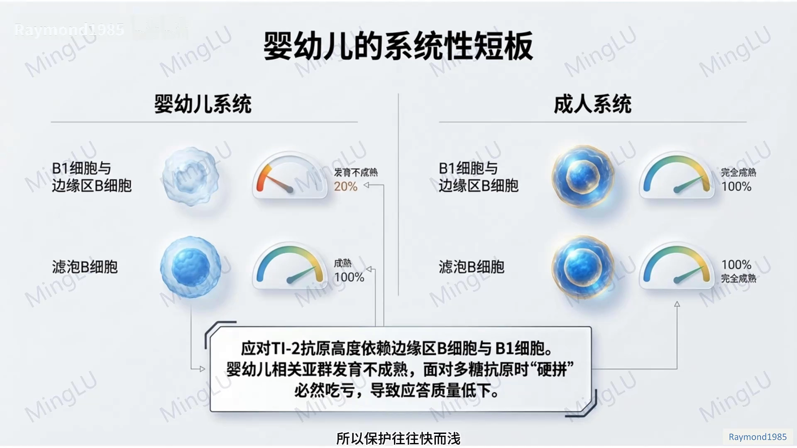

[【跳转到 00:55】](https://www.bilibili.com/video/BV1EiDeBWEx2/?t=55)

于是同一个病原，成人可能靠成熟的多糖应答勉强应付，婴幼儿却只能"硬拼"，应答质量低下。这就是临床上看到的反复感染。

## 二、把 TI 改造成 TD：结合疫苗如何改写B细胞的命运

现代疫苗学的一个关键发明，是把多糖抗原接到**蛋白载体**上，做成**结合疫苗**。

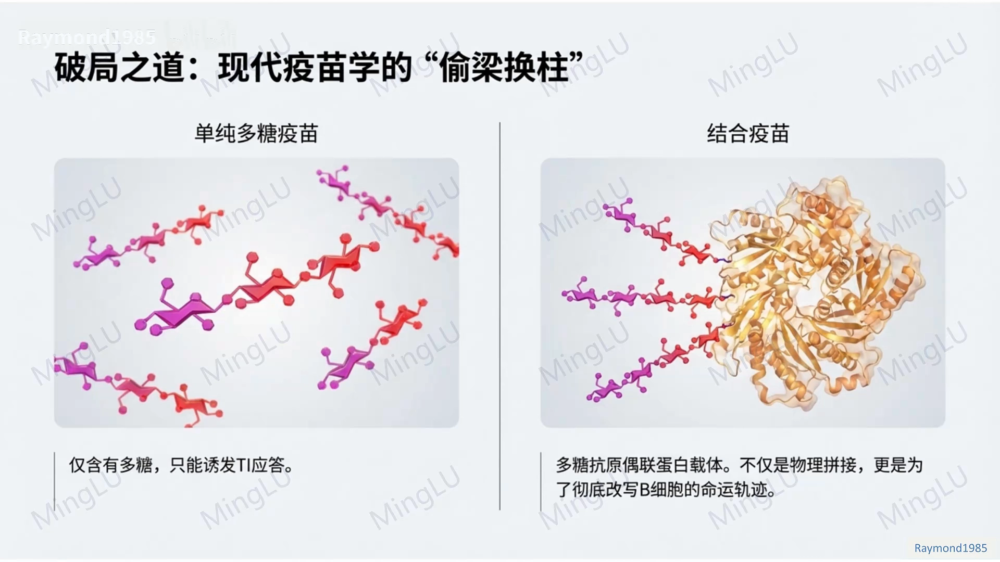

[【跳转到 01:20】](https://www.bilibili.com/video/BV1EiDeBWEx2/?t=80)

妙处在于：B细胞抓到的**还是多糖**——因为 BCR 识别的仍是多糖表位；但把这个复合物吞进去加工之后，递呈给 T 细胞的却是**蛋白载体来源的抗原肽**。于是，一个本来偏"胸腺非依赖"的反应，被改造成了**胸腺依赖性（TD）应答**。

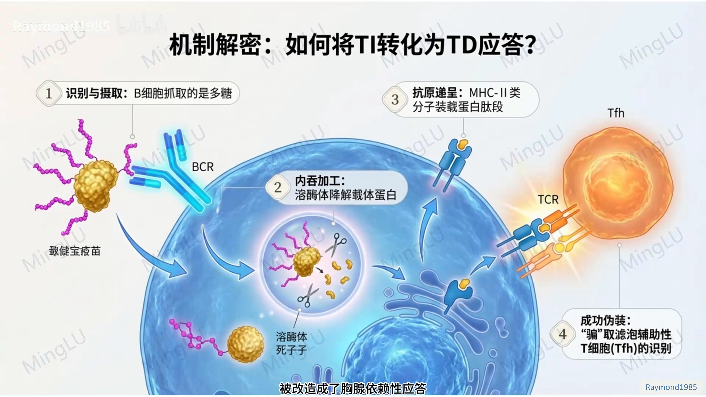

[【跳转到 01:46】](https://www.bilibili.com/video/BV1EiDeBWEx2/?t=106)

一旦进入 TD 应答，B细胞的命运就完全不同了。这里快速回顾一下信号（细节见 1.1.5）：

1. **第一信号**：BCR 识别天然构象的抗原，借助 CD79a/CD79b 把信号传入胞内，再由 CD19/CD21/CD81 组成的共受体复合体放大信号。
2. **抗原递呈**：B细胞把抗原加工后装载到 MHC II 类分子上，递呈给滤泡辅助性T细胞（Tfh）。
3. **第二信号**：Tfh 表面的 CD40L 与B细胞的 CD40 结合。

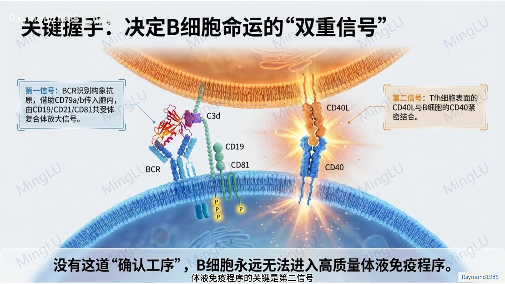

[【跳转到 02:21】](https://www.bilibili.com/video/BV1EiDeBWEx2/?t=141)

视频把第二信号称为一道"**确认工序**"：没有它，B细胞永远无法进入高质量体液免疫程序。这句话是理解后文的钥匙——**有没有 T 细胞的"确认"，决定了B细胞是去打一场快仗，还是去上一所训练营。**

## 三、命运的分岔：滤泡外"急救"与生发中心"升级"

拿到 T 细胞帮助之后，B细胞不会只停留在"先打一波抗体"的层面，而是走向两条路。

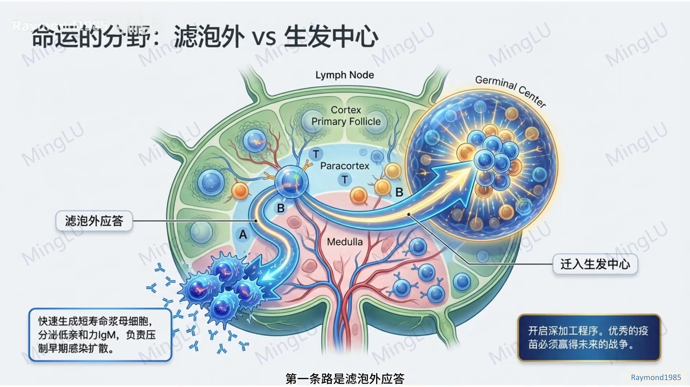

[【跳转到 02:37】](https://www.bilibili.com/video/BV1EiDeBWEx2/?t=157)

**第一条路：滤泡外应答（急救）**

一部分B细胞在淋巴器官的滤泡外区域直接增殖，快速产生一批**浆母细胞**（plasmablast，正在向浆细胞过渡、已经开始分泌抗体的中间状态）。它们分泌的是**低亲和力 IgM**，任务不是"精准打击"，而是抢在病原扩散之前把它压住。这条路的产物是**短寿命浆细胞**——顾名思义，存活时间短，无法长期维持抗体水平。

**第二条路：生发中心（升级）**

更多B细胞进入淋巴滤泡，与 Tfh、滤泡树突状细胞（FDC）一起组成**生发中心（germinal center, GC）**。视频把它比作B细胞的"**质量升级训练营**"：在这里，抗体不只要变多，更要变好。

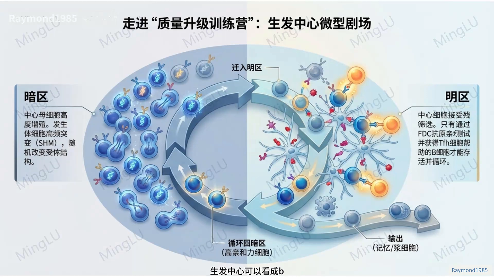

[【跳转到 02:48】](https://www.bilibili.com/video/BV1EiDeBWEx2/?t=168)

生发中心在空间上分成两个区：

- **暗区（dark zone）**：细胞密度高，显微镜下偏暗。中心母细胞在这里高度增殖，同时发生**体细胞高频突变**，随机改变 BCR 的结构。
- **明区（light zone）**：细胞密度低，透光下偏亮。中心细胞在这里接受"筛选"：只有能通过 FDC 表面抗原"测试"、并获得 Tfh 帮助的B细胞才能存活，然后回到暗区再突变、再筛选。

这个"暗区—明区"的循环，就是**亲和力成熟**：一轮轮"突变—筛选"下来，BCR 与抗原的结合越来越紧。

## 四、生发中心的两道工序：高频突变与类别转换

生发中心里发生两件核心的事，视频把它们称为两道"工艺"。

**工序一：体细胞高频突变与亲和力成熟**

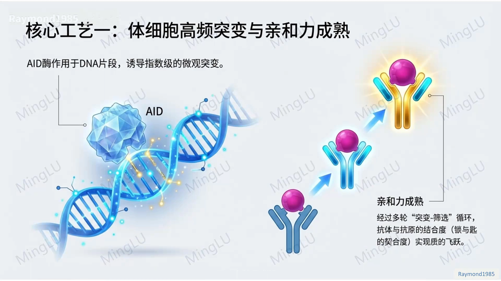

[【跳转到 03:02】](https://www.bilibili.com/video/BV1EiDeBWEx2/?t=182)

**AID（活化诱导胞苷脱氨酶）** 作用于编码抗体可变区的 DNA，引入点突变。突变是随机的：有的让 BCR 失去结合能力，这类细胞被淘汰；有的让结合更紧，这类细胞被选中并扩增。多轮之后，群体里高亲和力克隆的比例越来越高。这就是**亲和力成熟**——注意它改变的是"抓得牢不牢"，不改变"抓的是谁"。

**工序二：类别转换**

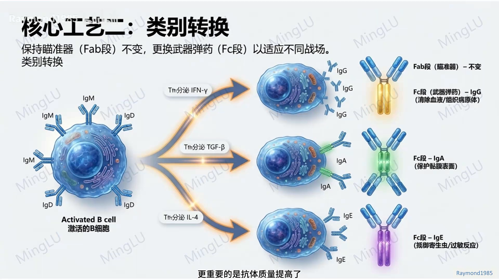

[【跳转到 03:12】](https://www.bilibili.com/video/BV1EiDeBWEx2/?t=192)

类别转换保持**可变区（Fab 段，负责识别抗原）不变**，只更换**恒定区（Fc 段，决定抗体怎么发挥效应）**。所以转换之后，抗体认的还是同一个抗原，但"打法"变了：

- 换成 **IgG**：血清和组织里的主力，负责清除血液、组织中的病原体；
- 换成 **IgA**：能穿过黏膜表面，负责黏膜防御；
- 换成 **IgE**：参与抵御寄生虫和过敏反应。

视频里给出的调控线索是细胞因子：Tfh 分泌 **IFN-γ** 促使转换为 IgG，分泌 **TGF-β** 促使转换为 IgA，分泌 **IL-4** 促使转换为 IgE。也就是说，B细胞"换成哪种抗体"，取决于它所在环境里 T 细胞给了什么信号——这是对抗原所处"战场"的一种适配。

## 五、两种终产物：长寿命浆细胞与记忆B细胞

生发中心的输出有两个方向，这是本节最需要分清的一对细胞状态。

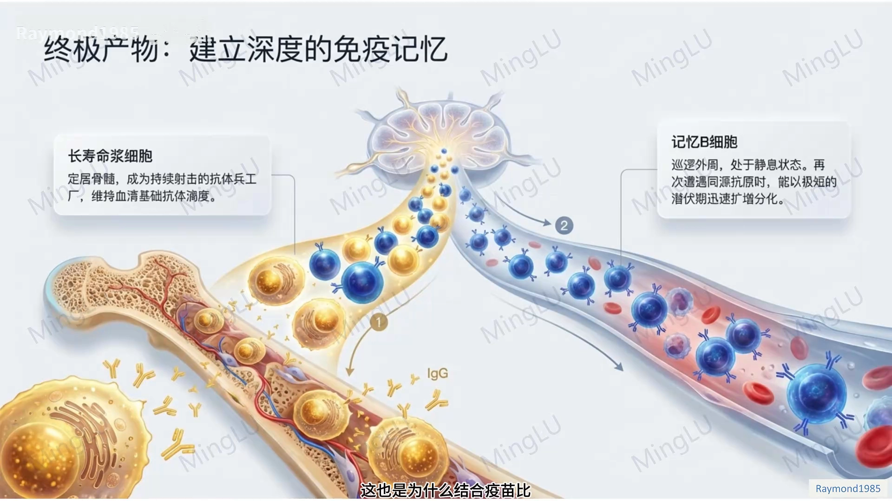

[【跳转到 03:32】](https://www.bilibili.com/video/BV1EiDeBWEx2/?t=212)

**长寿命浆细胞（long-lived plasma cell）**

- **位置**：迁居**骨髓**，在那里获得生存支持。
- **状态**：持续分泌，成为“抗体工厂”。
- **产出**：持续、大量地分泌高亲和力抗体，维持血清中的**基础抗体滴度**。所谓“滴度”，就是血清中抗体能被检测出的稀释倍数，是抗体浓度的常用表达。

浆细胞的形态与功能高度统一：视频把它形容为“持续射击的抗体工厂”——细胞里几乎全部产能都用于制造并分泌抗体。到了这个阶段，它已经不再是“巡逻识别”的细胞，而是一台专职生产抗体的机器。

**记忆B细胞（memory B cell）**

- **位置**：在外周巡逻，不固定在骨髓。
- **状态**：**静息**（quiescent）——当前不大量分泌抗体，但这不是功能丧失，而是"待机"。
- **产出**：再次遇到同源抗原时，能以极短的潜伏期迅速扩增、分化成新的抗体分泌细胞。

把两者放在一起对比，差别一目了然：

| 维度 | 长寿命浆细胞 | 记忆B细胞 |
| --- | --- | --- |
| 当前任务 | 持续分泌抗体 | 静息待命，不大量分泌 |
| 主要位置 | 骨髓 | 外周淋巴器官与循环 |
| 再次遇抗原 | 不需要再激活，继续分泌 | 被激活、扩增、分化 |
| 对抗原刺激的依赖 | 不依赖 | 依赖 |

这张表也解释了一个常见误解：**"抗体下降"不等于"记忆消失"**。血清抗体水平主要由长寿命浆细胞维持；而记忆B细胞是另一层保障，它平时不产出抗体，所以不会体现在抗体数值里。

## 六、抗体应答的时间曲线：两支部队接力

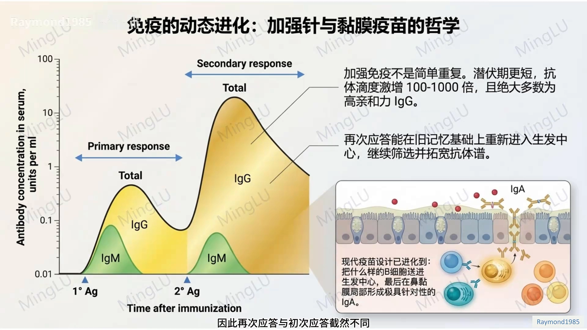

[【跳转到 03:37】](https://www.bilibili.com/video/BV1EiDeBWEx2/?t=217)

视频用经典的抗体动力学曲线收束前半段：第一次免疫后，IgM 先起、IgG 后起，峰值低、维持短；再次免疫后，潜伏期更短、抗体滴度可激增 100–1000 倍、维持更久，而且以高亲和力 IgG 为主。

这条曲线的细胞学解释，正是前面两条路线和两种终产物：

- 早期那一段低平的小峰，主要由**滤泡外应答**产生的短寿命浆细胞贡献，抗体以 IgM 为主、亲和力低；
- 后期那个高得多的峰，来自**生发中心**输出的长寿命浆细胞，抗体经过亲和力成熟和类别转换，以 IgG 为主；
- 第二次接种之所以起得快，是因为**记忆B细胞**已经在场，省掉了"从头找克隆、进生发中心"的时间。

初次与再次应答的详细对比（潜伏期、峰值、类别、亲和力四个维度）已在 1.1.4 展开，这里只把它当作细胞命运的"读数"来看。

## 七、加强针与黏膜疫苗：记忆不是静态存档

视频最后把视角推到应用层，给出两个判断。

**第一，加强针不是简单重复第一次刺激。** 近年的研究提示，加强免疫后的生发中心反应并不是机械地复制旧克隆，而是能在旧记忆的基础上**继续筛选、拓宽抗体谱**。也就是说，免疫记忆不是一份静态存档，而是可以被重塑、被升级的动态系统。

**第二，黏膜疫苗的关键不只是"局部刺激一下"。** 鼻黏膜 IgA 应答与三个因素密切相关：B细胞受体的**亲和力**、B细胞**进入生发中心的效率**、以及**趋化受体**的表达（决定细胞能否迁移到正确的位置）。

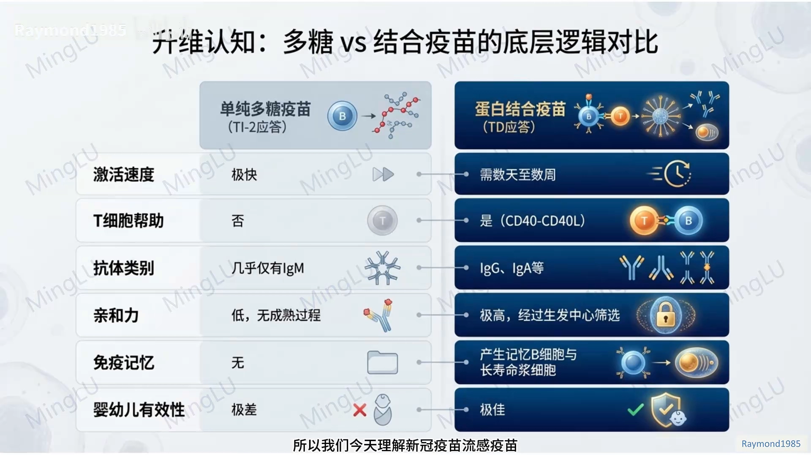

[【跳转到 04:41】](https://www.bilibili.com/video/BV1EiDeBWEx2/?t=281)

于是现代疫苗设计的提问方式变了：不再只问"能不能起抗体"，而是问"**把什么样的B细胞、送进什么样的生发中心、最后在什么部位形成什么类别的抗体**"。这句话把本节的三个关键词——细胞命运、生发中心、抗体产出——串成了一条完整的因果链。

## 小结

- 激活后的B细胞有两条命运路线：**滤泡外**（快、浅，产出短寿命浆细胞与低亲和力 IgM）和**生发中心**（慢、深，产出高亲和力抗体与记忆）。
- **TI-2 抗原**靠重复表位交联 BCR 快速激活B细胞，但缺少 T 细胞帮助，因此亲和力成熟差、类别转换有限、没有记忆；这是多糖疫苗对婴幼儿保护不足的细胞学原因。
- **结合疫苗**把多糖接到蛋白载体上，让B细胞"抓多糖、递呈蛋白肽"，从而借到 Tfh 的帮助，把 TI 应答改写成 TD 应答。
- 生发中心的两道工序是**体细胞高频突变/亲和力成熟**（改变"抓得牢不牢"）和**类别转换**（改变"怎么打"，Fab 不变、Fc 更换）。
- 生发中心的两种终产物是**长寿命浆细胞**（定居骨髓、持续分泌、维持基础滴度）和**记忆B细胞**（静息待命、再遇抗原快速扩增分化）。
- 抗体曲线的形状是细胞命运的读数：早期小峰来自滤泡外短寿命浆细胞，后期高峰来自生发中心输出的长寿命浆细胞，再次应答之"快"来自记忆B细胞。
- 免疫记忆是动态的：加强针可以继续筛选、拓宽抗体谱；疫苗设计的目标是"把对的B细胞送进对的生发中心"。

## 关键术语速查

| 术语 | 一句话解释 |
| --- | --- |
| TI-2 抗原 | 胸腺非依赖性抗原的一类，多为重复表位的多糖，可直接交联 BCR 激活B细胞，不需 T 细胞帮助 |
| TD 抗原 | 胸腺依赖性抗原，需要 Tfh 提供 CD40L 等帮助，才能进入生发中心并产生记忆 |
| 浆母细胞 | B细胞向浆细胞过渡的中间状态，已开始分泌抗体，增殖能力强 |
| 短寿命浆细胞 | 滤泡外应答的产物，分泌低亲和力抗体，存活时间短 |
| 长寿命浆细胞 | 生发中心输出、定居骨髓的终末分化细胞，持续分泌高亲和力抗体 |
| 记忆B细胞 | 静息待命的B细胞，不大量分泌抗体，再次遇抗原时快速扩增分化 |
| 生发中心 | 淋巴滤泡内由B细胞、Tfh、FDC 组成的结构，是亲和力成熟与类别转换的场所 |
| 暗区 / 明区 | 生发中心的两个区域：暗区增殖并高频突变，明区筛选并接受 Tfh 帮助 |
| 体细胞高频突变 | 生发中心内 BCR 可变区基因的高频点突变，由 AID 介导，是亲和力成熟的原料 |
| 亲和力成熟 | 多轮"突变—筛选"使抗体与抗原结合越来越紧的过程 |
| 类别转换 | 可变区不变、恒定区更换，使同一特异性抗体从 IgM 变为 IgG/IgA/IgE |
| 抗体滴度 | 血清中抗体可被检出的稀释倍数，用来表示抗体浓度 |
| 结合疫苗 | 把多糖抗原偶联到蛋白载体上的疫苗，可把 TI 应答转为 TD 应答 |