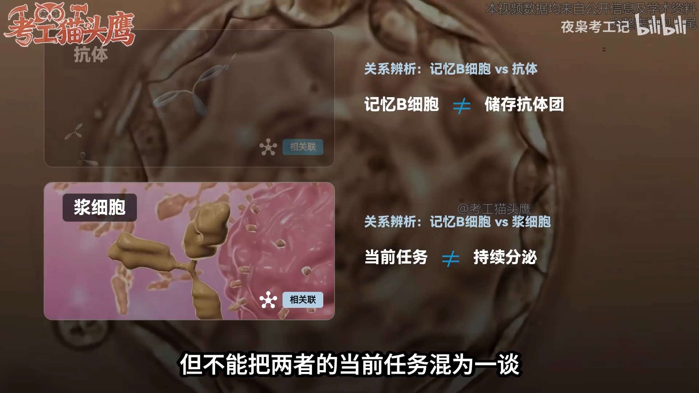
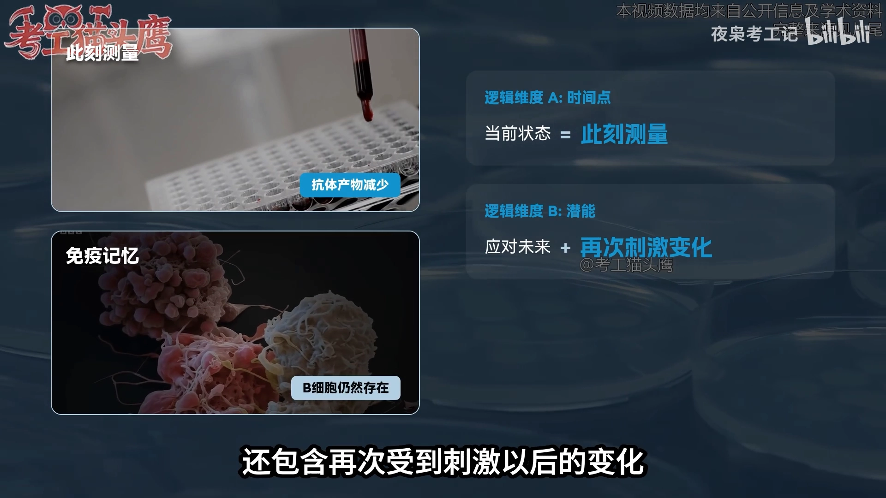
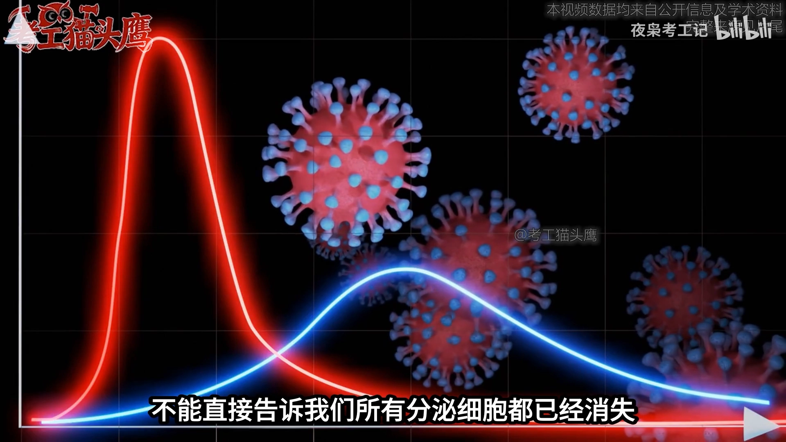
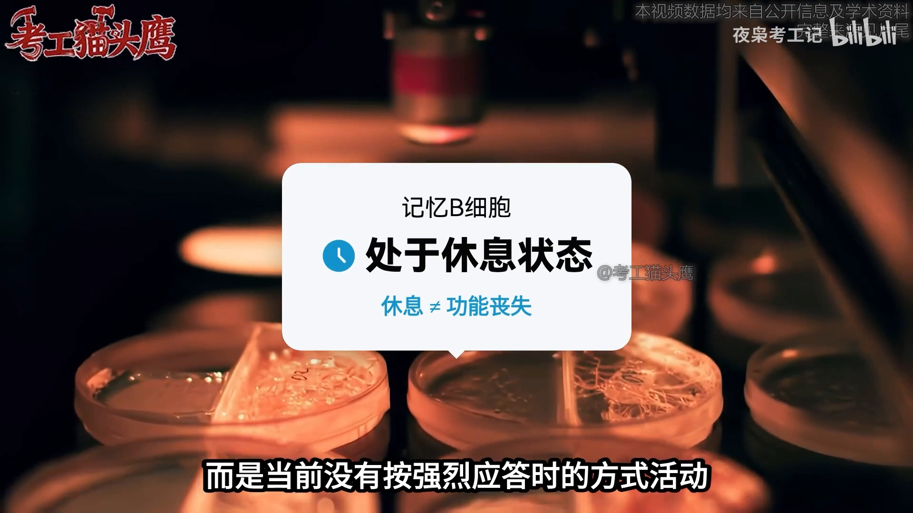

# 抗体下降，不等于记忆消失：把"记得"拆成产物、生产线与潜能三层

> 视频来源：[抗体下降会忘吗 免疫记忆靠什么](https://www.bilibili.com/video/BV12JpC6ZEk3/)（Bilibili · 夜枭考工记）｜时长约 12 分钟
> 简要导读：这是一支概念辨析型视频，没有复杂的通路图，通篇在拆一个日常推理："抗体少了，是不是就白感染了？"它把抗体、浆细胞、记忆B细胞三个对象分开，再讨论测量、位置、时间与保护终点。适合在读完 1.1.4（初次/再次应答）和本小节另一篇（生发中心与命运分岔）之后，用来校正对"免疫记忆"的直觉。

## 本讲要解决的核心问题（SCQA）

**背景**：感染或接种疫苗之后，血清里能测到针对该病原的抗体；过一段时间再测，数值往往会下降。

**冲突**：抗体能参与抵抗病原，这是常识。于是很容易顺着推出：抗体少了，过去那次感染留下的东西是不是也少了、甚至没了？这个推理看似顺理成章，其实跨得太远——它把一个可测的分子，直接当成了整套免疫记忆。

**疑问**：抗体下降以后，身体到底还"记不记得"这次感染？如果记得，记在哪里？

**回答（中心思想）**：抗体只是**产物**，不是记忆本身。感染后身体可能留下三层不同的东西：**当前循环的抗体**（产物）、**持续分泌抗体的长寿命浆细胞**（生产线）、**能在再次识别后启动新应答的记忆B细胞**（潜能）。抗体数值只反映第一层；后两层不会随抗体下降而自动消失。但反过来也成立：记忆的存在同样不能担保下一次一定安全，因为记忆有特异性、有时间差、有位置限制。

[【跳转到 00:00】](https://www.bilibili.com/video/BV12JpC6ZEk3/?t=0)

## 一、先把三个对象分开：抗体、浆细胞、记忆B细胞

视频开篇就指出，讨论"记不记得"之前，必须把名词分清，否则会从担心直接跳到放心。

先从最基础的说起：一次免疫应答需要有识别的对象。病原带有能被免疫系统识别的分子结构，这类引起识别和应答的目标叫**抗原**。这里的"识别"不是细胞认出了病原的姓名，而是它的受体能与某种结构相对应——这种针对特定结构的识别关系，就叫**特异性**。

B细胞是一类参与这种识别的免疫细胞。在合适的应答条件下，识别到抗原的B细胞可以**增殖**（产生更多相关细胞），也可以**分化**（转成承担不同任务的细胞）。

[【跳转到 01:41】](https://www.bilibili.com/video/BV12JpC6ZEk3/?t=101)

分化之后，有两个名字必须分开：

- **浆细胞**：承担分泌抗体的任务。抗体是它产生的分子，能针对相应抗原发挥作用。
- **记忆B细胞**：走向另一种状态。它保留再次应答的能力，却不必像浆细胞那样持续承担大量抗体分泌。

[【跳转到 03:05】](https://www.bilibili.com/video/BV12JpC6ZEk3/?t=185)

用一个类比：浆细胞是**工厂**，抗体是**出厂的产品**，记忆B细胞则是**停产待命的备用生产线**。我们在血里检测抗体，测到的是"产品库存"，既没有把工厂一并数过，也没有给所有备用生产线做清点。

[【跳转到 02:21】](https://www.bilibili.com/video/BV12JpC6ZEk3/?t=141)

这就引出三个层次：

1. **留下现成的抗体**：相关分子此刻就在血里；
2. **留下分泌抗体的细胞**：身体还可能继续产生相关分子；
3. **留下记忆B细胞**：身体还可能在再次识别以后，启动新的细胞应答。

把这三层混在一起，就会把"当前的数量""持续生产的能力""将来的反应能力"当成同一个量。

## 二、"记得"有两根支柱：持续分泌与待机再激活

[【跳转到 05:28】](https://www.bilibili.com/video/BV12JpC6ZEk3/?t=328)

### 2.1 持续分泌的一端：长寿命浆细胞需要"生存支持"

浆细胞并不都能长期存活。其中一部分**长寿命浆细胞**，可以在得到生存支持的条件下继续分泌抗体。

"生存支持"是个关键概念：长寿命浆细胞不是靠自己硬撑，而是需要周围组织提供存活信号和空间。**骨髓**是这类细胞能够获得支持的部位之一——但视频特别强调，它**不是唯一的部位**。长期分泌与周围的生存环境都有关系。

[【跳转到 04:12】](https://www.bilibili.com/video/BV12JpC6ZEk3/?t=252)

这也解释了抗体水平的本质：抗体不是感染结束时封存起来、此后原样留着的一批分子，它的水平与**不断产生和消耗**的过程有关。因此：

- 血中抗体水平与"长期分泌源"之间存在联系；
- 但二者仍不是一回事：一个数值下降，不能直接告诉我们所有分泌细胞都已经消失；
- 同样，知道长寿命浆细胞存在，也不能替某一次下降指定原因。

[【跳转到 04:47】](https://www.bilibili.com/video/BV12JpC6ZEk3/?t=287)

### 2.2 待机的一端：记忆B细胞的静息与再激活

[【跳转到 05:08】](https://www.bilibili.com/video/BV12JpC6ZEk3/?t=308)

记忆B细胞可以处于**休息状态**。这里最容易误读的是"休息"两个字：休息不等于已经失去功能，而是当前没有按强烈应答时的方式活动。它保留的能力，要在再次遇到能够识别的抗原、并得到相应激活条件时才体现出来。

被再次激活之后，相关细胞可以增殖、分化，形成**新的抗体分泌细胞**。这正是"抗体下降以后仍可能记得"的关键机制：测量发生在此刻，而记忆B细胞能承担的任务，还包含再次受到刺激以后的变化。

但视频也给了两条限制，避免把"待机"当成无限承诺：

- 记忆B细胞是**活细胞**，维持的是细胞群及其状态，不能说同一个细胞永远不死；
- "能够再次应答"说明存在这样一种机制，**不**等于任何感染都会留下足量、持久、覆盖所有变化的记忆。具体效果仍需要相应证据。

## 三、记忆不止B细胞：记忆T细胞与"位置"

视频还提醒，免疫记忆并不只有抗体这一条线，还有**记忆T细胞**。一场应答之后，相关细胞群会收缩，其中一部分作为记忆细胞保留下来；它们的继续存在同样需要适当的生存支持，不能理解成感染结束以后就自动进入永不失效的状态。

T细胞内部也有分工：有的参与辅助其他细胞的应答，有的参与清除已经感染的细胞。参与清除的那类T细胞，**并不是直接辨认血里游动的抗体**，而是要识别细胞表面递呈出来的抗原片段。也就是说，它们的作用对象与浆细胞并不相同，不是"另一种抗体工厂"。

[【跳转到 06:06】](https://www.bilibili.com/video/BV12JpC6ZEk3/?t=366)

位置还会进一步改变这些细胞怎样发挥作用：

- 有些记忆T细胞会**循环**，需要被调动到作用位置；
- 有些则**驻留**在组织里，可能就在再次感染发生的地方参与反应。

所以"免疫记忆"不是一支全部停在血液里的队伍，而是分布在血液、淋巴器官和黏膜组织里的不同岗位。

## 四、测量的边界：一次血检能回答什么

明确了机制，还要明确证据的边界。视频用一整段讨论"在哪里看"的问题。

一项血液检测有它明确的**取样位置**和**测量对象**。血里的某项抗体水平，可以提供有关"抗体这一层"的信息，却不能自动代表黏膜和各处组织的局部免疫。

[【跳转到 07:32】](https://www.bilibili.com/video/BV12JpC6ZEk3/?t=452)**黏膜**是身体表面和通道的内衬组织，局部免疫活动发生在具体部位，血液指标与这些地方的情况不能不经核对就当成完全对应。

这也让"没有测到"变得需要仔细理解。它可能对应三种完全不同的情况：

1. 真正缺失；
2. 低于检测能识别的范围；
3. 相关对象位于没有测量的部位。

单靠一次结果，未必能区分这三种情况。而这份不确定性有**两个方向**：不能据此宣判全身没有记忆，也不能据此保证身体一定在别处藏着足够的保护。"未测到什么"并不是"已经证明了另一个地方有什么"。

[【跳转到 08:20】](https://www.bilibili.com/video/BV12JpC6ZEk3/?t=500)

## 五、记忆的特异性与时间差：为什么"记得"仍可能赶不上

### 5.1 记忆只对"认得的目标"有效

记忆对应的是曾经建立起来的识别关系，目标必须还能被相关细胞或抗体识别，才有继续讨论的基础。若要回答"某种变化后的病原是否仍在识别范围内"，就需要与那个目标相匹配的证据，不能只凭"以前感染过"，便把对一次抗原的记忆扩大成对今后一切变化的通用能力。

### 5.2 "比初次快"不等于"快到病原没机会"

即使目标能被识别，时间也不能省掉。记忆B细胞受到刺激、形成新的分泌细胞、再产生抗体，这些动作有先后，不会在病原出现的同一瞬间全部完成。

已有记忆能够使再次应答更快，但"更快"总得有个比较对象：**比初次应答快，不等于快到病原完全没有机会开始感染**。

[【跳转到 09:15】](https://www.bilibili.com/video/BV12JpC6ZEk3/?t=555)而且不同细胞的时间表并不一样——有些循环细胞需要激活、扩增或迁移，驻留在组织中的细胞则可能在当地较快作出反应。所以我们可以解释"为什么存在时间差"，却不能给所有人、所有部位、所有感染统一填一个等待天数。

### 5.3 保护要问"到哪一步"

最后要落到保护的终点。**阻止感染发生**与**感染发生之后限制它的发展**，是不同的结果：

- 前一种要求防线在足够早的时候发挥作用；
- 后一种涉及已经开始的感染能否被控制。参与清除感染细胞的能力有它的作用，但它发挥作用时，感染细胞已经出现了。

把这样的能力直接叫做"不会感染"，就换掉了原来要判断的终点。这也解释了一个乍看矛盾的情形：再次发生感染，并不能单独证明以前的所有记忆都消失了——某些记忆仍可能参与感染后的应答，只是没有完全阻止感染。反过来，检测到了记忆细胞，也不能直接写下"不会生病"或"不会重症"的保证。

细胞具备什么能力，与这些能力最终造成什么结果，中间仍隔着病原、宿主、部位和时间的具体条件。

## 六、结论：两句话都要保留

回到最初的问题：身体为什么在抗体下降以后，仍可能记得一次感染？

因为这项下降描述的是**所测抗体**的变化，而感染还可能留下与再次识别和应答有关的**活细胞**。当前产物的水平，不能独自概括持续分泌与再次应答的能力。这就是"仍可能记得"的机制基础，也是"可能"两个字必须保留的原因。

[【跳转到 10:26】](https://www.bilibili.com/video/BV12JpC6ZEk3/?t=626)

视频最后给出一个对称的结论：

- **抗体下降，既不能独自证明全部记忆消失**；
- **记忆仍在，也不能独自担保下一次安全**。

这两句话并不是把答案推回模糊地带，而是把不同证据各自能回答的问题分清：身体可能保留的是"还能参与应答的能力"，而一次抗体检测告诉我们的是"其中一层当前的状态"。理解这一区别，才能既认真看待抗体的变化，又不把整套免疫记忆缩成检验单上的一个数值。

[【跳转到 11:31】](https://www.bilibili.com/video/BV12JpC6ZEk3/?t=691)

## 小结

- 抗体是**产物**，浆细胞是**生产线**，记忆B细胞是**潜能**；三者不能互相替代。
- "记得"至少有三层：当前循环的抗体、持续分泌抗体的长寿命浆细胞、能在再次识别后启动新应答的记忆B细胞。
- 长寿命浆细胞需要生存支持，骨髓是这类支持部位之一但非唯一；抗体水平是产生与消耗的动态结果。
- 记忆B细胞的"休息"不等于功能丧失，再激活需要抗原与相应条件；但待机不是无限承诺，维持的是细胞群而非单个细胞。
- 记忆T细胞分循环型与驻留型，识别的是细胞表面递呈的抗原片段，不是游离抗体。
- 一次血检有取样位置、检测阈值与测量对象的边界；"没测到"有多种解释，且不确定性是双向的。
- 记忆有特异性、有时间差、有位置限制；"比初次快"不等于"不会感染"，要区分阻止感染与限制疾病。
- 所以：抗体下降不能证明记忆消失，记忆存在也不能担保下一次安全。

## 关键术语速查

| 术语 | 一句话解释 |
| --- | --- |
| 抗原 | 能被免疫系统识别并引起应答的分子结构 |
| 特异性 | 受体或抗体只针对特定结构起反应的识别关系 |
| 浆细胞 | 终末分化的抗体分泌细胞，是抗体的"生产线" |
| 长寿命浆细胞 | 能长期存活并持续分泌抗体的浆细胞，需要组织提供生存支持 |
| 记忆B细胞 | 静息待命、再次遇抗原可快速扩增分化的B细胞，本身不大量分泌抗体 |
| 静息（休息状态） | 细胞当前不按强烈应答方式活动，但保留被激活的能力 |
| 再次应答 | 记忆细胞被同一抗原再激活后更快、更强的应答 |
| 记忆T细胞 | 应答后保留的T细胞，分循环型与组织驻留型，识别递呈的抗原片段 |
| 黏膜免疫 | 发生在身体表面与通道内衬组织局部的免疫活动，与血液指标不完全对应 |
| 抗体滴度 | 血清中抗体可被检出的稀释倍数，反映当前抗体水平 |
| 保护终点 | 判断疫苗或记忆效果时选择的结局，如阻止感染或限制重症 |