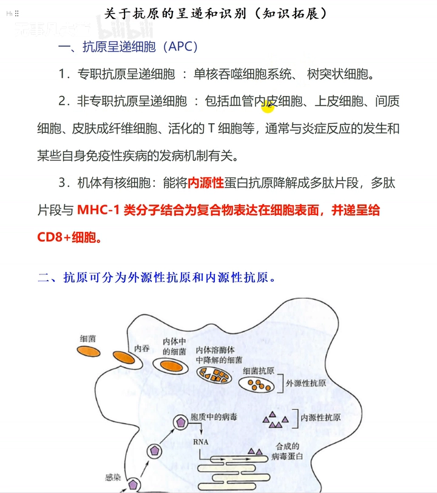
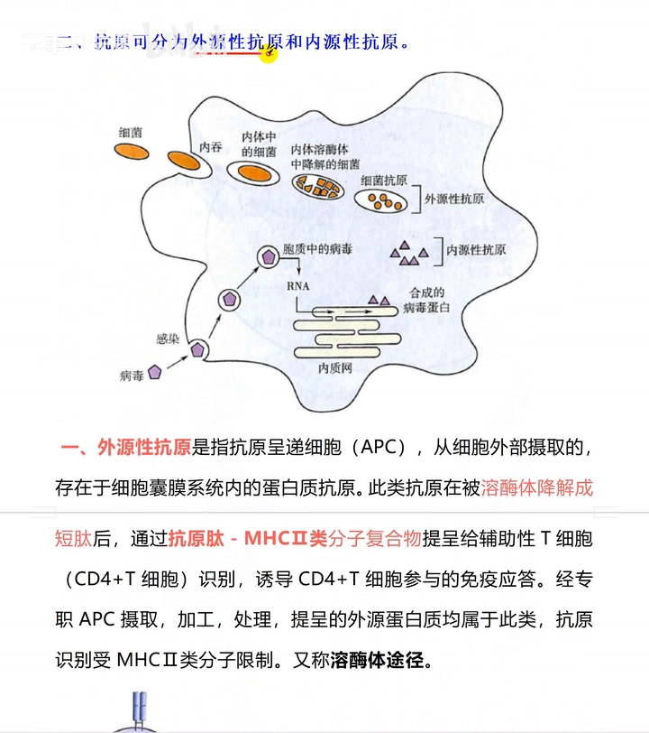
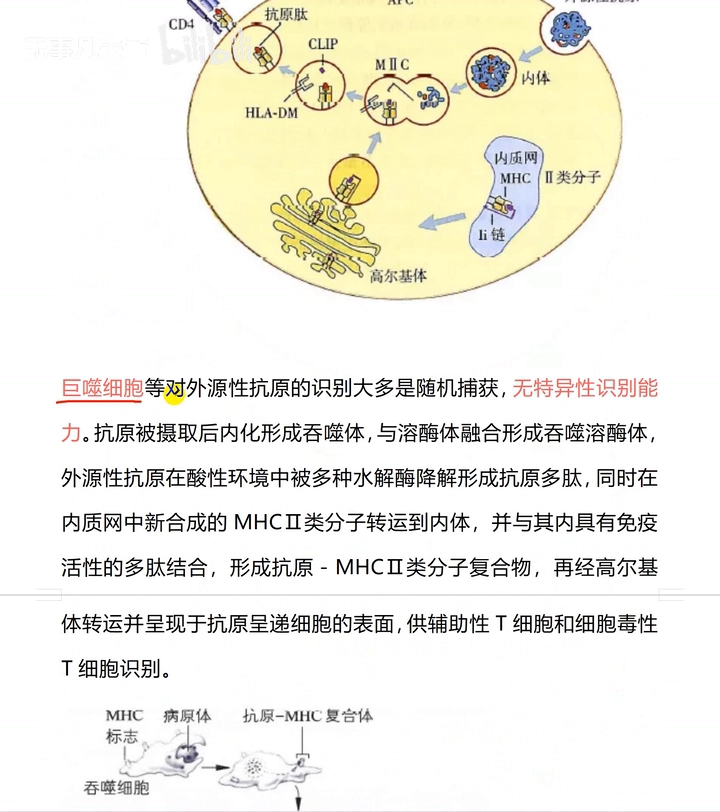
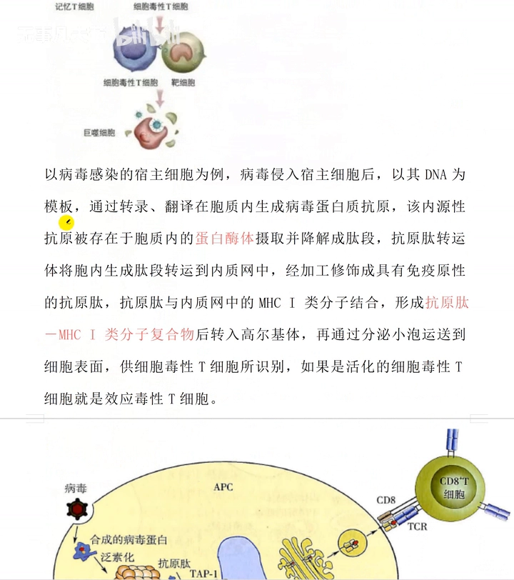
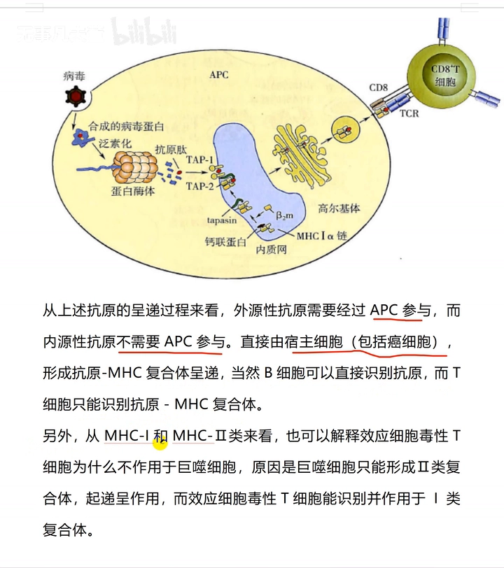

# 抗原呈递细胞与两条呈递通路：谁有资格呈递、呈递给谁

> 视频来源：[关于抗原的呈递和识别（知识拓展）（Bilibili）](https://www.bilibili.com/video/BV1nh4y1S7dL/)（UP 主：无事凡夫董）｜时长约 7 分钟
> 导读：这支视频按教材的骨架把「抗原呈递」讲成一张分类表——先分细胞（专职 / 非专职），再分抗原（外源性 / 内源性），最后落到两条通路的步骤和一个很妙的推论：为什么效应细胞毒性 T 细胞不杀巨噬细胞。适合作为 MHC 通路的入门框架，再配合细节讲解一起看。

## 本讲要解决的核心问题（SCQA）

**背景**：T 细胞不能直接识别完整抗原，只能识别 APC 处理后呈递出来的抗原肽-MHC 复合物。这一点在讲 TCR 时已经确立。

**冲突**：既然"呈递"是 T 细胞识别的必经之路，那是不是所有细胞都能干这件事？如果所有细胞都能把任何抗原呈递给任何 T 细胞，免疫系统就会失去分工，甚至自己打自己。

**疑问**：到底哪些细胞有资格呈递抗原？外源性抗原和内源性抗原分别走哪条通路、被哪类 T 细胞识别？为什么同一套"切肽—装 MHC"的机制，在不同细胞上会得出不同结果？

**回答（中心思想）**：抗原呈递要按**细胞**和**抗原来源**两个维度同时分类。细胞上分**专职 APC**（单核吞噬细胞系统、树突状细胞，组成性表达 MHC II）与**非专职 APC**（内皮、上皮、成纤维细胞、活化的 T 细胞等）；抗原上分**外源性**（走 MHC II、溶酶体途径、给 CD4 T 细胞）与**内源性**（走 MHC I、胞质溶胶途径、给 CD8 T 细胞）。正是这个"来源—通路—识别者"的固定配对，决定了谁呈递、呈递给谁。

## 一、三类"能呈递抗原的细胞"

视频一上来就把 APC 分成三类 [【跳转到 00:00】](https://www.bilibili.com/video/BV1nh4y1S7dL/?t=0)：

### 1.1 专职抗原呈递细胞

**专职抗原呈递细胞**（professional APC）包括**单核吞噬细胞系统**和**树突状细胞系统**。"专职"的含义是它们本来就以摄取、加工、呈递抗原为职业，而不是碰巧能呈递。

### 1.2 非专职抗原呈递细胞

**非专职抗原呈递细胞**包括血管内皮细胞、内皮细胞、上皮细胞、间质细胞、皮肤成纤维细胞、活化的 T 细胞等 [【跳转到 00:25】](https://www.bilibili.com/video/BV1nh4y1S7dL/?t=25)。

视频特别点出：这一类细胞通常与**炎症反应的发生**和**某些自身免疫性疾病的发病机制**有关。这句话的分量很重——正常情况下它们不该随便向外"广播"抗原，一旦在炎症中被诱导表达 MHC II、开始呈递，就可能把自身组织推到 T 细胞的枪口下。

### 1.3 机体有核细胞：内源性抗原的"全民呈递"

第三类是**机体有核细胞**：它们能将内源性蛋白抗原降解成多肽片段，多肽片段与 **MHC I 类分子**结合成为复合物，表达在细胞表面并呈递给 **CD8 T 细胞** [【跳转到 00:50】](https://www.bilibili.com/video/BV1nh4y1S7dL/?t=50)。

也就是说，"呈递内源性抗原"这件事是**几乎所有有核细胞**的通用能力，不需要"专职"身份。这一点是理解后面推论的关键。

## 二、抗原分两类：外源性与内源性

视频把抗原分成**外源性抗原**和**内源性抗原**两类 [【跳转到 01:12】](https://www.bilibili.com/video/BV1nh4y1S7dL/?t=72)。

### 2.1 外源性抗原：从外面摄取进来，走溶酶体途径

**外源性抗原**指抗原呈递细胞从细胞外部摄取的、存在于细胞膜系统内的蛋白质抗原。此类抗原被**溶酶体**降解成短肽以后，通过**抗原肽-MHC II 类分子复合物**呈递给**辅助性 T 细胞**（CD4 阳性 T 细胞）识别，诱导 CD4 阳性 T 细胞参与免疫应答 [【跳转到 01:17】](https://www.bilibili.com/video/BV1nh4y1S7dL/?t=77)。

经专职 APC 摄取、加工处理、呈递的外源蛋白质均属于此类抗原，其识别受 **MHC II 类分子限制**，这个途径又称**抗原溶酶体途径** [【跳转到 02:07】](https://www.bilibili.com/video/BV1nh4y1S7dL/?t=127)。

### 2.2 内源性抗原：胞内自己合成，走胞质溶胶途径

**内源性抗原**指细胞内合成的抗原（如病毒蛋白），以抗原-MHC I 类分子复合物的形式呈递给细胞毒性 T 细胞（CD8 阳性 T 细胞）。经胞浆蛋白酶体降解产生的内源性抗原肽**必须进入内质网**才能与 MHC I 类分子结合形成复合物 [【跳转到 03:44】](https://www.bilibili.com/video/BV1nh4y1S7dL/?t=224)。

几乎所有的有核细胞都可以表达 MHC I 类分子。当这些细胞受到病毒感染后，其 MHC I 类分子就可以和相应的病毒抗原肽结合，完成内源性抗原的呈递，并引起细胞毒性 T 细胞的识别与杀伤，称为**胞质溶胶途径** [【跳转到 04:34】](https://www.bilibili.com/video/BV1nh4y1S7dL/?t=274)。

## 三、MHC II 类通路：巨噬细胞的"随机捕获"

视频用巨噬细胞作例子，把外源性抗原的加工过程讲成一条链 [【跳转到 02:25】](https://www.bilibili.com/video/BV1nh4y1S7dL/?t=145)：

1. **随机捕获**：巨噬细胞等对外源性抗原的识别大多是随机捕获，**无特异性识别能力**。它既可以参与第二阶段的抗原提呈，也可以参与第三阶段特异性免疫，但本身不针对特定抗原。
2. **内化形成吞噬体**：抗原被摄取后内化形成吞噬体；吞噬体与溶酶体融合，形成**吞噬溶酶体** [【跳转到 02:30】](https://www.bilibili.com/video/BV1nh4y1S7dL/?t=150)。
3. **酸性环境中降解**：外源性抗原在酸性环境中被多种水解酶降解成抗原多肽 [【跳转到 02:55】](https://www.bilibili.com/video/BV1nh4y1S7dL/?t=175)。
4. **与 MHC II 类分子结合**：同时，在内质网中新合成的 MHC II 类分子转运到**内体**，与其内具有免疫活性的多肽结合，形成抗原-MHC II 类分子复合物 [【跳转到 03:09】](https://www.bilibili.com/video/BV1nh4y1S7dL/?t=189)。
5. **经高尔基体到细胞表面**：复合物再经高尔基体转运，呈现于抗原呈递细胞的表面，供辅助性 T 细胞和细胞毒性 T 细胞识别。

第 5 步那句"供辅助性 T 细胞和细胞毒性 T 细胞识别"容易让人误会。它说的是复合物摆在细胞表面、T 细胞都能"看"，但真正与 MHC II 类分子匹配的是 CD4 阳性 T 细胞；CD8 阳性 T 细胞认的是 MHC I 类分子。这一点在第五节还会用到。

## 四、MHC I 类通路：以病毒感染的宿主细胞为例

视频接着用一张教材图（人教版）把内源性抗原的路线走了一遍 [【跳转到 04:47】](https://www.bilibili.com/video/BV1nh4y1S7dL/?t=287)：

1. **病毒入侵与蛋白合成**：病毒侵入宿主细胞后，以其 DNA 为模板，通过转录、翻译在细胞质内生成病毒蛋白质抗原。
2. **蛋白酶体降解**：该内源性抗原被存在于胞质中的**蛋白酶体**摄取并降解成肽段。
3. **抗原肽转运体送入内质网**：抗原肽转运体（TAP）将胞内生成的肽段转运到内质网中，经加工修饰成具有免疫原性的抗原肽 [【跳转到 05:12】](https://www.bilibili.com/video/BV1nh4y1S7dL/?t=312)。
4. **与 MHC I 类分子结合**：抗原肽与内质网中的 MHC I 类分子结合，形成抗原肽-MHC I 类分子复合物，随后转入高尔基体。
5. **运到细胞表面**：再通过分泌小泡运送到细胞表面，供细胞毒性 T 细胞识别；如果是活化的细胞毒性 T 细胞，就是**效应细胞毒性 T 细胞** [【跳转到 05:37】](https://www.bilibili.com/video/BV1nh4y1S7dL/?t=337)。

把这条路线和第三节的 MHC II 路线并排看，会发现两条通路的"骨架"完全一样：**降解 → 肽与 MHC 结合 → 经高尔基体 → 表面展示 → T 细胞识别**。差别只在降解的场所（胞质 vs 吞噬溶酶体）和装载的场所（内质网 vs 内体）。

## 五、把两条通路放回细胞背景：三个推论

视频最后用三句话把前面的分类"用起来"，这三句也是本讲最有价值的部分。

### 5.1 外源性抗原需要 APC 参与，内源性抗原不需要

从上述呈递过程来看，**外源性抗原需要经过 APC 参与**；而**内源性抗原不需要 APC 参与**，直接由宿主细胞（当然也包括癌细胞）形成抗原-MHC 复合体并呈递 [【跳转到 06:09】](https://www.bilibili.com/video/BV1nh4y1S7dL/?t=369)。

这句话初看有点矛盾：内源性抗原不也需要"抗原呈递细胞"吗？关键在于"专职"二字。任何有核细胞都能把自己内部的蛋白装上 MHC I 类分子挂出来，所以被病毒感染的宿主细胞**自己就是**呈递者，不需要另一个专职 APC 来帮忙；而外源性抗原必须先被某个细胞吞进去，这个"吞"的动作只有专职 APC（以及部分非专职 APC）擅长。

### 5.2 B 细胞直接识别抗原，T 细胞只能识别抗原-MHC 复合体

视频用一句话概括了两类淋巴细胞的识别方式差异：**B 细胞可以直接识别抗原，T 细胞只能识别抗原-MHC 复合体** [【跳转到 06:04】](https://www.bilibili.com/video/BV1nh4y1S7dL/?t=364)。

这句话正好回答了本小节学习目标里的那个易混点——**抗体表位与 T 细胞抗原肽不是一回事**：

| 比较项 | 抗体 / B 细胞受体识别的表位 | T 细胞识别的抗原肽 |
| :--- | :--- | :--- |
| 识别对象 | 完整的、天然折叠的抗原分子表面 | 被降解成短肽、并装在 MHC 分子上的片段 |
| 是否需要加工 | 不需要，可直接结合 | 必须经过摄取/降解与 MHC 装载 |
| 谁来做"展示" | 抗原自己就是配体 | APC 或靶细胞的 MHC 分子负责展示 |
| 识别者 | B 细胞受体、分泌型抗体 | TCR（CD4 或 CD8 T 细胞） |

所以"抗原表位"这个词在两种语境下含义不同：抗体看到的是完整蛋白上的一块立体表面，T 细胞看到的是被切碎后装进 MHC 的一段线性肽。这也解释了为什么疫苗设计里"诱导抗体"和"诱导 T 细胞"往往需要不同的抗原形式。

### 5.3 效应细胞毒性 T 细胞为什么不杀巨噬细胞

视频给出的最后一个推论非常漂亮：从 MHC I 类和 MHC II 类的分工，可以解释**效应细胞毒性 T 细胞为什么不作用于巨噬细胞**——原因是巨噬细胞只能形成 **II 类复合物**，起呈递作用；而效应细胞毒性 T 细胞能识别并作用于 **I 类复合物** [【跳转到 06:34】](https://www.bilibili.com/video/BV1nh4y1S7dL/?t=394)。

换个说法：巨噬细胞是"情报官"（把吞进来的东西装到 MHC II 上，交给 CD4 T 细胞），不是"嫌疑人"（不把内部蛋白大量挂到 MHC I 上）。效应 CTL 的杀伤授权只针对"挂出 I 类复合物"的靶细胞，所以巨噬细胞不在它的击杀名单上。这条推论把"分子通路"和"细胞分工"接在了一起，也是本讲最值得记住的一句话。

## 小结

- 能呈递抗原的细胞分三层：**专职 APC**（单核吞噬细胞系统、树突状细胞）、**非专职 APC**（内皮、上皮、成纤维细胞、活化的 T 细胞等，与炎症和自身免疫病相关）、以及**所有有核细胞**（负责把内源性抗原装到 MHC I 上）。
- 抗原按来源分两类：**外源性**走 MHC II、溶酶体途径、给 CD4 T 细胞；**内源性**走 MHC I、胞质溶胶途径、给 CD8 T 细胞。
- 两条通路的骨架相同（降解 → 装载 → 高尔基体 → 表面展示 → T 细胞识别），差别在**降解场所**与**装载场所**。
- 外源性抗原需要 APC 参与，内源性抗原由宿主细胞自己完成呈递——"专职"与否决定了谁来做这件事。
- **B 细胞/抗体可以直接识别完整抗原，T 细胞只能识别抗原-MHC 复合体**：这就是抗体表位与 T 细胞抗原肽的根本区别。
- 巨噬细胞只形成 II 类复合物，效应 CTL 只认 I 类复合物——所以效应 CTL 不杀巨噬细胞。

## 关键术语速查

| 术语 | 一句话解释 |
| :--- | :--- |
| 专职 APC | 以摄取、加工、呈递抗原为职业的细胞，如树突状细胞、单核吞噬细胞 |
| 非专职 APC | 在特定条件下表达 MHC II 并呈递抗原的细胞，如内皮、上皮、成纤维细胞、活化的 T 细胞 |
| 外源性抗原 | 从细胞外摄取进来的蛋白抗原，经溶酶体降解，受 MHC II 限制 |
| 内源性抗原 | 细胞内合成的蛋白抗原，经蛋白酶体降解，受 MHC I 限制 |
| 溶酶体途径 | 外源性抗原的加工途径，降解发生在吞噬溶酶体 |
| 胞质溶胶途径 | 内源性抗原的加工途径，降解发生在胞质、装载发生在内质网 |
| 吞噬溶酶体 | 吞噬体与溶酶体融合形成的酸性降解小室 |
| 效应细胞毒性 T 细胞 | 活化的 CD8 T 细胞，识别靶细胞表面的抗原肽-MHC I 类复合物 |
| 抗原表位 | 抗原分子上被受体或抗体识别的部位；抗体看构象表面，T 细胞看加工后的肽 |