# T 细胞怎么分群：四种分类维度与六个 Th 亚群的功能地图

> 视频来源：[06章03节_T细胞的分类和功能](https://www.bilibili.com/video/BV1QAUBByEjs/)（Bilibili · 学免疫的姚小姚）｜时长约 18 分钟
> 简要导读：这是一节"先给分类框架、再填内容"的课：先讲 T 细胞的四种分群标准（活化阶段、TCR 类型、CD 分子、功能），再按功能把 Th 拆成六个亚群，最后落到 Treg 的发育与 CD8⁺ Treg。杀伤机制的具体过程见本小节另一篇（CTL 的穿孔素/颗粒酶与 Fas-FasL），本文只讲"谁是谁、谁帮谁"。

## 本讲要解决的核心问题（SCQA）

**背景**：T 细胞在胸腺里经过阳性选择与阴性选择，成熟为 CD4⁺ 或 CD8⁺ 的单阳性细胞，然后进入外周巡逻。这些内容在 1.1.8 已经建立。

**冲突**：可一旦翻开教材或文献，"T 细胞"这个词底下会冒出一大串名字：Th1、Th2、Th9、Th17、Th22、Tfh、Treg、nTreg、iTreg、Tc、CTL、Tm……它们有的按 CD 分子叫，有的按序号叫，有的按功能叫。名字混着来，很容易记成一堆散点。

**疑问**：这些亚群是按什么标准分出来的？分完之后，每一群到底负责什么？

**回答（中心思想）**：T 细胞的分类有四个互相独立的维度——**活化阶段、TCR 类型、CD 分子、功能**。真正有用的是最后一个：按功能分，CD4⁺ 分成辅助性 T 细胞（Th）与 CD4⁺ Treg，CD8⁺ 分成细胞毒性 T 细胞（Tc）与 CD8⁺ Treg。而 Th 的六个亚群，分群依据是"**它辅助了谁**"：Th1 帮巨噬细胞与 CTL，Th2 在生发中心外帮 B 细胞，Tfh 在生发中心里帮 B 细胞，Th9 帮肥大细胞与嗜酸性粒细胞，Th17 招中性粒细胞，Th22 修上皮。Treg 则负责外周耐受，用 IL-10 与 TGF-β 两件武器踩刹车。

## 一、四种分类维度：先搭框架，再填内容

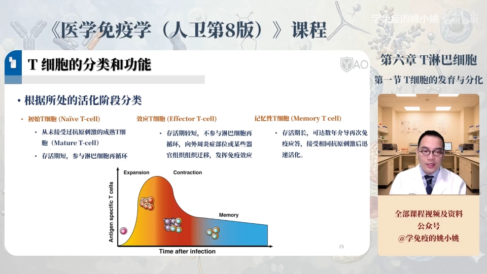

[【跳转到 01:20】](https://www.bilibili.com/video/BV1QAUBByEjs/?t=80)

### 1.1 按活化阶段：初始、效应、记忆

- **初始 T 细胞（naive T cell）**：从来没有接受过抗原刺激的成熟 T 细胞。特点是存活期短、参与**淋巴细胞再循环**——不断在血液、淋巴、淋巴结之间巡逻，只有这样才能碰到更多抗原。
- **效应 T 细胞**：初始 T 细胞识别抗原后进入这个阶段。数量上快速增殖，然后向炎症局部或某些脏器组织迁移，发挥具体效应。
- **记忆性 T 细胞**：存活期长，可达数年，介导再次应答；接受相同抗原刺激后迅速活化。

课程用一张曲线图把三者串起来：细胞数量先扩增、达到顶峰、发挥功能，然后收缩，最后留下一小群记忆细胞。图上用橙、红、蓝三种颜色标出各阶段的**代谢特征**：效应阶段代谢强，记忆阶段代谢降到较低水平——代谢低是为了活得久。这是一个常被忽略的关联：**功能强度和寿命，往往此消彼长**。

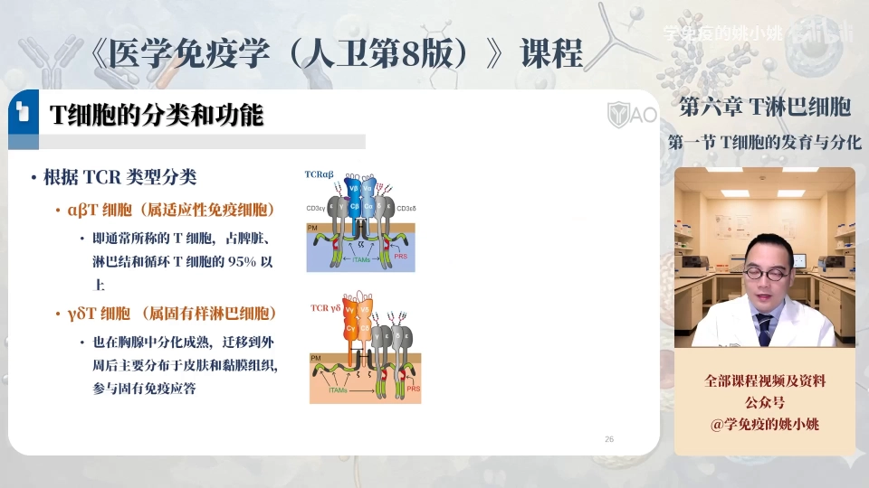

[【跳转到 02:10】](https://www.bilibili.com/video/BV1QAUBByEjs/?t=130)

### 1.2 按 TCR 类型：αβ 与 γδ

TCR 有两种：**αβ T 细胞**和 **γδ T 细胞**。

课程给了一个非常实用的提醒：**整个教材学习当中，如果没有特别强调，讲的都是 αβ T 细胞**。αβ T 细胞占脾脏、淋巴结和循环 T 细胞的 95% 以上，属于适应性免疫细胞；γδ T 细胞属于**固有样淋巴细胞**，同样在胸腺中分化成熟，但迁移到外周后主要分布在皮肤和黏膜组织，参与固有免疫应答。

为什么 γδ T 细胞算"固有样"？因为它不依赖 MHC 提呈、反应更快，更像固有免疫的工作方式。这也提醒我们：**"T 细胞"不等于"适应性免疫"**，边界是模糊的。

### 1.3 按 CD 分子：CD4 与 CD8

按表面 CD 分子分，就是 CD4⁺ 与 CD8⁺ 两大类。它们的识别对象不同（细节见 1.1.7）：

- **CD8⁺ T 细胞**：识别 MHC I 类分子提呈的**内源性**抗原；
- **CD4⁺ T 细胞**：识别 MHC II 类分子提呈的**外源性**抗原。

这里的"内源/外源"指的是抗原**在哪里被降解、装到哪类 MHC 上**，不是"病原体从哪来"。

### 1.4 按功能：最重要、也分得最细的一种

按功能划分，大部分 CD4⁺ 是辅助性 T 细胞（Th），大部分 CD8⁺ 是细胞毒性 T 细胞（Tc／CTL）。但课程特别强调"大部分"三个字：

> Th 细胞约等于 CD4，Tc 细胞约等于 CD8，但二者各有一小群细胞，功能上属于**调节性 T 细胞**，有免疫抑制功能。

也就是说，**CD4 和 CD8 里都有 Treg**。这个"约等于"的提醒很重要：用 CD 分子做近似判断可以，但当结论涉及"抑制"时，必须按功能重新核对。

## 二、六个 Th 亚群：分群依据是"辅助了谁"

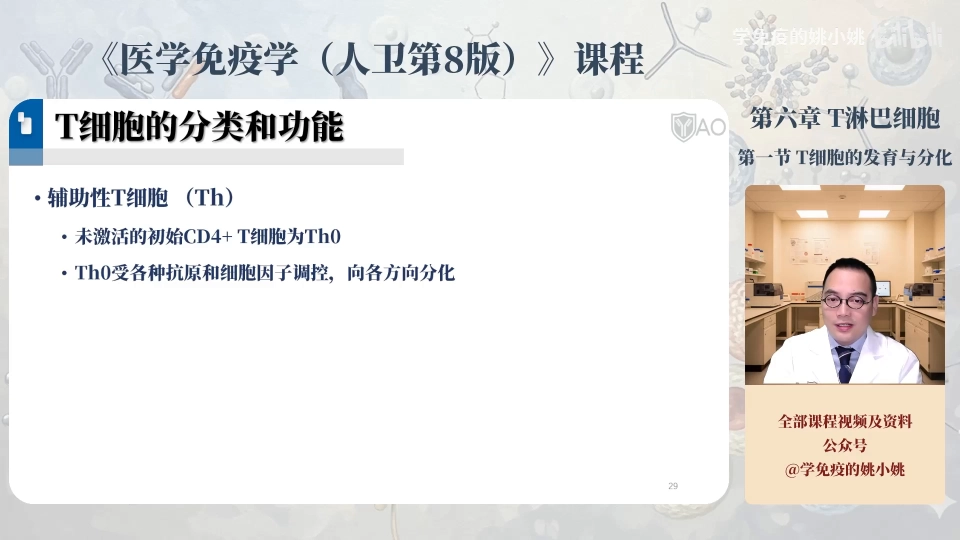

[【跳转到 03:50】](https://www.bilibili.com/video/BV1QAUBByEjs/?t=230)

刚从胸腺出来、还没接触过抗原的 CD4⁺ T 细胞叫 **Th0**。Th0 受各种抗原和细胞因子的调控，会向各个方向分化——课程把它比作"方向盘"。

分化方向包括：**Th1、Th2、Th9、Th17、Th22、Tfh**。课程还说明：教材上没有 Th9 和 Th22，因为这两群是较新发现的，可能还没更新。此外，Th0 在 **TGF-β** 作用下可以转化为调节型 T 细胞，负责免疫的负向调控。

接下来是这节课的方法论核心：

> 既然这一大类细胞叫"辅助性"T 细胞，它并不直接发挥免疫学作用，那我们要问的就是：**它到底辅助了谁？** 这也正是 Th 细胞分群的依据。

### 2.1 Th1：辅助"近战兵种"

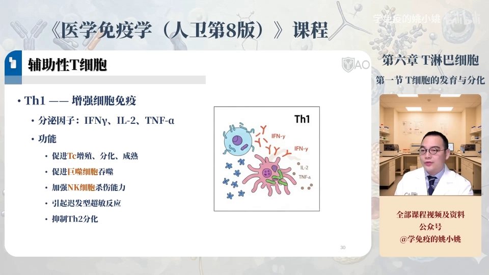

[【跳转到 05:05】](https://www.bilibili.com/video/BV1QAUBByEjs/?t=305)

Th1 主要分泌 **IFN-γ、IL-2、TNF-α**，辅助对象是 **Tc（细胞毒性 T 细胞）、巨噬细胞、NK 细胞**。

这三者的共同点是"**近战兵种**"：都需要直接接触抗原、直接和病原体面对面战斗。Th1 的功能就是增强**细胞免疫**——这种贴身肉搏的免疫叫细胞免疫。同时它会引起迟发型超敏反应，也会抑制 Th2 的分化。

### 2.2 Th2：在生发中心之外帮 B 细胞

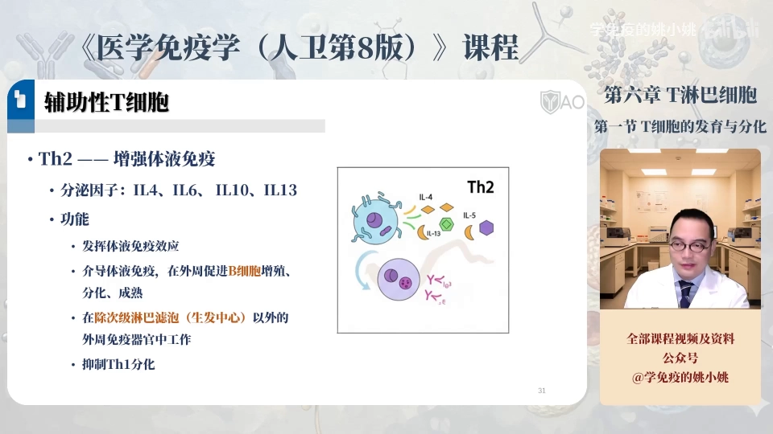

[【跳转到 05:55】](https://www.bilibili.com/video/BV1QAUBByEjs/?t=355)

Th2 增强的是**体液免疫**，主要分泌 **IL-4、IL-6、IL-10、IL-13**，功能是在外周促进 B 细胞的增殖、分化和成熟——B 细胞产生抗体的过程就是体液免疫。

这里有一个非常关键的边界：**Th2 在除淋巴滤泡（生发中心）以外的外周免疫器官中工作**。也就是说，生发中心里的 B 细胞**不由 Th2 辅助**，而由下一节要讲的 Tfh 辅助。这就是为什么"帮 B 细胞"要拆成两个亚群——工作地点不同。

### 2.3 Th1 与 Th2 为什么互相抑制

课程讲了一个对应关系：Th1 抑制 Th2 的分化，Th2 也抑制 Th1 的分化。原因很实在：

- Th1 加上 Th2 大概占所有 Th 细胞的 **90% 以上**；
- 而在一定时间内，从胸腺里出来的 Th0 数量是**有限的**。

所以两者实际上存在**竞争关系**。课程用大学社团招新打比方：每年进来的新生数量固定，两个最大的社团就会互相竞争——一边夸自己好，一边说对方不行、一点都不好玩。这种"说对方坏话"的方式，就是互相抑制。

这个比喻点出了一个常被误解的地方：Th1/Th2 的偏向不是"谁更强"，而是**在有限资源下的此消彼长**。

### 2.4 Tfh：生发中心里的专职帮手

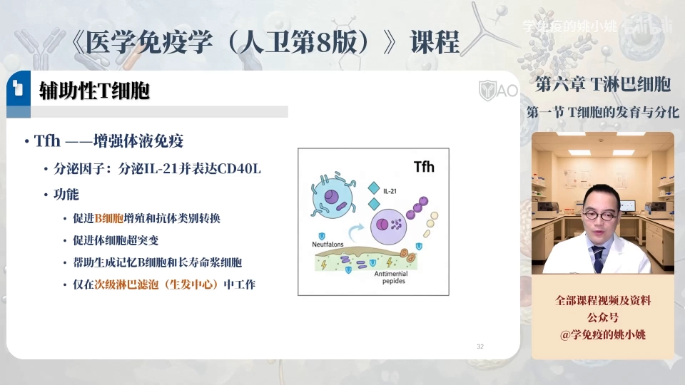

[【跳转到 07:35】](https://www.bilibili.com/video/BV1QAUBByEjs/?t=455)

Tfh 也增强体液免疫，但它**只在次级淋巴滤泡、也就是生发中心当中工作**。

为什么需要专门进化出这样一群细胞？因为 B 细胞虽然整个分化过程都在外周，但在生发中心里要经历一段很特殊的发育——包括**体细胞高频突变**、**亲和力成熟**等一系列筛选。这个过程比较精细，所以需要一位"驻场教官"。

名字也给了线索：**Tfh 的 f 就是滤泡（follicular）的第一个字母**。它的手段是分泌 IL-21 并表达 CD40L，帮助 B 细胞增殖、类别转换、体细胞超突变，最终生成记忆 B 细胞和长寿命浆细胞。

生发中心里这些工序的具体机制，1.1.6 已经详细讲过；这里补上的是**执行者的身份**。

### 2.5 Th9：一个"不是序号"的名字

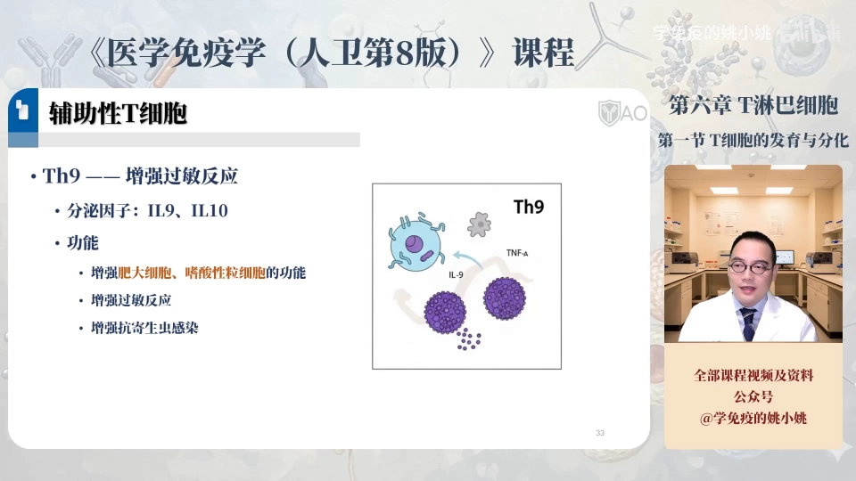

[【跳转到 08:25】](https://www.bilibili.com/video/BV1QAUBByEjs/?t=505)

Th9 这个名字容易让人困惑：为什么从 Th1、Th2 就直接跳到 Th9，3 到 8 去哪了？

答案是：**没有 3 到 8。Th9 不是序号，而是功能**——这群细胞主要分泌 IL-9，所以叫 Th9。它主要辅助**肥大细胞和嗜酸性粒细胞**。提到肥大细胞，第一反应就是过敏反应，没错：它在体内主要作用是增强抗寄生虫感染，**副作用就是增强了过敏反应**。

### 2.6 Th17：招募中性粒细胞

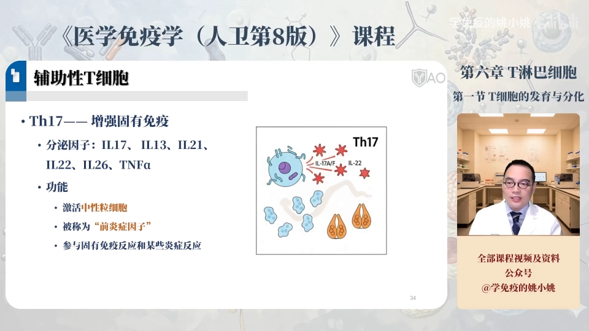

[【跳转到 09:15】](https://www.bilibili.com/video/BV1QAUBByEjs/?t=555)

Th17 主要分泌 **IL-17**。课程补充了一个细节：**IL-17 其实是一个家族，不是单一分子**，一共有从 IL-17A 到 IL-17F 六种亚型。

这些 IL-17 的主要作用是**激活中性粒细胞**。而中性粒细胞是白细胞中数量最多、发挥免疫功能最快的一群细胞。所以 IL-17 被称为**前炎症因子**——它在炎症前期就能通过激活中性粒细胞发挥很强的免疫作用。此外它还参与一些固有免疫反应和其他炎症反应。

### 2.7 Th22：修上皮屏障

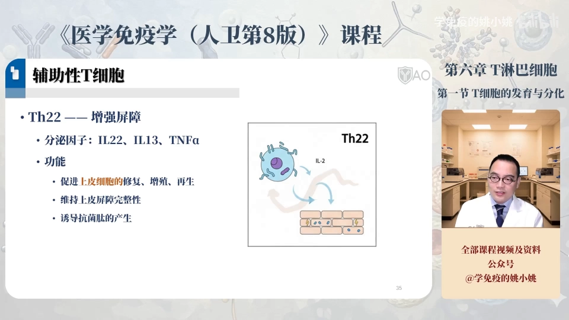

[【跳转到 09:40】](https://www.bilibili.com/video/BV1QAUBByEjs/?t=580)

Th22 顾名思义主要分泌 **IL-22**，辅助对象是**上皮细胞**——这里主要指**黏膜上皮**，包括呼吸道、消化道、泌尿生殖道的上皮细胞。

为什么专门照顾这些细胞？因为它们特别容易受到破坏。IL-22 促进黏膜上皮的修复、增殖和再生，从而维持**上皮屏障的完整性**，同时诱导一些抗菌肽的产生，帮助局部抗菌。

把 Th17 和 Th22 放在一起看很有意思：**一个负责"叫人"（招募中性粒细胞），一个负责"修墙"（修复上皮）**，两者其实是同一次黏膜炎症反应的两个环节。

## 三、Tc：功能单一的打手

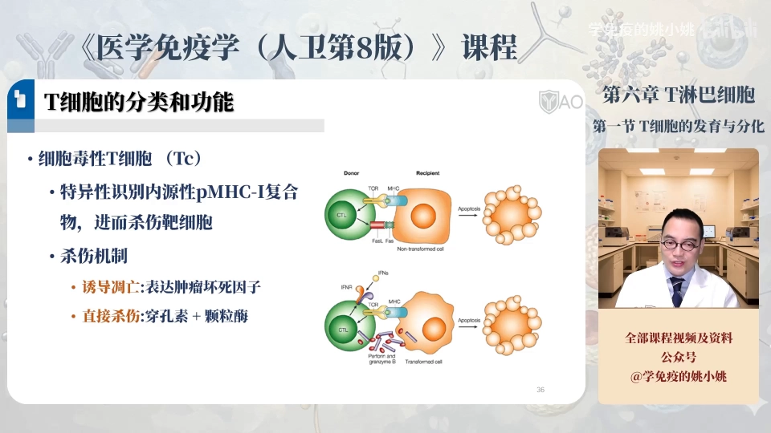

[【跳转到 10:30】](https://www.bilibili.com/video/BV1QAUBByEjs/?t=630)

Tc 细胞相对 Th 来说，功能就单一了——课程的原话是"一个头脑简单、四肢发达的打手"。它特异性识别**内源性抗原肽-MHC I 复合物**之后，直接杀伤靶细胞。

杀伤机制有两种：

1. **诱导凋亡**：很多细胞表面表达"自毁开关"，也就是肿瘤坏死因子受体；Tc 可以通过启动这些开关造成靶细胞死亡（Fas-FasL 即属此类）。
2. **直接杀伤**：分泌**穿孔素和颗粒酶**这两种细胞毒性蛋白，使靶细胞直接死亡。

课程顺带串了一个旧知识点：分泌穿孔素、颗粒酶的细胞，还有之前学过的 **NK 细胞**。所以 **NK 和 CD8⁺ T 细胞的杀伤机制是一样的**——区别在于识别方式：NK 不依赖 MHC-肽的特异性识别，Tc 依赖。

穿孔素如何打孔、颗粒酶如何进入、Fas 通路如何传导，本小节另一篇（《T 细胞的效应分工》）有完整的图示与讲解，这里不重复。

## 四、Treg：外周耐受的守门人

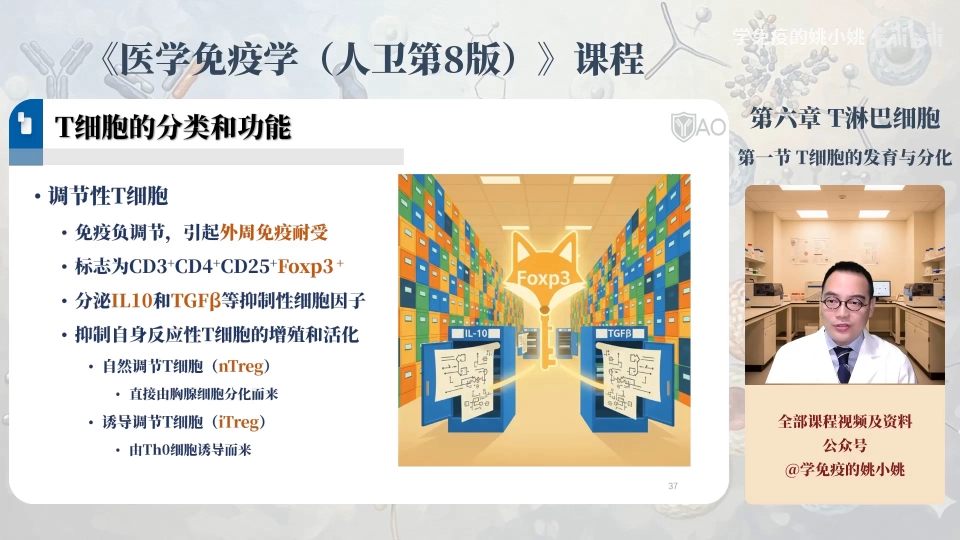

[【跳转到 12:15】](https://www.bilibili.com/video/BV1QAUBByEjs/?t=735)

### 4.1 为什么需要 Treg

Treg 数量比较少，但功能非常强，负责**免疫负调控**，也就是引起**外周免疫耐受**。

课程从胸腺里的阴性选择讲起：阴性选择本身就是免疫耐受的一个阶段，消灭那些对自身抗原起反应、有可能引起自身免疫病的 T 细胞。但由于各种原因——比如阴性选择的"漏网之鱼"，或者正常 T 细胞在外周发生突变——外周血里仍然会存在一定数量的**自身反应性 T 细胞**。

问题是：**你不可能把这些细胞再塞回胸腺去重训**。所以就需要一群特定的细胞在外周把它们压住，这就是 Treg。

### 4.2 标志与两件武器

Treg 的标志是 **CD3⁺CD4⁺CD25⁺Foxp3⁺**：

- **CD3**：T 细胞的特征性标志；
- **CD4**：属于 CD4⁺ 谱系；
- **CD25**：即 IL-2 受体；
- **Foxp3**：决定 Treg 身份的转录因子。

课程提到，**2025 年诺贝尔生理学或医学奖**授予了调节性 T 细胞的发现，奖项主题是"外周免疫耐受与调节性 T 细胞的发现历程"。

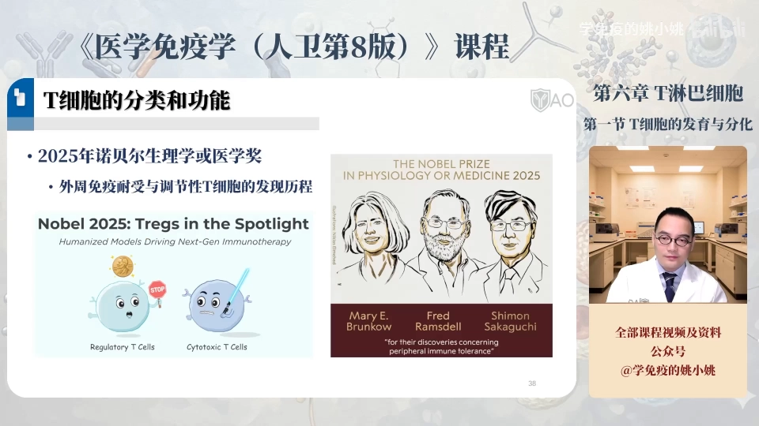

[【跳转到 14:26】](https://www.bilibili.com/video/BV1QAUBByEjs/?t=866)

Treg 抑制自身反应性 T 细胞的两件"武器"是 **IL-10 和 TGF-β**。课程特别强调：这是整本免疫学书里"唯二"学到的免疫抑制性细胞因子。

那么这两个因子是怎么表达出来的？课程用了一个很好的比喻：

> 每个细胞的核基因组就是一个非常非常大的档案馆，每个格子里都是基因，但很多基因不表达。一个细胞不是有这张图纸就一定要生产——它生产哪些图纸，由特定的转录因子决定。转录因子等同于打开这些图纸抽屉的**钥匙**。

对 Treg 来说，这把钥匙叫 **Foxp3**；它特异性地打开 IL-10 和 TGF-β 这两个基因的"保险箱"，所以 Treg 能产生这两种抑制性因子。

这个比喻解决了一个常见困惑：**为什么一个转录因子就能定义一种细胞身份**——因为它控制的是"整套分泌程序"的开关。

### 4.3 nTreg 与 iTreg：两种来源

从发育上看，Treg 分两类：

- **nTreg（自然调节性 T 细胞）**：在胸腺发育过程中直接进入外周的 Treg；
- **iTreg（诱导型调节性 T 细胞）**：当 nTreg 不够用时，由 **Th0 细胞额外诱导**产生。

这个区分回答了一个实际问题：外周耐受不是一套固定的编制，而是**按需扩编**的。

### 4.4 CD8⁺ Treg：更"强硬"的一群

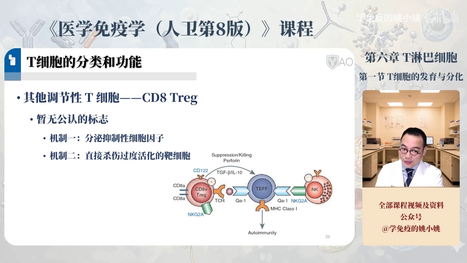

[【跳转到 15:02】](https://www.bilibili.com/video/BV1QAUBByEjs/?t=902)

除了经典的 CD4⁺ Treg，体内还有 **CD8⁺ 调节性 T 细胞**。它的特点是**目前没有公认的标志**——注意措辞：不是没有标志，而是没有公认的标志，因为目前已经发现了不下十群不同的具有抑制功能的 CD8⁺ T 细胞，统称为 CD8 Treg。

功能上它也是抑制自身反应性 T 细胞，但比 CD4⁺ Treg **多一手**：

1. **分泌抑制性细胞因子**（IL-10 和 TGF-β）：相对温和，通过细胞因子给靶细胞传递抑制信号，让它从自身反应性特别强的活化状态里"冷静下来"；
2. **直接杀伤**：因为 CD8⁺ T 细胞本身具有细胞毒性，它可以直接杀伤那些过度活化的靶细胞。

课程用一句玩笑话概括这种"先礼后兵"：

> 施主如果听不懂佛法，老衲也粗通几分拳脚。

也就是说：好声好气用 IL-10、TGF-β 跟你说话，你没反应，那我就释放穿孔素和颗粒酶，把这个效应性、自身免疫性的 T 细胞直接杀死。所以 **CD8⁺ Treg 的抑制功能强过 CD4⁺ Treg**。

## 五、一张图收尾：T 细胞的分类树

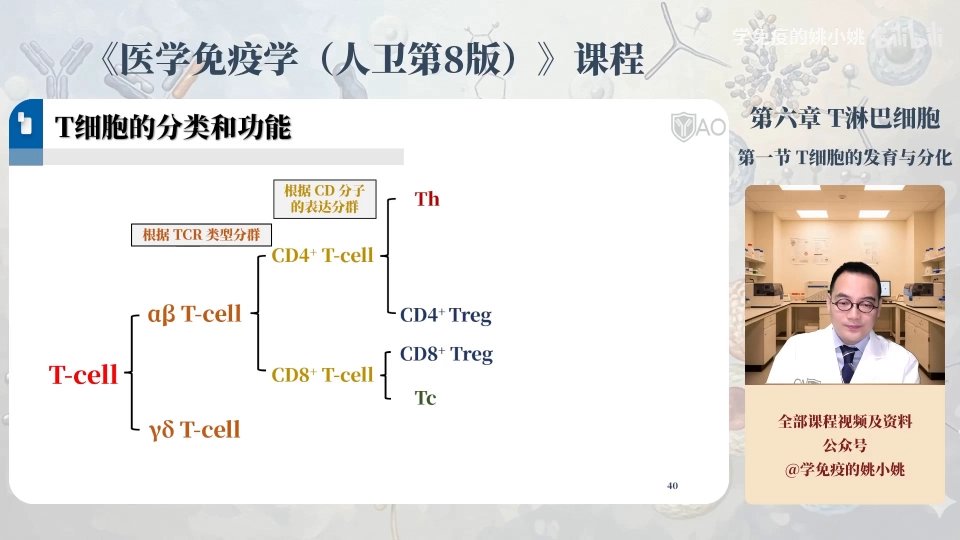

[【跳转到 17:07】](https://www.bilibili.com/video/BV1QAUBByEjs/?t=1027)

课程最后用一张树状图把所有维度拼起来：

- **按 TCR 类型**：T 细胞 → αβ T／γδ T；
- **按 CD 分子**：αβ T → CD4⁺／CD8⁺（γδ T 比较单一，只有唯一一群）；
- **按功能**：CD4⁺ → Th（六个亚群：Th1、Th2、Th9、Th17、Th22、Tfh）＋ CD4⁺ Treg（iTreg、nTreg）；CD8⁺ → CD8⁺ Treg ＋ Tc；
- **按活化阶段**：naive T、效应 T、记忆 T。

这张图的价值在于：它把前面那些"混着来的名字"放回了各自的分支上——**不同维度的名字可以同时属于一个细胞**。比如一个细胞可以既是 CD4⁺、又是 Th1、又是效应 T 细胞。理解了这一点，就不会再把分类维度当成互斥的标签。

## 小结

- T 细胞有**四个独立分类维度**：活化阶段、TCR 类型、CD 分子、功能；不同维度的标签可以叠加在同一个细胞上。
- 用 CD 分子做近似判断可以（Th≈CD4、Tc≈CD8），但**CD4 和 CD8 里都有 Treg**，涉及"抑制"时要按功能核对。
- **Th 分群的依据是"辅助了谁"**：Th1→巨噬细胞/CTL/NK，Th2→生发中心外的 B 细胞，Tfh→生发中心里的 B 细胞，Th9→肥大细胞/嗜酸性粒细胞，Th17→中性粒细胞，Th22→上皮细胞。
- **只有 Th1、Th2 是序号命名**，其余按分泌的细胞因子命名；Th9 的"9"不是序号。
- **Th1 与 Th2 互相抑制**，因为 Th0 的数量有限，两者占 Th 的 90% 以上，本质是竞争。
- **Treg 的标志是 CD3⁺CD4⁺CD25⁺Foxp3⁺**，靠 IL-10 与 TGF-β 抑制，分 nTreg 与 iTreg；CD8⁺ Treg 没有公认标志，但抑制手段更"强硬"。

## 关键术语速查

| 术语 | 一句话解释 |
| --- | --- |
| naive T 细胞 | 从未接触过抗原的成熟 T 细胞，存活期短、参与淋巴细胞再循环 |
| 淋巴细胞再循环 | T 细胞在血液—淋巴—淋巴结之间不断巡逻的过程 |
| αβ T／γδ T | 两类 TCR；前者占 95% 以上、属适应性免疫，后者属固有样淋巴细胞、多在皮肤黏膜 |
| Th0 | 未激活的初始 CD4⁺ T 细胞，可分化为各 Th 亚群或 iTreg |
| 近战兵种 | 课程对 Tc、巨噬细胞、NK 的比喻：需直接接触病原体作战 |
| 前炎症因子 | 炎症早期就发挥作用的因子，如 IL-17 |
| Tfh | 滤泡辅助性 T 细胞，只在生发中心工作，帮 B 细胞完成突变与类别转换 |
| nTreg／iTreg | 胸腺直接输出的 Treg／由 Th0 在外周诱导产生的 Treg |
| Foxp3 | 决定 Treg 身份的转录因子，相当于打开 IL-10、TGF-β 基因的钥匙 |
| 外周免疫耐受 | 在外周压制自身反应性 T 细胞，避免自身免疫病 |
| CD8⁺ Treg | 无公认标志、抑制功能强于 CD4⁺ Treg 的一群调节性 T 细胞 |