# T 细胞的效应分工：Th 亚群各自辅助谁，CTL 怎样两步杀死靶细胞

> 视频来源：[医学免疫学 第十二章_02 T细胞的免疫效应和转归](https://www.bilibili.com/video/BV1wp4y1q7XM/)（Bilibili · 学免疫的姚小姚）｜时长约 23 分钟
> 简要导读：这是一节按教材顺序推进的课程：先逐个过 CD4⁺ 各亚群"分泌什么、辅助谁"，再讲 CD8⁺ 细胞毒性 T 细胞的三步杀伤过程，最后收在"反应结束后这些细胞去哪"。本文保留这条主线与所有关键分子，把分化通路与转录因子的细节留给 1.1.8；MHC 如何装载肽、如何被 TCR 看到，见 1.1.7；B 细胞一侧的双信号见 1.1.5。

## 本讲要解决的核心问题（SCQA）

**背景**：在 1.1.8 里我们看到，T 细胞被 MHC-肽激活、在共刺激信号配合下增殖分化，变成效应 T 细胞和记忆 T 细胞。也就是说，"被激活"这件事已经有了答案。

**冲突**：但被激活只是拿到了"上场资格"。同样是效应 T 细胞，有的去杀被感染的细胞，有的跑去帮 B 细胞造抗体，有的专门招募中性粒细胞，还有的反而负责踩刹车、压制别的免疫细胞。如果只记住一堆 Th1、Th2、Tfh 的名字，遇到"为什么抗寄生虫要靠 Th2""为什么疫苗要诱导 Tfh"这类问题就答不上来。

**疑问**：CD4⁺ 与 CD8⁺ 的效应 T 细胞，各自对谁工作、靠什么分子工作？仗打完之后，这些细胞又去了哪里？

**回答（中心思想）**：效应 T 细胞的分工，本质上是"**辅助谁**"的分工——Th1 把巨噬细胞武装起来并支援 CTL，Th2 在生发中心之外帮 B 细胞，Tfh 在生发中心里帮 B 细胞，Th17 招募中性粒细胞，Th22 修上皮屏障，Treg 负责踩刹车；而 CD8⁺ 的 CTL 只有一件事：识别靶细胞、把杀伤装置极化到接触面，然后用穿孔素/颗粒酶和 Fas-FasL 两条路把靶细胞送进凋亡。反应结束后，大部分效应细胞被 Treg 抑制或经活化诱导的细胞死亡清除，少数留下来成为记忆 T 细胞。

## 一、Th 细胞不直接打仗，它的分类依据是"辅助了谁"

课程开篇就把 T 细胞效应分成两条线：以 CD4⁺ 为主的 Th 细胞，和以 CD8⁺ 为主的 Tc（细胞毒性 T 细胞）。

Th 细胞有一个容易忽略的性质：**它自己不直接杀伤、也不直接吞噬**。所以给 Th 分群的依据，不是"它做了什么"，而是"它帮了谁"。这条线索贯穿整节课。

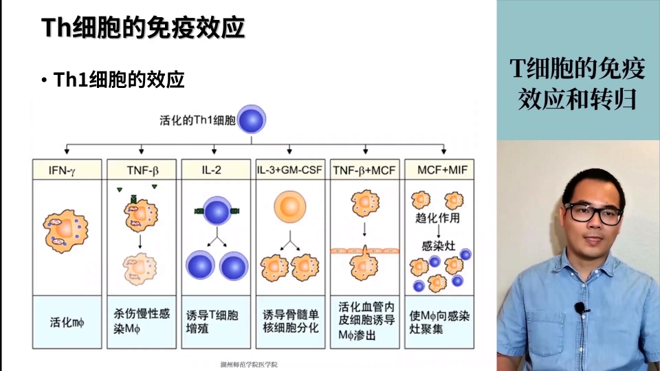

[【跳转到 02:08】](https://www.bilibili.com/video/BV1wp4y1q7XM/?t=128)

### 1.1 Th1：把巨噬细胞"武装"起来

Th1 最主要的辅助对象是**巨噬细胞**。它提供巨噬细胞活化的信号；而活化的巨噬细胞又会反过来给 Th1 提供共刺激信号和细胞因子信号，两者互相加强。

Th1 分泌的细胞因子各有分工：

- **IFN-γ**：活化巨噬细胞，是 Th1 的标志性因子；
- **IL-2**：既可以给自己用，也可以提供给 CTL（CD8⁺ 细胞毒性 T 细胞）使用，同时放大免疫应答；
- **TNF-α**：活化中性粒细胞，并参与募集单核细胞、巨噬细胞和淋巴细胞到炎症局部；
- **IL-3 与 GM-CSF**：诱导造血干细胞向单核细胞分化；
- **巨噬细胞活化因子、MCF、MIF**：让巨噬细胞活化、渗出血管、向感染灶聚集。

这里要解释几个词：

- **巨噬细胞**：吞掉病原体的大号吞噬细胞。但"吞进去"不等于"杀死"，被吞下的胞内病原体常常需要 Th1 再给一次活化信号才被清除。
- **趋化（chemotaxis）**：细胞顺着化学信号浓度梯度往源头爬。趋化因子就是这类"气味"。
- **GM-CSF**：粒细胞-巨噬细胞集落刺激因子，名字就说明了功能——刺激骨髓里的前体细胞长成粒细胞和巨噬细胞。

所以 Th1 型效应的画面是：一个巨噬细胞把抗原提呈给 Th1，Th1 回赠 IFN-γ 等活化信号，巨噬细胞被"点燃"，把肚子里的病原体干掉。

### 1.2 Th2：在生发中心之外帮 B 细胞

Th2 辅助的是 **B 细胞介导的体液免疫**。它用两种方式帮 B 细胞：

1. **接触信号**：通过直接接触给 B 细胞提供第二信号（协同刺激信号），辅助 B 细胞活化；
2. **细胞因子**：分泌 IL-4、IL-5、IL-10、IL-12 等（本视频幻灯片的列举），促进 B 细胞活化、增殖，以及向浆细胞分化、产生抗体。

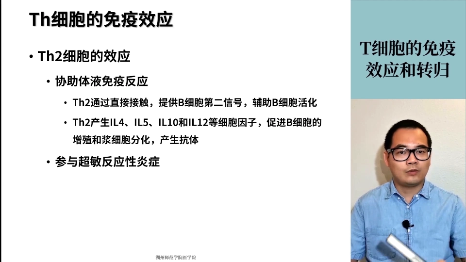

[【跳转到 02:49】](https://www.bilibili.com/video/BV1wp4y1q7XM/?t=169)

Th2 还有第二个身份：**超敏反应性炎症的参与者**。它分泌的 IL-5 能激活肥大细胞、嗜碱性粒细胞和嗜酸性粒细胞，而这三种细胞正是超敏反应和抗寄生虫感染的主力。这也解释了为什么"过敏"和"抗寄生虫"常常共享同一套装备。

### 1.3 Th9、Th17、Th22：命名按功能，不按序号

课程在这里给了一个很实用的记忆规则：**只有 Th1 和 Th2 是按序号命名的，后面的亚群都按"它分泌什么"命名**。所以看到 Th9 不要去找 Th3 到 Th8——它们不存在，Th9 就是"主要分泌 IL-9 的那群"。

**Th9** 分泌 IL-9：激活肥大细胞、参与抗寄生虫感染；同时能募集 DC 和 Tc 细胞，抑制部分肿瘤（如黑色素瘤）的生长。它也有病理面：可引起过敏性哮喘，并能协同 IL-17，成为多种自身免疫性疾病的致病性 T 细胞。

**Th17** 的主角是 IL-17，另外还产 IL-22 和 IL-21：

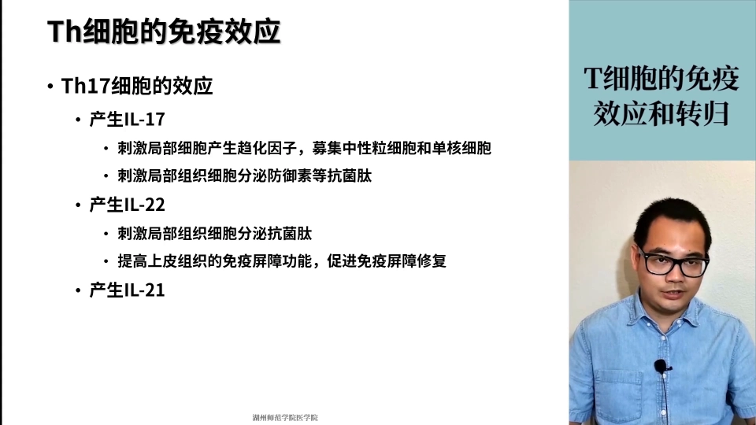

[【跳转到 05:54】](https://www.bilibili.com/video/BV1wp4y1q7XM/?t=354)

- **IL-17**：刺激局部细胞产生趋化因子，募集中性粒细胞和单核细胞迁移；也刺激局部组织分泌防御素等抗菌肽，点燃局部炎症。因此它被叫作**前炎症因子**。但刺激过强就是麻烦——过强会引起自身免疫性疾病。
- **IL-22**：提高上皮组织的免疫屏障功能，促进屏障修复。
- **IL-21**：以自分泌方式放大 Th17 自身，同时参与 Tc、NK 和 B 细胞的一部分功能。

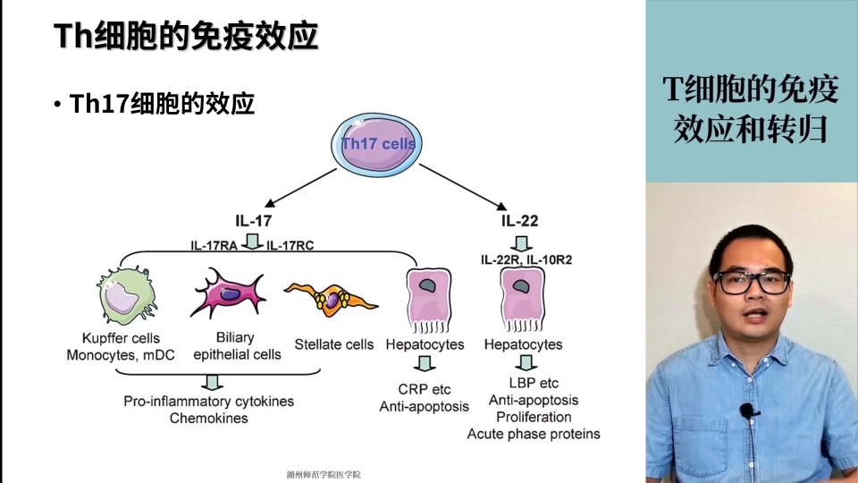

[【跳转到 06:19】](https://www.bilibili.com/video/BV1wp4y1q7XM/?t=379)

**Th22** 是专职产 IL-22 的一群，功能体现在三方面：

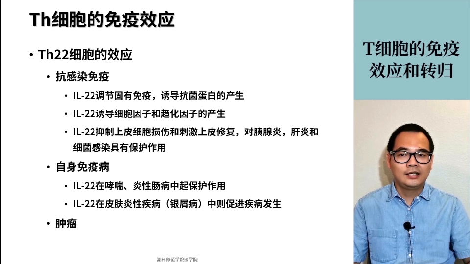

[【跳转到 07:40】](https://www.bilibili.com/video/BV1wp4y1q7XM/?t=460)

- **抗感染**：IL-22 调节固有免疫、诱导抗菌蛋白、诱导细胞因子和趋化因子；抑制上皮细胞损伤、刺激上皮修复，对胰腺炎、肝炎和细菌感染有保护作用；
- **自身免疫病**：作用方向因病而异——在哮喘、炎症性肠病中起保护作用，在银屑病（俗称牛皮癣）中却促进疾病发生；
- **肿瘤**：对实体瘤的进展有调节作用。

同一个分子在不同组织里扮演不同角色，这是免疫学里反复出现的主题。

### 1.4 Tfh：生发中心里的专职帮手

课程给了一个很好用的直觉：**凡是名字里带小写 f 的细胞，八成和生发中心有关**——f 就是滤泡（follicular）。

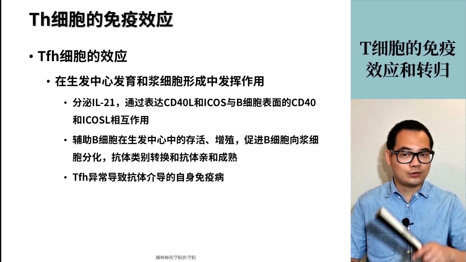

[【跳转到 08:55】](https://www.bilibili.com/video/BV1wp4y1q7XM/?t=535)

Tfh 的工作清单：

- 分泌 **IL-21**，并通过表达 **CD40L** 和 **ICOS**，与 B 细胞表面的 CD40、ICOSL 相互作用——这就是 B 细胞活化所需的协同刺激信号，也就是第二信号；
- 辅助 B 细胞在生发中心里**存活、增殖**；
- 促进 B 细胞向**浆细胞**分化；
- 推动**抗体类别转换**和**抗体亲和力成熟**。

后三项（类别转换、亲和力成熟、长寿命浆细胞）正是 1.1.6 讲过的生发中心"升级工序"，这里补上了它们的 T 细胞一侧：**没有 Tfh，生发中心就没有教官**。

课程也点出临床相关性：Tfh 异常会导致抗体介导的自身免疫病；它是当前研究非常热门的一群细胞，参与过敏、免疫缺陷、自身免疫病、肿瘤、代谢性疾病（如糖尿病）以及 HIV 等病毒感染，而它的作用主要通过调控生发中心（GC）实现。

## 二、Treg：唯一"不辅助"的 CD4⁺ 亚群

最后一群 CD4⁺ T 细胞不是辅助性 T 细胞，而是**调节性 T 细胞（Treg）**。它做的是负向调控，用四种方式压住免疫反应：

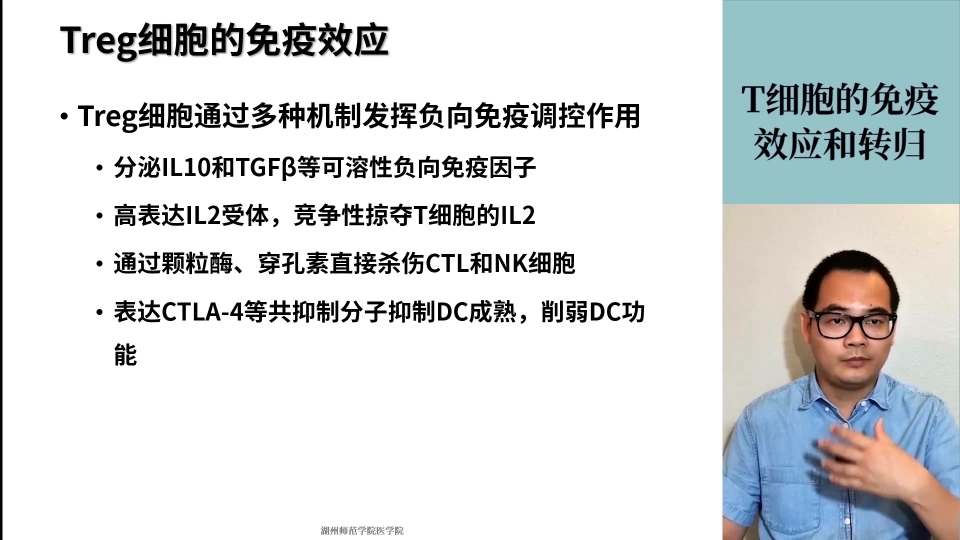

[【跳转到 10:17】](https://www.bilibili.com/video/BV1wp4y1q7XM/?t=617)

1. **分泌抑制性细胞因子**：IL-10 和 TGF-β。课程特别强调，这是整个学习体系里"唯二"两个免疫抑制性因子（不是说世界上只有这两种，其他如 IL-35 也抑制，只是教材只介绍这两个）。
2. **竞争性掠夺 IL-2**：Treg 高表达 IL-2 受体。而不管 CD4 还是 CD8，T 细胞活化都依赖 IL-2；Treg 把 IL-2 抢走，等于间接切断了别人的"燃料"。
3. **直接杀伤**：Treg（这里主要指 CD8⁺ 的那部分）可以通过直接杀伤作用，清除过度活化或错误活化的淋巴细胞。
4. **削弱 DC**：Treg 表达 CTLA-4 这类共抑制分子（1.1.8 讲过的"刹车分子"），通过其配体抑制 DC 成熟，从上游削弱抗原提呈。

注意第 4 条的思路：Treg 不只压制 T 细胞，它还去关掉"发令枪"——DC 不成熟，后续的激活就无从谈起。

## 三、CD8⁺ CTL：识别、极化、两种杀法

CD8⁺ 的细胞毒性 T 细胞（Tc／CTL）效应就"简单"得多：它只负责杀伤**胞内寄生病原体所寄生的宿主细胞**和**肿瘤细胞**。所有被它识别的细胞，统称**靶细胞**。

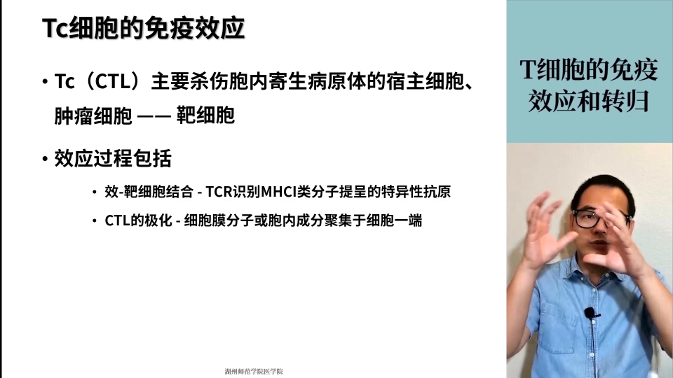

[【跳转到 14:07】](https://www.bilibili.com/video/BV1wp4y1q7XM/?t=847)

### 3.1 为什么第一个被杀的是"提呈抗原的那个细胞"

课程在这里讲了一个很漂亮的逻辑：肿瘤细胞和胞内寄生菌的宿主细胞，是通过 **MHC I 类分子**把内源性抗原肽提呈到表面的。也就是说，**它自己把"我出问题了"的证据举了出来**。

于是 CTL 发现它之后，第一个杀伤目标就是提呈抗原的这个细胞本身。课程用了一个略带调侃的说法：这些感染或癌变的细胞抱着"大公无私"的心态——我感染了、癌变了，那就先杀我吧。它是以牺牲自我的方式，把抗原信息交了出去。

这也解释了 MHC I 类通路的整体设计意图（通路细节见 1.1.7）：**内源性抗原走 MHC I，等于给细胞装了一个"自报家门"的窗口**，一旦内部出问题，CTL 就能看见。

### 3.2 极化：把武器搬到接触面

CTL 的效应过程分三步：效-靶细胞结合（即 TCR 识别 MHC I-肽）、**极化**、致死性攻击。

为什么需要极化？两个细胞都是球形的，贴在一起时接触面其实很小。如果穿孔素、颗粒酶这些杀伤分子均匀分布在 CTL 表面，结合时大部分分子根本够不到靶细胞。所以 CTL 会把所有有杀伤功能的分子**向接触面迁移**，集中火力提高杀伤效率——这个过程就叫极化。

### 3.3 杀法一：穿孔素打孔，颗粒酶进门

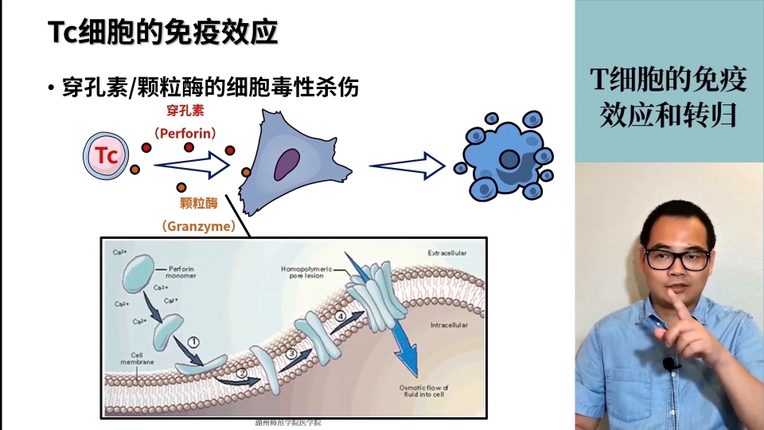

[【跳转到 16:07】](https://www.bilibili.com/video/BV1wp4y1q7XM/?t=967)

第一条路是**细胞毒性作用**：

- **穿孔素（perforin）** 在靶细胞膜上打孔，最终形成一个管状结构；
- 孔道一通，**颗粒酶（granzyme）** 就顺着进入靶细胞，"放毒"。

课程做了一个很好的类比：穿孔素形成的管状结构，非常像补体级联最后形成的 **MAC（膜攻击复合物）**，原理也一样——破坏膜的完整性，让细胞活不下去。

### 3.4 杀法二：Fas-FasL，按下靶细胞自己的"自毁开关"

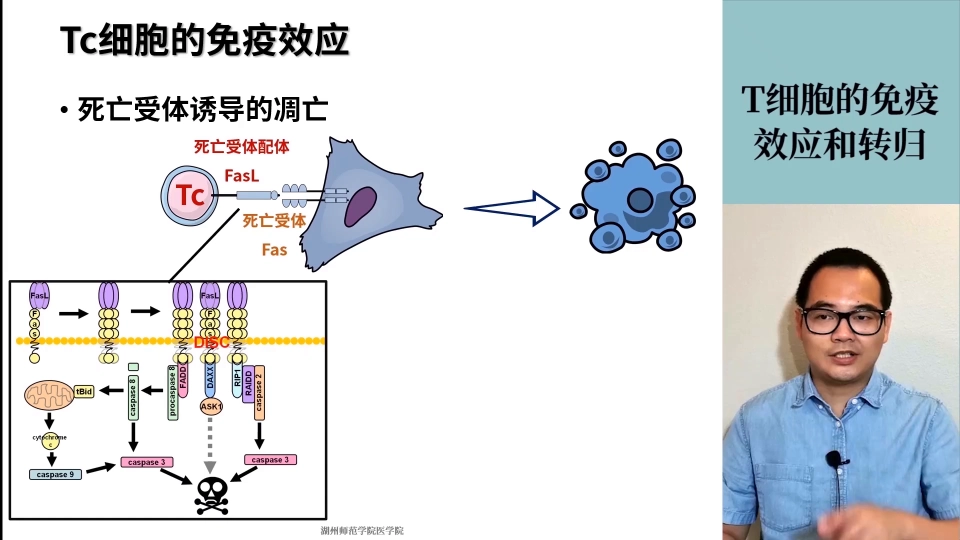

[【跳转到 17:10】](https://www.bilibili.com/video/BV1wp4y1q7XM/?t=1030)

第二条路是**死亡受体诱导的凋亡**：CTL 表面的 **FasL** 结合靶细胞表面的 **Fas**（一种死亡受体），启动靶细胞内部的凋亡程序。

课程把 Fas 比作靶细胞表面的"**自毁开关**"，FasL 就是按开关的那根手指。按下之后，胞内是一连串复杂的凋亡信号转导，主要通过 **caspase** 通路。课程明确说：中间的分子不需要记，你只要看到最后出现"死亡标志"、死亡信号传进细胞核，就知道这个细胞一定会死。

两条路常常同时作用，靶细胞在"双重打击"下很快死亡。而 CTL 本身不是一次性的——杀完一个靶细胞，它会回过头再去找下一个。

## 四、这套效应系统的意义与代价

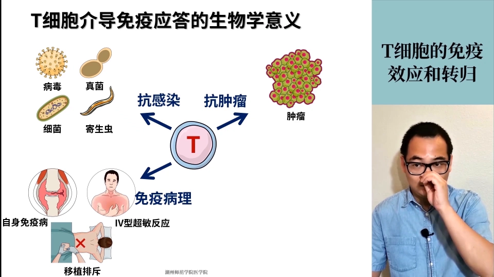

[【跳转到 18:13】](https://www.bilibili.com/video/BV1wp4y1q7XM/?t=1093)

课程把 T 细胞效应的生物学意义归为四类：

1. **抗感染**：细菌、真菌、病毒、寄生虫都可以是 T 细胞杀伤的目标；
2. **抗肿瘤**：肿瘤抗原属于内源性抗原，被 MHC I 提呈后由 CTL 识别清除，这就是**免疫监视**功能；
3. **免疫病理**：过度或错误活化的 T 细胞也会致病——自身免疫病（如类风湿性关节炎）、IV 型超敏反应（如接触性皮炎），以及介导移植排斥的主要也是 T 细胞；
4. **免疫调节**：例如 Th1 与 Th2 之间的平衡，对正常免疫功能非常重要。

第 3 条值得停一下：同一套杀伤装置，对准病原体是保护，对准自身组织就是病。免疫学的很多治疗思路，本质上都是在"保留前两条、抑制第三条"之间找平衡。

## 五、反应结束之后：T 细胞去哪了

抗原被清除、免疫系统重新平衡以后，大部分活化细胞会被抑制或清除——课程的说法是"刀枪入库，马放南山，下岗了"。少数留下来成为记忆性 T 细胞，可以在体内存在数个月到数年。**疫苗之所以有用，基础就在这里。**

### 5.1 两种"清场"方式：Treg 抑制与 AICD

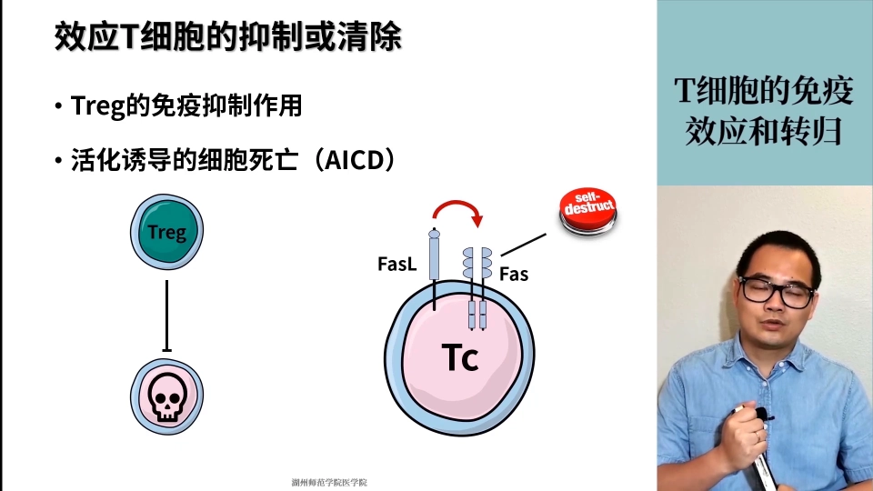

[【跳转到 20:48】](https://www.bilibili.com/video/BV1wp4y1q7XM/?t=1248)

1. **Treg 的免疫抑制作用**：效应 T 细胞发挥完作用后，由 Treg 负责抑制它、让它死亡。
2. **活化诱导的细胞死亡（AICD）**：这一条特别巧妙。T 细胞用 FasL 去按别人的自毁开关，而它自己也表达 Fas。活化的 T 细胞不断按别人，就会按到自己；活化时间越长，按到自己的概率越高。所以**越是活化程度高的 T 细胞，越容易被自己诱导凋亡**。

AICD 相当于给免疫反应装了一个"自动定时器"：反应越激烈，越早自动关停。这和 1.1.8 讲的共抑制信号（CTLA-4 等）是同一类设计思路——免疫系统必须自带刹车。

### 5.2 记忆 T 细胞：更快、更高、更强

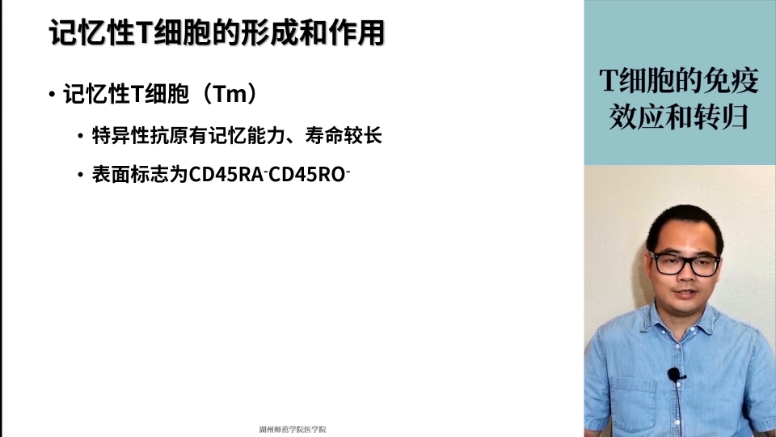

[【跳转到 21:43】](https://www.bilibili.com/video/BV1wp4y1q7XM/?t=1303)

记忆性 T 细胞（Tm）的特点是特异性抗原记忆、寿命长（几个月到几年）。课程用奥运口号"更快、更高、更强"来记它的四条作用特点：

- **对第一信号要求更低**：更低浓度的抗原就能激活它；
- **对第二信号（共刺激）依赖更低**：不必等完整的共刺激配合；
- **对细胞因子更敏感**；
- **自己分泌更多细胞因子**；如果是记忆性 CD8⁺ T 细胞，杀伤效应也更强。

把这四条串起来就是：同样的抗原再来一次，记忆 T 细胞用更少的条件、更短的时间，打出更强的反应。这正是 1.1.4 里"再次应答"在 T 细胞一侧的具体表现。

## 小结

- Th 细胞不直接打仗，**分群依据是"辅助谁"**：Th1 帮巨噬细胞和 CTL，Th2 在生发中心外帮 B 细胞，Tfh 在生发中心里帮 B 细胞。
- 除 Th1、Th2 外，**亚群按分泌的细胞因子命名**：Th9→IL-9，Th17→IL-17，Th22→IL-22；名字里的数字不是序号。
- **Th17 是"前炎症"的**：IL-17 招募中性粒细胞、诱导抗菌肽；过强则引起自身免疫病。
- **Treg 用四条路踩刹车**：IL-10/TGF-β、抢 IL-2、直接杀伤、用 CTLA-4 削弱 DC。
- **CTL 的杀伤分三步**：识别（MHC I-肽）→ 极化（武器搬到接触面）→ 致死性攻击（穿孔素/颗粒酶，或 Fas-FasL 凋亡）。
- 反应结束后，效应细胞被 **Treg 抑制**或经 **AICD** 清除，少数成为**记忆 T 细胞**（更快、更高、更强）。

## 关键术语速查

| 术语 | 一句话解释 |
| --- | --- |
| Th（辅助性 T 细胞） | CD4⁺ T 细胞，自己不杀伤，靠细胞因子和接触信号帮助别的细胞 |
| Tfh | 滤泡辅助性 T 细胞，在生发中心里通过 IL-21、CD40L、ICOS 帮 B 细胞 |
| Treg | 调节性 T 细胞，负责负向调控与外周耐受，标志为 CD4⁺CD25⁺Foxp3⁺ |
| CTL／Tc | 细胞毒性 T 细胞，识别 MHC I-肽后杀伤靶细胞 |
| 靶细胞 | 被 CTL 识别的细胞，即胞内寄生菌的宿主细胞或肿瘤细胞 |
| 极化 | CTL 把杀伤分子集中到与靶细胞接触的一端 |
| 穿孔素 | 在靶细胞膜上打孔的蛋白，作用类似补体的 MAC |
| 颗粒酶 | 随穿孔素孔道进入靶细胞、触发凋亡的酶 |
| Fas／FasL | 死亡受体及其配体，相当于靶细胞表面的"自毁开关"与按开关的手指 |
| AICD | 活化诱导的细胞死亡：活化越强，越容易被自己的 FasL 诱导凋亡 |
| 前炎症因子 | 在炎症早期就发挥作用的因子，如 IL-17 |
| 免疫监视 | 靠识别内源性抗原清除肿瘤细胞的机制 |