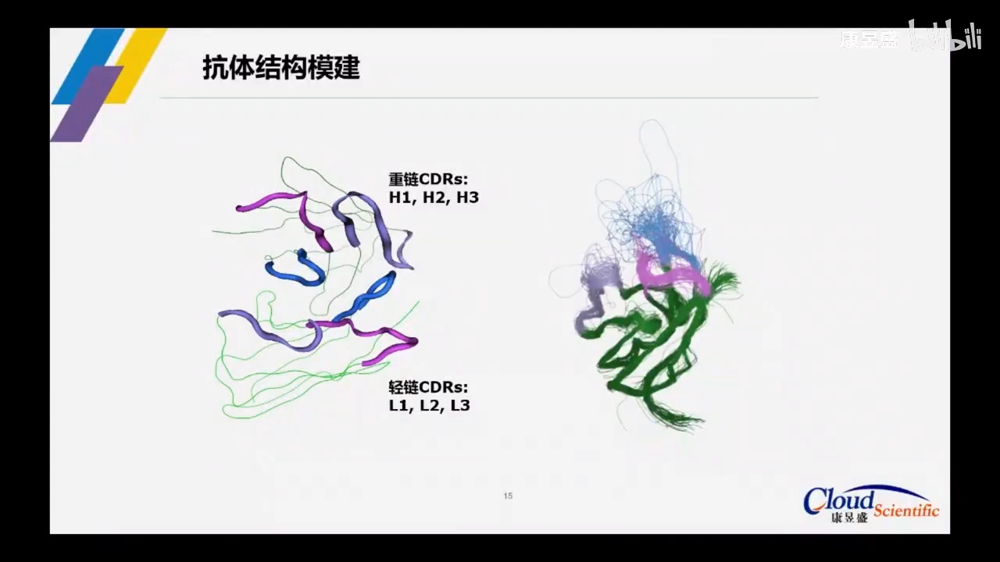
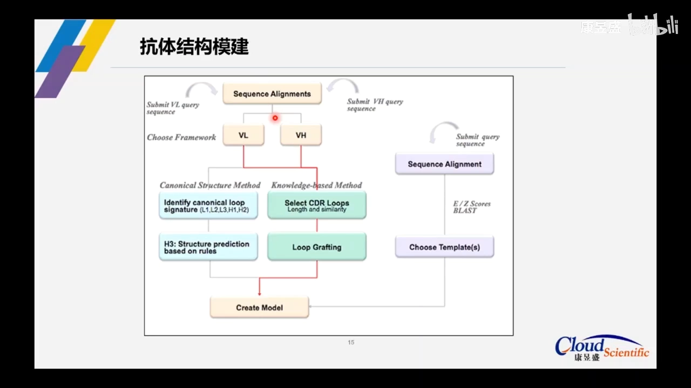
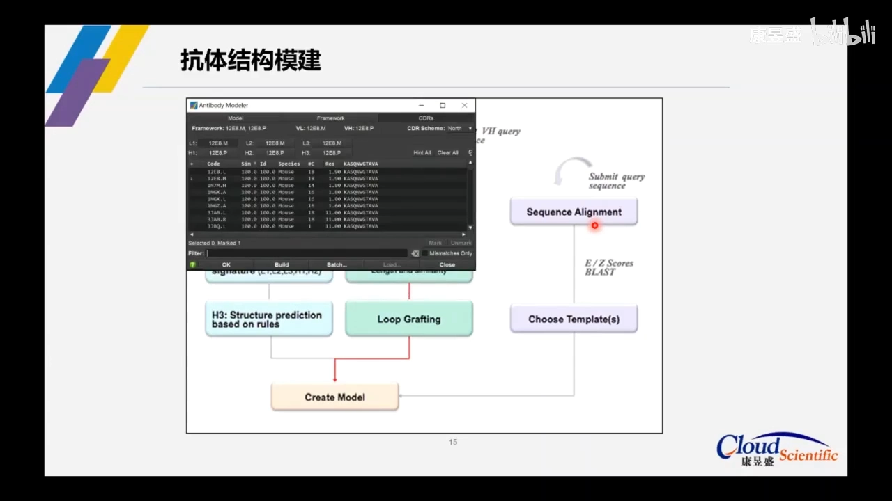
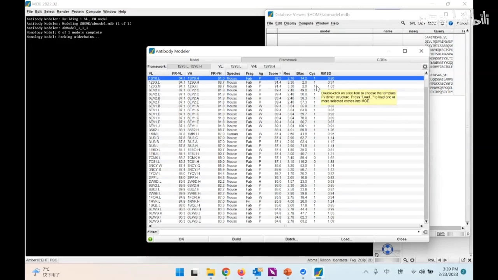
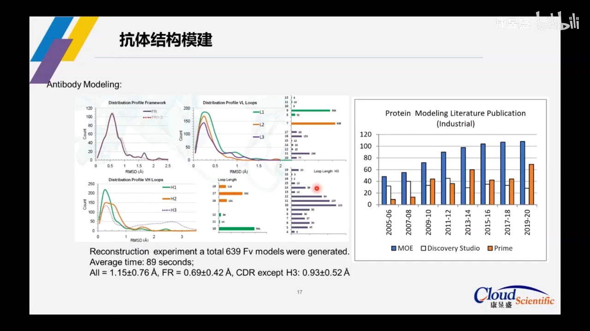
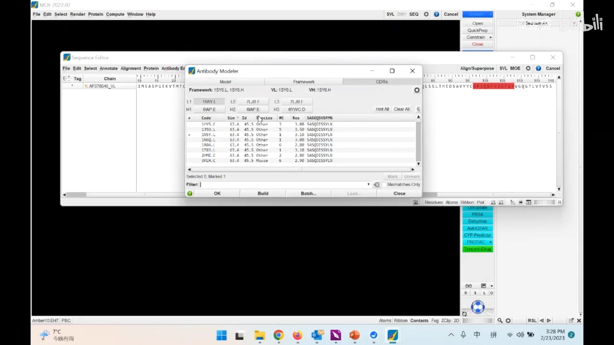
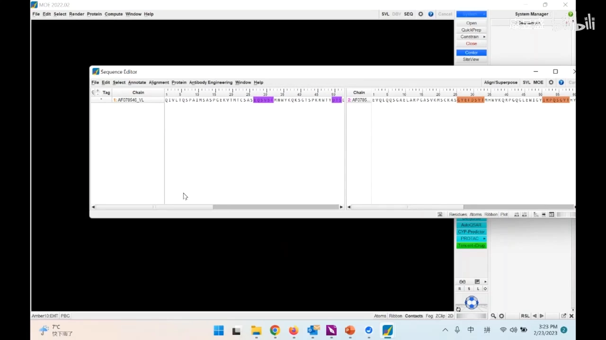
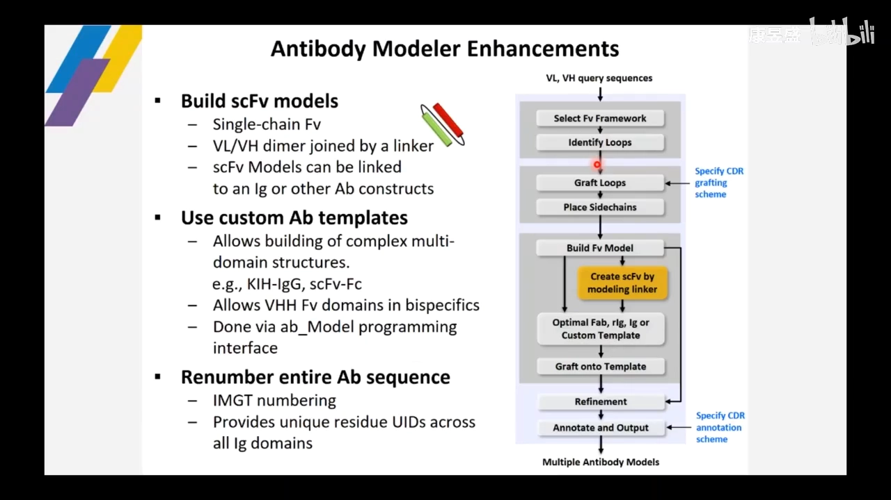
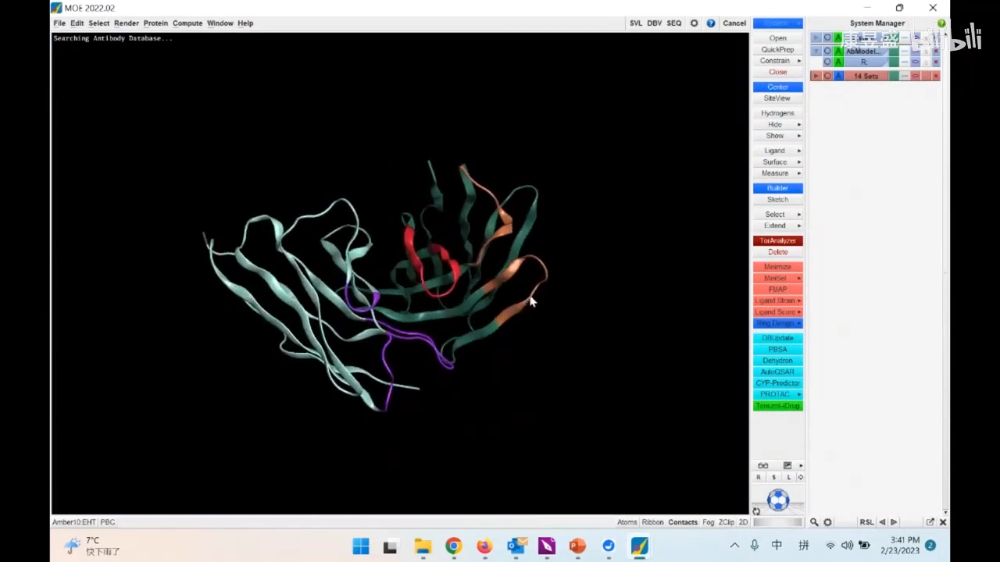

# 抗体环区构象：五条环有典型构象，CDR-H3 只能单独算

> 视频来源：[MOE抗体药物设计系列讲座第一讲 - 理性抗体设计之基础：抗体结构建模](https://www.bilibili.com/video/BV1fD4y1G7dK/)（Bilibili · 康昱盛，主讲人孙亚运）｜时长约 62 分钟
> 本文基于视频演说图文稿整理，时间戳可跳转到对应讲解。原文稿由 AI 字幕转写，术语（MOE、CDR、framework、grafting 等）已按上下文订正。

## 本讲要解决的核心问题（SCQA）

**背景**：前面的小节已经把可变区切成了框架区（framework，FR）和六个 CDR——轻链的 L1、L2、L3，重链的 H1、H2、H3。我们也知道不同编号体系（IMGT、Kabat、Chothia）会把这些位置标成不同的编号。

**冲突**：可是一旦要看真实的三维结构，六个 CDR 并不能"一视同仁"：有的环几乎可以照抄别的抗体的形状，有的环却怎么都猜不准；而编号表上写得整整齐齐的残基，实际在空间里未必待在同一个位置。

**疑问**：环的形状到底由什么决定？为什么偏偏是 CDR-H3 最难算？框架区在背后起了什么作用？编号和真实构象之间差在哪一步？

**回答（中心思想）**：**环的几何由三件事共同决定——环的长度、环的序列、以及框架提供的两个"锚点"**。因此抗体建模不能像普通蛋白那样整条序列找一个模板，而要**把框架和每一条 CDR 拆开、分别选模板**：L1–L3、H1、H2 这五条环多数能归入少数几种**典型构象（canonical structure）**，可以"按签名找模板"；**H3 因为长度和序列最不守规矩，只能单独按规则预测**。而 IMGT/Kabat/Chothia 这些编号，只是给残基发"门牌号"、把序列切成框架与 CDR 的**标签系统**——它不告诉你环长什么样，真实几何必须另外建模、再用几何指标验收。

## 一、六个 CDR 不是同一种零件

[【跳转到 05:38】](https://www.bilibili.com/video/BV1fD4y1G7dK/?t=338)

抗体分轻链和重链。轻链上有三段 CDR loop，就是 **L1、L2、L3**；重链上同样有三段，就是 **H1、H2、H3** [【跳转到 05:38】](https://www.bilibili.com/video/BV1fD4y1G7dK/?t=338)。

但这六段环的地位并不平等。讲者明确指出：**H3 相对于其他五个 loop，柔性会稍微大一点；而且 H3 的长度在不同抗体当中也不一样，有的抗体 H3 比较长，有的比较短** [【跳转到 06:03】](https://www.bilibili.com/video/BV1fD4y1G7dK/?t=363)。在单抗、单域抗体（比如纳米抗体）里，这些环的情况又各不相同 [【跳转到 06:28】](https://www.bilibili.com/video/BV1fD4y1G7dK/?t=388)。

> 一句话：**L1、L2、L3、H1、H2 是"有章可循"的五条环，H3 是"特例"**。记住这个二分，后面所有建模策略都是从它推出来的。

正因为抗体有这种特殊结构，**它不能套用普通蛋白结构建模的通用方法** [【跳转到 06:53】](https://www.bilibili.com/video/BV1fD4y1G7dK/?t=413)。

## 二、普通同源建模为什么在抗体上失灵

[【跳转到 08:58】](https://www.bilibili.com/video/BV1fD4y1G7dK/?t=538)

普通同源建模的流程是：提交整条序列 → 做序列比对 → 找一个（或几个）同源性最高的模板 → 以它为基础构建整个蛋白结构。它**不会去区分不同区域，用的是一条统一的模板** [【跳转到 08:58】](https://www.bilibili.com/video/BV1fD4y1G7dK/?t=538)。

抗体不能这么干。在抗体建模模块里，算法是**分区处理**的：

1. 先根据提供的轻链、重链序列，在后台数据库里做序列比对；
2. 比对之后，**框架（framework）和 CDR 分别匹配模板**：框架按相似性挑选；
3. CDR 则"基于知识"——后台会做**结构上的聚类**，也会做**序列相似性（identity）的比较**，再挑模板；
4. 最后把框架和 CDR 通过 **grafting（移植）** 拼到一起，做侧链放置和优化，得到最终模型 [【跳转到 07:43】](https://www.bilibili.com/video/BV1fD4y1G7dK/?t=463)。

这张流程图值得逐字读：左边一条路叫 **Canonical Structure Method**，做的是"**识别典型环的签名（canonical loop signature），范围是 L1、L2、L3、H1、H2**"，而 **H3 走的是另一条分支——"基于规则的结构预测"**；右边一条路叫 **Knowledge-based Method**，按"**长度和相似性**"选 CDR loop，再做 Loop Grafting。两条路的终点都是 Create Model [【跳转到 07:43】](https://www.bilibili.com/video/BV1fD4y1G7dK/?t=463)。

在软件窗口里，这种"分而治之"是看得见的：CDR 一栏被拆成 **L1、L2、L3、H1、H2、H3 六段，各自单独分析、各自挑一个最佳 template** [【跳转到 09:44】](https://www.bilibili.com/video/BV1fD4y1G7dK/?t=584)。

## 三、环的构象从哪来：长度、序列与框架

### 3.1 典型构象：长度和关键残基相同，形状就相同

所谓 **canonical structure（典型构象）**，说的是这样一件事：如果两条环的**长度相同、并且几个决定骨架走向的关键残基也相同或相似**，那么它们折叠出来的三维形状往往就是同一种。于是"预测这条环的形状"就退化成"**认出它属于哪一类，再拿同类的已知结构当模板**"——这正是流程图里 "Identify canonical loop signature" 的含义 [【跳转到 07:43】](https://www.bilibili.com/video/BV1fD4y1G7dK/?t=463)。

这也解释了为什么 L1、L2、L3、H1、H2 能被归入少数几类：它们的长度变化范围相对有限，序列上的关键位点也比较守规矩——这正是流程图把它们交给"典型构象法"、而把 H3 单列的前提。反过来，H3 不满足这个前提（见第四节）。

### 3.2 框架区是环的"锚点"，不是背景板

环不是悬在空中的。每一条 CDR 的两端都固定在框架的 β 折叠骨架上，**框架决定了环的起点、终点和整体朝向**；框架本身还决定了 VL 与 VH 两个结构域怎么 packing 在一起。所以框架模板选得好不好，直接决定环被"摆"在什么位置。

讲者给了一条很实用的默认规则：**框架模板一般会选同一个抗体的 VL 和 VH**，因为 VL 跟 VH 要 packing 在一起，用同一套框架才不影响各自的结构 [【跳转到 26:21】](https://www.bilibili.com/video/BV1fD4y1G7dK/?t=1581)。

软件给出的框架候选表里，每一行是一个候选抗体结构，列出 FR-VL、FR-VH 的相似性、物种、片段类型、**打分（Ag）、分辨率、B factor、Cys 数量、RMSD** 等；默认按 score 排序，相似性越高排得越前 [【跳转到 25:06】](https://www.bilibili.com/video/BV1fD4y1G7dK/?t=1506)。当然也可以手动双击指定——软件把推荐结果"透明化"，不是黑箱 [【跳转到 32:34】](https://www.bilibili.com/video/BV1fD4y1G7dK/?t=1954)。

### 3.3 框架比环"听话"：一组 RMSD 数据

讲者引用了一篇验证工作：用软件建模 639 个 Fv，再和晶体结构叠合算 RMSD（RMSD 越低表示越重合）[【跳转到 14:01】](https://www.bilibili.com/video/BV1fD4y1G7dK/?t=841)。

- **框架（FR）**：大多数落在 0.5–0.6 Å，基本都在 1 Å 以下，叠合后"非常重合" [【跳转到 14:51】](https://www.bilibili.com/video/BV1fD4y1G7dK/?t=891)；
- **轻链 CDR**：RMSD 更低，差不多 0.2–0.3 Å，大多数在 0.7 Å 以下 [【跳转到 16:06】](https://www.bilibili.com/video/BV1fD4y1G7dK/?t=966)；
- **重链 CDR（含 H3）**：依然理想，但分布明显更宽——图上 H3 的曲线拖着一条长尾 [【跳转到 16:31】](https://www.bilibili.com/video/BV1fD4y1G7dK/?t=991)；
- **总体**：全部结构约 1.15 Å，Fv 约 0.69 Å，CDR（不含 H3）约 0.93 Å，把 H3 算进来约 1 Å [【跳转到 16:56】](https://www.bilibili.com/video/BV1fD4y1G7dK/?t=1016)。

这张图的右半部分还画了 **Loop Length（H3）** 的分布：H3 的长度从很短一直排到十几、二十几个残基，跨度远大于其他五条环。**框架是"稳定件"，环是"可动件"，而 H3 是其中最自由的那一个**——数据把第一节的定性说法量化了。

## 四、CDR-H3 为什么最不守规矩

把前面几条线索合起来，H3 的特殊性有三个来源：

1. **长度高度可变**。其他五条环长度分布集中，H3 则从短到长连续分布（见上图 Loop Length H3）[【跳转到 16:31】](https://www.bilibili.com/video/BV1fD4y1G7dK/?t=991)。
2. **序列高度可变**。讲者指出抗体之间的整体序列 identity 差别很小，但 CDR 的结构差异却很大——H3 正是这种"序列看着像、结构差很多"最集中的地方。
3. **柔性更大**。讲者反复强调 H3 的柔性相对最大，因此建模难度也最大 [【跳转到 06:03】](https://www.bilibili.com/video/BV1fD4y1G7dK/?t=363)。

结果就是：**H3 不能靠"找同类"来解决**，只能走"基于规则的结构预测"这条分支 [【跳转到 07:43】](https://www.bilibili.com/video/BV1fD4y1G7dK/?t=463)。在软件里，H3 满足条件的模板非常多，聚类之后才挑出一个备选 [【跳转到 31:19】](https://www.bilibili.com/video/BV1fD4y1G7dK/?t=1879)。

### 4.1 一个反直觉的细节：序列最像的模板，未必结构最像

[【跳转到 29:16】](https://www.bilibili.com/video/BV1fD4y1G7dK/?t=1756)

在 CDR 模板列表里，候选是按 identity 从高到低排序的；但**软件实际选中的，往往不是 identity 最高的那一个**。

讲者解释了原因：**抗体之间的序列 identity 相差非常小，大多数抗体序列上非常相似；但 CDR 的结构却表现出非常大的差异**，正是这些结构差异让不同抗体能结合不同的靶蛋白 [【跳转到 29:41】](https://www.bilibili.com/video/BV1fD4y1G7dK/?t=1781)。

所以如果只按"同源性最高"去挑模板，找到的结构可能和真实结构相差比较大。软件的做法是：先把一定 identity/相似性以上的模板保留下来，**做结构叠合与聚类**，从中选出有代表性的一段结构作为模板 [【跳转到 30:31】](https://www.bilibili.com/video/BV1fD4y1G7dK/?t=1831)。

> 这就是"典型构象"思路的工程版本：**先用序列筛掉不相关的，再用结构聚类决定用哪一种形状**。序列相似只是入场券，结构聚类才是投票。

## 五、编号 ≠ 真实结构：门牌号不告诉你房间长什么样

[【跳转到 24:16】](https://www.bilibili.com/video/BV1fD4y1G7dK/?t=1456)

这一步最容易被初学者混淆，讲者在软件演示里把它拆得很清楚。

**第一层：注释（annotation）只是给序列分段、给残基编号。** 在序列编辑窗口里，可以按 IMGT、Kabat、Chothia 等传统方法给抗体序列做 annotation；注释之后，轻链、重链被划分开，CDR 被高亮出来 [【跳转到 21:56】](https://www.bilibili.com/video/BV1fD4y1G7dK/?t=1316)。

注意配色本身就在传递信息：轻链三条 CDR 是紫色，H1、H2 是橙色，**H3 被单独用红色标出**——因为 H3 柔性最大、在不同抗体中长短不同，需要和其他五条区分开 [【跳转到 22:39】](https://www.bilibili.com/video/BV1fD4y1G7dK/?t=1359)。

**第二层：编号是流程的输入，不是几何的结论。** 建模流程是"先注释 → 再按区域选模板 → grafting → 侧链放置 → 优化 → 重新编号并输出"。

流程图右下角那一步叫 **Renumber entire Ab sequence**，注释写得很直白：用 IMGT 编号，**为所有 Ig 结构域提供唯一的残基 UID** [【跳转到 12:16】](https://www.bilibili.com/video/BV1fD4y1G7dK/?t=736)。也就是说，编号解决的是"这个残基叫什么、和别的抗体怎么对齐"，它**不保证**两个编号相同的残基在空间里处在同一位置、更不保证环的形状相同。

由此可以推出三个实用判断：

- **同一条 CDR 在不同抗体里长度不同**，编号体系靠插入位点（insertion）来容纳，所以"编号连续"不等于"残基连续"；
- **编号相同的残基，构象可以完全不同**——这正是上一节"序列相似 ≠ 结构相似"的另一面；
- **判断环的形状，必须看结构（模板、聚类、几何评价），不能看编号表**。

## 六、模型建好之后：用几何指标验收

[【跳转到 37:01】](https://www.bilibili.com/video/BV1fD4y1G7dK/?t=2221)

模型构建完成后会自动做分子力学优化，然后输出到数据库 [【跳转到 33:49】](https://www.bilibili.com/video/BV1fD4y1G7dK/?t=2029)。接下来要评价"这个结构合不合理"，讲者演示了 `Protein → Geometry` 下的几项检查：

- **Ramachandran plot（拉氏图）**：横坐标 φ 角、纵坐标 ψ 角，橙色线围出合理区域，其中绿色是 core、还有 allowed 区；红色加号是落在合理区之外的 outlier。演示的模型里大多数残基都落在合理范围内，只有两个 outlier，稍微偏出一点 [【跳转到 38:25】](https://www.bilibili.com/video/BV1fD4y1G7dK/?t=2305)；
- **键长、键角**：按不同键类型给出 cutoff，看是否在合理阈值之下；
- **二面角、clash（原子间碰撞）、contact 能量**：进一步检查局部几何与原子重叠 [【跳转到 39:47】](https://www.bilibili.com/video/BV1fD4y1G7dK/?t=2387)；
- **report 与打分**：给出 allowed / core / outlier 的统计和总分，**分值越低表示模型越合理**；演示模型的 outlier 比例低于 0.0005 [【跳转到 40:22】](https://www.bilibili.com/video/BV1fD4y1G7dK/?t=2422)。

发现 outlier 的处理办法也很直接：把它 select 出来，再做一次 minimize 优化 [【跳转到 39:29】](https://www.bilibili.com/video/BV1fD4y1G7dK/?t=2369)。验收通过后，可以保存为 MOE 文件或导出 PDB [【跳转到 41:39】](https://www.bilibili.com/video/BV1fD4y1G7dK/?t=2499)。

这张成品图把全文串了起来：**框架是那一片片浅色的 β 折叠，六条彩色的环从它上面伸出来**；H3（红色）最长、最显眼，也最不确定。

## 七、两种工程用法：批量建模与"换个方法"

- **批量**：可以一次导入多条抗体序列（多序列文件或 mdb 数据库），选择模型类型（Fv / Fab / Fab2 / IgG / VHH / 双抗 / scFv）后批量构建 [【跳转到 43:18】](https://www.bilibili.com/video/BV1fD4y1G7dK/?t=2598)。
- **特殊形式**：`ab_custom` 脚本可以构建四类特殊结构——两个 scFv 组成的 BiTE、两个 VHH 用短 linker 连接、IgG 连 scFv、IgG 连 VHH（纳米抗体）[【跳转到 45:45】](https://www.bilibili.com/video/BV1fD4y1G7dK/?t=2745)。
- **换方法**：除了基于模板的同源建模，软件也提供 **AlphaFold2 接口**，输入序列、指定部署路径和输出路径即可调用，走的是"从头预测"而不是"找模板"的路线 [【跳转到 59:25】](https://www.bilibili.com/video/BV1fD4y1G7dK/?t=3565)。

> 这两条路线的差别，恰好对应本文的主题：**模板法假设"环有典型构象可抄"，从头预测法则不依赖这个假设**。H3 越不守规矩，后者的吸引力就越大。

## 小结

- 六个 CDR 分两类：**L1、L2、L3、H1、H2 多数能归入典型构象**；**H3 长度、序列、柔性都最自由**，必须单独处理。
- 环的几何由**长度 + 序列 + 框架锚点**共同决定；框架决定环的起止与朝向，还决定 VL/VH 怎么 packing。
- 抗体建模不能整条序列找一个模板，而要**框架与每条 CDR 分开选模板**，再 grafting 拼接。
- **序列相似 ≠ 结构相似**：抗体之间 identity 差别很小，CDR 结构差别却很大，所以模板要先按相似性筛、再按结构聚类选。
- **编号（IMGT/Kabat/Chothia）只是标签**：它给残基唯一 ID、把序列切成框架与 CDR，但不保证空间位置或环的形状。
- 数据上：框架 RMSD 约 0.69 Å，除 H3 外的 CDR 约 0.93 Å，全部约 1.15 Å——**框架最稳，H3 最飘**。
- 模型必须验收：拉氏图、键长键角、clash、contact 能量与总分，outlier 可再优化。

## 关键术语速查

| 术语 | 一句话解释 |
| --- | --- |
| CDR loop | 可变区上伸出来接触抗原的环，轻链 L1–L3、重链 H1–H3 共六条 |
| Framework（FR） | 环之间的 β 折叠骨架，给环提供起点、终点和朝向 |
| Canonical structure | 长度与关键残基相同/相似的环会折成同一种形状，可归为一类并复用模板 |
| Canonical loop signature | 判断一条环属于哪一类典型构象的"签名"（长度 + 关键位点） |
| CDR-H3 | 重链第三条 CDR，长度与序列高度可变、柔性最大，通常单独按规则预测 |
| Grafting | 把选好的 CDR loop 结构"移植"到框架模板上的建模步骤 |
| Side chain placement | 骨架确定后，为侧链寻找合理构象的步骤 |
| RMSD | 两个结构叠合后的平均偏差，越小越重合 |
| Ramachandran plot | 以 φ/ψ 二面角为坐标检查主链构象是否合理的图 |
| IMGT / Kabat / Chothia | 三套抗体序列编号与 CDR 边界定义方案，属于标签系统而非几何结论 |