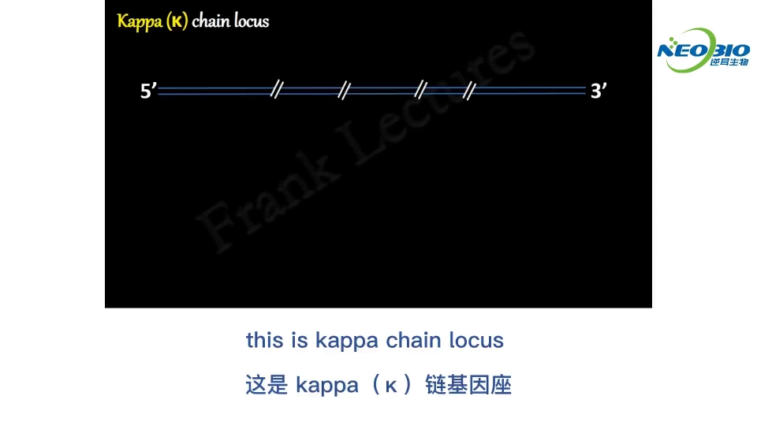
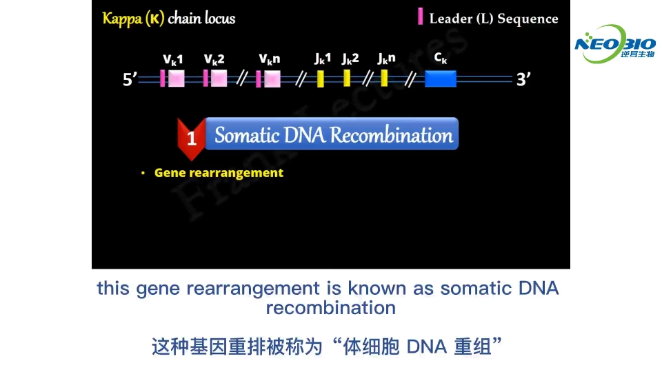
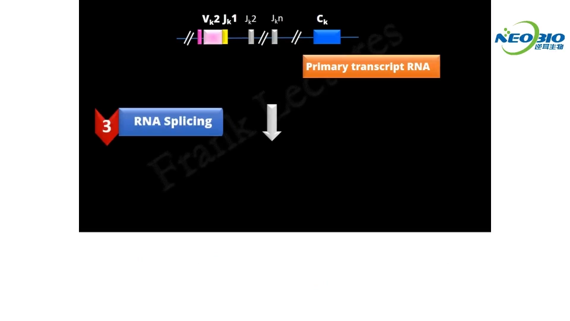
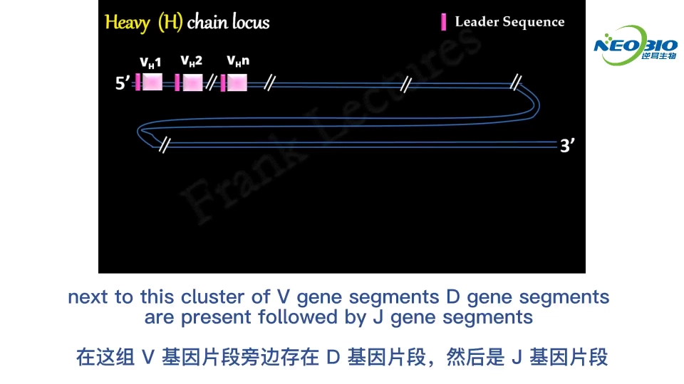
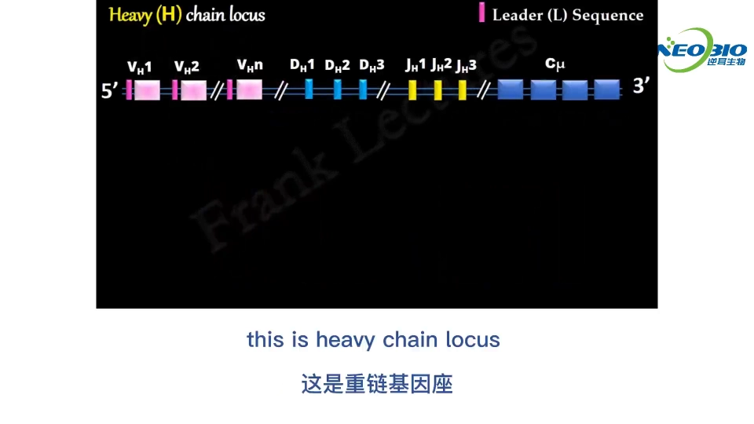
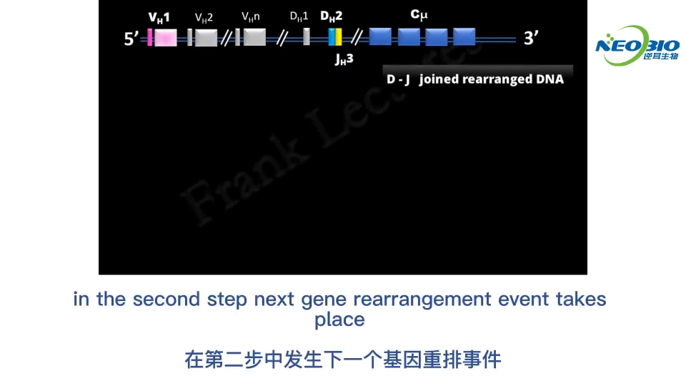
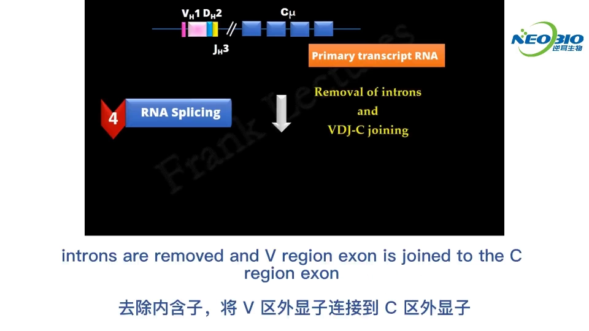

# 从种系基因座到可变区外显子：轻链 V-J 与重链 V-D-J 的拼装

> 视频来源：[抗体基因的 VDJ 重排（陈巍翻译）](https://www.bilibili.com/video/BV1fV4y1377t/)（Bilibili · UP 主「陈巍学基因」，时长 9:25）。本文据视频演说图文稿整理，时间戳可跳回原片对应讲解；原片为英文讲座配中文字幕，术语已按免疫学惯例订正。
>
> 导读：这支课用同一套四步流程（重排 → 转录 → 剪接 → 翻译）分别走一遍**轻链位点**和**重链位点**，把"V 区外显子是怎么被造出来的"画成可以照着数的图。适合作为上一节机制讲解的"流程图版本"。

## 本讲要解决的核心问题（SCQA）

**背景**：抗体链的可变区由多个基因片段共同编码，这些片段必须先被重新排列，才能形成一个功能性的可变区外显子。

**冲突**：轻链的可变区由 V 和 J 两段拼成，重链由 V、D、J 三段拼成——片段数目不同，意味着重排的**事件次数**也不同。但两条链最终都要接到恒定区上，而恒定区基因在基因组上离 V 区很远。如果只讲"重排"，会漏掉"接 C 区"这一步到底发生在哪一层。

**疑问**：轻链的 V-J 连接具体怎么走完四步？重链为什么需要**两次**重排事件？V 区和 C 区最后是在 DNA 上拼起来的，还是在 RNA 上拼起来的？

**回答（中心思想）**：轻链只发生**一次** DNA 重排（V-J），重链发生**两次**（先 D-J、再 V-DJ）；两次重排都只负责造出**可变区外显子**，而 V 区外显子与 C 区外显子的连接发生在**转录之后、由 RNA 剪接完成**。所以"重排"与"接恒定区"是两层不同的事件：前者改写 DNA，后者只是把同一份转录本剪出不同的读法。

## 一、轻链基因座：V 片段群、J 片段群、一个 C 基因

先看 $\kappa$（kappa）轻链位点的原始排布 [【跳转到 01:40】](https://www.bilibili.com/video/BV1fV4y1377t/?t=100)：

- 5' 端是一大群 **V 基因片段**（$V\kappa1, V\kappa2, \dots, V\kappa n$），每个 V 片段**前面都带一个前导序列（leader sequence）**；
- 接着是一小簇 **J 基因片段**（$J\kappa1, J\kappa2, \dots, J\kappa n$）；
- 最后是 **C 基因**（$C\kappa$）。

**前导序列是干什么的？** 它编码一段疏水的"信号肽"，让新合成的肽链能被引导到内质网里去。它不参与抗原识别，但没有它，抗体链就无法走上分泌途径——这也是为什么重排时必须**连同前导序列一起搬走**（后文重链的 V 片段同样"与它的前导序列一起"被连接）。

## 二、第一步：体细胞 DNA 重组，V-J 连接造出可变区外显子

重排的第一步在 DNA 上完成，视频给的正式名称是**体细胞 DNA 重组（somatic DNA recombination）** [【跳转到 01:40】](https://www.bilibili.com/video/BV1fV4y1377t/?t=100)。

"体细胞"三个字是有讲究的：这种 DNA 重排**只发生在体细胞中**，不发生在生殖细胞里，因此**不会遗传给下一代** [【跳转到 02:05】](https://www.bilibili.com/video/BV1fV4y1377t/?t=125)。这也解释了为什么每个人的抗体库是个体一生中"现做"的，而不是从父母那里继承来的。

这一步的发现者是日本科学家**利根川进**：他发现免疫球蛋白基因可以在分化细胞的基因组中**移动和重新排列**，并因此在 1987 年获得诺贝尔生理学或医学奖 [【跳转到 02:23】](https://www.bilibili.com/video/BV1fV4y1377t/?t=143)。

具体动作是：**随机选择一个 V 片段，随机选择一个 J 片段，把它们连接起来**。视频假设第二个 V 片段（$V\kappa2$）连到第一个 J 片段（$J\kappa1$），为了让读者把注意力集中在"片段重排"这件事上，其余没被选中的片段被画成褪色 [【跳转到 02:40】](https://www.bilibili.com/video/BV1fV4y1377t/?t=160)。

**这一步的产物是什么？** 是一个**外显子**——"这个 V-J 连接产生一个外显子，编码整个轻链 V 区"。注意这句话的分量：重排不是把两段 DNA "粘一粘"，而是**造出了一个全新的、完整的可变区编码单元**。此后的转录、剪接、翻译，都只是把这个外显子读出来。

## 三、第二到四步：转录、剪接、翻译

重排完成后还有三步，视频逐一定义 [【跳转到 03:05】](https://www.bilibili.com/video/BV1fV4y1377t/?t=185)：

- **第二步，转录**：重排后的 DNA 被复制成 **pre-mRNA**（初级转录本 RNA）；
- **第三步，RNA 剪接**：内含子被移除，**可变区外显子被连接到 C 区外显子上**，末端加上多聚腺苷酸（poly-A）尾巴，形成成熟 mRNA [【跳转到 03:33】](https://www.bilibili.com/video/BV1fV4y1377t/?t=213)；
- **第四步，翻译**：mRNA 被核糖体解码为轻链多肽 [【跳转到 03:55】](https://www.bilibili.com/video/BV1fV4y1377t/?t=235)。

**这里藏着全课最重要的一条界线**：V 区和 C 区在基因组上仍然隔着很长的序列，它们**从来没有在 DNA 层面被拼在一起**。真正把两者接起来的是**剪接**——把同一份 pre-mRNA 上的两个外显子剪到一起。所以"重排"只解决 V 区，"接 C 区"是剪接的工作。

## 四、重链基因座：多一组 D 片段，多九个 C 基因

重链位点的排布比轻链复杂一层 [【跳转到 04:15】](https://www.bilibili.com/video/BV1fV4y1377t/?t=255)：

- 5' 端仍是带前导序列的 **V 基因片段群**（$V_H1, V_H2, \dots, V_Hn$）；
- 紧接着是 **D 基因片段**；
- 然后是 **J 基因片段**；
- 最后是 **9 个 C 基因**，每一个对应不同种类和亚类的免疫球蛋白 [【跳转到 04:35】](https://www.bilibili.com/video/BV1fV4y1377t/?t=275)。

**为什么重链有 9 个 C 基因，轻链只有 1 个？** 因为抗体的"类别"（IgM、IgD、IgG、IgA、IgE）是由重链恒定区决定的，轻链没有这个负担。同一份重排好的 V 区 DNA，只要换接不同的 C 区外显子，就能产出不同类别的重链——这正是后面"类别转换"的结构基础（本讲只到"接哪个 C"为止）。

视频以编码 IgM 重链的 **$\mu$ 基因**为例，说明 C 基因本身也是分段的：它由 **6 个外显子**组成，其中四个编码 $\mu$ 重链的四个恒定域，另外两个小外显子编码 C 末端、即**膜结合形式**重链的尾部 [【跳转到 05:00】](https://www.bilibili.com/video/BV1fV4y1377t/?t=300)。

**这两个小外显子很关键**：它们让同一份 $\mu$ 基因既能造出分泌型 IgM（抗体），也能造出膜结合型 IgM（BCR 的一部分）。差别只在最后那段尾部——是亲水的还是疏水的。

## 五、重链要两次重排：先 D-J，再 V-DJ

轻链一次重排就够，重链不行——因为它有三个片段要拼。视频的表述很直接：**重链位点涉及两个基因重排事件，先是 D-J 连接，然后是 V 到 D-J 的连接** [【跳转到 05:26】](https://www.bilibili.com/video/BV1fV4y1377t/?t=326)。

**第一次重排（D-J）**：随机选择一个 D 片段，连接到随机选择的 J 片段上。视频假设第二个 D 片段（$D_H2$）连到第三个 J 片段（$J_H3$）[【跳转到 05:43】](https://www.bilibili.com/video/BV1fV4y1377t/?t=343)。

**第二次重排（V-DJ）**：再随机选择一个 V 片段，**连同它的前导序列一起**，连接到已经重排好的 D-J 片段上。视频假设第一个 V 片段（$V_H1$）连上去，于是得到 **V-D-J 连接、重排后的 DNA** [【跳转到 06:23】](https://www.bilibili.com/video/BV1fV4y1377t/?t=383)。

至此我们有了一个**完整的 V 区外显子**，它由随机选择的 V、D、J 片段组成 [【跳转到 06:48】](https://www.bilibili.com/video/BV1fV4y1377t/?t=408)。

**为什么必须分两步，而不是"V-D-J 一次接完"？** 视频在这里只陈述事实，没有展开机制；机制层面的解释（每个片段旁的 RSS 标签只有 12 或 23 两种间隔，且只有"12 配 23"才能重组，因此 V 与 J 无法直接配对）属于上一节的内容。就本讲而言，只需记住这个**操作次序**：重链两步、轻链一步。

## 六、重链的接 C 区：同样是 RNA 剪接

重排完成后，重链走的是和轻链完全同构的三步 [【跳转到 06:57】](https://www.bilibili.com/video/BV1fV4y1377t/?t=417)：

- **转录**：制造出 pre-mRNA。RNA 是单链的，所以图上用一条线表示；此时外显子里有 V 区，后面还有 C 区外显子，中间夹着非编码序列（内含子）[【跳转到 07:04】](https://www.bilibili.com/video/BV1fV4y1377t/?t=424)；
- **剪接**：内含子被移除，**V 区外显子连接到 C 区外显子**，产生具有完整可变区和恒定区外显子的 mRNA [【跳转到 07:28】](https://www.bilibili.com/video/BV1fV4y1377t/?t=448)；
- **翻译**：mRNA 被解码为重链多肽，其中由 V、D、J 片段形成的外显子对应重链的 V 区，后面接上重链的四个恒定域 [【跳转到 07:53】](https://www.bilibili.com/video/BV1fV4y1377t/?t=473)。

所以整支课的结论可以压成一句话：**重链位点的 V-D-J 组合涉及两个基因重排事件，从随机选择的基因片段中组装出一个完整的可变区外显子** [【跳转到 08:18】](https://www.bilibili.com/video/BV1fV4y1377t/?t=498)。

## 七、两条链的对照：把流程压成一张表

| 比较项 | 轻链（以 $\kappa$ 为例） | 重链 |
| :--- | :--- | :--- |
| 参与拼接的片段 | V + J | V + D + J |
| DNA 重排事件数 | 1 次（V-J） | 2 次（D-J，再 V-DJ） |
| 重排产物 | 编码整个 V 区的外显子 | 编码整个 V 区的外显子 |
| 恒定区基因数 | 1 个 $C\kappa$ | 9 个 C 基因（对应不同类别与亚类） |
| 与 C 区的连接方式 | RNA 剪接 | RNA 剪接 |
| 前导序列 | 每个 V 片段前自带 | 每个 V 片段前自带，随 V 一起搬走 |

**这张表能回答三个常见困惑**：

1. **"重排是不是把 V、D、J、C 一次拼完？"** 不是。重排只拼 V（重链再加 D、J），C 区靠剪接。
2. **"为什么轻链没有 D？"** 因为轻链的可变区只需要两个片段就能构成完整的结构域，D 片段是重链 CDR3 区域额外的多样性来源。
3. **"重排和剪接哪个改基因组？"** 只有重排改。剪接只是把转录本剪短，DNA 序列不变。

> **本讲的边界**：这里只讲"片段怎么被选中、怎么被拼成外显子"。拼接缝隙处额外的核苷酸加减（连接多样性）、重链与轻链的随机配对、以及抗原激活后的体细胞高频突变与亲和成熟，都属于后续小节的内容，不在本讲范围内。

## 小结

- **轻链一次、重链两次**：轻链 V-J 一步到位；重链先 D-J、再 V-DJ，共两个 DNA 重排事件。
- **重排的产物是外显子**：V-J 或 V-D-J 连接造出一个编码整个可变区的外显子，这是后续转录的模板。
- **重排只发生在体细胞**：由利根川进阐明，不遗传给后代，因此抗体库是个体一生"现做"的。
- **接 C 区靠剪接，不靠拼接**：V 区与 C 区在 DNA 上始终分开，pre-mRNA 剪接才把两个外显子接到一起。
- **前导序列随 V 一起搬**：它编码信号肽，决定抗体链能否进入内质网、走上分泌或膜结合途径。
- **C 基因决定类别**：重链有 9 个 C 基因，$\mu$ 基因自身还有 6 个外显子，其中两个小外显子决定膜结合型还是分泌型。

## 关键术语速查

| 术语 | 一句话解释 |
| :--- | :--- |
| 种系 DNA（germline DNA） | 未重排的原始基因组排布，V、D、J、C 片段依次排列 |
| 体细胞 DNA 重组 | 只发生在体细胞中的 DNA 重排，产物不遗传给后代 |
| V-J 连接 | 轻链中一个 V 与一个 J 相连，形成可变区外显子 |
| V-D-J 连接 | 重链中先 D-J、再 V-DJ，两次重排后形成可变区外显子 |
| 前导序列（leader） | 每个 V 片段前的信号肽编码序列，随 V 一起被搬入重排产物 |
| pre-mRNA | 初级转录本，含内含子，需剪接后才能翻译 |
| RNA 剪接 | 去除内含子、把 V 区外显子接到 C 区外显子上的过程 |
| C 基因 | 编码恒定区的基因；重链有 9 个，轻链只有 1 个 |
| 膜结合型 / 分泌型 | 同一 C 基因通过末端外显子的不同剪接，产出膜上受体或分泌抗体 |