# 免疫球蛋白基因重排机制：RSS、12-23 规则与片段连接

> 视频来源：[Ig基因重排的机制（P56）](https://www.bilibili.com/video/BV1VM411c769/)（Bilibili · UP 主「记医鼠乐园」，时长 15:38）。本文据视频演说图文稿整理，时间戳可跳回原片对应讲解。
>
> 导读：这支课把"基因重排"从一句口号拆成可检查的机制链条——**谁切（重组酶）、切哪里（RSS）、谁能和谁切（12/23 规则）、切完怎么定顺序、为什么每个 B 细胞只表达一套**。它不讨论连接处的核苷酸加减，也不讨论体细胞高频突变，正好是"片段选择与可变区形成"这一层。

## 本讲要解决的核心问题（SCQA）

**背景**：抗体由重链和轻链组成，每条链的 N 端那一段（可变区）负责识别抗原。可变区必须极度多样，才能认出自然界里层出不穷的病原体。

**冲突**：基因组里并没有为每一种抗体准备一个完整的基因。编码可变区的 DNA 在胚系（germline，即未发生重排的生殖细胞状态）里被拆成了许多**小片段**，散落在染色体上，彼此"几乎没有直接关联" [【跳转到 00:05】](https://www.bilibili.com/video/BV1VM411c769/?t=5)。片段本身数量有限，抗体种类却号称海量。

**疑问**：这些碎片是怎样被拼成一个完整可变区的？拼接有固定的先后顺序吗？细胞用什么"手"去挑选和剪接？为什么拼出来的东西不会乱套——比如把两个 V 片段接在一起？

**回答（中心思想）**：重排是一套**有标签、有方向、有先后**的定点剪切与连接：每个片段两侧贴着**重组信号序列（RSS）**，只有 RSS 被**重组酶（RAG1/RAG2）**识别的片段才会被切；RSS 的间隔只有 12 或 23 个核苷酸两种，而**只有"12 与 23 配对"才能重组**，这条 12/23 规则天然排除了 V-V、J-J 这类错误连接；RSS 又只长在片段的特定一端，于是 V、D、J 的先后次序被"标签位置"锁死；拼接在 **DNA 水平**完成并不可逆地删除中间序列，恒定区则在 **RNA 水平**靠剪接接上。至于"哪个 V 配哪个 J"，则是分子热运动下的**随机碰撞**，靠上亿个 B 细胞并行发育来穷举组合。

## 一、胚系基因座：可变区不是"一个基因"，而是一排可选的片段

先看一张"从 DNA 到蛋白"的全景图。最上面一行是**胚系重链 DNA**：左边一排是 V 片段（$V_H1, V_H2, \dots, V_Hn$），中间一小簇是 D 片段（$D_H1\dots D_H13$），接着是 J 片段（$J_H1\dots J_H6$），最后才是恒定区基因 $C\mu$、$C\delta$、$C\gamma3$、$C\gamma1$…… [【跳转到 01:24】](https://www.bilibili.com/video/BV1VM411c769/?t=84)

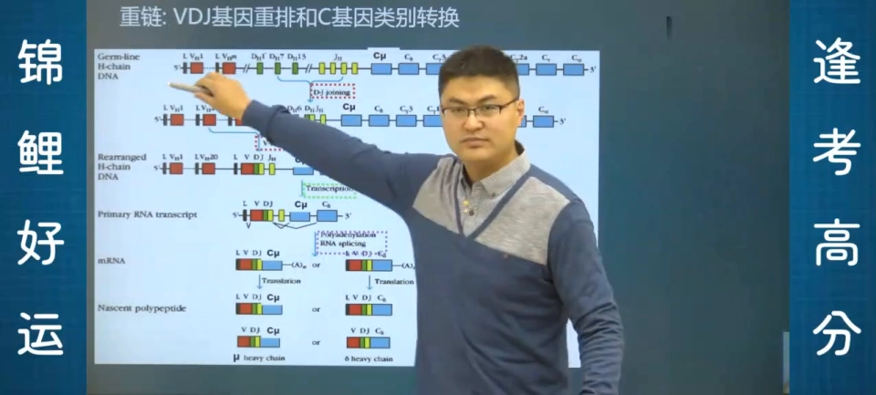

注意这张图的读法：**同一行是一个层级**。第一行是胚系 DNA；第二行是重排后的 DNA（中间那些没被选中的片段已经被删掉）；第三行是初级转录本（pre-mRNA）；第四行是成熟 mRNA；第五行才是新生多肽链。看懂这张图，后面所有讨论都只是在这张图上"放大某一步"。

视频用了一个很好用的比喻：这就像打麻将或扑克牌——**同一个花色里有很多张牌**，每个"区"（V 区、D 区、J 区）就是一个花色 [【跳转到 01:29】](https://www.bilibili.com/video/BV1VM411c769/?t=89)。重排要做的事，就是从每个花色里各抽一张，拼成一手牌。

那么各花色分别有哪些牌？

- **重链**：V、D、J 三组片段，可变区由"一个 V + 一个 D + 一个 J"拼成；
- **轻链**：只有 V 和 J 两组片段（没有 D），可变区由"一个 V + 一个 J"拼成 [【跳转到 02:32】](https://www.bilibili.com/video/BV1VM411c769/?t=152)；
- **恒定区**：由 C 区基因编码，不参与片段拼接。

轻链"少一个区、少一个步骤"，是理解重轻链差异的第一把钥匙。

## 二、重排的顺序：重链先 D-J 再 V-DJ，轻链一步 V-J

重链的可变区要拼三段，但它不是三段一起接，而是**分两步**：

1. **D-J 连接**：先抽一个 D、抽一个 J，把它们接起来。视频假设抽到的是 $D_H7$ 和 $J_H2$ [【跳转到 01:41】](https://www.bilibili.com/video/BV1VM411c769/?t=101)。
2. **V-DJ 连接**：再把一个 V 接到已经成型的 D-J 上 [【跳转到 02:18】](https://www.bilibili.com/video/BV1VM411c769/?t=138)。

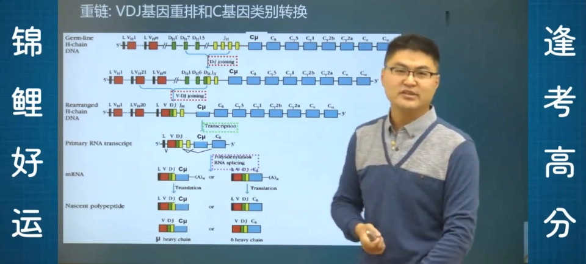

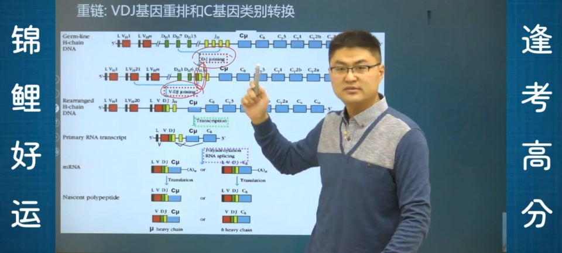

这里有一个容易被忽略的要点：**一旦 D 和 J 接上，这个组合就固定下来了**，那个 D 不会再回头去和别的 J 发生关系 [【跳转到 02:02】](https://www.bilibili.com/video/BV1VM411c769/?t=122)。重排是"一次性、不可逆"的删除式操作，不是可以反复试错的编辑。

轻链则简单一步：**V-J 直接连接**，然后接上 C 区 [【跳转到 02:32】](https://www.bilibili.com/video/BV1VM411c769/?t=152)。

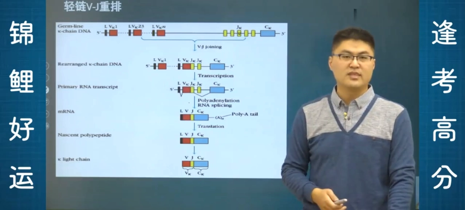

所以两条链的完整"拼装路线"是：

$$
\text{重链：} D\text{-}J \;\rightarrow\; V\text{-}DJ \;\rightarrow\; V\text{-}D\text{-}J\text{-}C
$$

$$
\text{轻链：} V\text{-}J \;\rightarrow\; V\text{-}J\text{-}C
$$

**为什么必须是这个顺序，而不能先 V-D 再 J？** 第二节先记住"就是这样"，第七节讲完 RSS 的位置就会明白：这不是约定俗成，而是**标签位置决定的物理必然**。

## 三、时间与场所：重链先于轻链，发生在骨髓里的祖 B 到前 B 阶段

把镜头从 DNA 拉到细胞层面。重排不是随时都能发生，它有严格的时间表 [【跳转到 02:51】](https://www.bilibili.com/video/BV1VM411c769/?t=171)：

- **祖 B 细胞（pro-B）→ 前 B 细胞（pre-B）**：先完成**重链**基因重排；
- **前 B 细胞 → 未成熟 B 细胞**：再完成**轻链**基因重排。此时轻链一开始并不是真正的轻链，而是"重链 + **替代轻链**"凑成的临时受体，后来替代轻链才被真正的轻链替换 [【跳转到 03:14】](https://www.bilibili.com/video/BV1VM411c769/?t=194)；
- **未成熟 B 细胞 → 成熟 B 细胞**：得到最终使用的免疫球蛋白。

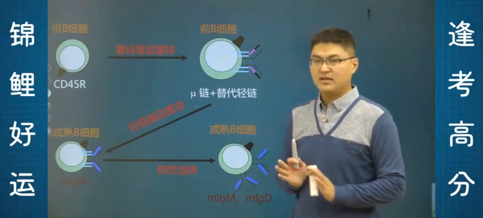

**为什么重链必须先做？** 因为轻链要和重链配对才能形成受体；如果重链都拼不出来，这条细胞就没有继续发育的资格。这个"先重后轻"的次序，本质上是一个**检查点设计**：每一步都先验证上一步的产物，通过了才允许走下一步。

## 四、DNA 层面拼片段，RNA 层面接恒定区

这是全课最值得记住的一条分界线 [【跳转到 03:44】](https://www.bilibili.com/video/BV1VM411c769/?t=224)：

| 步骤 | 发生水平 | 结果 |
| :--- | :--- | :--- |
| D-J 连接、V-DJ 连接 | DNA | 基因组 DNA 被永久改写，中间片段被删除 |
| 接上 C 区 | RNA | pre-mRNA 剪接，V 区外显子拼到 C 区外显子上 |
| 翻译 | 胞质 | 得到重链或轻链多肽 |

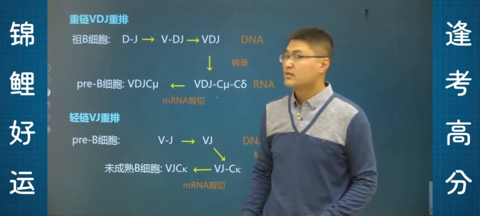

幻灯片上写得很清楚：祖 B 细胞阶段 $D\text{-}J \rightarrow V\text{-}DJ \rightarrow VDJ$，标注的是 **DNA**；随后"转录"到 pre-B 细胞阶段出现 $VDJ\text{-}C\mu$ 与 $VDJ\text{-}C\mu\text{-}C\delta$，标注的是 **RNA**，再经 mRNA 剪接成熟。轻链同理：前 B 细胞阶段 $V\text{-}J \rightarrow VJ$ 在 DNA 水平，未成熟 B 细胞阶段 $VJ\text{-}C\kappa$ 在 RNA 水平 [【跳转到 03:44】](https://www.bilibili.com/video/BV1VM411c769/?t=224)。

**为什么这个区分重要？** 因为它决定了"哪些改变可以遗传给子代细胞、哪些不能"：DNA 层面的重排是**不可逆的基因组改变**，会随细胞分裂传给所有后代；RNA 层面的剪接只是**同一份 DNA 的不同读法**，不改变基因组。同一份重排后的 DNA，通过不同的剪接可以产出膜型 IgM 或 IgD（见第十节）。

> **不要和体细胞高频突变混为一谈。** 本节讲的重排发生在 B 细胞**发育早期**，是把现成的片段拼起来；体细胞高频突变发生在 B 细胞被抗原激活之后的生发中心里，靠 AID 在已经拼好的可变区上做**单核苷酸替换**。前者改的是"片段的排列"，后者改的是"排列好之后的字母"。两者时间、地点、分子机制都不同。

## 五、谁在切和接：只在早期 B 细胞里上班的重组酶

片段不会自己跳到一起，需要一套酶来执行。视频把执行者称为**重组酶**——具体包括**重组酶 1 和重组酶 2** 两种（即 RAG1 与 RAG2），它们以二聚体的形式工作 [【跳转到 04:34】](https://www.bilibili.com/video/BV1VM411c769/?t=274)。

这套酶有两个"特异性"，正是重排受控的关键：

- **细胞特异性**：只在**早期 B 淋巴细胞**中表达，别的细胞没有；
- **时间特异性**：只限于发育早期，到了后期就不再表达——"它的使命就是把需要的基因片段组合在一起，组合完了，使命就结束了" [【跳转到 04:59】](https://www.bilibili.com/video/BV1VM411c769/?t=299)。

**敲除实验的旁证**：把重组酶的基因敲掉，小鼠完全不能产生免疫球蛋白分子，不但形不成完整的 B 细胞，连 T 细胞也没有——因为 T 细胞的表面受体 TCR 同属免疫球蛋白超家族，也要靠同一套酶重排 [【跳转到 06:03】](https://www.bilibili.com/video/BV1VM411c769/?t=363)。这种小鼠是彻底的免疫缺陷，比裸鼠或 SCID 小鼠更彻底，也无法存活 [【跳转到 06:28】](https://www.bilibili.com/video/BV1VM411c769/?t=388)。

这个实验说明一件事：**重排不是"锦上添花"的多样性机制，而是淋巴细胞能否建成的必要条件**。

## 六、RSS：给每个片段贴上"可以切这里"的标签

重组酶怎么知道该切哪儿？靠片段旁边的**重组信号序列（RSS, recombination signal sequence）**。视频的说法很直白：有 RSS 的片段，重组酶才知道"它是我要操作的对象"；没有 RSS 的，重组酶不会对它做任何操作 [【跳转到 05:24】](https://www.bilibili.com/video/BV1VM411c769/?t=324)。

**RSS 长什么样？** 它由三段组成：

$$
\text{RSS} \;=\; \underbrace{\text{七聚体}}_{7\ \text{nt}} \;-\; \underbrace{\text{间隔}}_{12\ \text{或}\ 23\ \text{nt}} \;-\; \underbrace{\text{九聚体}}_{9\ \text{nt}}
$$

其中七聚体（7 个核苷酸）和九聚体（9 个核苷酸）是**高度保守**的，中间间隔的长度**只有 12 或 23 两种可能**，不会出现别的数字 [【跳转到 08:00】](https://www.bilibili.com/video/BV1VM411c769/?t=480)。

**RSS 长在片段的哪一端？** 这一点决定了整个重排的几何形状 [【跳转到 07:10】](https://www.bilibili.com/video/BV1VM411c769/?t=430)：

- **V 片段**：RSS 只在 **3' 端**；
- **D 片段**：**两侧各有一个**（一侧用于先做 D-J，另一侧留给随后的 V-DJ）；
- **J 片段**：**两端都有**。

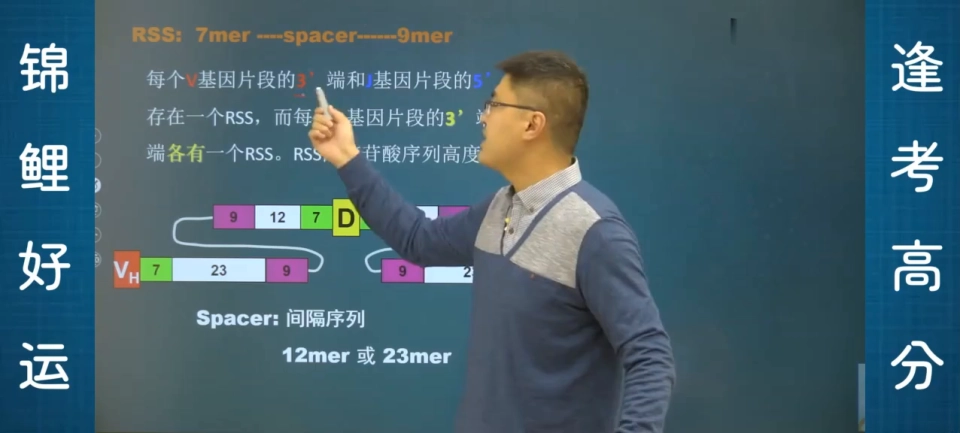

"RSS 的位置不会错"，所以拼装时"头就会装在最上面，脚就会装在最下面"——V 一定在最 5' 端，J 一定在 3' 端，中间夹着 D [【跳转到 10:40】](https://www.bilibili.com/video/BV1VM411c769/?t=640)。**这就是第二节那个"顺序为什么不能颠倒"的答案**：不是细胞记得顺序，而是标签的位置让别的顺序在物理上无法发生。

## 七、12/23 规则：为什么 V 不能直接连 V

如果只要求"有 RSS 就能切"，那么同一排里的两个 V 片段也能互相连接，结果就是 V 区被拼坏。细胞用一条简单规则堵住了这个漏洞：**只有间隔为 12 nt 的 RSS 与间隔为 23 nt 的 RSS 之间才能发生重组**，间隔相同的两个片段不能配对 [【跳转到 08:55】](https://www.bilibili.com/video/BV1VM411c769/?t=535)。

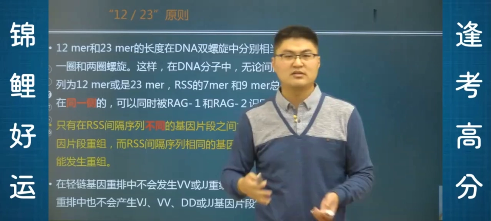

**为什么是 12 和 23 这两个数字？** 视频给了一个漂亮的几何解释 [【跳转到 08:30】](https://www.bilibili.com/video/BV1VM411c769/?t=510)：

- 视频给的记法是：DNA 双螺旋**转一圈对应 12 个核苷酸，两圈四舍五入就是 23 个**；
- 于是 12 nt 的间隔正好让七聚体和九聚体处在螺旋的**同一侧**，23 nt 的间隔绕两圈后也让两者处在**同一侧**；
- 只有当七聚体和九聚体落在**同一个平面**上并排时，重组酶才能同时"看见"它们——就像看一个物体，得正面并排才看得见，被挡住就看不见 [【跳转到 09:25】](https://www.bilibili.com/video/BV1VM411c769/?t=565)。

所以 12 与 23 不是随便定的数字，而是"**让标签朝向同一面**"所需的螺旋周期。两种不同间隔的 RSS 各朝一面、正好相对，才构成一个可以被 RAG 抓住的完整底物。

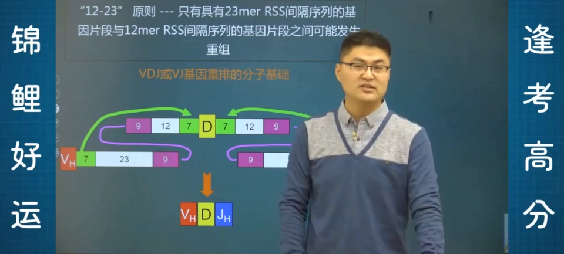

这条规则的推论非常干净：

- 轻链里，V 与 J 的 RSS 间隔一为 12、一为 23，所以 **V-J 能连，V-V 和 J-J 不能连**；
- 重链里，D 片段两侧的间隔与 V、J 相反，所以**先 D-J、再 V-DJ**，而 V-V、D-D、J-J 都被禁止。

**一句话总结**：RSS 决定"能切哪里"，12/23 规则决定"能和谁切"，两者的组合把重排限制成唯一合法的拼装路径。

## 八、片段选择是随机的：一次热运动造成的"碰撞"

规则解决了"能怎么连"，但没解决"这一次为什么选了这个 V"。视频的答案是：**没有选择，只有碰撞** [【跳转到 11:17】](https://www.bilibili.com/video/BV1VM411c769/?t=677)。

在细胞核里，DNA 分子不停做热运动，每一个瞬间的形状都不一样。某一个瞬间，某个 V 片段和某个 J 片段可能正好靠得很近；恰巧重组酶也通过热运动飘到那儿、碰到了 DNA——就在这一瞬间，这两个片段被切开并连接起来 [【跳转到 12:07】](https://www.bilibili.com/video/BV1VM411c769/?t=727)。

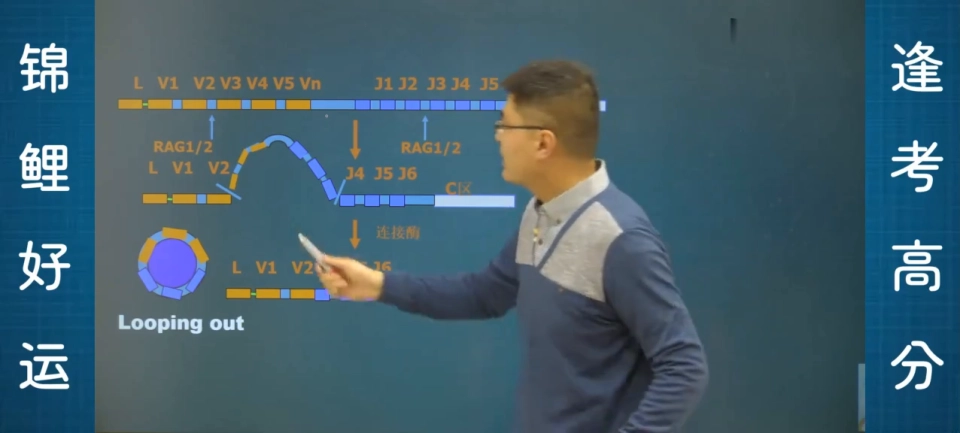

被切下来的中间部分会**环化成环形 DNA 并被降解**——"没有用了，不要了"，两头则被连接酶接上 [【跳转到 12:32】](https://www.bilibili.com/video/BV1VM411c769/?t=752)。注意这张图上的 **looping out（环出）**：DNA 是靠"弯过来"实现远距离片段相遇的，这也解释了为什么 V 和 J 之间隔着那么长的序列却还能接上。

于是不同的细胞会得到不同的组合：这个细胞是 $V2\text{-}J4$，那个细胞可能是 $V1\text{-}J5$，一旦接上就"从此固定下来" [【跳转到 13:03】](https://www.bilibili.com/video/BV1VM411c769/?t=783)。

**这套随机机制怎么保证组合被穷举？** 靠数量：个体发育时体内有数以万计、数以亿计的 B 细胞同时发育，它们的随机事件合起来会穷举所有组合，所以理论上每一个片段都不会被浪费 [【跳转到 13:28】](https://www.bilibili.com/video/BV1VM411c769/?t=808)。这就是"少量基因编码海量受体"的底层逻辑——**不是每个细胞都聪明，而是细胞足够多**。

## 九、两条"不许重复"的规矩：等位排斥与同种型排斥

随机碰撞会带来一个新问题：如果一个 B 细胞的两条同源染色体都完成重排、都表达出来，这个细胞表面就会挂两种不同特异性的受体，下游的克隆扩增与耐受筛选都会乱套。细胞的对策是两条规矩 [【跳转到 14:02】](https://www.bilibili.com/video/BV1VM411c769/?t=842)：

- **等位排斥（allelic exclusion）**：两条同源染色体上的两个等位基因，**只有一个能够表达**；
- **同种型排斥（isotype exclusion）**：轻链的 $\kappa$ 与 $\lambda$ 两型，一个 B 细胞只选其中一型表达。

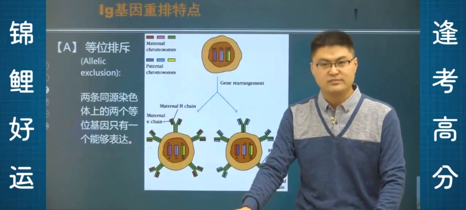

视频对这一点讲得比较简略，只说明它"是分子生物学、遗传学上讲过的内容，免疫学不再作为重点" [【跳转到 14:10】](https://www.bilibili.com/video/BV1VM411c769/?t=850)。但它的意义值得记住：**一个 B 细胞 = 一种特异性**，这是克隆选择学说能够成立的结构前提；如果受体可以混搭，克隆的概念就不存在了。

## 十、拼完之后：膜型 IgM 与 IgD 成为 BCR

重排只是把基因拼好，还要表达成蛋白。重链和轻链分别进入**内质网**，带着信号肽经由内质网、高尔基体走分泌蛋白的老路 [【跳转到 14:22】](https://www.bilibili.com/video/BV1VM411c769/?t=862)。

最终同一个 B 细胞表面会同时出现**膜型 IgM 和膜型 IgD**，其中 IgM 就是 B 细胞抗原受体（BCR）[【跳转到 14:45】](https://www.bilibili.com/video/BV1VM411c769/?t=885)。

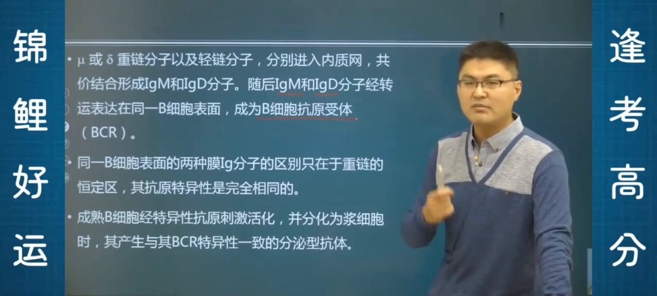

关键结论：**这两种膜型免疫球蛋白的区别仅限于重链的恒定区，它们的抗原特异性完全相同**；而且这个 B 细胞将来分泌的抗体，其抗原特异性也与表面的 BCR 完全一致 [【跳转到 15:10】](https://www.bilibili.com/video/BV1VM411c769/?t=910)。

为什么"完全相同"？因为可变区是同一份重排后的 DNA 编码的，IgM 与 IgD 的区别只来自 RNA 水平上接了不同的 C 区外显子（$C\mu$ 或 $C\delta$）——这正好呼应第四节那条分界线：**DNA 决定"认谁"，RNA 剪接决定"以什么形式出现"**。

## 小结

- **可变区是拼出来的，不是写好的**：胚系 DNA 里 V、D、J 是分散的片段群，重排从中各选一个拼成完整可变区外显子。
- **顺序固定**：重链先 D-J 再 V-DJ，最后在 RNA 水平接 C 区；轻链只有一步 V-J。顺序由 RSS 的位置决定，而非细胞"记得"。
- **两个层次要分清**：片段拼接在 DNA 水平、不可逆；接恒定区在 RNA 水平、靠剪接。前者改基因组，后者只是不同的读法。
- **RSS 是标签，12/23 是配对规则**：七聚体—间隔（12 或 23 nt）—九聚体；只有 12 与 23 配对才能重组，因此 V-V、J-J、D-D 被天然禁止。
- **执行者是 RAG1/RAG2**：只在早期淋巴细胞的特定阶段表达，敲除后 B、T 细胞都建不成。
- **片段选择靠随机碰撞**：DNA 热运动让远距离片段靠近，环出、切除、连接；靠上亿个 B 细胞并行发育穷举组合。
- **一个细胞只用一套**：等位排斥与同种型排斥保证"一个 B 细胞一种特异性"。
- **与体细胞高频突变划清界限**：重排发生在发育早期的骨髓里，改的是片段排列；高频突变发生在抗原激活后的生发中心，改的是已拼好序列上的单个碱基。

## 关键术语速查

| 术语 | 一句话解释 |
| :--- | :--- |
| 胚系基因（germline） | 未发生重排的生殖细胞状态 DNA，V/D/J 片段分散排列 |
| 基因重排（gene rearrangement） | 把分散的片段剪切、连接成完整可变区外显子的过程 |
| V / D / J 片段 | 编码可变区的基因片段组；重链有 V、D、J，轻链只有 V、J |
| RSS（重组信号序列） | 片段旁的"可切"标签，由七聚体、12 或 23 nt 间隔、九聚体组成 |
| 12/23 规则 | 只有间隔为 12 nt 与 23 nt 的两个 RSS 之间才能发生重组 |
| RAG1 / RAG2 | 执行 V(D)J 重排的重组酶，只在早期淋巴细胞中表达 |
| 环出（looping out） | DNA 弯曲使远距离片段靠近，被切下的中间序列环化后降解 |
| 等位排斥 | 两条同源染色体上的 Ig 等位基因只有一个被表达 |
| 同种型排斥 | 一个 B 细胞只表达 κ 或 λ 其中一种轻链 |
| 替代轻链 | 重链重排完成、真轻链尚未重排时，临时与重链配对形成前 B 细胞受体 |
| 体细胞高频突变 | 抗原激活后在生发中心对已重排可变区做的单碱基替换，与重排机制不同 |