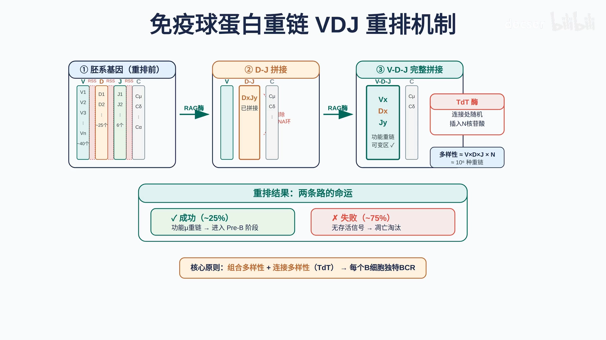
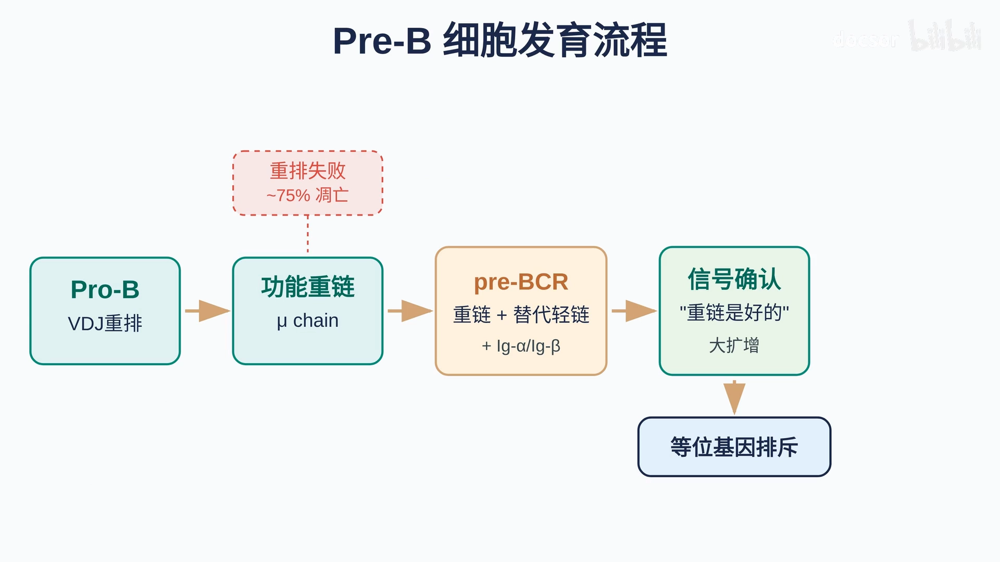
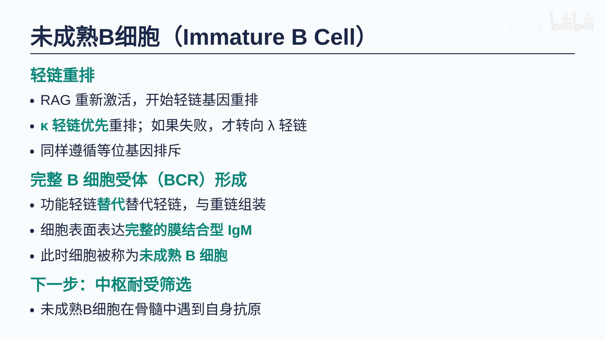
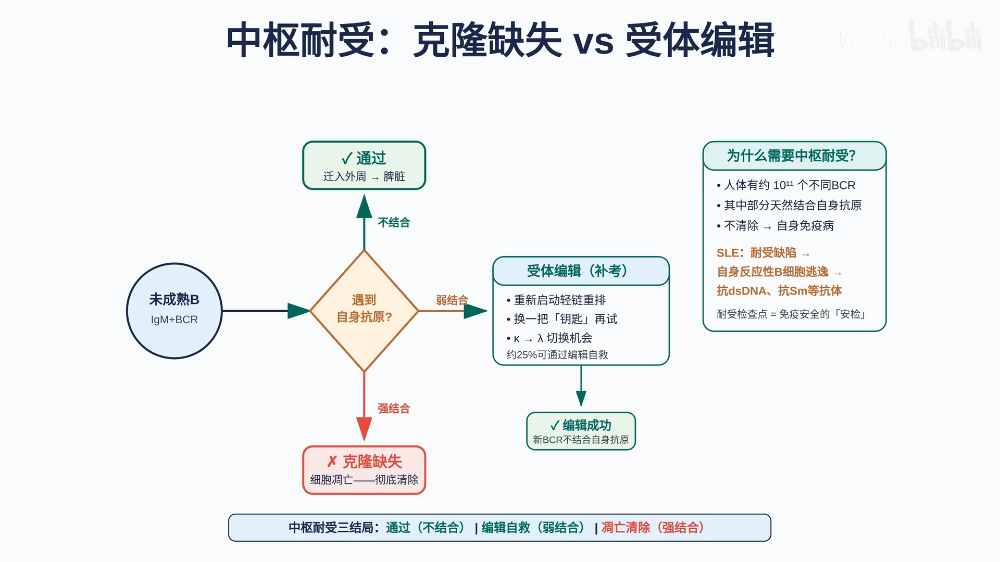
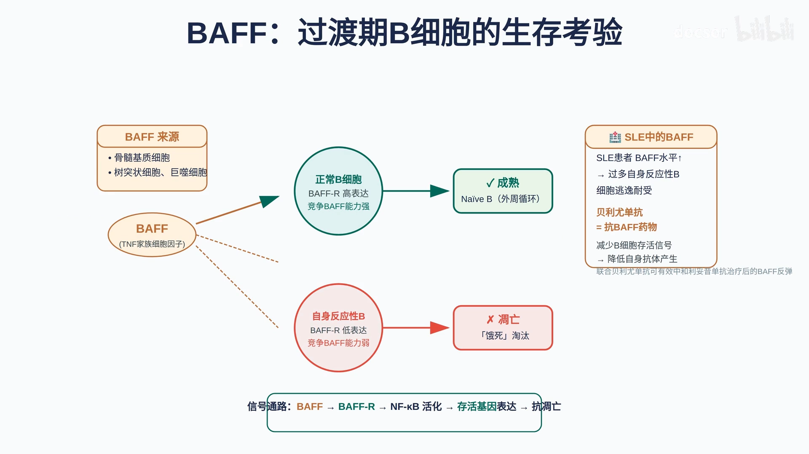
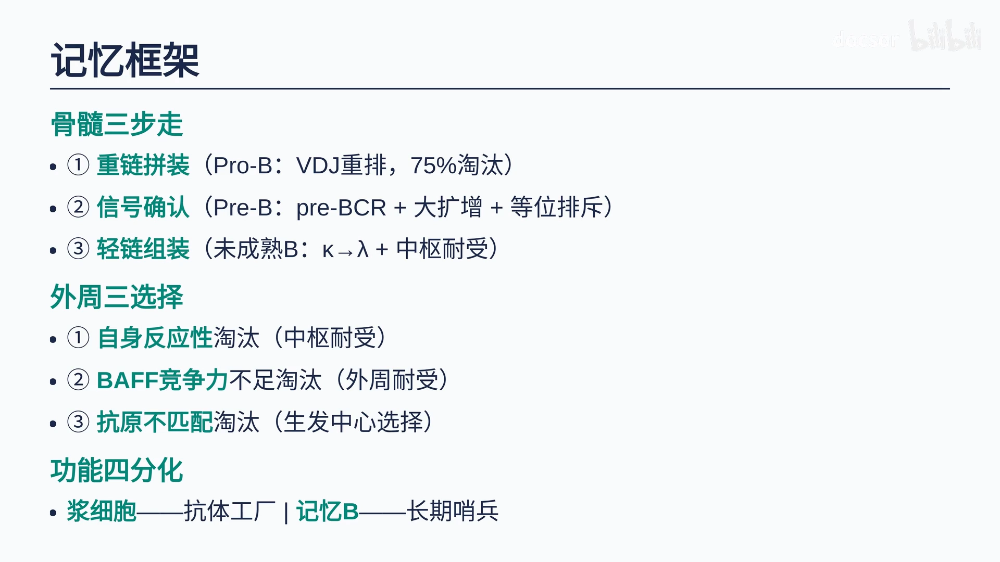

# 从理论组合到可用抗体库：B 细胞发育中的三重筛选

> 视频来源：[为什么你的抗体不会攻击自己？B 细胞发育的筛选逻辑（Bilibili）](https://www.bilibili.com/video/BV1mF5m6UEdo/)，UP 主「docsor」（Doctor Q 免疫学基础系列），时长 11:35。本文基于视频演说图文稿整理，时间戳可跳转到对应讲解。
>
> 导读：这支视频按「骨髓三步走 → 外周三选择 → 功能四分化」的框架讲完 B 细胞发育全过程。本文只把与**抗体多样性如何被"筛"出来**相关的部分讲透（重排的产出率、等位基因排斥、中枢耐受的克隆缺失与受体编辑、BAFF 竞争），活化信号、CD 分子与疾病部分压缩为背景，避免与相邻小节重复。

## 本讲要解决的核心问题（SCQA）

**背景**：上一小节算过，V(D)J 重排的组合多样性 + 连接多样性，仅重链理论上就能凑出约 $10^6$ 种；再乘上轻链，理论抗体库可达 $10^{11}$ 量级。

**冲突**：但"能造出"不等于"能用"。随机拼接必然造出大量废受体；更麻烦的是，随机组合里**一定包含识别自身抗原的受体**——如果放任它们出去，免疫系统就会攻击自己。

**疑问**：从一条重排好的基因，到一个真正可用的、不攻击自身的 B 细胞，中间要过几道关？每一道关筛掉什么、留下什么？理论组合数与体内实际库的差距是怎么形成的？

**回答（中心思想）**：B 细胞发育是一条**"先造多样性、再层层筛选"**的流水线。三道关键关卡——① **重排本身的成功率**（约 75% 的祖 B 细胞因重排失败而凋亡）；② **中枢耐受**（强结合自身抗原的克隆被删除，中等亲和力的靠受体编辑自救）；③ **外周竞争**（BAFF 存活信号不足者被淘汰）——把 $10^{11}$ 量级的理论组合压成一个**自身安全、单一特异性**的实际库。**多样性是"造"出来的，可用性是"筛"出来的。**

## 一、骨髓三步走：多样性在这里被造出来，也在这里被削掉大半

[【跳转到 00:16】](https://www.bilibili.com/video/BV1mF5m6UEdo/?t=16)

视频把 B 细胞发育分成**中枢发育（骨髓）→ 外周成熟 → 功能分化**三个阶段 [【跳转到 00:06】](https://www.bilibili.com/video/BV1mF5m6UEdo/?t=6)。进入重排之前还有一步"锁定身份"：转录因子 E2A 先启动 B 细胞程序基因，EBF1 随后激活最关键的 **Pax5**——它像一把双向锁，一面开启 B 细胞特有基因，一面主动关闭其他谱系基因，把细胞牢牢锁在 B 命运上 [【跳转到 00:21】](https://www.bilibili.com/video/BV1mF5m6UEdo/?t=21)。

视频把骨髓里的发育概括为三步，每一步都同时"造"和"筛"：

| 步骤 | 细胞阶段 | 核心事件 | 该步的筛选 |
| --- | --- | --- | --- |
| ① 重链拼装 | Pro-B（祖 B 细胞） | 重链 VDJ 重排 | 约 75% 因重排失败凋亡 |
| ② 信号确认 | Pre-B（前 B 细胞） | pre-BCR 组装、大扩增、等位基因排斥 | 无功能重链被淘汰 |
| ③ 轻链组装 | Immature B（未成熟 B 细胞） | 轻链重排（κ 优先，失败转 λ）+ 中枢耐受 | 自身反应性克隆被删除或编辑 |

### 1.1 第一步：重链重排——$10^6$ 种理论组合，75% 当场出局

[【跳转到 01:22】](https://www.bilibili.com/video/BV1mF5m6UEdo/?t=82)

祖 B 细胞的核心任务是**免疫球蛋白重链的 VDJ 重排**：RAG 重组酶先催化 D–J 拼接，再完成 V–DJ 三段组装；**TdT（末端脱氧核苷酸转移酶）在连接处随机插入核苷酸**，贡献连接多样性。

组合多样性 × 连接多样性，重链理论上的组合可达约 $10^6$ 种：

$$
\text{重链多样性} \approx V \times D \times J \times N \approx 10^{6}
$$

但幻灯片下半部分写得很直白——**重排有两条路**：

- **成功（约 25%）**：产生功能性的 μ 重链，进入 Pre-B 阶段；
- **失败（约 75%）**：没有存活信号，凋亡淘汰。

原因就是上一小节讲过的"不精确连接"：插入/缺失一旦让读码框错位或造出终止密码子，重链就是废的。**这就是理论组合数与实际库之间的第一道折扣，而且折扣很大。**

再把视野拉长：从造血干细胞到成熟 B 细胞，**总体成活率仅约 5%–10%** [【跳转到 01:47】](https://www.bilibili.com/video/BV1mF5m6UEdo/?t=107)。视频用了一个比喻：大多数"考生"在第一关就折了。

### 1.2 第二步：pre-BCR 信号与等位基因排斥——一个细胞只认一种抗原

[【跳转到 02:26】](https://www.bilibili.com/video/BV1mF5m6UEdo/?t=146)

重排出功能重链之后，它还不能单独上阵：重链先与**替代轻链**（视频口播为"拉姆达五"，即 λ5 一类的替代轻链成分）以及 Ig-α/Ig-β 组装成**前 B 细胞受体（pre-BCR）**。pre-BCR 传递两个核心信号：

1. **确认重链是有功能的**（"这把钥匙能用"）；
2. **触发大规模扩增**——一个成功的重排可以产生数十个拷贝，进入下一轮。

紧接着启动**等位基因排斥（allelic exclusion）**：一条染色体上的重链重排成功后，另一条同源染色体上的重链等位基因被"锁定"、不再重排。

**这一步为什么对"多样性 vs 实际库"很关键？** 因为等位基因排斥是**"一个 B 细胞，一种受体"**原则的分子基础。理论组合数是按"可能的重链 × 可能的轻链"算的，但每个 B 细胞最终只兑现其中**一个**组合。组合空间是"彩票池"，每个细胞只买一张。

### 1.3 第三步：轻链重排——κ 优先，失败再转 λ

[【跳转到 03:12】](https://www.bilibili.com/video/BV1mF5m6UEdo/?t=192)

Pre-B 细胞重新激活 RAG，进入**轻链重排**：

- **κ 轻链优先**启动；如果失败，才转向 **λ 轻链**；
- 轻链同样遵循等位基因排斥；
- 正常 B 细胞中 **κ : λ 比例约为 2 : 1**——这个比例正是"κ 先试、λ 兜底"这套顺序策略留下的痕迹。

功能轻链**取代**替代轻链，与重链组装成完整的**膜结合型 IgM**，细胞表面第一次出现完整的 B 细胞受体（BCR）。此时细胞被称为**未成熟 B 细胞**。

注意这里又出现一次"配对"的机会：同一个重链可以配不同的轻链，**配不上或配不好的组合会被换掉**——轻链的 κ→λ 二次尝试，本质上就是给重链再找一次配对机会。

## 二、中枢耐受：把"打自己"的克隆挡在骨髓里

[【跳转到 03:37】](https://www.bilibili.com/video/BV1mF5m6UEdo/?t=217)

未成熟 B 细胞表面已经有了完整的 IgM-BCR，接下来要面对**中枢耐受（central tolerance）**这道关卡。它的本质是：**在 B 细胞离开骨髓之前，筛掉会攻击自身的克隆。**

这一步之所以必须存在，是因为多样性是"穷举式"造出来的——视频在幻灯片里直接写明：

> 人体约有 $10^{11}$ 个不同 BCR；其中部分**天然结合自身抗原**；不清除 → 自身免疫病。

未成熟 B 细胞遇到自身抗原后，按**结合强度**分成三种结局：

| 遇到自身抗原 | 结局 | 机制 |
| --- | --- | --- |
| **不结合** | 通过，迁入外周（脾脏） | 安全，放行 |
| **弱结合** | **受体编辑（receptor editing）** 自救 | 重新启动轻链重排，换一把"钥匙"再试；κ→λ 切换提供机会；约 25% 可通过编辑自救 |
| **强结合** | **克隆缺失（clonal deletion）** | 细胞凋亡，彻底清除 |

**受体编辑**这个概念值得多说一句：它不是"改造已有的抗体"，而是**重新做一次轻链重排**，用一条新的轻链去替换那条让 BCR 结合自身的轻链。重链不变、轻链换掉，特异性就变了——这是免疫系统在"保留一个已经通过重链检查的细胞"和"消除自身反应性"之间找的折中方案。

幻灯片右下角还给了一个临床对照：**SLE（系统性红斑狼疮）**患者存在耐受缺陷，自身反应性 B 细胞得以逃逸，产生抗 dsDNA、抗 Sm 等自身抗体。**耐受检查点相当于免疫安全的"安检"**——安检失效，后果就是自身免疫病。

## 三、外周选择：BAFF 竞争决定谁能活到成熟

[【跳转到 04:21】](https://www.bilibili.com/video/BV1mF5m6UEdo/?t=261)

通过耐受检查的 B 细胞迁移到脾脏，经历 T1、T2、T3 三个**过渡期**。这一段的关键调控分子是 **BAFF（B 细胞激活因子，B-cell activating factor）**：它通过 BAFF 受体激活 **NF-κB** 通路，传递存活信号。

关键在于：**BAFF 的总量是有限的**，B 细胞之间必须竞争。

- **正常 B 细胞**：BAFF-R 高表达，竞争 BAFF 能力强 → 成熟为初始 B 细胞，进入外周循环；
- **自身反应性 B 细胞**：BAFF-R 低表达，竞争能力弱 → "饿死"淘汰。

这条曲线还解释了自身免疫病的一个机制：**BAFF 浓度过高时，原本应当被淘汰的自身反应性 B 细胞也能活下来**。SLE 患者 BAFF 水平升高，正是自身反应性 B 细胞逃逸耐受的原因之一；**贝利尤单抗（belimumab）**就是通过中和 BAFF 来恢复平衡。视频还提到一个用药细节：利妥昔单抗（抗 CD20）使用后 BAFF 会反弹，联合贝利尤单抗可以协同抑制。

**这就是理论库与实际库之间的第三道折扣**：即便一个克隆通过了中枢耐受，它还要在外周抢到有限的存活信号，才能进入真正可用的初始 B 细胞库。

## 四、把三道筛选串起来：多样性被"造"出来，也被"筛"出来

[【跳转到 09:04】](https://www.bilibili.com/video/BV1mF5m6UEdo/?t=544)

视频最后用一个"记忆框架"把全过程压成 **三步走、三选择、四分化**：

**骨髓三步走**

1. **重链拼装**：Pro-B 期 VDJ 重排，约 75% 淘汰；
2. **信号确认**：Pre-B 期 pre-BCR + 大扩增 + 等位基因排斥；
3. **轻链组装**：未成熟 B 期 κ→λ + 中枢耐受。

**三选择（把理论组合压成可用库的三道关）**

1. **自身反应性淘汰**（中枢耐受）——强结合者克隆缺失，弱结合者受体编辑；
2. **BAFF 竞争力不足淘汰**（外周耐受）——抢不到存活信号的克隆死亡；
3. **抗原不匹配淘汰**（生发中心选择）——这一段属于后续小节（体细胞高频突变与亲和成熟），这里只记一句：**通过前两关的 B 细胞被抗原激活后，还要在生发中心里按亲和力再比一轮**。

**功能四分化**：浆细胞（抗体工厂）、记忆 B 细胞（长期哨兵）、调节性 B 细胞、边缘区 B 细胞。

### 4.1 一张表看清"理论 vs 实际"

| 环节 | 理论上的量 | 实际剩下的 |
| --- | --- | --- |
| 重链 VDJ 重排 | 组合 × 连接 ≈ $10^6$ 种 | 约 25% 重排成功，75% 凋亡 |
| 轻链重排 + 配对 | 轻链数百种 × 重链数千种 | κ 优先、λ 兜底；κ:λ ≈ 2:1；不稳定配对被换掉 |
| 单个 B 细胞 | 可表达的组合很多 | 等位基因排斥 → **只表达一种** BCR |
| 中枢耐受 | 约 $10^{11}$ 个不同 BCR 中相当一部分天然结合自身 | 强结合删除、弱结合编辑（约 25% 可自救） |
| 外周成熟 | 通过耐受的克隆都算"合格" | BAFF 有限，竞争失败者淘汰 |
| 整体 | 从 HSC 到成熟 B 细胞 | **成活率仅约 5%–10%** |

一句话总结：**"理论上 $10^{11}$ 种"描述的是重排能造出的可能性空间；"实际可用的库"是这套空间经过成功率、等位排斥、耐受与竞争四重过滤后的剩余。** 两者相差好几个数量级，而这个差距恰恰是免疫系统安全性的来源——**多样性负责"认得出"，筛选负责"不打自己"。**

## 五、背景：通过筛选之后发生了什么（简述）

[【跳转到 06:28】](https://www.bilibili.com/video/BV1mF5m6UEdo/?t=388)

为保持全片完整，简要记录后续环节（详细机制属于相邻小节，不在此展开）：

- **B 细胞活化需要三个信号**：① BCR 识别抗原、内化加工并以 MHC II 类分子呈递；② 辅助性 T 细胞的 TCR 识别"抗原肽–MHC II"复合物，同时 CD40L 与 B 细胞 CD40 结合；③ 辅助性 T 细胞分泌 IL-4、IL-21 指导增殖与类别转换。只有信号一时（非 T 细胞依赖应答）仅产生低亲和力 IgM。
- **生发中心**：暗区中心母细胞高速增殖并发生**体细胞高频突变**（突变率约 1‰，是人体最高的生物学突变率之一），明区中只有亲和力提高的 B 细胞才能存活——本质是达尔文式筛选，通常循环多轮 [【跳转到 07:28】](https://www.bilibili.com/video/BV1mF5m6UEdo/?t=448)。
- **CD 分子的三个规律**：CD19 贯穿全程，是最稳定的谱系标志；CD20 从未成熟 B 细胞开始出现、浆细胞阶段消失（利妥昔单抗据此只清除成熟 B 细胞而不影响浆细胞）；浆细胞分化时 CD38、CD138 上调。
- **成熟初始 B 细胞同时表达膜型 IgM 与 IgD**，两者来自同一转录本的差异剪接，**共享完全相同的 VDJ 可变区**——这从另一个角度印证了"一个细胞一种特异性" [【跳转到 05:15】](https://www.bilibili.com/video/BV1mF5m6UEdo/?t=315)。
- **疾病映射**：常见变异型免疫缺陷病（浆细胞分化障碍导致低丙种球蛋白血症）、慢性淋巴细胞白血病（成熟 B 细胞克隆性增殖，按 IgH 可变区是否突变分型）、SLE（耐受缺陷 + BAFF 升高）[【跳转到 10:01】](https://www.bilibili.com/video/BV1mF5m6UEdo/?t=601)。治疗恰恰是对同一发育通路的不同干预：利妥昔单抗靶向 CD20、贝利尤单抗中和 BAFF、BTK 抑制剂阻断 BCR 下游信号。

## 小结

- **重排是"造多样性"，成功率是"第一道折扣"**：重链理论组合约 $10^6$ 种，但约 75% 的祖 B 细胞因重排失败凋亡，从 HSC 到成熟 B 细胞总体成活率仅 5%–10%。
- **pre-BCR 检查 + 等位基因排斥**确认重链可用并锁定"一个 B 细胞一种受体"，使组合空间不能靠单细胞同时表达多种受体来兑现。
- **轻链重排 κ 优先、λ 兜底**（κ:λ ≈ 2:1），同时给重链第二次配对机会。
- **中枢耐受按结合强度分流**：不结合→放行；弱结合→受体编辑（重排轻链换"钥匙"，约 25% 可自救）；强结合→克隆缺失。
- **外周 BAFF 竞争**是第三道关：存活信号有限，弱竞争者淘汰；BAFF 过高则自身反应性克隆逃逸（SLE 机制、贝利尤单抗的靶点）。
- **理论 $10^{11}$ 与实际库差好几个数量级**，这个差距由成功率、等位排斥、耐受、竞争共同造成，也正是免疫安全性的来源。
- **之后还有一轮**：抗原激活后的生发中心里，体细胞高频突变 + 亲和力选择继续打磨这个库（属后续小节）。

## 关键术语速查

| 术语 | 一句话解释 |
| --- | --- |
| 祖 B 细胞（Pro-B） | 骨髓中开始重链 VDJ 重排的阶段 |
| 前 B 细胞（Pre-B） | 表达 pre-BCR、进行大扩增与等位基因排斥的阶段 |
| 未成熟 B 细胞 | 表面已有完整 IgM-BCR、正在接受中枢耐受筛选的阶段 |
| pre-BCR | 重链 + 替代轻链 + Ig-α/Ig-β 组成的"试运行"受体 |
| 等位基因排斥 | 一条等位基因重排成功后抑制另一条，保证单一特异性 |
| 中枢耐受 | 在骨髓中清除或修正自身反应性 B 细胞的机制 |
| 克隆缺失 | 强结合自身抗原的 B 细胞直接凋亡 |
| 受体编辑 | 重新重排轻链、换一个不结合自身的 BCR 来自救 |
| BAFF | B 细胞激活因子，限量供应的外周存活信号 |
| 非生产性重排 | 读码框错位或含终止密码子、无法产生功能受体的重排 |
| 生发中心 | 抗原激活后进行体细胞高频突变与亲和力选择的场所 |