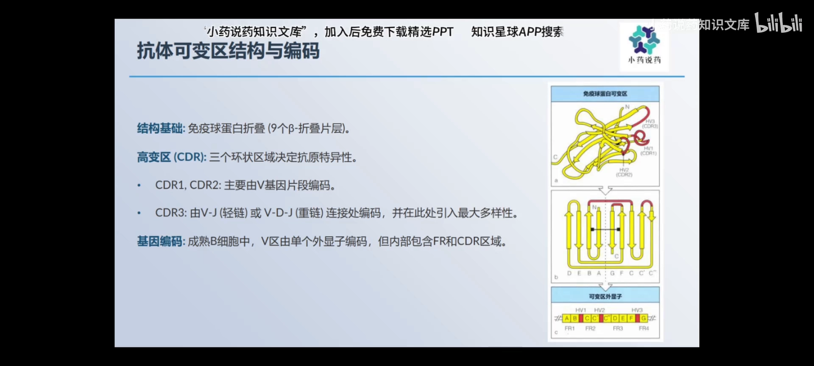
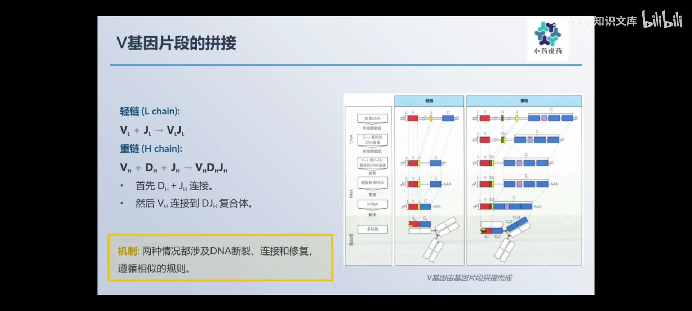
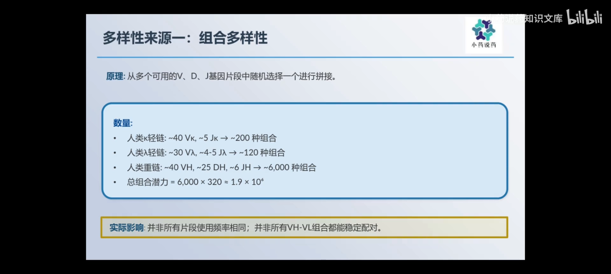
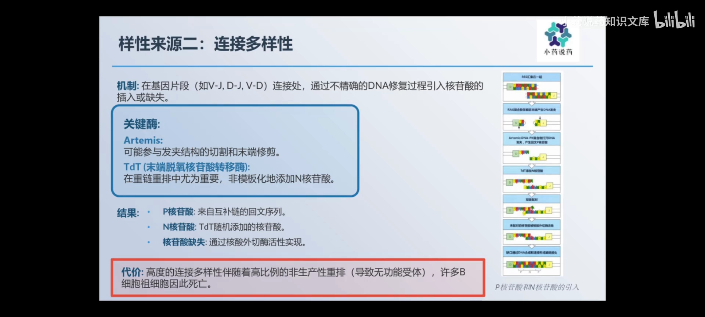
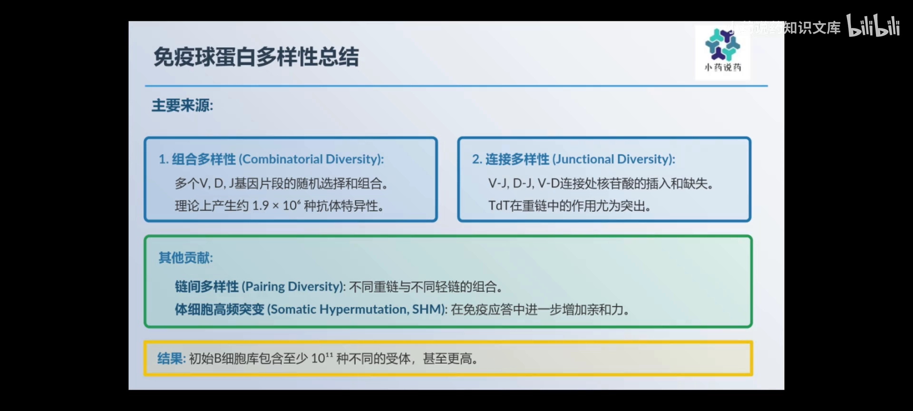

# 抗体可变区多样性：组合、连接与重轻链配对

> 视频来源：[抗体可变区多样性的来源（Bilibili）](https://www.bilibili.com/video/BV1cHprzfEQt/)，UP 主「小药说药知识文库」，时长 9:56。本文基于视频演说图文稿整理，时间戳可跳转到对应讲解。
>
> 导读：这支视频把「抗体为什么能认出无穷多种病原体」拆成可数的几个乘法项：片段组合、接头加工、重轻链配对。它给的是**理论组合数**（约 $1.9\times10^6$，再乘配对到 $10^{11}$），并明确点出「实际没这么简单」——片段使用有偏好、配对未必稳定。RAG/RSS 的分子细节只作背景，重点在多样性来源与理论/实际的落差。

## 本讲要解决的核心问题（SCQA）

**背景**：人体基因组只有两万多个蛋白编码基因，而抗体要面对的病原体几乎是无限的。抗体的可变区（V 区）就是"认脸"的那部分，它必须极度多样。

**冲突**：基因数量有限，抗体种类却号称上万亿。历史上对此有两种猜想——**胚系理论**（每种抗体都在基因里预先写好）与**体细胞突变理论**（基因有限，靠突变造多样性）；单看任何一种都解释不通。

**疑问**：有限的基因到底怎样被"拼"出天文数字的抗体？这些组合数是怎么算出来的？算出来的数字能不能直接当成真实抗体库的大小？

**回答（中心思想）**：可变区的多样性由**三个相乘/相加的来源**构成——① **组合多样性**：从多个 V、D、J 片段里各抽一个拼起来；② **连接多样性**：拼接缝隙处由不精确修复引入 N 核苷酸、P 核苷酸与核苷酸缺失；③ **链间（配对）多样性**：不同的重链与不同的轻链两两组合。三者叠加给出 $10^{11}$ 量级的**理论**受体库；但片段使用频率不均、重轻链配对未必稳定、连接加工又带来大量非生产性重排，所以**理论组合数不等于实际可用的抗体库**。

## 一、先看清可变区长什么样：三个环决定"认谁"

[【跳转到 00:57】](https://www.bilibili.com/video/BV1cHprzfEQt/?t=57)

可变区的骨架是一个**免疫球蛋白折叠**（immunoglobulin fold）：两片 β 折叠（共 9 个 β 折叠片层）像小笼子一样把疏水核心包在里面。真正决定结合特异性的不是笼子本身，而是笼子顶端三个特别灵活的环——**互补决定区（CDR, complementarity-determining region）**。

视频用了一个很形象的比喻：这三个环像手的指关节，形状各异，能捏住各种不同的东西。

三个环的分工不一样：

- **CDR1、CDR2**：主要由 **V 基因片段**编码，序列在胚系里就定好了；
- **CDR3**：由 **V–J（轻链）或 V–D–J（重链）的拼接处**编码，是三个环里变化最大、贡献多样性最多的一个。

这里有一个容易被忽略的细节：**成熟 B 细胞里整个 V 区由单个外显子编码**，但外显子内部是"骨架区（FR）—高变区（CDR）—骨架区—高变区……"交替拼起来的。也就是说，**骨架和环在基因上是分散编码的**，只是重排之后被拼进同一个外显子 [【跳转到 01:47】](https://www.bilibili.com/video/BV1cHprzfEQt/?t=107)。

**为什么 CDR3 最重要？** 因为 CDR1、CDR2 只能从有限的 V 片段里"选一个"，而 CDR3 是**两个（轻链）或三个（重链）片段接缝处的产物**，接缝怎么接、接进去几个碱基，都是随机的——所以它成了多样性最集中的地方。后文讲的两大来源，恰好一个管"选片段"，一个管"接缝怎么接"。

## 二、拼接本身：轻链两步、重链三步

[【跳转到 02:37】](https://www.bilibili.com/video/BV1cHprzfEQt/?t=157)

在初始（未重排）的 B 细胞里，V、D、J 片段是散落在基因组上的，彼此隔着很长的无关序列。B 细胞发育时发生**基因重排（gene rearrangement）**，把它们拉到一起连接：

- **轻链（L 链）**：$V_L + J_L \rightarrow V_LJ_L$，一步到位；
- **重链（H 链）**：$V_H + D_H + J_H \rightarrow V_HD_HJ_H$，分两步——先 $D_H$ 与 $J_H$ 连接，再把 $V_H$ 接到 $DJ_H$ 复合体上。

拼接带来的第一个后果不只是"凑出一个完整 V 区"，还有**位置效应**：重排把 V 片段搬到了离恒定区（C 区）很近的地方，于是转录后的 **RNA 剪接**可以把 V 区和 C 区接到同一条 mRNA 上，翻译出来的就是完整的多肽链。

视频特意强调，这种 DNA 重组**只发生在体细胞里**，与生殖细胞减数分裂时的重组不是一回事，叫**体细胞重组（somatic recombination）**——它改变的只是这一个淋巴细胞自己的基因组，不会遗传给下一代 [【跳转到 02:12】](https://www.bilibili.com/video/BV1cHprzfEQt/?t=132)。

## 三、来源一：组合多样性——从片段库里各抽一张牌

[【跳转到 03:02】](https://www.bilibili.com/video/BV1cHprzfEQt/?t=182)

**组合多样性（combinatorial diversity）**是最容易理解的一层：人类基因组里有多个不同的 V、D、J 片段，每次重排从每一类里**随机抽一个**出来拼接，抽法不同，抗体就不同。

视频给出了具体数字：

| 链 | 片段数 | 组合数 |
| --- | --- | --- |
| 人类 κ 轻链 | ~40 Vκ，~5 Jκ | ~200 |
| 人类 λ 轻链 | ~30 Vλ，~4–5 Jλ | ~120 |
| 人类重链 | ~40 VH，~25 DH，~6 JH | ~6,000 |
| 轻链合计 | κ + λ | ~320 |

于是**组合潜力**：

$$
6{,}000 \times 320 \approx 1.9 \times 10^{6}
$$

注意这张幻灯片右下角那行黄色批注——它是全片最关键的"刹车"：

> **实际影响：并非所有片段使用频率相同；并非所有 VH–VL 组合都能稳定配对。**

也就是说，$1.9\times10^6$ 是**上限式的乘法**，不是"人体里真的有 190 万种抗体在跑"。视频口播里补了两条现实约束 [【跳转到 04:17】](https://www.bilibili.com/video/BV1cHprzfEQt/?t=257)：

1. **片段使用有偏好**：有些 V、D、J 片段比较"受欢迎"，用得次数多；有些则很冷门，几乎不被选中。
2. **配对未必稳定**：不是所有重链和轻链凑在一起都能稳定地"干活儿"，细胞会换掉不合适的配对。

## 四、来源二：连接多样性——在接缝处做加减法

[【跳转到 04:42】](https://www.bilibili.com/video/BV1cHprzfEQt/?t=282)

**连接多样性（junctional diversity）**发生在片段拼接的缝隙里。两个 DNA 片段被切开后，细胞并不是"严丝合缝"地焊回去，而是走一套**不精确的 DNA 修复**流程，于是接缝处会多几个或少几个核苷酸。

参与的分子分工明确：

- **Artemis**：参与发夹结构的切开与末端修剪；
- **TdT（末端脱氧核苷酸转移酶，terminal deoxynucleotidyl transferase）**：**不依赖模板**地往末端随机添加核苷酸，在**重链**重排中尤其重要；
- **核酸外切酶**：切掉末端多出来的核苷酸，造成**核苷酸缺失**；
- 其余如 Ku、DNA-PK、DNA 连接酶 IV/XRCC4 等，属于普遍存在的 **NHEJ（非同源末端连接）** 修复机器，负责把断端接回去。

产出的三种"额外变化"：

| 类型 | 来源 |
| --- | --- |
| **P 核苷酸** | 来自互补链的回文序列（发夹打开后留下的反向重复） |
| **N 核苷酸** | TdT 随机添加的、非模板编码的核苷酸 |
| **核苷酸缺失** | 核酸外切酶的修剪活性 |

**代价（幻灯片里用红框标出）**：高度的连接多样性必然伴随**高比例的非生产性重排**——插入或缺失一旦让读码框错位、出现终止密码子，重排出来的受体就是废的，这些 B 细胞祖细胞会走向死亡。**多样性是拿"废品率"换来的**，这一点在后面讲"理论库 vs 实际库"时还会用到。

### 4.1 背景：谁在切、谁在接

[【跳转到 05:32】](https://www.bilibili.com/video/BV1cHprzfEQt/?t=332)

为完整起见补一句机制背景（细节属于上一小节的内容，这里只到"知道有谁参与"的程度）：

- **RAG-1 / RAG-2**（重组激活基因产物）是**淋巴特异性**的核心酶，只在淋巴细胞发育、组装抗原受体时表达，成对识别 **RSS（重组信号序列）** 并把两侧 DNA 切开；
- **NHEJ 等普遍存在的修复通路**负责把断端接回去，并顺手引入 P、N 核苷酸。

一句话概括分工：**RAG 负责精准定位与切割，NHEJ 负责连接与多样化修饰。**

## 五、来源三：链间多样性——重链乘轻链

[【跳转到 08:52】](https://www.bilibili.com/video/BV1cHprzfEQt/?t=532)

一条完整的抗体需要**重链 + 轻链**两条链配对。既然重链有几千种、轻链有几百种，两者两两组合就又乘了一次——这一层叫**链间多样性（pairing diversity）**。

把三层叠起来看：

$$
\underbrace{6{,}000}_{\text{重链组合}} \times \underbrace{320}_{\text{轻链组合}} \times \underbrace{\text{连接多样性}}_{\text{接缝加减}} \times \underbrace{\text{重轻链配对}}_{\text{再乘一次}} \;\Rightarrow\; \gtrsim 10^{11}
$$

视频的总结页把四个来源排了主次：

1. **组合多样性**（主）：多个 V、D、J 片段的随机选择与组合，理论上约 $1.9\times10^6$ 种特异性；
2. **连接多样性**（主）：V–J、D–J、V–D 连接处的插入与缺失，TdT 在重链上的作用尤其突出；
3. **链间多样性**（辅）：不同重链与不同轻链的组合；
4. **体细胞高频突变（SHM）**（辅，且发生在后面）：B 细胞被抗原激活之后才启动，进一步微调亲和力——它属于"之后还有一轮"，不是初始库的组成部分。

结论一句话：**初始 B 细胞库包含至少 $10^{11}$ 种不同的受体，甚至更高** [【跳转到 09:17】](https://www.bilibili.com/video/BV1cHprzfEQt/?t=557)。

## 六、$10^{11}$ 是理论上限，不是"体内真有这么多"

这是本小节最需要拎清的一点。视频给的是**理论组合潜力**，而"实际可用的抗体库"要在它之上打若干折扣：

| 折扣来源 | 视频里的依据 |
| --- | --- |
| 片段使用频率不均 | "有些 VDJ 片段比较受欢迎，用的次数多，有些则比较冷门" |
| 重轻链配对不稳定 | "不是所有重链和轻链的组合都能稳定地凑在一起干活儿，细胞也会换掉不合适的配对" |
| 非生产性重排 | 不精确连接导致读码框错位/终止密码子，大量 B 细胞祖细胞死亡 |
| 自身反应性克隆被清除 | 本片未展开；后续小节会讲骨髓里的阴性选择与受体编辑 |
| 一个 B 细胞只表达一种受体 | 等位基因排斥，使"组合数"不能靠单个细胞同时表达多种受体来兑现 |

所以正确的读法是：**$10^{11}$ 描述的是"可能造出多少种"，而一个人体内实际存在的、能用的 B 细胞克隆数是有限的**——理论空间远大于实际库。这也解释了为什么"免疫系统有宇宙中所有病原体的特征库"只是一种修辞：它靠的是**空间足够大 + 之后还有筛选与突变**，而不是真的把每种抗体都造了一份。

## 小结

- **可变区的三个 CDR 里，CDR3 变化最大**：CDR1/CDR2 由 V 片段决定，CDR3 由拼接处决定。
- **重排把分散的片段拼成一个外显子**：轻链 $V+J$ 一步，重链先 $D+J$ 再 $V+DJ$；同时把 V 区搬到 C 区旁边，靠 RNA 剪接接上。
- **组合多样性**：κ 约 200 种、λ 约 120 种、重链约 6,000 种，乘起来约 $1.9\times10^6$。
- **连接多样性**：TdT 加 N 核苷酸、发夹回文产生 P 核苷酸、外切酶造成缺失——多样性靠"不精确"换来，代价是高比例非生产性重排。
- **链间多样性**：重链 × 轻链再乘一次，把理论库推到 $10^{11}$ 量级。
- **理论不等于实际**：片段偏好、配对稳定性、非生产性重排、自身耐受筛选，都会让真实可用的库小于理论组合数。
- **体细胞高频突变是"之后还有一轮"**：它发生在抗原激活之后，不属于初始库。

## 关键术语速查

| 术语 | 一句话解释 |
| --- | --- |
| 免疫球蛋白折叠 | 可变区骨架的两片 β 折叠结构，把 CDR 环托在顶端 |
| CDR（互补决定区） | 决定结合特异性的三个柔性环；CDR3 由拼接处编码，变化最大 |
| 组合多样性 | 从多个 V/D/J 片段中各抽一个拼接所产生多样性 |
| 连接多样性 | 片段接缝处插入或缺失核苷酸所产生的多样性 |
| TdT | 末端脱氧核苷酸转移酶，不依赖模板地往断端加 N 核苷酸 |
| P 核苷酸 | 发夹结构打开后留下的互补链回文序列 |
| NHEJ | 非同源末端连接，负责把切开的 DNA 断端接回去 |
| 非生产性重排 | 读码框错位或出现终止密码子，导致受体无功能的重排 |
| 链间多样性 | 不同重链与不同轻链两两配对带来的额外组合 |
| 体细胞重组 | 只发生在淋巴细胞体细胞中的 DNA 重排，区别于减数分裂重组 |