# AID 为什么偏爱可变区：体细胞高频突变的靶向机制

> 视频来源：[B细胞抗体基因高频突变的DNA柔性基础](https://www.bilibili.com/video/BV15p4y137XX/)（Bilibili · 南模生物直播间，讲者孟飞龙）｜时长约 46 分钟
> 导读：这是一场研究工作汇报，前半段讲抗体多样化的三步框架，后半段集中回答一个问题——AID 凭什么在可变区"下手重"、在框架区"下手轻"。本文按"机制框架 → 现象 → 实验 → 结论"重排了顺序，把研究细节压缩成可读的推理链；讲者实验室的小鼠构建细节、致谢与合作者名单从略。

## 本讲要解决的核心问题（SCQA）

**背景**：抗体基因的总长度只有两到三兆碱基对（Mb），但人体内正常抗体分子的种类可以达到 $10^{11}$ 到 $10^{16}$ 量级。用有限的 DNA 编码出近乎无限的抗体库，是适应性免疫的核心问题。教科书给出的答案之一是"体细胞高频突变"：在 B 细胞成熟过程中，可变区上会积累大量点突变，从而改变抗体与抗原的结合能力。

**冲突**：突变并不是均匀撒在可变区上的。CDR（互补决定区，直接接触抗原的那几个环）上突变密集，框架区（维持蛋白折叠的骨架）上突变稀疏。如果只看结果，很容易得出一个"目的论"的解释：因为 CDR 更需要多样性，所以那里突变多。但突变是随机化学损伤的产物，DNA 本身并不知道自己哪一段将来要编码 CDR。

**疑问**：如果突变不是"按需分配"的，那么是什么分子机制让 AID（活化诱导胞苷脱氨酶，体细胞高频突变的核心酶）在可变区里挑三拣四？这个偏好是酶进化出来的，还是底物序列进化出来的？

**回答（中心思想）**：CDR 偏好主要不是细胞筛选的产物，而是**底物 DNA 的物理性质**——单链 DNA 的柔性——决定的。AID 通过一个带正电荷的"辅助补丁"松散地吸附单链 DNA，序列越柔，酶停留越久、脱氨越多；抗体基因在进化中正是沿着"在 CDR 里埋柔性元件"这条路被选择的。所以体细胞高频突变的靶向，是"微尺度 motif + 中尺度柔性上下文"两层叠加的结果，而不是酶认识某段特定序列。

## 一、先把框架立起来：体细胞高频突变是"程序性 DNA 损伤"的三步走

讲者把整个抗体多样化机制拆成三个步骤，这三步也正好是他实验室的研究主线。

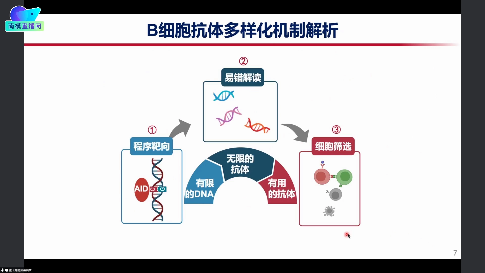

[【跳转到 04:49】](https://www.bilibili.com/video/BV15p4y137XX/?t=289)

**第一步：程序性靶向。** 由 DNA 损伤/修复相关的蛋白在抗体基因上"定点"制造损伤。这里的代表就是 AID——一种胞苷脱氨酶，它把单链 DNA 上的 C（胞嘧啶）变成 U（尿嘧啶）。C 变成 U 之后，这条链上就出现了一个"不该出现的字母"，等于埋下了一个损伤标记。

**第二步：易错修复。** 损伤出现后，如果这件事发生在干细胞等普通细胞里，细胞一定走"无错修复"，把序列原样修回去；但在淋巴细胞里，用的是一种容易出错的修复方式。正是这种"修得不认真"，把一个个 U 变成了各种各样的碱基替换，从而产生海量不同的序列。

**第三步：细胞筛选。** 有了很多抗体，但并不是每个抗体都有用。最后一步按抗体对抗原的亲和力做细胞层面的筛选，把有用的留下来。

讲者用了一句很有画面感的话：免疫系统在这里做的是"在瓷器店里打老鼠"——既要制造损伤，又不能让损伤失控。他还提到"福祸相依"：DNA 损伤在肿瘤里是祸，在 B 细胞里被程序化地利用起来，就变成了福。

> **和 V(D)J 重排的分工**：V(D)J 重排是"把现成的基因片段拼起来"，改变的是片段的组合方式；体细胞高频突变是在**已经拼好的**可变区上逐个碱基地改字母，改变的是序列内容。两者都发生在 B 细胞发育的特定阶段、都有严格的时序，但一个动"段落"，一个动"字"。（重排的细节见 3.1.2，本节只讨论"改字"这一层。）

## 二、现象：突变在 CDR 里更密，而且这不是筛选造成的

### 2.1 可变区外显子只有约 300 bp，却分成两种角色

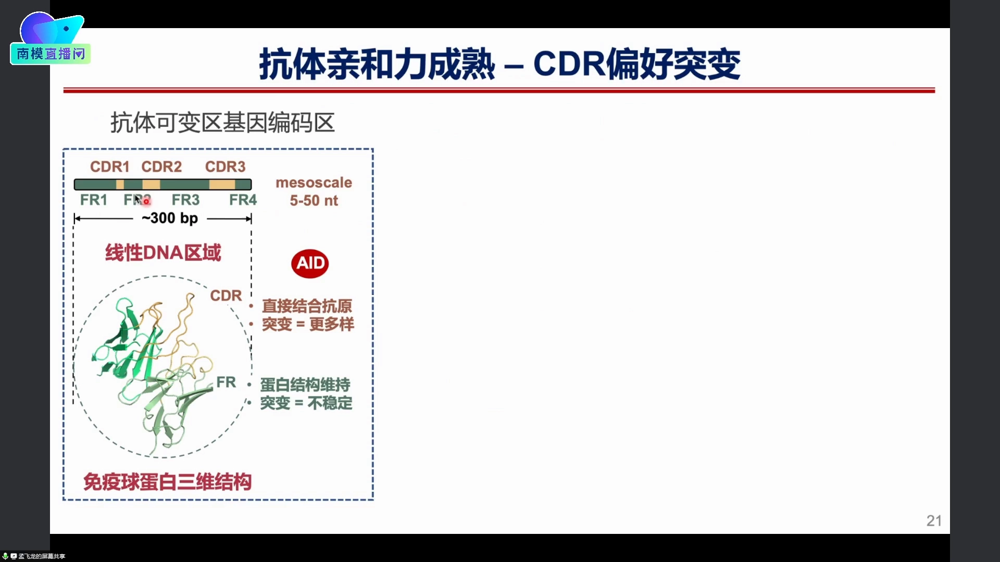

[【跳转到 17:00】](https://www.bilibili.com/video/BV15p4y137XX/?t=1020)

抗体可变区的编码区大约只有 300 bp，可以粗分成两半：

- **CDR（互补决定区）**：直接结合抗原，是"接触面"。突变在这里等于增加可能性。
- **框架区（framework，FR）**：维持蛋白结构。突变在这里很容易让整个蛋白不稳定。

如果让人类工程师来设计，一定会做同样的选择：CDR 多突变，框架区少突变。讲者称这是"非常朴素的想法"。

### 2.2 但 1981 年起就知道：这个偏好不是"设计"出来的

从 1981 年 David Baltimore 和 Lera Hood 两个实验室的工作开始，人们就发现 CDR 区域自发累积了更多突变，框架区少得多。用一句古话说就是"橘生淮南则为橘，生于淮北则为枳"——同一个 motif，在 CDR 里突变率高，在框架区就低，好像是周围环境在起作用。

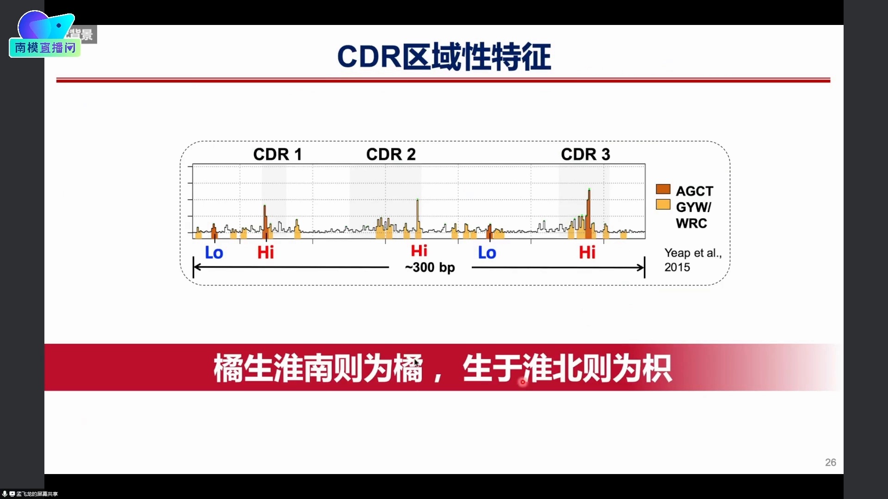

[【跳转到 19:47】](https://www.bilibili.com/video/BV15p4y137XX/?t=1187)

**关键证据：这不是细胞筛选的结果。** 上世纪 90 年代，不同实验室用了三种"筛选不到"的体系来验证：

1. **转基因**底物；
2. **不编码的（non-productive）等位基因**——这段序列不会被翻译成蛋白，因此不存在"蛋白稳定性"层面的选择；
3. **乘客基因**——把抗体序列接到别的地方，同样不参与抗体功能。

这三种体系里都看到了 CDR 偏好。既然序列根本不参与"能不能活下来"的竞争，偏好就只能来自突变过程本身。

### 2.3 教科书插图给我们的错觉

免疫学教科书里画突变，通常是在 CDR 上多画几个 mutation，框架区少画甚至不画。这带来一个错觉：好像 DNA 在突变的时候就已经预见到自己将来会编码什么——"我这个位置将来要编码 CDR，所以我的突变就多"。

这个错觉必须打破，否则后面的机制就无从谈起。真正的问题变成了：**酶怎么知道自己在哪一段 DNA 上？**

## 三、微尺度：AID 确实偏爱某些 3–5 bp 的 motif

AID 并不是完全"盲"的。它偏爱 AGCT 这样的 motif，也偏爱免疫学里常说的 WRC/GYW（W = A/T，R = 嘌呤，Y = 嘧啶）热点。讲者把这种 3–5 bp 尺度的偏好叫**微尺度**。

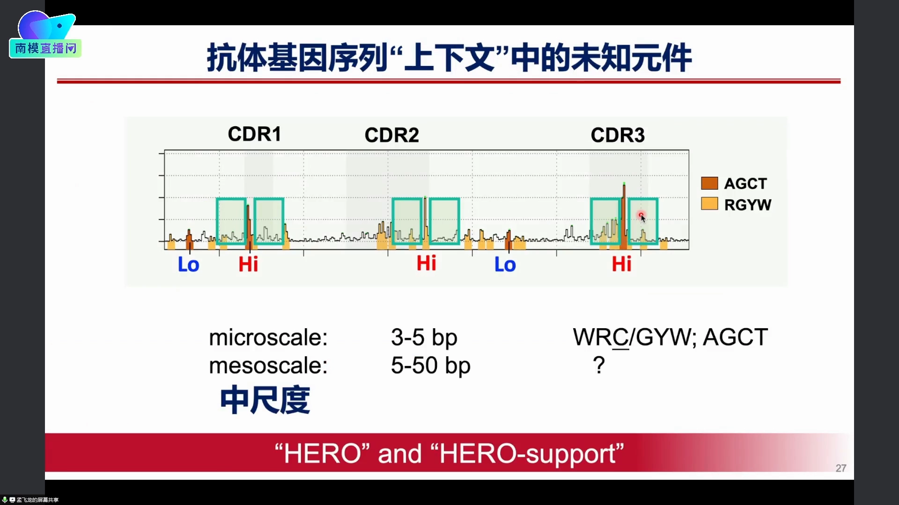

[【跳转到 20:08】](https://www.bilibili.com/video/BV15p4y137XX/?t=1208)

但微尺度解释不了 CDR 偏好：CDR 和框架区里都可能出现 AGCT，为什么 CDR 里的 AGCT 更容易被"打中"？于是讲者提出第二层假设——**中尺度（mesoscale）**：在 5–50 bp 的范围内，motif 两侧的序列上下文会影响突变率。幻灯片上把这两层写成"microscale: 3–5 bp / mesoscale: 5–50 bp"，并在中尺度那一行打了个问号。

## 四、把变量降到最少：体外重构与跨物种检验

要证明"上下文决定突变率"，最干净的办法是把细胞里的所有变量都拿掉。

### 4.1 体外脱氨酶检测重现了体内的谱式

讲者建立了基于高通量测序的脱氨酶活性检测方法：在试管里，用纯化的酶作用于一段很长、很复杂的底物，然后测每个 C 被脱氨的比例。

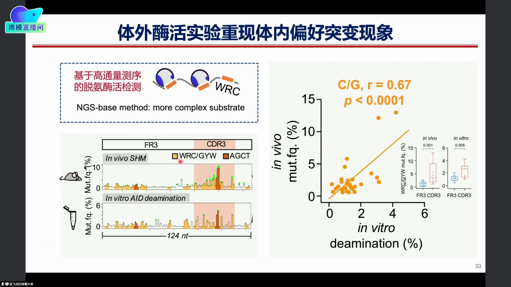

[【跳转到 24:00】](https://www.bilibili.com/video/BV15p4y137XX/?t=1440)

结果很意外：体外测到的突变谱式和小鼠体内的谱式基本一样，相关性 $r = 0.67$、$p < 0.0001$；CDR 偏好性在试管里也重现了——酶确实更喜欢作用于 CDR 区域。

这一步的意义很大：它说明 CDR 偏好**不需要细胞、不需要筛选、不需要染色质环境**，光靠"纯化的酶 + 纯 DNA 底物"就能复现。偏好信息一定编码在序列里。

### 4.2 27 个物种、1084 个抗体 V 基因

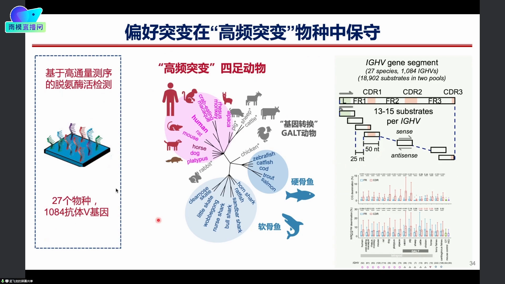

[【跳转到 24:41】](https://www.bilibili.com/video/BV15p4y137XX/?t=1481)

研究团队合成了 27 个物种、1084 个抗体 V 基因（IGHV）的底物，做高通量生化实验。结论是：在有高频突变的物种里，这种 CDR 偏好非常保守。

### 4.3 人 vs 马：变的是底物，不是酶

接下来是一个很漂亮的"换零件"实验。人和马都有高频突变，但马的抗体基因和人很不一样（马是比较免疫学里的一个特例）。那么差异来自酶（AID）还是来自 DNA 序列？

研究团队分别纯化了人的 AID 和马的 AID，让它们作用于同一批底物：两个酶产生的图谱基本一模一样。反过来，把马的抗体基因序列当底物、用人的酶去做，也**不会**出现 CDR 偏好。

由此推断：不是酶在进化，而是酶的底物——抗体基因序列——一直在进化。

## 五、AID 怎么"感知"上下文：靠柔性，不靠特异性序列

问题到这里变得更尖锐：如果序列上下文决定了突变率，酶又是怎么"读"出上下文的？

### 5.1 把上下文简化成单一碱基重复

生物化学的老办法是把复杂问题简单化。既然底物两边有上下文，那最简单的上下文就是把 AGCT 两边全部换成 T，或者全部换成 A——这样只有一种组合，没有别的变量。

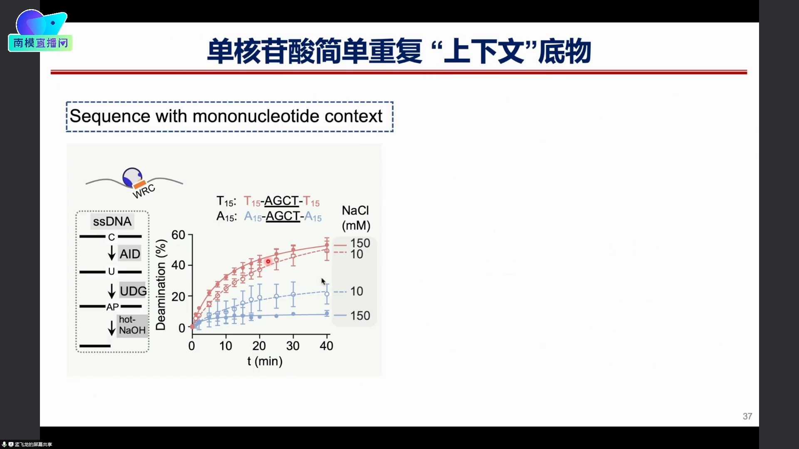

[【跳转到 26:59】](https://www.bilibili.com/video/BV15p4y137XX/?t=1619)

结果很干脆：AID 特别喜欢 T 的底物，不喜欢 A 的底物。T 一侧的脱氨比例随时间快速上升，A 一侧则低平得多。

### 5.2 单分子实验与结构：一个带正电荷的"辅助补丁"

单分子实验里，底物带荧光标记、酶不标记，测的是复合物的水动力学半径。酶和 T 底物结合后半径立刻上升，从半径推断大致形成了一比一的酶—底物结合状态——但这个状态比较松散，并不像抗原—抗体那样紧密。对 A 底物则没有这个现象。

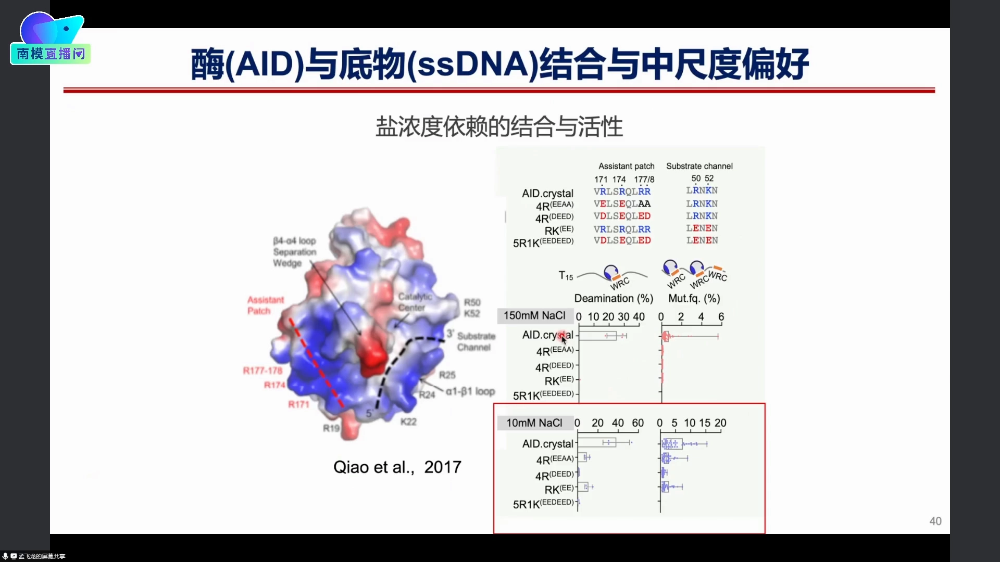

[【跳转到 28:00】](https://www.bilibili.com/video/BV15p4y137XX/?t=1680)

AID 的结构在 2017 年被解析：蛋白一侧是酶活催化口袋，另一侧有一块带正电荷的区域（图上标为 assistant patch，辅助补丁），当时没人知道它是干什么的。讲者猜测它是用来结合带负电的 DNA 的。证据有两条：

- 把这块正电荷区域的精氨酸/赖氨酸做成突变，酶就失活了；
- 降低盐浓度会削弱电荷相互作用（静电屏蔽），此时酶的行为发生明显变化。

盐浓度实验的结果特别说明问题：在生理盐浓度下，酶可以作用于底物上很多个 C，但它并不是每个 C 都动，反而特别喜欢其中两三个点；在低盐浓度下，大部分 C 都能被作用，序列偏好性完全消失。讲者用宋小宝小品里的话打比方——低盐下就"雨露均沾"了。

这说明 AID 的靶向不是"认序列"，而是"认结合得稳不稳"。结合越稳，停留越久，越有机会催化。

### 5.3 分子动力学：T 像绳子缠上去，A 很刚

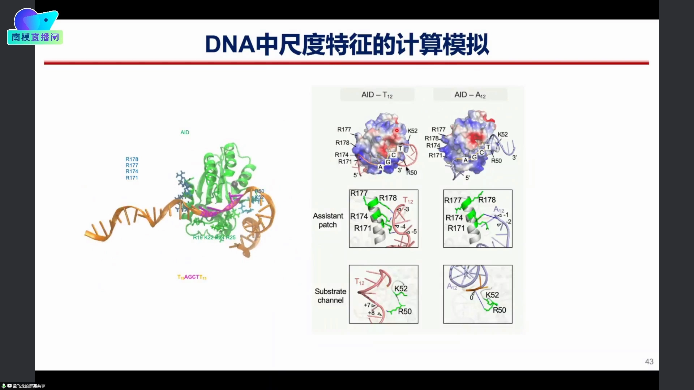

[【跳转到 30:47】](https://www.bilibili.com/video/BV15p4y137XX/?t=1847)

研究团队与上海交大的合作者用分子动力学模拟了两种底物与酶的结合。结果是：T 的底物特别柔，像一根绳子一样缠在酶的表面，非常贴合；A 的底物看起来很"刚"，不会服帖地贴在蛋白表面。

"柔"和"刚"并不是新概念。早在 2000 年左右，做材料、做单分子的研究者就用各种方法测过：T 的序列更柔，A 的序列更刚。只是这些物理性质一直停留在体外研究，很少有人问它在生理条件下有什么功能。

### 5.4 直接改柔性：插入 A6，活性跟着变

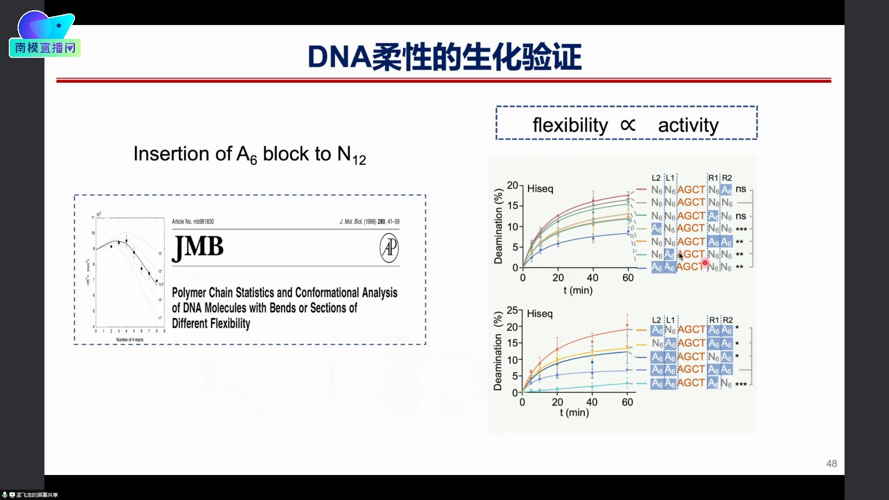

[【跳转到 33:58】](https://www.bilibili.com/video/BV15p4y137XX/?t=2038)

最直接的验证是"改物理性质，看活性"。A 的底物很刚、酶活很低，如果在 AGCT 旁边插入六个连着的 A（A6 是一段已知的刚性元件），位置越靠近 AGCT，酶活下降越明显；放得远一些，影响就不大。

反过来，在 A 底物里插入六个 N（随机序列），酶活立刻提升上来。

结论写成一句话就是：**单链 DNA 的柔性决定了 AID 的酶活**。幻灯片上把它写成 flexibility ∝ activity。

### 5.5 柔性有没有"序列密码"？

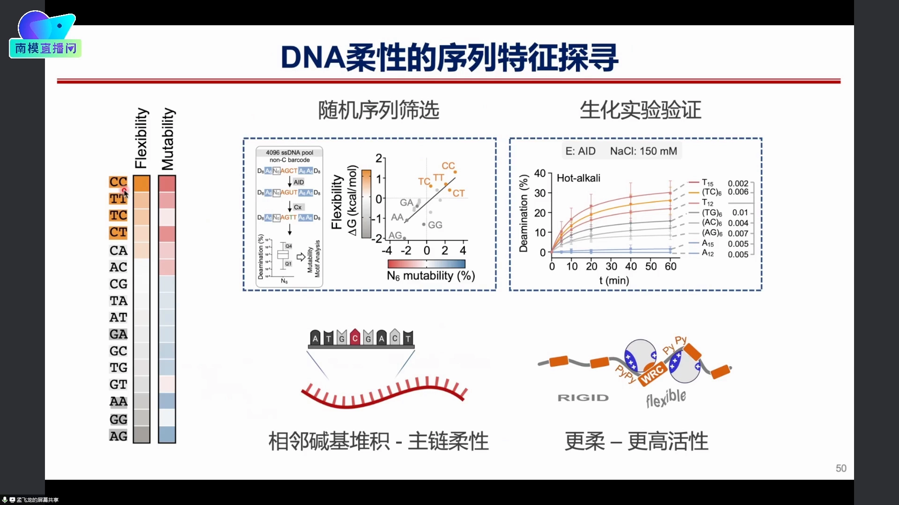

[【跳转到 35:41】](https://www.bilibili.com/video/BV15p4y137XX/?t=2141)

既然柔性决定活性，能不能从序列直接预测柔性？研究团队做了随机序列筛选：在 AGCT 前面放六个 N，六个位置大约有四千种组合，合成了 4000 多条单链 DNA，做高通量酶活实验。

结果找到了规律：像 CCTTTCTC 这样的组合柔性特别强。物理原因很清楚——嘧啶（C、T）和嘌呤（A、G）比起来只有一个环，碱基堆积力弱一点；一旦出现这种多嘧啶的 motif，主链柔性就增加，突变活性随之大幅提高。

在热图里，CC、TT、TC、CT 这些相邻组合排在"柔"的一端，GG、AG、AA 排在"刚"的一端。这就是讲者所说的"柔性密码"。

## 六、两层选择：氨基酸层 + DNA 柔性层

把上面的机制放回进化尺度，会得到一个有点反直觉的结论。

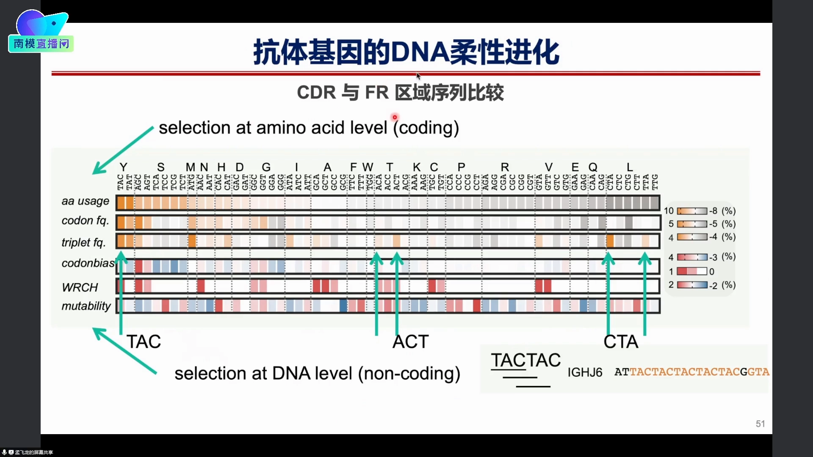

[【跳转到 36:46】](https://www.bilibili.com/video/BV15p4y137XX/?t=2206)

所有蛋白质在进化上都会受到氨基酸水平的进化压力——密码子怎么用、氨基酸怎么选，都是被选择过的。而抗体基因额外多了一层：在 DNA 水平上、在**不改变氨基酸**的前提下，序列也被选择了。

证据是这张"密码子用法 vs 突变率"的对照图：某些密码子（比如 TAC、ACT、CTA）在抗体基因里被偏好使用，而这些密码子恰好对应柔性更强、更容易被 AID 攻击的序列环境。也就是说，抗体基因在进化中主动"埋"了柔性元件在 CDR 里。

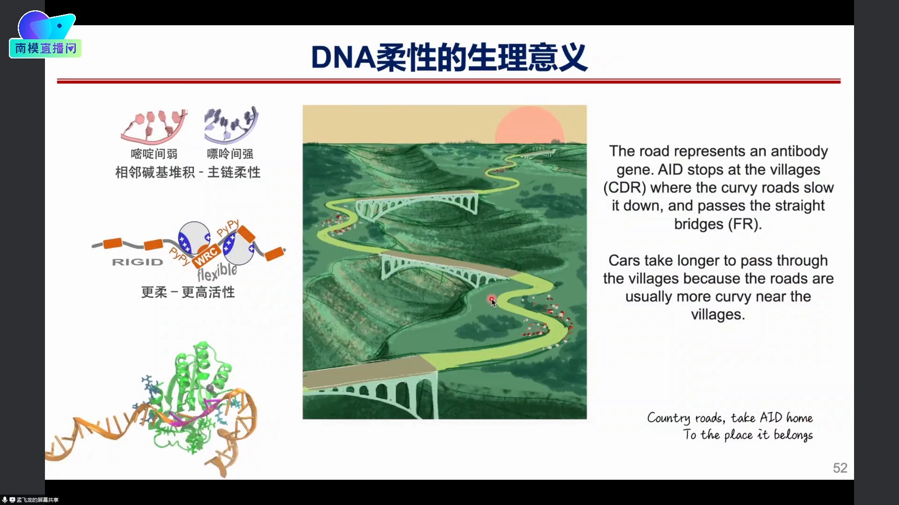

[【跳转到 37:17】](https://www.bilibili.com/video/BV15p4y137XX/?t=2237)

讲者用了一个很好记的比喻：把抗体基因比作一条路，AID 是路上开的车。笔直的高速路上，车一脚油门就过去了，什么也不会发生；到了村庄附近，路变得歪歪扭扭，车必须减速、要拐弯，停留时间变长，才有机会"下车"制造突变。CDR 就是那些弯道多的村庄，框架区就是笔直的高架桥。

## 七、这套机制的另一面：抗体多样化与淋巴瘤风险

AID 制造损伤的能力并不只对免疫系统有用。

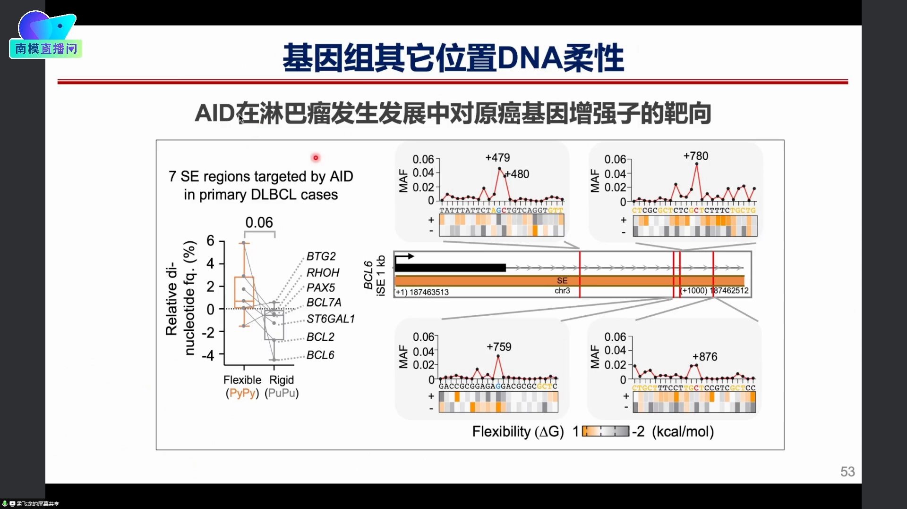

[【跳转到 38:26】](https://www.bilibili.com/video/BV15p4y137XX/?t=2306)

在淋巴瘤的癌症基因组里，可以看到 AID 会作用于一些增强子上，产生各种突变。研究团队把肿瘤里突变率特别高的位点拿出来看 DNA 柔性，发现它们都处高度柔软的区域；有些位点在一条链上是 G，对应的 C 在另一条链上，两条链的柔性都很高。

这提示："刚柔"可能不只是抗体基因的特殊设计，而是整个基因组上 AID 靶向的通用物理基础。讲者也把它作为一个开放问题留给听众：除了 AID 酶活的调控，其他生物学过程中柔性是否也在起作用？

> **读到这里要记住的判读原则**：突变数量是"损伤发生了多少次"，不是"亲和力提高了多少"。AID 的靶向由序列物理性质决定，突变落在哪里、落在哪个碱基上带有很强的随机性；绝大多数突变对结合没有帮助，甚至有害。真正决定抗体好不好的，是第三步的细胞筛选——那属于亲和成熟的内容（见 3.1.5）。

## 八、从机制到工程：能不能人为调高突变率？

### 8.1 洗牌小鼠：把上下文打乱，偏好就消失

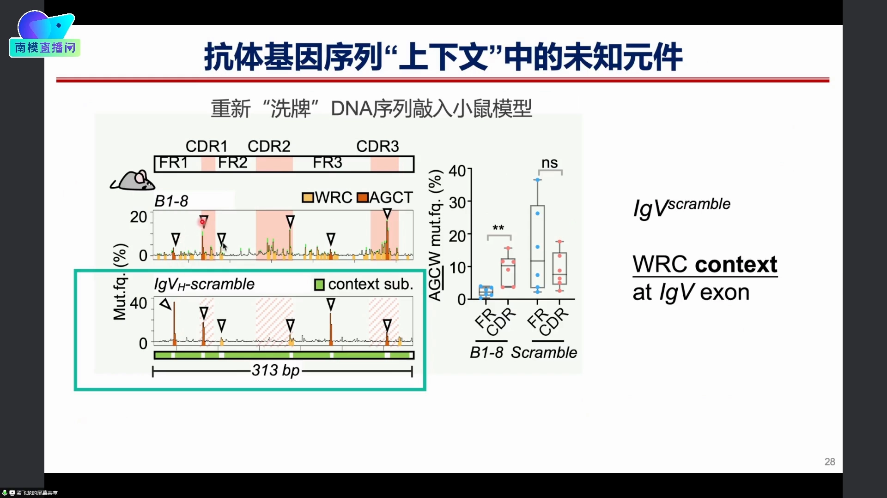

[【跳转到 21:11】](https://www.bilibili.com/video/BV15p4y137XX/?t=1271)

第一个实验是"洗牌"：把抗体可变区外显子的序列重新设计、打乱，只保留若干个位点。原本在抗体基因里呈现"低—高—低—高—低—高"起伏的突变频率，洗牌之后这种谱式完全消失。也就是说，一旦破坏了序列的天然排布，CDR 偏好就没有了。

### 8.2 定点改造：在框架区也能造出"热点"

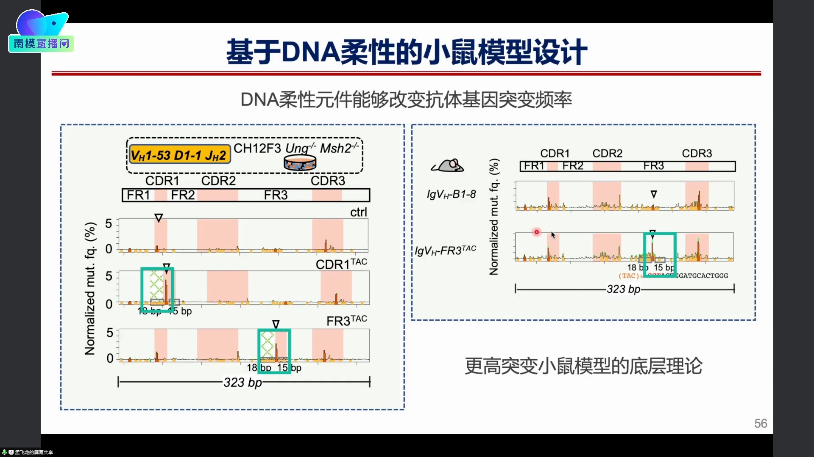

[【跳转到 40:22】](https://www.bilibili.com/video/BV15p4y137XX/?t=2422)

既然柔性决定突变率，就可以反着用：在 B 细胞系里，把一段柔性序列放到本来"冷"的框架区，那里的突变率也能变高。进一步做成的敲入小鼠里，框架区本来突变率极低，通过改造 DNA 序列，可以让它变得很高。

讲者把这个思路落到工程上：如果掌握了 DNA 柔性的"密码"，未来可以设计突变率更高的小鼠模型，在构建人源化小鼠时把柔性概念考虑进去。

### 8.3 人源化小鼠的局限：不只是"把人的基因搬进去"

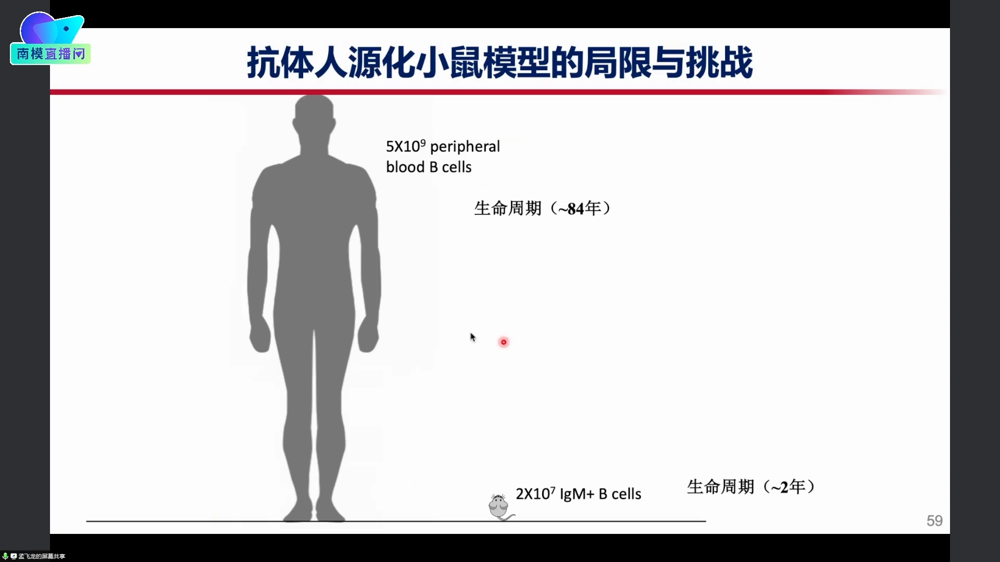

[【跳转到 41:44】](https://www.bilibili.com/video/BV15p4y137XX/?t=2504)

讲者顺手纠正了一张常见的示意图：人不应该只比小鼠"大一点"。人外周血大约有 $5\times10^9$ 个 B 细胞，小鼠只有 $2\times10^7$ 个 IgM+ B 细胞，差近 100 倍；人的生命周期约 84 年，小鼠约 2 年。

这带来两个现实后果：

- **突变率低**：小鼠的突变率比较低，所以做 Western blot 时大家更愿意用兔抗体而不是鼠抗体，效果通常更好；
- **库容小、时间短**：小鼠既没有足够多的 B 细胞，也没有足够长的时间去累积突变。

所以小鼠并不是一个理想的"找抗体"模型。讲者还列举了其他物种的特例：兔子的抗体亲和力特别高；羊驼和骆驼一样有单链抗体（纳米抗体的来源）；鸡和兔子都使用基因转换（gene conversion）而不是人这样的点突变策略；鲨鱼等软骨鱼也有单链抗体。

这些差异说明：抗体多样化在进化上有多种实现方式，"高频突变 + 筛选"只是其中一条路。未来的抗体人源化小鼠，可能要把兔、鼠、骆驼等物种的特征集成在一起。

## 小结

- 体细胞高频突变可以拆成三步：**程序性靶向**（AID 把 C 变成 U）→ **易错修复**（把 U 变成各种替换）→ **细胞筛选**（按亲和力留下有用的）。
- CDR 突变多、框架区突变少，这个现象从 1981 年就被观察到；用转基因、不编码等位基因、乘客基因等"筛选不到"的体系也能复现，说明它**不是细胞筛选的产物**。
- 靶向由两层决定：**微尺度**的 3–5 bp motif（AGCT、WRC/GYW）加上**中尺度**的 5–50 bp 序列上下文。
- 中尺度的本质是**单链 DNA 的柔性**：AID 用带正电荷的辅助补丁松散吸附 DNA，越柔的序列贴得越久、脱氨越多；T 比 A 柔，多嘧啶比多嘌呤柔。
- 体外纯酶 + 纯底物就能重现体内的 CDR 偏好；27 个物种、1084 个 IGHV 显示这个规律在有高频突变的物种中保守；人和马的 AID 酶行为一致，差异来自底物序列的进化。
- 抗体基因因此受到**两层选择**：氨基酸层的选择，加上 DNA 层（不改变氨基酸）的柔性选择。
- 同一套机制也是风险来源：AID 在淋巴瘤中会攻击柔性高的增强子。**突变数量反映的是损伤次数，不等于亲和力提升**；判断抗体好坏要看筛选后的功能读数。

## 关键术语速查

| 术语 | 一句话解释 |
| --- | --- |
| 体细胞高频突变（SHM） | B 细胞成熟过程中在可变区大量引入点突变的过程，是亲和力成熟的素材来源 |
| AID | 活化诱导胞苷脱氨酶，把单链 DNA 上的 C 脱氨变成 U，是 SHM 和类别转换共用的起始酶 |
| CDR / 框架区 | CDR 是直接接触抗原的环，框架区是维持折叠的骨架；两者对突变的耐受度完全不同 |
| 微尺度 / 中尺度 | 微尺度指 3–5 bp 的 motif 偏好，中尺度指 5–50 bp 的上下文对突变率的影响 |
| WRC/GYW、AGCT | AID 偏爱的短序列 motif，是"热点"的序列层描述 |
| 脱氨酶活性检测 | 用高通量测序定量每个 C 被脱氨比例的方法，可在体外重建突变谱式 |
| DNA 柔性 | 单链 DNA 作为高分子材料的弯曲难易程度，由碱基堆积力等物理因素决定 |
| 辅助补丁（assistant patch） | AID 表面一块带正电荷的区域，通过静电作用非特异性地吸附 DNA |
| 易错修复 | 把 U 加工成各种碱基替换的修复方式，是突变谱多样性的直接来源 |
| 基因转换 | 鸡、兔等物种使用的另一种抗体多样化策略，用供体序列替换可变区片段 |