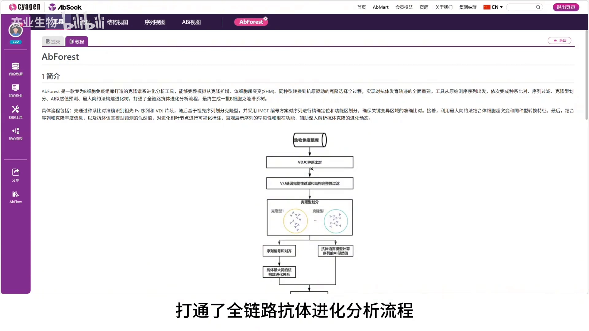
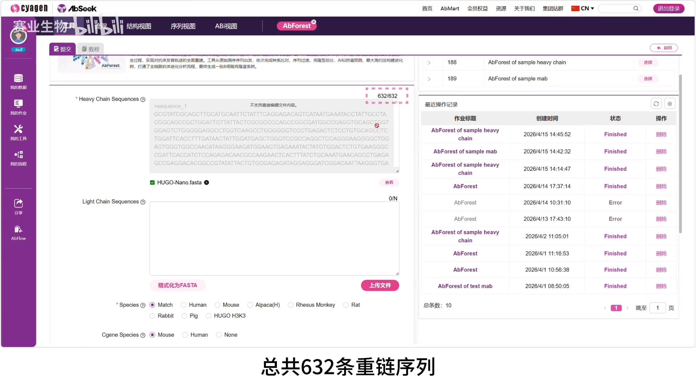
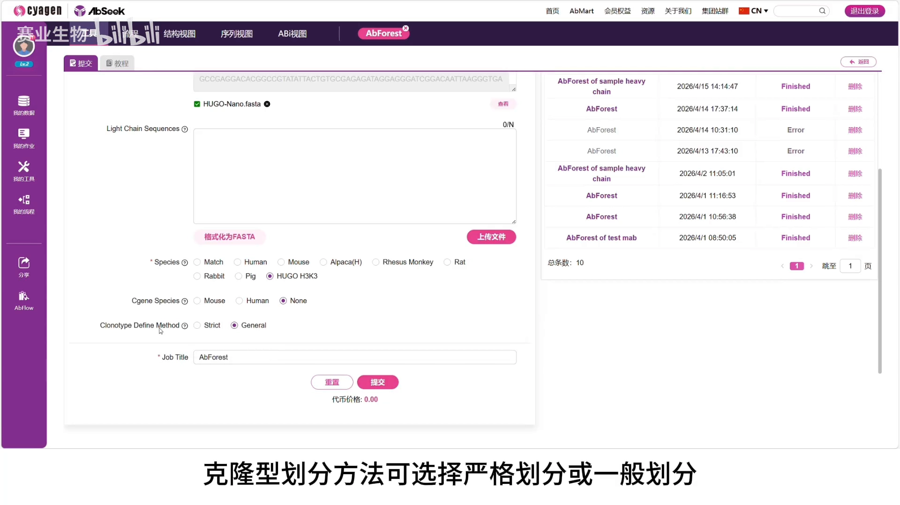
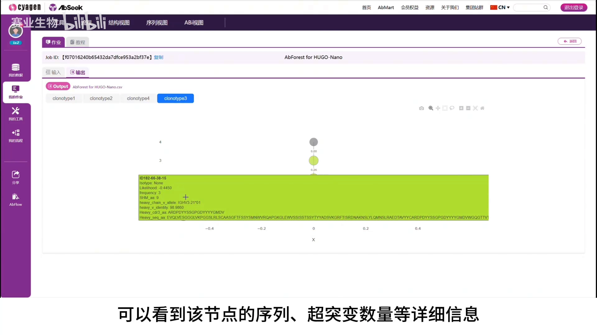

# 从序列到克隆谱系树：怎么读 B 细胞的进化轨迹

> 视频来源：[AbForest 工具实操｜B 细胞免疫组库克隆谱系进化全流程分析](https://www.bilibili.com/video/BV18uRsBREuY/)（Bilibili · 赛业生物）｜时长约 3 分钟
> 导读：这是一段工具演示，价值不在界面操作，而在于它把"一堆抗体序列"变成"一棵谱系树"的中间步骤摊开给你看：胚系比对、克隆型划分、最大简约法建树、节点信息。本文按这条流水线逐步解释每一步在做什么、读出什么、不能读出什么。

## 本讲要解决的核心问题（SCQA）

**背景**：做完一次 B 细胞免疫组库测序，你手上是一批抗体序列——每一条都是某个 B 细胞当时的可变区"快照"。

**冲突**：这些序列彼此相似但不相同。相似意味着它们可能来自同一个祖先 B 细胞，不相同意味着中间发生过体细胞高频突变。但"相似"是个模糊的说法：差几个碱基算同一个克隆？哪些差异是突变，哪些只是测序错误或不同 V 基因片段？

**疑问**：怎么把一批序列整理成"谁从谁演化而来"的谱系树？树上那些数字到底在说什么？

**回答（中心思想）**：谱系树是**推断**出来的，不是测出来的。它建立在四步之上：先把每条序列比对到胚系（germline）参考序列以确定"起点"，再按祖先序列的相似度把序列分进克隆型，然后用最大简约法排出最省突变的分支顺序，最后把每条序列的突变数、丰度等信息标到节点上。读懂这棵树的关键，是分清"亲缘关系"和"突变数量"是两件事，而两者都不等于亲和力。

## 一、谱系树要回答的问题：一个克隆的"家谱"

[【跳转到 00:00】](https://www.bilibili.com/video/BV18uRsBREuY/?t=0)

B 细胞被抗原激活后会在生发中心里增殖，并在增殖过程中不断积累体细胞高频突变（SHM），同时可能发生同种型转换（类别转换）。这些事件会在序列上留下痕迹：

- 同一个祖先细胞的后代，共享同一套 V(D)J 重排（同一组片段、同样的连接处）；
- 后代之间的差异，主要来自后续累积的点突变；
- 如果发生过类别转换，重链恒定区（C 区）会换掉，但可变区（V 区）不变。

所以"克隆谱系树"就是把一个克隆内部的所有序列，按"谁离祖先更近、谁离得更远"排成一棵树。它模拟的正是从克隆扩增、体细胞超突变、同种型转换到克隆选择的全过程。

## 二、四步流水线：从 FASTA 到谱系树

[【跳转到 00:42】](https://www.bilibili.com/video/BV18uRsBREuY/?t=42)

工具把流程固定成一条链，每一步都可以单独理解：

[【跳转到 00:26】](https://www.bilibili.com/video/BV18uRsBREuY/?t=26)

**第一步：VDJC 胚系比对。** 把每条测序得到的可变区序列，比对到参考的 V、D、J、C 基因片段上。这一步解决两个问题：这条序列用了哪个 V 片段、哪个 J 片段（决定它属于哪一支"家族"），以及——更关键——**它的祖先序列长什么样**。胚系序列就是"还没发生高频突变时的样子"，是后面所有突变计数的零点。

**第二步：完整性过滤。** 只保留 V/J 基因完整、结构完整的序列。残缺的序列没法可靠地比对和计数，会污染谱系推断。

**第三步：克隆型划分。** 基于祖先序列的相似度，把序列分组：同一组视为来自同一个祖先 B 细胞，也就是同一个克隆型（clonotype）。这一步是在定义"亲缘关系"的边界。

**第四步：序列编号、对齐与建树。** 用 IMGT 编号方案对序列做精确定位和功能区划分（框架区、CDR），确保关键变异区域的比对是准确的；然后用**最大简约法**（maximum parsimony）构建进化关系——在所有可能的树里，选那棵"总共需要的突变次数最少"的树。

最后，工具还会用抗体语言模型给序列算一个似然值，并结合克隆丰度信息，把这些标注到树的叶子上，用来提示"这条序列罕见到什么程度、可能有什么功能倾向"。

## 三、输入长什么样：632 条重链序列

[【跳转到 01:26】](https://www.bilibili.com/video/BV18uRsBREuY/?t=86)

[【跳转到 00:47】](https://www.bilibili.com/video/BV18uRsBREuY/?t=47)

演示用的是一份来自 HUGONANO 小鼠免疫组库的序列，共 632 条重链序列，没有轻链序列——**没有轻链就不用输入**，工具允许只做重链分析。

[【跳转到 01:10】](https://www.bilibili.com/video/BV18uRsBREuY/?t=70)

需要用户指定的参数有三类：

- **物种**：用于 V(D)J 基因的胚系比对（示例里选的是 HUGO H3K3 这一类人源化小鼠的参考集）。物种选错，胚系比对就会错，后面所有突变计数都不可信。
- **C 基因物种**：用于恒定区比对；也可以选"不比对 C 基因"，此时不做类别判断。
- **克隆型划分方法**：可选"严格划分"或"一般划分"，讲者建议**通常选一般划分就好**。

[【跳转到 01:51】](https://www.bilibili.com/video/BV18uRsBREuY/?t=111)

"严格"和"一般"的区别，本质上是**判定同一个克隆的阈值宽严**。阈值严，同一个克隆里只放几乎一模一样的序列，克隆型会变多、每棵树变小；阈值松，允许更多差异进同一棵树，克隆型变少、树变大。这个选择没有绝对对错，取决于你想看"很近期的事件"还是"整个克隆的演化史"。

## 四、读树：节点上的数字是什么意思

[【跳转到 02:33】](https://www.bilibili.com/video/BV18uRsBREuY/?t=153)

[【跳转到 02:04】](https://www.bilibili.com/video/BV18uRsBREuY/?t=124)

任务跑完后，结果页面按克隆型分标签展示，每个克隆型一棵谱系树。有一个硬性门槛：**克隆型里至少要包含 4 条序列，才会绘制谱系树**——序列太少，任何树形都只是巧合，推断没有意义。

把鼠标移到节点上，会弹出一张信息卡，里面有几项关键字段（截图里这一条）：

- **序列 ID 与同种型**（isotype）：这条序列属于哪个类别；
- **似然值**（likelihood）：语言模型给出的"像不像一条正常抗体序列"的分数；
- **克隆丰度**（frequency）：这个克隆在这个样本里出现了多少次；
- **SHM aa 9**：相对于胚系祖先，在氨基酸层面上积累了 9 个突变；
- **heavy_v_identity 96.98%**：与最接近的 V 基因参考序列的同一性；
- **CDR3 与重链全长氨基酸序列**：方便直接核对。

这张卡片其实就是"读树"的全部素材。它把三件容易混淆的事分开摆在了你面前：

1. **亲缘关系**——由树的分支结构表示：谁和谁是姐妹枝，谁更靠近根（祖先）；
2. **突变数量**——由节点上的 SHM 计数表示：从祖先到这里改了多少个字母；
3. **克隆丰度**——由 frequency 表示：这个序列在样本里被看到多少次。

[【跳转到 02:49】](https://www.bilibili.com/video/BV18uRsBREuY/?t=169)

## 五、三个容易读错的地方

**第一，树是推断，不是观测。** 最大简约法给出的是"最省突变的解释"，不是唯一正确的历史。序列越多、覆盖越全，推断越稳；只有 4 条序列时，树形很容易被一两个测序错误带偏。

**第二，突变数量不等于亲和力。** 节点上的 SHM 计数只说明"离祖先改了多少个字母"。改得多可能是被反复选择、越变越好，也可能只是这个克隆活得久、攒了一堆中性甚至有害的突变。亲和力必须靠实验测（结合动力学、竞争结合等），树本身给不出这个答案。

**第三，同一棵树里可能混着不同类别。** 因为类别转换发生在可变区不变的前提下，同一个克隆的后代可以带着不同的 C 区。所以看到同一棵树里出现不同 isotype，是正常的生物学现象，不是数据错误。

## 六、这套流程能用来做什么

讲者提到，工具最终产出的是"一批 B 细胞克隆谱系树"，并支持把分析后的数据以表格形式下载。有了这批树，可以做几类下游判断：

- **看克隆扩增**：某个克隆型的序列条数特别多，说明它被抗原驱动扩增过；
- **看突变累积程度**：树整体的 SHM 数量高，提示这个克隆经历了较长时间的亲和成熟；
- **找罕见序列**：似然值偏低、丰度极低的叶子，往往是"非典型"的序列，值得单独核对。

## 小结

- 谱系树是把一批抗体序列还原成"家谱"的推断工具，模拟的是克隆扩增、SHM、类别转换与克隆选择的全过程。
- 四步流水线：**胚系比对**（确定祖先与片段归属）→ **完整性过滤** → **克隆型划分**（定义亲缘边界）→ **编号对齐 + 最大简约法建树**。
- 克隆型划分的"严格/一般"是在调亲缘判定的阈值；克隆型至少要有 4 条序列才建树。
- 节点信息卡同时给出同种型、似然值、克隆丰度、SHM 数量和 V 基因同一性——**亲缘关系、突变数量、克隆丰度是三件事**。
- 树是推断而非观测；**突变数量不等于亲和力**，亲和力必须靠实验读数。

## 关键术语速查

| 术语 | 一句话解释 |
| --- | --- |
| 克隆型（clonotype） | 共享同一套 V(D)J 重排、推断来自同一祖先 B 细胞的一组序列 |
| 胚系序列（germline） | 未发生体细胞高频突变时的参考序列，是突变计数的零点 |
| 胚系比对 | 把测序序列比对到 V/D/J/C 参考片段，确定片段归属与祖先序列 |
| 最大简约法 | 在所有可能的树中选"总突变次数最少"的那棵，用于重建谱系 |
| SHM 数量 | 相对于胚系祖先累积的突变个数，反映变异量而非亲和力 |
| 克隆丰度 | 某个克隆型在样本中出现的序列条数，反映扩增程度 |
| 同种型（isotype） | 抗体重链类别（如 IgM、IgG），由类别转换决定，不影响可变区 |
| IMGT 编号 | 抗体可变区的标准编号方案，用于跨序列对齐框架区与 CDR |