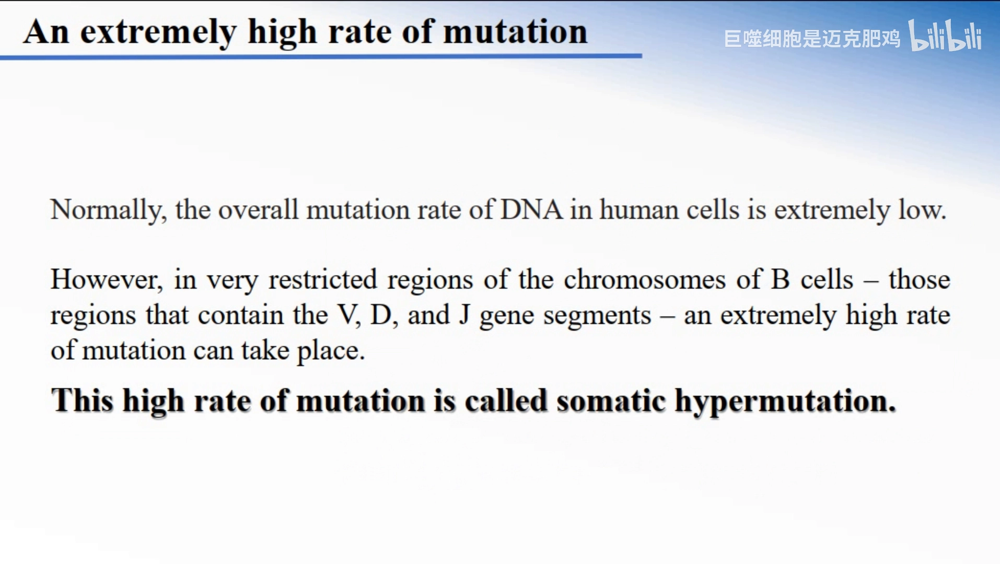
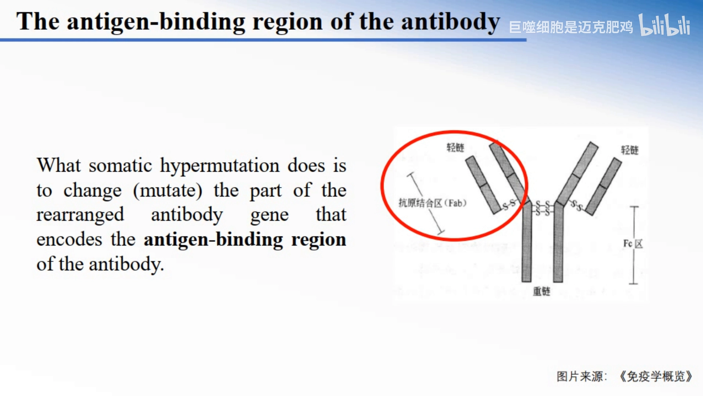
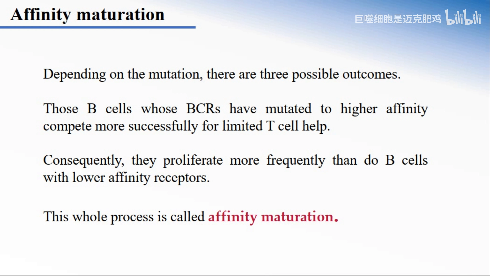

# 突变不一定更好：体细胞高频突变的三种结局与亲和力成熟

> 视频来源：[第三章 B细胞和抗体 (6)体细胞高频突变【How the Immune System Works 讲解】](https://www.bilibili.com/video/BV1Ls4y1E7nx/)（Bilibili · 巨噬细胞是迈克肥鸡）｜时长约 3 分钟
> 导读：这是一节很短的读书讲解，按《How the Immune System Works》第三章的顺序，把"高频突变做了什么、结果有几种、为什么最后会变好"讲成一条因果链。篇幅短，但"突变不等于改善"这个判读要点说得很清楚，适合作为进入本节其他两篇之前的入门。

## 本讲要解决的核心问题（SCQA）

**背景**：抗体要能抓住抗原，靠的是可变区（尤其是 Fab 端）与抗原形状的匹配。B 细胞在成熟过程中会通过体细胞高频突变，在编码抗原结合区的基因序列上引入改变。

**冲突**：突变是随机改字母，改完之后抗体不一定更好——可能更强，也可能没变化，甚至更差。既然大部分改动是"白改"或"改坏"，为什么免疫系统还要这么做？

**疑问**：随机突变怎么会稳定地产生"更适配"的抗体？"亲和力成熟"到底描述的是突变，还是别的什么？

**回答（中心思想）**：体细胞高频突变只负责**提供变异**，真正让抗体变好的是**选择**——数量有限的辅助性 T 细胞更愿意刺激那些突变后亲和力更高的 B 细胞。突变与选择合起来，才叫亲和力成熟。

## 一、一句话定义：在抗原结合区上"加突变"

[【跳转到 00:00】](https://www.bilibili.com/video/BV1Ls4y1E7nx/?t=0)

讲者用一句话概括体细胞高频突变：**通过突变进一步增强 BCR 对同源抗原的亲和性**。

[【跳转到 00:12】](https://www.bilibili.com/video/BV1Ls4y1E7nx/?t=12)

它有两个时间特征：

- 一般发生在 **B 细胞成熟的晚期**；
- 一般发生在**抗体类别转换之后**。

> **和 V(D)J 重排的区别**：V(D)J 重排是把基因片段拼成一个可用的可变区，发生在 B 细胞还没遇到抗原的阶段；体细胞高频突变是在**已经拼好的**可变区上逐个碱基地改字母，发生在 B 细胞被抗原激活、进入成熟程序的晚期。前者决定"用哪几个片段"，后者决定"这个片段要不要微调"。

## 二、突变率的对比：全身很低，只有这一小块很高

[【跳转到 00:26】](https://www.bilibili.com/video/BV1Ls4y1E7nx/?t=26)

正常来讲，人体细胞 DNA 的突变率非常非常低——否则我们都会长得千奇百怪。但在 B 细胞的染色体中，含 V、D、J 基因片段的那一小块区域可以出现极高的突变率。这种"局部高突变"就是体细胞高频突变（somatic hypermutation）。

[【跳转到 00:07】](https://www.bilibili.com/video/BV1Ls4y1E7nx/?t=7)

换句话说，免疫系统不是把整体突变率调高，而是在一个非常受限的区域里"开了一个口子"。这一点很重要：它解释了为什么高频突变不会把 B 细胞变成一团乱码。

## 三、突变改的是哪一段：Fab 端，不是 Fc 端

[【跳转到 00:51】](https://www.bilibili.com/video/BV1Ls4y1E7nx/?t=51)

体细胞高频突变做的事情，是改变**重排后的抗体基因中编码抗原结合区的那一部分**。落到蛋白上，就是改变 Fab 端（抗原结合片段）的形状与化学性质，从而改变它和抗原贴合的紧密程度。

这里有一个很好用的分工记忆法：

- **Fab 端**由体细胞高频突变来微调——管"抓得紧不紧"；
- **Fc 端**由抗体类别转换来更换——管"抓完之后调用什么效应功能"。

两者互不干扰：换 Fc 不改变抗原识别，改 Fab 不改变效应功能。

[【跳转到 01:06】](https://www.bilibili.com/video/BV1Ls4y1E7nx/?t=66)

## 四、三种结局：更好、不变、更差

[【跳转到 01:16】](https://www.bilibili.com/video/BV1Ls4y1E7nx/?t=76)

突变之后，Fab 端可能出现三种情况：

1. **亲和性增强**——抗体对抗原结合得更牢；
2. **亲和性不变**——改了字母，但接触面没有实质变化；
3. **亲和性更差**——改动破坏了原本的匹配。

这一步是本节最需要记住的判读原则：**突变数量本身没有方向**。一个克隆上积累了 10 个突变，不代表它比只有 3 个突变的克隆更好；它也可能只是"改坏了 10 次"。要判断好坏，必须看功能读数（结合强度、竞争实验等），而不是数突变个数。

## 五、选择：有限的 T 细胞辅助是"评委"

那为什么整体上抗体会越变越好？讲者给出的关键点是：**B 细胞的增殖需要被辅助性 T 细胞持续刺激，而这些 T 细胞的数量是有限的**。

有限的 T 细胞会更喜欢刺激那些 BCR 突变之后亲和性更高的 B 细胞。于是：

- 亲和性变高的克隆，得到更多刺激 → 增殖频率更高 → 占比更大；
- 亲和性不变或变差的克隆，得不到足够的辅助 → 逐渐被淘汰。

这就是"突变 + 选择"的循环：突变提供随机变异，选择把方向定下来。

[【跳转到 01:41】](https://www.bilibili.com/video/BV1Ls4y1E7nx/?t=101)

## 六、结果：亲和力成熟

[【跳转到 02:06】](https://www.bilibili.com/video/BV1Ls4y1E7nx/?t=126)

经过一轮轮"突变—选择"，最终的结果是：机体拥有更多、更优质的 B 细胞，它们产生的抗体对特定抗原结合得更牢固。这个整体过程就叫**亲和力成熟**（affinity maturation）。

讲者用了一个很形象的总结：B 细胞通过抗体类别转换调整 Fc 端，通过体细胞高频突变调整 Fab 端，于是机体拥有了更多、更精妙的"B 细胞武器"，这些被微调过的 B 细胞能产生对付入侵者最适配的抗体。

[【跳转到 02:27】](https://www.bilibili.com/video/BV1Ls4y1E7nx/?t=147)

## 小结

- 体细胞高频突变 = 在**已经重排好的**可变区、编码抗原结合区的那段序列上引入点突变，发生在 B 细胞成熟晚期、通常在类别转换之后。
- 全基因组突变率很低，只有含 V、D、J 的这一小块区域突变率极高。
- 突变改的是 **Fab 端**（抓得紧不紧），类别转换换的是 **Fc 端**（抓完之后干什么）。
- 突变有三种结局：更好、不变、更差。**突变多 ≠ 亲和力高**。
- 让抗体真的变好的是**选择**：数量有限的辅助性 T 细胞优先刺激高亲和力克隆。
- "突变 + 选择"的整体结果叫**亲和力成熟**。

## 关键术语速查

| 术语 | 一句话解释 |
| --- | --- |
| 体细胞高频突变（SHM） | 在重排后的可变区上引入大量点突变，为亲和力成熟提供变异 |
| 亲和力成熟 | 突变与选择反复循环，使抗体群体对抗原的结合越来越强的整体过程 |
| Fab 端 | 抗原结合片段，由可变区构成，决定"抓得紧不紧" |
| Fc 端 | 恒定区构成的效应端，决定"抓完之后调用什么功能" |
| 类别转换 | 更换重链恒定区、从而更换抗体类别的过程，不改变抗原识别 |
| 辅助性 T 细胞 | 为 B 细胞提供增殖与分化所需的辅助信号，数量有限，构成选择压力 |