# 生发中心竞争：低亲和力 B 细胞如何被动员，并塑造抗变异抗体

> 视频来源：[Germinal center competition](https://www.bilibili.com/video/BV1mS411K7zY/)（Bilibili · ImmuneZoom 系列，讲者：中科院生物物理研究所 唐（Tang）研究员，时长约 36 分钟）
> 导读：这是一场研究工作汇报，回答一个看似矛盾的问题——如果生发中心就是"越强越活"的筛选器，那些亲和力极低的广谱中和抗体前体是怎么活下来的？本文按"教科书模型 → 悖论 → 宽松模型 → 实验证据 → 修订后的模型"的顺序重排了讲者的论证。视频字幕为 AI 翻译，术语与口播数字已按画面幻灯片订正；个别无法核实的人名按原音保留。AID 与突变机制、克隆谱系判读见 3.1.4，浆细胞与记忆 B 细胞的命运见 1.1.6，本文只引用不重述。

## 本讲要解决的核心问题（SCQA）

**背景**：抗体亲和力成熟的经典图景是"突变 + 选择"。B 细胞在生发中心（germinal center，GC）里大量增殖并发生体细胞高频突变，谁拿到的抗原信号强、拿到的 Tfh 帮助多，谁就能继续扩增，否则凋亡。于是抗体亲和力一轮轮升高。

**冲突**：但 HIV 的广谱中和抗体（broadly neutralizing antibody，bnAb）给出了反例。把这类抗体的突变"还原"回胚系序列后，它连病毒都结合不上——也就是说，**它们的起点是极低亲和力的前体**。按"越强越活"的逻辑，这些前体本该在第一轮就被淘汰。

**疑问**：低亲和力 B 细胞到底能不能进入生发中心、能不能活下来？如果能，生发中心里的"竞争"究竟在选什么？

**回答（中心思想）**：生发中心竞争不是单纯的"淘汰弱者"。面对病毒这类**颗粒状、表位密集重复**的抗原，多价结合会把亲和力差距"抹平"一大截，让低亲和力 B 细胞也能参与；而竞争者的存在又反过来**加速**低亲和力细胞的亲和力成熟。结果是：动员更多 B 细胞进入反应，反而更容易富集出能对抗变异的抗体。教科书的"角斗场"模型需要修订为"竞争与多样性共存"。

## 一、教科书模型：GC 是"突变 + Tfh 帮助"的筛选器

### 1.1 GC 是 B 细胞反应中的一个阶段

讲者先把概念摆清楚：抗体是生发中心的产物。GC 是 B 细胞反应的一个阶段，在这个阶段里，抗原反应性 B 细胞**大规模增殖**，同时免疫球蛋白基因发生**体细胞高频突变**——这两个条件合起来，才为"挑选出高亲和力抗体"提供了基础。

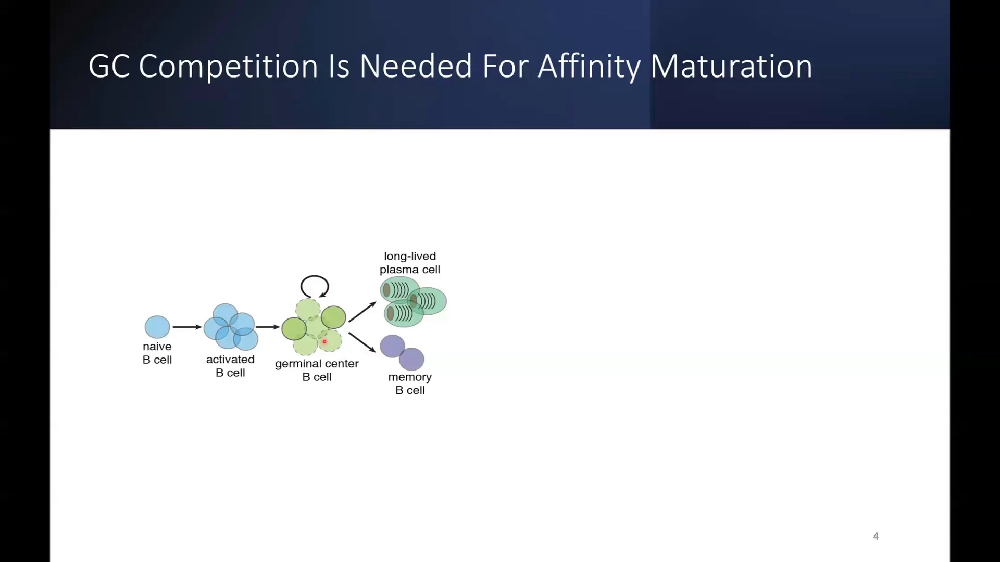

[【跳转到 06:38】](https://www.bilibili.com/video/BV1mS411K7zY/?t=398)

也就是说，GC 不是终点站，而是一个"加工车间"：进来的细胞先扩增、再突变，然后被筛选，最后有两条出口——长寿命浆细胞（负责持续分泌抗体）和记忆 B 细胞（负责下次更快应答）。这两条出口的细节属于 1.1.6 的内容，这里只需记住：**GC 的产出质量，决定了体液免疫的最终质量**。

### 1.2 限制因素是 Tfh 帮助

那么"筛选"具体是怎么发生的？讲者给了一句话的答案：**限制因素是来自 Tfh 细胞（滤泡辅助性 T 细胞）的帮助**。在筛选过程中，GC B 细胞只有拿到 Tfh 的帮助才能继续克隆扩增；拿不到帮助的细胞会自然死亡。

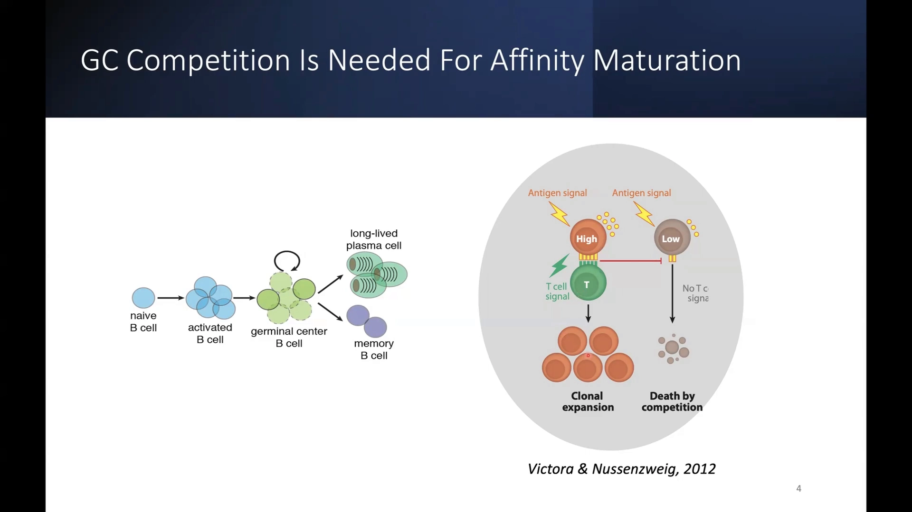

[【跳转到 07:08】](https://www.bilibili.com/video/BV1mS411K7zY/?t=428)

这张图（引自 Victora & Nussenzweig, 2012）是理解全场的钥匙。它把"亲和力"翻译成了两个可累积的信号：

- **抗原信号**：BCR 结合抗原、把抗原内吞处理后再呈递出去。亲和力越高，能抢到的抗原越多，表面呈递的肽-MHC 越多。
- **T 细胞信号**：Tfh 细胞识别到足够多的肽-MHC，才给出帮助（接触信号 + 细胞因子）。

两个信号叠加，高亲和力细胞就进入"克隆扩增"；只有一个信号、拿不到 T 细胞帮助的低亲和力细胞，则走向"竞争性死亡"。这就是"GC 竞争是亲和力成熟的驱动力"这一说法的由来。

### 1.3 这套模型解释不了一个悖论

麻烦在于：这套模型解释不了广谱中和抗体的来历。

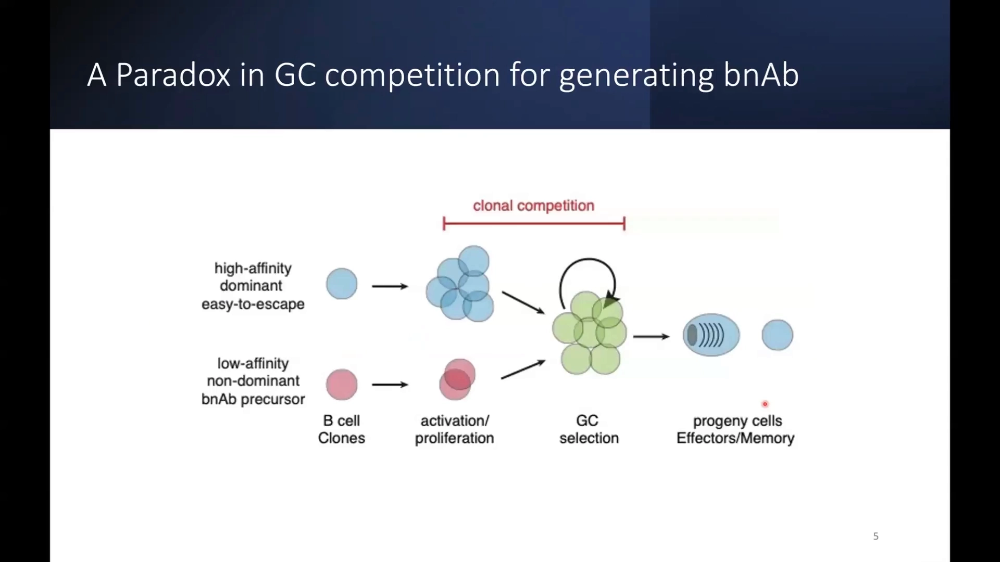

[【跳转到 07:33】](https://www.bilibili.com/video/BV1mS411K7zY/?t=453)

讲者把悖论拆成三步：

1. **抗病毒反应里的 bnAb 前体恰恰是低亲和力的**。序列分析显示，bnAb 需要大量体细胞高频突变才能长成；把突变还原回胚系，抗体就完全丧失中和能力，甚至连结合都做不到。
2. **识别显性表位的 B 细胞，数量更多、亲和力通常也更高**。所以在免疫应答中它们更容易被激活，能拿到最强的抗原信号和 Tfh 帮助，产生更多后代。
3. **低亲和力克隆拿到帮助的能力差**，在竞争中机会很小，会输给高亲和力 B 细胞。

一边说"低亲和力必输"，一边又观察到"低亲和力前体最终长成了 bnAb"。矛盾就在这里。

## 二、宽松模型：面对复杂抗原，竞争没那么激烈

### 2.1 低亲和力 B 细胞确实能进 GC

讲者指出，低亲和力 B 细胞能进入 GC，这一点十多年前就有工作清楚证明过（当时用的是加热处理的抗原），最近另一个实验室用天然蛋白抗原也报告了类似结果。

那怎么调和矛盾？几年前有实验室直接去测了 GC B 细胞的亲和力（例如对重组 rPA、rHA 的结合），结果发现**亲和力分布范围非常宽**——面对复杂抗原时，GC 里的竞争可能并没有那么激烈。其他小组在同一年也报告了类似结果。

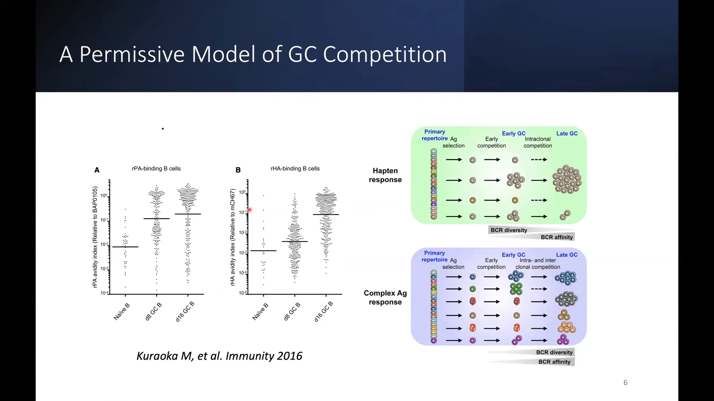

[【跳转到 09:13】](https://www.bilibili.com/video/BV1mS411K7zY/?t=553)

图中左右两半是两种抗原的对比：上半（绿色）是半抗原应答，早期竞争之后只剩少数几个克隆胜出，多样性被"收窄"；下半（紫色）是复杂抗原应答，多个克隆可以同时存活，**多样性被保留下来**。这就是"宽松模型"（permissive model）：当抗原是复杂抗原而不是半抗原时，GC 的竞争不那么严酷，低亲和力 B 细胞有机会在 GC 里待上一段时间。

### 2.2 宽松模型只是"快照"，没回答命运

讲者对宽松模型的评价很克制：它解释了"GC 里为什么会有低亲和力细胞"，但它只是一张快照——既没回答这些细胞从哪来，也没回答**它们在 GC 竞争中的最终命运**。而这正是本讲要补的那块。

## 三、为什么这个问题值得做：通用流感疫苗的"茎部困境"

讲者特意解释了现实动机，这段对理解"竞争"的实际意义很有帮助。

流感病毒表面的血凝素（HA）分头部和茎部。头部免疫原性强、变化快；茎部变化小，是"通用疫苗"的理想靶点。但问题是：

- **茎部是"穷"表位**：能结合茎部的 B 细胞更少，所以免疫原性差；
- **头部是免疫显性区域**：它把大多数 B 细胞都吸引走了；
- **针对茎部的 B 细胞亲和力一般偏低**——正好是竞争中最吃亏的那一类。

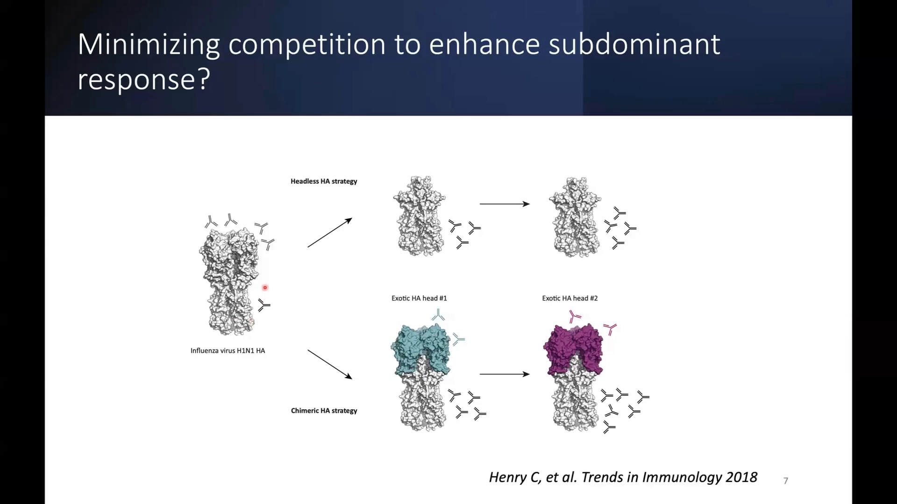

[【跳转到 11:18】](https://www.bilibili.com/video/BV1mS411K7zY/?t=678)

于是有了两种主流策略：**无头 HA**（把头部去掉，逼免疫系统看茎部）和**嵌合 HA**（换上异源头部，让头部不再是"老朋友"）。两者都是"尽量减少竞争造成的抑制"。

但讲者紧接着泼了一盆冷水：**最近一项采用后一种策略的临床试验，并没能证明"消除竞争"就自动能提高那些"输家"的应答**。这说明我们对竞争机制的理解还不够——如果竞争不只是"压制"，那简单地"取消竞争"当然不一定有效。这就是他决定从机制入手的原因。

## 四、实验系统：用 Qβ-VLP 当"病毒替身"

### 4.1 为什么不用真病毒

要研究抗病毒反应，讲者的实验室却没有直接用病毒，而是用了一种重组的 **Qβ 病毒样颗粒（Qβ-VLP）**。理由很实在：真实感染里变量太多，结果很难解释。VLP 则是一个受控的"病毒替身"。

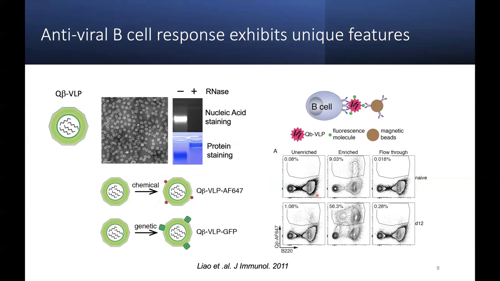

[【跳转到 13:08】](https://www.bilibili.com/video/BV1mS411K7zY/?t=788)

它"像病毒"的地方有三点：**颗粒状**（而不是可溶的单个蛋白分子）、**形状规整**、**表面密集重复地排列着表位**。此外它内部还包裹 RNA，可以模拟病毒的基因组物质（电镜和核酸染色都能证明）。对免疫系统来说，"颗粒 + 重复表位 + 核酸"正是病毒的典型特征。

### 4.2 可改造，所以能当研究工具

VLP 的另一个好处是可以方便地改造表面，于是变成了一套工具箱：

- **荧光标记**：让 VLP 带上荧光，就能精确"点名"抗原特异性 B 细胞；
- **磁珠富集**：把 VLP 包被在磁珠上，就能把抗原特异性 B 细胞富集出来做详细分析。

这套工具此前已经发表（Liao et al., J Immunol 2011）。图中右侧的流式图很直观：在未免疫（naive）小鼠里，Qβ 特异性的 B 细胞只占 0.08%，磁珠富集后升到 9.03%；免疫后第 12 天，这个比例从 1.08% 富集到 56.3%。

### 4.3 一个意外的观察：GC 反应特别持久

用这套系统，讲者实验室注意到一个有意思的现象：**Qβ-VLP 免疫能诱导出持续时间很长的 GC 反应**，这是常规蛋白抗原加佐剂免疫看不到的。

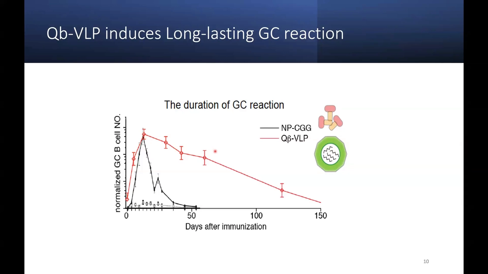

[【跳转到 15:07】](https://www.bilibili.com/video/BV1mS411K7zY/?t=907)

讲者补充说明：持久的 GC 反应在病毒感染中很常见，但在接种疫苗时并不常见。这个现象让他觉得耐人寻味——GC 的功能被认为是制造高亲和力抗体，如果 GC 能在短时间内对普通蛋白抗原造出高亲和力抗体，**那为什么对病毒要花那么长时间？** 这里面一定有什么东西。

## 五、低亲和力 B 细胞能进 GC，但起步吃亏

### 5.1 用"去除高亲和力细胞"的办法造出低亲和力组分

要研究低亲和力 B 细胞，最直接的办法是**把高亲和力的那部分去掉**。讲者的做法是基于磁珠富集：用 VLP 包被磁珠，能结合的抗原特异性 B 细胞被富集走，结合不上、被"流过去"的细胞（低亲和力部分）被收集起来，转移到新的宿主体内。这些细胞可以通过同源标记（congenic marker）与宿主细胞区分。

这个方法与以往用高亲和力或低亲和力 BCR **转基因** B 细胞的研究不同：它用的是多克隆细胞群，更接近生理状态。

### 5.2 低亲和力细胞能启动 GC，但浆细胞少

第一个结果：两个细胞组分都能启动 GC 反应。不过被去除高亲和力细胞后的"depleted"组分产生的**浆细胞更少**。

讲者的判断是：这并不奇怪，因为 depleted 组分并没有"启动 GC 反应"的内在缺陷，它只是确实不太能分化成浆细胞。

### 5.3 关键对照：去掉 Aicda 之后，GC 反应塌了

这里有个隐患：depleted 转移中的 GC 反应，会不会只是因为一开始亲和力就太低、后面靠突变补上来的？为了验证，他们从 **Aicda 缺陷（Aicda-/-）小鼠**身上转移细胞——Aicda 是体细胞高频突变的关键基因，没有它就不能突变。

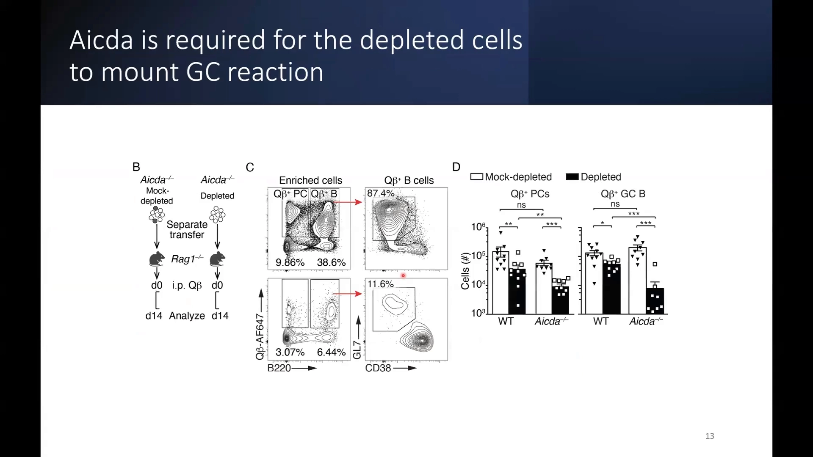

[【跳转到 16:55】](https://www.bilibili.com/video/BV1mS411K7zY/?t=1015)

结果很干脆：Aicda 缺陷的 depleted 细胞产生的 GC 反应**大幅减少，掉了十几倍**。这反过来说明：depleted 转移实验里的 GC 反应，很大程度上依赖低亲和力 B 细胞在这个过程中**通过突变获得亲和力**——低亲和力不是"不能进"，而是"必须靠突变才站得住"。

### 5.4 混合转移：低亲和力细胞反而受益

接下来的实验是全场最反直觉的一步：把高亲和力和低亲和力的细胞**混在一起**，在同一个宿主体内观察反应。讲者说他当时还向学生"挑战"，因为他预测低亲和力细胞会输。

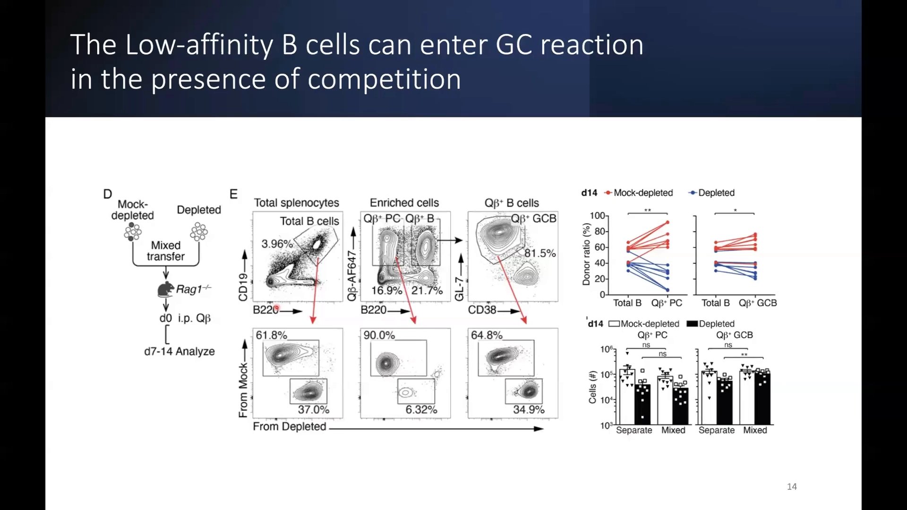

[【跳转到 18:10】](https://www.bilibili.com/video/BV1mS411K7zY/?t=1090)

事实恰恰相反：低亲和力细胞进入 GC 反应没有问题（虽然产生的浆细胞少一些）；定量来看，**混合转移条件下的 GC B 细胞数量显著增加**，比分开转移要多。也就是说，低亲和力细胞其实从竞争中获益。

### 5.5 动力学：先落后，后追平

刘灿（Liu Can）进一步研究了反应动力学：**早期** depleted 组分对 GC 的贡献低得多；后来它们逐渐在 GC 中占到了一席之地，到后期两个组分对 GC 反应的贡献大致相当。

[【跳转到 18:35】](https://www.bilibili.com/video/BV1mS411K7zY/?t=1115)

把 5.4 和 5.5 合起来看，低亲和力 B 细胞的处境是：**起步吃亏，但不会被清场**。建模分析还提示，在持续时间较长的 GC 反应中，低亲和力细胞可能起更大作用。

为什么会这样？讲者给出一个假设：高亲和力和低亲和力细胞**其实并没有真正在竞争**——正如宽松模型所提示的，它们可能识别的是不同的表位。要验证这一点，就得去看结构。

## 六、为什么竞争没那么狠：同一个表位 + 多价结合

### 6.1 结构上只有一个显性表位

讲者与生物物理研究所朱平（Zhu Ping）教授合作（包柯延 Bao Keyan 为博士后），从分选的 GC B 细胞出发，解析了抗体与 Qβ-VLP 复合物的结构。VLP 由 180 个单体组成，单体有三个略有差异的构象、两两形成二聚体，其中 βA-βB 环突出在颗粒表面。

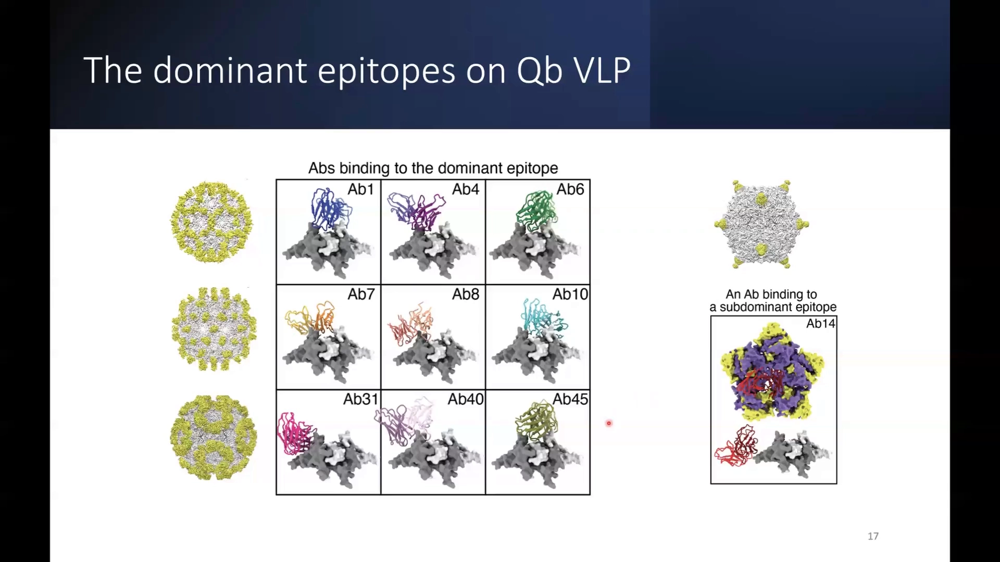

[【跳转到 20:45】](https://www.bilibili.com/video/BV1mS411K7zY/?t=1245)

他们拿到二十多个高分辨率结构。由于颗粒高度对称，抗体结合的模式看起来有规律，但仔细检查会发现：**大多数抗体结合在突出的环（loop）上，也就是显性表位**；只有个别抗体（如 Ab14）结合在环区之外、靠近五重轴的位置，属于亚显性表位。

更关键的是：解析的十个结构里有五个来自**低亲和力来源**的 GC B 细胞，它们**全都结合到同一个显性环上**。所以"识别不同表位"这个解释不成立——高亲和力和低亲和力细胞识别的是同一个表位。那竞争为什么不激烈？

### 6.2 真亲和力 vs 多价结合 vs 竞争 IC50

答案指向"多价结合"。讲者用三种测法把"结合"拆开：

1. **真亲和力**：把 VLP 固定在表面上、相当于拆成单体，用抗体去结合，测单价相互作用的强度；
2. **多价结合**：让抗体与溶液中的完整 VLP 结合，测的是多价相互作用的强度；
3. **竞争 IC50**：用无标记方法让抗体去竞争荧光标记的 VLP，在稳态条件下计算。

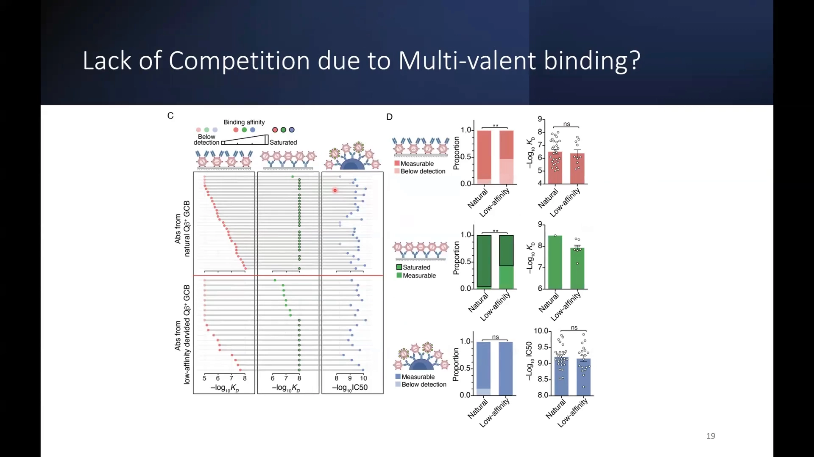

[【跳转到 21:56】](https://www.bilibili.com/video/BV1mS411K7zY/?t=1316)

结果非常清楚：许多来自低亲和力来源的抗体，在"真亲和力"这一项上**低于检测限**——这与它们亲和力很低是一致的；但换到多价结合的测量里，它们的信号和其他抗体一样**饱和**了。也就是说，在细胞表面测试时，所有这些抗体都能结合 VLP，两组之间在多价结合和竞争 IC50 上都**没有显著差异**。

这就是"竞争不激烈"的分子解释：**VLP 表面重复排列的表位，让一个抗体分子可以用两个臂同时抓住颗粒，多价结合把单价的亲和力差距"抹平"了**。讲者也提醒，他们是从低亲和力来源里挑出"能结合荧光"的抗体来做分析的，所以真实的结合亲和力可能更低——差距只会更大，不会更小。

### 6.3 亲和力成熟的时间尺度：前两周最快，之后还在继续

既然表观亲和力被多价结合"抹平"了，那亲和力成熟还能不能测出来？讲者改用"真亲和力"逐时间点测：

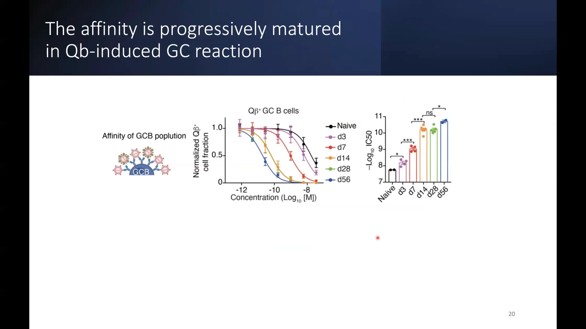

[【跳转到 24:51】](https://www.bilibili.com/video/BV1mS411K7zY/?t=1491)

结论有两条：

- **最大的变化发生在前两周**，之后曲线看起来变慢了；
- 但"变慢"不等于"停止"。到第四周、第八周，亲和力仍在上升；在最后一个时间点，他们观察到比预期更高的亲和力（大约高两倍、四倍）。虽然统计上并不显著（因为分布比较分散），但趋势说明：**针对多价抗原的免疫反应，亲和力成熟会持续很久**。

这一点和 4.3 的"持久 GC"对上了：GC 持续时间长，亲和力成熟的时间窗口也就长。

## 七、竞争到底在选什么：不能继续突变，就会被淘汰

前面 5.3 证明了低亲和力 B 细胞"需要突变才能起步"。那反过来问：**如果 B 细胞能起步、但不能再继续突变，会怎样？**

讲者检查了 Aicda 缺陷小鼠。有意思的是，即使不能发生体细胞高频突变，它们启动 GC 完全没有问题，**GC 反应甚至比野生型小鼠还强**——因为少了"筛选"这道关卡，细胞只扩增不被淘汰。

但测亲和力时，Aicda 缺陷小鼠的亲和力明显落后于野生型（免疫后两周）。这是预期之中的。

真正有趣的是**竞争实验**：把野生型和 Aicda 缺陷细胞一起做骨髓嵌合（mixed bone marrow chimera）后免疫。

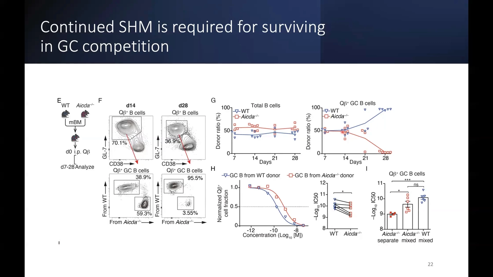

[【跳转到 27:21】](https://www.bilibili.com/video/BV1mS411K7zY/?t=1641)

- 第 14 天，两个供体的贡献大致相当，Aicda 缺陷供体甚至占到 59.3%；
- 到第 28 天，Aicda 缺陷供体只剩 3.55%，几乎完全消失；
- 在竞争条件下，Aicda 缺陷细胞的亲和力也升不上去。

讲者的解释是：这**不是超突变本身的贡献，而是"选择高亲和力 B 细胞"的竞争在起作用**。Aicda 缺陷细胞一开始能靠胚系里已经比较高的亲和力被选中，但后来它们不能继续突变、无法跟上队伍，就被淘汰了。换句话说，**竞争筛选的是"持续变好的能力"，而不只是"当下的亲和力"**。

## 八、竞争反而加速低亲和力细胞的成熟

到这里还差最后一环：竞争对低亲和力细胞到底是"压制"还是"促进"？

讲者改造了基于竞争的检测：用固定浓度的 VLP 去"封堵"大约 50% 的荧光信号。**封堵率越高，说明抗体亲和力越高**——亲和力高的抗体能抢走更多 VLP，把荧光信号挡下来。

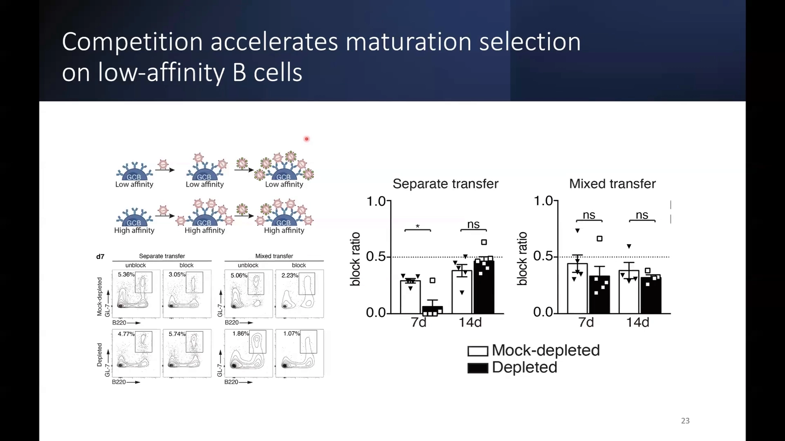

[【跳转到 29:01】](https://www.bilibili.com/video/BV1mS411K7zY/?t=1741)

结果很关键：

- **单独转移**：第 7 天，低亲和力（depleted）细胞的封堵率明显低于对照，虽然后来它们赶上来了；
- **混合转移**：第 7 天，低亲和力细胞的封堵率就已经接近对照水平，也就是说亲和力很快就升上来了。

所以结论是：**高亲和力竞争者的存在，实际上加速了低亲和力 B 细胞的亲和力成熟**。竞争在这里不是"压制弱者"，而是"逼着弱者快点变强"。

讲者把这一部分总结为一句话：在模拟病毒的抗原作用下，低亲和力 B 细胞可以被动员进 GC 反应；据他们所知，这是第一次证明 GC 竞争可以被"感知"到（也就是竞争强度本身会影响成熟速度）。

## 九、功能富集：从"亲和力"到"抗变异广度"

### 9.1 动员更多 B 细胞有什么好处

讲者把问题推进到功能层面：动员更多 B 细胞参与 GC 反应，对防护病毒感染有没有好处？

他们利用前面的结构信息，挑出 VLP 表面与抗体接触的关键位点，做了一系列**突变体 VLP**（相当于"病毒变异株"的替身），然后测试抗体还能不能结合。

结果符合预期：当一个或多个接触残基被突变掉时，有些抗体完全丧失结合能力，有些只受部分影响。但也有一些惊喜——**有些抗体能结合所有突变体**。

### 9.2 把"能打所有变异株"的抗体定义为 VP 抗体

他们按结合各种突变体的能力给抗体分类，把**几乎能结合所有突变体的抗体定义为"抗变异"抗体（variant-proof，VP）**。

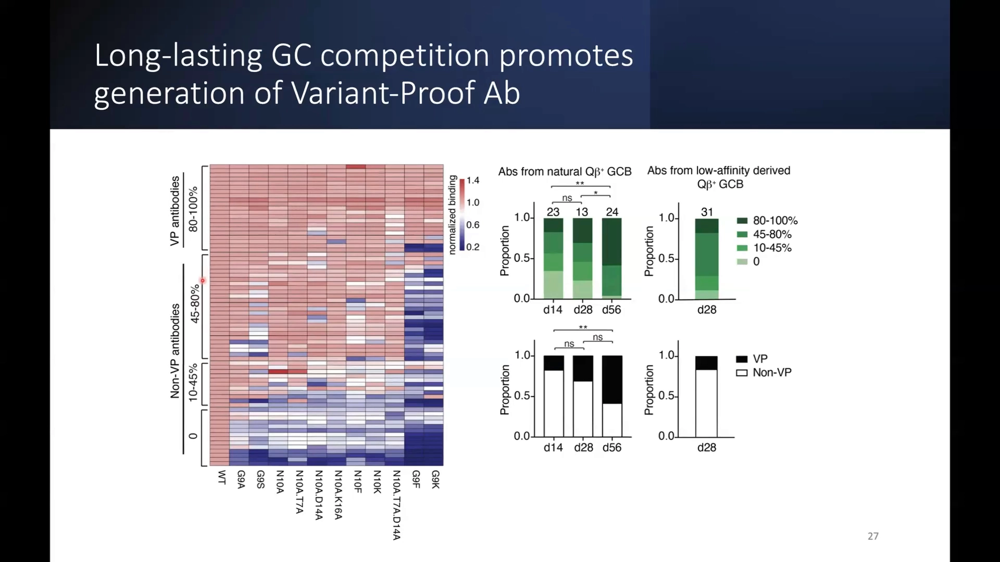

[【跳转到 32:01】](https://www.bilibili.com/video/BV1mS411K7zY/?t=1921)

数据是：免疫后只有不到 20% 的 GC B 细胞产生 VP 抗体，但到**第八周超过 50%**。而且**低亲和力来源的细胞也贡献了 VP 抗体**——比如第 28 天，许多低亲和力来源的 GC B 细胞产生的抗体能结合相当一部分突变体。

这正好把前面几章串起来了：低亲和力细胞被动员进来 → 在竞争压力下加速成熟 → 最终贡献了抗变异广度。讲者说还需要更多数据做对比，但趋势支持这个结论：**动员更多 B 细胞参与 GC 反应是非常有益的，尤其是对病毒的免疫反应**。

### 9.3 机制：抗体结合是"灵活"的

最后他们分析了结合的机理。长话短说：VP 抗体与 VLP 的结合很"灵活"——当某个氨基酸被改变时，抗体可以调整构象，在真实世界里采用一种新的结合方式。

这解释了一个现象：一些病毒的可变区域确实能躲开抗体，但**它们可能在 GC 反应中被"追平"**——抗体不是死守一种结合姿势，而是能换一种姿势继续抓住抗原。

## 十、修订后的模型：竞争与多样性共存

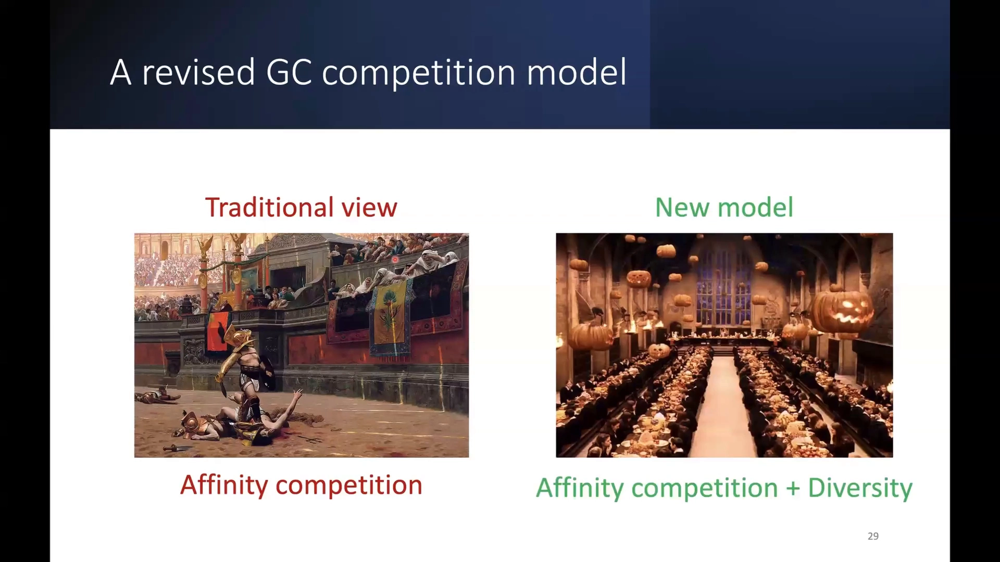

[【跳转到 33:58】](https://www.bilibili.com/video/BV1mS411K7zY/?t=2038)

讲者用两张图收尾：传统观点把 GC 画成角斗场——每个细胞都在为生存而战，只有最强的一个活下来；新模型则把它画成一场长桌宴——**竞争依然存在，但多样性也能共存**。

他因此主张：**教科书里现行的 GC 竞争模型应该修订**。与其把 GC 想象成"每个细胞都在为生存而战"的场所，它也可以是一个"竞争与多样性共存"的环境。这是免疫系统一种很有价值的适应，也是一个可以利用的机制——用来设计更有效的抗病毒疫苗（流感、HIV）。

讲者给出的两条 take-home message 是：

1. **GC 竞争增强了低亲和力 B 细胞的参与，促进了抗变异（VP）抗体的产生**；
2. **靶向 B 细胞的 TLR 信号和抗原呈递，可以"压过" GC 诱导的抗体免疫显性**——他们提供了第一个例子，说明免疫显性并非不可打破。

## 小结

- **教科书模型**：GC 里 B 细胞大量增殖 + 体细胞高频突变，靠"抗原信号 + Tfh 帮助"筛选；亲和力高者扩增，拿不到帮助者凋亡。
- **悖论**：广谱中和抗体的前体是低亲和力的，按上述模型本该第一轮就被淘汰。
- **宽松模型**：面对复杂抗原，GC 里 GC B 细胞的亲和力分布很宽，竞争没有半抗原那么严酷，低亲和力细胞能停留。
- **低亲和力细胞能进 GC，但起步吃亏**：它们能启动 GC 反应、浆细胞偏少；去掉 Aicda 后 GC 反应塌掉十几倍，说明它们必须靠突变才站得住。
- **混合转移中低亲和力细胞反而受益**：早期贡献低，后期追平；建模提示长 GC 反应中它们作用更大。
- **竞争不狠的分子原因**：VLP 只有一个显性表位（高、低亲和力抗体结合同一处），但表面重复表位带来多价结合，把单价亲和力差距抹平——真亲和力低于检测限的抗体，在多价结合和竞争 IC50 上与对照无差异。
- **时间尺度**：亲和力成熟前两周最快，之后仍在继续（4 周、8 周仍在升），与"持久 GC"一致。
- **竞争选的是"持续变好的能力"**：不能继续突变的 Aicda 缺陷细胞，第 14 天还占 59.3%，第 28 天只剩 3.55%。
- **竞争加速低亲和力细胞成熟**：混合转移中，低亲和力细胞的亲和力在第 7 天就追上了单独转移时第 14 天才有的水平。
- **功能富集**：抗变异（VP）抗体比例从不到 20%（早期）升到超过 50%（第 8 周），低亲和力来源细胞也有贡献；机制是抗体结合构象灵活，能换姿势抓住变异抗原。
- **模型修订**：GC 不是纯粹的角斗场，而是"竞争 + 多样性"共存；这为通用疫苗设计提供了新思路。

## 关键术语速查

| 术语 | 一句话解释 |
| --- | --- |
| 生发中心（GC） | B 细胞在淋巴滤泡内形成的临时结构，B 细胞在此增殖、突变并被筛选 |
| 亲和力成熟 | 抗体与抗原的结合强度随免疫应答推进而逐步提高的过程 |
| 体细胞高频突变（SHM） | GC 中 B 细胞免疫球蛋白基因以极高频率产生点突变，由 AID（基因 Aicda）启动 |
| Tfh 细胞 | 滤泡辅助性 T 细胞，向 GC B 细胞提供存活与扩增所需的帮助信号 |
| 免疫显性 | 同一抗原上某些表位压过其他表位、主导抗体应答的现象 |
| 广谱中和抗体（bnAb） | 能中和多种病毒变异株的抗体，其胚系前体往往亲和力极低 |
| 宽松模型（permissive model） | 面对复杂抗原时 GC 竞争较不严酷、低亲和力 B 细胞也可停留的模型 |
| 病毒样颗粒（VLP） | 由病毒结构蛋白自组装成的空心颗粒，表面表位密集重复，免疫原性强但内部无完整基因组 |
| 亲和力 vs 亲合力 | 单个结合位点与表位的结合强度 vs 多个位点同时结合带来的总结合强度（多价效应） |
| 抗变异抗体（VP） | 本讲定义的、能结合所测全部 VLP 突变体的抗体，代表抗体应答的广度 |
| Aicda | 编码 AID 的基因；敲除后 B 细胞不能发生体细胞高频突变 |